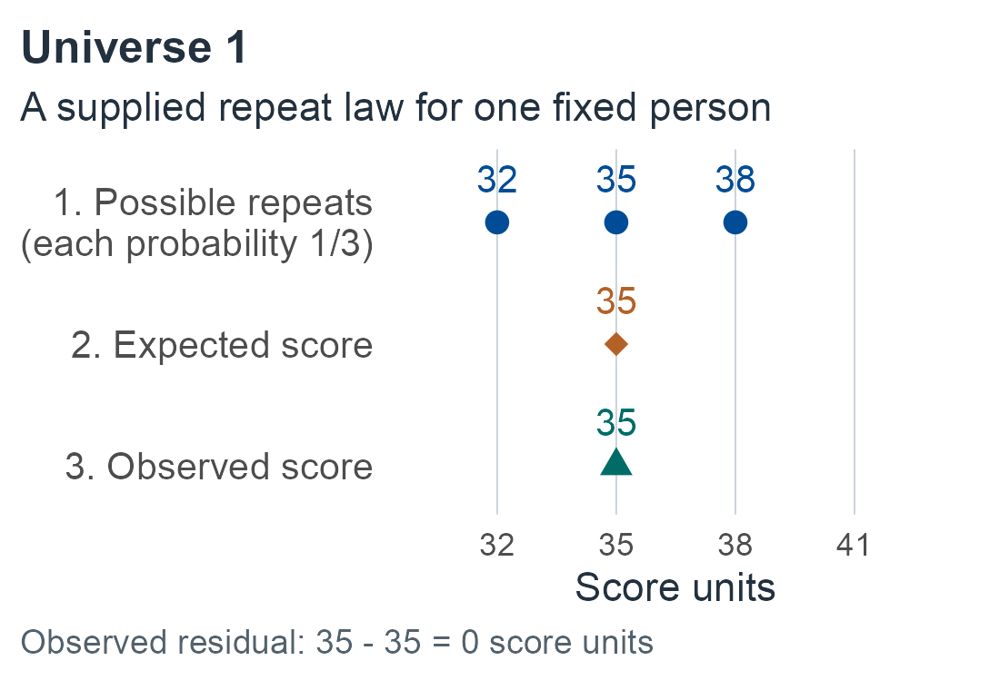
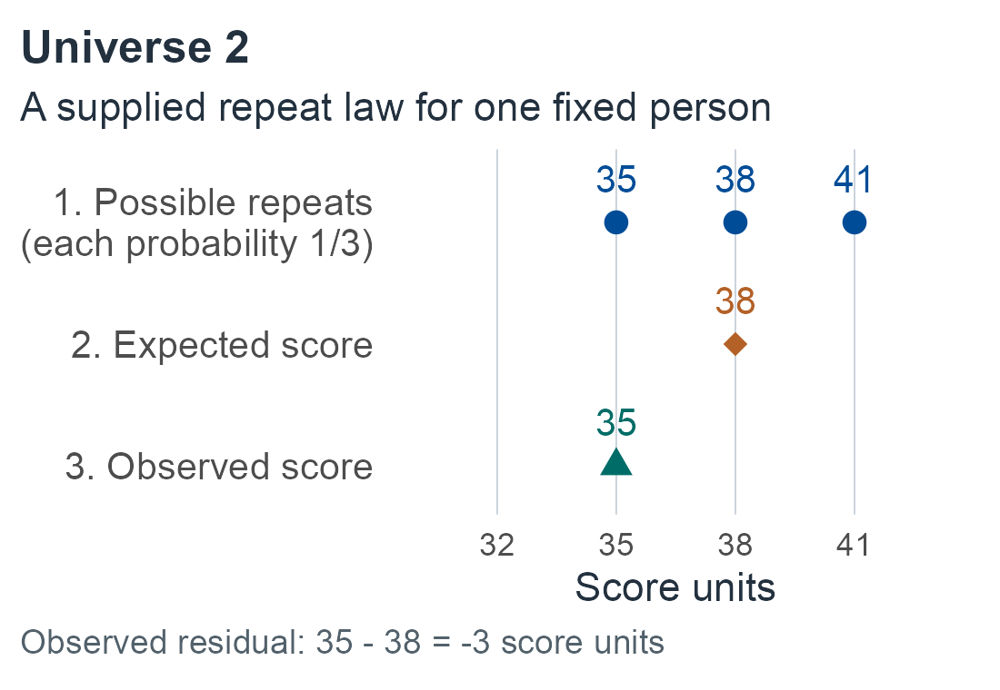

# The interpretation problem {#sec-interpretation}

```{=html}
<style>
.m00-page #quarto-content > *, .m00-page main.content { min-width: 0; }
.m00-scroll { max-width: 100%; min-width: 0; overflow-x: auto; }
.m00-scroll table { min-width: 34rem; }
.m00-scroll .math.display { overflow: visible; }
.m00-scroll mjx-container[display="true"] { max-width: none; width: max-content; min-width: 100%; overflow: visible; }
.m00-scroll:focus-visible, .m00-page .math.inline:focus-visible { outline: 3px solid var(--book-focus); outline-offset: 3px; }
.m00-page .math.inline { display: inline-block; max-width: 100%; overflow-x: auto; overflow-y: hidden; vertical-align: middle; padding-block: .1em; }
.m00-figure-panels { display: grid; gap: .6rem; }
.m00-figure-panels p { margin: 0; }
.m00-figure-panels img { width: 100%; height: auto; }
</style>
<script>
document.body.classList.add('m00-page');
(function () {
  function markOverflow() {
    document.querySelectorAll('main .math.inline').forEach(function (element) {
      if (element.scrollWidth > element.clientWidth + 2) {
        element.tabIndex = 0;
        element.setAttribute('role', 'group');
        element.setAttribute('aria-label', 'Long mathematical expression; scroll horizontally');
      } else {
        element.removeAttribute('tabindex');
        element.removeAttribute('role');
        element.removeAttribute('aria-label');
      }
    });
  }
  function start() {
    function settle() { requestAnimationFrame(function () { requestAnimationFrame(markOverflow); }); }
    function ready() {
      if (window.MathJax && MathJax.startup && MathJax.startup.promise) MathJax.startup.promise.then(settle);
      else setTimeout(ready, 150);
    }
    ready();
    if (document.fonts) document.fonts.ready.then(settle);
    window.addEventListener('resize', settle);
    new MutationObserver(settle).observe(document.documentElement, { attributes: true, attributeFilter: ['style'] });
  }
  if (document.readyState === 'loading') document.addEventListener('DOMContentLoaded', start, { once: true });
  else start();
}());
</script>
```

## Begin with a question

A neuropsychological assessment produces observations under particular conditions: item responses, completion times, recalled material, errors, ratings, and other behaviors. Scoring rules turn these observations into performances. Norms place performances relative to a specified comparison population. Summaries select features of the resulting profile.

An interpretation makes a further claim. A low percentile describes a reference comparison. An estimate of underlying ability requires a measurement model. A probability of disease requires a relationship between observations and a clinical target. A recommendation also requires consequences and alternatives.

The purpose of this book is to make those steps explicit and mathematically connected.

## Six related questions {#sec-six-questions}

:::: {.m00-scroll role="group" tabindex="0" aria-label="Interpretation questions table; scroll horizontally"}

| Question | Target | Information needed beyond the observed score |
|---|---|---|
| [How unusual is the performance?](01-one-performance.md#sec-m01-question) | A reference percentile or event probability | Reference population, sampling design, and joint distribution where relevant |
| [What is the underlying ability or state?](05-measurement-and-replication.md#sec-m05-question) | A latent attribute or expected performance | Measurement model, replication conditions, and identifying information |
| [Is the discrepancy unusual?](03-correlated-battery.md#sec-m03-question) | A contrast or conditional departure | Cross-score dependence and the precise difference being interpreted |
| [Has the person changed?](08-change.md#sec-m08-question) | Personal change or deviation from expected retest performance | Baseline information, retest distribution, practice and form effects |
| [What clinical outcome does the pattern predict?](11-clinical-targets-and-decisions.md#sec-m11-question) | Diagnostic, pathological, functional, or prognostic target | Target-specific data and validation in the intended population |
| [What should be done next?](11-clinical-targets-and-decisions.md#sec-m11-decisions) | Preferred action or further measurement | Consequences, preferences, costs, and feasible alternatives |

::::

These questions can be asked about the same person and battery. They do not have to give concordant answers. A person can decline from a high baseline while remaining ordinary relative to peers. A rare profile can arise for several reasons. A common limitation can still matter for daily functioning.

A named statistic should enter the argument after the question and target are defined.

For first reading, continue in chapter order. For consultation, use the [reading paths](../index.qmd#reading-paths) and each destination's assumptions.

## The interpretation contract {#sec-interpretation-contract}

Before deriving a method, specify:

1. **The claim:** what is to be estimated, tested, predicted, or decided?
2. **The observations:** which responses, scores, covariates, and occasions are available?
3. **The comparison:** which population and which sampling or administration process are relevant?
4. **The measurement:** what is intended to remain stable, and what variation counts as error?
5. **The model:** which measurement and distributional assumptions are being used?
6. **The uncertainty:** which parameters, transformations, or individual attributes are unknown?
7. **The guarantee:** what does the interval, probability, error rate, or decision rule mean?
8. **The boundary:** which stronger clinical claims require additional data or evidence?

This contract will accompany the methods developed in later chapters. It prevents a precise answer to one question from silently becoming an answer to another.

An interpretation-and-use argument is supported by evidence for its constituent steps; justification of a score interpretation does not automatically justify every use [@kane2013interpretations].

::: {.book-example #sec-m00-worked-contract}

**The contract in use.** In a synthetic example, a person scores 35, with higher scores indicating better performance. **Claim:** the fraction of intended peers scoring 35 or lower. **Observations:** this single score and its administration/scoring protocol; no repeats or clinical outcomes.

**Comparison:** intended peers under compatible administration and scoring. **Measurement:** one observed performance, without an identified replication or model for latent ability. **Model:** the peer distribution is supplied as a teaching benchmark; include scores equal to 35.

**Uncertainty:** no reference parameters are estimated here; the person's expected repeat performance, latent state and clinical outcome remain unspecified. **Guarantee:** the resulting probability describes the declared peer event under that law; no confidence coverage is asserted. **Boundary:** it supplies no disease probability, conclusion about latent deficit or treatment recommendation.

**Change the question.** Does that peer distribution also tell us what this person would score on a repeat? No. We need declared repeat conditions and measurement information relating this person's performances across repeats ([Measurement and replication](05-measurement-and-replication.md#sec-m05-question)). An expected repeat score differs from the next realization and from latent ability.

:::

## A score has several possible meanings

The [notation appendix](../appendices/notation.md#sec-notation) collects these symbols.

Let $U$ denote recorded responses and $A$ the administration conditions. A scoring rule produces a performance $Y=s(U,A)$. A reference-dependent transformation can then produce a reported score,

:::: {.m00-scroll role="group" tabindex="0" aria-label="Normed score transformation; scroll horizontally"}

$$
Z=g(Y,C;\mathcal D_{\mathrm{ref}}),
$$ {#eq-normed-score}

::::

where $C$ denotes measured context or background and $\mathcal D_{\mathrm{ref}}$ the reference data.

An underlying ability or state is a different object. Denote it by $H$. A measurement model specifies how observations depend on $H$ and other relevant features. A norm transformation alone does not identify that relationship.

Assume performance has a finite absolute expectation under the declared replications. For a declared replication universe $\mathcal M$, a classical expected score can be written as $\tau_{\mathcal M}(i)=E_{\mathcal M}(Y_i\mid i)$ for person $i$. Hold the person fixed and average performance over the conditions varied by that universe. Defining the residual gives

:::: {.m00-scroll role="group" tabindex="0" aria-label="Expected performance and residual; scroll horizontally"}

$$
Y_i=\tau_{\mathcal M}(i)+E_{\mathcal M,i}.
$$ {#eq-score-decomposition}

::::

This construction depends on what is replicated. It does not alone assert Gaussian errors, constant error variance, or independent errors across tests. These distinctions are fundamental to classical test theory [@novick1966axioms].

The replication choice in @fig-m00-replication-universe is explicit: both laws are supplied for one fixed synthetic person. They are not learned from the single observed score or pooled across different people.

::: {#fig-m00-replication-universe fig-alt="Two supplied repeat universes give different expected scores for the same observed performance; labeled rows distinguish possible repeats, their average and the single observation."}

::: {.m00-figure-panels}

<p><a href="figures/m00-replication-1.png" aria-label="Open full-size repeat-universe panel 1"></a></p>

<p><a href="figures/m00-replication-2.png" aria-label="Open full-size repeat-universe panel 2"></a></p>

:::

The same observed score under two declared replication universes. Each of the three possible scores has probability 1/3. Expected performance is 35 in Universe 1 and 38 in Universe 2; the observed score stays 35, so its residual is 0 or -3. Rows separate kinds of quantity, not occasions. These supplied laws are synthetic and identify no latent ability or diagnosis.

:::

An operational composite, latent factor estimate, copula coordinate, and peer-relative score can each be useful. Their numerical similarity does not establish an identical interpretation.

## Separate the uncertainties

A small reference sample leaves uncertainty about population means, covariances, and percentiles. A noisy test leaves uncertainty about an individual's underlying state. A future assessment adds uncertainty about repeated performance. A diagnostic inference adds uncertainty about a separate clinical target.

These uncertainties can enter the same calculation, but they should remain identifiable in the derivation. Existing single-case work already provides important frequentist and Bayesian treatments of reference uncertainty [@crawford2007singlecase].

Consequently, the following are distinct outputs:

- A confidence interval for a reference-population quantity.
- A sampling interval or procedure concerning an individual's fixed measurement target.
- A predictive distribution for a new or repeated performance.
- A posterior distribution for an underlying attribute.
- A posterior probability or calibrated prediction for a clinical outcome.

Each chapter states the relevant target and conditioning.

## A shared model with several branches

The common framework consists of a population distribution, an observation model, scoring and norming operations, summaries, and inferential targets. Classical test theory averages over declared replications. Generalizability theory examines observation facets. Factor analysis and structural equation modeling (SEM) represent latent structure. Item response theory (IRT) models item-response probabilities.

These perspectives have mathematical bridges, including variance-component representations and categorical latent-variable models [@gleser1965generalizability; @chen2025irt]. Their interpretations depend on the design and assumptions used to establish each bridge.

Gaussian models provide a tractable starting point for joint profiles, projections, and predictive laws. Later branches will examine bounds, discreteness, nonnormal dependence, heterogeneous populations, changing measurement, and informative administration. A more elaborate model will be introduced when it resolves a defined limitation.

## The next step

The [next chapter](01-one-performance.md) begins with reference rarity for one observed performance. It will distinguish continuous and discrete scores and define the event whose probability is being reported. Measurement of an underlying ability and inference about disease will then require explicit additional developments.

