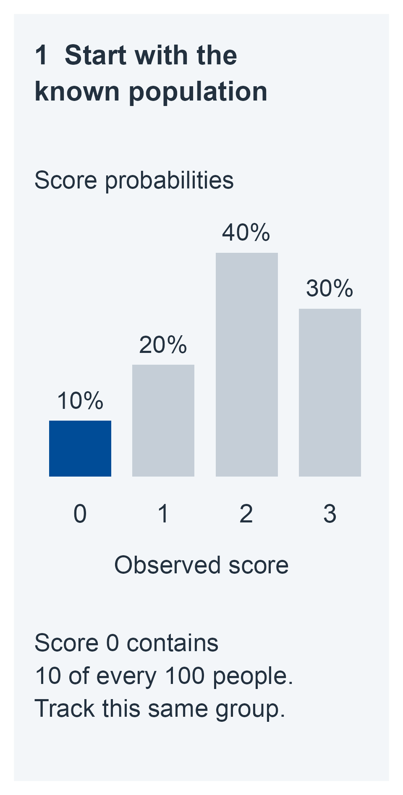
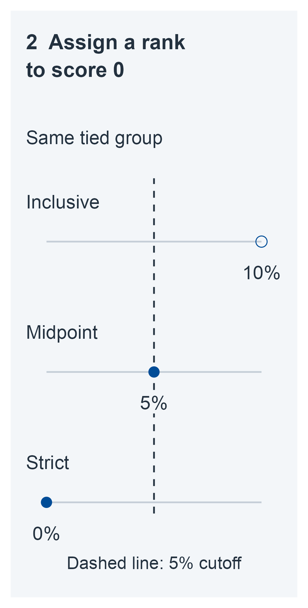
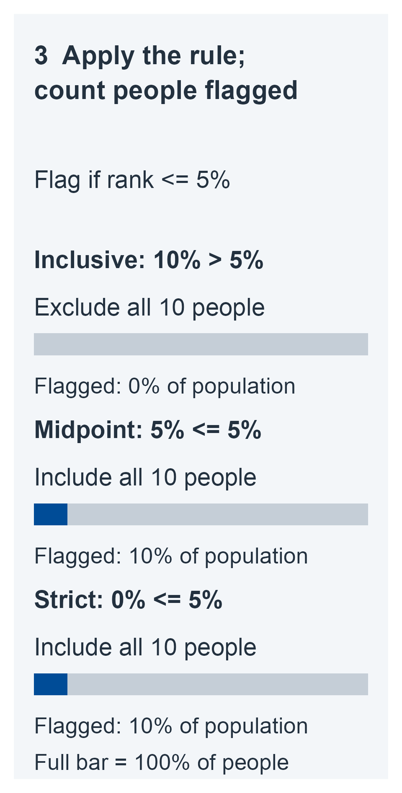

# One observed performance {#sec-one-performance}

## The comparison comes first {#sec-m01-question}

A person obtains a score of 35 on a test, and the score is described as low. That word already contains a comparison: low in which direction, relative to whom, and counted how? Before the number can carry that meaning, we need to know the score's direction, the intended peers, the administration and scoring conditions, and the comparison being made. If higher scores indicate better performance, one useful question is: *What proportion of the intended reference population would obtain a score this low or lower?* If the score records errors, the relevant direction might instead be upward.

This chapter answers that reference question, and only that question, in three steps. First, we treat the reference distribution as known and ask what proportion of it falls in a declared event; this is where continuous scores and scores with ties part ways. Second, we ask which reported proportions survive when a score is relabeled on another scale or merged into coarser categories. Third, we stop assuming that the proportion is supplied and estimate the frequency of a fixed event from independent reference persons, once with a frequentist confidence procedure and once with a Bayesian posterior. By the end, a reader should be able to name the event behind a reported percentile, recognize when a tie convention changes it, and say what an interval for an estimated frequency does and does not guarantee.

Neither the known-law calculation nor the frequency experiment observes an underlying ability directly. Nor does either identify whether a particular person has a disease, has declined, or needs a particular intervention. The [closing interpretation](#sec-m01-interpretation) explains why those questions need different information.

To make the question precise, we need a little notation. Following the [interpretation contract](00-interpretation.md#sec-interpretation-contract), let $Y=s(U,A)$ be a scalar performance obtained by scoring responses $U$ under administration conditions $A$. Let $y_0$ be the observed case score. The reference law $P_{\mathrm{ref}}$ is the distribution of performances from persons in a specified population assessed under the declared protocol. It includes whatever variation that protocol produces. Informally, $P_{\mathrm{ref}}$ describes how the intended peers perform on this test when it is given and scored this way. Here the replication experiment samples different reference persons; it does not repeatedly assess the same patient.

Any background restrictions, such as an age stratum, are part of the declared comparison. If a conditional reference law is intended, the formulas below apply within the fixed conditioning stratum. Mixing strata answers a different population question. Selecting suitable peers is a substantive requirement; the probability calculations cannot establish that suitability.

## A distribution and an event {#sec-m01-events}

The reference cumulative distribution function (CDF) is

:::: {.m01-equation .overflow-auto tabindex="0" role="group" aria-label="Reference cumulative distribution"}

$$
F_{\mathrm{ref}}(y)=P_{\mathrm{ref}}(Y\leq y).
$$ {#eq-m01-cdf}

::::

For a fixed measurable set of scores $B$, define the event probability

:::: {.m01-equation .overflow-auto tabindex="0" role="group" aria-label="Fixed event probability"}

$$
\pi_B=P_{\mathrm{ref}}(Y\in B).
$$ {#eq-m01-event-probability}

::::

For example, $B=(-\infty,y_0]$ asks about a score at or below the case's performance; $B=[y_0,\infty)$ asks about a score at or above it. A fixed clinical rule may instead specify $B=(-\infty,c]$ for an externally chosen cutoff $c$. The cutoff and its clinical justification are separate from the frequency of crossing it.

Rarity therefore refers to a declared event, not just to a number. For a continuous score, the probability of *exactly* any particular value is zero, including values at the center of the distribution. That fact does not make every performance clinically unusual. A tail or another specified region supplies the comparison that a point probability lacks.

It helps to say exactly what is fixed and what is uncertain. In the known-law experiment, $F_{\mathrm{ref}}$ and the rule $B$ are supplied, and $y_0$ is held fixed for the calculation. There is no unknown reference parameter to estimate. A Bayesian analysis supplied with exactly this same known law gives the same event probability; a prior is needed only when an unknown quantity is introduced. The frequency experiment below makes $\pi_B$ unknown while keeping $B$ fixed.

### Continuous and discrete tails {#sec-m01-tails}

Many neuropsychological scores are counts: words recalled, items passed, errors made. On such a scale, many reference persons share each value. Suppose that on a test scored from 0 to 3, 10% of peers score 0 and another 20% score exactly 1. Is a score of 1 at the 10th, 20th, or 30th percentile? Each answer can be defended, because each treats the tied peers differently (the [synthetic example below](#sec-m01-discrete-example) works through all three). To keep the answers apart, we need two quantities: the probability of falling strictly below a score and the probability of tying it. Write

:::: {.m01-equation .overflow-auto tabindex="0" role="group" aria-label="Strict tail and tie mass"}

$$
F_{\mathrm{ref}}(y-)=\lim_{x\uparrow y}F_{\mathrm{ref}}(x),
\qquad
\Delta F_{\mathrm{ref}}(y)=F_{\mathrm{ref}}(y)-F_{\mathrm{ref}}(y-).
$$ {#eq-m01-left-limit}

::::

The left limit is the probability of scoring strictly below $y$; the jump $\Delta F_{\mathrm{ref}}(y)$ is the probability of tying $y$.

::: {#prp-m01-tails}
## Tails at a fixed score

**Target and assumptions.** For any scalar reference distribution and fixed score $y_0$, the strict and inclusive tail probabilities are

:::: {.m01-equation .overflow-auto tabindex="0" role="group" aria-label="Strict and inclusive tail comparisons"}

| Comparison event | Probability |
|---|---|
| $Y<y_0$ | $F_{\mathrm{ref}}(y_0-)$ |
| $Y\leq y_0$ | $F_{\mathrm{ref}}(y_0)$ |
| $Y>y_0$ | $1-F_{\mathrm{ref}}(y_0)$ |
| $Y\geq y_0$ | $1-F_{\mathrm{ref}}(y_0-)$ |

::::

Each inclusive tail exceeds its strict counterpart by $\Delta F_{\mathrm{ref}}(y_0)$. No normality or latent measurement model is required.
:::

::: {.proof}
As $x$ approaches $y_0$ from below, the sets $\{Y\leq x\}$ increase to $\{Y<y_0\}$. Continuity of probability for increasing sets gives the left-limit identity. Partitioning $\{Y\leq y_0\}$ into $\{Y<y_0\}$ and $\{Y=y_0\}$ gives the jump identity. The two upper-tail expressions follow by taking complements.
:::

For a continuous distribution, $\Delta F_{\mathrm{ref}}(y_0)=0$, so the strict and inclusive versions agree. For a discrete or mixed distribution they may differ substantially. Differences between the percentile definitions can be especially large when a test has few items or when reference scores are concentrated in a narrow range, such as near ceiling [@crawford2009percentilenorms]. In particular, the complement of $P(Y\leq y_0)$ is $P(Y>y_0)$, not $P(Y\geq y_0)$. The two inclusive tails sum to $1+\Delta F_{\mathrm{ref}}(y_0)$ because both count ties.

The term *percentile rank* needs its own convention. Strict, inclusive, and midpoint definitions have all been used in neuropsychology [@crawford2009percentilenorms]. On a proportion scale, the midpoint convention is

:::: {.m01-equation .overflow-auto tabindex="0" role="group" aria-label="Midpoint rank"}

$$
M_{\mathrm{ref}}(y_0)
=F_{\mathrm{ref}}(y_0-)+\tfrac12\Delta F_{\mathrm{ref}}(y_0).
$$ {#eq-m01-midpoint}

::::

Multiplying by 100 expresses any of these ranks as a percentage. The midpoint assigns half the tie mass to each side. It is a reporting convention, not the probability of the observed-score event $Y\leq y_0$, and it does not reveal a person's position within a tied category.

Is the midpoint only an average of two probabilities, or is it the probability of some event? It has an explicit randomized interpretation: introduce a new $V$, independent of $Y$, with $P(V=1)=P(V=0)=1/2$, and count the event

:::: {.m01-equation .overflow-auto tabindex="0" role="group" aria-label="Randomized midpoint event"}

$$
\{Y<y_0\}\ \cup\ \{Y=y_0,\ V=1\}.
$$

::::

Its probability is $M_{\mathrm{ref}}(y_0)$ by independence. The extra random decision is part of this enlarged experiment. It is unnecessary for ordinary reporting, and must not be silently substituted for an inclusive count. In particular, assigning half a count to each tied reference person does not produce the binary observations required by the binomial analysis below.

### Synthetic example: a known normal reference {#sec-m01-normal-example}

Suppose, entirely for illustration, that the intended reference law is known to be $Y\sim N(50,10^2)$, higher scores indicate better performance, and $y_0=35$. The population mean 50 and standard deviation 10 are supplied constants, not estimates from a norm sample. Standardizing gives

:::: {.m01-equation .overflow-auto tabindex="0" role="group" aria-label="Known normal reference example"}

$$
z_0=\frac{35-50}{10}=-1.5,
\qquad
P_{\mathrm{ref}}(Y\leq35)=\Phi(-1.5)
\approx0.0668072,
$$ {#eq-m01-normal-example}

::::

where $\Phi$ is the standard normal CDF. Thus about 6.68% of reference performances are at or below 35; about 93.32% are at or above it. Put differently, under this model roughly 1 in 15 reference performances is as low as 35 or lower. Ties have probability zero in this model, so inclusive and strict tails coincide.

These are evaluations of an exact normal CDF expression, rounded numerically. They describe the model's reference population, not the probability of disease or the uncertainty in an individual's underlying ability. If 50 and 10 were sample estimates, substituting them would introduce a different experiment, developed in [Finite reference information](02-finite-reference.md#sec-finite-reference).

The lower-tail event must also be distinguished from a two-sided event. If the question were prespecified as a departure of at least 15 points in either direction from 50, the event would be $|Y-50|\geq15$, with probability $2\Phi(-1.5)\approx0.1336144$ by normal symmetry. Doubling a tail is justified here by that event and symmetry; a general two-sided comparison needs its own definition, particularly for asymmetric or discrete scores.

### Synthetic example: ties at score 1 {#sec-m01-discrete-example}

Now use a different, entirely synthetic reference distribution:

:::: {.m01-equation .overflow-auto tabindex="0" role="group" aria-label="Known four-score population probabilities"}

| Score $y$ | 0 | 1 | 2 | 3 |
|---|---:|---:|---:|---:|
| $P_{\mathrm{ref}}(Y=y)$ | .1 | .2 | .4 | .3 |

::::

At $y_0=1$, the strict lower tail is .1 and the inclusive lower tail is $.1+.2=.3$. The strict upper tail is $.4+.3=.7$, whereas the inclusive upper tail is $.2+.4+.3=.9$. The midpoint lower rank is $.1+.2/2=.2$.

Consequently, “below 1,” “at or below 1,” and “midpoint percentile rank at 1” correspond to 10%, 30%, and 20%, respectively. Those statements answer different comparisons. The 20-point spread between the strict and inclusive answers is exactly the tie mass $\Delta F_{\mathrm{ref}}(1)=.2$, and the midpoint sits halfway across it. At the minimum score 0, the strict lower tail is zero even though the minimum category occurs in 10% of the population. A zero strict tail at a boundary does not imply that observing the boundary score is impossible.

### Using a rank to flag performances {#sec-m01-flagging}

Percentile ranks are often used to act on a score as well as to describe it, for example by flagging any performance below a stated level. A natural requirement for such a rule is that it flag no more of the reference population than its stated level: a rule stated at 5% should flag at most 5% of reference persons. Whether a rule meets that requirement depends on the tie convention it uses.

Suppose a rule flags any score whose inclusive lower-tail probability is at most a prespecified level $u$. The rule's event is $B_u=\{y:F_{\mathrm{ref}}(y)\leq u\}$. To ask how frequently this rule flags reference persons, we now let $Y$ vary over the reference population; the preceding comparisons held the case score $y_0$ fixed.

::: {#prp-m01-tail-calibration}
## Inclusive lower tails control the reference flagging frequency

**Target and assumptions.** The reference CDF is known and the rule uses that same law, with $0<u<1$ fixed in advance. For a performance $Y$ drawn from this law,

:::: {.m01-equation .overflow-auto tabindex="0" role="group" aria-label="Reference flagging bound"}

$$
P_{\mathrm{ref}}\{F_{\mathrm{ref}}(Y)\leq u\}\leq u.
$$ {#eq-m01-tail-calibration}

::::

For a continuous reference CDF, equality holds. For a discrete or mixed law, the inequality can be strict.
:::

::: {.proof}
Since a CDF is nondecreasing and has limits 0 and 1 at the two extremes, $B_u$ is a lower interval with a finite endpoint $c$. If it includes $c$, its probability is $F_{\mathrm{ref}}(c)\leq u$. Otherwise its probability is $F_{\mathrm{ref}}(c-)=\lim_{x\uparrow c}F_{\mathrm{ref}}(x)\leq u$, because all $x<c$ belong to $B_u$. This proves the bound. When the CDF is continuous, there is a $c$ with $F_{\mathrm{ref}}(c)=u$. Then $\{Y\leq c\}$ is contained in the flagging event and has probability $u$, proving equality together with the bound.
:::

The discrete example shows why the tie convention matters for this use. Keep the known population distribution fixed and set $u=.05$. The minimum score 0 occurs in 10% of the population. Its inclusive rank is 10%, its midpoint rank is 5%, and its strict rank is 0%. These ranks describe comparisons with score 0; they are not the percentages of people the rule will flag.

[The process figure](#fig-m01-rank-flagging) follows that same tied category through the decision. The inclusive rank exceeds the 5% cutoff, so none of its members are flagged. The midpoint rank equals the cutoff and the strict rank falls below it, so both rules flag everyone in the category: 10% of the population. No other score passes under any convention. Thus the achieved flagging fractions are 0%, 10%, and 10%, even though the assigned ranks are 10%, 5%, and 0%. Assigning the category a midpoint rank does not select half its members; all receive the same rank and the same decision. Including equality in “at most 5%” is essential here: a rule requiring a rank strictly below 5% would exclude the midpoint group.

::: {#fig-m01-rank-flagging .book-process-figure}

One population, three rank conventions, one cutoff. The numbered stages show the known score distribution, the rank assigned to its lowest category, and the fraction of the population flagged by the rule. The population stays fixed. Midpoint ranking changes a reported rank; it does not split the tied group. Counts out of 100 illustrate specified proportions, not an observed reference sample.

:::

Thus strict or midpoint ranks need not control the flagging frequency at the reported level. Reporting a midpoint remains a declared convention; using it to flag performances requires calculating the probability of that rule's event.

In the known normal example, by contrast, there are no ties: the inclusive rule at $u=.05$ flags exactly 5% of reference performances, the equality case of [the proposition](#prp-m01-tail-calibration).

The bound concerns the specified reference population and a known CDF. It supplies neither a disease probability nor a guarantee for an estimated CDF substituted into the rule. Randomly including half the ties in a comparison at a fixed $y_0$, as above, is also a different experiment from flagging scores by their midpoint ranks.

## Changing the score scale {#sec-m01-transformations}

Raw scores are routinely converted before they are reported: to standard scores, T scores, scaled scores, or percentile bands. Does the conversion change the reference comparison? It depends on the conversion. Some reporting transformations relabel a score without changing its ordering. Others merge distinct scores and lose information. These cases should be separated before attaching a reference probability to a reported value.

::: {#prp-m01-increasing}
## Increasing transformations preserve the comparison events

**Target and assumptions.** Let $g$ be a fixed measurable function that is strictly increasing on the possible scores, including the case score. Define the reported score $Z=g(Y)$ and $z_0=g(y_0)$, using the induced reference law of $Z$.

**Result.** All four strict and inclusive tail events are preserved. In particular,

:::: {.m01-equation .overflow-auto tabindex="0" role="group" aria-label="Increasing transformation identities"}

$$
F_{Z,\mathrm{ref}}(g(y_0))=F_{\mathrm{ref}}(y_0),
\qquad
F_{Z,\mathrm{ref}}(g(y_0)-)=F_{\mathrm{ref}}(y_0-).
$$ {#eq-m01-increasing}

::::

Tie masses and midpoint ranks are preserved as well.
:::

::: {.proof}
Strict increase gives $g(Y)\leq g(y_0)$ if and only if $Y\leq y_0$, and $g(Y)<g(y_0)$ if and only if $Y<y_0$. Taking probabilities gives the two identities. Equality and the upper comparisons follow from the same ordering or from complements. The jump and midpoint identities then follow by subtraction and averaging.
:::

The normal example's transformation $Z=(Y-50)/10$ is one instance. A strictly decreasing transformation instead reverses the tail directions. In either case, the reference law must be transformed with the score. Keeping an unrelated reference law would not preserve the probability.

This result concerns ordering and events. Nonlinear increasing transformations need not preserve distances, means, or standard deviations, and a change of reporting scale does not establish a latent ability interpretation. If $g$ is fitted, its strict increase can still preserve the observed order, but the identity supplies no guarantee for an *estimated* reference CDF. Uncertainty from fitted norms belongs in [Finite reference information](02-finite-reference.md#sec-finite-reference), [Reference curves, tables, and transformations](13-reference-curves.md#sec-reference-curves) (whole-curve error and fitted transformations) and [Norms, invariance, and linking](07-norms-invariance-linking.md#sec-norms).

### What coarsening can lose {#sec-m01-coarsening}

A conversion table that assigns a range of raw scores to a single scaled score, or a report that gives only a percentile band, is of the second kind. Suppose that $W=h(Y)$ for a fixed nondecreasing function that can assign several original scores to one category. For $w_0=h(y_0)$,

:::: {.m01-equation .overflow-auto tabindex="0" role="group" aria-label="Coarsening bounds"}

$$
\{W<w_0\}\subseteq\{Y<y_0\}
\subseteq\{Y\leq y_0\}\subseteq\{W\leq w_0\}.
$$ {#eq-m01-coarsening}

::::

Indeed, a score at or above $y_0$ cannot map below $h(y_0)$, and a score at or below $y_0$ cannot map above it. Taking probabilities bounds the original comparison by the probabilities below and through the whole reported category. It generally does not locate the original score within that category.

For example, merge 0 and 1 into a lower category and 2 and 3 into an upper category in the discrete example. The category probabilities are .3 and .7. Both original scores 0 and 1 now have inclusive lower-tail probability .3 on the reported scale, although their original inclusive tails were .1 and .3. If only the categories are retained, the probability of an original score of 0 is not recoverable: the alternative original probabilities $(.2,.1,.4,.3)$ give the same category distribution. Events that are unions of entire retained categories remain recoverable.

Rounding, floors, and ceilings can have this many-to-one character. Deterministic coarsening does not supply an independent additive-error model or a distribution for an unobserved within-category rank. [Items and scoring](06-items-and-scoring.md#sec-items-and-scoring) develops observation models for such questions. Here the correct probability is the one for the score and event actually observed.

## Learning a fixed event's frequency {#sec-m01-frequency}

The known-law examples supply probabilities by assumption. Where would such a number come from in practice? Usually from reference data: a sample of peers assessed under the declared protocol. This section takes the most direct route from those data to an event frequency. The event is fixed first, and we count how many reference persons satisfy it. Only the binary outcome of each person's comparison is used; no shape is assumed for the score distribution. The [next chapter](02-finite-reference.md#sec-finite-reference) takes the complementary route of fitting a reference model, such as a normal law with estimated mean and standard deviation.

Choose a sample size $n\geq1$ before observing the data. Let $Y_1,\ldots,Y_n$ be independent performances with the same intended reference law and protocol. Fix $B$ independently of these observations, and define

:::: {.m01-equation .overflow-auto tabindex="0" role="group" aria-label="Fixed event indicators and count"}

$$
X_i=\mathbf1\{Y_i\in B\},\qquad
K=\sum_{i=1}^{n}X_i,\qquad
\pi=\pi_B.
$$ {#eq-m01-indicators}

::::

The observed count is $k$. The target $\pi$ is a population event probability on the observed score scale. The event, sampling design, and $n$ are held fixed; repeated sampling generates new independent reference persons. There is no additional uncertainty about scoring or the population definition in this elementary model.

Where can a fixed event come from? The case can supply it: a case score can determine $B=(-\infty,y_0]$ when that case is independent of the reference sample. The following analysis then conditions on the observed $y_0$. A rule built with separate data can also serve; it can be treated as fixed conditional on those data if the evaluation persons remain independent draws from the intended law. The resulting inference concerns that particular rule's frequency, not its performance across repeated training samples.

::: {#prp-m01-binomial}
## The fixed-event count experiment

**Assumptions.** Under the preceding fixed design, $X_i$ are independent Bernoulli variables with a common event probability $\pi\in[0,1]$.

**Result.**

:::: {.m01-equation .overflow-auto tabindex="0" role="group" aria-label="Binomial count law"}

$$
\begin{gathered}
P_\pi(K=k)=\binom nk\pi^k(1-\pi)^{n-k},\quad k=0,\ldots,n,
\\
 K\sim\operatorname{Binomial}(n,\pi).
\end{gathered}
$$ {#eq-m01-binomial}

::::

At $\pi=0$ the count is zero with probability one; at $\pi=1$ it is $n$ with probability one. For $n\geq1$, $\widehat\pi=K/n$ is unbiased and

:::: {.m01-equation .overflow-auto tabindex="0" role="group" aria-label="Event frequency moments"}

$$
E_\pi(\widehat\pi)=\pi,
\qquad
\operatorname{Var}_\pi(\widehat\pi)=\frac{\pi(1-\pi)}{n}.
$$ {#eq-m01-binomial-moments}

::::
:::

::: {.proof}
Each specified binary sequence with $k$ occurrences has probability $\pi^k(1-\pi)^{n-k}$. There are $\binom nk$ such sequences. Summing their probabilities gives the count law, with the endpoint cases defined directly by the degenerate Bernoulli laws. Each indicator has mean $\pi$ and variance $\pi(1-\pi)$; independence makes the variance of their sum the sum of their variances. Dividing by $n$ gives the moment formulas.
:::

Neither normal scores nor a parametric score distribution are required. Independence, a common probability, and a fixed event are required. Repeated observations from the same person, clustered recruitment, heterogeneous probabilities, or incomplete observation need another sampling model. Choosing a cutoff from these same $n$ scores also changes the experiment: for instance, a cutoff equal to the sample minimum forces exactly one inclusive occurrence in a sample without ties. The fixed-rule binomial law cannot simply be applied to that fitted cutoff. Likewise, the coverage result below is for fixed $n$, not for an arbitrary data-dependent stopping rule.

### Frequentist inference by tail inversion {#sec-m01-confidence}

A confidence procedure assigns an interval to every possible count. Its guarantee concerns how often that interval covers the same fixed $\pi$ across repeated samples from the declared experiment.

The construction below can be pictured as a sweep over candidate values $q$ of the event probability. For each $q$, ask whether the observed count would be unusually high, or unusually low, if $q$ were the true probability, using probability $\alpha/2$ in each direction as the standard for “unusual.” The interval keeps the candidate values under which the observed count is unusual in neither direction. Here $\alpha$ is the total error probability chosen in advance; a 95% confidence procedure uses $\alpha=.05$. Two binomial tail sums make that check precise.

For a proposed probability $q$, define the finite binomial sums

:::: {.m01-equation .overflow-auto tabindex="0" role="group" aria-label="Binomial tail sums"}

$$
\begin{gathered}
T_+(q;k)=\sum_{j=k}^{n}\binom nj q^j(1-q)^{n-j},
\\
T_-(q;k)=\sum_{j=0}^{k}\binom nj q^j(1-q)^{n-j}.
\end{gathered}
$$ {#eq-m01-binomial-tails}

::::

At $q=0$ or $q=1$, evaluate these probabilities using the degenerate count laws stated above.

::: {#thm-m01-confidence}
## An equal-tailed binomial confidence procedure

**Target and assumptions.** Let $K$ have the fixed-event binomial law above and choose $0<\alpha<1$ before observing $K$. Define $L(0)=0$ and $U(n)=1$. For the other counts, define the unique interior solutions

:::: {.m01-equation .overflow-auto tabindex="0" role="group" aria-label="Confidence endpoint roots"}

$$
\begin{gathered}
T_+(L(k);k)=\alpha/2\quad(k=1,\ldots,n),
\\
T_-(U(k);k)=\alpha/2\quad(k=0,\ldots,n-1).
\end{gathered}
$$ {#eq-m01-confidence-roots}

::::

**Result.** The closed interval $[L(K),U(K)]$ satisfies

:::: {.m01-equation .overflow-auto tabindex="0" role="group" aria-label="Confidence coverage guarantee"}

$$
P_\pi\{L(K)\leq\pi\leq U(K)\}\geq1-\alpha
\quad\text{for every }\pi\in[0,1].
$$ {#eq-m01-coverage}

::::

The guarantee is finite-sample coverage under the stated sampling design. “Exact” here means that the binomial sampling law is used without a large-sample approximation; coverage need not equal $1-\alpha$ because counts are discrete.
:::

::: {.proof}
For $k\geq1$, $T_+(q;k)$ increases continuously and strictly from 0 to 1 as $q$ increases from 0 to 1. For $k<n$, $T_-(q;k)$ decreases continuously and strictly from 1 to 0. One way to check the directions is to construct $K(q)=\sum_i\mathbf1\{V_i\leq q\}$ from independent uniform variables: increasing $q$ can only increase the count. Strictness also follows from the positive derivative displayed below. Thus the required roots exist and are unique.

Fix the true $0<\pi<1$. A lower-endpoint failure $L(K)>\pi$ occurs precisely at counts for which $T_+(\pi;K)<\alpha/2$. These counts, if any, form an upper set, since $T_+(\pi;k)$ decreases with $k$. Let its smallest count be $r$. Its probability is $P_\pi(K\geq r)=T_+(\pi;r)<\alpha/2$. An upper-endpoint failure $U(K)<\pi$ occurs precisely when $T_-(\pi;K)<\alpha/2$. These counts, if any, form a lower set with largest count $s$, and their probability is $P_\pi(K\leq s)=T_-(\pi;s)<\alpha/2$. An empty failure set has probability zero. Adding the bounds on the two failures gives coverage at least $1-\alpha$.

At $\pi=0$ or 1, the count is degenerate and the respective endpoint is always included, giving coverage one. Finally, the endpoints are ordered: at an interior-count lower root, $T_-(L(k);k)=1-T_+(L(k);k)+P_{L(k)}(K=k)>\alpha/2$, so its decreasing-tail root lies above $L(k)$. The boundary counts have ordered endpoints directly.
:::

This equal-tailed tail-inversion procedure is widely known as the Clopper–Pearson interval [@clopper1934binomial]. @brown2001binomial describe it as the inversion of the equal-tailed binomial test, give the same beta-quantile endpoints, and compare it with other binomial intervals. Its endpoints are defined implicitly, as roots, but they are straightforward to evaluate.

**Computation.** The root definitions are exact finite-sum specifications. A convenient equivalent representation uses beta quantiles. Define, for $a,b>0$,

:::: {.m01-equation .overflow-auto tabindex="0" role="group" aria-label="Beta normalizer and density"}

$$
\begin{gathered}
\mathrm B(a,b)=\int_0^1 u^{a-1}(1-u)^{b-1}\,du,
\\
f_{a,b}(u)=\frac{u^{a-1}(1-u)^{b-1}}{\mathrm B(a,b)},\quad0<u<1,
\end{gathered}
$$ {#eq-m01-beta-density}

::::

and let $Q_v(a,b)$ be the $v$ quantile of this $\operatorname{Beta}(a,b)$ distribution. Then

:::: {.m01-equation .overflow-auto tabindex="0" role="group" aria-label="Beta quantile confidence endpoints"}

$$
\begin{gathered}
L(k)=
\begin{cases}
0,&k=0,\\
Q_{\alpha/2}(k,n-k+1),&k>0,
\end{cases}
\\
U(k)=
\begin{cases}
Q_{1-\alpha/2}(k+1,n-k),&k<n,\\
1,&k=n.
\end{cases}
\end{gathered}
$$ {#eq-m01-confidence-beta}

::::

To establish this representation, differentiate the finite sum for $T_+$; adjacent terms cancel to give

:::: {.m01-equation .overflow-auto tabindex="0" role="group" aria-label="Binomial tail derivative"}

$$
\frac{d}{dq}T_+(q;k)
=\frac{n!}{(k-1)!(n-k)!}q^{k-1}(1-q)^{n-k},\quad k\geq1.
$$ {#eq-m01-tail-derivative}

::::

Its integral from 0 to 1 is one because $T_+(0;k)=0$ and $T_+(1;k)=1$. It is therefore the normalized beta density with parameters $(k,n-k+1)$. Integrating to $q$ identifies $T_+$ with that beta CDF. The identity $T_-(q;k)=1-T_+(q;k+1)$ gives the upper-endpoint representation. Beta quantiles here are a way to evaluate a frequentist construction; no prior has been introduced.

**Boundary cases.** For an all-zero or all-occurrence sample,

:::: {.m01-equation .overflow-auto tabindex="0" role="group" aria-label="Confidence boundary cases"}

$$
[L(0),U(0)]=[0,\ 1-(\alpha/2)^{1/n}],
\qquad
[L(n),U(n)]=[(\alpha/2)^{1/n},\ 1].
$$ {#eq-m01-confidence-boundaries}

::::

These follow by solving $(1-U)^n=\alpha/2$ and $L^n=\alpha/2$. Thus no observed occurrences does not establish a zero population frequency. With no reference observations at all ($n=0$), $K/n$ is undefined; $[0,1]$ expresses the absence of sampling information. The theorem itself assumes $n\geq1$.

### Bayesian inference for the same probability {#sec-m01-bayes}

The confidence procedure treats $\pi$ as fixed and evaluates a rule for producing intervals over repeated samples. A Bayesian analysis asks a different kind of question: given this sample, how should uncertainty about $\pi$ be described? Answering it requires stating, in a prior, what is assumed about $\pi$ before the sample. Keep the same event, observations, and binomial likelihood. Specify a proper prior density with respect to $d\pi$,

:::: {.m01-equation .overflow-auto tabindex="0" role="group" aria-label="Proper beta prior"}

$$
\pi\sim\operatorname{Beta}(a,b),\qquad a>0,\ b>0.
$$ {#eq-m01-beta-prior}

::::

The parameters $a,b$ describe prior information about the population frequency of this event. They are not parameters of a patient's ability or diagnosis. The prior is part of the analysis and must be reported. If an independent case score or independently developed rule defines the event, this is a prior conditional on that particular event; using the evaluation count to choose the prior would require a different analysis.

::: {#prp-m01-beta-posterior}
## A proper beta prior gives a proper event-frequency posterior

**Target and assumptions.** Conditional on the fixed rule and design, use the binomial likelihood and the proper prior above. For $0\leq k\leq n$,

:::: {.m01-equation .overflow-auto tabindex="0" role="group" aria-label="Beta event frequency posterior"}

$$
\begin{gathered}
\pi\mid K=k\sim\operatorname{Beta}(a+k,b+n-k),
\\
E(\pi\mid K=k)=\frac{a+k}{a+b+n}.
\end{gathered}
$$ {#eq-m01-beta-posterior}

::::

An equal-tailed posterior credible interval with posterior probability $1-\alpha$ is

:::: {.m01-equation .overflow-auto tabindex="0" role="group" aria-label="Equal tailed credible interval"}

$$
\big[Q_{\alpha/2}(a+k,b+n-k),\
Q_{1-\alpha/2}(a+k,b+n-k)\big].
$$ {#eq-m01-credible}

::::
:::

::: {.proof}
Multiplying the prior density by the likelihood gives a density proportional to $\pi^{a+k-1}(1-\pi)^{b+n-k-1}$. Both updated parameters are positive, making each endpoint singularity integrable; hence $\mathrm B(a+k,b+n-k)$ is finite and positive. Normalization gives the claimed posterior. Writing $a_k=a+k$ and $b_k=b+n-k$, its mean is $\mathrm B(a_k+1,b_k)/\mathrm B(a_k,b_k)=a_k/(a_k+b_k)$. To establish the ratio, integrate the derivative of $u^{a_k}(1-u)^{b_k}$ over $(0,1)$; its zero boundary values give $a_k\mathrm B(a_k,b_k+1)=b_k\mathrm B(a_k+1,b_k)$. Combine this with $\mathrm B(a_k+1,b_k)+\mathrm B(a_k,b_k+1)=\mathrm B(a_k,b_k)$ to obtain the mean. The posterior density is continuous and positive on $(0,1)$, so the two quantiles exclude posterior mass $\alpha/2$ from each end and enclose exactly $1-\alpha$.
:::

For $n>0$, the posterior mean can be written

:::: {.m01-equation .overflow-auto tabindex="0" role="group" aria-label="Posterior mean weights"}

$$
\frac{a+k}{a+b+n}
=\frac{n}{n+a+b}\frac{k}{n}
+\frac{a+b}{n+a+b}\frac{a}{a+b}.
$$ {#eq-m01-prior-weight}

::::

It combines the observed frequency and prior mean with explicit weights. In this formula $a+b$ plays the role of a number of prior observations: a prior with $a+b=2$ carries little weight against $n=100$ reference persons but considerably more against $n=5$. A different proper prior generally changes the posterior mean and interval. A convenient teaching prior does not resolve substantive uncertainty about appropriate prior information.

For one new independent reference person, assume that the new indicator and the observed indicators are independent conditional on the same $\pi$. Integrating over its posterior gives

:::: {.m01-equation .overflow-auto tabindex="0" role="group" aria-label="New reference person predictive probability"}

$$
P(X_{\mathrm{new}}=1\mid K=k)
=\int_0^1\pi\,f(\pi\mid k)\,d\pi
=\frac{a+k}{a+b+n}.
$$ {#eq-m01-predictive-event}

::::

This is a posterior predictive probability of the fixed event for another reference person. It is not a model of the assessed patient's repeated performance. With the uniform prior $a=b=1$, the predictive probability becomes $(k+1)/(n+2)$, a formula known as Laplace's rule of succession [@zabell1989succession].

**Boundary cases.** If $k=0$, the posterior is $\operatorname{Beta}(a,b+n)$; if $k=n$, it is $\operatorname{Beta}(a+n,b)$. Both are proper. With $n=0$ it is the original prior. Setting $a=b=0$ does not give a proper prior, and at either all-zero or all-occurrence data its formal posterior is still nonintegrable at an endpoint; it cannot replace the stipulated proper analysis.

A continuous beta prior assigns zero probability to the exact parameter values $\pi=0$ and $\pi=1$, and the posterior retains this feature. Structural certainty that an event is impossible or inevitable would require a different prior model, potentially with point masses. Consequently, the equal-tailed credible interval has positive lower endpoint even after $k=0$. If the true probability were exactly zero, those intervals would have zero frequentist coverage at zero. This illustrates directly why a posterior probability statement and a uniform frequentist coverage statement are different guarantees.

### Synthetic example: 8 occurrences in 100 persons {#sec-m01-frequency-example}

Consider a third synthetic example, separate from the two supplied score distributions. A binary event was fixed in advance and occurs in $k=8$ of $n=100$ independent reference persons under the stated common-probability design. The sample estimate is $\widehat\pi=.08$.

For a 95% confidence procedure, $\alpha=.05$ and the tail-inversion interval is

:::: {.m01-equation .overflow-auto tabindex="0" role="group" aria-label="Eight of one hundred confidence interval"}

$$
\big[Q_{.025}(8,93),Q_{.975}(9,92)\big]
\approx[.0351716,.1515576].
$$ {#eq-m01-frequency-confidence-example}

::::

Its rounded percentage limits are 3.52% and 15.16%. Across repeated samples generated at any fixed $\pi$, this procedure covers $\pi$ at least 95% of the time. That statement does not assign 95% probability to the fixed parameter after this particular sample.

For an explicit teaching prior, take $\operatorname{Beta}(1,1)$, uniform on the event-probability scale. The posterior is $\operatorname{Beta}(9,93)$, with mean and 95% equal-tailed credible interval

:::: {.m01-equation .overflow-auto tabindex="0" role="group" aria-label="Eight of one hundred Bayesian example"}

$$
\begin{gathered}
E(\pi\mid k)=\frac9{102}\approx.0882353,
\\
\big[Q_{.025}(9,93),Q_{.975}(9,93)\big]
\approx[.0415595,.1501162].
\end{gathered}
$$ {#eq-m01-frequency-bayes-example}

::::

Thus the posterior mean is about 8.82%, and the credible limits are 4.16% and 15.01%. Conditional on the data, model, and stated prior, the probability that $\pi$ lies between these credible limits is 95%. The posterior predictive event probability for one additional reference person is also $9/102$. Neither interval was obtained by a normal approximation; their exact beta-quantile expressions were evaluated numerically.

The two sets of limits are close in this example, but they are statements of different kinds. One describes how a procedure behaves across repeated reference samples; the other gives a probability for $\pi$ given these data and the stated prior. Their closeness here is not a general equivalence: the [boundary discussion](#sec-m01-bayes) above showed that the two guarantees can come apart completely at $\pi=0$.

For comparison, if the same design had produced zero occurrences in 100 persons, the 95% frequentist interval would be $[0,1-.025^{1/100}]\approx[0,.0362167]$. Under the same teaching prior the posterior would be $\operatorname{Beta}(1,101)$, with predictive event probability $1/102\approx.0098039$. Both analyses allow uncertainty after an empty observed event count, although they express it differently.

## What the probability supports {#sec-m01-interpretation}

The three examples separate a supplied population probability from an estimate based on a finite sample. The resulting outputs also have different targets:

:::: {.m01-equation .overflow-auto tabindex="0" role="group" aria-label="Interpretations of chapter outputs"}

| Output | Target and interpretation |
|---|---|
| Known-law tail probability | The fraction of reference performances satisfying the declared score event, under the supplied law |
| Confidence interval for $\pi_B$ | A procedure covering a fixed reference event probability at a stated rate across repeated reference samples |
| Posterior for $\pi_B$ | Uncertainty about that same reference event probability conditional on the data, likelihood, and prior |
| Individual disease probability | A different target, requiring evidence relating performances and other observations to the specified disease in the intended clinical setting |

::::

The binomial likelihood contains event occurrences in reference persons; it contains no observations connecting those occurrences with a diagnostic target $D$. Attaching an independent diagnostic label with any chosen prevalence would leave the score and count laws unchanged. Hence these laws alone cannot determine an individual's disease probability. Even reference persons described as healthy do not supply the clinical prevalence and competing disease-related performance distributions needed for that inference. [Clinical targets and decisions](11-clinical-targets-and-decisions.md#sec-clinical-targets) develops that additional model and evidence. For a neuropsychological illustration, @gavett2015bayes uses Bayes' theorem to combine simulated base rates of low scores in a standardization sample and in a mixed clinical sample with prevalence rates of cognitive impairment.

A useful report therefore identifies the reference population and protocol, the observed score scale, the exact event including ties, and whether its probability was supplied or estimated. For estimated frequencies it also states the sample design, count and denominator, interval procedure, and prior when used. A rare reference event can motivate further inquiry, but the frequency calculation does not establish the cause of the performance, personal decline, response validity, or a preferred action.

For the synthetic examples, report sentences that state the comparison without overreaching might read:

- Known law: “Under the stated synthetic reference model (normal, mean 50, standard deviation 10, higher scores better), about 6.7% of reference performances are at or below 35.”
- Estimated frequency: “The prespecified event occurred in 8 of 100 independent reference persons (8%); the 95% equal-tailed exact binomial confidence interval for its reference frequency is 3.5% to 15.2%.”

Neither sentence makes a claim about ability, decline, or diagnosis.

Stronger conclusions need information matched to the question. Better reference sampling can improve frequency precision and population relevance. Measurement and replication data are needed for an underlying ability or expected performance ([Measurement and replication](05-measurement-and-replication.md#sec-measurement)). Earlier observations and an occasion model are needed for change ([Change](08-change.md#sec-change)). Outcome data and decision consequences are needed for diagnosis, prognosis, function, and action. None is supplied by making a percentile more numerically precise.

## Choosing the calculation {#sec-m01-summary}

The table routes each question in this chapter to the result that answers it. Every row assumes the declared reference population, protocol, and score direction of the [opening section](#sec-m01-question).

:::: {.m01-equation .overflow-auto tabindex="0" role="group" aria-label="Calculation lookup guide"}

| Question | Result | Declare, and watch for |
|---|---|---|
| What fraction of peers score below, at or below, above, or at or above this score? | [Tails](#prp-m01-tails); [normal](#sec-m01-normal-example) and [discrete](#sec-m01-discrete-example) examples | Law, direction, tie handling. On discrete scales, strict and inclusive tails differ by the tie mass. |
| Which percentile rank is reported? | [Ranks](#sec-m01-tails) | Strict, inclusive, or midpoint. A midpoint is a convention, not the probability of scoring at or below the case. |
| Does a rank-based rule flag at most its stated fraction of peers? | [Calibration](#prp-m01-tail-calibration) | Known CDF, level fixed in advance, inclusive tails. Not guaranteed for strict or midpoint ranks on discrete scores, or for an estimated CDF. |
| Does another reporting scale change the comparison? | [Rescaling](#prp-m01-increasing); [coarsening](#sec-m01-coarsening) | The transformed reference law. Coarsening bounds the original tail but does not recover it. |
| How often does a fixed event occur among peers? | [Count law](#prp-m01-binomial); [interval](#thm-m01-confidence); [posterior](#prp-m01-beta-posterior) | Event fixed independently of the sample, sample size fixed in advance, independent persons with a common probability, a proper prior for the Bayesian analysis. Not for an event chosen from the same data, clustered persons, or data-dependent stopping. |
| What is this person's ability, change, or diagnosis? | [Not answered here](#sec-m01-interpretation) | Measurement, occasion, or clinical-outcome evidence developed in later chapters. |

::::

## Checks and the next experiment {#sec-m01-checks}

The tail, transformation, coarsening, count, coverage, and posterior arguments above are direct derivations of standard probability results, not claims of new theory. The normal and beta expressions are exact distributional representations; displayed decimals are rounded numerical evaluations. The examples use specified synthetic numbers and provide no clinical validation.

The R companion reproduces the synthetic calculations; its M01 guide supplies the commands and data dictionary. The numerical values can also be checked by an error-function evaluation of the normal CDF, direct inversion of the finite binomial sums, and integration of the beta densities. Numerical checks supplement the proofs; they cannot establish the sampling or measurement assumptions in an actual reference sample.

This chapter holds the event fixed independently of its evaluation sample. The [next chapter](02-finite-reference.md#sec-finite-reference) develops comparisons using sample-estimated normal means and standard deviations, prediction for an independent new observation, and uncertainty in continuous reference percentiles. [A correlated battery](03-correlated-battery.md#sec-correlated-battery) develops joint event probabilities when several scores are considered. Searching among scores or rules and then reporting the most unusual result changes the event and requires its own analysis.

