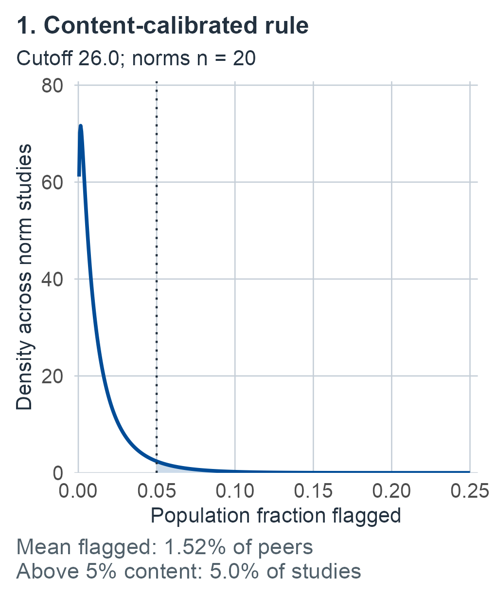
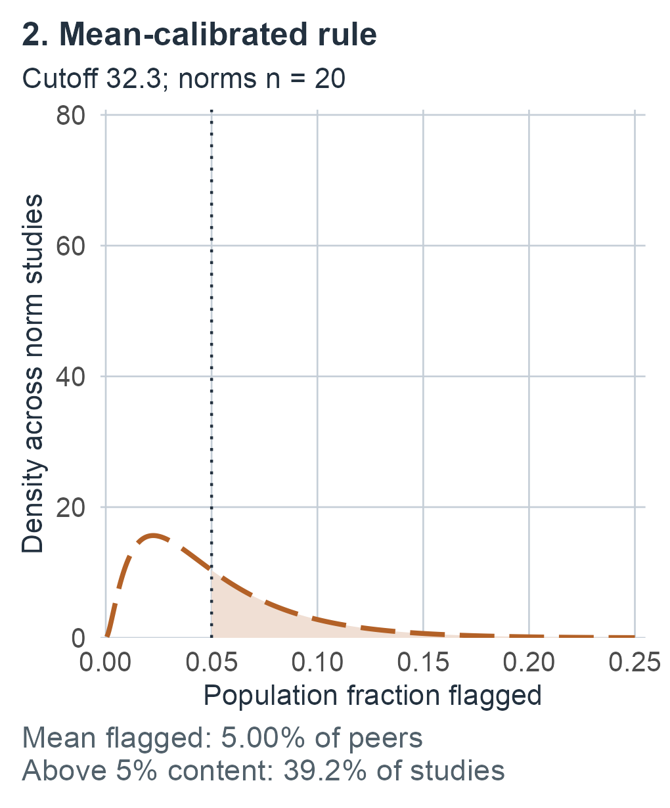

# Finite reference information {#sec-finite-reference}

This chapter develops scalar normal-reference prediction, fixed-score percentiles, fitted-cutoff content, quantiles and population SD, together with regression prediction and conditional percentiles. Whole-curve bands, finite-support tables and estimated transformations continue in [Reference curves, tables, and transformations](13-reference-curves.md#sec-reference-curves).

## Two clinics, one score {#sec-m02-question}

Two clinics evaluate the same score of 35 on the same higher-is-better test. Each compares it with a normal reference curve whose estimated mean is 50 and estimated standard deviation (SD) is 10. One clinic's norms came from 20 peers; the other's came from 2,000. Substituting these estimates into the normal CDF, each clinic reports that about 6.7% of peers score at or below 35. Should the two reports carry the same uncertainty?

Most readers will expect the 20-person norms to deserve less confidence, and that expectation is correct. The harder question is: uncertainty about *what*? In the [known-normal example](01-one-performance.md#sec-m01-normal-example), a score of 35 was compared with a population whose mean 50 and standard deviation 10 were supplied constants. Now suppose those two numbers summarize a finite reference sample. The sample mean can miss the population mean, and the sample standard deviation can miss the population standard deviation. A new performance also varies around that population mean. Prediction must include all three sources of variation. Other questions hold a score or percentile level fixed and ask about the reference population itself. Their intervals have different targets, units and sampling interpretations.

Four questions show how far apart these targets are:

- *Where might another peer's score fall?* The answer is in score units and always includes that peer's own variation.
- *What fraction of the peer population scores at or below 35?* This is a fixed population proportion; the score is held fixed.
- *Which score marks the lowest 5% of peers?* This reverses the previous question: the fraction is fixed and the score boundary is unknown.
- *How often does a cutoff fitted from these norms actually flag peers?* Here the rule itself changes from one norming study to the next.

Sample size affects these answers very differently. Under the chapter's normal model and the two stipulated summaries (synthetic numbers, not data from actual clinics), a 95% confidence interval for the population fraction at or below 35 runs from about 1.6% to 19.9% with 20 peers and from about 5.9% to 7.5% with 2,000. A 95% prediction interval for another peer's score runs from about 28.6 to 71.4 with 20 peers and from about 30.4 to 69.6 with 2,000, which is also, to one decimal, the interval for known parameters. More norm participants make the population curve nearly known. They do not make a new peer's score less variable, and they say nothing about how much this patient's own score would vary on retesting; that question needs a measurement model ([measurement and replication](05-measurement-and-replication.md#sec-measurement)).

How large normative samples need to be has been argued in neuropsychology [@bridges2007howmany; @crawford2008optimal], and simulation studies have compared the sample sizes that traditional and regression-based norming need for a given precision of estimated percentiles [@oosterhuis2016norms]. This chapter supplies the exact calculations behind such comparisons under a stated normal model.

This chapter and the [next](13-reference-curves.md#sec-reference-curves) develop each of these targets, and several more, with an explicit frequentist experiment and a Bayesian comparison. By the end, a reader should be able to name the target before quoting an interval, state what is held fixed and what repeats in its guarantee, and recognize when two numerically similar outputs answer different questions.

## How the chapter is organized {#sec-m02-roadmap}

Each target receives its own experiment, frequentist guarantee, reference-prior posterior, proper-prior sensitivity analysis, synthetic example and limits. Within each target section that order is the same, so a reader who needs one result can go directly to it. The targets fall into five groups: the first three are developed in this chapter, the last two in [Reference curves, tables, and transformations](13-reference-curves.md#sec-reference-curves).

:::: {.m02-scroll tabindex="0" role="group" aria-label="Table 1: Chapter question map"}

| Group | Sections | Question family |
|---|---|---|
| Scalar normal norms | [Prediction](#sec-m02-normal-experiment) through [its limits](#sec-m02-boundaries); [fixed-score percentile](#sec-m02-percentile) | A new peer's score; the population fraction at a fixed score |
| Peers defined by predictors | [Regression prediction](#sec-m02-regression); [conditional percentile](#sec-m02-regression-percentile) | The same two questions at a fixed predictor vector |
| Rules and boundaries fitted from norms | [Fitted cutoff](#sec-m02-fitted-cutoff); [population quantile](#sec-m02-quantile); [population SD](#sec-m02-scale) | What a fitted cutoff actually flags; the score at a fixed fraction; between-person spread |
| The whole reference curve | [Simultaneous band](13-reference-curves.md#sec-m13-joint-band); [score range](13-reference-curves.md#sec-m13-range); [calibration error](13-reference-curves.md#sec-m13-cdf-error) | Questions asked at many scores, or at scores chosen after seeing the norms |
| Other score models | [Discrete support](13-reference-curves.md#sec-m13-discrete-reference); [estimated transformations](13-reference-curves.md#sec-m13-transformations) | Scores with ties; norms that also choose a nonlinear scale |

::::

The [closing section](#sec-m02-closing) returns to the two clinics. A [lookup guide](#sec-m02-target-guide) near the end of this chapter states every guarantee of both chapters in table form, and the next chapter ends with a [synthesis](13-reference-curves.md#sec-m13-synthesis) and a list of [what to report](13-reference-curves.md#sec-m13-reporting).

For a first reading, follow [scalar prediction](#sec-m02-normal-experiment) through its [example](#sec-m02-example) and [limits](#sec-m02-boundaries), then [fixed-score percentile uncertainty](#sec-m02-percentile) through its [example](#sec-m02-percentile-example) and [limits](#sec-m02-percentile-boundaries). Continue to [regression prediction](#sec-m02-regression) and [conditional percentiles](#sec-m02-regression-percentile) when predictors define the peers. Read [achieved content](#sec-m02-fitted-cutoff) before interpreting a fitted rule's frequency; use [quantiles](#sec-m02-quantile) and [SD](#sec-m02-scale) for their respective parameter questions. For consultation, go directly to the [lookup guide](#sec-m02-target-guide); its final branches route all-score, tied-score and estimated-scale questions to the next chapter.

## A running example and recurring symbols {#sec-m02-running}

Most examples reuse the same synthetic inputs, so that only the target changes from section to section. They are constructed numbers, not data from a clinical study.

:::: {.m02-scroll tabindex="0" role="group" aria-label="Table 2: Shared synthetic inputs"}

| Input | Value | Introduced in |
|---|---|---|
| Reference sample | 20 scores $50\pm j\sqrt{190/77}$, $j=1,\ldots,10$, with $\bar y=50$ and $s=10$ | [Scalar example](#sec-m02-example) |
| Case score | $y_0=35$ on a higher-is-better scale | [Scalar example](#sec-m02-example) |
| Proper teaching prior | $m_0=50$, $\kappa_0=5$, $a_0=3$, $b_0=200$; updated $m_n=50$, $\kappa_n=25$, $a_n=13$, $b_n=1150$ | [Scalar example](#sec-m02-example) |
| Regression example | $n=10$, an intercept and one centered predictor, $x_0=(1,3)^T$, $y_0=45$ | [Regression example](#sec-m02-regression-example) |
| Four-score table | Support $(0,1,2,3)$, counts $(1,2,4,3)$ | [Discrete example](13-reference-curves.md#sec-m13-discrete-example), next chapter |

::::

Several operators recur. Each is defined formally where it is first used.

:::: {.m02-scroll tabindex="0" role="group" aria-label="Table 3: Recurring mathematical operators"}

| Symbol | Meaning |
|---|---|
| $\Phi,\phi$; $z_u=\Phi^{-1}(u)$ | Standard normal CDF and density; normal quantile |
| $G_\nu$; $q_{\nu,u}$ | Central Student $t$ CDF with $\nu$ degrees of freedom; its $u$ quantile ([prediction](#sec-m02-frequentist)) |
| $t_\nu(m,c)$ | Location-scale Student law of $m+cT$; $c$ is a scale, not generally an SD |
| $H_\nu(t;\lambda)$; $k_\nu(r;\lambda)$ | Noncentral Student CDF with the sign convention of @eq-m02-noncentral-cdf; its quantile in the first argument |
| $c_{d,r}$ | Chi-square quantile with $d$ degrees of freedom ([population SD](#sec-m02-scale-confidence)) |
| $\operatorname{IG}(a,b)$ | Inverse-gamma law with exponent $-b/v$ (@eq-m02-inverse-gamma) |

::::

Some symbols are easy to confuse because they look alike or appear in neighboring sections:

:::: {.m02-scroll tabindex="0" role="group" aria-label="Table 4: Symbols and their local homes"}

| Symbol | Meaning and home |
|---|---|
| $c$; $c_{\mathrm{reg}}$ | Scale of the predictive Student law ([scalar](#sec-m02-frequentist) and [regression](#sec-m02-regression-frequentist) prediction) |
| $\zeta$; $\zeta_{u,\gamma,n}$ | Dimensionless coefficient of a fitted cutoff $\bar Y+\zeta S$; its content-calibrated value ([fitted cutoff](#sec-m02-fitted-cutoff)) |
| $h_0$ | Leverage at the predictor vector $x_0$ ([regression](#sec-m02-regression-experiment)) |
| $\lambda$ | Noncentrality of $H_\nu$ |
| $\tau_-,\tau_+$; $\xi_{n,1-\alpha}$; $\omega$ | Next chapter: SD limits of a joint confidence region, calibrated radius of a uniform error band, and the sinh shape parameter |

::::

Each section restates its local definitions.

## One new performance and independent reference persons {#sec-m02-normal-experiment}

The question is whether a case's observed performance is unusually low, high, or far from the center relative to a specified reference population when its normal distribution has unknown parameters. The prediction target is one new **observed reference performance**, $Y_{\mathrm{new}}$. The case score $y_0$ is evaluated against this null comparison; it is not included in the reference estimates. No disease model or individual measurement-error decomposition is supplied.

It helps to picture two layers of variation. Peers' scores scatter around the population mean $\mu$ with SD $\sigma$. The norming study's estimates scatter around $(\mu,\sigma)$ from one possible norming study to another. A new peer's score is affected by both layers. Questions about the population itself, taken up from the [percentile section](#sec-m02-percentile) onward, involve only the second.

Let the reference data be $\mathcal D_{\mathrm{ref}}=(Y_1,\ldots,Y_n)$, with

:::: {.m02-scroll tabindex="0" role="group" aria-label="Equation: experiment"}

$$
\begin{gathered}
Y_1,\ldots,Y_n,Y_{\mathrm{new}}\mid\mu,v
\ \text{independent with law}\ N(\mu,v),
\\
 v=\sigma^2>0,\quad n\geq2.
\end{gathered}
$$ {#eq-m02-experiment}

::::

The sample size is fixed independently of the scores. All performances use the same declared scoring and administration protocol and intended peer population, possibly within a fixed background stratum. The experiment samples different persons. It does not predict a retest of this same patient. The population parameters $\mu$ and $v$ are unknown; they are fixed in the frequentist experiment and assigned a prior in the Bayesian experiment.

Define

:::: {.m02-scroll tabindex="0" role="group" aria-label="Equation: summaries"}

$$
\bar Y=\frac1n\sum_{i=1}^nY_i,
\qquad
S^2=\frac1{n-1}\sum_{i=1}^n(Y_i-\bar Y)^2,
\qquad \nu=n-1.
$$ {#eq-m02-summaries}

::::

Lowercase $\bar y,s^2$ denote their observed values, and we require $s^2>0$. Under the stated nondegenerate normal model this holds with probability one. An observed zero variance requires reconsidering the model or data resolution; the formulas below do not apply to it.

Normality here concerns the **observed performance scale**. Bounded or discrete scores, transformations fitted on the same sample, clustered reference persons, and informative selection do not automatically satisfy this experiment. Suitability of the peers and protocol requires evidence beyond the calculation.

## Frequentist prediction {#sec-m02-frequentist}

Write $G_\nu$ for the standard Student $t$ CDF with $\nu$ degrees of freedom and $q_{\nu,u}=G_\nu^{-1}(u)$ for its quantile, $0<u<1$. For clarity, $t_\nu(m,c)$ below means the distribution of $m+cT$ for $T\sim t_\nu$ and $c>0$. Its parameter $c$ is a **scale**, not generally its standard deviation.

::: {#thm-m02-predictive}
## A normal new-case prediction pivot

**Target, observations, and assumptions.** Under @eq-m02-experiment with the unbiased variance in @eq-m02-summaries, predict one independent new reference performance using only the reference sample.

**Result.** For every fixed $\mu\in\mathbb R$ and $v>0$,

:::: {.m02-scroll tabindex="0" role="group" aria-label="Equation: predictive pivot"}

$$
T_{\mathrm{pred}}
=\frac{Y_{\mathrm{new}}-\bar Y}{S\sqrt{1+1/n}}
\sim t_{n-1}.
$$ {#eq-m02-predictive-pivot}

::::

Consequently, for a prespecified $0<\alpha<1$, the random prediction interval

:::: {.m02-scroll tabindex="0" role="group" aria-label="Equation: prediction interval"}

$$
\begin{aligned}
I_\alpha(\mathcal D_{\mathrm{ref}})
&=[L_\alpha,U_\alpha],\\
L_\alpha&=\bar Y+S\sqrt{1+1/n}\,q_{\nu,\alpha/2},\\
U_\alpha&=\bar Y+S\sqrt{1+1/n}\,q_{\nu,1-\alpha/2}.
\end{aligned}
$$ {#eq-m02-prediction-interval}

::::

satisfies $P_{\mu,v}\{Y_{\mathrm{new}}\in I_\alpha(\mathcal D_{\mathrm{ref}})\}=1-\alpha$. The probability averages over both the reference sample and the new performance. Each tail has probability $\alpha/2$.
:::

::: {.proof}
Standardize the reference vector as $X_i=(Y_i-\mu)/\sigma$. Its joint density is proportional to $\exp(-\sum_i x_i^2/2)$. An orthogonal rotation with first coordinate $\sum_iX_i/\sqrt n$ preserves that density and yields independent standard normal coordinates $W_1,\ldots,W_n$. The first coordinate equals $\sqrt n(\bar Y-\mu)/\sigma$; the squared length of the remaining coordinates is

:::: {.m02-scroll tabindex="0" role="group" aria-label="Equation: residual chi square"}

$$
Q=\sum_{j=2}^nW_j^2=\frac{\nu S^2}{v}\sim\chi^2_\nu.
$$ {#eq-m02-residual-chi-square}

::::

Thus $\bar Y$ is independent of $S^2$. The independent new observation is also independent of every reference coordinate. Therefore

:::: {.m02-scroll tabindex="0" role="group" aria-label="Equation: calculation 6"}

$$
Z=\frac{Y_{\mathrm{new}}-\bar Y}{\sigma\sqrt{1+1/n}}
\sim N(0,1),\qquad Z\ \text{independent of}\ Q.
$$

::::

Here $\operatorname{Var}(Y_{\mathrm{new}}-\bar Y)=v+v/n$ by independence. The ratio $Z/\sqrt{Q/\nu}$ is exactly @eq-m02-predictive-pivot. To see its named law explicitly, use the change of variables $z=t\sqrt{q/\nu}$ in the independent normal and chi-square densities. The Jacobian is $\sqrt{q/\nu}$, giving

:::: {.m02-scroll tabindex="0" role="group" aria-label="Equation: t density"}

$$
\begin{aligned}
f_T(t)
&=\int_0^\infty
\frac{e^{-t^2q/(2\nu)}}{\sqrt{2\pi}}
\frac{q^{\nu/2-1}e^{-q/2}}{2^{\nu/2}\Gamma(\nu/2)}
\sqrt{\frac q\nu}\,dq\\
&=\frac{\Gamma((\nu+1)/2)}{\sqrt{\nu\pi}\,\Gamma(\nu/2)}
\left(1+\frac{t^2}{\nu}\right)^{-(\nu+1)/2}.
\end{aligned}
$$ {#eq-m02-t-density}

::::

The last step is the gamma integral $\int_0^\infty q^{a-1}e^{-bq}\,dq=\Gamma(a)b^{-a}$ for $a,b>0$. This is the Student $t$ density. Substituting its two quantiles proves the interval coverage and the separate tail probabilities.
:::

The denominator in @eq-m02-predictive-pivot adds two variances: $v$ for the new peer's own scatter and $v/n$ for the error in $\bar Y$. Replacing the unknown $\sigma$ by $S$ turns the normal law into a Student law with $\nu=n-1$ degrees of freedom, whose heavier tails account for not knowing the SD. In neuropsychology this comparison of one case with a modest normative or control sample is the modified $t$-test that Crawford and Howell brought into clinical use from Sokal and Rohlf's *Biometry*: the case is treated as a sample of one, contributes nothing to the variance estimate, and the difference is divided by $S\sqrt{(n+1)/n}$ [@crawford1998small, p. 483; @crawford2002confidence, pp. 1197, 1206].

For the observed case, put

:::: {.m02-scroll tabindex="0" role="group" aria-label="Equation: observed tails"}

$$
\begin{gathered}
c=s\sqrt{1+1/n},\\
t_0=\frac{y_0-\bar y}{c},\\
p_L=G_\nu(t_0),\quad p_U=1-G_\nu(t_0).
\end{gathered}
$$ {#eq-m02-observed-tails}

::::

Under the null experiment where the case is an independent draw from the same normal law, replacing $y_0$ by that random case gives a uniform $p_L$ on $(0,1)$: $P_{\mu,v}(p_L\leq u)=u$. Equivalently, a prespecified low-score flag at $p_L\leq\alpha$ has exact null flagging probability $\alpha$, averaged over reference samples and cases. Continuity makes strict and inclusive tails equal here, as in [M01](01-one-performance.md#sec-m01-tails).

If the prespecified question concerns departures in either direction, symmetry gives

:::: {.m02-scroll tabindex="0" role="group" aria-label="Equation: two sided"}

$$
p_{\mathrm{two}}=2G_\nu(-|t_0|).
$$ {#eq-m02-two-sided}

::::

This is also uniform under the same joint null experiment. It orders departures from the estimated center using the predictive scale. It is not the probability of the single point $y_0$.

### What the guarantee conditions on {#sec-m02-conditioning}

The theorem does not assert exact coverage conditional on every realized set of norms. For observed $\bar y,s$, let $L$ and $U$ be the endpoints in @eq-m02-prediction-interval. Independence of the new performance gives

:::: {.m02-scroll tabindex="0" role="group" aria-label="Equation: conditional coverage"}

$$
P_{\mu,v}\{L\leq Y_{\mathrm{new}}\leq U\mid\mathcal D_{\mathrm{ref}}\}
=\Phi\!\left(\frac{U-\mu}{\sigma}\right)
-\Phi\!\left(\frac{L-\mu}{\sigma}\right).
$$ {#eq-m02-conditional-coverage}

::::

This generally differs from $1-\alpha$. The unknown $\mu,\sigma$ remain in the expression. An especially simple illustration uses the lower-tail rule at $u=1/2$. Since $q_{\nu,1/2}=0$, it flags $Y_{\mathrm{new}}\leq\bar y$. If $\bar y=\mu+\sigma$, its conditional probability is $\Phi(1)\approx0.8413447$, rather than $1/2$. Nearby sample means also give conditional probabilities near this value and occur with positive probability. Averaging over the reference mean restores the theorem's $1/2$ guarantee. The interval procedure therefore has exact joint sampling coverage while particular norm samples can compare differently with the true population.

The denominator also distinguishes prediction from testing a population mean. A mean test uses $S/\sqrt n$ for $\bar Y-\mu_0$ at a fixed hypothesized $\mu_0$. A new person's score has its own variance $v$, so $Y_{\mathrm{new}}-\bar Y$ requires $S\sqrt{1+1/n}$. Treating that new score as a fixed null mean and dividing by $S/\sqrt n$ misses this variance. Using $S$ alone also misses the reference-mean contribution; using $1/n$ in the sample variance would require a separate adjustment.

## Bayesian prediction under an explicit reference prior {#sec-m02-bayesian}

The likelihood uses the reference persons alone:

:::: {.m02-scroll tabindex="0" role="group" aria-label="Equation: likelihood"}

$$
L(\mu,v;\mathcal D_{\mathrm{ref}})
=(2\pi v)^{-n/2}
\exp\!\left[-\frac{\nu s^2+n(\mu-\bar y)^2}{2v}\right].
$$ {#eq-m02-likelihood}

::::

Choose the improper reference prior

:::: {.m02-scroll tabindex="0" role="group" aria-label="Equation: reference prior"}

$$
p(\mu,v)\propto\frac1v
\quad\text{with respect to }d\mu\,dv,
\qquad \mu\in\mathbb R,\ v>0.
$$ {#eq-m02-reference-prior}

::::

The measure matters: under $v=\sigma^2$ this is a density proportional to $1/\sigma$ with respect to $d\mu\,d\sigma$. It is not a proper distribution expressing bounded prior knowledge. Its posterior must be normalized and shown proper before it can be used for prediction. We use it as a specified comparison convention, without claiming it is uniquely appropriate.

Define an inverse-gamma distribution by the density

:::: {.m02-scroll tabindex="0" role="group" aria-label="Equation: inverse gamma"}

$$
\operatorname{IG}(v;a,b)
=\frac{b^a}{\Gamma(a)}v^{-a-1}e^{-b/v},
\qquad v>0,\quad a,b>0.
$$ {#eq-m02-inverse-gamma}

::::

Here $b$ appears in the numerator of the exponent $-b/v$; this definition fixes the parameterization.

::: {#prp-m02-reference-posterior}
## Proper posterior and predictive agreement

**Target and assumptions.** Use @eq-m02-likelihood, the prior density in @eq-m02-reference-prior, $n\geq2$, and observed $s^2>0$. Conditional on $\mu,v$, the new reference person is independent of the reference data and has law $N(\mu,v)$.

**Result.** The posterior is proper and can be factored as

:::: {.m02-scroll tabindex="0" role="group" aria-label="Equation: reference posterior"}

$$
\mu\mid v,\mathcal D_{\mathrm{ref}}\sim N(\bar y,v/n),
\qquad
v\mid\mathcal D_{\mathrm{ref}}\sim
\operatorname{IG}\!\left(\frac\nu2,\frac{\nu s^2}{2}\right).
$$ {#eq-m02-reference-posterior}

::::

Its posterior predictive law is

:::: {.m02-scroll tabindex="0" role="group" aria-label="Equation: reference predictive"}

$$
Y_{\mathrm{new}}\mid\mathcal D_{\mathrm{ref}}
\sim t_\nu\!\left(\bar y,s\sqrt{1+1/n}\right).
$$ {#eq-m02-reference-predictive}

::::

Thus the predictive lower and upper probabilities at $y_0$ are exactly $p_L,p_U$ in @eq-m02-observed-tails. The equal-tailed posterior predictive interval equals the observed version of @eq-m02-prediction-interval and has posterior predictive probability $1-\alpha$.
:::

::: {.proof}
Multiplying likelihood and prior gives a joint posterior kernel

:::: {.m02-scroll tabindex="0" role="group" aria-label="Equation: calculation 16"}

$$
v^{-n/2-1}
\exp\!\left[-\frac{\nu s^2+n(\mu-\bar y)^2}{2v}\right].
$$

::::

Integrating over $\mu$ contributes $\sqrt{2\pi v/n}$, leaving the kernel $v^{-(\nu/2+1)}\exp[-\nu s^2/(2v)]$. With $a=\nu/2>0$ and $b=\nu s^2/2>0$,

:::: {.m02-scroll tabindex="0" role="group" aria-label="Equation: calculation 17"}

$$
\int_0^\infty v^{-a-1}e^{-b/v}\,dv=\Gamma(a)b^{-a}<\infty,
$$

::::

by the substitution $r=b/v$. This establishes propriety and the stated inverse-gamma marginal. Normalizing the conditional kernel in $\mu$ gives $N(\bar y,v/n)$. With one observation the residual sum of squares is zero and the reference-prior posterior is improper. For $n\geq2$ but $s^2=0$, the integral also diverges at zero. Those cases are excluded.

At fixed $v$, integrating $\mu$ adds the new-observation variance $v$ and posterior mean variance $v/n$, so that

:::: {.m02-scroll tabindex="0" role="group" aria-label="Equation: calculation 18"}

$$
Y_{\mathrm{new}}\mid v,\mathcal D_{\mathrm{ref}}
\sim N(\bar y,hv),\qquad h=1+1/n.
$$

::::

The remaining mixture can be evaluated directly:

:::: {.m02-scroll tabindex="0" role="group" aria-label="Equation: predictive mixture"}

$$
\begin{aligned}
f(y\mid\mathcal D_{\mathrm{ref}})
&=\int_0^\infty
\frac{e^{-(y-\bar y)^2/(2hv)}}{\sqrt{2\pi hv}}
\frac{b^a}{\Gamma(a)}v^{-a-1}e^{-b/v}\,dv\\
&=\frac{\Gamma(a+1/2)}{\Gamma(a)\sqrt{2\pi hb}}
\left[1+\frac{(y-\bar y)^2}{2hb}\right]^{-(a+1/2)}.
\end{aligned}
$$ {#eq-m02-predictive-mixture}

::::

This is the location-scale version of @eq-m02-t-density with $2a=\nu$ degrees of freedom and squared scale $hb/a=hs^2$. Its CDF and quantiles give the claimed probability and interval agreement.
:::

The agreement is exact **for this normal experiment, prior, and new-observation target**. The two statements retain different conditioning. Frequentist coverage holds for every fixed $\mu,v$ across repeated reference samples and new persons. Bayesian prediction conditions on the observed reference data and averages over the posterior for $\mu,v$ and the new performance. A proper posterior from an improper prior does not supply a proper prior-predictive experiment. Nor does agreement of these outputs imply that every credible interval is a confidence interval or that all priors give this answer.

At $n=2$, the predictive law is Cauchy: its center is a location, not a finite expectation. The predictive variance is finite only for $n>3$, when it equals $c^2\nu/(\nu-2)$. Accordingly, even when it exists, its standard deviation exceeds its scale $c$.

## A proper-prior sensitivity calculation {#sec-m02-prior-sensitivity}

External information about the intended reference population can be expressed with a proper prior. One transparent family is

:::: {.m02-scroll tabindex="0" role="group" aria-label="Equation: proper prior"}

$$
v\sim\operatorname{IG}(a_0,b_0),\qquad
\mu\mid v\sim N(m_0,v/\kappa_0),
\qquad a_0,b_0,\kappa_0>0.
$$ {#eq-m02-proper-prior}

::::

Here $m_0$ is a prior center on the score scale, $\kappa_0$ controls its conditional precision, and $a_0,b_0$ control uncertainty about the variance. These are additional scientific choices, rather than known features of the test.

::: {#prp-m02-proper-predictive}
## Prediction with a proper normal–inverse-gamma prior

**Target and assumptions.** Keep the same normal sampling experiment and independent new reference performance, replacing only the prior by @eq-m02-proper-prior.

**Result.** Put

:::: {.m02-scroll tabindex="0" role="group" aria-label="Equation: proper update"}

$$
\begin{aligned}
\kappa_n&=\kappa_0+n,&
m_n&=\frac{\kappa_0m_0+n\bar y}{\kappa_n},\\
a_n&=a_0+n/2,&
b_n&=b_0+\frac12\left[\nu s^2+
\frac{\kappa_0n}{\kappa_n}(\bar y-m_0)^2\right].
\end{aligned}
$$ {#eq-m02-proper-update}

::::

The posterior has $v\mid\mathcal D_{\mathrm{ref}}\sim\operatorname{IG}(a_n,b_n)$ and $\mu\mid v,\mathcal D_{\mathrm{ref}}\sim N(m_n,v/\kappa_n)$. Therefore

:::: {.m02-scroll tabindex="0" role="group" aria-label="Equation: proper predictive"}

$$
Y_{\mathrm{new}}\mid\mathcal D_{\mathrm{ref}}
\sim t_{2a_n}\!\left(m_n,
\sqrt{\frac{b_n}{a_n}\left(1+\frac1{\kappa_n}\right)}\right).
$$ {#eq-m02-proper-predictive}

::::
:::

::: {.proof}
Complete the square using

:::: {.m02-scroll tabindex="0" role="group" aria-label="Equation: calculation 23"}

$$
n(\mu-\bar y)^2+\kappa_0(\mu-m_0)^2
=\kappa_n(\mu-m_n)^2+
\frac{\kappa_0n}{\kappa_n}(\bar y-m_0)^2.
$$

::::

Multiplication of likelihood and the two proper prior densities then gives the stated normal conditional and inverse-gamma marginal. Their parameters are positive, so the posterior is proper. Integrating $\mu$ gives $N(m_n,v(1+1/\kappa_n))$; the integral in @eq-m02-predictive-mixture, with updated $a_n,b_n$ and $h=1+1/\kappa_n$, proves the predictive law.
:::

This law can change the center, scale, and degrees of freedom. Its predictive intervals have the stated posterior probability; they do not acquire the preceding exact fixed-parameter frequentist coverage merely by being Student intervals. The prior must also transform with a change of score units. For $Y'=A+BY$, $B>0$, the corresponding hyperparameters are $m_0'=A+Bm_0$, $b_0'=B^2b_0$, with $a_0,\kappa_0$ unchanged.

## Synthetic example: estimated mean 50 and SD 10 {#sec-m02-example}

Take $n=20$ and the 20 synthetic reference values

:::: {.m02-scroll tabindex="0" role="group" aria-label="Equation: calculation 24"}

$$
\left\{50-j\sqrt{190/77},\ 50+j\sqrt{190/77}:\ j=1,\ldots,10\right\}.
$$

::::

They have $\bar y=50$ and $s=10$, since $\sum_{j=1}^{10}j^2=385$ gives residual sum of squares $2(190/77)(385)=1900$. These deliberately constructed data specify the illustration; they are not observations from a clinical study. Assume the independent normal model for the calculation, with unknown $\mu,v$, and compare a case score $y_0=35$ on the same higher-is-better scale.

The predictive scale and statistic are

:::: {.m02-scroll tabindex="0" role="group" aria-label="Equation: calculation 25"}

$$
c=10\sqrt{21/20}\approx10.2469508,\qquad
t_0=\frac{-15}{c}\approx-1.4638501,\qquad \nu=19.
$$

::::

Numerical evaluation of the exact Student CDF gives

:::: {.m02-scroll tabindex="0" role="group" aria-label="Equation: example tails"}

$$
p_L\approx0.0797920,\qquad
p_U\approx0.9202080,\qquad
p_{\mathrm{two}}\approx0.1595840.
$$ {#eq-m02-example-tails}

::::

The 95% prediction interval, using $q_{19,.975}\approx2.0930241$, is

:::: {.m02-scroll tabindex="0" role="group" aria-label="Equation: example interval"}

$$
50\ \pm\ 2.0930241(10.2469508)
\approx[28.5528856,\ 71.4471144].
$$ {#eq-m02-example-interval}

::::

Under the reference prior this is also the 95% equal-tailed posterior predictive interval, and 0.0797920 is the posterior predictive probability of a new reference performance at or below 35. Its frequentist interpretation is the joint-sampling comparison already specified. For the hypothetical *known* population parameters in M01, the lower tail was $\Phi(-1.5)\approx0.0668072$. Here 50 and 10 are estimates, so simply using that normal tail would omit finite-reference uncertainty; with small norms the plug-in normal tail exaggerates how rare a score is [@crawford1998small, p. 483; @crawford2002confidence, p. 1197]. The difference shown is specific to this example; it is not a universal numerical correction.

Put as one report sentence: *under a normal model fitted to these 20 peers and the reference prior, the posterior predictive probability that a new peer scores at or below 35 is about 8.0%, and the 95% prediction interval runs from about 28.6 to 71.4.* The predictive tail exceeds the known-parameter 6.7% because uncertainty about the mean and SD spreads the predictive law beyond the plug-in normal curve. For the second clinic in the [opening](#sec-m02-question), with the same summaries from 2,000 peers, the same calculation gives about 6.69%, essentially the known-parameter value. The sentence compares the case with peers; it is not a probability about this patient's ability or diagnosis.

For a proper-prior sensitivity illustration choose $m_0=50$, $\kappa_0=5$, $a_0=3$, and $b_0=200$ in squared score units. This prior has $E(v)=b_0/(a_0-1)=100$, obtained by integrating @eq-m02-inverse-gamma. The update gives $m_n=50$, $\kappa_n=25$, $a_n=13$, $b_n=1150$, and

:::: {.m02-scroll tabindex="0" role="group" aria-label="Equation: calculation 28"}

$$
Y_{\mathrm{new}}\mid\mathcal D_{\mathrm{ref}}
\sim t_{26}(50,\sqrt{92}).
$$

::::

Its lower tail at 35 is approximately 0.0649711 and its 95% interval is $[30.2840542,69.7159458]$. These hyperparameters are synthetic assumptions, not a recommended prior. The comparison shows that matching outputs under the improper reference prior does not remove sensitivity to external information or prior choice.

## Limits, checks, and interpretation {#sec-m02-boundaries}

The derivations give exact named-distribution expressions under the stated model; their displayed decimal values are numerical CDF and quantile evaluations. Positive affine changes of units preserve $t_0$ and transform prediction endpoints accordingly. As $n\to\infty$ under the fixed normal population, $\bar Y\to\mu$ and $S\to\sigma$, while $\sqrt{1+1/n}\to1$ and $t_{n-1}$ quantiles approach normal quantiles. The procedure then approaches the known-parameter comparison. For the latter distributional limit, $Q/\nu$ has mean 1 and variance $2/\nu$, so the ratio representation in the proof converges to a standard normal. The prediction width approaches a population-performance width, rather than shrinking to zero like uncertainty about a mean.

The result supports comparison of a prespecified observed performance with a peer reference model. More representative independent reference persons improve parameter estimation; design and model checks address whether the reference law applies. Reusing a reference person's own score as the new case, selecting the tail after examining it, or selecting peers based on the case requires another analysis. Multiple scores and fitted regression predictors also require their own sampling laws.

Two tempting additional targets remain distinct:

- **An individual's latent true score or expected performance.** This experiment has no model separating stable person variation from occasion or measurement variation. Such inference needs an identified measurement/replication model and its data, developed in [measurement and replication](05-measurement-and-replication.md#sec-measurement).
- **Uncertainty about the population percentile of a fixed score.** For fixed $y_0$, that parameter is $\pi(\mu,v;y_0)=\Phi((y_0-\mu)/\sqrt v)$. Its posterior distribution or frequentist confidence procedure is a parameter-uncertainty target. Under the reference prior, the predictive lower tail equals $E\{\pi(\mu,v;y_0)\mid\mathcal D_{\mathrm{ref}}\}$ by averaging the conditional new-person probability. This single expectation is not an uncertainty interval for $\pi$. The [next section](#sec-m02-percentile) develops those intervals.

Neither a predictive tail nor an interval establishes disease, acquired decline, response validity, or a preferred action. Those claims require measurement, longitudinal, outcome, or decision information matched to the question. The three results here are direct derivations of established normal-model calculations, with numerical self-checks; they are not claims of new theory or clinical validation.

## Uncertainty about a fixed score's population percentile {#sec-m02-percentile}

A score can be fixed while its population percentile is uncertain. In the example above, substituting the estimated mean 50 and SD 10 into the normal CDF gives about 6.68% at or below 35. How much could that population proportion differ because the norms came from only 20 reference persons? This question concerns an unknown reference parameter. An interval for that proportion has probability units; an interval for a future performance has score units. This is the question on which the two clinics in the [opening](#sec-m02-question) differ most.

### Target and reference-only sampling {#sec-m02-percentile-target}

Retain the independent normal reference persons and unbiased sample variance in @eq-m02-experiment and @eq-m02-summaries, but now hold a finite score $y_0$ fixed independently of those observations. Define

:::: {.m02-scroll tabindex="0" role="group" aria-label="Equation: percentile target"}

$$
\delta=\frac{y_0-\mu}{\sigma},\qquad
\pi=\pi(\mu,v;y_0)=\Phi(\delta),\qquad
\widehat\pi=\Phi\!\left(\frac{y_0-\bar Y}{S}\right).
$$ {#eq-m02-percentile-target}

::::

The target $\pi$ is the fraction of performances at or below this fixed score in the intended normal reference population. The plug-in estimate $\widehat\pi$ need not equal its posterior mean or median. No individual measurement-error decomposition is supplied.

For frequentist coverage, $\mu,v,y_0$ and $n$ are fixed and only the reference persons are resampled. For Bayesian inference, condition on their data and the fixed $y_0$, using the same reference-only likelihood as before. If an independent case supplies $y_0$, the analysis treats that observed score as fixed for the reference-parameter question; it does not add the case to the reference likelihood. Selecting a cutoff from these reference scores changes the declared experiment.

One could instead retain only indicators $\mathbf1\{Y_i\le y_0\}$ and use M01's [fixed-event frequency experiment](01-one-performance.md#sec-m01-frequency). Here the full scores are used with a normal population assumption. The binomial count experiment and its beta posterior do not become the present normal-parameter calculation merely because both targets are event probabilities.

### A noncentral Student comparison for the parameter {#sec-m02-percentile-confidence}

We need a sampling law that retains the unknown percentile. Define the noncentral Student CDF by

:::: {.m02-scroll tabindex="0" role="group" aria-label="Equation: noncentral cdf"}

$$
\begin{aligned}
H_\nu(t;\lambda)
&=P\!\left\{\frac{Z+\lambda}{\sqrt{Q/\nu}}\le t\right\}\\
&=\int_0^\infty
\Phi\!\left(t\sqrt{q/\nu}-\lambda\right)
f_{\chi^2_\nu}(q)\,dq,
\end{aligned}
$$ {#eq-m02-noncentral-cdf}

::::

where $Z\sim N(0,1)$ and $Q\sim\chi^2_\nu$ are independent. This equation defines the noncentrality sign as well as the CDF. In particular, $H_\nu(t;0)=G_\nu(t)$.

For the reference sample put

:::: {.m02-scroll tabindex="0" role="group" aria-label="Equation: percentile statistic"}

$$
T_\pi=\frac{\sqrt n(y_0-\bar Y)}{S},\qquad
t_\pi=\frac{\sqrt n(y_0-\bar y)}s,\qquad
\lambda=\sqrt n\,\delta.
$$ {#eq-m02-percentile-statistic}

::::

The orthogonal-normal argument used earlier gives $\sqrt n(\bar Y-\mu)/\sigma\sim N(0,1)$ independently of $Q=\nu S^2/v$. Consequently $T_\pi$ has CDF $H_\nu(\cdot;\lambda)$: its numerator after standardization is $\sqrt n\delta-\sqrt n(\bar Y-\mu)/\sigma$. Only the reference mean is random in that numerator. This is why $S/\sqrt n$ appears here. It is a different statistic and target from the new-case prediction pivot with denominator $S\sqrt{1+1/n}$.

To compute the limits below, hold the observed statistic fixed and vary the unknown noncentrality until the CDF reaches each specified probability level. Transform those two noncentrality endpoints to population percentiles. This is inversion in the CDF's **noncentrality argument**. The later [population-quantile calculation](#sec-m02-quantile-confidence) instead starts with a supplied percentile level, which fixes the noncentrality, and takes quantiles in the CDF's **first argument**. The same distribution serves different unknown targets.

::: {#thm-m02-percentile-confidence}
## Exact confidence limits for a fixed score's normal percentile

**Target and assumptions.** Use the fixed-score experiment above, $n\ge2$, $v>0$, observed $s^2>0$, and a prespecified $0<\alpha<1$.

**Result.** For a finite statistic $t$, define $\lambda_L(t)$ and $\lambda_U(t)$ as the unique roots

:::: {.m02-scroll tabindex="0" role="group" aria-label="Equation: percentile inversion"}

$$
H_\nu(t;\lambda_L)=1-\alpha/2,\qquad
H_\nu(t;\lambda_U)=\alpha/2.
$$ {#eq-m02-percentile-inversion}

::::

Then the random interval

:::: {.m02-scroll tabindex="0" role="group" aria-label="Equation: percentile confidence"}

$$
C_\alpha(\mathcal D_{\mathrm{ref}};y_0)
=\left[
\Phi\!\left(\frac{\lambda_L(T_\pi)}{\sqrt n}\right),
\Phi\!\left(\frac{\lambda_U(T_\pi)}{\sqrt n}\right)
\right]
$$ {#eq-m02-percentile-confidence}

::::

satisfies, for every fixed $\mu\in\mathbb R$, $v>0$ and $y_0\in\mathbb R$,

:::: {.m02-scroll tabindex="0" role="group" aria-label="Equation: percentile coverage"}

$$
P_{\mu,v}\{\pi(\mu,v;y_0)\in C_\alpha(\mathcal D_{\mathrm{ref}};y_0)\}
=1-\alpha.
$$ {#eq-m02-percentile-coverage}

::::

Both endpoints lie strictly between zero and one for finite observed data. The probability resamples reference persons only.
:::

::: {.proof}
For fixed finite $t$, differentiating the integral in @eq-m02-noncentral-cdf with respect to $\lambda$ gives

:::: {.m02-scroll tabindex="0" role="group" aria-label="Equation: calculation 35"}

$$
\frac{\partial H_\nu(t;\lambda)}{\partial\lambda}
=-E\!\left[\phi\!\left(t\sqrt{Q/\nu}-\lambda\right)\right]<0.
$$

::::

The bounded normal density justifies differentiation under the integral. Dominated convergence gives limits 1 and 0 as $\lambda$ tends to $-\infty$ and $+\infty$, respectively. Continuity and strict decrease therefore give unique finite roots, with $\lambda_L<\lambda_U$. For fixed $\lambda$, the same integral is a continuous strictly increasing CDF in $t$, since $Q>0$ almost surely. Thus $H_\nu(T_\pi;\lambda)$ is uniform on $(0,1)$ under the reference-sampling law.

By decrease in $\lambda$, the interval contains the true noncentrality precisely when

:::: {.m02-scroll tabindex="0" role="group" aria-label="Equation: calculation 36"}

$$
\alpha/2\le H_\nu(T_\pi;\lambda)\le1-\alpha/2.
$$

::::

This event has probability $1-\alpha$, with each excluded tail having probability $\alpha/2$. The map $\lambda\mapsto\Phi(\lambda/\sqrt n)$ is strictly increasing, proving coverage for $\pi$ and the stated endpoint support.
:::

These are exact model-based confidence limits, although evaluating the CDF and solving the two equations generally require numerical methods. They are the limits that Crawford and Garthwaite introduced for the abnormality of a single test score [@crawford2002confidence, pp. 1198-1199, 1206]; their worked example (15 controls, a score 2 SDs below the control mean) reproduces under this theorem as about 0.2% to 13.6%, the limits reported on p. 1199, and @crawford2009percentilenorms propose reporting standards for percentile norms that include interval estimates of percentile ranks. The coverage statement concerns a fixed population parameter across reference samples; it does not assign probability to that parameter after one sample has been observed.

### The induced posterior and interval agreement {#sec-m02-percentile-posterior}

Use the explicit prior density $1/v$ relative to $d\mu\,dv$ in @eq-m02-reference-prior. Its posterior is proper under the current sample-size and variance conditions, as established in @prp-m02-reference-posterior. We now transform that posterior to the percentile parameter, rather than reuse a future-score interval.

::: {#prp-m02-percentile-posterior}
## A percentile posterior with matching equal-tailed limits

**Target and assumptions.** Keep the fixed score $y_0$, the normal reference likelihood and the stipulated reference prior. Write $d=(y_0-\bar y)/s$, so that $t_\pi=\sqrt n\,d$.

**Result.** Conditional on the reference data, the standardized parameter has representation

:::: {.m02-scroll tabindex="0" role="group" aria-label="Equation: percentile posterior representation"}

$$
\delta\ \overset{d}{=}\ d\sqrt{R/\nu}-\frac W{\sqrt n},
\qquad R\sim\chi^2_\nu,\quad W\sim N(0,1),
\quad R\perp W.
$$ {#eq-m02-percentile-posterior-representation}

::::

For $0<p<1$, the induced posterior CDF is

:::: {.m02-scroll tabindex="0" role="group" aria-label="Equation: percentile posterior cdf"}

$$
F_{\pi\mid\mathcal D_{\mathrm{ref}}}(p)
=1-H_\nu\!\left(t_\pi;\sqrt n\,\Phi^{-1}(p)\right).
$$ {#eq-m02-percentile-posterior-cdf}

::::

It is continuous and strictly increasing on $(0,1)$, with no endpoint atoms. Its equal-tailed posterior credible interval of probability $1-\alpha$ equals the observed confidence interval in @eq-m02-percentile-confidence.
:::

::: {.proof}
The reference posterior permits the construction $\mu=\bar y+\sqrt{v/n}\,W$, where $W$ is standard normal independently of $v$. The inverse-gamma marginal gives $R=\nu s^2/v\sim\chi^2_\nu$ by change of variables. Substituting in $(y_0-\mu)/\sqrt v$ proves the representation.

For finite $x$, integrate over $R$ to obtain

:::: {.m02-scroll tabindex="0" role="group" aria-label="Equation: calculation 39"}

$$
\begin{aligned}
P(\delta\le x\mid\mathcal D_{\mathrm{ref}})
&=E\!\left[\Phi\!\left(\sqrt n\,x-t_\pi\sqrt{R/\nu}\right)\right]\\
&=1-H_\nu(t_\pi;\sqrt n\,x).
\end{aligned}
$$

::::

The conditional normal distribution has positive density everywhere, and the mixing distribution is proper. Hence this CDF is continuous and strictly increasing, with limits 0 and 1 at the two infinite extremes. Transforming by $\pi=\Phi(\delta)$ proves @eq-m02-percentile-posterior-cdf and its support. At $p=\Phi(\lambda_L/\sqrt n)$ its value is $\alpha/2$; at $p=\Phi(\lambda_U/\sqrt n)$ its value is $1-\alpha/2$. These are exactly the two posterior quantiles.
:::

The interval endpoints agree for this target, normal likelihood, prior measure and equal-tailed construction. Their interpretations remain different: confidence coverage fixes the parameters and repeats the reference sampling, whereas posterior probability conditions on the realized sample. The agreement supplies no rule that all credible intervals or all priors have exact frequentist coverage. The percentile posterior itself is not a Student distribution: it is supported on $(0,1)$, and the Student CDF above is evaluated as a function of its **noncentrality**. Crawford and Garthwaite computed this posterior by Monte Carlo for single-case comparisons and found its mean and credible limits indistinguishable from the frequentist point estimate and confidence limits, noting that theory for the interval agreement had not been developed [@crawford2007singlecase, pp. 346-347]. @prp-m02-percentile-posterior supplies that agreement exactly for this target.

All positive moments of $\pi$ exist because $0<\pi<1$. In particular,

:::: {.m02-scroll tabindex="0" role="group" aria-label="Equation: percentile posterior mean"}

$$
\begin{aligned}
E(\pi\mid\mathcal D_{\mathrm{ref}})
&=E\!\left[\Phi\!\left(\frac{y_0-\mu}{\sqrt v}\right)
\mathrel{\big|}\mathcal D_{\mathrm{ref}}\right]\\
&=P(Y_{\mathrm{new}}\le y_0\mid\mathcal D_{\mathrm{ref}})\\
&=G_\nu\!\left(\frac{y_0-\bar y}{s\sqrt{1+1/n}}\right).
\end{aligned}
$$ {#eq-m02-percentile-posterior-mean}

::::

The second equality averages the conditional new-person probability over the proper posterior; the last uses the already-derived predictive law. This bounded expectation exists even when the predictive mean of $Y_{\mathrm{new}}$ does not. One posterior mean is not a description of the whole percentile posterior or an interval for its parameter.

### Percentile uncertainty with the proper prior {#sec-m02-percentile-proper}

External prior information also changes parameter uncertainty. Use the proper prior in @eq-m02-proper-prior and its posterior parameters $m_n,\kappa_n,a_n,b_n$ from @eq-m02-proper-update. No case-score likelihood is added.

::: {#prp-m02-percentile-proper}
## The proper-prior percentile distribution

**Target and assumptions.** Keep the same fixed-score target and normal reference experiment, with the positive normal–inverse-gamma hyperparameters already specified.

**Result.** Put

:::: {.m02-scroll tabindex="0" role="group" aria-label="Equation: percentile proper index"}

$$
\nu_p=2a_n,\qquad
t_{\pi,p}=\sqrt{\kappa_n}\,(y_0-m_n)\sqrt{a_n/b_n}.
$$ {#eq-m02-percentile-proper-index}

::::

Then, for $0<p<1$,

:::: {.m02-scroll tabindex="0" role="group" aria-label="Equation: percentile proper cdf"}

$$
F^{\mathrm{proper}}_{\pi\mid\mathcal D_{\mathrm{ref}}}(p)
=1-H_{\nu_p}\!\left(t_{\pi,p};\sqrt{\kappa_n}\,\Phi^{-1}(p)\right).
$$ {#eq-m02-percentile-proper-cdf}

::::

Its posterior $\gamma$-quantile, $0<\gamma<1$, is $\Phi(\lambda_\gamma/\sqrt{\kappa_n})$, where $H_{\nu_p}(t_{\pi,p};\lambda_\gamma)=1-\gamma$.
:::

::: {.proof}
Construct $\mu=m_n+\sqrt{v/\kappa_n}\,W$ with $W$ standard normal independently of $v$. Now $R=2b_n/v\sim\chi^2_{2a_n}$, including noninteger positive degrees of freedom, since the inverse-gamma reciprocal has a gamma law. Therefore

:::: {.m02-scroll tabindex="0" role="group" aria-label="Equation: calculation 43"}

$$
\delta\ \overset{d}{=}
(y_0-m_n)\sqrt{\frac{R}{2b_n}}-\frac W{\sqrt{\kappa_n}}.
$$

::::

Conditioning on $R$ and using normal symmetry gives the claimed CDF exactly as in the preceding proof. The positive posterior parameters give a proper mixing law, so the support and unique-quantile arguments also apply.
:::

The posterior mean is the proper-prior predictive CDF in @eq-m02-proper-predictive evaluated at $y_0$, by the same iterated-expectation identity. Both the mean and the interval can change with the prior. Although the CDF formula has the same form, $t_{\pi,p}$, $\kappa_n$ and $\nu_p$ are posterior quantities incorporating that prior; they are not the sampling pivot and sample-size/df combination used to prove @eq-m02-percentile-coverage. Exact fixed-parameter confidence coverage does not follow from this proper-prior calculation.

### Synthetic percentile intervals at score 35 {#sec-m02-percentile-example}

Reuse the [20 constructed reference scores](#sec-m02-example), with $\bar y=50$, $s=10$ and fixed $y_0=35$. These remain synthetic data under the assumed normal reference model. The plug-in estimate is $\widehat\pi=\Phi(-1.5)\approx0.0668072$. The statistic for percentile-parameter inversion is

:::: {.m02-scroll tabindex="0" role="group" aria-label="Equation: calculation 44"}

$$
t_\pi=\sqrt{20}(-1.5)\approx-6.7082039,
$$

::::

rather than the earlier predictive statistic $-1.4638501$. Solving @eq-m02-percentile-inversion at $\alpha=.05$ gives standardized-parameter endpoints approximately $[-2.1359072,-0.8456423]$. Transforming them gives the 95% confidence interval

:::: {.m02-scroll tabindex="0" role="group" aria-label="Equation: percentile example confidence"}

$$
C_{.05}\approx[0.0163435,\ 0.1988762].
$$ {#eq-m02-percentile-example-confidence}

::::

This procedure covers the fixed normal population proportion in 95% of repeated reference samples. Under the specified reference prior, the same observed endpoints bound 95% of its percentile posterior. Neither statement says that a future performance is between these two numbers.

For sensitivity, retain $m_0=50$, $\kappa_0=5$, $a_0=3$, $b_0=200$, giving $m_n=50$, $\kappa_n=25$, $a_n=13$, $b_n=1150$ as before. Thus $\nu_p=26$ and $t_{\pi,p}\approx-7.9741430$. Numerical evaluation and inversion give:

:::: {.m02-scroll tabindex="0" role="group" aria-label="Table 5: Scalar percentile posterior comparison"}

| Percentile-parameter posterior | Mean | Median | 95% equal-tailed credible interval |
|---|---|---|---|
| Specified reference prior | $0.0797920$ | $0.0698720$ | $[0.0163435,0.1988762]$ |
| Specified proper prior | $0.0649711$ | $0.0574315$ | $[0.0149879,0.1574509]$ |

::::

The two means agree with the earlier predictive lower tails, as the expectation identity requires. The means, medians and plug-in estimate differ. The reference-prior interval allows population proportions from about 1.63% to 19.89% under its posterior interpretation; under the confidence interpretation it is the procedure, not a fixed observed interval, that receives repeated-sampling coverage. The proper prior changes that uncertainty rather than inheriting the confidence guarantee. Neither teaching prior is a recommendation for a clinical instrument.

As a report sentence: *a normal curve fitted to these 20 peers places about 6.7% of the peer population at or below 35, and a 95% confidence interval for that population fraction runs from about 1.6% to 19.9%.* The width, not the point estimate, is what distinguishes the two clinics in the [opening](#sec-m02-question): with the same summaries from 2,000 peers, the same procedure gives about 5.9% to 7.5%.

### Boundaries, computation, and interpretation {#sec-m02-percentile-boundaries}

Several checks clarify the result:

- **A central observed score.** At a dataset where $y_0=\bar y$, the reference posterior representation reduces exactly to $\delta=-W/\sqrt n$. Its percentile quantiles are $\Phi(z_\gamma/\sqrt n)$, where $z_\gamma=\Phi^{-1}(\gamma)$. The confidence endpoints agree because $H_\nu(0;\lambda)=\Phi(-\lambda)$. This is an algebraic check at that dataset, not permission to select $y_0=\bar Y$ and retain the fixed-score sampling guarantee. For the proper posterior, $y_0=m_n$ similarly gives $\delta\sim N(0,1/\kappa_n)$.
- **Small samples and tails.** At $n=2$ the reference posterior and these percentile limits remain well defined when $s^2>0$, even though the earlier predictive distribution is Cauchy. No finite mean of $\mu$ or future performance was needed to derive the bounded percentile distribution. Zero observed variance is still excluded. For finite data and interior tail levels, the exact endpoints remain in $(0,1)$, however extreme the fixed score. Software can round a very small tail to zero or a large CDF to one; solving first on the $\delta$ or $\lambda$ scale and retaining log-tail probabilities helps distinguish numerical rounding from a true endpoint.
- **Score units.** A positive affine change $Y'=A+BY$, with $y_0'=A+By_0$ and $B>0$, preserves $\delta$, $t_\pi$ and both reference intervals. The proper posterior has the same invariance when its hyperparameters transform as specified earlier. A nonlinear transformation requires reconsidering the normal model on the transformed observed scale.
- **Growing independent norms.** Under a fixed normal population, $d_n=(y_0-\bar Y)/S\to\delta$. In the reference posterior representation, $R/\nu$ has mean 1 and variance $2/\nu$, while $W/\sqrt n\to0$ in probability. Conditional posterior mass therefore concentrates at $\delta$ and hence at $\pi$. Every fixed interior posterior quantile converges to that value; the matching confidence endpoints converge with it. With fixed proper hyperparameters, $m_n\to\mu$, $\kappa_n/n\to1$, $a_n/n\to1/2$ and $b_n/a_n\to v$, giving the same concentration conclusion from the proper representation. Percentile-parameter uncertainty vanishes as the norms grow, whereas the earlier prediction interval retains population-performance variation.

The CDF integrals and confidence coverage above are exact under their declared model. The displayed decimals use deterministic integration and root finding; a noncentral Student library is a computational route, not a proof. Root bracketing and tail evaluation need care for extreme scores. Posterior normalization, central-score closed forms, small samples, both score directions, affine transformations and the predictive-mean identity provide useful checks on an implementation.

The result answers how uncertain the peer-population proportion at a fixed score is under a normal reference model. Representative independent reference persons improve estimation; checks of sampling, protocol and distribution assess whether that model applies. Like every result in this chapter, it does not quantify an individual's latent ability, acquired decline, response validity, disease probability or preferred action; the [reporting section](13-reference-curves.md#sec-m13-reporting) points to the information those targets need. Discrete scores, learned transformations, estimated regression and multivariate profiles require their own experiments and remain outside this scalar result family.

## Prediction with estimated regression norms {#sec-m02-regression}

Peers may be defined by specified predictors rather than a single common mean. How unusual is one performance relative to the conditional reference distribution at that person's predictor values, when both the regression coefficients and residual variance are estimated? This remains a question about an **observed score** from a new person. A regression coefficient is not, by itself, a causal effect or a measurement of latent ability.

### Observations, design and target {#sec-m02-regression-experiment}

Let $Y=(Y_1,\ldots,Y_n)^T$ contain scores from independent reference persons on the declared performance scale. Use the model

:::: {.m02-scroll tabindex="0" role="group" aria-label="Equation: regression model"}

$$
Y=X\beta+\epsilon,\qquad
\epsilon\sim N_n(0,vI_n),\qquad
\beta\in\mathbb R^k,\quad v=\sigma^2>0.
$$ {#eq-m02-regression-model}

::::

The known design $X\in\mathbb R^{n\times k}$ has full column rank, with $1\le k<n$. Here **$k$ counts every fitted coefficient**, including an intercept if present. Columns, predictor transformations and sample size are fixed independently of the outcomes. Predictor values are observed without a measurement-error model. We condition on $X$ throughout; this is not a claim about an unspecified random-predictor sampling design.

At a fixed externally specified new predictor vector $x_0\in\mathbb R^k$, the prediction target is

:::: {.m02-scroll tabindex="0" role="group" aria-label="Equation: regression new"}

$$
Y_{\mathrm{new}}=x_0^T\beta+\epsilon_{\mathrm{new}},\qquad
\epsilon_{\mathrm{new}}\sim N(0,v),\qquad
\epsilon_{\mathrm{new}}\perp\epsilon.
$$ {#eq-m02-regression-new}

::::

The case value $y_0$ is evaluated against this conditional null reference law and is excluded from fitting. Reference and new persons follow the same scoring/administration protocol and correctly specified linear, homoscedastic Gaussian error model. The predictors may locate different conditional means within the reference population. No retest dependence or latent measurement decomposition is supplied.

Write

:::: {.m02-scroll tabindex="0" role="group" aria-label="Equation: regression summaries"}

$$
\begin{aligned}
M&=X^TX,&\widehat\beta&=M^{-1}X^TY,&\nu&=n-k,\\
S^2&=\frac{\|Y-X\widehat\beta\|^2}{\nu},&
h_0&=x_0^TM^{-1}x_0,&\widehat m_0&=x_0^T\widehat\beta.
\end{aligned}
$$ {#eq-m02-regression-summaries}

::::

The dimensionless $h_0\ge0$ is the leverage for predicting at $x_0$; it measures estimation variance there, since $\operatorname{Var}(\widehat m_0\mid X)=vh_0$. Lowercase $s^2$ and observed $\widehat\beta$ denote the realized summaries. Require observed residual sum of squares $\nu s^2>0$, an event of probability one under this model. Both $\beta$ and $v$ are unknown; $X,x_0$ are fixed known inputs.

Leverage has a simple geometric reading. For a design with an intercept, it is smallest when $x_0$ sits at the center of the predictor values used in norming and grows as $x_0$ moves toward or beyond their edge, where the fitted mean is less well pinned down. The [example](#sec-m02-regression-example) shows the effect numerically. With one predictor, $h_0=1/n+(x_0-\bar x)^2/\{(n-1)s_x^2\}$, the form used for neuropsychological regression norms by @crawford2007regression [p. 612]. @crawford1998regression recommended this standard error for a new case over the standard error of estimate, noting that correct limits widen as the predictor moves away from its mean.

### Frequentist prediction and its conditioning {#sec-m02-regression-frequentist}

::: {#thm-m02-regression-predictive}
## A leverage-adjusted new-observation pivot

**Target and assumptions.** Under @eq-m02-regression-model and @eq-m02-regression-new, condition on fixed full-rank $X$ and fixed $x_0$, with $n>k$ and observed $s^2>0$.

**Result.** For every fixed $\beta,v$,

:::: {.m02-scroll tabindex="0" role="group" aria-label="Equation: regression pivot"}

$$
T_{\mathrm{reg}}=
\frac{Y_{\mathrm{new}}-x_0^T\widehat\beta}{S\sqrt{1+h_0}}
\sim t_\nu,\qquad \nu=n-k.
$$ {#eq-m02-regression-pivot}

::::

For a prespecified $0<\alpha<1$, the prediction interval

:::: {.m02-scroll tabindex="0" role="group" aria-label="Equation: regression interval"}

$$
\begin{aligned}
I^{\mathrm{reg}}_\alpha(Y;X,x_0)&=
\big[\widehat m_0+S\sqrt{1+h_0}\,q_{\nu,\alpha/2},\\
&
\widehat m_0+S\sqrt{1+h_0}\,q_{\nu,1-\alpha/2}\big]
\end{aligned}
$$ {#eq-m02-regression-interval}

::::

satisfies

:::: {.m02-scroll tabindex="0" role="group" aria-label="Equation: regression coverage"}

$$
P_{\beta,v}\{Y_{\mathrm{new}}\in I^{\mathrm{reg}}_\alpha(Y;X,x_0)\mid X,x_0\}
=1-\alpha.
$$ {#eq-m02-regression-coverage}

::::

This probability averages over reference outcomes and the independent new outcome at these fixed predictors; each excluded tail has probability $\alpha/2$.
:::

::: {.proof}
Choose an $n\times k$ matrix $U$ whose orthonormal columns span the column space of $X$, and an $n\times\nu$ matrix $V$ with orthonormal columns spanning its orthogonal complement. Then $P=UU^T=XM^{-1}X^T$, $I_n-P=VV^T$ and $[U\ V]$ is orthogonal. Rotating the standardized error vector gives

:::: {.m02-scroll tabindex="0" role="group" aria-label="Equation: calculation 52"}

$$
A=U^T\epsilon/\sigma\sim N_k(0,I_k),\qquad
B=V^T\epsilon/\sigma\sim N_\nu(0,I_\nu),\qquad A\perp B.
$$

::::

The rotated density is the product of standard normal densities, which establishes independence, rather than inferring it from zero covariance alone. The fit depends only on $A$:

:::: {.m02-scroll tabindex="0" role="group" aria-label="Equation: calculation 53"}

$$
\widehat\beta-\beta=M^{-1}X^T\epsilon\sim N_k(0,vM^{-1}).
$$

::::

The residual vector is $(I_n-P)Y=(I_n-P)\epsilon=\sigma VB$, so

:::: {.m02-scroll tabindex="0" role="group" aria-label="Equation: regression projection"}

$$
Q=\frac{\nu S^2}{v}=B^TB\sim\chi^2_\nu,
\qquad Q\perp\widehat\beta.
$$ {#eq-m02-regression-projection}

::::

The independent new error and the fitted-mean error give

:::: {.m02-scroll tabindex="0" role="group" aria-label="Equation: calculation 55"}

$$
Y_{\mathrm{new}}-x_0^T\widehat\beta
=\epsilon_{\mathrm{new}}-x_0^T(\widehat\beta-\beta)
\sim N\{0,v(1+h_0)\},
$$

::::

independently of $Q$. Its standardized value divided by $\sqrt{Q/\nu}$ has the Student law already derived in @eq-m02-t-density. Quantiles prove the coverage and separate-tail assertions.
:::

With $G_\nu$ and $q_{\nu,u}$ as defined earlier, the observed comparisons are

:::: {.m02-scroll tabindex="0" role="group" aria-label="Equation: regression tails"}

$$
\begin{aligned}
c_{\mathrm{reg}}&=s\sqrt{1+h_0},\\
t_{0,\mathrm{reg}}&=\frac{y_0-x_0^T\widehat\beta}{c_{\mathrm{reg}}},\\
p_L&=G_\nu(t_{0,\mathrm{reg}}),\\
p_U&=1-G_\nu(t_{0,\mathrm{reg}}),\\
p_{\mathrm{two}}&=2G_\nu(-|t_{0,\mathrm{reg}}|).
\end{aligned}
$$ {#eq-m02-regression-tails}

::::

Choose the direction or two-sided question before seeing the case outcome. Under the independent-new-case null, each corresponding $p$ value is uniform on $(0,1)$ across the joint reference/new-outcome experiment, conditional on $X,x_0$. The lower-tail statement follows by the probability integral transform; symmetry gives the upper and prespecified two-sided statements. No event probability is assigned to an isolated point score.

Conditioning further on the **realized reference outcomes** gives a different expression. With observed endpoints $L,U$,

:::: {.m02-scroll tabindex="0" role="group" aria-label="Equation: regression conditional"}

$$
P_{\beta,v}\{L\le Y_{\mathrm{new}}\le U\mid Y,X,x_0\}
=\Phi\!\left(\frac{U-x_0^T\beta}{\sigma}\right)
-\Phi\!\left(\frac{L-x_0^T\beta}{\sigma}\right).
$$ {#eq-m02-regression-conditional}

::::

This generally is not $1-\alpha$. For example, the lower-tail rule at level $1/2$ flags $Y_{\mathrm{new}}\le\widehat m_0$. At a reference realization with $\widehat m_0=x_0^T\beta+\sigma$, its conditional flag probability is $\Phi(1)\approx.8413447$. When $h_0>0$, neighborhoods of that fitted mean have positive reference-sampling probability. The exact guarantee averages over those reference outcomes as well as new persons.

Estimating the **conditional population mean** $x_0^T\beta$ uses scale $S\sqrt{h_0}$. For $h_0>0$, the same independence argument gives $(\widehat m_0-x_0^T\beta)/(S\sqrt{h_0})\sim t_\nu$. If $x_0=0$, then $h_0=0$ and the model's mean there is known to be zero. In either case a new observed performance still has residual variance $v$. Substituting $S\sqrt{h_0}$ into the prediction interval omits it: for $h_0>0$, that mistaken interval has joint coverage

:::: {.m02-scroll tabindex="0" role="group" aria-label="Equation: regression mean misuse"}

$$
2G_\nu\!\left(q_{\nu,1-\alpha/2}\sqrt{\frac{h_0}{1+h_0}}\right)-1
<1-\alpha.
$$ {#eq-m02-regression-mean-misuse}

::::

### An explicit reference-prior comparison {#sec-m02-regression-bayesian}

Use only the reference likelihood, with $y$ the observed vector,

:::: {.m02-scroll tabindex="0" role="group" aria-label="Equation: regression prior"}

$$
\begin{gathered}
L(\beta,v;y,X)=(2\pi v)^{-n/2}
\exp\!\left[-\frac{\|y-X\beta\|^2}{2v}\right],\\
p(\beta,v)\propto\frac1v\quad\text{relative to }d\beta\,dv.
\end{gathered}
$$ {#eq-m02-regression-prior}

::::

This specifies a flat coefficient density and the same variance measure used in the scalar comparison. It is an improper comparison convention; propriety must be established. The case score adds no likelihood term.

::: {#prp-m02-regression-reference}
## Reference posterior and predictive agreement

**Target and assumptions.** Use the fixed-design experiment, prior in @eq-m02-regression-prior, full rank, $n>k$ and $\nu s^2>0$. The inverse-gamma parameterization is @eq-m02-inverse-gamma, with exponent $-b/v$.

**Result.** The posterior is proper, with

:::: {.m02-scroll tabindex="0" role="group" aria-label="Equation: regression reference"}

$$
\begin{aligned}
\beta\mid v,y,X&\sim N_k(\widehat\beta,vM^{-1}),\\
v\mid y,X&\sim\operatorname{IG}(\nu/2,\nu s^2/2),\\
Y_{\mathrm{new}}\mid y,X,x_0&\sim
t_\nu\!\left(x_0^T\widehat\beta,s\sqrt{1+h_0}\right).
\end{aligned}
$$ {#eq-m02-regression-reference}

::::

The predictive tails equal @eq-m02-regression-tails and its equal-tailed interval equals the observed @eq-m02-regression-interval.
:::

::: {.proof}
The normal equations $X^T(y-X\widehat\beta)=0$ give

:::: {.m02-scroll tabindex="0" role="group" aria-label="Equation: calculation 61"}

$$
\|y-X\beta\|^2=\nu s^2+
(\beta-\widehat\beta)^TM(\beta-\widehat\beta).
$$

::::

Since $M$ is positive definite, integrating the joint posterior kernel over $\beta$ contributes $(2\pi v)^{k/2}|M|^{-1/2}$. The remaining kernel is

:::: {.m02-scroll tabindex="0" role="group" aria-label="Equation: calculation 62"}

$$
v^{-\nu/2-1}\exp[-\nu s^2/(2v)].
$$

::::

Its integral is finite because $\nu/2>0$ and $\nu s^2/2>0$, by the inverse-gamma integral above. Normalizing both factors proves the posterior. If rank fails, a flat unidentified coefficient direction prevents normalization. For this full-coefficient flat prior there is no residual-df experiment at $n\le k$; if an otherwise admissible sample has zero residual sum of squares, the variance integral diverges at zero.

At fixed $v$, integrating $\beta$ gives $Y_{\mathrm{new}}\mid v,y,X,x_0\sim N(x_0^T\widehat\beta,v(1+h_0))$. Mixing over the inverse-gamma marginal uses @eq-m02-predictive-mixture with $a=\nu/2$, $b=\nu s^2/2$ and $h=1+h_0$. It gives the stated Student law and hence the tail and quantile agreement.
:::

Agreement concerns this prior measure, model and independent-new-observation target. The frequentist guarantee fixes $\beta,v$ and repeats reference and new outcomes. The Bayesian statement conditions on the observed reference data and integrates parameter uncertainty and a new outcome. It supplies posterior predictive probability $1-\alpha$ for that observed interval; it does not change @eq-m02-regression-conditional into constant fixed-parameter conditional coverage. There is no proper prior-predictive experiment under the improper prior, and no general matching claim for other priors or parameter intervals. When $\nu=1$, the predictive law is Cauchy; its center is a location rather than a finite mean. As before, the Student parameter is a scale; its variance exists only for $\nu>2$ and equals $c_{\mathrm{reg}}^2\nu/(\nu-2)$.

### Proper conjugate prior and sensitivity {#sec-m02-regression-proper}

External reference information can instead be represented by

:::: {.m02-scroll tabindex="0" role="group" aria-label="Equation: regression proper prior"}

$$
\begin{gathered}
v\sim\operatorname{IG}(a_0,b_0),\\
\beta\mid v\sim N_k(m_0,vK_0^{-1}),\\
a_0,b_0>0,\quad K_0\text{ positive definite}.
\end{gathered}
$$ {#eq-m02-regression-proper-prior}

::::

Here $m_0$ is a coefficient vector, and $K_0$ specifies its conditional precision relative to $v$. This local vector $m_0$ replaces the scalar prior center only within the regression branch.

::: {#prp-m02-regression-proper}
## Proper-prior regression prediction

**Target and assumptions.** Keep the same reference likelihood and new-person target, with prior @eq-m02-regression-proper-prior.

**Result.** Define

:::: {.m02-scroll tabindex="0" role="group" aria-label="Equation: regression proper update"}

$$
\begin{aligned}
K_n&=K_0+X^TX,\qquad
m_n=K_n^{-1}(K_0m_0+X^Ty),\\
a_n&=a_0+n/2,\\
b_n&=b_0+\frac12\{y^Ty+m_0^TK_0m_0-m_n^TK_nm_n\}\\
&=b_0+\frac12\{\|y-Xm_n\|^2+(m_n-m_0)^TK_0(m_n-m_0)\}.
\end{aligned}
$$ {#eq-m02-regression-proper-update}

::::

Then $\beta\mid v,y,X\sim N_k(m_n,vK_n^{-1})$, $v\mid y,X\sim\operatorname{IG}(a_n,b_n)$, and

:::: {.m02-scroll tabindex="0" role="group" aria-label="Equation: regression proper predictive"}

$$
Y_{\mathrm{new}}\mid y,X,x_0\sim
t_{2a_n}\!\left(x_0^Tm_n,
\sqrt{\frac{b_n}{a_n}\left(1+x_0^TK_n^{-1}x_0\right)}\right).
$$ {#eq-m02-regression-proper-predictive}

::::
:::

::: {.proof}
Completing the coefficient square gives the identity

:::: {.m02-scroll tabindex="0" role="group" aria-label="Equation: calculation 66"}

$$
\|y-X\beta\|^2+(\beta-m_0)^TK_0(\beta-m_0)
=(\beta-m_n)^TK_n(\beta-m_n)+2(b_n-b_0).
$$

::::

The likelihood times proper prior has variance power $v^{-a_0-1-(n+k)/2}$. Factoring out the normalized $k$-variate conditional normal leaves $v^{-a_n-1}e^{-b_n/v}$ with $a_n=a_0+n/2$, not $(n-k)/2$. Positive definiteness of $K_n$ and the second expression for $b_n\ge b_0>0$ prove propriety. Integrating the coefficients gives conditional variance $v(1+x_0^TK_n^{-1}x_0)$; the same normal–inverse-gamma mixture proves the predictive law.
:::

Prior information can change the center, scale and degrees of freedom. This interval has its stated posterior predictive probability, but the pivot proof does not apply to its prior-shifted center and scale. Exact coverage for every fixed $\beta,v$ therefore does not follow. Hyperparameters require substantive justification or sensitivity analysis; the choices below are only synthetic teaching values. The reference prior is specified separately, rather than obtained by setting positive proper-prior parameters to zero and ignoring the conditional normal's variance factor.

For the **intercept-containing design illustrated below**, change outcome units by $Y'=A+BY$, $B>0$, retaining the same predictor columns. If $e_1=(1,0,\ldots,0)^T$ is the intercept coefficient direction, use

:::: {.m02-scroll tabindex="0" role="group" aria-label="Equation: regression units"}

$$
\begin{gathered}
\beta'=Ae_1+B\beta,\\
 v'=B^2v,\\
m_0'=Ae_1+Bm_0,\\
 b_0'=B^2b_0,\\
K_0'=K_0,\\
 a_0'=a_0.
\end{gathered}
$$ {#eq-m02-regression-units}

::::

Because the first column and $x_0$'s first coordinate are one, the model and new mean receive the same affine transformation: $X\beta'=A\mathbf1+B X\beta$ and $x_0^T\beta'=A+B x_0^T\beta$. Thus centers and interval endpoints transform affinely, scales multiply by $B$, and standardized comparisons are preserved. An arbitrary design without an intercept need not represent the added constant: that translation requires a specified offset or an appropriate model change. No intercept is silently added here.

### Synthetic example with an intercept and one predictor {#sec-m02-regression-example}

Take $n=10$, columns $X_i=(1,c_i)$ and the externally fixed centered predictor values

:::: {.m02-scroll tabindex="0" role="group" aria-label="Equation: calculation 68"}

$$
c=(-5,-4,-3,-2,-1,1,2,3,4,5)^T.
$$

::::

Construct the synthetic outcomes exactly by

:::: {.m02-scroll tabindex="0" role="group" aria-label="Equation: regression example data"}

$$
y_i=50+2c_i+\sqrt{50/187}\,(c_i^2-11).
$$ {#eq-m02-regression-example-data}

::::

These are deliberately constructed numbers, not a clinical sample or a claim about observed predictor effects. Their symmetries give $\sum c_i=0$, $\sum c_i^2=110$, $\sum c_i^4=1958$. The residual vector is orthogonal to both columns and has squared length $(50/187)(1958-1210)=200$. Hence

:::: {.m02-scroll tabindex="0" role="group" aria-label="Equation: calculation 70"}

$$
M=\operatorname{diag}(10,110),\quad
\widehat\beta=(50,2)^T,\quad\nu=8,\quad s^2=25.
$$

::::

Assume the Gaussian model for this calculation. For a fixed new predictor $c_0=3$, let $x_0=(1,3)^T$ and evaluate a case score $y_0=45$ on a higher-is-better scale. Then

:::: {.m02-scroll tabindex="0" role="group" aria-label="Equation: regression example index"}

$$
\begin{gathered}
\widehat m_0=56,\\
 h_0=\frac1{10}+\frac9{110}=\frac2{11},\\
c_{\mathrm{reg}}=5\sqrt{13/11}\approx5.4355731,
\\
 t_{0,\mathrm{reg}}\approx-2.0237057.
\end{gathered}
$$ {#eq-m02-regression-example-index}

::::

Numerical Student CDF and quantile evaluation gives

:::: {.m02-scroll tabindex="0" role="group" aria-label="Equation: regression example values"}

$$
\begin{gathered}
p_L\approx.0388057,\\
 p_U\approx.9611943,\\
p_{\mathrm{two}}\approx.0776113,\\
I^{\mathrm{reg}}_{.05}\approx[43.4655460,68.5344540].
\end{gathered}
$$ {#eq-m02-regression-example-values}

::::

The reference-prior predictive calculation gives the same numbers. Its lower tail is a probability for a new peer performance at $c_0=3$, conditional on these data and prior; the frequentist lower-tail rule has the joint null flagging guarantee already stated. The case lies below the conditional fitted center of 56; comparison with an unconditional center of 50 would answer a different peer question.

As a report sentence: *among peers with predictor value 3, a normal regression fitted to these ten reference persons gives a posterior predictive probability of about 3.9% (reference prior) that a new peer scores at or below 45, and the 95% prediction interval runs from about 43.5 to 68.5.*

For sensitivity choose $m_0=(48,1)^T$, $K_0=\operatorname{diag}(2,10)$, $a_0=3$, $b_0=50$. In these score units $E(v)=25$. The update is

:::: {.m02-scroll tabindex="0" role="group" aria-label="Equation: calculation 73"}

$$
K_n=\operatorname{diag}(12,120),\quad
m_n=(149/3,23/12)^T,\quad a_n=8,\quad b_n=1895/12.
$$

::::

At $x_0$, the predictive center is $665/12\approx55.4166667$, and $x_0^TK_n^{-1}x_0=19/120$. The proper predictive law is therefore

:::: {.m02-scroll tabindex="0" role="group" aria-label="Equation: calculation 74"}

$$
t_{16}\!\left(665/12,\sqrt{263405/11520}\right),
\qquad \text{scale}\approx4.7817379.
$$

::::

Its lower tail at 45 is approximately $.0223370$ and its 95% equal-tailed interval is $[45.2798351,65.5534982]$. The changed tail and interval show that the prior choice can affect a comparison near a threshold. Neither prior is a clinical recommendation. A change to units $Y'=10+2Y$, with the prior transformed by @eq-m02-regression-units, preserves both lower tails and maps both intervals to $10+2$ times their original endpoints.

For this centered one-predictor design,

:::: {.m02-scroll tabindex="0" role="group" aria-label="Equation: calculation 75"}

$$
h_0=1/n+c_0^2/\sum_i c_i^2.
$$

::::

It is smallest at the design center and grows away from it. The chosen $c_0=3$ is within the observed predictor range and away from the design center. At $c_0=8$, extrapolation would give $h_0=15/22$, so the formula widens the interval. That algebra accounts for coefficient estimation under a globally correct linear model; it does not supply empirical evidence that the model transports beyond the observed covariate range. More leverage adjustment cannot repair a wrong conditional mean or variance model.

### Boundaries and practical interpretation {#sec-m02-regression-boundaries}

The intercept-only design $X=\mathbf1_n$, $x_0=1$ gives $k=1$, $\widehat\beta=\bar y$, $h_0=1/n$, $\nu=n-1$ and the earlier scalar predictive pivot and reference posterior exactly. The proper branch also reduces to @eq-m02-proper-update when $K_0=\kappa_0$ and $m_0$ is scalar. At $n=2$ with unequal scores the reference predictive law is the same Cauchy boundary. With a general full-rank design, $n=k+1$ similarly gives $\nu=1$; small residual degrees of freedom remain consequential even with many reference persons.

A growing reference sample only removes estimation uncertainty where its design provides increasing information. For a concrete sequence, repeat the ten fixed predictor rows in the example $r$ times, each time sampling independent new reference persons from a fixed $\beta,v$. Then $n_r=10r$, $M_r=r\operatorname{diag}(10,110)$, $\nu_r=10r-2$, and at fixed $x_0=(1,3)^T$, $h_{0,r}=2/(11r)\to0$. The fitted mean's variance is $vh_{0,r}\to0$. Also $S_r^2/v=Q_r/\nu_r$ has mean 1 and variance $2/\nu_r$, so $S_r^2\to v$ in probability. The Student quantiles approach normal quantiles by the normal/chi-square ratio argument. Prediction endpoints therefore approach

:::: {.m02-scroll tabindex="0" role="group" aria-label="Equation: calculation 76"}

$$
x_0^T\beta+\sigma z_{\alpha/2},\qquad
x_0^T\beta+\sigma z_{1-\alpha/2},
$$

::::

rather than collapsing to the mean. A design that adds information only in other directions need not have $h_0\to0$. This example establishes a declared design limit, not a theorem about arbitrary expanding norms.

Full rank and positive residual degrees of freedom are essential for the stated flat-prior/pivot analysis. Reusing a reference person's own outcome as the new case breaks independence and changes its residual law. Heteroscedastic errors change both the new residual variance and the fitted-mean variance; nonnormal errors generally remove the exact independent chi-square/Student decomposition. Outcome-driven column selection, predictor tuning or fitted transformations change the sampling experiment. Estimated or error-prone new predictors add uncertainty absent here. A proper prior may regularize an unidentified fit, but it does not restore this frequentist pivot or establish model adequacy. These extensions need separate developments.

Decimal values use numerical named-distribution evaluation; algebra and model assumptions supply the exact guarantees. The result supports one observed-score comparison at externally fixed predictors. More representative independent reference persons with relevant predictor coverage, evidence for the conditional mean/variance and protocol, and justified prior information can strengthen it. It does not identify latent ability, response validity, acquired decline, disease probability or a preferred action. Conditional normative interpretation is developed further in [norms and invariance](07-norms-invariance-linking.md#sec-norms); predicting this person's retest needs the joint occasion model in [change](08-change.md#sec-change).

## A fixed score's conditional reference percentile {#sec-m02-regression-percentile}

At a specified predictor vector, how uncertain is the fraction of peer performances at or below a fixed score? The preceding regression prediction asks where a new performance may fall. Here the unknown quantity is a **parameter of that conditional reference distribution**, evaluated at a score already fixed for this analysis.

Retain the independent Gaussian regression model in @eq-m02-regression-model, its known full-column-rank design, $1\le k<n$, $\nu=n-k$, and observed $\nu s^2>0$. Fix finite $y_0$ independently of the reference outcomes, and fix **nonzero** $x_0$. Because $M=X^TX$ is positive definite, $h_0=x_0^TM^{-1}x_0>0$. An intercept design with intercept coordinate one meets this restriction. Define

:::: {.m02-scroll tabindex="0" role="group" aria-label="Equation: reg percentile target"}

$$
\delta=\frac{y_0-x_0^T\beta}{\sqrt v},\qquad
\pi=\Phi(\delta),\qquad
\widehat\pi=\Phi\!\left(\frac{y_0-x_0^T\widehat\beta}{S}\right).
$$ {#eq-m02-reg-percentile-target}

::::

The target $\pi$ is a conditional **observed-score** proportion among the intended peers at $x_0$, on the declared score and administration scale. It lies strictly between zero and one. Its plug-in estimate $\widehat\pi$ is a statistic, not a posterior distribution or necessarily a posterior mean. A confidence interval estimates the fixed population proportion across reference samples. A percentile posterior describes parameter uncertainty conditional on those data and a prior. A predictive lower tail is an average conditional probability for a new observed score. These outputs can be related without having the same interpretation.

For confidence coverage, condition on $X,x_0,y_0$, hold $\beta,v$ fixed and repeat **reference outcomes alone**. No new case is resampled in this experiment. If a patient's score supplies $y_0$, treat its observed value as the evaluation point and add no patient likelihood term. Bayesian inference likewise uses the reference-only likelihood, with the same fixed inputs. Outcome-driven selection of predictors, transformations or $y_0$ is outside this experiment.

Retaining the full reference scores allows the linear mean model and common variance to share information across predictor rows. Merely counting $Y_i\le y_0$ generally yields independent indicators with different probabilities $\Phi((y_0-X_i^T\beta)/\sqrt v)$. Their sum need not be binomial with probability $\pi$ at $x_0$. A separately sampled homogeneous stratum at $x_0$ could instead support M01's [fixed-event experiment](01-one-performance.md#sec-m01-frequency); that is a different observation design and information reduction.

### Reference-only confidence inversion {#sec-m02-reg-percentile-confidence}

Use the noncentral Student convention in @eq-m02-noncentral-cdf: $H_\nu(t;\lambda)=P\{(Z+\lambda)/\sqrt{Q/\nu}\le t\}$ for independent $Z\sim N(0,1)$ and $Q\sim\chi^2_\nu$. Positive $\lambda$ shifts the numerator upward. Put

:::: {.m02-scroll tabindex="0" role="group" aria-label="Equation: reg percentile statistic"}

$$
T_{\pi,x}=\frac{y_0-x_0^T\widehat\beta}{S\sqrt{h_0}},\qquad
t_{\pi,x}=\frac{y_0-x_0^T\widehat\beta}{s\sqrt{h_0}},\qquad
\lambda=\frac{\delta}{\sqrt{h_0}}.
$$ {#eq-m02-reg-percentile-statistic}

::::

The middle expression uses the realized fitted coefficients and $s$; the first denotes the statistic across reference samples. The denominator is $S\sqrt{h_0}$, not the new-observation scale $S\sqrt{1+h_0}$.

::: {#thm-m02-reg-percentile-confidence}
## Conditional-percentile confidence limits under a fixed design

**Target and assumptions.** Use the fixed-score reference experiment above, with $x_0\ne0$, $h_0>0$, $\nu>0$, $v>0$, observed $s^2>0$, and a prespecified $0<\alpha<1$.

**Result.** The sampling CDF of $T_{\pi,x}$ is $H_\nu(\cdot;\lambda)$. For each finite $t$, let $\lambda_L(t),\lambda_U(t)$ be the unique roots

:::: {.m02-scroll tabindex="0" role="group" aria-label="Equation: reg percentile inversion"}

$$
H_\nu(t;\lambda_L)=1-\alpha/2,\qquad
H_\nu(t;\lambda_U)=\alpha/2.
$$ {#eq-m02-reg-percentile-inversion}

::::

Then

:::: {.m02-scroll tabindex="0" role="group" aria-label="Equation: reg percentile confidence"}

$$
C_{\alpha,x}(Y)=\left[
\Phi\{\sqrt{h_0}\lambda_L(T_{\pi,x})\},\quad
\Phi\{\sqrt{h_0}\lambda_U(T_{\pi,x})\}\right]
$$ {#eq-m02-reg-percentile-confidence}

::::

has exact reference-only coverage

:::: {.m02-scroll tabindex="0" role="group" aria-label="Equation: reg percentile coverage"}

$$
P_{\beta,v}\{\pi\in C_{\alpha,x}(Y)\mid X,x_0,y_0\}=1-\alpha
$$ {#eq-m02-reg-percentile-coverage}

::::

for every fixed $\beta,v$ in the model. Each excluded tail has probability $\alpha/2$. Finite-data endpoints are strictly ordered inside $(0,1)$.
:::

::: {.proof}
The projection construction in @eq-m02-regression-projection gives

:::: {.m02-scroll tabindex="0" role="group" aria-label="Equation: calculation 82"}

$$
A_0=\frac{x_0^T(\widehat\beta-\beta)}{\sqrt{vh_0}}\sim N(0,1),
\qquad Q=\frac{\nu S^2}{v}\sim\chi^2_\nu,\qquad A_0\perp Q.
$$

::::

Thus $T_{\pi,x}=(\lambda-A_0)/\sqrt{Q/\nu}$, with the required noncentral Student law because $-A_0$ is standard normal. Only coefficient estimation, rather than a new residual, contributes to this numerator.

For finite $t$, the defining integral gives

:::: {.m02-scroll tabindex="0" role="group" aria-label="Equation: calculation 83"}

$$
\frac{\partial H_\nu(t;\lambda)}{\partial\lambda}
=-E\!\left[\phi\!\left(t\sqrt{Q/\nu}-\lambda\right)\right]<0.
$$

::::

The bounded normal density justifies differentiating under the integral. Dominated convergence gives continuity and limits 1 and 0 as $\lambda$ tends to $-\infty$ and $+\infty$. Hence the two roots exist uniquely and satisfy $\lambda_L<\lambda_U$. At fixed $\lambda$, $H_\nu(t;\lambda)$ is a continuous strictly increasing CDF in $t$, with limits zero and one, since $Q>0$ almost surely. Consequently $H_\nu(T_{\pi,x};\lambda)$ is uniform under reference sampling.

By decrease in $\lambda$, the roots bracket the true $\lambda$ exactly when $\alpha/2\le H_\nu(T_{\pi,x};\lambda)\le1-\alpha/2$. This event has probability $1-\alpha$ and equal excluded tails. The strictly increasing map $\lambda\mapsto\Phi(\sqrt{h_0}\lambda)$ proves the result and endpoint support.
:::

In neuropsychology these limits accompany the comparison of an obtained score with a regression prediction [@crawford2006regression]. The confidence guarantee repeats only the norms while keeping the evaluation point and population parameters fixed. It does not assign a post-data probability to the parameter. The CDF expression and coverage are exact under the model; evaluating the roots generally requires numerical integration or named-distribution computation.

### An induced reference-prior posterior {#sec-m02-reg-percentile-posterior}

Use $p(\beta,v)\propto1/v$ relative to $d\beta\,dv$ and the reference-only likelihood in @eq-m02-regression-prior. To check propriety for the present target, complete the likelihood square as $\nu s^2+(\beta-\widehat\beta)^TM(\beta-\widehat\beta)$. Integration over coefficients contributes $(2\pi v)^{k/2}|M|^{-1/2}$, leaving $v^{-\nu/2-1}e^{-\nu s^2/(2v)}$. Its integral is $\Gamma(\nu/2)(\nu s^2/2)^{-\nu/2}<\infty$ exactly under the stated positive-df/residual conditions and full rank. Thus the normalized posterior remains

:::: {.m02-scroll tabindex="0" role="group" aria-label="Equation: calculation 84"}

$$
\beta\mid v,y,X\sim N_k(\widehat\beta,vM^{-1}),\qquad
v\mid y,X\sim\operatorname{IG}(\nu/2,\nu s^2/2).
$$

::::

Rank failure leaves an unnormalized flat coefficient direction. Zero observed residual sum of squares makes this variance integral diverge; no percentile transformation repairs an improper joint posterior.

::: {#prp-m02-reg-percentile-posterior}
## Percentile posterior and precise equal-tailed matching

**Target and assumptions.** Use the same fixed $x_0,y_0$, Gaussian likelihood and explicit reference prior, under the conditions above. Write $d_x=(y_0-x_0^T\widehat\beta)/s$ for the observed standardized difference, so $t_{\pi,x}=d_x/\sqrt{h_0}$.

**Result.** The normalized posterior has the stochastic representation

:::: {.m02-scroll tabindex="0" role="group" aria-label="Equation: reg percentile representation"}

$$
\delta\ \overset d=\ d_x\sqrt{R/\nu}-\sqrt{h_0}W,\qquad
R\sim\chi^2_\nu,\quad W\sim N(0,1),\quad R\perp W.
$$ {#eq-m02-reg-percentile-representation}

::::

For $0<p<1$ its induced percentile CDF is

:::: {.m02-scroll tabindex="0" role="group" aria-label="Equation: reg percentile cdf"}

$$
F_{\pi\mid y,X,x_0,y_0}(p)
=1-H_\nu\!\left(t_{\pi,x};\frac{\Phi^{-1}(p)}{\sqrt{h_0}}\right).
$$ {#eq-m02-reg-percentile-cdf}

::::

It is continuous and strictly increasing on $(0,1)$, with no atoms at zero or one. Its posterior $\gamma$-quantile is $\Phi(\sqrt{h_0}\lambda_\gamma)$, where $H_\nu(t_{\pi,x};\lambda_\gamma)=1-\gamma$. In particular, its equal-tailed credible interval of probability $1-\alpha$ equals the **observed** confidence interval in @eq-m02-reg-percentile-confidence.
:::

::: {.proof}
At fixed $v$, construct $x_0^T\beta=x_0^T\widehat\beta+\sqrt{vh_0}W$, with $W$ independent of $v$. The inverse-gamma change of variables gives $R=\nu s^2/v\sim\chi^2_\nu$. Substitution proves the representation, including its independent factors. For finite $z$,

:::: {.m02-scroll tabindex="0" role="group" aria-label="Equation: calculation 87"}

$$
\begin{aligned}
P(\delta\le z\mid y,X,x_0,y_0)
&=E\!\left[\Phi\!\left(\frac z{\sqrt{h_0}}
-t_{\pi,x}\sqrt{R/\nu}\right)\right]\\
&=1-H_\nu(t_{\pi,x};z/\sqrt{h_0}).
\end{aligned}
$$

::::

The conditional normal has positive variance $h_0$ and density everywhere. Mixing it over a proper distribution gives a continuous strictly increasing CDF with limits zero and one as $z\to\mp\infty$. Applying $\pi=\Phi(\delta)$ yields the CDF and unique interior quantiles. Substitution of $\lambda_L,\lambda_U$ gives CDF values $\alpha/2,1-\alpha/2$, proving the endpoint matching directly for this target.
:::

This is an agreement for the specified model, prior measure, parameter target and equal-tailed construction. Its proof is separate from predictive matching. Confidence coverage fixes $\beta,v$ and repeats $Y$; posterior probability conditions on the observed $y$ and integrates $\beta,v$. Other priors or credible-set constructions do not inherit this guarantee. The percentile posterior is supported on $(0,1)$; it is not itself a Student distribution.

All positive moments of $\pi$ exist because it is bounded. In particular, conditioning on parameters and then integrating them gives

:::: {.m02-scroll tabindex="0" role="group" aria-label="Equation: reg percentile mean"}

$$
\begin{aligned}
E(\pi\mid y,X,x_0,y_0)
&=E\!\left[\Phi\!\left(\frac{y_0-x_0^T\beta}{\sqrt v}\right)\mathrel{\big|}y,X\right]\\
&=P(Y_{\mathrm{new}}\le y_0\mid y,X,x_0)\\
&=G_\nu\!\left(\frac{y_0-x_0^T\widehat\beta}{s\sqrt{1+h_0}}\right).
\end{aligned}
$$ {#eq-m02-reg-percentile-mean}

::::

The second equality uses the independent-new-person conditional law only to identify this bounded expectation; it does not add an outcome to the likelihood. This posterior mean equals the earlier predictive lower tail. It is one summary of parameter uncertainty, not an interval for $\pi$. It exists even at $\nu=1$, where the predictive observed-score mean does not.

### Proper-prior sensitivity for the same parameter {#sec-m02-reg-percentile-proper}

Retain $v\sim\operatorname{IG}(a_0,b_0)$, $\beta\mid v\sim N_k(m_0,vK_0^{-1})$, $a_0,b_0>0$, $K_0$ positive definite, with exponent $-b_0/v$. The coefficient-square completion in @eq-m02-regression-proper-update gives $K_n=K_0+M$, $m_n=K_n^{-1}(K_0m_0+X^Ty)$, $a_n=a_0+n/2$ and the stated positive $b_n$. The conditional normal's $v^{-k/2}$ factor is retained; $a_n$ is not $a_0+(n-k)/2$. Define the transformed posterior quantities

:::: {.m02-scroll tabindex="0" role="group" aria-label="Equation: reg percentile proper index"}

$$
\begin{gathered}
\eta_n=x_0^Tm_n,\\
 \ell_n=x_0^TK_n^{-1}x_0>0,\\
s_p=\sqrt{b_n/a_n},\\
 \nu_p=2a_n,\\
t_{\pi,p,x}=\frac{y_0-\eta_n}{s_p\sqrt{\ell_n}}.
\end{gathered}
$$ {#eq-m02-reg-percentile-proper-index}

::::

::: {#prp-m02-reg-percentile-proper}
## Proper-prior conditional-percentile distribution

**Target and assumptions.** Keep the same reference experiment and fixed-score percentile, changing only to the proper prior above.

**Result.** With independent $R_p\sim\chi^2_{\nu_p}$ and $W\sim N(0,1)$,

:::: {.m02-scroll tabindex="0" role="group" aria-label="Equation: reg percentile proper representation"}

$$
\delta\ \overset d=\ (y_0-\eta_n)\sqrt{\frac{R_p}{2b_n}}-\sqrt{\ell_n}W.
$$ {#eq-m02-reg-percentile-proper-representation}

::::

For $0<p<1$,

:::: {.m02-scroll tabindex="0" role="group" aria-label="Equation: reg percentile proper cdf"}

$$
F^{\mathrm{proper}}_{\pi\mid y,X,x_0,y_0}(p)
=1-H_{\nu_p}\!\left(t_{\pi,p,x};\frac{\Phi^{-1}(p)}{\sqrt{\ell_n}}\right).
$$ {#eq-m02-reg-percentile-proper-cdf}

::::

The posterior $\gamma$-quantile is $\Phi(\sqrt{\ell_n}\lambda_{p,\gamma})$, where $H_{\nu_p}(t_{\pi,p,x};\lambda_{p,\gamma})=1-\gamma$. It has the same open support and no endpoint atoms. Its mean is

:::: {.m02-scroll tabindex="0" role="group" aria-label="Equation: reg percentile proper mean"}

$$
E^{\mathrm{proper}}(\pi\mid y,X,x_0,y_0)
=G_{2a_n}\!\left(\frac{y_0-\eta_n}{\sqrt{(b_n/a_n)(1+\ell_n)}}\right).
$$ {#eq-m02-reg-percentile-proper-mean}

::::
:::

::: {.proof}
The normalized posterior is $\beta\mid v,y,X\sim N_k(m_n,vK_n^{-1})$, $v\mid y,X\sim\operatorname{IG}(a_n,b_n)$. Positive $K_n,a_n,b_n$ establish propriety. Construct $x_0^T\beta=\eta_n+\sqrt{v\ell_n}W$ independently of $v$ and use $R_p=2b_n/v\sim\chi^2_{2a_n}$. This proves the representation, including when $2a_n$ is noninteger. Its conditional normal CDF integrates to

:::: {.m02-scroll tabindex="0" role="group" aria-label="Equation: calculation 93"}

$$
E\!\left[\Phi\!\left(\frac{\Phi^{-1}(p)}{\sqrt{\ell_n}}
-t_{\pi,p,x}\sqrt{R_p/\nu_p}\right)\right],
$$

::::

which is the claimed CDF by normal symmetry. Positivity of $\ell_n$ and the proper mixing law prove support and unique quantiles. Averaging the conditional probability $P(Y_{\mathrm{new}}\le y_0\mid\beta,v,x_0)$ gives the mean; @eq-m02-regression-proper-predictive evaluates it as the displayed Student CDF.
:::

The same-looking noncentral Student formula does not establish confidence matching. Its center, variance multiplier and degrees of freedom incorporate prior information; they do not have the reference-only sampling law used in @thm-m02-reg-percentile-confidence. These intervals have their posterior credible probability. Uniform exact coverage at every fixed $\beta,v$ requires a separate sampling argument and is not supplied by conjugacy.

### Synthetic conditional-percentile example {#sec-m02-reg-percentile-example}

Reuse exactly the [ten constructed outcomes and fixed predictor rows](#sec-m02-regression-example), with $\widehat\beta=(50,2)^T$, $s=5$, $\nu=8$, $x_0=(1,3)^T$, $h_0=2/11$, and fixed $y_0=45$. All inputs remain synthetic. Here

:::: {.m02-scroll tabindex="0" role="group" aria-label="Equation: reg percentile example index"}

$$
\begin{gathered}
d_x=-2.2,\\
 \widehat\pi=\Phi(-2.2)\approx.0139034,\\
t_{\pi,x}=-2.2\sqrt{11/2}\approx-5.1594573.
\end{gathered}
$$ {#eq-m02-reg-percentile-example-index}

::::

The predictive statistic was approximately $-2.0237057$. This more extreme percentile-inversion statistic has a different sampling law with unknown noncentrality; it should not be read as a predictive $p$ value.

Solving the two confidence equations at $\alpha=.05$ gives standardized-parameter endpoints approximately $[-3.5237641,-.8272491]$, and hence

:::: {.m02-scroll tabindex="0" role="group" aria-label="Equation: reg percentile example confidence"}

$$
C_{.05,x}\approx[.0002127,.2040480].
$$ {#eq-m02-reg-percentile-example-confidence}

::::

Under the reference prior, the same endpoints contain 95% of the percentile posterior. Under the confidence interpretation, the procedure covers the fixed population proportion in 95% of repeated reference samples. The observed interval is wide despite the small plug-in proportion.

Retain the same proper sensitivity assumptions $m_0=(48,1)^T$, $K_0=\operatorname{diag}(2,10)$, $a_0=3,b_0=50$. The already computed update gives $\eta_n=665/12$, $\ell_n=19/120$, $a_n=8,b_n=1895/12$. Thus $s_p=\sqrt{1895/96}$, $\nu_p=16$ and $t_{\pi,p,x}\approx-5.8921473$. Deterministic CDF integration and root finding give:

:::: {.m02-scroll tabindex="0" role="group" aria-label="Table 6: Conditional percentile posterior comparison"}

| Conditional-percentile posterior | Mean | Median | 95% equal-tailed credible interval |
|---|---|---|---|
| Specified reference prior | $.0388057$ | $.0171182$ | $[.0002127,.2040480]$ |
| Specified proper prior | $.0223370$ | $.0106764$ | $[.0002826,.1139546]$ |

::::

Both means reproduce the [regression predictive lower tails](#sec-m02-regression-example). The proper prior changes the parameter interval as well as its mean. The reference mean, median and plug-in estimate differ because they summarize different functions of the reference information. The reference interval ranges from about $.0213\%$ to $20.4048\%$; this describes uncertainty about a population fraction, not an individual's probability of disease or a range of possible raw scores. Neither synthetic prior is an instrument-specific recommendation.

### Boundaries, design limits and interpretation {#sec-m02-reg-percentile-boundaries}

Several special cases make the target and scaling visible:

- **Central score at an observed dataset.** If $y_0=x_0^T\widehat\beta$, then $d_x=t_{\pi,x}=0$ and $\delta\mid y\sim N(0,h_0)$. Its percentile quantiles are $\Phi(\sqrt{h_0}z_\gamma)$, because $H_\nu(0;\lambda)=\Phi(-\lambda)$. Its mean and median are $1/2$. For the proper posterior, $y_0=\eta_n$ similarly gives $\delta\mid y\sim N(0,\ell_n)$. These are algebraic checks at a dataset, not permission to select $y_0=x_0^T\widehat\beta(Y)$ from the reference outcomes and keep the fixed-score coverage theorem.
- **Both directions and extreme tails.** Reflection of $d_x$ changes the distribution of $\delta$ to its negative; percentile quantiles then reflect as $q_\gamma\mapsto1-q_{1-\gamma}$. This follows from the representation and normal symmetry, or $H_\nu(-t;-\lambda)=1-H_\nu(t;\lambda)$. For an upper-tail parameter $1-\pi$, transform interval endpoints to $[1-U,1-L]$. A prespecified two-sided event needs its own probability definition. All exact interior quantiles remain strictly inside $(0,1)$, even when floating-point probability output rounds to zero or one.
- **One residual degree of freedom and the scalar reduction.** At $n=k+1$, the reference posterior and inversion remain proper for $s^2>0$, with $\nu=1$. A Cauchy predictive law does not prevent the bounded percentile mean or posterior. For $X=\mathbf1_n,x_0=1$, $h_0=1/n$, $\nu=n-1$ and $t_{\pi,x}=\sqrt n(y_0-\bar y)/s$. Both reference results reduce exactly to the earlier scalar percentile calculation, including $n=2$. Setting $K_0=\kappa_0$ makes $\ell_n=1/(\kappa_0+n)$ and also recovers the scalar proper branch.
- **The excluded zero vector.** Positive definiteness implies $h_0=0$ exactly when $x_0=0$. At that vector the model's conditional mean is known to be zero: $\delta=y_0/\sqrt v$. If also $y_0=0$, $\pi=1/2$ is known and its posterior is a point mass. Otherwise only variance uncertainty enters that target. Dividing by $\sqrt{h_0}$, or using a positive conditional-normal variance, cannot cover this boundary. It is excluded from the positive-leverage formulas above; the direct calculation below handles it.
- **Outcome units.** For the intercept-containing design, $Y'=A+BY$, $y_0'=A+By_0$, $B>0$, and the coefficient/variance/prior transformation in @eq-m02-regression-units preserve $\delta,d_x,h_0,t_{\pi,x}$. They also preserve $\ell_n,t_{\pi,p,x}$ and both percentile distributions. A design without an intercept need not support a translation; a nonlinear transformation need not preserve the Gaussian regression experiment.

For a concrete **growing design**, repeat the ten fixed predictor rows $r$ times with independent new reference outcomes from one fixed $\beta,v$, fixed coefficient dimension $k=2$, and fixed $x_0,y_0$. Then $M_r=rM$, $h_{0,r}=2/(11r)\to0$ and $\nu_r=10r-2\to\infty$. The fitted mean has variance $vh_{0,r}\to0$, so it converges in probability to $x_0^T\beta$. Since $S_r^2/v$ has mean 1 and variance $2/\nu_r$, $S_r^2\to v$ in probability and $d_{x,r}\to\delta$.

In the reference posterior representation, $R_r/\nu_r$ likewise has mean 1 and variance $2/\nu_r$, and $\sqrt{h_{0,r}}W\to0$. Thus posterior mass outside every fixed neighborhood of the true $\delta$ tends to zero in reference-sampling probability. Continuity and strict increase of $\Phi$ transfer this concentration to $\pi$; every fixed interior posterior quantile converges to $\pi$, as do the matching confidence endpoints. These are probabilistic limits under growing independent reference information, not a claim of monotone widths for every realized sample sequence.

The same declared design with **fixed proper hyperparameters** has $K_{n_r}=K_0+rM$, $m_{n_r}\to\beta$ and $\ell_{n_r}\to0$: its coefficient bias is $K_{n_r}^{-1}K_0(m_0-\beta)=O(1/r)$ and its sampling covariance is $vK_{n_r}^{-1}(rM)K_{n_r}^{-1}=O(1/r)$. To check variance consistency, the minimized penalized residual expression gives

:::: {.m02-scroll tabindex="0" role="group" aria-label="Equation: reg percentile proper limit"}

$$
b_0+\frac{\operatorname{RSS}_r}{2}
\le b_{n_r}\le b_0+\frac12\{\|\epsilon_r\|^2+
(\beta-m_0)^TK_0(\beta-m_0)\}.
$$ {#eq-m02-reg-percentile-proper-limit}

::::

Both bounding expressions divided by $a_{n_r}=a_0+10r/2$ converge in probability to $v$: $\operatorname{RSS}_r/v\sim\chi^2_{10r-2}$ and $\|\epsilon_r\|^2/v\sim\chi^2_{10r}$. Hence $b_{n_r}/a_{n_r}\to v$. With $\nu_p\to\infty$, the proper representation has the same concentration conclusion. In contrast, the new-score prediction interval retains the population residual width described in the preceding regression section. A design that fails to increase information at $x_0$ need not make $h_0\to0$; none of these arguments establishes a universal arbitrary-design limit.

The displayed decimals are deterministic evaluations of exact CDF integrals and root equations. For numerical work one can evaluate the posterior CDF directly as $H_\nu(-t;-\lambda)$ instead of subtracting a value close to one. A finite noncentral Student library return is not sufficient evidence of accuracy in extreme tails: check the defining integral, inversion residuals and available bounds. For example, at $t<0,\lambda>0$, $H_\nu(t;\lambda)\le\Phi(-\lambda)$ follows immediately from its integrand. Solving on the $\delta$ or $\lambda$ scale and retaining log tails helps separate numerical loss from true support boundaries. Numerical checks do not establish empirical model adequacy.

The result estimates a conditional peer-population proportion from finite norms. Representative independent reference persons with relevant predictor coverage and evidence for the conditional mean, common variance and protocol improve that inference. As elsewhere in the chapter, it does not establish latent ability, acquired decline, response validity, diagnosis or a clinical action ([reporting](13-reference-curves.md#sec-m13-reporting)). Estimated predictors, learned transformations and model selection also require separate uncertainty calculations.

### The known-zero-mean boundary {#sec-m02-reg-zero-percentile}

At $x_0=0$ in this fixed-design regression, the conditional population mean is known to be zero and the fixed-score percentile is ${\pi_0}(v)=\Phi(y_0/\sqrt v)$. The residual pivot still gives

:::: {.m02-scroll tabindex="0" role="group" aria-label="Equation: reg zero variance"}

$$
v_L=\frac{\nu S^2}{c_{\nu,1-\alpha/2}},\qquad
v_U=\frac{\nu S^2}{c_{\nu,\alpha/2}},
$$ {#eq-m02-reg-zero-variance}

::::

where $c_{\nu,r}$ is the chi-square quantile, $\nu=n-k>0$, and observed $S^2>0$. The gamma/chi-square law follows from the same orthogonal residual coordinates as before. For $y_0>0$, ${\pi_0}$ is strictly decreasing, giving percentile interval $[{\pi_0}(v_U),{\pi_0}(v_L)]$; for $y_0<0$ it is strictly increasing, giving $[{\pi_0}(v_L),{\pi_0}(v_U)]$. Strict monotonicity makes each inclusion event equivalent to $v_L\le v\le v_U$, proving exact $1-\alpha$ reference-only coverage. If $y_0=0$, the percentile is known to be $1/2$ and the singleton interval covers with probability one.

For Bayesian inference, push the normalized reference variance posterior $\operatorname{IG}(\nu/2,\nu s^2/2)$, or the proper posterior $\operatorname{IG}(a_n,b_n)$, through that same ${\pi_0}$. Monotonicity transforms its quantiles with the corresponding order reversal; the degenerate $y_0=0$ target remains a point mass. Reference variance confidence/posterior quantile equality follows by the reciprocal chi-square mapping derived in the [population-scale section](#sec-m02-scale-reference), and therefore transfers to this strictly monotone target. Proper-prior credible limits retain their own posterior meaning. This closes the boundary without dividing by zero or pretending that a new observation has zero residual variation.

## Calibrating one cutoff fitted from finite norms {#sec-m02-fitted-cutoff}

A clinic may fit a normal norm transformation and flag a score whose fitted standardized value is below a chosen coefficient. Repeating the norming study changes the fitted cutoff. How much can its actual population flagging fraction change, and how can the rule limit that fraction in a specified proportion of norming studies?

A picture helps. A norming study that happens to estimate the mean too low places a low-score cutoff too low, so the rule flags fewer peers than intended; one that estimates it too high flags more. Across possible norming studies, the rule's actual flagging fraction therefore has a distribution. A careful rule can control the unfavorable tail of that distribution, not only its average.

### A random achieved population fraction {#sec-m02-cutoff-experiment}

Return to the scalar experiment in @eq-m02-experiment: $n\ge2$ independent reference persons with observed scores $Y_i\sim N(\mu,v)$, fixed unknown $\mu\in\mathbb R,v=\sigma^2>0$, and unbiased $S^2$ with $\nu=n-1$. Require observed $s^2>0$. The intended peers, score scale, administration protocol and sample size are specified before sampling. A future reference person is independent with the same law. This experiment samples different persons; it supplies no decomposition into latent ability and measurement error.

Here $\zeta$ is a **dimensionless coefficient**, chosen independently of the reference scores. Define the fitted cutoff and its achieved lower-tail content by

:::: {.m02-scroll tabindex="0" role="group" aria-label="Equation: cutoff target"}

$$
\begin{aligned}
C_\zeta(Y)&=\bar Y+\zeta S,\\
D_\zeta(Y)&=\frac{C_\zeta(Y)-\mu}{\sigma},\\
\Theta_\zeta(\mu,v;Y)&=\Phi\{D_\zeta(Y)\}.
\end{aligned}
$$ {#eq-m02-cutoff-target}

::::

The rule flags $Y_{\mathrm{new}}\le C_\zeta(Y)$, equivalently $(Y_{\mathrm{new}}-\bar Y)/S\le \zeta$. At fixed $\mu,v$, $\Theta_\zeta$ is **random across reference samples**. After observing $y$, its value $\Phi\{(\bar y+\zeta s-\mu)/\sigma\}$ is the unknown conditional flagging probability for that particular set of norms. The fitted normal CDF at its own cutoff is always $\Phi(\zeta)$; that plug-in number need not equal the actual population fraction.

Keep four quantities separate:

- The sampling distribution of $\Theta_\zeta(Y)$ across norming studies.
- Its sampling mean $E_{\mu,v}\Theta_\zeta(Y)$, averaging over norms and future persons.
- Its unknown value at the realized norms.
- A posterior distribution for that realized value, conditional on the reference data and a prior.

Frequentist probabilities below fix $\mu,v$ and repeat the norms; joint flagging also repeats the new person. Posterior probabilities fix the observed norms and integrate $\mu,v$.

The earlier fixed-score theorem cannot be cited as a fixed-parameter confidence theorem after substituting $y_0=C_\zeta(Y)$. Both the evaluation point and its population content now depend on the reference outcomes. We derive this rule's sampling law directly. Its cutoff is a deterministic function of the reference observations and contributes no additional likelihood term.

### The content law and exact coefficient calibration {#sec-m02-cutoff-calibration}

Write $z_u=\Phi^{-1}(u)$ for $0<u<1$. The orthogonal-normal construction in @eq-m02-residual-chi-square gives independent

:::: {.m02-scroll tabindex="0" role="group" aria-label="Equation: calculation 99"}

$$
Z=\frac{\sqrt n(\bar Y-\mu)}\sigma\sim N(0,1),
\qquad Q=\frac{\nu S^2}{v}\sim\chi^2_\nu.
$$

::::

::: {#thm-m02-cutoff-content}
## Achieved content and a calibrated coefficient

**Target and assumptions.** Use the scalar normal fitted rule above, with fixed $n\ge2$ and prespecified real $\zeta$. Define

:::: {.m02-scroll tabindex="0" role="group" aria-label="Equation: cutoff standardized cdf"}

$$
B_{n,\zeta}(x)=\int_0^\infty
\Phi\!\left\{\sqrt n\left(x-\zeta\sqrt{q/\nu}\right)\right\}
 f_{\chi^2_\nu}(q)\,dq.
$$ {#eq-m02-cutoff-standardized-cdf}

::::

**Result.** For every fixed $\mu,v$,

:::: {.m02-scroll tabindex="0" role="group" aria-label="Equation: cutoff sampling law"}

$$
\begin{gathered}
D_\zeta\ \overset d=\ \frac Z{\sqrt n}+\zeta\sqrt{Q/\nu},
\\
P_{\mu,v}(\Theta_\zeta\le p)=B_{n,\zeta}(z_p),\quad 0<p<1.
\end{gathered}
$$ {#eq-m02-cutoff-sampling-law}

::::

The standardized law has a positive density on all of $\mathbb R$. The content law is continuous and strictly increasing on $(0,1)$, with no endpoint atoms. If $d_{n,\zeta}(r)$ solves $B_{n,\zeta}(d)=r$, its content $r$-quantile is $\Phi\{d_{n,\zeta}(r)\}$.

For any independently prespecified $0<u<1$ and $0<\gamma<1$, exactly one finite coefficient ${\zeta_{u,\gamma,n}}$ satisfies

:::: {.m02-scroll tabindex="0" role="group" aria-label="Equation: cutoff content control"}

$$
B_{n,{\zeta_{u,\gamma,n}}}(z_u)=\gamma,
\qquad
P_{\mu,v}\{\Theta_{{\zeta_{u,\gamma,n}}}(Y)\le u\}=\gamma
$$ {#eq-m02-cutoff-content-control}

::::

for every $\mu,v$. Using the noncentral Student convention in @eq-m02-noncentral-cdf,

:::: {.m02-scroll tabindex="0" role="group" aria-label="Equation: cutoff noncentral mapping"}

$$
\begin{aligned}
B_{n,\zeta}(x)&=1-H_\nu(\sqrt n\,\zeta;\sqrt n\,x),\\
{\zeta_{u,\gamma,n}}
&=\frac1{\sqrt n}\,
 H_\nu^{-1}(1-\gamma;\sqrt n\,z_u).
\end{aligned}
$$ {#eq-m02-cutoff-noncentral-mapping}

::::

Here $H_\nu^{-1}(r;\lambda)$ is the quantile in the **first argument**, with $\lambda$ fixed. Increasing $\zeta$ decreases the content-control probability. Increasing $\gamma$ therefore decreases the calibrated coefficient; increasing $u$ increases it.
:::

::: {.proof}
Substitute the independent mean and variance representations into $D_\zeta$. Conditional on $Q=q$, it is normal with mean $\zeta\sqrt{q/\nu}$ and variance $1/n$. This proves the normalized mixture CDF and the content transformation. The conditional density is everywhere positive and bounded by $\sqrt{n/(2\pi)}$, so its mixture is a positive density integrating to one. Dominated convergence proves the CDF limits and continuity. Thus standardized and content quantiles exist uniquely with the stated support.

For fixed finite $x$, differentiation with respect to $\zeta$ gives

:::: {.m02-scroll tabindex="0" role="group" aria-label="Equation: cutoff direction"}

$$
\frac{\partial B_{n,\zeta}(x)}{\partial \zeta}
=-\sqrt n\,E\!\left[\sqrt{Q/\nu}\,
\phi\!\left\{\sqrt n\left(x-\zeta\sqrt{Q/\nu}\right)\right\}\right]<0.
$$ {#eq-m02-cutoff-direction}

::::

The finite chi-square square-root moment and bounded normal density justify differentiation. Since $Q>0$ almost surely, dominated convergence gives limits 1 and 0 as $\zeta\to-\infty$ and $\zeta\to+\infty$. There is exactly one coefficient at any interior probability $\gamma$. The positive derivative in $x$ and negative derivative in $\zeta$ give the stated directions.

To check the noncentral sign and scale directly, the event $Z/\sqrt n+\zeta\sqrt{Q/\nu}\le x$ is equivalent to

:::: {.m02-scroll tabindex="0" role="group" aria-label="Equation: calculation 105"}

$$
\frac{-Z+\sqrt n\,x}{\sqrt{Q/\nu}}\ge\sqrt n\,\zeta.
$$

::::

The ratio has CDF $H_\nu(\cdot;\sqrt n\,x)$ because $-Z$ is standard normal independently of $Q$. Continuity makes equality irrelevant. Taking its survival probability proves the mapping and coefficient quantile. No new-person residual enters this content experiment.
:::

The levels $u$ and $\gamma$ have different meanings. The first is the maximum population fraction to be flagged; the second is the fraction of repeated norm samples whose achieved flagging fraction is at most that maximum. Equivalently, with reference-sampling probability $\gamma$, the unflagged region $(C_\zeta,\infty)$ contains at least $1-u$ of the population. This is a one-sided population-content or tolerance guarantee: $\bar Y+\zeta_{u,\gamma,n}S$ is a one-sided normal tolerance limit, and its coefficient is, after the sign change for a lower limit, the noncentral Student quantile tabulated as a one-sided tolerance factor [@young2016tolerance, eqs. 1 and 6, pp. 201-202]. It does not establish which side of $u$ the unknown content of one realized norm set falls on. Nor does it claim simultaneous control for multiple choices of $u$ or for a coefficient selected after inspecting the scores.

### Joint new-person flagging controls a mean {#sec-m02-cutoff-joint}

::: {#prp-m02-cutoff-joint}
## Average flagging and predictive calibration

**Target and assumptions.** Keep the same fitted rule and add the independent new reference performance from @eq-m02-experiment.

**Result.** Its joint flagging probability is

:::: {.m02-scroll tabindex="0" role="group" aria-label="Equation: cutoff joint mean"}

$$
E_{\mu,v}\Theta_\zeta(Y)
=P_{\mu,v}\{Y_{\mathrm{new}}\le\bar Y+\zeta S\}
=G_\nu\!\left(\frac \zeta{\sqrt{1+1/n}}\right).
$$ {#eq-m02-cutoff-joint-mean}

::::

Consequently the coefficient for joint flagging probability exactly $u$ is

:::: {.m02-scroll tabindex="0" role="group" aria-label="Equation: cutoff joint coefficient"}

$$
\zeta^{\mathrm{joint}}_{u,n}=\sqrt{1+1/n}\,q_{\nu,u}.
$$ {#eq-m02-cutoff-joint-coefficient}

::::

Its content-control probability at $u$ is $B_{n,\zeta^{\mathrm{joint}}_{u,n}}(z_u)$, which need not equal a requested $\gamma$. Conversely the content-calibrated coefficient's joint flagging rate is @eq-m02-cutoff-joint-mean at $\zeta={\zeta_{u,\gamma,n}}$, which need not equal $u$.
:::

::: {.proof}
At fixed reference data, independence gives the new-person flagging probability $\Theta_\zeta$. Averaging this bounded probability over the norms proves the first equality. The flagging event is also

:::: {.m02-scroll tabindex="0" role="group" aria-label="Equation: calculation 108"}

$$
\frac{Y_{\mathrm{new}}-\bar Y}{S\sqrt{1+1/n}}
\le\frac \zeta{\sqrt{1+1/n}}.
$$

::::

The Student pivot in @thm-m02-predictive proves the remaining statements. One can also integrate the normal factor in the representation of $\Theta_\zeta$: for an independent standard normal $V$, $P(V-Z/\sqrt n\le \zeta\sqrt{Q/\nu})$ gives the same Student CDF.
:::

An average of 5% across norm samples can include norm sets that flag substantially more than 5% of their population. The content-calibrated coefficient instead sets a quantile of this distribution. For a given $u$, the two coefficients coincide only when the requested $\gamma$ equals the joint coefficient's actual content-control probability; no universal equality or ordering for arbitrary $u,\gamma$ is asserted.

### Reference-prior uncertainty at the realized cutoff {#sec-m02-cutoff-reference-posterior}

Use the reference-only likelihood in @eq-m02-likelihood and the explicit density $p(\mu,v)\propto1/v$ relative to $d\mu\,dv$. Rechecking propriety, likelihood times prior has kernel

:::: {.m02-scroll tabindex="0" role="group" aria-label="Equation: calculation 109"}

$$
v^{-n/2-1}\exp\!\left[-\frac{\nu s^2+n(\mu-\bar y)^2}{2v}\right].
$$

::::

Integrating $\mu$ supplies $\sqrt{2\pi v/n}$, leaving $v^{-\nu/2-1}e^{-\nu s^2/(2v)}$. Its integral is $\Gamma(\nu/2)(\nu s^2/2)^{-\nu/2}<\infty$ when $n\ge2,s^2>0$. Thus the same proper posterior in @eq-m02-reference-posterior applies. The realized cutoff $C=\bar y+\zeta s$ does not change the likelihood or the posterior parameters.

::: {#prp-m02-cutoff-reference}
## An exact sampling–posterior identity for this rule

**Target and assumptions.** Conditional on observed reference data $y$, use that posterior to infer $\Theta_\zeta(\mu,v;y)=\Phi\{(C-\mu)/\sqrt v\}$ at the realized fitted cutoff, with the same prespecified $\zeta$.

**Result.** With independent $R\sim\chi^2_\nu$ and $W\sim N(0,1)$,

:::: {.m02-scroll tabindex="0" role="group" aria-label="Equation: cutoff reference representation"}

$$
\frac{C-\mu}{\sqrt v}\ \overset d=\
\zeta\sqrt{R/\nu}-\frac W{\sqrt n}\quad\text{conditional on }y.
$$ {#eq-m02-cutoff-reference-representation}

::::

Therefore

:::: {.m02-scroll tabindex="0" role="group" aria-label="Equation: cutoff reference cdf"}

$$
P\{\Theta_\zeta(\mu,v;y)\le p\mid y\}=B_{n,\zeta}(z_p).
$$ {#eq-m02-cutoff-reference-cdf}

::::

This posterior law and all its quantiles equal the achieved-content **sampling** law and quantiles in @thm-m02-cutoff-content. In particular, at $\zeta={\zeta_{u,\gamma,n}}$,

:::: {.m02-scroll tabindex="0" role="group" aria-label="Equation: cutoff reference matching"}

$$
P\{\Theta_\zeta(\mu,v;y)\le u\mid y\}=\gamma.
$$ {#eq-m02-cutoff-reference-matching}

::::

Its bounded posterior mean is

:::: {.m02-scroll tabindex="0" role="group" aria-label="Equation: cutoff reference mean"}

$$
\begin{aligned}
E\{\Theta_\zeta(\mu,v;y)\mid y\}
&=P(Y_{\mathrm{new}}\le C\mid y)\\
&=G_\nu\!\left(\frac \zeta{\sqrt{1+1/n}}\right).
\end{aligned}
$$ {#eq-m02-cutoff-reference-mean}

::::
:::

::: {.proof}
Construct $\mu=\bar y+\sqrt{v/n}\,W$ with $W$ independent of $v$. The normalized inverse-gamma posterior gives $R=\nu s^2/v\sim\chi^2_\nu$. Substituting $C=\bar y+\zeta s$ proves the representation. Its independent factors have exactly the same laws as the sampling representation, using normal symmetry for $-W$. Thus the CDF and quantile identity follow directly, including the calibrated probability. Averaging the conditional new-person probability over this proper posterior proves the mean identity; the predictive CDF at $C$ evaluates it. This is not an extra case observation or a case likelihood.
:::

The identity comes from this particular equivariant cutoff, normal model and prior measure. Sampling fixes $\mu,v$ and varies the cutoff; the posterior fixes the observed cutoff and varies $\mu,v$. For any fixed $0<\alpha<1$, the constant content endpoints

:::: {.m02-scroll tabindex="0" role="group" aria-label="Equation: cutoff content interval"}

$$
[\Phi\{d_{n,\zeta}(\alpha/2)\},\ \Phi\{d_{n,\zeta}(1-\alpha/2)\}]
$$ {#eq-m02-cutoff-content-interval}

::::

contain posterior probability $1-\alpha$ for every admissible dataset and contain the random achieved content in $1-\alpha$ of repeated norm samples at every fixed $\mu,v$. This follows from the two explicit laws. It is an interval for a random content target in the sampling experiment, rather than the earlier fixed-score confidence statement. The improper prior itself still supplies no proper prior-predictive experiment. A different prior or fitted rule requires its own analysis.

### Proper-prior sensitivity with the same fitted rule {#sec-m02-cutoff-proper}

Retain the proper scalar prior $v\sim\operatorname{IG}(a_0,b_0)$ and $\mu\mid v\sim N(m_0,v/\kappa_0)$, with $a_0,b_0,\kappa_0>0$ and exponent $-b_0/v$. Use exactly the updates $m_n,\kappa_n,a_n,b_n$ in @eq-m02-proper-update. The fitted cutoff remains $C=\bar y+\zeta s$; it is not recentered around $m_n$.

::: {#prp-m02-cutoff-proper}
## Proper-prior posterior content at a fitted cutoff

**Target and assumptions.** Infer the same realized fraction $\Phi\{(C-\mu)/\sqrt v\}$ using that proper prior and reference-only likelihood. Define

:::: {.m02-scroll tabindex="0" role="group" aria-label="Equation: cutoff proper index"}

$$
\nu_p=2a_n,\qquad A_\zeta=(\bar y+\zeta s-m_n)\sqrt{a_n/b_n}.
$$ {#eq-m02-cutoff-proper-index}

::::

**Result.** The normalized posterior gives

:::: {.m02-scroll tabindex="0" role="group" aria-label="Equation: cutoff proper representation"}

$$
\begin{gathered}
\frac{C-\mu}{\sqrt v}\ \overset d=\
A_\zeta\sqrt{R_p/\nu_p}-\frac W{\sqrt{\kappa_n}},
\\
 R_p\sim\chi^2_{\nu_p},\ W\sim N(0,1),\ R_p\perp W.
\end{gathered}
$$ {#eq-m02-cutoff-proper-representation}

::::

For $0<p<1$, its content CDF is

:::: {.m02-scroll tabindex="0" role="group" aria-label="Equation: cutoff proper cdf"}

$$
\begin{aligned}
F_\zeta^{\mathrm{proper}}(p\mid y)
&=\int_0^\infty
\Phi\!\left[\sqrt{\kappa_n}\left\{z_p-A_\zeta\sqrt{r/\nu_p}\right\}\right]
 f_{\chi^2_{\nu_p}}(r)\,dr\\
&=1-H_{\nu_p}(\sqrt{\kappa_n}A_\zeta;\sqrt{\kappa_n}z_p).
\end{aligned}
$$ {#eq-m02-cutoff-proper-cdf}

::::

This has open support $(0,1)$ and unique interior quantiles. Solve $F_\zeta^{\mathrm{proper}}(\Phi(x)\mid y)=r$ for $x$ to obtain its $r$-quantile $\Phi(x)$. Its mean is

:::: {.m02-scroll tabindex="0" role="group" aria-label="Equation: cutoff proper mean"}

$$
E^{\mathrm{proper}}(\Theta_\zeta\mid y)
=G_{\nu_p}\!\left(\frac{A_\zeta}{\sqrt{1+1/\kappa_n}}\right).
$$ {#eq-m02-cutoff-proper-mean}

::::
:::

::: {.proof}
Completing the scalar mean square gives the proper posterior $v\mid y\sim\operatorname{IG}(a_n,b_n)$, $\mu\mid v,y\sim N(m_n,v/\kappa_n)$. The positive updated parameters normalize both factors; here $a_n=a_0+n/2$, retaining the conditional normal prior's variance factor. Set $R_p=2b_n/v$ and $\mu=m_n+\sqrt{v/\kappa_n}W$ with independent factors. Substitution gives the representation, even for noninteger positive $\nu_p$. Conditioning on $R_p$ proves the CDF and its noncentral mapping. The positive conditional normal variance proves support and unique quantiles. Averaging $P(Y_{\mathrm{new}}\le C\mid\mu,v)$ gives the predictive CDF at this same $C$, which is the stated mean.
:::

The sampling law of the originally defined cutoff is unchanged by a prior choice. This posterior need not equal that sampling law, and its probability of content at most $u$ need not be $\gamma$ even at the content-calibrated coefficient. Conjugacy alone supplies no exact fixed-parameter matching guarantee for its credible sets. The positive proper hyperparameters encode additional assumptions whose relevance requires evidence or sensitivity analysis.

### Synthetic comparison of two cutoffs {#sec-m02-cutoff-example}

Reuse exactly the [20 constructed reference scores](#sec-m02-example), $\{50\pm j\sqrt{190/77}:j=1,\ldots,10\}$, giving $\bar y=50,s=10$. Retain the teaching prior $m_0=50,\kappa_0=5,a_0=3,b_0=200$, hence $m_n=50,\kappa_n=25,a_n=13,b_n=1150$. All inputs are synthetic; normal sampling is an assumption for the illustration.

Set the maximum lower-tail content to $u=.05$ and the desired reference-set probability to $\gamma=.95$. The exact equations, evaluated numerically, give:

:::: {.m02-scroll tabindex="0" role="group" aria-label="Table 7: Calibration objectives and score cutoffs"}

| Calibration objective | Coefficient $\zeta$ | Realized cutoff $50+10\zeta$ |
|---|---|---|
| Content at most $.05$ in $.95$ of reference samples | $-2.3960017$ | $26.0399832$ |
| Joint new-person flagging probability $.05$ | $-1.7718339$ | $32.2816612$ |

::::

For each rule the same realized cutoff is used under both priors. Sampling summaries below describe the unknown achieved fraction across repeated reference sets at any fixed $\mu,v$; by @prp-m02-cutoff-reference they also describe its reference-prior posterior at these data.

:::: {.m02-scroll tabindex="0" role="group" aria-label="Table 8: Achieved content summaries"}

| Rule and content distribution | Mean | Median | 95% equal-tailed interval | 95th percentile |
|---|---|---|---|---|
| Content rule: sampling / reference posterior | $.0152303$ | $.0092222$ | $[.0005543,.0649990]$ | $.0500000$ |
| Joint rule: sampling / reference posterior | $.0500000$ | $.0406046$ | $[.0066958,.1463104]$ | $.1228716$ |
| Content rule: proper posterior | $.0095719$ | $.0059215$ | $[.0004292,.0401594]$ | $.0308327$ |
| Joint rule: proper posterior | $.0380595$ | $.0313055$ | $[.0058767,.1085595]$ | $.0912683$ |

::::

The content rule achieves the requested reference-set control: its sampling probability of content at most $.05$ is $.95$, and its average flagging fraction is about $1.523\%$. Under the reference prior, its posterior probability of content at most $.05$ is also $.95$. Its central 95% interval has upper endpoint about $.065$, while its one-sided 95th percentile is $.05$; these are different interval constructions.

The joint rule has average flagging fraction $.05$, but only about $.6077354$ of reference samples achieve content at most $.05$. Its 95th content percentile is about $.1228716$. Under the proper prior, the posterior probabilities of content at most $.05$ are approximately $.9873405$ at the content cutoff and $.7475475$ at the joint cutoff. Neither proper-posterior probability replaces the rule's frequentist sampling probability.

The proper posterior uses $A_\zeta=10\zeta\sqrt{13/1150}$ at each cutoff, with $\nu_p=26,\kappa_n=25$. Its different summaries express sensitivity to the stipulated prior while leaving the fitted rule unchanged. The 95% intervals have probability units; neither describes a raw-score prediction interval. No true population $\mu,v$ is asserted by the synthetic sample summaries, and neither teaching prior is a clinical recommendation.

::: {#fig-m02-cutoff-content .m02-content-figure}

Sampling densities of achieved lower-tail content for two cutoffs fitted to 20 synthetic norms. The content-calibrated rule (cutoff 26.0, solid) limits content to at most 5% in 95% of norming studies; the mean-calibrated joint rule (cutoff 32.3, dashed) averages 5% flagging. Both panels use the same axes. The dotted line marks population fraction 0.05; shading lies above it within the displayed range. Readouts use the full law, while curves cover 0.0005 to 0.25. Under the specified reference prior, these are also posterior densities at the realized cutoffs (@prp-m02-cutoff-reference). Numerical quadrature of @eq-m02-cutoff-noncentral-mapping; synthetic illustration.

:::

@fig-m02-cutoff-content shows the two sampling laws. In practical terms, moving from the joint rule's cutoff of about 32.3 to the content rule's 26.0 trades average flagging (5% down to about 1.5%) for protection against an unlucky norming study. With the content rule, 95% of norming studies yield a cutoff that flags at most 5% of the population; the joint rule achieves that in only about 61% of norming studies. Which property matters depends on the purpose of the rule, not on the statistics alone.

### Direction, units, limits and practical use {#sec-m02-cutoff-boundaries}

Several checks explain the scope of the calculation:

- **Central cutoff.** For $\zeta=0$, $D_0=Z/\sqrt n$, so $B_{n,0}(x)=\Phi(\sqrt n\,x)$ and content quantiles are $\Phi(z_r/\sqrt n)$. Its mean and median are $1/2$, and $P(\Theta_0\le1/2)=1/2$. A fitted mean does not give 95% reference-set control at content $1/2$.
- **Upper flagging.** At cutoff $\bar Y+\zeta S$, upper-tail content is $\Psi_\zeta=1-\Theta_\zeta$. Normal symmetry gives $\Psi_\zeta\overset d=\Theta_{-\zeta}$ across norms and under the reference posterior. Thus upper-tail content at most $u$ with probability $\gamma$ uses $\zeta=-{\zeta_{u,\gamma,n}}$. More generally, $B_{n,-\zeta}(x)=1-B_{n,\zeta}(-x)$ and content quantiles reflect as $q_r\mapsto1-q_{1-r}$. Proper posteriors transform the realized target by the same endpoint reversal; equality with the sampling law is not restored. A two-sided event or two jointly controlled cutoffs needs a separate calculation.
- **Small samples.** At $n=2$, $\nu=1$ still gives proper normalized content laws, finite unique coefficients for interior $u,\gamma$ and bounded content means. The joint predictive law is Cauchy; no predictive score mean is used. Zero observed variance and $n=1$ remain outside the reference-prior results.
- **Score units.** Under $Y'=A+BY$, $B>0$, $C'_\zeta=A+BC_\zeta$, while $D_\zeta,\Theta_\zeta,\zeta$ and calibration levels remain unchanged. Transform $m'_0=A+Bm_0,b'_0=B^2b_0$, keeping $a_0,\kappa_0$ fixed, to preserve $A_\zeta$ and the proper posterior. A nonlinear transformation need not retain the normal model.

For **growing independent norms** from one fixed normal population, $\bar Y_n\to\mu$ and $S_n\to\sigma$ in probability. The first follows from variance $v/n$; the second follows from $S_n^2/v=Q_n/(n-1)$ with mean 1 and variance $2/(n-1)$. For each fixed finite $\zeta$, $D_{\zeta,n}\to \zeta$ and $\Theta_{\zeta,n}\to\Phi(\zeta)$ in probability. Hence every fixed interior sampling content quantile tends to $\Phi(\zeta)$: eventually the probability outside any neighborhood is less than both quantile tail levels. The reference-posterior quantiles have the same limit by their exact identity.

For fixed $u,\gamma$, the calibrated coefficients also satisfy

:::: {.m02-scroll tabindex="0" role="group" aria-label="Equation: cutoff coefficient limit"}

$$
{\zeta_{u,\gamma,n}}\longrightarrow z_u,
\qquad \zeta^{\mathrm{joint}}_{u,n}\longrightarrow z_u.
$$ {#eq-m02-cutoff-coefficient-limit}

::::

To prove the first limit, fix $\epsilon>0$. At coefficients $z_u-\epsilon$ and $z_u+\epsilon$, concentration of $D_{\zeta,n}$ gives $B_{n,z_u-\epsilon}(z_u)\to1$ and $B_{n,z_u+\epsilon}(z_u)\to0$. Strict decrease in $\zeta$ traps the unique calibrated coefficient between these values for all sufficiently large $n$. For the joint coefficient, the normal/chi-square ratio converges in distribution to a standard normal, whose strictly increasing CDF gives convergence of Student quantiles. Both fitted cutoffs converge to $\mu+\sigma z_u$, their achieved contents converge to $u$, and boundedness gives joint flagging means tending to $u$. Exact $P(\Theta_{{\zeta_{u,\gamma,n}}}\le u)=\gamma$ at every finite $n$ is compatible with concentration at $u$; convergence in distribution does not determine CDF convergence at the limiting atom.

With fixed positive proper hyperparameters, $m_n\to\mu$, $\kappa_n\to\infty$ and $b_n/a_n\to v$. Indeed $\bar Y_n\to\mu,S_n^2\to v$, and the proper-update correction $\kappa_0n(\bar Y_n-m_0)^2/\kappa_n$ is bounded in probability and becomes negligible after division by $a_n$. For fixed $\zeta$, or either convergent calibrated coefficient sequence, $A_\zeta\to \zeta$ or $z_u$, respectively. In its posterior representation $R_p/\nu_p$ has mean 1 and variance $2/\nu_p\to0$, and $W/\sqrt{\kappa_n}\to0$. Thus proper posterior mass and every fixed interior content quantile concentrate at the same corresponding fraction, in reference-sampling probability. These are probabilistic limits, not monotone precision claims for every realized sequence of norms. Individual future scores retain their population variation.

The CDF integrals, coefficient quantiles and guarantees are exact under the declared model. Displayed decimals use deterministic integration and root finding. Evaluating the defining mixture directly or the appropriate Student survival function avoids subtracting nearly equal probabilities; solving on the standardized-content scale helps preserve extreme-tail information. A finite noncentral Student software return can be inaccurate even when it looks plausible. Check defining integrals, inversion residuals, reflection and available bounds, such as $H_\nu(t;\lambda)\le\Phi(-\lambda)$ at $t<0,\lambda>0$. Mathematical open support persists when software rounds a tiny content to zero or one.

This section answers how the population flagging fraction of one prespecified fitted scalar rule varies with finite norming information and distinguishes content control from mean flagging. More representative independent norms and evidence for the normal observed-score model and protocol improve the intended comparison. Independent validation persons can also estimate the particular realized rule's frequency under M01's fixed-rule experiment, conditional on its training data. Neither these guarantees nor a low achieved content establishes latent impairment, acquired decline, response validity, disease probability or a clinical action ([reporting](13-reference-curves.md#sec-m13-reporting)). Arbitrary learned transformations, outcome-driven rule selection, regression cutoffs, nonnormal scores and simultaneous content bands remain outside this result.

## Uncertainty about one population quantile {#sec-m02-quantile}

What score marks the lowest 5% of performances in the intended peer population, and how uncertain is that score because the norms are finite? This reverses the fixed-score percentile question. There the score was supplied and the population fraction was unknown. Here the fraction is supplied and its population score boundary is unknown. The answer has score units.

### Target, observations and conditioning {#sec-m02-quantile-experiment}

Return to $n\ge2$ independent reference scores $Y_i\sim N(\mu,v)$ on the declared observed-performance scale, with $v=\sigma^2>0$, unbiased $S^2$ and $\nu=n-1$ as in @eq-m02-summaries. Require observed $s^2>0$. Fix one $0<u<1$ independently of the reference outcomes and put

:::: {.m02-scroll tabindex="0" role="group" aria-label="Equation: quantile target"}

$$
z_u=\Phi^{-1}(u),\qquad
q_u(\mu,v)=\mu+\sqrt v\,z_u,\qquad
\widehat q_u=\bar Y+S z_u.
$$ {#eq-m02-quantile-target}

::::

The target $q_u$ is a **fixed population parameter** in the frequentist experiment; only its estimate and interval endpoints change across reference samples. The sampling design, $n,u$, population, scoring and administration protocol are held fixed. Bayesian inference conditions on the reference scores and $u$ and integrates the unknown $\mu,v$. No new person or case contributes likelihood. These are different-person reference observations, without an individual measurement-error or retest model.

The preceding section's $\Theta_c(\mu,v;Y)$ was a random fraction at a fitted cutoff. The present $q_u$ is the fixed score at which the true normal CDF equals $u$. Both differ from a future performance, a fixed score's percentile, and a person's latent ability. The plug-in estimate $\widehat q_u$ does not determine a confidence level or posterior probability by itself.

### Exact confidence limits from a known noncentrality {#sec-m02-quantile-confidence}

Use the noncentral Student convention $H_\nu(t;\lambda)$ in @eq-m02-noncentral-cdf: the numerator is $Z+\lambda$ with $Z$ standard normal independently of $Q\sim\chi^2_\nu$. Write $k_\nu(r;\lambda)=H_\nu^{-1}(r;\lambda)$ for its quantile in the **first argument**, $0<r<1$. Unlike the fixed-score percentile calculation, the noncentrality below is known from the specified $u$.

::: {#thm-m02-quantile-confidence}
## Reference-only confidence bounds for a normal population quantile

**Target and assumptions.** Infer the one fixed $q_u$ in the independent scalar normal experiment above, using only its reference scores. Let $0<\alpha<1$ and $0<\gamma<1$ be prespecified.

**Result.** At the true parameter,

:::: {.m02-scroll tabindex="0" role="group" aria-label="Equation: quantile pivot"}

$$
T_u(q_u)=\frac{\sqrt n(\bar Y-q_u)}{S}
\ \sim\ H_\nu(\,\cdot\,;\lambda_-),
\qquad \lambda_-=-\sqrt n\,z_u.
$$ {#eq-m02-quantile-pivot}

::::

The equal-tailed confidence interval is

:::: {.m02-scroll tabindex="0" role="group" aria-label="Equation: quantile confidence interval"}

$$
\begin{aligned}
L_\alpha^q&=\bar Y-\frac S{\sqrt n}
                 k_\nu(1-\alpha/2;\lambda_-),\\
U_\alpha^q&=\bar Y-\frac S{\sqrt n}
                 k_\nu(\alpha/2;\lambda_-),\\
P_{\mu,v}\{L_\alpha^q\le q_u\le U_\alpha^q\}&=1-\alpha.
\end{aligned}
$$ {#eq-m02-quantile-confidence-interval}

::::

Its two excluded tails each have probability $\alpha/2$. One-sided bounds with coverage $\gamma$ are

:::: {.m02-scroll tabindex="0" role="group" aria-label="Equation: quantile one sided"}

$$
\begin{aligned}
L_{\gamma}^{q,\mathrm{one}}
 &=\bar Y-\frac S{\sqrt n}k_\nu(\gamma;\lambda_-),&
P_{\mu,v}\{L_{\gamma}^{q,\mathrm{one}}\le q_u\}&=\gamma,\\
U_{\gamma}^{q,\mathrm{one}}
 &=\bar Y-\frac S{\sqrt n}k_\nu(1-\gamma;\lambda_-),&
P_{\mu,v}\{q_u\le U_{\gamma}^{q,\mathrm{one}}\}&=\gamma.
\end{aligned}
$$ {#eq-m02-quantile-one-sided}

::::

All endpoints are finite, and the two-sided lower endpoint is strictly below the upper endpoint. Each guarantee holds for every fixed $\mu\in\mathbb R,v>0$ and repeats reference persons only.
:::

::: {.proof}
The orthogonal-normal density factorization in @eq-m02-residual-chi-square gives independent $Z=\sqrt n(\bar Y-\mu)/\sigma\sim N(0,1)$ and $Q=\nu S^2/v\sim\chi^2_\nu$. Substitution of the true quantile gives

:::: {.m02-scroll tabindex="0" role="group" aria-label="Equation: calculation 124"}

$$
T_u(q_u)=\frac{Z-\sqrt n\,z_u}{\sqrt{Q/\nu}},
$$

::::

establishing both the negative noncentrality and the $\sqrt n$ scale. There is no new-person residual in the numerator. For fixed finite $\lambda$, the defining mixture for $H_\nu$ is continuous and strictly increasing in its first argument: each conditional normal CDF increases strictly because $Q>0$ almost surely. Dominated convergence gives limits 0 and 1 at the two infinite ends. It is normalized, since it mixes proper normal distributions. Thus its interior quantiles are finite and uniquely ordered.

The event $k_\nu(\alpha/2;\lambda_-)\le T_u(q_u)\le k_\nu(1-\alpha/2;\lambda_-)$ has probability $1-\alpha$. Solving its two inequalities for $q_u$ reverses the endpoint order and gives the displayed interval. Likewise $L_{\gamma}^{q,\mathrm{one}}\le q_u$ is equivalent to $T_u(q_u)\le k_\nu(\gamma;\lambda_-)$, and $q_u\le U_{\gamma}^{q,\mathrm{one}}$ to $T_u(q_u)\ge k_\nu(1-\gamma;\lambda_-)$. Continuity proves the one-sided probabilities exactly.
:::

This is inference about a reference-population boundary. It assigns coverage to the procedure across norming studies. It is not a prediction interval for one observed performance, and no posterior probability for the fixed boundary has yet been assigned.

### Reference-prior posterior and target-specific matching {#sec-m02-quantile-reference}

Use exactly the reference-only likelihood in @eq-m02-likelihood and density $p(\mu,v)\propto1/v$ relative to $d\mu\,dv$. Multiplying them and integrating $\mu$ gives a variance kernel $v^{-\nu/2-1}\exp\{-\nu s^2/(2v)\}$. Its integral is $\Gamma(\nu/2)(\nu s^2/2)^{-\nu/2}$, finite for $n\ge2,s^2>0$. Hence the posterior in @eq-m02-reference-posterior is proper. Neither $q_u$ nor its estimate adds an observation. At $n=1$ or $s^2=0$ the reference-prior normalization fails; those cases remain excluded.

::: {#prp-m02-quantile-reference}
## A quantile-parameter posterior with exact confidence matching

**Target and assumptions.** Infer the same fixed-level $q_u$ conditional on the observed reference data $y$, with this likelihood and prior measure.

**Result.** Independently draw $W\sim N(0,1)$ and $R\sim\chi^2_\nu$. Then

:::: {.m02-scroll tabindex="0" role="group" aria-label="Equation: quantile reference representation"}

$$
q_u\mid y\ \overset d=\
\bar y+\frac s{\sqrt n}
\frac{W+\sqrt n\,z_u}{\sqrt{R/\nu}}.
$$ {#eq-m02-quantile-reference-representation}

::::

Its normalized CDF and $r$-quantile are

:::: {.m02-scroll tabindex="0" role="group" aria-label="Equation: quantile reference cdf"}

$$
\begin{aligned}
J_y(x)&=H_\nu\!\left(\frac{\sqrt n(x-\bar y)}s;
                                  \sqrt n\,z_u\right),\quad x\in\mathbb R,\\
Q_y(r)&=\bar y+\frac s{\sqrt n}k_\nu(r;\sqrt n\,z_u),
                  \quad 0<r<1.
\end{aligned}
$$ {#eq-m02-quantile-reference-cdf}

::::

This is a location-scale noncentral Student law for a **parameter**, not the central Student predictive law. It has continuous strictly increasing CDF on all real scores. Its equal-tailed $1-\alpha$ posterior interval equals the observed $[L_\alpha^q,U_\alpha^q]$. Its $(1-\gamma)$ and $\gamma$ posterior quantiles equal $L_{\gamma}^{q,\mathrm{one}}$ and $U_{\gamma}^{q,\mathrm{one}}$, respectively.
:::

::: {.proof}
Construct $\mu=\bar y+\sqrt{v/n}\,W$ independently of the posterior variance factor. The normalized inverse-gamma marginal gives $R=\nu s^2/v\sim\chi^2_\nu$. Therefore $q_u=\bar y+\sqrt v(z_u+W/\sqrt n)$, proving the representation and its CDF/quantiles. The proper mixing law and positive conditional normal variance give normalization and full support.

Normal reflection gives

:::: {.m02-scroll tabindex="0" role="group" aria-label="Equation: quantile reflection"}

$$
H_\nu(-t;-\lambda)=1-H_\nu(t;\lambda),\qquad
k_\nu(r;\lambda)=-k_\nu(1-r;-\lambda).
$$ {#eq-m02-quantile-reflection}

::::

Apply the second identity with $\lambda=\sqrt n z_u$ to the posterior quantiles. At $r=\alpha/2,1-\alpha/2$ they equal the confidence endpoints, and at $r=1-\gamma,\gamma$ they equal the one-sided bounds. A direct coverage check for this target is also available: at fixed true $q_u$, the first identity yields $J_Y(q_u)=1-H_\nu(T_u(q_u);\lambda_-)$. The probability integral transform of the continuous sampling pivot is uniform. Thus this particular posterior CDF evaluated at the fixed truth is uniform across reference samples. This proof does not invoke the earlier predictive or achieved-content identity.
:::

The endpoints agree under this normal model, prior measure and tail construction. Their conditioning remains different: confidence fixes $\mu,v$ and repeats the norms; posterior probability fixes the norms and integrates $\mu,v$. An improper prior with a proper posterior supplies no proper prior-predictive experiment. Other priors and other credible-set constructions require their own calibration arguments. The posterior's shift $\bar y$ and scale $s/\sqrt n$ are distribution parameters. Away from $u=1/2$, $\bar y$ need not be its mean or median; the scale is not generally its standard deviation.

### Proper-prior sensitivity and moments {#sec-m02-quantile-proper}

Use the existing proper prior $v\sim\operatorname{IG}(a_0,b_0)$, $\mu\mid v\sim N(m_0,v/\kappa_0)$, with $a_0,b_0,\kappa_0>0$ and exponent $-b_0/v$. Completing the mean square as in @eq-m02-proper-update leaves $\mu\mid v,y\sim N(m_n,v/\kappa_n)$ and $v\mid y\sim\operatorname{IG}(a_n,b_n)$. Here $a_n=a_0+n/2$, including the conditional normal prior's variance factor; all updated parameters are positive. The target and reference-only likelihood are unchanged.

::: {#prp-m02-quantile-proper}
## Proper-prior posterior of a fixed-level quantile

**Target and assumptions.** Infer $q_u$ under that proper prior and the same observed normal reference experiment. Set $\rho_n=\sqrt{b_n/(a_n\kappa_n)}$.

**Result.** With independent $W\sim N(0,1)$ and $R_p\sim\chi^2_{2a_n}$,

:::: {.m02-scroll tabindex="0" role="group" aria-label="Equation: quantile proper representation"}

$$
q_u\mid y\ \overset d=\
m_n+\rho_n\frac{W+\sqrt{\kappa_n}z_u}{\sqrt{R_p/(2a_n)}}.
$$ {#eq-m02-quantile-proper-representation}

::::

Its CDF and $r$-quantile are

:::: {.m02-scroll tabindex="0" role="group" aria-label="Equation: quantile proper cdf"}

$$
\begin{aligned}
J_y^{\mathrm{proper}}(x)
 &=H_{2a_n}\!\left(\frac{x-m_n}{\rho_n};\sqrt{\kappa_n}z_u\right),\\
Q_y^{\mathrm{proper}}(r)
 &=m_n+\rho_n k_{2a_n}(r;\sqrt{\kappa_n}z_u).
\end{aligned}
$$ {#eq-m02-quantile-proper-cdf}

::::

These are proper full-support distributions, also for noninteger $2a_n$. Their equal-tailed and one-sided credible bounds use the same posterior probability levels as above. They have no general exact fixed-parameter confidence guarantee.
:::

::: {.proof}
The updated inverse-gamma marginal gives $R_p=2b_n/v\sim\chi^2_{2a_n}$. Construct $\mu=m_n+\sqrt{v/\kappa_n}W$ with independent factors and substitute into $\mu+\sqrt v z_u$. This proves the representation, CDF and quantiles, with the same normalization/support argument as before. These updated constants differ from the sampling pivot's $n,\nu,\lambda_-$; conjugacy does not make that pivot applicable.

For an explicit failure of universal matching, at fixed $n$ take true $\mu=0,v=1$ and a sequence of proper priors $m_0=10,\kappa_0=a_0=b_0=K\to\infty$. For every finite dataset, $m_n\to10$, $b_n/a_n\to1$, $\kappa_n,2a_n\to\infty$. The posterior representation then concentrates at $10+z_u$, and every fixed interior posterior quantile tends there. The true population quantile is $z_u$. Thus the proper one-sided lower credible bound eventually exceeds the true $q_u$ for each dataset. Bounded convergence shows its fixed-parameter confidence coverage tends to zero, although its posterior probability remains the specified $\gamma$. This is a mathematical counterexample, not a recommended prior.
:::

Before using posterior means, consider the general representation
$q_u=m+\sqrt v(z_u+W/\sqrt\kappa)$, with $v\sim\operatorname{IG}(a,b)$ independently of $W$. Use $(m,\kappa,a,b)=(\bar y,n,\nu/2,\nu s^2/2)$ for the reference posterior or the four proper updates. For any $r>0$, independence and the gamma integral give

:::: {.m02-scroll tabindex="0" role="group" aria-label="Equation: quantile moment condition"}

$$
E(|q_u-m|^r\mid y)
=E|z_u+W/\sqrt\kappa|^r\,
 b^{r/2}\frac{\Gamma(a-r/2)}{\Gamma(a)},\qquad r<2a.
$$ {#eq-m02-quantile-moment-condition}

::::

For $r\ge2a$ the variance-factor integral diverges at infinity; the nondegenerate normal factor has positive finite absolute $r$-moment. Thus these moments exist exactly when $r<2a$. Translation by a finite $m$ does not change this threshold for absolute moments. When $a>1/2$,

:::: {.m02-scroll tabindex="0" role="group" aria-label="Equation: quantile posterior mean"}

$$
E(q_u\mid y)=m+z_u\sqrt b\,\frac{\Gamma(a-1/2)}{\Gamma(a)}.
$$ {#eq-m02-quantile-posterior-mean}

::::

When $a>1$, conditional variance and variance of the conditional mean give

:::: {.m02-scroll tabindex="0" role="group" aria-label="Equation: quantile posterior variance"}

$$
\operatorname{Var}(q_u\mid y)
=\frac b{\kappa(a-1)}
 +z_u^2 b\left\{\frac1{a-1}
    -\left(\frac{\Gamma(a-1/2)}{\Gamma(a)}\right)^2\right\}.
$$ {#eq-m02-quantile-posterior-variance}

::::

The reference posterior mean requires $n>2$ and its variance requires $n>3$. At $n=2$, both positive and negative first moments diverge, because the normal numerator has positive probability on each side; even at $u=1/2$ its symmetric center is not an expectation. In that central case the law is Cauchy; at other $u$ it is noncentral Student with one degree of freedom, generally not a shifted Cauchy. Quantiles and finite credible/confidence bounds still exist. With the proper prior and $n\ge2$, $a_n=a_0+n/2>1$, so both displayed moments exist. None is a moment of an individual's latent ability or future performance.

### The one-sided bridge to fitted-cutoff content {#sec-m02-quantile-content-bridge}

::: {#prp-m02-quantile-content-bridge}
## A lower quantile bound is the content-calibrated cutoff

**Target and assumptions.** Retain the same independently fixed $u,\gamma,n$ and the scalar rule $C_\zeta=\bar Y+\zeta S$ from @eq-m02-cutoff-target.

**Result.** The lower bound in @eq-m02-quantile-one-sided is exactly

:::: {.m02-scroll tabindex="0" role="group" aria-label="Equation: quantile content coefficient"}

$$
L_{\gamma}^{q,\mathrm{one}}
=\bar Y+S {\zeta_{u,\gamma,n}},\qquad
{\zeta_{u,\gamma,n}}
=\frac1{\sqrt n}k_\nu(1-\gamma;\sqrt n z_u).
$$ {#eq-m02-quantile-content-coefficient}

::::

Moreover, at every fixed $\mu,v$,

:::: {.m02-scroll tabindex="0" role="group" aria-label="Equation: quantile content event"}

$$
\{F_{\mu,v}(C_\zeta)\le u\}
=\{C_\zeta\le q_u\},\qquad
P_{\mu,v}\{F_{\mu,v}(L_{\gamma}^{q,\mathrm{one}})\le u\}
=\gamma.
$$ {#eq-m02-quantile-content-event}

::::

Here $F_{\mu,v}(x)=\Phi((x-\mu)/\sqrt v)$. The same random endpoint is both a lower confidence bound for a fixed score parameter and a cutoff whose random achieved fraction is at most $u$ in $\gamma$ of norming studies.
:::

::: {.proof}
Reflect the one-sided coefficient $-k_\nu(\gamma;-\sqrt n z_u)/\sqrt n$ using @eq-m02-quantile-reflection. It equals the coefficient in @eq-m02-cutoff-noncentral-mapping. Strict increase of $F_{\mu,v}$ and $F_{\mu,v}(q_u)=u$ prove the event identity. The lower-bound coverage theorem now proves the content guarantee directly. Thus this bridge follows by inversion of the population CDF and the independently derived quantile pivot; it does not substitute a random evaluation point into the fixed-score percentile theorem.
:::

At a realized lower bound $L$, posterior events also satisfy $\{F_{\mu,v}(L)\le u\}=\{q_u\ge L\}$. Under the reference prior the probability is $\gamma$ at the confidence/content endpoint. A proper posterior's own $(1-\gamma)$ quantile has this posterior probability by definition, but need not give sampling content control. The proper posterior probability at the **original** reference/content endpoint can instead differ, as the preceding section illustrates. No simultaneous-in-$u$ band or arbitrary learned-rule guarantee follows. An upper confidence bound similarly satisfies $P_{\mu,v}\{F_{\mu,v}(U_{\gamma}^{q,\mathrm{one}})\ge u\}=\gamma$; it controls the complementary upper-region content $1-u$, rather than the original lower-region maximum $u$.

### Synthetic fifth-percentile example {#sec-m02-quantile-example}

Reuse exactly the [20 constructed scores](#sec-m02-example), $\{50\pm j\sqrt{190/77}:j=1,\ldots,10\}$, giving $\bar y=50,s=10$. Set $u=.05$, $\alpha=.05$ and $\gamma=.95$ before sampling. The plug-in quantile is $50+10z_{.05}\approx33.5514637$. The sampling pivot has $\nu=19$ and noncentrality $-\sqrt{20}z_{.05}\approx7.3560090$; the reference posterior has the opposite noncentrality, with location 50 and scale $10/\sqrt{20}\approx2.2360680$.

The proper teaching prior remains $m_0=50,\kappa_0=5,a_0=3,b_0=200$, giving $m_n=50,\kappa_n=25,a_n=13,b_n=1150$. Its quantile posterior has degrees of freedom 26, noncentrality $5z_{.05}\approx-8.2242681$ and scale $\sqrt{1150/325}\approx1.8810799$. This is neither the proper predictive scale $\sqrt{92}$ nor the plug-in population SD 10.

Deterministic evaluation of the exact distributions gives the following score-valued summaries. Both posteriors have the moments used here, as their shape parameters exceed one.

:::: {.m02-scroll tabindex="0" role="group" aria-label="Table 9: Population quantile posterior comparison"}

| Quantile-parameter treatment | Posterior mean | Posterior median | 95% equal-tailed interval |
|---|---:|---:|---|
| Reference prior; exact confidence interval | $32.8645079$ | $33.2883520$ | $[24.2401998,39.0451346]$ |
| Proper teaching prior; credible interval | $34.0646004$ | $34.3505975$ | $[27.3136597,39.1727825]$ |

::::

:::: {.m02-scroll tabindex="0" role="group" aria-label="Table 10: One-sided population quantile bounds"}

| Quantile-parameter treatment | 95% one-sided lower bound | 95% one-sided upper bound |
|---|---:|---:|
| Reference prior; exact confidence bounds | $26.0399832$ | $38.2541754$ |
| Proper teaching prior; credible bounds | $28.6638213$ | $38.4949299$ |

::::

The reference two-sided procedure covers the true population fifth-percentile score in 95% of repeated norming samples. Its lower one-sided bound is exactly the earlier content cutoff $26.0399832$: in 95% of norming samples, the population fraction below that fitted bound is at most 5%. The upper bound answers the opposite inequality for the same fixed fifth-percentile parameter. Combining two 95% one-sided bounds gives a central 90% interval, not the displayed 95% two-sided interval.

As a report sentence: *a normal curve fitted to these 20 peers estimates the population fifth-percentile score at about 33.6, and a 95% confidence interval for that boundary runs from about 24.2 to 39.0.* The interval concerns where the population's lowest-5% boundary lies, not where any person's score will fall.

Under the proper prior, posterior probability that the fifth-percentile score exceeds its own lower bound is .95. This is also posterior probability of content at most .05 at that realized bound. It is not a claim that 95% of norming studies achieve that content. At the original cutoff $26.0399832$ its posterior probability is approximately $.9873405$, as previously calculated; changing the posterior does not change the original rule's sampling law.

For comparison, the earlier joint-predictive 5% cutoff is $32.2816612$, while the 95% new-score prediction interval is $[28.5528856,71.4471144]$. These describe future-score probabilities averaged over their specified uncertainty, rather than uncertainty about $q_{.05}$. The plug-in fifth percentile, its posterior mean/median, a posterior predictive fifth percentile, and a confidence bound need not coincide. The synthetic sample does not assert true population values of $\mu,v$, and neither prior is an instrument-specific recommendation.

### Boundaries, growing information and practical use {#sec-m02-quantile-boundaries}

- **Population median.** At $u=1/2$, $z_u=0$ and $q_{1/2}=\mu$. The sampling pivot is central Student, the confidence interval becomes $\bar Y\pm S q_{\nu,1-\alpha/2}/\sqrt n$, and the reference posterior is $t_\nu(\bar y,s/\sqrt n)$. The proper posterior becomes $t_{2a_n}(m_n,\rho_n)$. This recovers inference about the population mean/median, with the moment exceptions above.
- **Reflection.** Replacing $Y$ by $-Y$ and $u$ by $1-u$ sends the target to $-q_u$. Quantile interval endpoints become $[-U,-L]$, and one-sided lower/upper bounds exchange. The proper prior must also reflect $m_0$. Reflecting only $u$ at fixed data reflects the reference posterior about $\bar y$ (the proper posterior about $m_n$); it is not a new clinical ordering.
- **Units.** For $Y'=A+BY$, $B>0$, all quantile estimates and interval endpoints transform as $x'=A+Bx$. The pivot and its noncentrality stay unchanged. The proper prior transforms by $m'_0=A+Bm_0,b'_0=B^2b_0$, with $a_0,\kappa_0$ fixed. Arbitrary nonlinear transformations need a reconsidered observed-score model.
- **Small samples and interior tails.** Positive observed variance is indispensable for the reference posterior and these pivots. At $n=2$, finite unique quantiles still give exact coverage despite absent score moments. Every fixed interior $u,\alpha,\gamma$ gives finite endpoints; their magnitude can grow near tail boundaries. The endpoints $u=0,1$ would require infinite population normal quantiles and are excluded.

For **growing independent norms from one fixed normal population**, $\bar Y_n\to\mu$ and $S_n\to\sigma$ in probability: the mean has variance $v/n$, and $S_n^2/v$ has mean 1 and variance $2/(n-1)$. Consequently $\widehat q_u\to q_u$. The pivot representation also shows

:::: {.m02-scroll tabindex="0" role="group" aria-label="Equation: quantile limit"}

$$
\begin{gathered}
\frac1{\sqrt n}\frac{Z-\sqrt n z_u}{\sqrt{Q/\nu}}
\longrightarrow -z_u
\quad\text{in probability},\\
\frac{k_\nu(r;-\sqrt n z_u)}{\sqrt n}\longrightarrow -z_u
\quad(0<r<1).
\end{gathered}
$$ {#eq-m02-quantile-limit}

::::

The quantile limit follows by trapping: the probability outside any fixed neighborhood of $-z_u$ eventually falls below both $r$ and $1-r$. All fixed-level confidence endpoints therefore converge to $q_u$ and their two-sided width tends to zero. This directly handles noncentrality growing with $\sqrt n$; a fixed-noncentrality normal approximation is unnecessary.

Conditional on each dataset, the reference posterior representation has $R/\nu\to1$ and $W/\sqrt n\to0$ in posterior probability, since the chi-square ratio has variance $2/\nu$. Combined with sampling consistency of $\bar Y,S$, posterior mass outside every neighborhood of $q_u$ tends to zero in reference-sampling probability. Every fixed interior posterior quantile concentrates there by the same trapping argument. With fixed proper hyperparameters, $m_n\to\mu$, $\kappa_n\to\infty$ and $b_n/a_n\to v$: the proper-update mean-shift penalty is bounded in probability and is negligible after division by $a_n$. Rewriting its representation as $m_n+\sqrt{b_n/a_n}(z_u+W/\sqrt{\kappa_n})/\sqrt{R_p/(2a_n)}$ proves the same posterior and quantile concentration. These limits do not assert monotone widths for every realized sequence. Future scores retain their population variation even as parameter intervals shrink.

The probability integrals and coverage arguments are exact under their assumptions; displayed decimals are numerical CDF/quantile evaluations. Check a noncentral Student implementation against the defining mixture, reflection and inversion residuals, especially at extreme tails. For example, its integrand implies $H_\nu(t;\lambda)\le\Phi(-\lambda)$ whenever $t<0$; a finite software result can violate this bound. Direct tail integration avoids treating rounded zero or one as a support boundary.

The result supports uncertainty statements about one prespecified score boundary in an observed-score peer distribution. More representative independent reference persons, consistent scoring/protocol information and checks of tail shape and sampling assumptions improve its use. A frozen realized cutoff can separately be evaluated in independent persons through [M01's fixed-event experiment](01-one-performance.md#sec-m01-frequency); that assesses its own frequency, not variation across refitted norms. Latent ability and measurement precision require replication/measurement data; personal decline requires longitudinal data; disease, response validity and action require target-specific evidence and consequences. Regression/multivariate quantiles, simultaneous quantile curves, selected levels and nonnormal models require separate development.

## Uncertainty about the population SD {#sec-m02-scale}

How precisely do finite norms determine the spread of observed performances among peers? The sample SD supplies a point estimate, but its uncertainty can be substantial even when the mean is well estimated. This question concerns a fixed population parameter; it requires neither a new case nor a future-score residual.

The SD matters because it sets the unit of every standardized score. A score 15 points below the mean is 1.5 SDs below if the population SD is 10, but only about 1.1 SDs below if it is 14. In the [example](#sec-m02-scale-example), population SDs from about 7.6 to 14.6 remain inside the 95% confidence interval from 20 peers.

### Target, observations and nuisance mean {#sec-m02-scale-experiment}

Use $n\ge2$ independent reference persons with observed-score law $N(\mu,v)$, unknown $\mu\in\mathbb R$, $v>0$, fixed sample size and common declared population, scale and scoring/administration protocol. Retain the unbiased $S^2$ and $\nu=n-1$ in @eq-m02-summaries and require observed $s^2>0$. The principal target is the population SD $\sigma=\sqrt v$; the variance $v$ is an equivalent parameter. The SD has score units and the variance has squared score units. Neither is an individual's measurement standard error, a latent variance component or the uncertainty of the sample mean.

Frequentist probability below fixes both $\mu,v$ and repeats the reference persons alone. Bayesian probability conditions on their observed scores and integrates the unknown nuisance mean as well as the variance. A patient's score and a hypothetical future person supply no likelihood here. Representativeness, independence and the normal law concern observed performances, not an unobserved Gaussian ability inferred from a norm transformation.

### Exact confidence bounds {#sec-m02-scale-confidence}

For any real $d>0$, write $C_d$ for the $\chi^2_d$ CDF, $\overline C_d=1-C_d$ for its survival function, and $c_{d,r}=C_d^{-1}(r)$ for $0<r<1$. Its density is

:::: {.m02-scroll tabindex="0" role="group" aria-label="Equation: scale chi density"}

$$
f_d(x)=\frac{x^{d/2-1}e^{-x/2}}{2^{d/2}\Gamma(d/2)},\qquad x>0.
$$ {#eq-m02-scale-chi-density}

::::

The gamma integral normalizes this positive density. Its CDF is continuous and strictly increasing from 0 to 1 on $(0,\infty)$, so every interior $c_{d,r}$ is unique, positive and finite. Real $d$ will also accommodate proper posterior shapes.

::: {#thm-m02-scale-confidence}
## Reference-only confidence bounds for variance and SD

**Target and assumptions.** Infer fixed $v$ and $\sigma$ under the reference-only experiment above, with unknown nuisance $\mu$. Prespecify $0<\alpha,\gamma<1$ independently of the scores.

**Result.** The random equal-tailed variance interval has endpoints

:::: {.m02-scroll tabindex="0" role="group" aria-label="Equation: scale confidence interval"}

$$
L_\alpha^v=\frac{\nu S^2}{c_{\nu,1-\alpha/2}},\qquad
U_\alpha^v=\frac{\nu S^2}{c_{\nu,\alpha/2}},
\qquad P_{\mu,v}\{L_\alpha^v\le v\le U_\alpha^v\}=1-\alpha.
$$ {#eq-m02-scale-confidence-interval}

::::

Each failure has probability $\alpha/2$: $P_{\mu,v}(L_\alpha^v>v)=P_{\mu,v}(U_\alpha^v<v)=\alpha/2$. The one-sided bounds of confidence level $\gamma$ are

:::: {.m02-scroll tabindex="0" role="group" aria-label="Equation: scale one sided"}

$$
L_\gamma^{v,\mathrm{one}}=\frac{\nu S^2}{c_{\nu,\gamma}},\qquad
U_\gamma^{v,\mathrm{one}}=\frac{\nu S^2}{c_{\nu,1-\gamma}},
$$ {#eq-m02-scale-one-sided}

::::

with $P_{\mu,v}(L_\gamma^{v,\mathrm{one}}\le v)=\gamma$ and $P_{\mu,v}(v\le U_\gamma^{v,\mathrm{one}})=\gamma$. Taking the positive square root of each endpoint gives the corresponding bounds for $\sigma$, with exactly the same coverage. All endpoints are positive and finite when $S^2>0$, and the equal-tailed lower endpoint is strictly below its upper endpoint.
:::

::: {.proof}
The orthogonal-normal density factorization in @eq-m02-residual-chi-square gives

:::: {.m02-scroll tabindex="0" role="group" aria-label="Equation: scale pivot"}

$$
Q=\frac{\nu S^2}{v}\sim\chi^2_\nu.
$$ {#eq-m02-scale-pivot}

::::

It uses one coordinate for the unknown mean and $\nu$ independent standard normal residual coordinates. Their squared length has the displayed chi-square density. Thus

:::: {.m02-scroll tabindex="0" role="group" aria-label="Equation: scale coverage events"}

$$
\begin{aligned}
\{L_\alpha^v\le v\le U_\alpha^v\}
&=\{c_{\nu,\alpha/2}\le Q\le c_{\nu,1-\alpha/2}\},\\
\{L_\gamma^{v,\mathrm{one}}\le v\}
&=\{Q\le c_{\nu,\gamma}\},\\
\{v\le U_\gamma^{v,\mathrm{one}}\}
&=\{Q\ge c_{\nu,1-\gamma}\}.
\end{aligned}
$$ {#eq-m02-scale-coverage-events}

::::

Continuity gives the exact probabilities and tail failures. Inverting a positive pivot reverses the denominator's quantile order, explaining the reciprocal endpoints. Strict increase of the square root preserves every event for $\sigma$.
:::

The interval quantifies uncertainty about a fixed population spread; it is not an interval containing 95% of persons. The unknown mean does not appear in these limits, because centering by the estimated mean has already consumed one degree of freedom. If $\mu$ were supplied as known, $\sum_i(Y_i-\mu)^2/v$ would instead have $n$ degrees of freedom. Replacing $n-1$ by $n$ while retaining the centered residual sum of squares would mix those two experiments.

### Reference posterior and exact tail matching {#sec-m02-scale-reference}

Use the reference-only likelihood @eq-m02-likelihood and the explicit improper prior $p(\mu,v)\propto1/v$ relative to $d\mu\,dv$, as in @eq-m02-reference-prior. Under $v=\sigma^2$ the same joint prior measure has density proportional to $1/\sigma$ relative to $d\mu\,d\sigma$. The measure, integration over the unknown mean and specified tail construction are essential to the following comparison.

::: {#prp-m02-scale-reference}
## Normalized scale posterior and matching confidence endpoints

**Target and assumptions.** Use the scale experiment, reference likelihood and prior measure just stated, with $n\ge2,s^2>0$. Put $a=\nu/2$ and $b=\nu s^2/2$.

**Result.** The variance posterior is $\operatorname{IG}(a,b)$ in @eq-m02-inverse-gamma. For arguments $x>0,t>0$, its normalized variance/SD densities and CDFs are

:::: {.m02-scroll tabindex="0" role="group" aria-label="Equation: scale posterior laws"}

$$
\begin{aligned}
p_v(x\mid\mathcal D_{\mathrm{ref}})
 &=\frac{b^a}{\Gamma(a)}x^{-a-1}e^{-b/x},\\
p_\sigma(t\mid\mathcal D_{\mathrm{ref}})
 &=\frac{2b^a}{\Gamma(a)}t^{-2a-1}e^{-b/t^2},\\
F_v(x\mid\mathcal D_{\mathrm{ref}})
 &=\overline C_{2a}(2b/x),\\
F_\sigma(t\mid\mathcal D_{\mathrm{ref}})
 &=\overline C_{2a}(2b/t^2).
\end{aligned}
$$ {#eq-m02-scale-posterior-laws}

::::

Both CDFs are zero on nonpositive arguments and continuous and strictly increasing from 0 to 1 on the positive half-line. Their $r$-quantiles, $0<r<1$, are

:::: {.m02-scroll tabindex="0" role="group" aria-label="Equation: scale posterior quantiles"}

$$
V_r(a,b)=\frac{2b}{c_{2a,1-r}},\qquad
D_r(a,b)=\sqrt{\frac{2b}{c_{2a,1-r}}}.
$$ {#eq-m02-scale-posterior-quantiles}

::::

For the reference $a,b$, the $\alpha/2$ and $1-\alpha/2$ posterior quantiles equal the observed confidence endpoints for each parameter. The $1-\gamma$ posterior quantile equals its one-sided lower bound; the $\gamma$ quantile equals its one-sided upper bound.
:::

::: {.proof}
From @eq-m02-reference-posterior, likelihood times prior has kernel $v^{-n/2-1}\exp[-\{\nu s^2+n(\mu-\bar y)^2\}/(2v)]$. Integrating $\mu$ contributes $\sqrt{2\pi v/n}$, leaving $v^{-a-1}e^{-b/v}$ with $a=\nu/2>0,b>0$. The substitution $w=b/v$ gives integral $\Gamma(a)b^{-a}$, so the marginal is proper with exactly the stated normalizing constant. This argument integrates the unknown mean; substituting $\mu=\bar y$ into the likelihood would omit that factor.

Now $R=2b/v\mid\mathcal D_{\mathrm{ref}}\sim\chi^2_{2a}$ by change of variables. Consequently $P(v\le x\mid\mathcal D_{\mathrm{ref}})=P(R\ge2b/x)$, giving the variance CDF and its reciprocal quantile. The SD transformation $v=t^2$ has Jacobian $2t$, yielding the second density and square-root quantile. The change of variables also establishes normalization, limits and strict increase. Finally, substitute $2a=\nu,2b=\nu s^2$ into the quantiles and compare with @eq-m02-scale-confidence-interval and @eq-m02-scale-one-sided.

A direct target-specific calibration check is useful. At fixed true $v$, the random reference posterior CDF evaluated there is $\overline C_\nu(\nu S^2/v)=1-C_\nu(Q)$, uniform on $(0,1)$ under reference sampling. The same holds at true $\sigma$ for its CDF. This proves the tail agreement for this parameter without borrowing a predictive or quantile-parameter identity.
:::

The equal endpoints retain two meanings. Confidence repeats the norms with $\mu,v$ fixed. Credibility fixes the norms and assigns posterior probability to parameter values after integrating $\mu$. The improper prior supplies no proper prior-predictive experiment. Exact matching here does not establish confidence coverage for arbitrary credible sets or a different prior.

### A proper prior changes the bounds {#sec-m02-scale-proper}

::: {#prp-m02-scale-proper}
## Scale inference under the proper teaching prior

**Target and assumptions.** Keep the same experiment and targets, but use $v\sim\operatorname{IG}(a_0,b_0)$ and $\mu\mid v\sim N(m_0,v/\kappa_0)$ with fixed $a_0,b_0,\kappa_0>0$, as in @eq-m02-proper-prior.

**Result.** The updated parameters are exactly @eq-m02-proper-update:

:::: {.m02-scroll tabindex="0" role="group" aria-label="Equation: scale proper update"}

$$
\begin{aligned}
a_n&=a_0+n/2,\qquad \kappa_n=\kappa_0+n,\\
m_n&=(\kappa_0m_0+n\bar y)/\kappa_n,\\
b_n&=b_0+\frac12\left[\nu s^2+
\frac{\kappa_0n}{\kappa_n}(\bar y-m_0)^2\right]>0.
\end{aligned}
$$ {#eq-m02-scale-proper-update}

::::

The variance and SD posterior laws and quantiles in @eq-m02-scale-posterior-laws and @eq-m02-scale-posterior-quantiles apply with $(a,b)=(a_n,b_n)$. Thus a $1-\alpha$ equal-tailed SD credible interval is $[D_{\alpha/2}(a_n,b_n),D_{1-\alpha/2}(a_n,b_n)]$; its one-sided lower and upper bounds of posterior level $\gamma$ are $D_{1-\gamma}(a_n,b_n)$ and $D_\gamma(a_n,b_n)$. Squaring these gives variance bounds. They have their stated posterior probabilities, with no general fixed-parameter confidence guarantee.
:::

::: {.proof}
The proper joint prior includes the normalized conditional normal density and hence a factor $v^{-1/2}$ in addition to the inverse-gamma kernel. Complete the square as in the proof of @prp-m02-proper-predictive. Before integrating $\mu$, the variance power is $v^{-a_0-1-(n+1)/2}$. Integrating the completed normal kernel contributes $v^{1/2}$ and leaves the normalized inverse-gamma marginal with shape $a_0+n/2$ and the displayed $b_n$. Both parameters are positive. In particular the shape is not $a_0+(n-1)/2$. The previous reciprocal transformation proves all densities, CDFs and quantiles for this marginal as well, including fractional shapes.

For an explicit failure of universal confidence matching, take $n=2$, true $\mu=0,v=1$ and the proper prior $m_0=0,\kappa_0=a_0=1,b_0=100$. Then $a_n=2$ and $b_n\ge100$ for every dataset. The one-sided .95 lower credible bound for $v$ is therefore at least $200/c_{4,.95}\approx21.0798600>1$. Its SD counterpart is also greater than the true $\sigma=1$. Their frequentist coverage is zero, although each posterior assigns .95 probability above its own lower bound. The strict inequality can be checked without numerical quantiles: for $X\sim\chi^2_4$, Markov's inequality gives $P(X\ge200)\le4/200=.02$, hence $c_{4,.95}<200$. This is a mathematical counterexample, not a prior recommendation or clinical illustration.
:::

The mean remains a nuisance even when the target is spread: a proper prior linking its uncertainty to $v$ contributes the nonnegative mean-shift term in $b_n$. A prior center far from the reference mean can therefore change the dispersion posterior. Positive affine changes of score units must transform the prior too. The reference prior is a separate convention, not obtained by simply labeling all proper hyperparameters zero.

### Moments are optional; their existence is not {#sec-m02-scale-moments}

::: {#prp-m02-scale-moments}
## Moment boundaries for variance and SD posteriors

**Target and assumptions.** Let the normalized variance posterior be $\operatorname{IG}(a,b)$ with $a,b>0$, using either branch above.

**Result.** For every $r>0$,

:::: {.m02-scroll tabindex="0" role="group" aria-label="Equation: scale moment condition"}

$$
\begin{aligned}
E(v^r\mid\mathcal D_{\mathrm{ref}})
 &=b^r\frac{\Gamma(a-r)}{\Gamma(a)} &&\text{if }r<a,\\
E(\sigma^r\mid\mathcal D_{\mathrm{ref}})
 &=b^{r/2}\frac{\Gamma(a-r/2)}{\Gamma(a)} &&\text{if }r<2a.
\end{aligned}
$$ {#eq-m02-scale-moment-condition}

::::

Each expectation is infinite at or above its threshold. In particular,

:::: {.m02-scroll tabindex="0" role="group" aria-label="Equation: scale moments"}

$$
\begin{aligned}
E(\sigma\mid\mathcal D_{\mathrm{ref}})
 &=\sqrt b\,\frac{\Gamma(a-1/2)}{\Gamma(a)}, &&a>1/2,\\
\operatorname{Var}(\sigma\mid\mathcal D_{\mathrm{ref}})
 &=\frac b{a-1}-b\left[\frac{\Gamma(a-1/2)}{\Gamma(a)}\right]^2, &&a>1,\\
E(v\mid\mathcal D_{\mathrm{ref}})
 &=\frac b{a-1}, &&a>1,\\
\operatorname{Var}(v\mid\mathcal D_{\mathrm{ref}})
 &=\frac{b^2}{(a-1)^2(a-2)}, &&a>2.
\end{aligned}
$$ {#eq-m02-scale-moments}

::::

Under the reference prior, the SD mean needs $n>2$, its variance and the variance-parameter mean need $n>3$, and the variance-parameter variance needs $n>5$. At $n=2$ the posterior is proper but both parameter means are infinite. Every interior posterior quantile remains finite. Under the proper prior with $n\ge2$, $a_n>1$, so the SD mean/variance and the variance-parameter mean exist; the variance-parameter variance still requires $a_n>2$.
:::

::: {.proof}
Multiplying the inverse-gamma density by $v^r$ and substituting $w=b/v$ gives $b^r\Gamma(a-r)/\Gamma(a)$ when $a-r>0$. If $r\ge a$, the integrand's large-$v$ behavior is a positive constant times $v^{r-a-1}$, whose integral diverges. Substitute $r/2$ for $r$ to obtain SD moments. The mean formulas follow directly. Subtract the squared means from the second moments, using $\Gamma(a)=(a-1)\Gamma(a-1)$, to obtain both variances. The reference thresholds follow from $2a=n-1$.
:::

The observed $s$, posterior mean of $\sigma$, posterior median and posterior SD of $\sigma$ describe different objects. The last is uncertainty about the population SD and has score units; it is not the population SD itself. Likewise $\sqrt{E(v\mid\mathcal D_{\mathrm{ref}})}$ need not equal $E(\sigma\mid\mathcal D_{\mathrm{ref}})$. Missing moments do not invalidate the normalized law or its quantile bounds.

### Synthetic 20-person illustration {#sec-m02-scale-example}

Reuse exactly the [constructed reference sample](#sec-m02-example), $\{50\pm j\sqrt{190/77}:j=1,\ldots,10\}$, with $n=20$, $\bar y=50$, $s=10$ and residual sum of squares 1900. The sample SD is an estimate, not a supplied true $\sigma$. Prespecify $\alpha=.05,\gamma=.95$. The reference posterior has $(a,b)=(9.5,950)$. Retain the same proper teaching prior $m_0=50,\kappa_0=5,a_0=3,b_0=200$, giving $m_n=50,\kappa_n=25,a_n=13,b_n=1150$.

:::: {.m02-scroll tabindex="0" role="group" aria-label="Table 11: Population SD posterior comparison"}

| SD procedure | Posterior median | Posterior mean | Two-sided .95 interval |
|---|---:|---:|---|
| Reference prior; exact confidence interval | $10.1789956$ | $10.4176395$ | $[7.6049039,14.6057164]$ |
| Proper teaching prior; credible interval | $9.5277635$ | $9.6880351$ | $[7.4069065,12.8894567]$ |

::::

:::: {.m02-scroll tabindex="0" role="group" aria-label="Table 12: One-sided population SD bounds"}

| SD procedure | One-sided .95 lower bound | One-sided .95 upper bound |
|---|---:|---:|
| Reference prior; exact confidence bounds | $7.9392553$ | $13.7041040$ |
| Proper teaching prior; credible bounds | $7.6908102$ | $12.2291890$ |

::::

Squaring the **unrounded** endpoints gives variance intervals $[57.8345640,213.3269504]$ and $[54.8622634,166.1380949]$. The corresponding one-sided variance lower/upper bounds are $63.0317742/187.8024658$ and $59.1485611/149.5530647$. Two .95 one-sided bounds delimit a central .90 interval, not the central .95 interval in the table. Posterior SDs of the population SD are approximately $1.7993036$ and $1.4054571$ score units; these quantify parameter uncertainty, whereas $s=10$ estimates population dispersion. All moments displayed here satisfy their existence conditions.

Every input is synthetic. The proper prior changes both uncertainty and location summaries; its narrower interval here is not a guarantee of better calibration or clinical usefulness. These are parameter intervals, unlike the earlier future-score interval $[28.5528856,71.4471144]$. No patient's own latent score, precision or disease probability is estimated by this calculation.

### Boundaries, growing information and use in norms {#sec-m02-scale-boundaries}

At $n=2$ the chi-square pivot has one degree of freedom. Positive finite endpoints and exact confidence coverage still exist for all fixed interior levels, although upper limits can be very large and posterior means fail under the reference prior. At $n=1$ the centered positive-degree-of-freedom pivot is unavailable; with zero residual sum of squares the reference-prior posterior is improper. A proper prior can still yield a proper posterior, but neither case is included in the experiment here. A zero recorded variance calls for reconsidering resolution or model assumptions. Interval levels exactly 0 or 1 are excluded. A chi-square implementation should evaluate reciprocal tails using survival functions or inverse survival functions where appropriate, rather than subtracting a tiny tail from a rounded one. Finite mathematical endpoints need not be representable at arbitrarily extreme floating-point levels.

For $Y'=A+BY$, $B>0$, the population parameters transform as $v'=B^2v,\sigma'=B\sigma$; $S'^2=B^2S^2$. Confidence bounds transform by the same factors and do not depend on $A$. For the proper prior take $m'_0=A+Bm_0,b'_0=B^2b_0$, with $\kappa_0,a_0$ fixed. Then $b'_n=B^2b_n$, giving the corresponding posterior pushforward, including density Jacobians. The reference prior measure changes only by a constant factor, leaving its posterior equivariant. Nonlinear transformations can alter both dispersion and normality and need their own analysis.

For **growing independent norms from one fixed normal population**, the gamma moments of the pivot give

:::: {.m02-scroll tabindex="0" role="group" aria-label="Equation: scale sampling moments"}

$$
E(S_n^2)=v,\qquad \operatorname{Var}(S_n^2)=\frac{2v^2}{n-1}.
$$ {#eq-m02-scale-sampling-moments}

::::

Chebyshev's inequality yields $S_n^2\to v$ and hence $S_n\to\sigma$ in probability. Independently, $Q_\nu/\nu$ has mean 1 and variance $2/\nu$, so it concentrates at 1. For every fixed interior $r$, this forces $c_{\nu,r}/\nu\to1$: eventually the probability outside any neighborhood of 1 is below both $r$ and $1-r$, trapping the quantile inside. Substitution in the reciprocal endpoints proves convergence of every fixed-level variance confidence endpoint to $v$ and every SD endpoint to $\sigma$. Their two-sided widths tend to zero.

To establish posterior concentration explicitly, write under the reference posterior

:::: {.m02-scroll tabindex="0" role="group" aria-label="Equation: scale reference limit"}

$$
v=\frac{s_n^2}{R_\nu/\nu},\qquad
\sigma=\frac{s_n}{\sqrt{R_\nu/\nu}},\qquad R_\nu\sim\chi^2_\nu.
$$ {#eq-m02-scale-reference-limit}

::::

The auxiliary ratio concentrates at 1. Combined with sampling consistency of $S_n$, for every $\epsilon,\eta>0$ the sampling probability that posterior mass outside an $\epsilon$ neighborhood of the true $v$ (or $\sigma$) exceeds $\eta$ tends to zero. For instance, restrict the consistent $s_n^2$ to a small neighborhood of $v$ and the ratio to a small neighborhood of 1; continuity of division bounds the posterior error by $P(|R_\nu/\nu-1|>\delta)\le2/(\nu\delta^2)$, which tends to zero.

With fixed proper hyperparameters, $\bar Y_n\to\mu$ since its variance is $v/n$. The proper mean-shift penalty $\kappa_0n(\bar Y_n-m_0)^2/\kappa_n$ is bounded in sampling probability. Thus $b_n/a_n\to v$, while $a_n\to\infty$. Its posterior representation is

:::: {.m02-scroll tabindex="0" role="group" aria-label="Equation: scale proper limit"}

$$
v=\frac{b_n/a_n}{R_p/(2a_n)},\qquad
\sigma=\frac{\sqrt{b_n/a_n}}{\sqrt{R_p/(2a_n)}},\qquad
R_p\sim\chi^2_{2a_n}.
$$ {#eq-m02-scale-proper-limit}

::::

The ratio has mean 1 and variance $1/a_n\to0$, proving the same posterior concentration. Every fixed interior posterior quantile converges to the true parameter by the preceding trapping argument, or directly by its reciprocal chi-square formula. These are probabilistic limits under independent sampling with fixed proper hyperparameters; they do not claim monotonically shrinking widths for every realized sample path. The population spread and future-score variation remain even when uncertainty about the spread vanishes.

The chi-square/inverse-gamma laws, transformations and coverage arguments are exact under the declared model. Displayed decimals are numerical CDF/quantile evaluations; deterministic integration and limiting-summary checks are self-checks, not proofs or empirical evidence. More representative independent norms and evidence about sampling, protocol consistency and observed-score distributional shape improve the intended inference. More persons do not by themselves remove selection or model misspecification.

Population SD uncertainty matters when the same estimated scale enters standardization or downstream norms, but these scale bounds alone do not give uncertainty bounds for an entire transformation. Such a transformation also depends on its other fitted quantities and their joint uncertainty. Between-person observed dispersion does not identify within-person measurement precision, latent ability, acquired decline, diagnosis, response validity or action; [reporting](13-reference-curves.md#sec-m13-reporting) points to the information those targets need. Regression/multivariate dispersion, covariance uncertainty, reliability, nonnormal alternatives and simultaneous transformation bands remain separate developments.

## Choosing the reference question: a lookup guide {#sec-m02-target-guide}

First identify what is uncertain. Is it a new performance, the population fraction below a supplied score, the score at a supplied fraction, the content of a fitted rule, the population spread, the fraction in a fixed score range, or the whole reference curve? Then identify the observed-score model: a normal reference law, a known finite score support, or a continuous family with a supplied or estimated transformation. The tables below route these questions to their developments in this chapter and in [Reference curves, tables, and transformations](13-reference-curves.md#sec-reference-curves). They summarize the proved guarantees **under each section's model and design**, rather than establish that those assumptions fit a particular instrument or peer population.

In the initial scalar normal branch, independent reference persons share an observed-score normal law with unknown mean $\mu$ and variance $v=\sigma^2>0$. Sample size, population, scale and protocol are fixed; $n\ge2$ and the observed sample variance is positive. The regression branch instead conditions on a fixed full-column-rank design $X$ and externally fixed predictor vector $x_0$, with independent homoscedastic normal errors, $k$ fitted coefficients, $n>k$ and positive residual variance. Its predictor columns and transformations are fixed independently of outcomes. Each linked section states the remaining conditions and the calculation.

### Predict another observed performance {#sec-m02-guide-prediction}

Here the interval has **score units**. A new person contributes their own score variation as well as uncertainty from estimating the norms. In frequentist prediction, the population parameters remain fixed and the repeated experiment includes both the norms and that new person's outcome.

:::: {.m02-scroll tabindex="0" role="group" aria-label="Table 13: Prediction lookup guide"}

| Question and target | Fixed inputs; what is repeated | Frequentist guarantee |
|---|---|---|
| [Scalar prediction](#sec-m02-normal-experiment): where may one independent $Y_{\mathrm{new}}$ fall? | Common normal population and protocol; repeat reference scores **and** one new score. | The stated prediction interval covers with probability $1-\alpha$ over that joint experiment. |
| [Regression prediction](#sec-m02-regression): where may a new score at $x_0$ fall? | Condition on $X,x_0$; repeat reference outcomes **and** the independent new outcome. | The stated interval has joint coverage $1-\alpha$ conditional on the fixed design and predictors. |

::::

Neither statement gives that same frequentist coverage conditional on every realized set of norms. The [scalar conditioning calculation](#sec-m02-conditioning) shows the difference explicitly; regression retains it. Predicting this person's retest would require a joint occasion model. Predicting only a population or regression mean would omit the new-person residual and answer another question.

### Learn about the reference population or a fitted rule {#sec-m02-guide-reference}

For the next eight questions, frequentist probability repeats **reference observations alone**, keeping population parameters fixed. In regression it also conditions on $X,x_0$. An observed case score may supply an evaluation point, but it is excluded from the reference fit and contributes no case likelihood to these parameter analyses.

:::: {.m02-scroll tabindex="0" role="group" aria-label="Table 14: Reference target lookup guide"}

| Question and target | What must be fixed or specified | Frequentist guarantee |
|---|---|---|
| [Scalar percentile](#sec-m02-percentile): what fraction $F_{\mu,v}(y_0)$ lies at or below a score? | Finite $y_0$ fixed independently of reference outcomes. | The stated interval covers this fixed proportion with probability $1-\alpha$; it is pointwise in $y_0$. |
| [Conditional regression percentile](#sec-m02-regression-percentile): what fraction lies below $y_0$ among peers at $x_0$? | Fixed $X$, nonzero $x_0$ and independently fixed $y_0$ for the core inversion. | The stated interval covers the fixed conditional proportion with probability $1-\alpha$, conditional on those inputs. |
| [Fitted-cutoff content](#sec-m02-fitted-cutoff): what population fraction does $\bar Y+\zeta S$ actually flag? | The rule form and coefficient $\zeta$ are fixed independently of norms; its realized cutoff and achieved content $\Theta_\zeta$ vary with them. | Choosing the derived coefficient for prespecified $u,\gamma$ gives $P_{\mu,v}(\Theta_\zeta\le u)=\gamma$ across norming studies. |
| [Fixed population quantile](#sec-m02-quantile): which score $q_u$ has population CDF value $u$? | One level $u\in(0,1)$ fixed independently of reference outcomes. | The stated interval covers the fixed score parameter $q_u$ with probability $1-\alpha$; one-sided bounds are also developed. |
| [Population scale](#sec-m02-scale): how dispersed are observed performances among peers? | Target population SD $\sigma$ or variance $v$; the unknown mean remains a nuisance parameter. | The stated intervals cover the fixed SD or variance with probability $1-\alpha$, with their respective score or squared-score units. |
| [Whole normal reference CDF](13-reference-curves.md#sec-m13-joint-band): which curves remain compatible simultaneously at every score? | Normal model, population, component allocation and band construction fixed before outcomes. | The stated reference band contains the entire true CDF for **all real scores at once** with probability $1-\alpha$. |
| [Fixed-range fraction](13-reference-curves.md#sec-m13-range): what fraction lies in one score interval $(a,b]$? | Finite $a<b$ fixed independently of reference outcomes; same scalar normal experiment. | The stated bounds have **at least** $1-\alpha$ reference-only coverage; induced posterior intervals are developed separately. |
| [Fitted-curve calibration error](13-reference-curves.md#sec-m13-cdf-error): how far can the plug-in normal percentile curve miss population calibration anywhere? | Normal model, population, protocol and plug-in fitting rule fixed before outcomes; achieved supremum error varies with norms. | A radius calibrated from its parameter-free law gives an exact $1-\alpha$ all-score band around the fitted curve; posterior discrepancy is assessed at the unchanged fit. |

::::

Percentile intervals, cutoff contents and fixed-range fractions have probability units. Quantile intervals have score units, but concern a fixed population boundary rather than a future person's performance. The fitted rule's achieved content is random across norms: controlling it in a fraction $\gamma$ of norming studies is distinct from setting its [average flagging rate](#sec-m02-cutoff-joint) over norms and future persons. Substituting a learned cutoff into the fixed-score theorem does not preserve its experiment.

An interval for one fixed score's percentile does not become simultaneous by inspecting more scores. The all-score band supports later inspection of scores, including scores chosen after seeing the norms, **within that fixed band event**. It does not cover outcome-driven selection of the model, population, allocation or construction. Its proof concerns all real scores; checking a finite grid is insufficient. Population spread likewise does not measure an individual's measurement precision: that requires a declared replication universe and measurement model.

### Read the probability with its conditioning {#sec-m02-guide-probability}

A confidence statement holds the population parameters fixed and repeats the specified observations. A posterior statement holds the observed reference data fixed and integrates parameter uncertainty under the likelihood and prior. Posterior prediction also integrates the new outcome. Thus a posterior predictive interval and a posterior interval for a percentile are different objects, even when a predictive tail equals the posterior mean of that percentile.

Several conventions recur in these comparisons:

- The scalar comparison prior is a density proportional to $1/v$ **relative to $d\mu\,dv$**. The regression comparison prior is proportional to $1/v$ **relative to $d\beta\,dv$**, where $\beta$ is the full coefficient vector. These are improper measures whose posterior propriety is established under the linked sections' conditions, rather than proper distributions of prior information.
- The documented confidence/posterior agreements depend on the target, construction and this precise measure. The proper teaching priors can yield different answers; their credible probabilities do not in general supply fixed-parameter confidence coverage.
- The fitted-rule and whole-curve agreements have their own proofs and are not consequences of an interval match for one percentile.
- The fixed-range confidence construction can be conservative; its induced posterior is a separate calculation.
- The fitted-curve error law instead concerns a random achieved discrepancy across norming studies; its reference-prior agreement follows from a separate distance-symmetry argument, and the proper posterior need not agree.

More representative independent norms and evidence for the score model, protocol and relevant predictor coverage improve these comparisons. Measurement replications, longitudinal observations and outcome-specific evidence would address different uncertainties. None of the reference outputs alone supplies a posterior for latent ability or disease, establishes response validity, or selects a clinical action. Return to this guide when the clinical question changes.

### Choose a score model and account for its fitting {#sec-m02-guide-transformations}

The ten normal families form an analytic core. Two further branches develop the reference/fitting questions when that core's raw-score assumptions are unsuitable.

:::: {.m02-scroll tabindex="0" role="group" aria-label="Table 15: Alternative score model lookup guide"}

| Question and source | Observation experiment and frequentist guarantee | Bayesian target and fitting |
|---|---|---|
| [Finite score support](13-reference-curves.md#sec-m13-discrete-reference): how uncertain is a table with ties, its events and population quantiles? | Fixed known attainable support, independent reference persons. Multinomial cumulative-count bounds give at least the declared simultaneous CDF/quantile coverage, including boundary truths. A fitted empirical cutoff's full achieved-content law is an explicit finite sum; selected-content bounds use the simultaneous event. | A positive-parameter Dirichlet prior gives a normalized joint posterior, beta event/CDF marginals and a discrete score-quantile posterior. Freeze the actual fitted rule when evaluating its posterior content; its law need not match variability across refitted tables. |
| [Supplied or estimated continuous transformation](13-reference-curves.md#sec-m13-transformations): which raw reference curve or boundary is supported after choosing a scale? | Supplied increasing maps transport justified normal procedures exactly. Estimated families retain all nuisance parameters in a reference-only confidence set with at least nominal coverage. Conditional regression sorts candidate residual PITs; scalar order-score bands and grid-valued prediction give weaker-assumption benchmarks. | A proper shape/mean/variance prior and the full raw-score Jacobian yield nuisance-integrated CDF/quantile/predictive mixtures. The general regression bridge gives the corresponding coefficient posterior and explicit integrability/identification conditions. A fitted point shape is not treated as supplied. |

::::

The distribution-free new-score rank benchmark in the continuous scalar branch assumes iid continuous raw outcomes; it does not pool reference persons from different conditional means as if they were identically distributed. Its exact attainable levels are $(r-l)/(n+1)$, while the reference-parameter bands give conservative lower bounds. Discrete score quantiles use a generalized inverse and may jump; normal continuous quantiles solve a CDF equality. Those differences belong to the experiments, rather than being numerical inconveniences.

For a first reading, follow scalar prediction and fixed-score percentile uncertainty, then fixed-design regression if covariate-defined peers are the question. Read achieved content before interpreting the frequency of a fitted rule. Use the whole-curve/range/error sections for a table consulted at several scores, and the final two branches when ties or transformation fitting are consequential. The detailed confidence/posterior comparisons supply conditions for each shortcut rather than a single interchangeable “uncertainty interval.”

The accompanying R example reproduces the synthetic comparisons in this chapter. Its M02 guide explains the commands, data columns and numerical checks, including the distinction between a predictive interval and uncertainty about a population percentile.

## What the first targets show {#sec-m02-closing}

Return to the two clinics of the [opening](#sec-m02-question). Both report that about 6.7% of peers score at or below 35. Their predictive tails differ only moderately (about 8.0% with 20 peers and 6.69% with 2,000), and their 95% prediction intervals for another peer's score differ in width by under 4 score points (about 42.9 versus 39.2), because a new peer's own variation dominates both. Their 95% confidence intervals for the population percentile differ greatly (about 1.6% to 19.9% versus 5.9% to 7.5%), and the same contrast holds for the other normal-model reference targets, whose growing-sample limits are proved in their sections: those uncertainties shrink as independent norms grow. None of these numbers describes how much the patient's own score would vary on retesting.

The questions in this chapter concern one score, one fraction, one boundary, one rule or one dispersion parameter at a time. The evaluation score, percentile level or rule coefficient is specified independently of the reference outcomes, as each experiment requires. A fitted cutoff and its achieved population content still vary across norming samples; the rule is prespecified, while those fitted quantities are random. A norms table is usually consulted at whatever score a patient obtains, scores often have ties, and a norming study may also choose the score scale. [Reference curves, tables, and transformations](13-reference-curves.md#sec-reference-curves) takes up those questions with the same synthetic sample and teaching prior, and ends with a synthesis of both chapters and a list of what a reference comparison should report.

