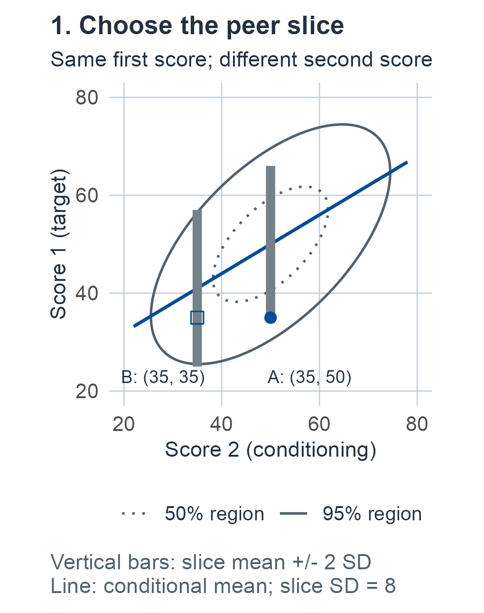
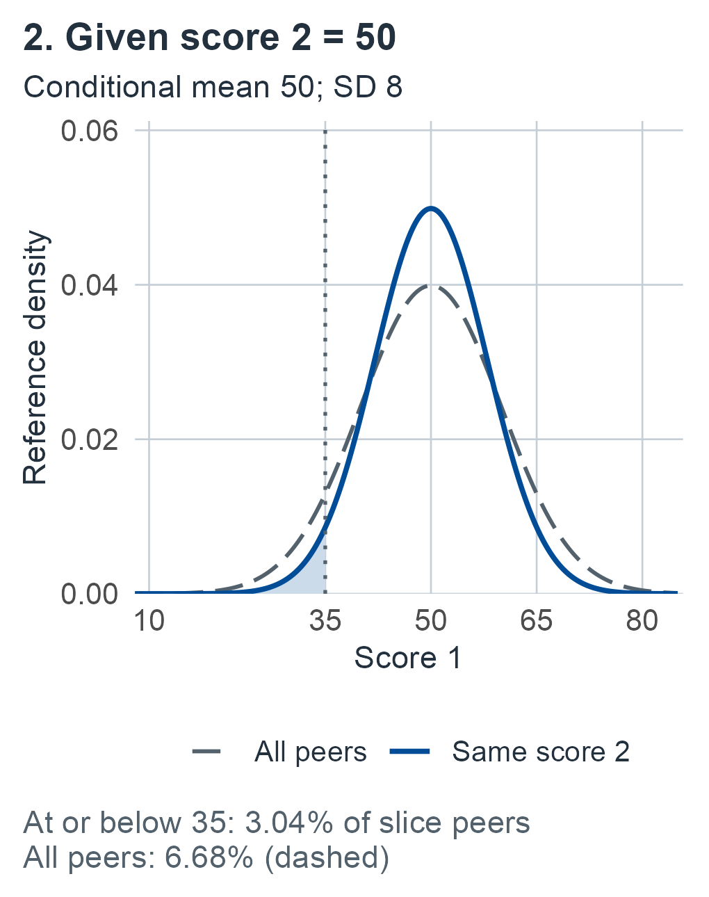
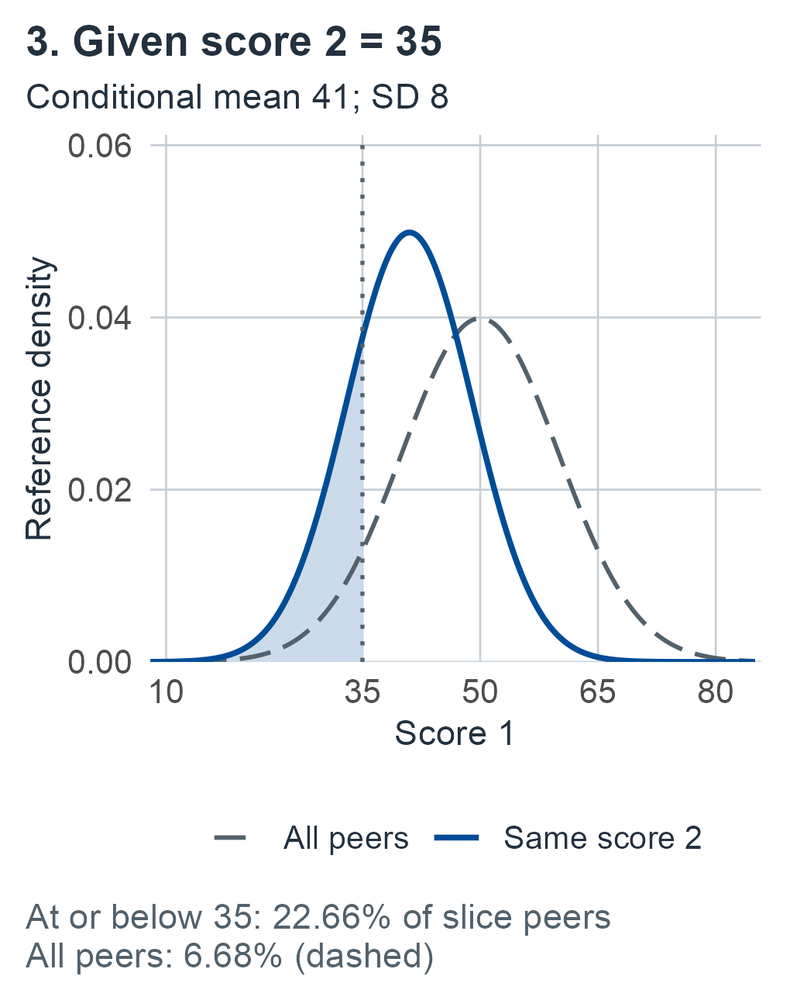

# A correlated battery {#sec-correlated-battery}

This chapter develops known-law and finite-reference comparisons of observed-score profiles, including conditional comparisons, counts and covariance choices.

## Same first score, different company {#sec-m03-question}

Two people take the same two tests. Both tests are scored so that higher is better, and among reference peers each has mean 50 and SD 10. Both people score 35 on the first test. One scores 50 on the second test; the other scores 35. On the first test alone their performances are indistinguishable: each lies 1.5 SD below the reference mean, and about 6.7% of peers score at or below it. Should the two first-test scores be described the same way?

That depends on the question asked of the profile. Suppose, as a synthetic illustration used throughout this chapter, that the two observed scores have correlation .6 among reference peers. Several reasonable comparisons then give different answers:

- *How low is the average of the two scores?* About 20.1% of peers have an average at or below the first person's 42.5; about 4.7% have an average at or below the second person's 35.
- *How unusual is the gap between the two scores?* A gap of 15 points or more, in either direction, occurs in about 9.4% of peers. The second person has no gap.
- *How low is the first score among peers with the same second score?* Among peers who score 50 on the second test, about 3.0% score 35 or lower on the first. Among peers who score 35 on the second test, about 22.7% do.
- *How far is the whole profile from the reference center, or how many scores fall below a cutoff?* These questions give still other orderings, developed later in the chapter.

These answers do not contradict one another. The first person's average is less unusual, but the imbalance is more unusual. The second person's average is lower, yet a low first score is less surprising among peers who are also low on the second test. Each answer refers to a different event in the same joint reference distribution, and each uses information that a single-score percentile ignores: how the scores vary together. Those comparisons require a joint reference law and a declared question. Clinical reviews of normative interpretation now treat several such multivariate approaches, including base rates of low scores across a battery [@kiselica2024recent].

The initial known-law units develop that foundation with supplied known reference parameters. Later units explicitly introduce fitted reference samples or another comparison metric. The chapter extends the [scalar known-law comparison](01-one-performance.md#sec-m01-normal-example). The [finite-reference chapter](02-finite-reference.md#sec-finite-reference) explains why fitted parameters create another experiment; its scalar and fixed-design regression results do not automatically calibrate a fitted battery procedure.

By the end of the chapter, a reader should be able to name the reference event and its ordering before quoting a probability, state which scores or norms are held fixed and what repeats in the guarantee, and recognize when two similar-looking numbers answer different questions.

## How the chapter is organized {#sec-m03-roadmap}

The chapter develops nine units, listed below in the order they appear. Each one asks a different question of the same kind of observed-score profile and gives its own experiment, result and proof, Bayesian reading, return to the running example, and boundaries. A reader who needs one result can go directly to it.

:::: {.m03-scroll tabindex="0" role="group" aria-label="Table: Unit Question Reference law"}

| Unit | Question | Reference law |
|---|---|---|
| 1. [Composites and discrepancies](#sec-m03-linear); [conditional comparisons](#sec-m03-conditional) | How unusual is a declared average or contrast, or a score among peers with given other scores? | Known |
| 2. [Whole-profile distance](#sec-m03-quadratic) | How far is the profile from the reference center, counting departures in any direction? | Known |
| 3. [Counts below cutoffs](#sec-m03-count) | How often do peers have at least this many scores at or below fixed cutoffs? | Known |
| 4. [Conditional counts](#sec-m03-conditional-count) | The same, among peers with given other scores | Known |
| 5. [Vector prediction](#sec-m03-vector-prediction) | How unusual is a whole profile when the mean and covariance are estimated? | Fitted |
| 6. [A named family](#sec-m03-family) | Which named scores cross a threshold calibrated for the whole declared family? | Known |
| 7. [A fitted count rule](#sec-m03-fitted-count) | What fraction of the population actually crosses cutoffs fitted from norms? | Fitted |
| 8. [Conditional target-vector prediction](#sec-m03-conditional-vector) | Unit 1's conditional comparison, with an estimated relationship | Fitted |
| 9. [Covariance choices and the declared battery](#sec-m03-covariance-battery) | Does calibration survive another weighting matrix, a smaller battery, or score-dependent selection? | Known, then fitted |

::::

For a first reading, follow the [known-law experiment](#sec-m03-known-experiment) through [linear](#sec-m03-linear) and [conditional comparisons](#sec-m03-conditional) to their [worked example](#sec-m03-example), then [profile distance](#sec-m03-quadratic), [counts](#sec-m03-count) and [conditional counts](#sec-m03-conditional-count). The [named-family unit](#sec-m03-family) returns to supplied population inputs; [changed-metric comparisons](#sec-m03-metric-law) also begin with a known law.

For estimated norms, continue from [vector prediction](#sec-m03-vector-prediction) to [fitted-count content](#sec-m03-fitted-count) or [conditional target-vector prediction](#sec-m03-conditional-vector), according to the question. Read [fitted metrics](#sec-m03-metric-fitted) and [battery selection](#sec-m03-battery-protocol) before changing those procedures. For consultation, go directly to the [lookup guide](#sec-m03-guide), then read the linked experiment, full result conditions and worked example before using a calculation.

## The running example and reused symbols {#sec-m03-running}

Every unit returns to the same synthetic material, so that a change in the answer can be traced to a change in the question or the experiment rather than to new data. The R companion's M03 guide reproduces these comparisons step by step and identifies the target and units of each output table.

- **Known population inputs** (@eq-m03-example-law): means $(50,50)^T$, both SDs 10, observed-score correlation .6.
- **Two profiles**, written (score 1, score 2): $y^{(a)}=(35,50)^T$ and $y^{(b)}=(35,35)^T$. Higher scores are better on both tests.
- **A teaching cutoff** of 40 on both tests (1 SD below the mean), stipulated in advance and not clinically validated.
- **A hypothetical norm sample** of $n=20$ people whose sample mean and covariance happen to equal the known inputs above. It defines a different experiment, used from the [vector-prediction unit](#sec-m03-vector-prediction) onward.

None of these numbers is empirical norm data, and none supports a diagnosis.

The chapter covers many experiments with a limited alphabet, so several letters carry different meanings in different units. Each is defined where it is used; the most likely confusions are:

:::: {.m03-scroll tabindex="0" role="group" aria-label="Table: Symbol Meanings, by unit"}

| Symbol | Meanings, by unit |
|---|---|
| $Q_C$ | Distance of the conditioning block from its mean ([quadratic unit](#sec-m03-quadratic-block)); distance under a chosen comparison matrix $C$ ([covariance unit](#sec-m03-metric-law)) |
| $C$, $c$ | Conditioning block of scores and a conditioning value; a cutoff vector (count units); a chi-square quantile $c_{k,1-\alpha}$; a comparison matrix (covariance unit) |
| $T$ | Target block of scores; count tail $T_k$; Student CDF $T_v$ |
| $h$ | Prediction multiplier $1+1/n$ or leverage multiplier $h(x_0)$; joint crossing probability $h_\rho$ (count example) |
| $d$ | Distance $d(y)$; denominator degrees of freedom $n-p$; number of regression features $q+1$ (conditional-vector unit) |
| $S$, $A$ | Sample covariance and scatter matrices; fixed summary $S_w$; adjusted family comparison $A_j$ |
| $B$, $H$, $M$, $R$, $E$ | Each has a local meaning in one unit and another elsewhere (for example $B$: conditional coefficients, regression coefficients, Bonferroni values $B_j$; $H$: family flagging frequency $H(t)$, a normal matrix in a proof, a score transformation). Read the nearest definition. |

::::

## Known-law baseline: observations, targets and design {#sec-m03-known-experiment}

We start with the simplest experiment that can answer the opening question: the joint distribution of the observed scores among reference peers is supplied, not estimated. Units 1 to 4, unit 6 and the first part of unit 9 compute probabilities under this one law.

Let $Y=(Y_1,\ldots,Y_p)^T$ be the observed score profile from one person assessed under a fixed administration and scoring protocol, on specified score scales. The intended peer population is fixed. Let $y$ denote the observed case profile. Supply the reference law

:::: {.m03-scroll tabindex="0" role="group" aria-label="Equation: known law"}

$$
Y\sim N_p(\mu,\Sigma),\qquad p\ge2,\qquad \Sigma=\Sigma^T\succ0,
$$ {#eq-m03-known-law}

::::

where $\mu\in\mathbb R^p$ and $\Sigma\in\mathbb R^{p\times p}$ are **known population inputs**. Positive definiteness means $x^T\Sigma x>0$ for every nonzero real $x$; informally, no weighted combination of the scores is constant across peers, so no score is an exact linear function of the others.

Covariances refer to these observed scores, in products of their stated units. They are not latent-ability covariances or within-person error variances. No normative sample is fitted here. A Gaussian model for bounded, discrete or coarsened tests is an additional modeling choice; the exact laws below require the stated continuous joint model.

Fix the battery, weights, target/conditioning partition and tail directions independently of the profile. At the realized $y$, our targets are reference probabilities of specified events: a linear summary at least as low as observed, a discrepancy at least as far from its reference mean, or a target score at least as low as observed **conditional on other observed scores**. Probabilities are on a 0–1 scale; multiply by 100 for percentages.

The repeated experiment samples observed profiles from different reference persons under this same law and protocol. For conditional calibration, it uses the conditional reference law at a fixed conditioning profile. These are not repeated measurements of the case. Evaluating $y$ against the reference law does not assert that the case belongs to that population; it describes the null comparison under which calibration is claimed.

## Linear composites and discrepancies {#sec-m03-linear}

The simplest way to summarize a profile is a fixed weighted sum: an average, a total, or a difference between two scores. Each such summary is one number, so its comparison works exactly like a single-score percentile once we know the summary's own mean and variance. The new ingredient is that its variance depends on how the scores covary. When two tests tend to move together, their average varies more than it would for unrelated tests, and their difference varies less. With equal SDs of 10 and correlation .6, the average of two scores has SD about 8.94 rather than 7.07, and the difference has SD about 8.94 rather than 14.14. Treating correlated scores as independent would therefore misstate both comparisons, in opposite directions.

Use the following construction of the multivariate normal: $Y=\mu+LG$, where $L$ is a nonsingular $p\times p$ matrix with $LL^T=\Sigma$ and the coordinates of $G$ are independent standard normals. A positive-definite symmetric matrix admits such an $L$, for example by taking positive square roots of its eigenvalues in an orthonormal eigenbasis. The vector $G$ is a mathematical construction, with no latent cognitive interpretation.

::: {#prp-m03-linear-normal}
## Fixed affine summaries of a known Gaussian profile

**Target and assumptions.** Use @eq-m03-known-law. Let $W\in\mathbb R^{d\times p}$ and $b\in\mathbb R^d$ be fixed. Summaries are evaluated on the declared observed score scale.

**Result.** The vector $S=b+WY$ has Gaussian law, possibly degenerate, with

:::: {.m03-scroll tabindex="0" role="group" aria-label="Equation: affine"}

$$
E(S)=b+W\mu,\qquad \operatorname{Cov}(S)=W\Sigma W^T.
$$ {#eq-m03-affine}

::::

The covariance is positive semidefinite, and is positive definite exactly when $W$ has full row rank. In particular, for fixed $w\in\mathbb R^p\setminus\{0\}$,

:::: {.m03-scroll tabindex="0" role="group" aria-label="Equation: linear standardization"}

$$
S_w=w^TY\sim N(m_w,v_w),\quad
m_w=w^T\mu,\quad v_w=w^T\Sigma w>0,\quad
Z_w=\frac{S_w-m_w}{\sqrt{v_w}}\sim N(0,1).
$$ {#eq-m03-linear-standardization}

::::
:::

::: {.proof}
Linearity of expectation and the covariance identity for a fixed linear map give @eq-m03-affine for any finite-second-moment vector, without normality. Here also $S=b+W\mu+WLG$.

For completeness, if $G_j$ is standard normal, integration by parts in its density gives $\psi'(t)=-t\psi(t)$ for $\psi(t)=E(e^{itG_j})$, with $\psi(0)=1$; the Gaussian density makes the boundary term vanish. Hence $\psi(t)=e^{-t^2/2}$. Independence of its coordinates gives, for any $t\in\mathbb R^d$,

:::: {.m03-scroll tabindex="0" role="group" aria-label="Equation: affine characteristic"}

$$
E(e^{it^TS})
=\exp\!\left\{it^T(b+W\mu)-\tfrac12t^TW\Sigma W^Tt\right\}.
$$ {#eq-m03-affine-characteristic}

::::

This is the characteristic function of the stated Gaussian law, including singular linear images. For $a\in\mathbb R^d$, $a^TW\Sigma W^Ta=(W^Ta)^T\Sigma(W^Ta)\ge0$, with equality exactly when $W^Ta=0$. Thus full row rank is necessary and sufficient for positive definiteness. Taking $d=1$, $b=0$, $W=w^T$ proves the scalar statement. The zero vector would give a constant summary and cannot be standardized by this formula.
:::

In words, a fixed weighted summary of a jointly normal profile is normal, centered at the same weighted sum of the reference means, with variance $w^T\Sigma w$. That quadratic form is where the covariances enter: a positive covariance adds to the variance when the two weights share a sign and subtracts when they differ.

An average is one fixed composite. A fixed contrast has weights summing to zero, such as $(1,-1)^T$ for two tests on a comparable scale. This algebraic condition does not force $w^T\mu=0$: unequal reference means still require centering the contrast at its own mean. Weights can carry units when combining differently scaled scores; a difference of raw scores on unrelated scales needs a substantive rationale.

For the observed summary $s_w=w^Ty$, define $z_w=(s_w-m_w)/\sqrt{v_w}$. With $\Phi$ the standard normal CDF, the declared comparison events have probabilities

:::: {.m03-scroll tabindex="0" role="group" aria-label="Equation: linear tails"}

$$
\begin{aligned}
q_{w,L}(y)&=P_{\mathrm{ref}}(S_w\le s_w)=\Phi(z_w),\\
q_{w,U}(y)&=P_{\mathrm{ref}}(S_w\ge s_w)=1-\Phi(z_w),\\
q_{w,2}(y)&=P_{\mathrm{ref}}\{|S_w-m_w|\ge|s_w-m_w|\}
=2\Phi(-|z_w|).
\end{aligned}
$$ {#eq-m03-linear-tails}

::::

The two-sided event orders departures by absolute distance from the reference mean. It is appropriate only when that is the intended question. A lower tail for $Y_1-Y_2$ asks specifically whether score 1 is relatively lower; its two-sided tail asks about imbalance in either direction. Strict and inclusive comparisons coincide under these continuous nondegenerate scalar laws.

Each tail answers a stated reference question: what fraction of peers has a summary at least this extreme, in the declared direction? Because the summary is a fixed function of the profile, a rule that flags small tail values has a known flagging frequency among reference peers. If $Y$ itself is drawn from the reference law and $0<\alpha<1$ is fixed, each declared tail rule is exactly calibrated:

:::: {.m03-scroll tabindex="0" role="group" aria-label="Equation: linear calibration"}

$$
P_{\mathrm{ref}}\{q_{w,L}(Y)\le\alpha\}
=P_{\mathrm{ref}}\{q_{w,U}(Y)\le\alpha\}
=P_{\mathrm{ref}}\{q_{w,2}(Y)\le\alpha\}=\alpha.
$$ {#eq-m03-linear-calibration}

::::

For the lower tail this follows from $P\{Z_w\le\Phi^{-1}(\alpha)\}=\alpha$; symmetry gives the upper tail, and $P\{|Z_w|\ge\Phi^{-1}(1-\alpha/2)\}=\alpha$ gives the two-sided case. This is one fixed rule's reference flagging frequency. Choosing the most unusual summary after viewing the profile changes the experiment; it has no such guarantee from @eq-m03-linear-calibration. Multiple prespecified summaries also do not receive a simultaneous guarantee from their individual calibrations.

## Conditional comparisons among observed peers {#sec-m03-conditional}

A composite combines scores into one number. A conditional comparison instead keeps the target score separate and changes the **comparison group**: it compares the first score with peers who share the observed second score.

Picture the reference population as a cloud of points, one per peer, with the second score on the horizontal axis and the first on the vertical (@fig-m03-conditional-slices). With positive correlation the cloud is an ellipse tilted upward. Draw a thin vertical slice at second score 50: the peers in that slice have first scores centered at 50 and spread less widely than the whole cloud. Move the slice to second score 35 and its center drops, to 41 in the running example, while its spread stays the same. A conditional comparison asks where the observed first score falls **within the relevant slice**. The algebra below finds the slice's center, its spread, and the residual distance from the center. In neuropsychological practice the same comparison is also made with a regression equation predicting one score from another, which can be built from published means, SDs and correlations alone [@crawford2007regression]; the [conditional-vector unit](#sec-m03-conditional-vector) treats that estimated version.

::: {#fig-m03-conditional-slices .m03-content-figure fig-alt="Joint distribution of two synthetic observed test scores: score 2 horizontal, score 1 vertical, both axes 20 to 80. Correlation 0.6 tilts 50% and 95% ellipses upward. Bars at score 2=50 and 35 have score 1 means 50 and 41, each +/-16. Circle A=(35,50) and open square B=(35,35) share score 1=35. Score 1 reference densities for all peers (dashed) and peers with score 2=50 (solid), on common axes with the next panel. The conditional mean is 50, SD8. Dotted cutoff at the observed 35; shaded conditional lower tail is 3.04% of this slice versus 6.68% of all peers. Same score 1 density axes, now conditioning on score 2=35. The solid conditional curve moves to mean 41 while its SD stays 8; dashed all-peer curve is unchanged. At the observed 35, the conditional lower tail is 22.66%, versus the unchanged marginal 6.68%."}

Conditional comparisons under the supplied synthetic law. **1.** Score 2 is horizontal and score 1 vertical in the joint reference picture. The 50% and 95% central ellipses, the mean line $50+.6(c-50)$ and the bars at score 2=50 and 35 track the same two profiles, written (score 1,score 2): A=$(35,50)$, filled circle; B=$(35,35)$, open square. Each bar extends two conditional SDs (8 points per SD) around its slice mean, respectively 50 and 41. **2–3.** Solid curves show score 1 among peers in each slice, separately; dashed curves repeat its unchanged marginal law. Shading lies at or below the observed score 35 in each conditional law. The full-law conditional lower tails are 3.04% and 22.66%, versus 6.68% marginally. Curves span 8 to 85; the readouts also include probability outside that plotted range. These are reference distributions of observed scores among different people, not sampling distributions, posteriors or either person's retest scores. All inputs are stipulated teaching values. Open a panel for its full-resolution image.

:::

Partition the coordinates into a nonempty target block $T$ and nonempty conditioning block $C$, of sizes $r$ and $s$, with $r+s=p$. The subscript $C$ here labels a block of observed test scores. It introduces no new background-covariate or measurement model. After a fixed reordering, write

:::: {.m03-scroll tabindex="0" role="group" aria-label="Equation: partition"}

$$
Y=\begin{pmatrix}Y_T\\Y_C\end{pmatrix},\quad
\mu=\begin{pmatrix}\mu_T\\\mu_C\end{pmatrix},\quad
\Sigma=\begin{pmatrix}\Sigma_{TT}&\Sigma_{TC}\\
\Sigma_{CT}&\Sigma_{CC}\end{pmatrix}.
$$ {#eq-m03-partition}

::::

::: {#prp-m03-conditional-normal}
## Gaussian conditional scores and independent residuals

**Target and assumptions.** Use the known law in @eq-m03-known-law and the fixed coordinate partition in @eq-m03-partition. Conditioning is on observed scores from the same reference profile.

**Result.** Define the $r\times s$ coefficient matrix, conditional mean function and $r\times r$ covariance by

:::: {.m03-scroll tabindex="0" role="group" aria-label="Equation: conditional parameters"}

$$
\begin{aligned}
B&=\Sigma_{TC}\Sigma_{CC}^{-1},\\
m_T(c)&=\mu_T+B(c-\mu_C),\\
V_T&=\Sigma_{TT}-\Sigma_{TC}\Sigma_{CC}^{-1}\Sigma_{CT}.
\end{aligned}
$$ {#eq-m03-conditional-parameters}

::::

Both $\Sigma_{CC}$ and $V_T$ are positive definite. The residual

:::: {.m03-scroll tabindex="0" role="group" aria-label="Equation: residual"}

$$
R_T=Y_T-m_T(Y_C)
$$ {#eq-m03-residual}

::::

has law $N_r(0,V_T)$ and is independent of $Y_C$. Consequently the conditional law, using its everywhere-defined Gaussian-density version, is

:::: {.m03-scroll tabindex="0" role="group" aria-label="Equation: conditional law"}

$$
Y_T\mid Y_C=c\sim N_r\{m_T(c),V_T\},\qquad c\in\mathbb R^s.
$$ {#eq-m03-conditional-law}

::::
:::

::: {.proof}
For nonzero $u\in\mathbb R^s$, the vector $(0,u)^T$ gives $u^T\Sigma_{CC}u>0$, so the conditioning inverse exists. For nonzero $x\in\mathbb R^r$, put $h=-\Sigma_{CC}^{-1}\Sigma_{CT}x$. Direct expansion yields

:::: {.m03-scroll tabindex="0" role="group" aria-label="Equation: schur positive"}

$$
0<\begin{pmatrix}x\\h\end{pmatrix}^{\!T}
\Sigma\begin{pmatrix}x\\h\end{pmatrix}=x^TV_Tx.
$$ {#eq-m03-schur-positive}

::::

This proves positivity of the Schur complement $V_T$. It also excludes a deterministically predicted target under the current assumptions.

The stacked vector $(R_T,Y_C)$ is a fixed affine image of $Y$, so is jointly Gaussian by @prp-m03-linear-normal. Its means are $(0,\mu_C)$, and direct covariance multiplication gives

:::: {.m03-scroll tabindex="0" role="group" aria-label="Equation: residual covariance"}

$$
\operatorname{Cov}(R_T,Y_C)
=\Sigma_{TC}-B\Sigma_{CC}=0,\qquad
\operatorname{Var}(R_T)=V_T.
$$ {#eq-m03-residual-covariance}

::::

Insert this block-diagonal covariance in @eq-m03-affine-characteristic: the joint characteristic function factors into the characteristic functions for $N_r(0,V_T)$ and $N_s(\mu_C,\Sigma_{CC})$. This proves independence, using joint Gaussianity as well as zero covariance. Thus conditional on $Y_C=c$, the equation $Y_T=m_T(c)+R_T$ gives @eq-m03-conditional-law. Positive definiteness supplies a positive Gaussian density for every $c$, and the density ratio defines that conditional version even though a particular continuous value has probability zero.
:::

Each piece of @eq-m03-conditional-parameters has a direct reading in the slice picture. The coefficient matrix $B$ says how far the slice center moves per unit change in the conditioning scores; in the running example it is the single number .6. The function $m_T(c)$ is the slice center itself. The matrix $V_T$ is the spread that remains within a slice. The residual $R_T$ is the observed target's distance from its slice center, and its independence from $Y_C$ is what makes one standardization serve every slice.

The conditional covariance does not depend on $c$ in this model. It satisfies

:::: {.m03-scroll tabindex="0" role="group" aria-label="Equation: covariance reconstruction"}

$$
\Sigma_{TT}=V_T+B\Sigma_{CC}B^T,
$$ {#eq-m03-covariance-reconstruction}

::::

so conditioning removes the positive-semidefinite covariance of the conditional means. This is a comparison of population spreads, not a reliability decomposition. The mean $m_T(c)$ is the expected target score **among reference peers with those observed conditioning scores**. It is not this person's expected score across replications, latent true score or retest expectation.

For a scalar target $T=\{j\}$, write $v_{j\mid C}=V_T>0$. At observed $(y_j,c)$, define

:::: {.m03-scroll tabindex="0" role="group" aria-label="Equation: conditional cdf"}

$$
z_{j\mid C}=\frac{y_j-m_j(c)}{\sqrt{v_{j\mid C}}},\qquad
F_{j\mid C}(y_j\mid c)=\Phi(z_{j\mid C}).
$$ {#eq-m03-conditional-cdf}

::::

This is the conditional lower-tail reference proportion. Upper and two-sided comparisons are respectively $1-\Phi(z_{j\mid C})$ and $2\Phi(-|z_{j\mid C}|)$, with distance measured from $m_j(c)$. In the repeated reference experiment the residual standardization is standard normal independently of $Y_C$. For each fixed $c$ and $0<\alpha<1$,

:::: {.m03-scroll tabindex="0" role="group" aria-label="Equation: conditional calibration"}

$$
P_{\mathrm{ref}}\{F_{j\mid C}(Y_j\mid c)\le\alpha\mid Y_C=c\}=\alpha.
$$ {#eq-m03-conditional-calibration}

::::

The same conditional equality holds for the declared upper and two-sided rules by normal symmetry. Integrating over $Y_C$ gives their marginal calibration too. This does not permit changing the target block, conditioning block or tail after inspecting which choice produces the smallest number. The vector conditional law supplies a building block; it does not itself select an ordering or an omnibus tail for a multivariate target.

## Known-law inference and Bayesian conditioning {#sec-m03-known-bayesian}

The preceding probabilities answer reference questions exactly under the supplied law. They are neither confidence intervals for estimated means/covariances nor probabilities that an individual has a latent deficit. For example, when $T=\{j\}$, the interval

:::: {.m03-scroll tabindex="0" role="group" aria-label="Equation: conditional interval"}

$$
\left[m_j(c)-\Phi^{-1}(1-\alpha/2)\sqrt{v_{j\mid C}},\quad
m_j(c)+\Phi^{-1}(1-\alpha/2)\sqrt{v_{j\mid C}}\right]
$$ {#eq-m03-conditional-interval}

::::

contains a random target observed score with conditional reference probability $1-\alpha$ at each fixed $c$. Its width represents conditional between-person performance variation. There is no reference-estimation component to remove by acquiring a larger norm sample in this known-law calculation.

A Bayesian supplied with the same known joint reference law obtains the same conditional-predictive distribution for an **as yet unobserved target coordinate of a reference person**, after observing $Y_C=c$. Bayes conditioning here is the normalized density $f(y_T,c)/f_C(c)$, whose proper Gaussian form was proved above. It integrates to one because $V_T\succ0$. No unknown reference parameter, nondegenerate prior or parameter-propriety calculation is needed. Equivalently, if reference parameters were represented by a point-mass prior at the supplied $(\mu,\Sigma)$, a reference-model likelihood would leave that point mass unchanged; that convention adds no uncertainty.

This section is the full statement of a pattern that recurs in every known-law unit below. After the target score is also observed, its conditional tail is a reference comparison at that value, not a posterior distribution for the already observed score. Predicting another person's *entire* independent reference profile still uses the original joint law. Predicting this person's retest requires a joint-occasion model, and estimating latent ability requires a measurement likelihood and prior. Uncertain norms would instead require a reference-sampling likelihood and a declared treatment of covariance and other nuisance uncertainty. Those are distinct extensions, without a general confidence/credible equivalence established here.

## Two synthetic profiles under one supplied law {#sec-m03-example}

For illustration only, supply

:::: {.m03-scroll tabindex="0" role="group" aria-label="Equation: example law"}

$$
\mu=\begin{pmatrix}50\\50\end{pmatrix},\qquad
\Sigma=\begin{pmatrix}100&60\\60&100\end{pmatrix}.
$$ {#eq-m03-example-law}

::::

Both SDs are 10 and the observed-score correlation is $.6$; none is estimated from the two cases. Higher scores indicate better performance on both comparable scales. Fix the average $S_{\mathrm{av}}=(Y_1+Y_2)/2$, discrepancy $S_{\mathrm{diff}}=Y_1-Y_2$, and conditional target $Y_1\mid Y_2$ before viewing the profiles. Then

:::: {.m03-scroll tabindex="0" role="group" aria-label="Equation: example laws"}

$$
\begin{aligned}
S_{\mathrm{av}}&\sim N(50,80),& S_{\mathrm{diff}}&\sim N(0,80),\\
Y_1\mid Y_2=c&\sim N\{50+.6(c-50),64\}.&&
\end{aligned}
$$ {#eq-m03-example-laws}

::::

The second argument of each normal law is its **variance**. Thus both linear summaries have SD $\sqrt{80}=8.9442719$, while the conditional SD is 8. These similar-looking scales arise from different questions. The marginal first score has SD 10.

Compare profiles $y^{(a)}=(35,50)^T$ and $y^{(b)}=(35,35)^T$. Before reading the table, consider the second person. Their first score is low, but so is their second. Among peers who share that low second score, should a first score of 35 look more or less unusual than it does among all peers? Because the scores are positively correlated, peers who are low on the second test tend to be lower on the first as well, so the comparison group is centered lower and 35 should look *less* unusual. For the first person, whose second score is at the mean, the comparison group keeps the marginal center but is less spread out, so 35 should look *more* unusual.

For marginal and average performance, declare a lower-tail comparison. For discrepancy, declare the two-sided imbalance event. For conditional performance, declare a lower tail relative to peers with the same second score. The table also displays the signed discrepancy standardization to make its direction visible.

:::: {.m03-scroll tabindex="0" role="group" aria-label="Table: Comparison Profile y^{(a)}=(35,50)^T Profile y^{(b)}=(35,35)^T"}

| Comparison | Profile $y^{(a)}=(35,50)^T$ | Profile $y^{(b)}=(35,35)^T$ |
|---|---:|---:|
| Marginal score 1: value; $z$; lower tail | $35$; $-1.5000000$; $.0668072$ | $35$; $-1.5000000$; $.0668072$ |
| Average: value; $z$; lower tail | $42.5$; $-.8385255$; $.2008678$ | $35$; $-1.6770510$; $.0467663$ |
| Discrepancy: value; $z$; two-sided tail | $-15$; $-1.6770510$; $.0935325$ | $0$; $0$; $1$ |
| Score 1 conditional on score 2: expected value; residual; $z$; lower tail | $50$; $-15$; $-1.8750000$; $.0303964$ | $41$; $-6$; $-.7500000$; $.2266274$ |

::::

The formulas are exact normal-CDF expressions; displayed evaluations are rounded numerical values. The accompanying probability checks compare direct density integrals with CDF evaluations; these stipulated inputs supply no empirical evidence.

The table confirms the prediction. Both people have the same 6.68% marginal lower tail on score 1. The first person's average is less low, while their imbalance is more unusual: under the declared two-sided discrepancy event its reference probability is about 9.35%. Among peers scoring 50 on test 2, score 1 has conditional mean 50 and SD 8, giving a 3.04% lower tail at 35. For the second person, the average is lower, but there is no observed discrepancy. Peers scoring 35 on test 2 have conditional first-score mean 41, so 35 has a conditional lower tail of 22.66%. This does not make the score a high marginal performance; it changes the comparison group and reference center.

The conditional expectation 41 is closer to the marginal mean 50 than the conditioning score 35 in this equal-scale example. That population association supplies no evidence of personal recovery or of which test reflects an underlying ability more accurately. No one of these four probabilities replaces the others, and none is a disease probability.

A report sentence for the first person could read: "Under the supplied joint reference law, about 3% of peers who score 50 on test 2 score 35 or lower on test 1." The sentence names the comparison group, the event and the model. It does not say that the person has a 3% chance of being typical, or that test 1 is impaired.

## Boundaries and useful reductions {#sec-m03-boundaries}

The results above use three ingredients: a joint Gaussian law, a positive-definite covariance, and summaries fixed on the stated score scales. The paragraphs below show what survives when each ingredient is weakened.

**Moment identities need less than Gaussian laws.** The affine mean/covariance formulas and residual covariance cancellation remain algebraically true for any vector with the stated finite moments and positive-definite covariance. Conditional means need not then be linear, conditional variances need not be constant, and uncorrelated residuals need not be independent. Even normal marginal scores are insufficient: if $X\sim N(0,1)$ and an independent sign $J$ is equally likely to be $-1$ or $1$, then $(X,JX)$ has standard normal marginals and covariance $I_2$, but its coordinates satisfy $|JX|=|X|$ and are dependent. Its joint law is not Gaussian.

**Zero cross-covariance under the joint model.** If $\Sigma_{TC}=0$, then $B=0$, $m_T(c)=\mu_T$ and $V_T=\Sigma_{TT}$. Joint Gaussianity then gives independence, and conditional comparisons reduce to marginal ones. With diagonal $\Sigma$, every disjoint coordinate partition has this property. In the two-score example with correlation reset to zero, average variance is 50, discrepancy variance is 200, and the conditional first-score mean/variance are 50/100.

**Consistent changes of units.** For $\widetilde Y=a+DY$ with positive diagonal $D$, transform the law to $\widetilde\mu=a+D\mu$, $\widetilde\Sigma=D\Sigma D$. To represent the same linear question, use $\widetilde w=D^{-T}w$, giving $\widetilde w^T(\widetilde y-\widetilde\mu)=w^T(y-\mu)$ and unchanged summary variance and $z$. The uncentered summary has a known additive shift $\widetilde w^Ta$ relative to $w^Ty$, which must also be applied to its comparison threshold. For a fixed partition, $\widetilde m_T(\widetilde c)=a_T+D_Tm_T(c)$ and $\widetilde V_T=D_TV_TD_T$, so a scalar conditional tail is unchanged. Reusing numerical average weights after different rescalings can define a different question. Nonlinear marginal norm transformations require an induced joint law and do not preserve linear summaries automatically.

**Redundancy and near-singularity.** Redundant summaries such as $(Y_1,Y_2,Y_1+Y_2)$ have singular covariance even when $\Sigma\succ0$. A battery containing a deterministic total and all its components also violates the positive-definite input assumption. A constant scalar summary has no continuous normal tail standardization. These cases require removing redundancy or formulating a separate degenerate-law analysis.

For equal marginal SD $\sigma$ and correlation $-1<\rho<1$, the average and discrepancy variances are $\sigma^2(1+\rho)/2$ and $2\sigma^2(1-\rho)$, and the scalar conditional variance is $\sigma^2(1-\rho^2)$. As $\rho\uparrow1$, the latter two tend to zero. For fixed profile $(35,50)$ with means 50 and $\sigma=10$, its conditional $z=-15/\{10\sqrt{1-\rho^2}\}$ tends to $-\infty$. For $(35,35)$, its conditional $z=-1.5\sqrt{(1-\rho)/(1+\rho)}$ tends to zero. This explains the sensitivity of conditional comparisons to a nearly deterministic association. At $\rho=1$ the full covariance is singular; the positive-density conditional construction and continuous calibration statements above no longer apply. One cannot obtain a general singular-law guarantee merely by plugging that boundary into the inverse/standardization formulas.

## A known-law distance for the whole profile {#sec-m03-quadratic}

The earlier comparisons fix a weighted direction or a target score conditional on other observed scores. A different question asks whether the **whole profile** is far from the reference center when distances account for the supplied covariance. This requires declaring an ordering of profiles. Here we order by squared distance after transforming the reference covariance to the identity.

Geometrically, the contours of a joint normal density are ellipses (ellipsoids for more than two scores), tilted and stretched by the covariance. The distance used here counts how many contour "steps" a profile lies from the center. Two profiles on the same ellipse are equally far, even if one is low on both tests and the other is low on only one. In @fig-m03-conditional-slices the profile $(35,35)$ lies along the long axis of the ellipse, where peers are plentiful, while $(35,50)$ lies off that axis. With positive correlation, a profile whose scores disagree can therefore be farther from center than one whose scores are equally low. Large departures in any direction count, including unusually high scores. This is an omnibus reference comparison, not a rule specifically for low performance.

Continue to use @eq-m03-known-law on the declared observed score scales: known $\mu$, known symmetric positive-definite $\Sigma$, fixed peer population and protocol. Fix the battery, center, covariance, distance rule and any coordinate partition independently of the evaluated profile. Repeated sampling still concerns observed profiles from different reference persons; no finite norm sample, personal replications or latent model is introduced. For a realized profile $y$, define

:::: {.m03-scroll tabindex="0" role="group" aria-label="Equation: quadratic distance"}

$$
Q(y)=(y-\mu)^T\Sigma^{-1}(y-\mu),\qquad d(y)=\sqrt{Q(y)}.
$$ {#eq-m03-quadratic-distance}

::::

$Q(y)$ is the squared Mahalanobis distance of the profile from the reference mean. Mahalanobis introduced this generalized distance to measure the separation of two populations' mean vectors under a common dispersion matrix [@mahalanobis1936generalized, p. 50]; here one endpoint is a single observed profile. In neuropsychology, comparing it with a chi-square law on $p$ degrees of freedom, with the normative covariance treated as known, is the test of profile unusualness proposed by Huba and later applied to Wechsler index profiles as the Mahalanobis distance index [@huba1985unusual, p. 322; @crawford2012waisiv, pp. 197, 204]. The inverse covariance cancels the score units, so both quantities are dimensionless. $Q$ is the **squared** distance; $d$ is the distance. An inverse exists because the original score covariance is positive definite, not because every collection of summaries is nonredundant.

### The reference law and central region {#sec-m03-quadratic-law}

For integer $k\ge1$, let $\chi^2_k$ denote the sum of the squares of $k$ independent standard normals; $k$ is its degrees of freedom. Write $F_k$ for its CDF and $\overline F_k=1-F_k$ for its upper tail. A useful exact integral representation is

:::: {.m03-scroll tabindex="0" role="group" aria-label="Equation: chi square cdf"}

$$
\begin{aligned}
f_k(t)&=\frac{t^{k/2-1}e^{-t/2}}{2^{k/2}\Gamma(k/2)},\\
F_k(t)&=\int_0^t f_k(u)\,du,\qquad t>0,
\end{aligned}
$$ {#eq-m03-chi-square-cdf}

::::

with $F_k(t)=0$ for $t\le0$. Here $\Gamma(a)=\int_0^\infty v^{a-1}e^{-v}\,dv$, $a>0$. The density is positive for $t>0$, so the positive quantile $c_{k,1-\alpha}=F_k^{-1}(1-\alpha)$ is unique for $0<\alpha<1$.

::: {#prp-m03-quadratic-normal}
## Known-covariance profile distance and reference coverage

**Target and assumptions.** Use the fixed known observed-score law in @eq-m03-known-law and the fixed ordering in @eq-m03-quadratic-distance. The probability repeats reference profiles; $\mu$ and $\Sigma$ are not estimated.

**Result.** The random squared distance satisfies

:::: {.m03-scroll tabindex="0" role="group" aria-label="Equation: quadratic law"}

$$
Q(Y)\sim\chi^2_p.
$$ {#eq-m03-quadratic-law}

::::

At observed $y$, the upper-tail reference probability is

:::: {.m03-scroll tabindex="0" role="group" aria-label="Equation: quadratic tail"}

$$
\pi_{\mathrm{all}}(y)
=P_{\mathrm{ref}}\{Q(Y)\ge Q(y)\}
=\overline F_p\{Q(y)\}.
$$ {#eq-m03-quadratic-tail}

::::

For fixed $0<\alpha<1$, the central reference region

:::: {.m03-scroll tabindex="0" role="group" aria-label="Equation: quadratic region"}

$$
\mathcal E_{1-\alpha}
=\{y:Q(y)\le c_{p,1-\alpha}\}
$$ {#eq-m03-quadratic-region}

::::

has $P_{\mathrm{ref}}(Y\in\mathcal E_{1-\alpha})=1-\alpha$. The tail rule is exactly calibrated:

:::: {.m03-scroll tabindex="0" role="group" aria-label="Equation: quadratic calibration"}

$$
P_{\mathrm{ref}}\{\pi_{\mathrm{all}}(Y)\le\alpha\}=\alpha.
$$ {#eq-m03-quadratic-calibration}

::::
:::

::: {.proof}
Use the construction $Y=\mu+LG$, $LL^T=\Sigma$, from the linear development. The transformation $L^{-1}(Y-\mu)=G$ is called whitening: its coordinates have joint independent standard normal law. Then

:::: {.m03-scroll tabindex="0" role="group" aria-label="Equation: quadratic whitening"}

$$
Q(Y)=G^TL^T(LL^T)^{-1}LG=G^TG.
$$ {#eq-m03-quadratic-whitening}

::::

There are $p$ squared coordinates. The supplied reference center has not been estimated or replaced by the profile's own average, so no degree of freedom is lost.

To justify @eq-m03-chi-square-cdf from the sum-of-squares definition, the two inverse branches of $G_j^2=t$ give density $t^{-1/2}e^{-t/2}/\sqrt{2\pi}$ for $t>0$. This is a gamma density with shape $1/2$ and rate $1/2$, since the Gaussian integral gives $\Gamma(1/2)=\sqrt\pi$. Convolving two gamma densities of common rate $1/2$ adds their shapes: after substituting $u=tv$ in the convolution, the remaining integral is $\int_0^1v^{a-1}(1-v)^{b-1}\,dv=\Gamma(a)\Gamma(b)/\Gamma(a+b)$. This identity follows directly by changing variables $(x,y)$ to $(x+y,x/(x+y))$ in the product defining $\Gamma(a)\Gamma(b)$, with Jacobian $x+y$. Induction gives the density for $k$ squared independent normals above; substituting $t=2v$ verifies its normalization.

Thus $Q(Y)$ has the stated continuous CDF. The region event is exactly $Q(Y)\le c_{p,1-\alpha}$, so it has probability $1-\alpha$. Likewise $\pi_{\mathrm{all}}(Y)\le\alpha$ is $Q(Y)\ge c_{p,1-\alpha}$, up to a zero-probability boundary. This proves calibration and the observed-tail expression.
:::

The region is an ellipsoid centered at the supplied population mean. Its radius in whitened coordinates is $\sqrt{c_{p,1-\alpha}}$, not $c_{p,1-\alpha}$. It describes where a random reference performance falls. It is not a confidence region for an unknown mean or a credible region for this person's latent abilities. A nonsignificant omnibus tail also does not establish that every prespecified directional comparison is unremarkable; the events and orderings differ.

For computation, @eq-m03-chi-square-cdf is an exact integral; evaluating its quantile generally requires a numerical method. Two useful reductions follow directly from the definition and density:

:::: {.m03-scroll tabindex="0" role="group" aria-label="Equation: quadratic low df"}

$$
\overline F_1(q)=2\Phi(-\sqrt q),\qquad
\overline F_2(q)=e^{-q/2},\qquad q\ge0.
$$ {#eq-m03-quadratic-low-df}

::::

The first is the two-sided squared-normal event; the second integrates $f_2(t)=e^{-t/2}/2$. Although the main battery experiment has $p\ge2$, the one-dimensional reduction applies to scalar blocks and supplies a computational check. Neither expression preserves the sign of a performance deviation.

### Separating a conditioning block and target residual {#sec-m03-quadratic-block}

Use the fixed nonempty coordinate blocks $T,C$ from @eq-m03-partition, of dimensions $r,s$ with $r+s=p$. Keep the existing $B$, $m_T(c)$ and positive-definite $V_T$ from @eq-m03-conditional-parameters. At $y=(y_T,y_C)$ define

:::: {.m03-scroll tabindex="0" role="group" aria-label="Equation: quadratic block definitions"}

$$
\begin{aligned}
Q_C(y_C)&=(y_C-\mu_C)^T\Sigma_{CC}^{-1}(y_C-\mu_C),\\
Q_{T\mid C}(y)&=\{y_T-m_T(y_C)\}^TV_T^{-1}\{y_T-m_T(y_C)\}.
\end{aligned}
$$ {#eq-m03-quadratic-block-definitions}

::::

The first distance compares the conditioning scores marginally with their reference center. The second compares the target scores with the expected scores among peers having those observed conditioning values.

::: {#prp-m03-quadratic-block}
## Additive distances with different conditional meanings

**Target and assumptions.** Use the same known joint normal law, fixed coordinate partition and known conditional quantities as in @prp-m03-conditional-normal. The reference ordering is fixed before seeing the profile.

**Result.** For every observed profile,

:::: {.m03-scroll tabindex="0" role="group" aria-label="Equation: quadratic decomposition"}

$$
Q(y)=Q_C(y_C)+Q_{T\mid C}(y).
$$ {#eq-m03-quadratic-decomposition}

::::

In repeated reference sampling, the two summands are independent, with

:::: {.m03-scroll tabindex="0" role="group" aria-label="Equation: quadratic block laws"}

$$
Q_C(Y_C)\sim\chi^2_s,\qquad
Q_{T\mid C}(Y)\sim\chi^2_r.
$$ {#eq-m03-quadratic-block-laws}

::::

For each fixed conditioning value $c$, using the same Gaussian-density conditional version as before,

:::: {.m03-scroll tabindex="0" role="group" aria-label="Equation: quadratic conditioned laws"}

$$
\begin{aligned}
Q_{T\mid C}(Y_T,c)\mid Y_C=c&\sim\chi^2_r,\\
Q(Y_T,c)\mid Y_C=c&\sim Q_C(c)+\chi^2_r.
\end{aligned}
$$ {#eq-m03-quadratic-conditioned-laws}

::::
:::

::: {.proof}
Put $A=\Sigma_{TT}$, $K=\Sigma_{TC}$ and $C_0=\Sigma_{CC}$ for this calculation. Since $B=KC_0^{-1}$ and $V_T=A-KC_0^{-1}K^T$, block multiplication gives

:::: {.m03-scroll tabindex="0" role="group" aria-label="Equation: quadratic factorization"}

$$
\begin{aligned}
M&=\begin{pmatrix}I_r&B\\0&I_s\end{pmatrix},\\
\Sigma&=M\begin{pmatrix}V_T&0\\0&C_0\end{pmatrix}M^T.
\end{aligned}
$$ {#eq-m03-quadratic-factorization}

::::

$M$ is invertible and sends centered blocks $(y_T-\mu_T,y_C-\mu_C)$, under its inverse, to $(y_T-m_T(y_C),y_C-\mu_C)$. Inverting the displayed factorization therefore gives @eq-m03-quadratic-decomposition. This algebraic identity needs positive definiteness and the stated matrices, but not normality of a random vector.

For the distributional statement, @prp-m03-conditional-normal gives $R_T\sim N_r(0,V_T)$ independent of $Y_C\sim N_s(\mu_C,C_0)$. Whitening each block gives respectively $r$ and $s$ independent standard normals. Their squared lengths have the stated chi-square laws and are independent because their input blocks are independent. The sum is the squared length of all $r+s=p$ such normals, agreeing with @eq-m03-quadratic-law. At fixed $Y_C=c$, the residual law is unchanged while $Q_C(c)$ is a constant. This proves both conditional statements.
:::

The residual comparison has the upper tail

:::: {.m03-scroll tabindex="0" role="group" aria-label="Equation: quadratic conditional tail"}

$$
\pi_{T\mid C}(y)=\overline F_r\{Q_{T\mid C}(y)\}.
$$ {#eq-m03-quadratic-conditional-tail}

::::

It is exactly calibrated **conditional on each fixed $Y_C=c$**: the probability that it is at most $\alpha$ is $\alpha$. Equivalently, the conditional reference ellipsoid

:::: {.m03-scroll tabindex="0" role="group" aria-label="Equation: quadratic conditional region"}

$$
\mathcal E_{T\mid c,1-\alpha}
=\{t:Q_{T\mid C}(t,c)\le c_{r,1-\alpha}\}
$$ {#eq-m03-quadratic-conditional-region}

::::

contains a random target score vector with conditional probability $1-\alpha$. In a scalar block this is the earlier two-sided conditional reference interval: $c_{1,1-\alpha}=\{\Phi^{-1}(1-\alpha/2)\}^2$ by @eq-m03-quadratic-low-df. The residual-distance tail is therefore a **two-sided** comparison, not the earlier lower conditional percentile. Also, $\overline F_s\{Q_C(y_C)\}$ is a marginal omnibus comparison of the conditioning block; it is not uncertainty about the observed conditioning scores.

Global calibration does not imply the same flagging frequency within every conditioning stratum. With $k=c_{p,1-\alpha}$,

:::: {.m03-scroll tabindex="0" role="group" aria-label="Equation: quadratic global given c"}

$$
P_{\mathrm{ref}}\{Q(Y)\ge k\mid Y_C=c\}
=\overline F_r\{k-Q_C(c)\},
$$ {#eq-m03-quadratic-global-given-c}

::::

where the upper tail is 1 at nonpositive arguments. When $Q_C(c)\ge k$, the conditioning block alone puts the profile outside or on the global boundary, and the conditional flagging probability is 1. Otherwise that frequency depends on $c$. Averaging over $Y_C$ recovers the marginal global frequency $\alpha$. The calibrated conditional residual rule instead asks whether target performance is unusual *given* those conditioning scores. It can give a different answer without a contradiction.

These independent contributions are reference geometry, not independent cognitive causes. Reversing which scores are conditioned on generally reallocates the two contributions while leaving $Q$ unchanged. Neither contribution identifies a causal deficit or a unique mechanism.

### Known-law prediction and Bayesian interpretation {#sec-m03-quadratic-bayesian}

Before observing a new reference person's profile, the joint law assigns probability $1-\alpha$ to $\mathcal E_{1-\alpha}$. After observing their conditioning block, it assigns conditional probability $1-\alpha$ to $\mathcal E_{T\mid c,1-\alpha}$ for the as yet unobserved target. A Bayesian supplied with the same known joint law obtains these same predictive probabilities; the block conditioning uses the already normalized proper Gaussian conditional density. There is no unknown reference mean/covariance here to endow with a nondegenerate prior or integrate out.

The limits stated in the [known-law Bayesian section](#sec-m03-known-bayesian) apply unchanged. Once the whole profile is observed, $Q(y)$ and its reference tail are fixed functions of those observations and the supplied law. The tail is not a posterior probability that the case is in the reference population, has a disease, or has latent abilities outside an ellipsoid. A new independent reference person's entire profile retains its original joint law. Norm uncertainty, latent ability and personal retest questions need their own likelihoods and priors, and no general confidence/credible-region equivalence is established for them.

### The same two synthetic profiles {#sec-m03-quadratic-example}

Keep @eq-m03-example-law and both earlier profiles unchanged. For score 1 as target and score 2 as conditioning coordinate, write $u=(y_1-50)/10$, $v=(y_2-50)/10$. The original inverse covariance and block formula give

:::: {.m03-scroll tabindex="0" role="group" aria-label="Equation: quadratic example formulas"}

$$
\begin{aligned}
Q(y)&=\frac{u^2-1.2uv+v^2}{.64},\\
Q_C(y_2)&=v^2,\qquad
Q_{T\mid C}(y)=\frac{(u-.6v)^2}{.64}.
\end{aligned}
$$ {#eq-m03-quadratic-example-formulas}

::::

All tails in the next table are upper tails of their stated **squared-distance** laws. In the scalar conditioning/residual blocks this means a two-sided normal comparison.

:::: {.m03-scroll tabindex="0" role="group" aria-label="Table: Quantity and declared reference tail Profile (35,50)^T Profile (35,35)^T"}

| Quantity and declared reference tail | Profile $(35,50)^T$ | Profile $(35,35)^T$ |
|---|---:|---:|
| Global $Q$; $\chi^2_2$ upper tail | $3.515625$; $.1724216$ | $2.812500$; $.2450605$ |
| Conditioning $Q_C$; $\chi^2_1$ upper tail | $0$; $1$ | $2.250000$; $.1336144$ |
| Target residual $Q_{T\mid C}$; $\chi^2_1$ upper tail | $3.515625$; $.0607927$ | $.562500$; $.4532547$ |

::::

For the first person, $Q=0+3.515625$; for the second, $Q=2.25+.5625=2.8125$. The .95 global reference region uses

:::: {.m03-scroll tabindex="0" role="group" aria-label="Equation: quadratic example region"}

$$
Q(y)\le c_{2,.95}=-2\log(.05)\approx5.9914645,
\qquad \sqrt{c_{2,.95}}\approx2.4477468.
$$ {#eq-m03-quadratic-example-region}

::::

Both profiles are inside it. This is a probability region for reference performances, not a statement that these people have a .95 probability of being healthy. The global upper tails are about 17.24% and 24.51%. As the geometric picture predicted, the profile with disagreeing scores is the farther one: under positive reference correlation, a low first score with an average second score can have a larger covariance-standardized distance than two equally low scores. The block decomposition shows why. For the first person, all of the distance comes from the target residual; for the second, most comes from the conditioning score itself.

The earlier average lower tails are about 20.09% and 4.68%, respectively; they order performance along the average direction and need not rank profiles as the omnibus distance does. The two-sided discrepancy tails remain about 9.35% and 100%. The earlier **lower** conditional tails, about 3.04% and 22.66%, should not be silently replaced by the residual-distance tails, about 6.08% and 45.33%. The latter compare departures on either side of the conditional mean. All values are rounded evaluations of the declared normal/chi-square expressions under supplied synthetic parameters, not estimates from these cases or clinical evidence.

### Reductions, invariance and limits {#sec-m03-quadratic-boundaries}

**Diagonal covariance and score units.** If $\Sigma$ is diagonal with entries $\sigma_j^2>0$, then $Q(y)=\sum_j\{(y_j-\mu_j)/\sigma_j\}^2$. Under the joint normal model those standardized coordinates are independent, and disjoint target/conditioning blocks reduce to separate marginal sums. More generally, for any fixed nonsingular $A_0$ and offset $a_0$, set $\widetilde Y=a_0+A_0Y$, $\widetilde\mu=a_0+A_0\mu$, $\widetilde\Sigma=A_0\Sigma A_0^T$. Since $\widetilde\Sigma^{-1}=A_0^{-T}\Sigma^{-1}A_0^{-1}$, the global $Q$ and its tail are unchanged. This includes unequal positive changes of units and orthogonal coordinate changes when the entire law is transformed consistently.

For a conditional comparison, invertible transformations *within* each fixed block preserve the same conditioning information and residual distance: the residual and covariance transform together to $A_TR_T$ and $A_TV_TA_T^T$. Mixing scores across the two blocks can instead change the target and conditioning question. Permuting coordinates while preserving block membership merely rewrites the same decomposition; exchanging which block is conditioned on generally does not. The global invariance does not erase this distinction.

**Moments are not the reference law.** For any distribution with mean $\mu$ and nonsingular covariance $\Sigma$, $E\{Q(Y)\}=\operatorname{tr}(\Sigma^{-1}\Sigma)=p$, by expanding the quadratic form and taking expectations. This moment identity alone does not give a chi-square distribution. In the earlier normal-marginals example $(X,JX)$ with covariance $I_2$, $Q=2X^2$ has law $2\chi^2_1$, rather than $\chi^2_2$, even though its expectation is 2. A Gaussian copula or latent covariance must not be substituted for the actual observed-score joint law without an appropriate model.

**Nearly singular association.** With equal marginal SD 10, means 50 and $-1<\rho<1$, the two-score expression becomes

:::: {.m03-scroll tabindex="0" role="group" aria-label="Equation: quadratic correlation limit"}

$$
Q(y)=v^2+\frac{(u-\rho v)^2}{1-\rho^2}.
$$ {#eq-m03-quadratic-correlation-limit}

::::

For fixed $(35,50)$, $Q=2.25/(1-\rho^2)\to\infty$ as $\rho\uparrow1$. For fixed $(35,35)$, $Q=4.5/(1+\rho)\to2.25$, while its conditional-residual contribution tends to zero. These limits keep $\rho<1$; at the singular endpoint the inverse and the present full-dimensional continuous reference calculation are unavailable. Deterministically redundant totals/subtotals likewise require a separately specified nonredundant or degenerate-law analysis, not a silent pseudoinverse substitution into this result.

**Battery composition and fitting.** Adding an independent standardized reference coordinate adds its square to $Q$ and increases the reference degrees of freedom by one. Even if the added case score is at its reference mean and contributes zero observed distance, its inclusion changes the reference distribution for the enlarged battery. Global reference tails are therefore tied to the declared battery, not intrinsic labels attached to a person. A low-score count uses another event; checking many coordinate tails, or choosing a subset after viewing the profile, is also a different procedure. No simultaneous or selected-rule guarantee follows from the one fixed omnibus rule. Fitted means, covariance, transformations or partitions require a sampling/selection experiment beyond this known-law derivation; plugging estimates into the formula does not retain the proved reference law automatically.

## Counting performances below fixed cutoffs {#sec-m03-count}

An omnibus distance can be large because of unusually high performances, unusually low performances, or an unusual combination. A different question asks: **how often would reference peers have at least this many scores at or below specified lower cutoffs?** A count retains the number of threshold crossings while discarding their magnitudes and, as a summary, their identities. It needs its own reference event.

Keep the known observed-score joint Gaussian law in @eq-m03-known-law, the reference population, score scales and administration protocol. Fix the battery and finite cutoffs $c=(c_1,\ldots,c_p)^T$ independently of the evaluated profiles. Set

:::: {.m03-scroll tabindex="0" role="group" aria-label="Equation: count definition"}

$$
I_j(Y)=\mathbf1\{Y_j\le c_j\},\qquad
N_c(Y)=\sum_{j=1}^p I_j(Y),\qquad n_c=N_c(y).
$$ {#eq-m03-count-definition}

::::

The random quantity is the count for another reference performance; $n_c$ is the observed case's count. Here $\mu$, $\Sigma$, $c$ and $p$ are supplied, with $\Sigma\succ0$. No norm sample, cutoff fitting or within-person replication experiment is introduced. Although the battery has $p\ge2$, the formulas below also have a one-score reduction. Use inclusive coordinate cutoffs. Under this continuous model $P(Y_j=c_j)=0$, so strict coordinate cutoffs would have the same reference probability. The resulting **count is discrete**, with positive probabilities of tied counts; strict and inclusive count tails must still be distinguished.

### Exact threshold regions and independent reductions {#sec-m03-count-regions}

With two tests and one cutoff on each, the cutoffs divide the score plane into four rectangular regions: neither score low, only test 1 low, only test 2 low, or both low. The count is 0, 1, 1 or 2 in these regions. Its distribution is found by adding the reference probability of each region, and those probabilities depend on the tilt of the joint cloud. In the running example, correlation .6 puts more probability in the "both low" and "neither low" corners than independence does. The general construction does the same with $2^p$ regions.

For a subset $A\subseteq\{1,\ldots,p\}$, let $\mathcal R_A(c)$ be the region in which exactly the coordinates in $A$ cross their cutoffs:

:::: {.m03-scroll tabindex="0" role="group" aria-label="Equation: count pattern region"}

$$
\mathcal R_A(c)=\{x:x_j\le c_j\ (j\in A),\ x_j>c_j\ (j\notin A)\}.
$$ {#eq-m03-count-pattern-region}

::::

These are axis-aligned threshold regions, sometimes called orthant regions after translating the cutoffs to zero. The Gaussian density on the original score scale is

:::: {.m03-scroll tabindex="0" role="group" aria-label="Equation: count density"}

$$
f_{\mu,\Sigma}(x)=
\frac{\exp\{-\tfrac12(x-\mu)^T\Sigma^{-1}(x-\mu)\}}
{(2\pi)^{p/2}|\Sigma|^{1/2}}.
$$ {#eq-m03-count-density}

::::

Changing variables from the independent-normal construction $Y=\mu+LG$ gives this density: the Jacobian is $|\det L|=|\Sigma|^{1/2}$, and $G^TG=(x-\mu)^T\Sigma^{-1}(x-\mu)$.

::: {#prp-m03-count-regions}
## The count law is a sum over disjoint threshold patterns

**Target and assumptions.** Use the fixed known continuous joint Gaussian law and cutoffs above. Define pattern probabilities $w_A=P_{\mathrm{ref}}\{Y\in\mathcal R_A(c)\}$, count masses $\pi_m=P_{\mathrm{ref}}\{N_c(Y)=m\}$ and count tails $T_k=P_{\mathrm{ref}}\{N_c(Y)\ge k\}$.

**Result.** Exact integral and finite-sum representations are

:::: {.m03-scroll tabindex="0" role="group" aria-label="Equation: count law"}

$$
\begin{aligned}
w_A&=\int_{\mathcal R_A(c)} f_{\mu,\Sigma}(x)\,dx,\\
\pi_m&=\sum_{|A|=m}w_A,\quad m=0,\ldots,p,\\
T_k&=\sum_{m=k}^p\pi_m,\quad k=1,\ldots,p.
\end{aligned}
$$ {#eq-m03-count-law}

::::

There is no mass outside $\{0,\ldots,p\}$, $\sum_{m=0}^p\pi_m=1$, $T_k=1$ for integer $k\le0$, and $T_k=0$ for integer $k>p$. Write $\sigma_j=\sqrt{\Sigma_{jj}}>0$, $a_j=(c_j-\mu_j)/\sigma_j$ and $q_j=\Phi(a_j)$. Then

:::: {.m03-scroll tabindex="0" role="group" aria-label="Equation: count mean"}

$$
E_{\mathrm{ref}}\{N_c(Y)\}=\sum_{j=1}^p q_j.
$$ {#eq-m03-count-mean}

::::

If the coordinates are independent, their probability generating polynomial is

:::: {.m03-scroll tabindex="0" role="group" aria-label="Equation: count independent"}

$$
G_c(t)=E_{\mathrm{ref}}\{t^{N_c(Y)}\}
=\prod_{j=1}^p(1-q_j+q_jt),\qquad
\pi_m=[t^m]G_c(t).
$$ {#eq-m03-count-independent}

::::

Here $[t^m]$ means the coefficient of $t^m$. This is the Poisson-binomial count law; when all $q_j=q$ it reduces to

:::: {.m03-scroll tabindex="0" role="group" aria-label="Equation: count binomial"}

$$
\pi_m=\binom pm q^m(1-q)^{p-m},
\qquad N_c(Y)\sim\operatorname{Binomial}(p,q).
$$ {#eq-m03-count-binomial}

::::
:::

::: {.proof}
Every profile lies in exactly one $\mathcal R_A(c)$, because each coordinate either does or does not satisfy its cutoff. On that region $N_c=|A|$. Integrating the density over these disjoint regions and grouping by $|A|$ gives the count masses, tails, support and normalization. Linearity of expectation gives $E(N_c)=\sum_jP(Y_j\le c_j)=\sum_j\Phi(a_j)$, without requiring independent coordinates.

For independent coordinates, the indicators are independent Bernoulli variables with probabilities $q_j$. Their individual generating polynomials are $1-q_j+q_jt$, so multiplication gives @eq-m03-count-independent. Expanding the product selects a term $q_jt$ exactly for coordinates in a crossing subset $A$; its coefficient is the sum of those pattern probabilities. Equal $q_j=q$ gives the binomial expansion. In the joint Gaussian branch, diagonal $\Sigma$ makes the density factor into independent scalar normal densities. For $p=1$ these statements reduce to $\pi_0=1-q_1$, $\pi_1=q_1$, $T_1=q_1$.
:::

The mean identity alone does not determine the count distribution or make the indicators independent. The exact Gaussian probabilities use the whole specified joint law, including its dependence. Outside this branch, even a supplied mean and covariance need not determine threshold-pattern probabilities; normal marginal scores alone are insufficient, as the earlier dependent-sign example shows. The region partition remains valid for other joint laws, but its probabilities must be calculated under those laws, including any boundary masses.

The binomial reduction above counts **tests within one reference person's fixed battery**, under independent equal-probability coordinate crossings. The [fixed-event frequency experiment](01-one-performance.md#sec-m01-frequency) counts independent reference **persons** satisfying a single fixed event, which could itself be $N_c\ge k$. Independence across people does not make the tests within each person independent. For correlated tests, substituting $\operatorname{Binomial}(p,q)$ simply because all marginal cutoffs have probability $q$ changes the reference law.

Equation @eq-m03-count-law is an exact representation, not generally a closed numerical answer. It may contain many regions. Deterministic integration, a suitable probability algorithm or simulation can evaluate it, but the method, numerical error and modeling assumptions must be reported separately. @genz2009computation review numerical methods for these multivariate normal (and Student) rectangle probabilities. The next special case reduces the integrals to one dimension.

### A one-dimensional integral for nonnegative equicorrelation {#sec-m03-count-factor}

Standardize only for this calculation: $Z_j=(Y_j-\mu_j)/\sigma_j$, retaining the induced observed-score law and cutoffs $a_j$. These $Z_j$ are mathematical standardized coordinates, not latent abilities or an additional norm transformation. Suppose all distinct pairs have the same correlation $\rho$. For $p\ge2$, the equicorrelation matrix is

:::: {.m03-scroll tabindex="0" role="group" aria-label="Equation: count equicorrelation"}

$$
R_\rho=(1-\rho)I_p+\rho\mathbf1_p\mathbf1_p^T,
\qquad -\frac1{p-1}<\rho<1.
$$ {#eq-m03-count-equicorrelation}

::::

Its eigenvalue is $1+(p-1)\rho$ along $\mathbf1_p$ and $1-\rho$ in the orthogonal directions, giving the stated positive-definite range. The special representation below uses only $0\le\rho<1$.

::: {#prp-m03-count-factor}
## Equicorrelated count probabilities by conditioning on one normal variable

**Target and assumptions.** Let $U,\epsilon_1,\ldots,\epsilon_p$ be independent standard normals and $0\le\rho<1$. The standardized known Gaussian law has the representation

:::: {.m03-scroll tabindex="0" role="group" aria-label="Equation: count factor construction"}

$$
Z_j=\sqrt\rho\,U+\sqrt{1-\rho}\,\epsilon_j.
$$ {#eq-m03-count-factor-construction}

::::

This is a distributional construction, without a cognitive-factor interpretation. Define

:::: {.m03-scroll tabindex="0" role="group" aria-label="Equation: count factor probability"}

$$
b_j(u;\rho)=\Phi\!\left(\frac{a_j-\sqrt\rho\,u}{\sqrt{1-\rho}}\right).
$$ {#eq-m03-count-factor-probability}

::::

**Result.** With $\phi$ the standard normal density,

:::: {.m03-scroll tabindex="0" role="group" aria-label="Equation: count factor law"}

$$
\pi_m=\int_{-\infty}^{\infty}\phi(u)
[t^m]\prod_{j=1}^p\{1-b_j(u;\rho)+b_j(u;\rho)t\}\,du.
$$ {#eq-m03-count-factor-law}

::::

When all standardized cutoffs equal $a$, put $b(u;\rho)=\Phi\{(a-\sqrt\rho\,u)/\sqrt{1-\rho}\}$. Then

:::: {.m03-scroll tabindex="0" role="group" aria-label="Equation: count factor equal"}

$$
\pi_m=\binom pm\int_{-\infty}^{\infty}\phi(u)
b(u;\rho)^m\{1-b(u;\rho)\}^{p-m}\,du.
$$ {#eq-m03-count-factor-equal}

::::
:::

::: {.proof}
The constructed vector is a linear transformation of independent standard normals, so it is jointly Gaussian by the earlier affine result. Each coordinate has variance $\rho+(1-\rho)=1$, distinct coordinates have covariance $\rho$, and all means are zero. It therefore has the specified standardized joint law. Conditional on $U=u$, the coordinates depend on independent $\epsilon_j$, and their crossing probabilities are $b_j(u;\rho)$. Applying the independent generating polynomial conditionally, then integrating its finitely many coefficients against $\phi(u)$, gives @eq-m03-count-factor-law. Each coefficient is a bounded nonnegative conditional probability; exchanging finite sums and integrals is justified. Equal standardized cutoffs give equal conditional probabilities and the conditional binomial expansion, proving @eq-m03-count-factor-equal. This is generally a mixture of binomial laws, not a binomial law marginally.
:::

The reduction to one integral is the classical one for "product" correlation structures, $\rho_{ij}=\lambda_i\lambda_j$ with real $|\lambda_i|<1$; here $\lambda_i=\sqrt\rho$ [@genz2009computation, pp. 16-17].

**Independence and negative correlations.** At $\rho=0$, $b_j(u;0)=q_j$ is constant, and the one-dimensional integral reduces exactly to @eq-m03-count-independent. Unequal $a_j$ give a conditional Poisson-binomial polynomial even when $\rho>0$. Admissible negative equicorrelations remain covered by the general Gaussian regions in @eq-m03-count-law, but not by this real square-root common-factor construction. For two scores, for example, every $-1<\rho<0$ is admissible; replacing it by $|\rho|$ or applying $\sqrt\rho$ in a real-valued formula would compute a different or undefined model.

**The nearly identical-score limit.** Couple the vectors by keeping $U,\epsilon_j$ fixed as $\rho\uparrow1$. Then $Z_j\to U$ almost surely. Apart from the probability-zero set on which $U$ equals a cutoff, the crossing indicators and the finite count converge. For descending ordered cutoffs $a_{[1]}\ge\cdots\ge a_{[p]}$, bounded convergence gives

:::: {.m03-scroll tabindex="0" role="group" aria-label="Equation: count factor limit"}

$$
\lim_{\rho\uparrow1}T_k(\rho)=\Phi(a_{[k]}),\quad k=1,\ldots,p,
\qquad
\pi_m(\rho)=T_m(\rho)-T_{m+1}(\rho).
$$ {#eq-m03-count-factor-limit}

::::

Use $T_0=1$ and $T_{p+1}=0$ to obtain all limiting masses. Indeed the limiting count is $\#\{j:U\le a_j\}$, which is at least $k$ exactly when $U\le a_{[k]}$. Repeated cutoffs give some zero intermediate masses; unequal cutoffs can leave intermediate counts with positive probability. With a common cutoff $a$, only counts 0 and $p$ remain in the limit, with masses $1-\Phi(a)$ and $\Phi(a)$. This is a limit of nonsingular laws; it does not substitute $\rho=1$ into a full-dimensional inverse density. The mean remains $\sum_j\Phi(a_j)$ throughout, despite changing count probabilities. No general monotonicity of every count tail in correlation is established here.

### The same two profiles, with a fixed teaching cutoff {#sec-m03-count-example}

Keep exactly the law in @eq-m03-example-law and profiles $(35,50)^T$ and $(35,35)^T$. For this comparison stipulate cutoffs $(40,40)^T$ **in advance**, externally supplied rather than fitted or selected from these cases. Both standardized cutoffs are $a=-1$. The number 40 is a teaching convention, with no clinical validation supplied. The first profile has $n_c=1$ and the second $n_c=2$.

For the two-score law write $h_\rho=P(Z_1\le-1,Z_2\le-1)$ and $q=\Phi(-1)\approx .1586553$. Direct integration of the original two-dimensional standardized density gives the exact expression

:::: {.m03-scroll tabindex="0" role="group" aria-label="Equation: count example orthant"}

$$
h_\rho=
\int_{-\infty}^{-1}\int_{-\infty}^{-1}
\frac{\exp\{-(x^2-2\rho xz+z^2)/(2(1-\rho^2))\}}
{2\pi\sqrt{1-\rho^2}}\,dz\,dx.
$$ {#eq-m03-count-example-orthant}

::::

For $0\le\rho<1$ the alternative one-dimensional exact expression is

:::: {.m03-scroll tabindex="0" role="group" aria-label="Equation: count example factor"}

$$
h_\rho=\int_{-\infty}^{\infty}\phi(u)
\Phi\!\left(\frac{-1-\sqrt\rho\,u}{\sqrt{1-\rho}}\right)^2du.
$$ {#eq-m03-count-example-factor}

::::

The two marginals each cross with probability $q$, so the disjoint-region calculation gives

:::: {.m03-scroll tabindex="0" role="group" aria-label="Equation: count example probabilities"}

$$
\pi_0=1-2q+h_\rho,\quad \pi_1=2(q-h_\rho),\quad
\pi_2=h_\rho,\qquad T_1=2q-h_\rho,\quad T_2=h_\rho.
$$ {#eq-m03-count-example-probabilities}

::::

Rounded numerical evaluations of these exact integrals are:

:::: {.m03-scroll tabindex="0" role="group" aria-label="Table: Reference count probability Supplied correlation .6 Changed reference law: correlation 0"}

| Reference count probability | Supplied correlation $.6$ | Changed reference law: correlation $0$ |
|---|---:|---:|
| $P(N_c=0)$ | $.7552154$ | $.7078610$ |
| $P(N_c=1)$ | $.1722588$ | $.2669675$ |
| $P(N_c=2)$ | $.0725259$ | $.0251715$ |
| $T_1=P(N_c\ge1)$ | $.2447846$ | $.2921390$ |
| $T_2=P(N_c\ge2)$ | $.0725259$ | $.0251715$ |

::::

The second column uses the unchanged supplied law; the third is an explicit sensitivity comparison that removes correlation while retaining the marginal laws and cutoffs. Under independence, $h_0=q^2$ and the count is binomial with two trials. Under correlation $.6$, it is not. The expected count is $2q\approx .3173105$ under both laws. In this example positive dependence places more mass on two crossings and less on at least one crossing than independence does. These two events need not move in the same direction.

The independence column is what a binomial calculation would give. With correlation .6, both crossings are almost three times as frequent (7.25% rather than 2.52%), while at least one crossing is less frequent. In this example, a base rate of two low scores computed as if the tests were independent would understate how often reference peers show that pattern. This is the problem of base rates of abnormally low scores on a battery. @crawford2007percentage [pp. 419-420] noted that binomial calculations are correct for independent tests, that with substantial correlations they overstate the percentage with at least one abnormal score and can understate the percentages with two or more, and proposed a Monte Carlo method that needs only the tests' correlation matrix. The example above shows both directions.

To compare the observed counts with reference counts, declare the **inclusive upper count tail** $T_{n_c}$:

:::: {.m03-scroll tabindex="0" role="group" aria-label="Table: Observed profile Count at or below 40 P_{ mathrm{ref}}(N_c ge n_c) under correlation .6"}

| Observed profile | Count at or below 40 | $P_{\mathrm{ref}}(N_c\ge n_c)$ under correlation $.6$ |
|---|---:|---:|
| $(35,50)^T$ | $1$ | $.2447846$ |
| $(35,35)^T$ | $2$ | $.0725259$ |

::::

Thus about 24.48% of reference persons have at least one crossing and 7.25% have both. These are count events under a supplied model, not disease probabilities. Neither is the lower average tail, lower conditional score tail or omnibus-distance tail calculated earlier. A count does not retain how far below the cutoff each score lies. All displayed probabilities are rounded deterministic evaluations, checked using both threshold-density integration and the one-dimensional formula; they are not estimates from these two people or empirical clinical evidence.

### Discrete flagging frequencies and known-law prediction {#sec-m03-count-calibration}

A fixed rule that flags $N_c\ge k$ has reference flagging probability **exactly $T_k$**, not automatically a chosen nominal $\alpha$. The region is the union of threshold-pattern regions with at least $k$ crossings. Its attainable probabilities form a finite set. For $0<\alpha<1$, choose independently of evaluated profiles

:::: {.m03-scroll tabindex="0" role="group" aria-label="Equation: count calibrated threshold"}

$$
k_\alpha=\min\{k\in\{0,\ldots,p+1\}:T_k\le\alpha\}.
$$ {#eq-m03-count-calibrated-threshold}

::::

This set is nonempty because $T_{p+1}=0$. The nonrandomized rule then has flagging probability $T_{k_\alpha}\le\alpha$, generally strictly smaller than $\alpha$. Equivalently, the inclusive count-tail comparison obeys

:::: {.m03-scroll tabindex="0" role="group" aria-label="Equation: count tail calibration"}

$$
P_{\mathrm{ref}}\{T_{N_c(Y)}\le\alpha\}=T_{k_\alpha}\le\alpha.
$$ {#eq-m03-count-tail-calibration}

::::

To prove the equality, note that $T_k$ is nonincreasing, so $T_n\le\alpha$ is equivalent on attainable counts to $n\ge k_\alpha$; the event has the stated probability. If $k_\alpha=p+1$, no count is flagged.

The discreteness has a practical consequence. In the synthetic $.6$ law, a rule flagging both low scores has frequency about .0725259: it exceeds .05 and is below .10. Among upper-count-threshold rules, control at .05 therefore flags no one, whereas control at .10 can flag counts of two with frequency about 7.25%. Neither level is attained exactly. No randomized rule is introduced. The continuous coordinate laws did not remove ties in the discrete summary; a strict upper count tail would answer another event.

A Bayesian supplied with this same known joint law obtains the same **predictive distribution for the count of an as yet unobserved reference person**. It is the pushforward of the normalized joint Gaussian density through $N_c$. There is no unknown reference mean, covariance or cutoff to assign a nondegenerate prior or integrate out; written as a point-mass prior, the known parameters stay a point mass. After observing the complete profile, its count is known; $T_{n_c}$ is a reference comparison, not posterior uncertainty about the observed count, latent impairment or membership in the reference population. The remaining limits of the [known-law Bayesian section](#sec-m03-known-bayesian) apply unchanged: another independent reference person still has the original count law, and retest, uncertain norms and latent or clinical targets need their own likelihoods, priors and designs, with no general confidence/credible equivalence claimed.

This fixed overall count rule does not identify which named test is abnormal, validate a cutoff clinically, control a selected battery rule, or provide simultaneous discoveries. Changing the battery, cutoffs, scoring scale or reference population changes the event or its law; choosing them after viewing scores requires a separate selection experiment. The clinical literature on multivariate base rates raises the same dependence on battery composition [@kiselica2024recent, p. 650]. Comparisons with large normative samples also illustrate that a supplied correlation matrix is a model: simulated base rates agreed well with observed ones for whole standardization samples but not within subgroups of low or high intelligence, which the correlation matrix does not represent [@brooks2010comparing, p. 20]. Norm estimation and fitted cutoffs require reference-sampling uncertainty. The proofs and synthetic checks here establish a known-law mathematical branch only. Conditional counts, a named-test family and fitted cutoffs are taken up in the following units, each with its own experiment.

## Low-score counts given other observed performances {#sec-m03-conditional-count}

This unit combines the two previous ideas: the slice picture of the conditional unit and the regions of the count unit. The count is taken only over the target scores, inside the slice defined by the observed conditioning scores.

The unconditional count law asks how often the full reference population crosses fixed cutoffs. Another question asks how often the **target scores** cross their cutoffs among reference peers having specified observed conditioning scores. Once those conditioning scores are supplied, their own cutoff crossings are already known. Treating that part of the full-battery count as random again would answer a different experiment.

Keep @eq-m03-known-law, the fixed nonempty target/conditioning partition in @eq-m03-partition, and finite fixed cutoff vector $c$ from @eq-m03-count-definition. The population, protocol, observed-score scales, battery, cutoffs and partition are fixed independently of the evaluated profile. Write $x_C$ for a specified conditioning profile, distinct from the cutoff vector $c$. The existing conditional law @eq-m03-conditional-law supplies known $m_T(x_C)$ and positive-definite $V_T$. No norm sample, parameter estimate or latent model is introduced.

Define the random target count and the already determined conditioning count by

:::: {.m03-scroll tabindex="0" role="group" aria-label="Equation: conditional count definition"}

$$
N_T(Y_T)=\sum_{j\in T}\mathbf1\{Y_j\le c_j\},\qquad
n_C(x_C)=\sum_{j\in C}\mathbf1\{x_j\le c_j\}.
$$ {#eq-m03-conditional-count-definition}

::::

Conditional on $Y_C=x_C$, the full fixed-battery count is $n_C(x_C)+N_T(Y_T)$. Repeated probability concerns observed target scores drawn from the reference conditional law at this fixed $x_C$, not repeated performances of this person. As before, use the everywhere-defined Gaussian-density version of conditioning: a particular continuous $x_C$ has probability zero, but its density ratio gives a normalized conditional distribution. All formulas below use that version.

### Conditional regions and the known full-count shift {#sec-m03-conditional-count-law}

For a target subset $A\subseteq T$, set

:::: {.m03-scroll tabindex="0" role="group" aria-label="Equation: conditional count region"}

$$
\mathcal R_{T,A}(c_T)
=\{u_T:u_j\le c_j\ (j\in A),\ u_j>c_j\ (j\in T\setminus A)\}.
$$ {#eq-m03-conditional-count-region}

::::

Here $c_T$ contains the fixed target cutoffs. The density used for these regions is

:::: {.m03-scroll tabindex="0" role="group" aria-label="Equation: conditional count density"}

$$
f_{T\mid C}(u_T\mid x_C)=
\frac{\exp[-\tfrac12\{u_T-m_T(x_C)\}^TV_T^{-1}\{u_T-m_T(x_C)\}]}
{(2\pi)^{r/2}|V_T|^{1/2}},\qquad r=|T|.
$$ {#eq-m03-conditional-count-density}

::::

::: {#prp-m03-conditional-count-law}
## Target counts and full-battery counts under a known conditional law

**Target and assumptions.** Use the fixed known Gaussian law, partition and cutoffs above. For each fixed $x_C$, let $\pi_{T,m}(x_C)$ be the conditional probability of $m$ target crossings and $T_{T,k}(x_C)$ the inclusive conditional probability of at least $k$ target crossings. The repeated outcomes are the target observed scores, not the supplied conditioning scores.

**Result.** Exact conditional pattern/count probabilities are

:::: {.m03-scroll tabindex="0" role="group" aria-label="Equation: conditional count probabilities"}

$$
\begin{aligned}
w_{T,A}(x_C)&=\int_{\mathcal R_{T,A}(c_T)}
f_{T\mid C}(u_T\mid x_C)\,du_T,\\
\pi_{T,m}(x_C)&=\sum_{|A|=m}w_{T,A}(x_C),\quad m=0,\ldots,r,\\
T_{T,k}(x_C)&=\sum_{m=k}^r\pi_{T,m}(x_C),\quad k=1,\ldots,r.
\end{aligned}
$$ {#eq-m03-conditional-count-probabilities}

::::

The masses sum to 1 and vanish outside $0,\ldots,r$. Extend the tail to integers $k\le0$ by 1 and integers $k>r$ by 0. For any integer full-count threshold $k$,

:::: {.m03-scroll tabindex="0" role="group" aria-label="Equation: conditional count full tail"}

$$
P_{\mathrm{ref}}\{N_c(Y)\ge k\mid Y_C=x_C\}
=T_{T,k-n_C(x_C)}(x_C).
$$ {#eq-m03-conditional-count-full-tail}

::::

Thus the conditional full-count support is $n_C(x_C),\ldots,n_C(x_C)+r$. Its tail is 1 for $k\le n_C(x_C)$ and 0 for $k>n_C(x_C)+r$. With $V_{T,jj}$ denoting the conditional variance of coordinate $j\in T$, put

:::: {.m03-scroll tabindex="0" role="group" aria-label="Equation: conditional count coordinate probability"}

$$
q_j(x_C)=\Phi\!\left(\frac{c_j-m_j(x_C)}{\sqrt{V_{T,jj}}}\right).
$$ {#eq-m03-conditional-count-coordinate-probability}

::::

Then

:::: {.m03-scroll tabindex="0" role="group" aria-label="Equation: conditional count mean"}

$$
\begin{aligned}
E_{\mathrm{ref}}(N_T\mid Y_C=x_C)&=\sum_{j\in T}q_j(x_C),\\
E_{\mathrm{ref}}(N_c\mid Y_C=x_C)&=n_C(x_C)+\sum_{j\in T}q_j(x_C).
\end{aligned}
$$ {#eq-m03-conditional-count-mean}

::::
:::

::: {.proof}
The actual conditional Gaussian result gives $V_T\succ0$ and the stated proper density. Its proof separates an independent Gaussian residual from $Y_C$; it does not assume independence of coordinates within that residual. For each fixed $x_C$, the target pattern regions partition $\mathbb R^r$. On region $\mathcal R_{T,A}$, $N_T=|A|$. Integrating and grouping as in the earlier unconditional count proof gives the masses, tails, normalization and target support.

The full count is pointwise the sum of the target and conditioning counts. At fixed $Y_C=x_C$, the second summand is exactly $n_C(x_C)$, so $N_c\ge k$ is equivalent to $N_T\ge k-n_C(x_C)$. This proves the shift, its support and boundary tails, including at conditioning profiles exactly equal to a cutoff, where our declared inclusive convention fixes $n_C$. Finally, each target coordinate has the corresponding scalar normal conditional marginal, giving $P(Y_j\le c_j\mid x_C)=q_j(x_C)$. Sum indicator expectations and add the known shift to obtain both means, without target-coordinate independence.
:::

For computation, these are exact integrals and finite sums, not assertions that every multivariate probability has a closed numerical form. The covariance to use is **$V_T$**, and the center is **$m_T(x_C)$**. In general neither the marginal target covariance nor the original full-battery correlation can be substituted. Conditioning need not preserve an equicorrelation structure or make the target indicators independent.

If the actual $V_T$ is diagonal, its jointly Gaussian target coordinates are conditionally independent, and

:::: {.m03-scroll tabindex="0" role="group" aria-label="Equation: conditional count independent"}

$$
E\{t^{N_T}\mid Y_C=x_C\}
=\prod_{j\in T}\{1-q_j(x_C)+q_j(x_C)t\}.
$$ {#eq-m03-conditional-count-independent}

::::

This is a conditional Poisson-binomial polynomial; a conditional binomial specialization requires equal $q_j(x_C)$ as well as independence. If $r=1$, it is simply a Bernoulli count with conditional probability $q_j(x_C)$, whatever the original target/conditioning correlation. If $\Sigma_{TC}=0$, the earlier Gaussian result gives $m_T(x_C)=\mu_T$ and $V_T=\Sigma_{TT}$, so the **target** conditional count law reduces to its target marginal law. The **full** count still includes the known $n_C(x_C)$; independence of the two blocks does not make those already observed crossings random again.

### A fixed conditional rule and its reference frequency {#sec-m03-conditional-count-calibration}

For a complete observed profile $y=(y_T,y_C)$, define the inclusive target-count comparison

:::: {.m03-scroll tabindex="0" role="group" aria-label="Equation: conditional count comparison"}

$$
q_{T\mid C}^{\mathrm{count}}(y)
=T_{T,N_T(y_T)}(y_C).
$$ {#eq-m03-conditional-count-comparison}

::::

It is also the conditional full-count tail at the observed $N_c(y)$, because subtracting the known $n_C(y_C)$ leaves $N_T(y_T)$. This equality concerns two descriptions of the **same conditional experiment**. It does not equate this probability with the earlier unconditional full-count tail $T_{N_c(y)}$.

::: {#prp-m03-conditional-count-calibration}
## Discrete count calibration within conditioning strata and after averaging

**Target and assumptions.** Fix $0<\alpha<1$. Prespecify the conditional rule function using the supplied joint law, fixed cutoffs and fixed partition. It may use the observed $Y_C$ through this conditional law, but cannot select cutoffs or the partition after inspecting the profile.

**Result.** For each $x_C$, set

:::: {.m03-scroll tabindex="0" role="group" aria-label="Equation: conditional count threshold"}

$$
k_\alpha(x_C)=\min\{k\in\{0,\ldots,r+1\}:T_{T,k}(x_C)\le\alpha\}.
$$ {#eq-m03-conditional-count-threshold}

::::

The nonrandomized rule flags $N_T\ge k_\alpha(x_C)$, equivalently $N_c\ge n_C(x_C)+k_\alpha(x_C)$ within this stratum. Its conditional reference frequency obeys

:::: {.m03-scroll tabindex="0" role="group" aria-label="Equation: conditional count calibration"}

$$
\begin{aligned}
&P_{\mathrm{ref}}\{q_{T\mid C}^{\mathrm{count}}(Y)\le\alpha\mid Y_C=x_C\}\\
&\qquad=T_{T,k_\alpha(x_C)}(x_C)\le\alpha.
\end{aligned}
$$ {#eq-m03-conditional-count-calibration}

::::

Applying the same prespecified function across reference persons gives

:::: {.m03-scroll tabindex="0" role="group" aria-label="Equation: conditional count marginal calibration"}

$$
P_{\mathrm{ref}}\{q_{T\mid C}^{\mathrm{count}}(Y)\le\alpha\}
=E_{\mathrm{ref}}\{T_{T,k_\alpha(Y_C)}(Y_C)\}\le\alpha.
$$ {#eq-m03-conditional-count-marginal-calibration}

::::
:::

::: {.proof}
At any fixed $x_C$, the conditional tails are nonincreasing in the integer count, with $T_{T,0}=1$ and $T_{T,r+1}=0$. Thus the defining set is nonempty and the event $T_{T,N_T}(x_C)\le\alpha$ is exactly $N_T\ge k_\alpha(x_C)$ on attainable counts. Its conditional probability is the stated tail and is at most $\alpha$. If $k_\alpha(x_C)=r+1$, no target count is flagged, even though the full-battery threshold used to express that empty event includes its stratum's known shift.

Each pattern probability is an integral of a nonnegative jointly measurable Gaussian conditional density over a fixed region; hence these probabilities and their finite tail sums are measurable functions of $x_C$. The minimum of finitely many measurable tail comparisons defines a measurable rule. The law of total probability can therefore average the pointwise conditional frequency over $Y_C$, proving the marginal bound. This averages the **same conditional rule**, not a separately selected unconditional rule.
:::

The inequalities may be strict because only finitely many count-tail probabilities are attainable in each stratum. No randomized rule is introduced. Continuous target scores have no mass on a coordinate cutoff under this model, but their count retains ties; a strict count tail is a different convention and does not inherit this guarantee automatically. A correct conditional calculation describes association among peers with specified observed scores, not a person's impairment burden or causal explanation.

Conversely, for a fixed unconditional full-count threshold $k_0$, the earlier frequency $T_{k_0}$ averages

:::: {.m03-scroll tabindex="0" role="group" aria-label="Equation: conditional count fixed rule average"}

$$
T_{k_0}=E_{\mathrm{ref}}\{T_{T,k_0-n_C(Y_C)}(Y_C)\}.
$$ {#eq-m03-conditional-count-fixed-rule-average}

::::

This follows by conditioning the same event $N_c\ge k_0$ and using @eq-m03-conditional-count-full-tail. It does not bound that event's frequency in every conditioning stratum by its marginal frequency or by an intended nominal level. The conditional calibrated rule above instead uses a potentially different threshold function. Choosing whichever comparison looks more unusual after seeing the whole profile is another procedure.

### Prediction before target observation and comparison afterward {#sec-m03-conditional-count-bayesian}

A Bayesian supplied with the same known joint reference law and observed $Y_C=x_C$ obtains the same predictive target-count masses by integrating the proper conditional density. Their sum is 1 by the pattern partition. The conditioning count is fixed, so prediction for the full count is precisely the shifted distribution, not a second model for missing conditioning information. There is no unknown norm mean, covariance or cutoff requiring a nondegenerate prior or a parameter-propriety argument; a point-mass prior at supplied parameters stays a point mass.

After all target scores are also observed, $N_T(y_T)$ and $N_c(y)$ are known. Their conditional count tail is a reference comparison, not posterior uncertainty about an already observed count, latent deficit, disease, or membership in the reference population. Another independent reference person's **whole** profile retains the original joint law and unconditional count distribution unless conditioning information for that new person is supplied too. Retest, uncertain norms and latent or clinical targets need the separate models listed in the [known-law Bayesian section](#sec-m03-known-bayesian); no general confidence/credible equivalence follows from this known-law agreement.

### The original two profiles and fixed cutoffs {#sec-m03-conditional-count-example}

Keep @eq-m03-example-law, both profiles and teaching cutoffs $(40,40)^T$ unchanged. Fix $T=\{1\}$ and $C=\{2\}$ independently of the profiles. The earlier conditional law gives

:::: {.m03-scroll tabindex="0" role="group" aria-label="Equation: conditional count example law"}

$$
\begin{aligned}
m_1(x_2)&=50+.6(x_2-50),\qquad V_T=64,\\
q_1(x_2)&=P(Y_1\le40\mid Y_2=x_2)
=\Phi\!\left(\frac{40-m_1(x_2)}8\right).
\end{aligned}
$$ {#eq-m03-conditional-count-example-law}

::::

Thus the target count is Bernoulli with probability $\Phi(-1.25)$ at $x_2=50$ and $\Phi(-.125)$ at $x_2=35$. These are exact CDF expressions; the table reports rounded numerical evaluations under the supplied synthetic law.

:::: {.m03-scroll tabindex="0" role="group" aria-label="Table: Conditional count quantity Profile (35,50)^T Profile (35,35)^T"}

| Conditional count quantity | Profile $(35,50)^T$ | Profile $(35,35)^T$ |
|---|---:|---:|
| Observed conditioning score $x_2$ | $50$ | $35$ |
| Conditional target mean; SD | $50$; $8$ | $41$; $8$ |
| Known conditioning count $n_C(x_2)$ | $0$ | $1$ |
| $P(N_T=0\mid x_2)$ | $.8943502$ | $.5497382$ |
| $P(N_T=1\mid x_2)=q_1(x_2)$ | $.1056498$ | $.4502618$ |
| Observed target count; full count | $1$; $1$ | $1$; $2$ |
| Conditional full-count tail at observed count | $.1056498$ | $.4502618$ |

::::

The table is easiest to read through the slice picture. At conditioning score 50, the full count takes values 0 or 1. At conditioning score 35, it takes values 1 or 2, because test 2 has already crossed 40. Both cases have a target crossing; their conditional full-count comparisons are about **10.56%** and **45.03%**. Those describe the frequency of a target crossing among their respective reference peers, not the probabilities that these people have a deficit.

The earlier lower conditional score tails at the **observed target score 35**, about 3.04% and 22.66%, used another event. The present target-count event is **score 1 at or below the fixed cutoff 40**, so its probabilities are larger. The earlier **unconditional full-count** tails, about 24.48% and 7.25%, instead average over reference performances on both tests. None of these three comparisons replaces the others or assigns a clinical meaning to the teaching cutoff.

For a concrete calibration distinction, the unconditional rule “flag both scores at or below 40” has reference frequency about $.0725259$, below .10. Conditional on score 2 being 50, that full-count event is impossible and has probability 0. Conditional on score 2 being 35, its probability is $.4502618$, above .10. A marginal bound therefore did not give a .10 bound within every conditioning stratum. The conditional rule in @prp-m03-conditional-count-calibration answers the latter question with its own prespecified function; in these two strata at $\alpha=.10$, both Bernoulli crossing probabilities exceed .10, so its nonrandomized target-count threshold is 2 and it flags neither case. This is conservatism of the fixed discrete comparison, not evidence that either case is clinically unaffected.

These probabilities are rounded deterministic calculations, checked by joint-density-ratio and conditional-density integrations, with additional correlated-target checks. They are synthetic numerical illustrations, not evidence of empirical normality, population/protocol suitability or clinical cutoff validity. A selected battery, changing cutoffs or conditioning blocks after viewing scores, estimated norms, latent state, retest, diagnosis and action require their separate experiments and evidence; this fixed-partition conditional-count unit supplies none of those broader guarantees.

So far every unit has treated the reference law as known. The next unit asks what changes when the mean and covariance come from a finite norm sample; the fixed-family unit after it returns to the known law, and the two units after that combine fitting with counts and with conditioning.

## Predicting a vector from finite reference information {#sec-m03-vector-prediction}

The earlier distance compares a profile with supplied population parameters. If its center and covariance are estimated from a finite sample, how unusual is one new observed profile? Replacing those parameters by estimates changes the reference law. We now develop one fixed omnibus ordering with uncertainty in both estimates. Large departures in any direction count; this is not specifically a low-performance rule.

Two things happen when the norms are estimated. The new person's profile and the estimated center both vary, so their difference varies a little more than the new profile alone; the factor $h=1+1/n$ below records that. And the estimated covariance is itself uncertain: where it happens to understate the spread in some direction, distances in that direction are inflated. Averaged over norm samples, large distances become more common than the known-law chi-square predicts. The exact correction turns out to be a rescaled F distribution, whose tail is heavier than the chi-square tail and approaches it as the norm sample grows.

### Reference persons, a new person and a fixed ordering {#sec-m03-vector-experiment}

Fix the battery dimension $p\ge2$, sample size $n>p$, peer population, continuous observed-score scales and administration protocol before sampling. Let

:::: {.m03-scroll tabindex="0" role="group" aria-label="Equation: vector experiment"}

$$
Y_1,\ldots,Y_n,Y_{\mathrm{new}}\mid\mu,\Sigma
\quad\text{be independent }N_p(\mu,\Sigma),\qquad \Sigma=\Sigma^T\succ0.
$$ {#eq-m03-vector-experiment}

::::

Here the $Y_i$ index **people**, each with $p$ scores. Both $\mu$ and $\Sigma$ are unknown. They are fixed parameters for frequentist probability and assigned a stated prior for Bayesian analysis. The target is another person's observed vector $Y_{\mathrm{new}}$, not a retest, latent ability or an unknown population mean. A case profile $y$ is excluded from the reference fit. Define

:::: {.m03-scroll tabindex="0" role="group" aria-label="Equation: vector summaries"}

$$
\begin{aligned}
\bar Y&=\frac1n\sum_{i=1}^nY_i,&
A&=\sum_{i=1}^n(Y_i-\bar Y)(Y_i-\bar Y)^T,\\
S&=A/m,&m&=n-1,&h&=1+1/n,\\
\widehat Q(y;\mathcal D_{\mathrm{ref}})
&=(y-\bar Y)^TS^{-1}(y-\bar Y).
\end{aligned}
$$ {#eq-m03-vector-summaries}

::::

$S$ is the unbiased **sample covariance matrix**, with squared-score/product-score units; lowercase $\bar y,s,A_{\mathrm{obs}}=ms$ denote realized summaries. Require $s\succ0$. The symbol $S$ here is a matrix, not the earlier scalar weighted summary $S_w$. The ordering $\widehat Q$ is dimensionless and fixed before seeing outcomes. No subset, weights, transformation or model is selected from these scores. The exact results require the joint continuous normal model on the actual observed scale, independent representative norm persons, and a new person with the same null law/protocol.

### Why estimating the covariance changes the distance law {#sec-m03-vector-scatter}

::: {#prp-m03-vector-scatter}
## Independent Gaussian mean, scatter and inverse-scatter distance

**Target and assumptions.** Use @eq-m03-vector-experiment, and choose a fixed nonsingular $L$ with $LL^T=\Sigma$.

**Result.** There exist independent standard normal row vectors forming an $m\times p$ matrix $H$, such that

:::: {.m03-scroll tabindex="0" role="group" aria-label="Equation: vector scatter law"}

$$
A\ \overset d=\ LWL^T,\quad W=H^TH,\qquad
\bar Y\sim N_p(\mu,\Sigma/n),\quad \bar Y\perp A.
$$ {#eq-m03-vector-scatter-law}

::::

$H$ has rank $\min(m,p)$ almost surely; hence $S\succ0$ almost surely exactly when $n>p$. For $m\ge p$ and $Z\sim N_p(0,I_p)$ independent of $H$,

:::: {.m03-scroll tabindex="0" role="group" aria-label="Equation: vector inverse law"}

$$
Z^TW^{-1}Z\ \overset d=\ \frac{U}{V},\qquad
U\sim\chi^2_p,\quad V\sim\chi^2_{m-p+1},\quad U\perp V.
$$ {#eq-m03-vector-inverse-law}

::::
:::

::: {.proof}
Write the standardized reference rows as $L^{-1}(Y_i-\mu)$. Rotate the $n$ rows by an orthogonal matrix whose first row is $\mathbf1_n^T/\sqrt n$. The joint standard normal density is proportional to the exponential of minus half the sum of squared entries; the rotation preserves that sum and has absolute Jacobian one. Thus the transformed rows are independent $N_p(0,I_p)$. The first row gives $\sqrt n L^{-1}(\bar Y-\mu)$; the remaining $m$ rows form $H$, and their sum of outer products gives the centered scatter in @eq-m03-vector-scatter-law. This also gives $E(A)=m\Sigma$, hence unbiasedness of $S$.

Independent normal columns in $\mathbb R^m$ almost surely avoid the proper linear span of the preceding columns until that space is filled. Applying the same argument to rows when $m<p$ proves the rank claim. For $n\le p$, with $n\ge2$ so $S$ is defined, its rank is at most $n-1<p$ and its ordinary inverse is unavailable.

For the inverse law, split $H=[a\ B]$ into its first column and its other $p-1$ columns. With $P_B=B(B^TB)^{-1}B^T$, the first diagonal entry of the block inverse is

:::: {.m03-scroll tabindex="0" role="group" aria-label="Equation: vector schur inverse"}

$$
\{(H^TH)^{-1}\}_{11}
=\{a^T(I_m-P_B)a\}^{-1}.
$$ {#eq-m03-vector-schur-inverse}

::::

For $p=1$, take $B$ empty and $P_B=0$. Conditional on $B$, rotate its orthogonal complement, of dimension $m-p+1$, onto coordinate axes. The independent $a\sim N_m(0,I_m)$ then gives $a^T(I_m-P_B)a\sim\chi^2_{m-p+1}$. This conditional law does not depend on $B$.

Write $Z=RU_0$, with $R^2\sim\chi^2_p$ independent of its unit direction $U_0$; this follows by polar coordinates in the spherical normal density. The law of $W$ is unchanged by any fixed orthogonal congruence, because right rotation of $H$ preserves its independent standard normal density. Consequently, conditional on each direction $U_0=u$, $u^TW^{-1}u$ has the law of the displayed first diagonal entry. Its law is constant across directions and it is independent of $R$. Therefore $Z^TW^{-1}Z=R^2(U_0^TW^{-1}U_0)$ has the ratio law in @eq-m03-vector-inverse-law, with independent factors. No independence of observed test scores or unproved inverse-covariance substitution is used.
:::

The Gram matrix $H^TH$ is often called a standard Wishart scatter with $m$ degrees of freedom; here that name refers to the construction just proved. The name honors Wishart, who derived the joint distribution of the sample variances and product-moment coefficients in samples from a multivariate normal population [@wishart1928generalised, p. 38, eq. 9], arguing geometrically with the volume interpretation of the Gram determinant and successive perpendicular distances, as the proofs here also do [@wishart1928generalised, pp. 39-40]. A separate Wishart density is not needed for the sampling argument.

### A prediction ellipsoid and its repeated-sampling guarantee {#sec-m03-vector-frequentist}

For $a,b>0$, define $F_{a,b}$ as the law of $(U/a)/(V/b)$ for independent $U\sim\chi^2_a,V\sim\chi^2_b$. Write $G_{a,b}$ for its CDF and $f_{a,b;u}=G_{a,b}^{-1}(u)$. Transforming the two gamma densities, or integrating one conditional on the other, gives

:::: {.m03-scroll tabindex="0" role="group" aria-label="Equation: vector f density"}

$$
g_{a,b}(t)=\frac{(a/b)^{a/2}}{\mathrm B(a/2,b/2)}
t^{a/2-1}(1+at/b)^{-(a+b)/2},\qquad t>0.
$$ {#eq-m03-vector-f-density}

::::

The beta function is $\mathrm B(x,z)=\Gamma(x)\Gamma(z)/\Gamma(x+z)$, equivalently its integral on $(0,1)$. In the ratio change of variables $u=atv/b$, the Jacobian is $av/b$; integrating $v$ gives this positive normalized density. Its quantiles are unique.

::: {#thm-m03-vector-predictive}
## A finite-reference omnibus prediction rule

**Target and observations.** Predict one independent new observed vector using only the reference sample in @eq-m03-vector-experiment and its unbiased covariance. Put $d=n-p>0$.

**Result.** For every fixed $\mu,\Sigma\succ0$,

:::: {.m03-scroll tabindex="0" role="group" aria-label="Equation: vector pivot"}

$$
\frac{d}{pmh}\widehat Q(Y_{\mathrm{new}};\mathcal D_{\mathrm{ref}})
\sim F_{p,d}.
$$ {#eq-m03-vector-pivot}

::::

At observed $y$, define

:::: {.m03-scroll tabindex="0" role="group" aria-label="Equation: vector tail region"}

$$
\begin{aligned}
q_{\mathrm{pred}}(y;\mathcal D_{\mathrm{ref}})
&=1-G_{p,d}\!\left\{\frac{d\widehat Q(y;\mathcal D_{\mathrm{ref}})}{pmh}\right\},\\
b_{n,p,\alpha}&=\frac{pmh}{d}f_{p,d;1-\alpha},\\
\widehat{\mathcal E}_{1-\alpha}(\mathcal D_{\mathrm{ref}})
&=\{y:\widehat Q(y;\mathcal D_{\mathrm{ref}})\le b_{n,p,\alpha}\}.
\end{aligned}
$$ {#eq-m03-vector-tail-region}

::::

For a prespecified $0<\alpha<1$,

:::: {.m03-scroll tabindex="0" role="group" aria-label="Equation: vector coverage"}

$$
\begin{aligned}
P_{\mu,\Sigma}\{Y_{\mathrm{new}}\in\widehat{\mathcal E}_{1-\alpha}\}&=1-\alpha,\\
P_{\mu,\Sigma}\{q_{\mathrm{pred}}(Y_{\mathrm{new}};\mathcal D_{\mathrm{ref}})\le\alpha\}&=\alpha.
\end{aligned}
$$ {#eq-m03-vector-coverage}

::::

Both probabilities repeat **the norms and the new person**.
:::

::: {.proof}
The new-person deviation and the reference-mean error are independent, with covariance $\Sigma$ and $\Sigma/n$. Their difference is therefore $N_p(0,h\Sigma)$, independently of $A$ by @prp-m03-vector-scatter and new-person independence. It can be represented as $\sqrt h LZ$ independently of $W$. Since $S=LWL^T/m$,

:::: {.m03-scroll tabindex="0" role="group" aria-label="Equation: vector pivot proof"}

$$
\widehat Q(Y_{\mathrm{new}})=mhZ^TW^{-1}Z
\ \overset d=\ mh\frac{U}{V},\qquad V\sim\chi^2_d.
$$ {#eq-m03-vector-pivot-proof}

::::

The definition of $F_{p,d}$ gives @eq-m03-vector-pivot. Its continuous positive density gives the quantile coverage and uniform tail probability in @eq-m03-vector-coverage. The equality boundary has probability zero. The radius in sample-whitened coordinates is $\sqrt{b_{n,p,\alpha}}$, not $b_{n,p,\alpha}$.
:::

In neuropsychology this rule is the multivariate normative comparison of @huizenga2007multivariate [p. 2536, eq. 2], who wrote the statistic as $\{(n-p)/(g(n-1)p)\}(\bar y-x)^TC^{-1}(\bar y-x)\sim F(p,n-p)$ with $g=(n+1)/n$; this is @eq-m03-vector-pivot with $g=h$ and their sample covariance $C$ equal to $S$. Their simulations also found the rule's familywise false-positive rate on target for normative samples as small as 15.

The factor $h=1+1/n$ includes both the future person's variation and estimation of the reference mean. A confidence question about $\mu$ would concern $\bar Y-\mu$, with covariance $\Sigma/n$, rather than $Y_{\mathrm{new}}-\bar Y$. It cannot use this prediction event interchangeably. Estimating the covariance also changes the degrees of freedom and tail shape; keeping the known-law $\chi^2_p$ reference after fitting $S$ has no guarantee from either theorem.

At realized norms, independence of $Y_{\mathrm{new}}$ gives the **achieved population content**

:::: {.m03-scroll tabindex="0" role="group" aria-label="Equation: vector realized content"}

$$
P_{\mu,\Sigma}\{Y_{\mathrm{new}}\in\widehat{\mathcal E}_{1-\alpha}\mid\mathcal D_{\mathrm{ref}}\}
=\int_{(z-\bar y)^Ts^{-1}(z-\bar y)\le b_{n,p,\alpha}}
f_{\mu,\Sigma}(z)\,dz.
$$ {#eq-m03-vector-realized-content}

::::

It generally depends on the unknown parameters and realized norms. The theorem averages this content over norm samples; it does not make it $1-\alpha$ at each set of norms. This distinguishes joint prediction coverage from a population-content or tolerance guarantee across norming studies. The [scalar prediction chapter](02-finite-reference.md#sec-m02-conditioning) makes the same distinction.

### A local matrix integral for parameter uncertainty {#sec-m03-vector-matrix-integral}

Integrating covariance uncertainty requires a finite normalizing constant. The next result establishes when an inverse-Wishart density can be normalized, supporting the posterior propriety and prediction calculations that follow. On a first pass, read the result and its finiteness conditions, then continue to [posterior prediction](#sec-m03-vector-reference) and the [example](#sec-m03-vector-example); return to the proof to reconstruct the normalization argument.

To specify a prior precisely, let $d\Sigma=\prod_{i\le j}d\Sigma_{ij}$ denote Lebesgue measure on the distinct entries of a real symmetric matrix, restricted to the positive-definite cone. For real $\nu>p-1$, define

:::: {.m03-scroll tabindex="0" role="group" aria-label="Equation: vector multigamma"}

$$
\Gamma_p(\nu/2)=\pi^{p(p-1)/4}
\prod_{j=1}^p\Gamma\!\left(\frac{\nu+1-j}{2}\right).
$$ {#eq-m03-vector-multigamma}

::::

::: {#prp-m03-vector-matrix-integral}
## Normalizing an inverse-Wishart covariance density

**Assumptions.** $\Psi\succ0$ is fixed and $\nu$ is real. Then

:::: {.m03-scroll tabindex="0" role="group" aria-label="Equation: vector matrix integral"}

$$
\begin{aligned}
I_p(\nu,\Psi)
&=\int_{\Sigma\succ0}|\Sigma|^{-(\nu+p+1)/2}
 e^{-\operatorname{tr}(\Psi\Sigma^{-1})/2}\,d\Sigma\\
&=2^{\nu p/2}\Gamma_p(\nu/2)|\Psi|^{-\nu/2}<\infty
\quad\text{if and only if }\nu>p-1.
\end{aligned}
$$ {#eq-m03-vector-matrix-integral}

::::

For that range, division of the integrand by $I_p$ defines the normalized distribution $\operatorname{IW}_p(\nu,\Psi)$ used below. If $\Psi$ is only positive semidefinite and singular, the integral diverges for every $\nu$.
:::

::: {.proof}
For an invertible matrix $C$, congruence on symmetric matrices has absolute Jacobian $|C|^{p+1}$. For positive diagonal $C$, multiply its factors $c_i^2$ on diagonal entries and $c_ic_j$ on off-diagonal entries: each $c_i$ occurs $p+1$ times. Orthogonal congruence preserves the Frobenius volume, and passing between its orthonormal coordinates and distinct-entry coordinates changes only a fixed volume constant; its absolute determinant is one. Singular-value decomposition therefore proves the general formula. Differentiating inversion, $dK=-\Sigma^{-1}(d\Sigma)\Sigma^{-1}$, gives absolute Jacobian $|\Sigma|^{-(p+1)}$ for $K=\Sigma^{-1}$.

Thus inversion changes the integral to

:::: {.m03-scroll tabindex="0" role="group" aria-label="Equation: vector precision integral"}

$$
\int_{K\succ0}|K|^{(\nu-p-1)/2}
 e^{-\operatorname{tr}(\Psi K)/2}\,dK.
$$ {#eq-m03-vector-precision-integral}

::::

Set $K=\Psi^{-1/2}M\Psi^{-1/2}$. The determinant and congruence Jacobian give the factor $|\Psi|^{-\nu/2}$, leaving $\Psi=I_p$. Write $M=TT^T$ with $T$ lower triangular and $t_{ii}>0$. Its Jacobian is $2^p\prod_i t_{ii}^{p+1-i}$. To verify it inductively, adjoining a last row $(b^T,c)$ maps the new off-diagonal block to $T_{p-1}b$ and its final diagonal to $b^Tb+c^2$. For fixed earlier block, this contributes $|T_{p-1}|2c$; multiplying the preceding Jacobian proves the formula.

Since $\operatorname{tr}(TT^T)$ is the sum of squared entries and $|TT^T|=\prod_i t_{ii}^2$, the off-diagonal integrals are $\sqrt{2\pi}$ and the diagonal ones are

:::: {.m03-scroll tabindex="0" role="group" aria-label="Equation: vector cholesky integrals"}

$$
\int_0^\infty t^{\nu-i}e^{-t^2/2}\,dt
=2^{(\nu-i-1)/2}\Gamma\!\left(\frac{\nu-i+1}{2}\right),\quad i=1,\ldots,p.
$$ {#eq-m03-vector-cholesky-integrals}

::::

They converge exactly when all $\nu-i>-1$, equivalently $\nu>p-1$. Multiplication gives $2^{\nu p/2}\Gamma_p(\nu/2)$. Tonelli's theorem permits factorization and also proves divergence when any diagonal integral diverges.

For singular positive-semidefinite $\Psi$, rotate a null direction into the last coordinate. Write $K=\begin{pmatrix}B&v\\v^T&t+v^TB^{-1}v\end{pmatrix}$, $B\succ0,t>0$. This change in the last diagonal has Jacobian one, $|K|=|B|t$, and $\operatorname{tr}(\Psi K)$ is independent of $t$. For every fixed $B,v$, the remaining factor integrates $t^{(\nu-p-1)/2}$ over $(0,\infty)$, which diverges for every exponent. Nonnegativity again justifies the conclusion.
:::

This local calculation establishes the covariance normalization needed here; it is not an empirical model for covariance uncertainty. In dimension one, $\operatorname{IW}_1(\nu,\Psi)$ is precisely $\operatorname{IG}(\nu/2,\Psi/2)$ in the [finite-reference chapter's](02-finite-reference.md#sec-m02-bayesian) parameterization.

### Prediction under an explicit comparison prior {#sec-m03-vector-reference}

Use only the reference-person likelihood,

:::: {.m03-scroll tabindex="0" role="group" aria-label="Equation: vector likelihood"}

$$
L(\mu,\Sigma;\mathcal D_{\mathrm{ref}})
=(2\pi)^{-np/2}|\Sigma|^{-n/2}
\exp\!\left[-\frac12\operatorname{tr}\{\Sigma^{-1}
[A_{\mathrm{obs}}+n(\mu-\bar y)(\mu-\bar y)^T]\}\right].
$$ {#eq-m03-vector-likelihood}

::::

For a specific comparison with sampling prediction, **choose** the improper prior measure

:::: {.m03-scroll tabindex="0" role="group" aria-label="Equation: vector reference prior"}

$$
p(\mu,\Sigma)\propto |\Sigma|^{-(p+1)/2}
\quad\text{relative to }d\mu\,d\Sigma,\qquad \mu\in\mathbb R^p,\ \Sigma\succ0.
$$ {#eq-m03-vector-reference-prior}

::::

It is a stated convention for this branch, not a uniquely appropriate or proper distribution of prior information. Posterior propriety must be established. After changing variables from $\Sigma^{-1}$ to $\Sigma$, it is the case $v=p+1$ of the prior family studied by @geisser1963posterior [p. 369, eq. 2.3]. For the population mean they showed that this choice makes the posterior law of $N(\bar x-\mu)^TS^{-1}(\bar x-\mu)$ equal to Hotelling's $\{p(N-1)/(N-p)\}F(p,N-p)$ [@geisser1963posterior, p. 370], so posterior and confidence ellipsoids for the mean coincide; @prp-m03-vector-reference below proves the analogous agreement for a new person's profile.

Define a multivariate Student distribution $t^{(p)}_d(m_*,\Lambda)$, $d>0,\Lambda\succ0$, by its density

:::: {.m03-scroll tabindex="0" role="group" aria-label="Equation: vector student density"}

$$
\frac{\Gamma((d+p)/2)}{\Gamma(d/2)(d\pi)^{p/2}|\Lambda|^{1/2}}
\left[1+\frac{(z-m_*)^T\Lambda^{-1}(z-m_*)}{d}\right]^{-(d+p)/2}.
$$ {#eq-m03-vector-student-density}

::::

Here $m_*$ is a location and $\Lambda$ a **scale matrix**. A construction is $m_*+\sqrt{d/R}\,\Lambda^{1/2}G$, with $R\sim\chi^2_d$ and $G\sim N_p(0,I_p)$ independent. Integrating the conditional normal density over $R$ by the gamma integral gives exactly @eq-m03-vector-student-density and proves normalization. This construction also gives

:::: {.m03-scroll tabindex="0" role="group" aria-label="Equation: vector student radial"}

$$
\frac{(Z_*-m_*)^T\Lambda^{-1}(Z_*-m_*)}{p}\sim F_{p,d}.
$$ {#eq-m03-vector-student-radial}

::::

Its mean is $m_*$ only when $d>1$; its covariance exists only when $d>2$, then equals $d\Lambda/(d-2)$. These thresholds follow from the gamma moments of $R^{-1/2}$ and $R^{-1}$. For smaller $d$ the location remains meaningful even though the corresponding moments do not exist.

::: {#prp-m03-vector-reference}
## Proper posterior and matching prediction for this prior

**Target and assumptions.** Use @eq-m03-vector-likelihood and @eq-m03-vector-reference-prior with $n>p$ and $s\succ0$. Update parameters using the reference persons alone and predict the independent $Y_{\mathrm{new}}$ from the same conditional normal law.

**Result.** The posterior is proper, with

:::: {.m03-scroll tabindex="0" role="group" aria-label="Equation: vector reference posterior"}

$$
\begin{aligned}
\mu\mid\Sigma,\mathcal D_{\mathrm{ref}}&\sim N_p(\bar y,\Sigma/n),\\
\Sigma\mid\mathcal D_{\mathrm{ref}}&\sim\operatorname{IW}_p(m,A_{\mathrm{obs}}),\\
Y_{\mathrm{new}}\mid\mathcal D_{\mathrm{ref}}
&\sim t^{(p)}_d\!\left(\bar y,\Lambda_{\mathrm{ref}}\right),\qquad
\Lambda_{\mathrm{ref}}=\frac{hA_{\mathrm{obs}}}{d}=\frac{mh}{d}s,\quad d=n-p.
\end{aligned}
$$ {#eq-m03-vector-reference-posterior}

::::

Under this posterior predictive law, the upper probability of the declared distance at $y$ is exactly $q_{\mathrm{pred}}(y;\mathcal D_{\mathrm{ref}})$, and $\widehat{\mathcal E}_{1-\alpha}$ has posterior predictive probability $1-\alpha$.
:::

::: {.proof}
Multiply likelihood by prior and integrate the normal kernel in $\mu$. This contributes $(2\pi/n)^{p/2}|\Sigma|^{1/2}$. The remaining covariance kernel is $|\Sigma|^{-(m+p+1)/2}\exp[-\operatorname{tr}(A_{\mathrm{obs}}\Sigma^{-1})/2]$. Its integral is $I_p(m,A_{\mathrm{obs}})$, finite because $m>p-1$ and $A_{\mathrm{obs}}\succ0$. Normalization gives both posterior factors. With singular scatter the last part of @prp-m03-vector-matrix-integral shows impropriety; for positive-definite scatter the exact condition is $n>p$. These exclusions cannot be repaired by writing an ordinary inverse at a singular sample.

At fixed $\Sigma$, integrating $\mu$ gives $Y_{\mathrm{new}}\mid\Sigma,\mathcal D_{\mathrm{ref}}\sim N_p(\bar y,h\Sigma)$. More generally, mixing $N_p(m_*,h_*\Sigma)$ with $\Sigma\sim\operatorname{IW}_p(\nu,\Psi)$ gives density, with $v=z-m_*$,

:::: {.m03-scroll tabindex="0" role="group" aria-label="Equation: vector iw mixture"}

$$
\frac{I_p(\nu+1,\Psi+vv^T/h_*)}{(2\pi h_*)^{p/2}I_p(\nu,\Psi)}.
$$ {#eq-m03-vector-iw-mixture}

::::

The determinant identity $|\Psi+vv^T/h_*|=|\Psi|(1+v^T\Psi^{-1}v/h_*)$ follows by whitening and rotating $\Psi^{-1/2}v$ onto one axis. In the ratio of multivariate gamma functions, all intermediate factors cancel, leaving

:::: {.m03-scroll tabindex="0" role="group" aria-label="Equation: vector gamma ratio"}

$$
\frac{\Gamma_p((\nu+1)/2)}{\Gamma_p(\nu/2)}
=\frac{\Gamma((\nu+1)/2)}{\Gamma((\nu-p+1)/2)}.
$$ {#eq-m03-vector-gamma-ratio}

::::

Thus @eq-m03-vector-iw-mixture is @eq-m03-vector-student-density with degrees of freedom $\nu-p+1$ and scale $h_*\Psi/(\nu-p+1)$. Set $\nu=m$, $\Psi=A_{\mathrm{obs}}$, $h_*=h$. Finally the predictive squared radius is $(d/(mh))\widehat Q$; dividing it by $p$ and using @eq-m03-vector-student-radial proves the claimed tail/ellipsoid agreement.
:::

This is equality of particular predictive outputs for **this model, prior measure, ordering and new-observation target**. Geisser and Cornfield made the corresponding point for means: Student's interval for one mean and Hotelling's joint region are each matched by some prior, but no prior matches both [@geisser1963posterior, p. 375]. Frequentist coverage fixes population parameters and repeats norms and people; posterior prediction fixes the norms and averages parameter uncertainty and a new outcome. Their agreement does not change @eq-m03-vector-realized-content into constant frequentist coverage conditional on norms. The improper prior supplies no normalized prior-predictive experiment. The case does not contribute a parameter-update likelihood term merely because its tail is evaluated. After observing its profile, the tail is a reference comparison, not posterior uncertainty about that observed vector, disease or membership in the reference population.

### Proper-prior sensitivity for the same future vector {#sec-m03-vector-proper}

Specify a proper teaching family before seeing the reference sample:

:::: {.m03-scroll tabindex="0" role="group" aria-label="Equation: vector proper prior"}

$$
\Sigma\sim\operatorname{IW}_p(\nu_0,\Psi_0),\qquad
\mu\mid\Sigma\sim N_p(m_0,\Sigma/\kappa_0),\qquad
\nu_0>p-1,\ \Psi_0\succ0,\ \kappa_0>0.
$$ {#eq-m03-vector-proper-prior}

::::

The inverse-Wishart normalizer is given above, and the conditional normal density includes its $|\Sigma|^{-1/2}$ factor. This proper prior is **not** obtained by dropping that factor from a covariance prior. Hyperparameters express additional assumptions about the peer distribution; their relevance needs evidence or sensitivity analysis.

::: {#prp-m03-vector-proper}
## Proper normal–inverse-Wishart prediction

**Target and assumptions.** Keep the same reference likelihood and independent future vector; replace only the prior by @eq-m03-vector-proper-prior. Set

:::: {.m03-scroll tabindex="0" role="group" aria-label="Equation: vector proper update"}

$$
\begin{aligned}
\kappa_n&=\kappa_0+n,&m_n&=\frac{\kappa_0m_0+n\bar y}{\kappa_n},&\nu_n&=\nu_0+n,\\
\Psi_n&=\Psi_0+A_{\mathrm{obs}}
+\frac{\kappa_0n}{\kappa_n}(\bar y-m_0)(\bar y-m_0)^T,\\
d_n&=\nu_n-p+1,&h_n&=1+1/\kappa_n,&\Lambda_n&=\frac{h_n\Psi_n}{d_n}.
\end{aligned}
$$ {#eq-m03-vector-proper-update}

::::

**Result.** The proper posterior and prediction are

:::: {.m03-scroll tabindex="0" role="group" aria-label="Equation: vector proper posterior"}

$$
\begin{aligned}
\mu\mid\Sigma,\mathcal D_{\mathrm{ref}}&\sim N_p(m_n,\Sigma/\kappa_n),\\
\Sigma\mid\mathcal D_{\mathrm{ref}}&\sim\operatorname{IW}_p(\nu_n,\Psi_n),\\
Y_{\mathrm{new}}\mid\mathcal D_{\mathrm{ref}}&\sim t^{(p)}_{d_n}(m_n,\Lambda_n).
\end{aligned}
$$ {#eq-m03-vector-proper-posterior}

::::

Here $\Psi_n\succ0$, $\nu_n>p-1$ ensure propriety even if the observed scatter is singular. The fixed frequentist rule and its proved sampling law remain those in @thm-m03-vector-predictive on that theorem's domain.
:::

::: {.proof}
The identity

:::: {.m03-scroll tabindex="0" role="group" aria-label="Equation: vector square completion"}

$$
\begin{aligned}
&n(\mu-\bar y)(\mu-\bar y)^T+\kappa_0(\mu-m_0)(\mu-m_0)^T\\
&\quad=\kappa_n(\mu-m_n)(\mu-m_n)^T
+\frac{\kappa_0n}{\kappa_n}(\bar y-m_0)(\bar y-m_0)^T
\end{aligned}
$$ {#eq-m03-vector-square-completion}

::::

follows by expansion. Multiplying the likelihood and the two proper prior factors, then integrating $\mu$, gives the stated inverse-Wishart kernel with $\nu_n=\nu_0+n$. Positive-definite $\Psi_0$ plus positive-semidefinite scatter and mean adjustment gives $\Psi_n\succ0$. The matrix integral proves posterior propriety. Conditional prediction first integrates $\mu$ to add covariance $\Sigma/\kappa_n$ to the new person's $\Sigma$, then applies @eq-m03-vector-iw-mixture with $\nu_n,\Psi_n,h_n$. This proves the predictive law.
:::

The proper-prior central ellipsoid uses $(z-m_n)^T\Lambda_n^{-1}(z-m_n)\le p f_{p,d_n;1-\alpha}$ and has posterior predictive probability $1-\alpha$. It generally differs from the comparison-prior/frequentist ellipsoid. Its radial upper tail orders distance from **$m_n$ with scale $\Lambda_n$**; if those differ in direction or center from $\bar y,s$, it is another ordering. The probability of the original fixed event remains the integral of this predictive density over that original event, not automatically this new radial tail. In the teaching example below the centers coincide and scales are proportional, so the orderings agree and the proper-prior radial tail is also the probability of exactly the same original distance event.

Conjugacy does not supply uniform fixed-parameter frequentist coverage for the proper-prior ellipsoid. For a direct reason, hold a finite norm sample fixed, take $\kappa_0\to\infty$ at a fixed $m_0$, and set $\Psi_0=\nu_0V_0$ for fixed $V_0\succ0$ while $\nu_0\to\infty$. The updates and Student construction make prediction converge to $N_p(m_0,V_0)$: $m_n\to m_0$, $d_n\to\infty$, $\Lambda_n\to V_0$ and $R/d_n\to1$ in probability. Its central region is then fixed by the prior and need not have the requested probability under a different true $N_p(\mu,\Sigma)$. The same conclusion holds after averaging norms, by bounded convergence of the conditional contents; normal boundary probability is zero. Thus no universal exact-coverage identity over all these proper priors is possible. This counterargument concerns prediction, not diagnosis or a recommendation for concentrated priors.

### The same profiles with synthetic finite norms {#sec-m03-vector-example}

For a **new hypothetical norming experiment**, stipulate $n=20,p=2$, observed $\bar y=(50,50)^T$ and

:::: {.m03-scroll tabindex="0" role="group" aria-label="Equation: vector example sample"}

$$
s=\begin{pmatrix}100&60\\60&100\end{pmatrix}.
$$ {#eq-m03-vector-example-sample}

::::

These are sample summaries, not the previously supplied population parameters, observations from the two cases or empirical norm data. The earlier known-law example is retained as a different experiment. Here $m=19,h=1.05,d=18$. Because the numerical center/covariance coincide with the earlier inputs, the observed distances still equal 3.515625 and 2.8125. Their reference law changes.

For proper sensitivity stipulate, before this hypothetical sample, $m_0=(50,50)^T$, $\kappa_0=1$, $\nu_0=5$ and $\Psi_0=2s_{\mathrm{example}}$, where $s_{\mathrm{example}}$ denotes the fixed matrix printed above. The prior was chosen to equal these teaching summaries numerically; it was not estimated from the observed norms. Its update is $m_n=\bar y$, $\kappa_n=21$, $\nu_n=25$, $\Psi_n=21s$, $d_n=24$. Consequently

:::: {.m03-scroll tabindex="0" role="group" aria-label="Equation: vector example scales"}

$$
\Lambda_{\mathrm{ref}}=\frac{133}{120}s,\qquad
\Lambda_n=\frac{11}{12}s;
\qquad
\operatorname{Cov}_{\mathrm{ref}}(Y_{\mathrm{new}}\mid\mathcal D_{\mathrm{ref}})=\frac{399}{320}s,\quad
\operatorname{Cov}_{\mathrm{proper}}(Y_{\mathrm{new}}\mid\mathcal D_{\mathrm{ref}})=s.
$$ {#eq-m03-vector-example-scales}

::::

Scale and covariance matrices differ even when the posterior center is the same. For $p=2$, integrating the F density gives $1-G_{2,b}(t)=(1+2t/b)^{-b/2}$. This yields exact expressions for this example:

:::: {.m03-scroll tabindex="0" role="group" aria-label="Equation: vector example expressions"}

$$
\begin{aligned}
q_{\mathrm{pred}}(y)&=(1+\widehat Q(y)/19.95)^{-9},\\
q_{\mathrm{proper}}(y)&=(1+\widehat Q(y)/22)^{-12},\\
b_{20,2,.05}&=19.95\{.05^{-1/9}-1\},\\
b^{\mathrm{proper}}_{.05}&=22\{.05^{-1/12}-1\}.
\end{aligned}
$$ {#eq-m03-vector-example-expressions}

::::

The proper tail here concerns the **same** upper $\widehat Q$ event because its center and proportional scale agree with the sample ordering. Numerical evaluations, rounded to seven decimals, are:

:::: {.m03-scroll tabindex="0" role="group" aria-label="Table: Quantity Profile (35,50)^T Profile (35,35)^T"}

| Quantity | Profile $(35,50)^T$ | Profile $(35,35)^T$ |
|---|---:|---:|
| $\widehat Q$ using these sample summaries | $3.5156250$ | $2.8125000$ |
| Finite-reference $F_{2,18}$ statistic | $1.5859962$ | $1.2687970$ |
| Frequentist predictive / comparison-prior upper tail | $.2320582$ | $.3051451$ |
| Proper-prior $F_{2,24}$ radial statistic | $1.9176136$ | $1.5340909$ |
| Proper-prior probability of the same upper-distance event | $.1688098$ | $.2360619$ |
| Earlier known-law $\chi^2_2$ upper tail, supplied population inputs | $.1724216$ | $.2450605$ |

::::

At $\alpha=.05$ the finite-reference region uses $\widehat Q\le7.8792683$; the proper-prior region uses $\widehat Q\le6.2385145$. Both cases lie within both regions. The earlier known-law region uses $Q\le5.9914645$. The comparison-prior posterior predictive probability of its own region is .95, as is the proper prior's probability of its own region. That does not assert .95 fixed-parameter content at these realized norms. For example, if the true law actually has this same mean/covariance, the finite-reference region's conditional content here is $1-\exp(-7.8792683/2)\approx.9805447$, rather than .95. Independence of a future person gives this conditional calculation; averaging over norm samples restores the theorem's .95.

In words: with only 20 norm persons, the first profile's predictive upper tail is about 23%, rather than the 17% that known parameters give. Estimating the norms makes the same distance less unusual. Under the stipulated proper prior, which adds prior information, the tail is about 17%, close to the known-law value in this example; that reflects the chosen prior, not a property of proper priors in general.

All summaries and priors here are stipulated synthetic inputs. The tail difference demonstrates sensitivity under one chosen proper prior, not clinical improvement or a preferred prior. None of the omnibus comparisons names an impaired test or gives a probability of disease. Nonflagging does not establish that a person is clinically unaffected.

### Reductions, boundaries and what more norms can change {#sec-m03-vector-boundaries}

**One score and the smallest sample.** For $p=1$, $d=n-1=m$ and the pivot is $\widehat Q/h\sim F_{1,n-1}$, the square of the [finite-reference chapter's](02-finite-reference.md#sec-m02-frequentist) predictive Student statistic. The comparison prior becomes $1/v$ relative to $d\mu\,dv$, its inverse-Wishart marginal is $\operatorname{IG}(m/2,ms/2)$ and its predictive scale squared is $hs$. For $n=p+1$, $d=1$: the sampling prediction law exists and the comparison-prior posterior is proper, but prediction is multivariate Cauchy, without a finite mean or covariance. Mathematical admissibility at this boundary is not evidence of stable clinical estimation. For $n\le p$ the sample inverse and present frequentist rule are unavailable. A proper prior can still predict using its own positive-definite posterior scale; it does not validate a pseudoinverse version of this rule.

**Score units, diagonal populations and near singularity.** Under any fixed nonsingular linear transformation and offset, transform every reference vector and the case by $\widetilde y=a+Cy$. Then $\widetilde{\bar y}=a+C\bar y$, $\widetilde s=CsC^T$, and $\widehat Q$ is unchanged by direct inversion. Hence the sampling tail is unchanged, including under permutations or unequal positive score-unit changes. The comparison predictive scale transforms by the same congruence. For the proper prior also transform $m_0$ to $a+Cm_0$ and $\Psi_0$ to $C\Psi_0C^T$, keeping $\nu_0,\kappa_0$ fixed; the posterior updates then commute with the transformation. Reusing unchanged numerical prior matrices on new units would be a different prior.

Even if the population covariance is diagonal, the sample covariance generally has off-diagonal entries. Conditional on one nonzero normal column of $H$, its inner product with another independent column is a nondegenerate continuous normal variable, so the corresponding off-diagonal sample entry is nonzero almost surely. Population independence therefore does not license replacing $S$ by its diagonal without rederiving the fitted procedure. The theorem applies to every fixed positive-definite $\Sigma$, including nearly singular ones, but inversion can become numerically unstable. At a singular population or deterministically redundant battery the full-dimensional density/rank assumptions fail. No inverse endpoint or pseudoinverse guarantee follows.

**Increasing independent norms at fixed dimension.** Each normal coordinate product has finite variance. Entrywise Chebyshev convergence of raw second moments and $\bar Y\to\mu$ gives $S\to\Sigma$ in probability. Inversion is continuous at a positive-definite matrix, so at an independently fixed profile $y$, $\widehat Q(y)\to Q(y)$. In the pivot, a $\chi^2_d/d$ denominator converges to one because its variance is $2/d$, while $mh/d\to1$. Thus the finite-reference distance law and its continuous quantiles tend to the known-law $\chi^2_p$ law and quantiles. The comparison-prior predictive center/scale converge to $\mu,\Sigma$, its degrees of freedom diverge, and the Student construction tends to the normal law. Fixed proper hyperparameters give the same limit by their updates. This is a fixed-$p$, correctly specified independent-normal sampling statement; it does not cover growing batteries, selected models or transport to another population.

Representative joint norms can improve parameter estimation and permit checking the observed-score model and protocol. They do not remove the between-person variation of a new performance, identify within-person measurement precision, validate a latent model, or supply retest/clinical outcome evidence. The theorem calibrates one prespecified whole-profile prediction rule. Conditional-block prediction, fitted cutoff/count contents, named-test multiplicity, selected administration, shrinkage and high-dimensional methods require their own experiments and proofs; the first three are developed in the units that follow, the rest mainly in later chapters. A Bayesian multivariate normal model fitted to reference-sample means, SDs, correlation matrices and sample sizes, with a covariance prior built from separate SDs and a correlation matrix and extended to diagnostic posttest probabilities across several reference populations, has been evaluated by simulation [@goette2023validation]; its diagnostic target lies outside this chapter. No empirical or clinical validation is implied.

## One fixed family of named-score comparisons {#sec-m03-family}

A whole-profile distance or a low-score count gives one overall comparison. Another question asks **which named scores cross a reference threshold when the family of scores is declared in advance?** A marginal 5% flag on each of several tests need not make the probability of at least one flag 5%. This requires a family event and its own calibration.

Dependence matters here too. If two tests were unrelated, flagging each at 5% would flag at least one in $1-.95^2=9.75\%$ of peers. If they were almost perfectly correlated, the two flags would nearly always coincide and the family frequency would approach 5% (the common-cutoff limit in @eq-m03-count-factor-limit). The running example's correlation of .6 gives about 8.45%. Whatever the dependence, the family frequency lies between the single-test level and the sum of the single-test levels (here 5% and 10%), which is why the sum-based Bonferroni correction is conservative and a correction that uses the known dependence can be sharper. This unit returns from fitted norms to supplied population inputs.

### A complete-reference experiment and its error event {#sec-m03-family-experiment}

Return to the known observed-score law @eq-m03-known-law: $Y\sim N_p(\mu,\Sigma)$, $\Sigma\succ0$, with supplied population inputs. Fix all $p\ge2$ named coordinates, their lower-tail directions, score scales, peer population and administration/scoring protocol before outcomes. Different reference persons are repeated. No reference sample, fitted parameters, personal replications or outcome-selected subset is introduced. The preceding finite-reference vector theorem concerns another experiment.

Write $\sigma_j=\sqrt{\Sigma_{jj}}>0$, $Z_j=(Y_j-\mu_j)/\sigma_j$ and $R_{jk}=\Sigma_{jk}/(\sigma_j\sigma_k)$. Define

:::: {.m03-scroll tabindex="0" role="group" aria-label="Equation: family marginals"}

$$
q_j(y)=\Phi\!\left(\frac{y_j-\mu_j}{\sigma_j}\right),\qquad
M(y)=\min_{1\le j\le p}q_j(y),\qquad z_t=\Phi^{-1}(t),\quad 0<t<1.
$$ {#eq-m03-family-marginals}

::::

Here $q_j$ is a marginal lower-tail reference comparison, not the earlier conditional score tail. At common coordinate level $t$, let

:::: {.m03-scroll tabindex="0" role="group" aria-label="Equation: family event"}

$$
\begin{aligned}
\mathcal F_t(y)&=\{j:q_j(y)\le t\},\\
N(t;y)&=|\mathcal F_t(y)|,\\
\mathcal B_t&=\{y:\mathcal F_t(y)\ne\varnothing\}
=\{y:M(y)\le t\},\\
H(t)&=P_{\mathrm{ref}}\{Y\in\mathcal B_t\}.
\end{aligned}
$$ {#eq-m03-family-event}

::::

The target $H(t)$ is the **familywise reference flagging frequency**. If we call a flag an error under the complete joint reference null, the error event is at least one named-coordinate flag for a person drawn from that whole reference law. This convention does not say that every reference person's low score lacks clinical meaning or that a particular case belongs to the reference population. It states the model under which the frequency is controlled.

There is only one complete reference law here. We do not specify arbitrary configurations of true and false component hypotheses or their distributions. Consequently, this unit does not establish *strong* familywise error control over such configurations. Reporting which named thresholds were crossed is also not proof of test-specific impairment, latent deficit, a cognitive cause or disease.

### Marginal calibration, the union and a conservative rule {#sec-m03-family-union}

Each $Z_j$ is standard normal under the joint model. Thus $q_j(Y)$ is uniform on $(0,1)$, although the vector of these quantities is generally dependent. For example, for $0<u<1$,

:::: {.m03-scroll tabindex="0" role="group" aria-label="Equation: family marginal calibration"}

$$
P_{\mathrm{ref}}\{q_j(Y)\le u\}
=P_{\mathrm{ref}}\{Z_j\le\Phi^{-1}(u)\}=u.
$$ {#eq-m03-family-marginal-calibration}

::::

The family rule at $t$ is a threshold-count event with raw cutoffs $c_j(t)=\mu_j+\sigma_j z_t$. The earlier disjoint-region probabilities supply its joint law, not a binomial independence assumption.

::: {#prp-m03-family-union}
## A union-bound family rule for supplied reference marginals

**Target and assumptions.** Use the known joint Gaussian experiment, fixed lower-tail family and $0<t<1$. Let $w_A(t)$ be the probability that the named flag set is exactly $A\subseteq\{1,\ldots,p\}$, using the regions in @eq-m03-count-pattern-region with cutoffs $c_j(t)$.

**Result.** Exact probabilities and bounds are

:::: {.m03-scroll tabindex="0" role="group" aria-label="Equation: family union law"}

$$
\begin{aligned}
w_A(t)&=\int_{\mathcal R_A(c(t))}f_{\mu,\Sigma}(x)\,dx,\\
H(t)&=\sum_{A\ne\varnothing}w_A(t)=1-w_\varnothing(t),\\
E_{\mathrm{ref}}\{N(t;Y)\}&=pt,\qquad
t\le H(t)\le\min(pt,1).
\end{aligned}
$$ {#eq-m03-family-union-law}

::::

For a prespecified $0<\alpha<1$, the common level $t_B=\alpha/p$ therefore gives $P_{\mathrm{ref}}(\mathcal F_{t_B}(Y)\ne\varnothing)\le\alpha$. Equivalently, define the Bonferroni adjusted quantities

:::: {.m03-scroll tabindex="0" role="group" aria-label="Equation: family bonferroni"}

$$
B_j(y)=\min\{1,pq_j(y)\},\qquad
B_{\mathrm{all}}(y)=\min_j B_j(y)=\min\{1,pM(y)\}.
$$ {#eq-m03-family-bonferroni}

::::

The named flags $\{j:B_j(y)\le\alpha\}$ equal $\mathcal F_{\alpha/p}(y)$, and

:::: {.m03-scroll tabindex="0" role="group" aria-label="Equation: family bonferroni calibration"}

$$
P_{\mathrm{ref}}\{B_{\mathrm{all}}(Y)\le\alpha\}=H(\alpha/p)\le\alpha.
$$ {#eq-m03-family-bonferroni-calibration}

::::
:::

::: {.proof}
The threshold regions partition score space and have named flag set $A$ on region $\mathcal R_A$. Sum the nonempty-region probabilities to obtain $H$, or complement the empty region. Each coordinate indicator has mean $t$ by @eq-m03-family-marginal-calibration; linearity gives $E(N)=pt$ without coordinate independence.

The event for any one coordinate is contained in the union, so $H(t)\ge t$. Pointwise, $\mathbf1\{N\ge1\}\le N$; taking expectations gives $H(t)\le pt$. Probability is also at most one. At $t=\alpha/p$ this proves the family bound. Since $\alpha<1$, $B_j\le\alpha$ is equivalent to $q_j\le\alpha/p$; taking the union proves the adjusted-quantity statements.
:::

This is the elementary union-bound, or Bonferroni, argument. For several normative comparisons with finite norms, @huizenga2007multivariate [p. 2535] recommended Bonferroni-corrected univariate comparisons and noted that the correction becomes conservative as the correlations between tests increase. Its family bound needs valid marginal frequency bounds, not independence. Under this particular continuous model the marginals have equality; the joint $H$ still depends on $R$. Using $t=\alpha$ on every coordinate instead has actual family frequency $H(\alpha)$, not automatically $\alpha$.

The number $B_j(y)$ is not the marginal probability $P(Y_j\le y_j)$, which is already $q_j(y)$. It is an adjusted comparison used with the declared family rule. Likewise, $B_{\mathrm{all}}$ is a calibrated conservative overall comparison for the minimum ordering, not the earlier squared-distance or fixed-cutoff count tail.

### Exact calibration using the known joint dependence {#sec-m03-family-exact}

The standardized joint density is

:::: {.m03-scroll tabindex="0" role="group" aria-label="Equation: family standard density"}

$$
\phi_R(z)=\frac{\exp(-z^TR^{-1}z/2)}{(2\pi)^{p/2}|R|^{1/2}}.
$$ {#eq-m03-family-standard-density}

::::

The same family CDF has the exact integral representation

:::: {.m03-scroll tabindex="0" role="group" aria-label="Equation: family h integral"}

$$
H(t)=1-\int_{(z_t,\infty)^p}\phi_R(z)\,dz,\quad 0<t<1;
\qquad H(0)=0,\quad H(1)=1.
$$ {#eq-m03-family-h-integral}

::::

This is a positive-region probability complement: all coordinates exceed their common standardized threshold exactly when the family has no flag. It is not generally an elementary numerical expression.

::: {#prp-m03-family-exact}
## A dependence-calibrated level and adjusted named comparisons

**Target and assumptions.** Use the same fixed complete reference law/family, with $R\succ0$ and prespecified $0<\alpha<1$.

**Result.** $H$ is continuous and strictly increasing on $[0,1]$. Hence a unique $t_\alpha\in(0,1)$ satisfies $H(t_\alpha)=\alpha$. In the present $p\ge2$ model,

:::: {.m03-scroll tabindex="0" role="group" aria-label="Equation: family threshold bounds"}

$$
\frac{\alpha}{p}<t_\alpha<\alpha.
$$ {#eq-m03-family-threshold-bounds}

::::

Define

:::: {.m03-scroll tabindex="0" role="group" aria-label="Equation: family adjusted"}

$$
\begin{aligned}
A_j(y)&=H\{q_j(y)\},\\
A_{\mathrm{all}}(y)&=H\{M(y)\}=\min_j A_j(y).
\end{aligned}
$$ {#eq-m03-family-adjusted}

::::

Then the named flag set is $\{j:A_j(y)\le\alpha\}=\mathcal F_{t_\alpha}(y)$, with

:::: {.m03-scroll tabindex="0" role="group" aria-label="Equation: family exact calibration"}

$$
\begin{aligned}
P_{\mathrm{ref}}\{A_{\mathrm{all}}(Y)\le\alpha\}
&=P_{\mathrm{ref}}\{\mathcal F_{t_\alpha}(Y)\ne\varnothing\}=\alpha,\\
P_{\mathrm{ref}}\{A_j(Y)\le\alpha\}&=t_\alpha\le\alpha.
\end{aligned}
$$ {#eq-m03-family-exact-calibration}

::::

Thus the minimum adjusted comparison is uniform under this complete reference law; the individual adjusted comparisons are conservative. For every observed coordinate,

:::: {.m03-scroll tabindex="0" role="group" aria-label="Equation: family adjusted bounds"}

$$
q_j(y)\le A_j(y)\le B_j(y).
$$ {#eq-m03-family-adjusted-bounds}

::::
:::

::: {.proof}
For $0\le u<v\le1$, the event $u<M(Y)\le v$ is contained in the union of $\{u<q_j(Y)\le v\}$. Marginal uniformity therefore gives

:::: {.m03-scroll tabindex="0" role="group" aria-label="Equation: family continuity"}

$$
0\le H(v)-H(u)\le p(v-u).
$$ {#eq-m03-family-continuity}

::::

This proves continuity, including at the stated endpoints; the endpoint values also follow from $t\le H(t)\le\min(pt,1)$ and limits. For $0<u<v<1$, choose an open interval of $Z_1$ strictly between $z_u$ and $z_v$, with every other coordinate greater than $z_v$. The positive Gaussian density assigns positive probability to a bounded open rectangle inside that region. There $u<M<v$, so $H(v)>H(u)$. Together with $0<H(t)<1$ for interior $t$, this proves strict increase on the full interval. Existence/uniqueness of $t_\alpha$ follow from continuity and strict increase.

For $p\ge2$, the union has probability strictly greater than $t$: a nonempty open rectangle with coordinate 2 below $z_t$ and coordinate 1 above it has positive probability, adding to coordinate 1's event. Also the first two coordinate events overlap with positive probability. Pointwise, $\mathbf1\{N\ge1\}\le N-\mathbf1\{q_1\le t,q_2\le t\}$, so $H(t)<pt$. Finally all coordinates can exceed $z_t$ with positive probability, so $H(t)<1$. Applying these strict bounds at $t=\alpha/p$ and $t=\alpha$, then using strict monotonicity, proves @eq-m03-family-threshold-bounds. In particular, the Bonferroni rule is strictly conservative here.

Strict increase gives $H(q_j)\le\alpha$ if and only if $q_j\le t_\alpha$. Taking the union yields $M\le t_\alpha$, of probability $H(t_\alpha)=\alpha$. The individual event has probability $t_\alpha$ by marginal uniformity. Monotonicity also gives $\min_jH(q_j)=H(M)$. Since the argument holds for every interior $\alpha$, the overall adjusted comparison is uniform. Substituting $t=q_j(y)$ into the union bounds gives @eq-m03-family-adjusted-bounds. Observed finite scores have $q_j\in(0,1)$; endpoint extensions are consistent by continuity.
:::

There are two meanings to keep apart. At a fixed realized $q_j(y)$, $A_j(y)=P_{\mathrm{ref}}\{\min_\ell q_\ell(Y)\le q_j(y)\}$ is the probability that **some** coordinate in the declared reference family is at least that low in its own marginal ranking. It is not an updated probability that coordinate $j$ is impaired. At level $\alpha$, the collection of $A_j$ values also identifies which named coordinates cross the common calibrated threshold. The family probability concerns the union of these named flags; each coordinate alone has flagging frequency $t_\alpha$, not $\alpha$.

The exact integral and root specify the mathematical rule. Numerical integration/root-finding approximates their values and must report its error separately. Checking monotonicity at finitely many numerical points would not replace the proof above. Full positive-definite Gaussian support is used for strict increase and the strict threshold bounds; it is not a claim about an estimated dependence matrix or every coarsened score distribution.

### Independent scores and the count distinction {#sec-m03-family-independent}

If the coordinates are independent, so are their uniform marginal comparisons. Hence

:::: {.m03-scroll tabindex="0" role="group" aria-label="Equation: family independent"}

$$
\begin{aligned}
H(t)&=1-(1-t)^p,\\
t_\alpha&=1-(1-\alpha)^{1/p},\\
A_j(y)&=1-\{1-q_j(y)\}^p.
\end{aligned}
$$ {#eq-m03-family-independent}

::::

These formulas follow by multiplying the $p$ no-flag probabilities. They are the independence, or Šidák, common-level calculation. @sidak1967rectangular proved that a rectangular region built this way for two-sided events, $|X_j|\le c_j$, is conservative under any normal dependence; the present lower-tail family uses the formula only as the exact independent case, and no one-sided dependence inequality is claimed here. They do not apply to correlated coordinates merely because all marginal comparisons are uniform. In the one-score reduction $p=1$, $H(t)=t$, $t_\alpha=\alpha$ and $A_1=B_1=q_1$; the strict inequalities in @eq-m03-family-threshold-bounds are specifically for $p\ge2$.

At each fixed $t$, $N(t;Y)$ is a discrete count, and $H(t)=P\{N(t;Y)\ge1\}$. In this unit $t$ can vary continuously to set that event's frequency. The earlier count rule held raw cutoffs fixed and selected an **integer count threshold**, with finitely many attainable probabilities. Its possible conservatism is compatible with exact family calibration here. Changing $t$ changes the raw cutoff vector; the two constructions are different procedures. Strict/inclusive coordinate cutoffs agree under the continuous model, but counts retain ties. For discrete/coarsened scores, the strict increase/uniform argument here need not hold; no arbitrary exact-$\alpha$ family rule is asserted for that branch.

### Known-law Bayesian prediction for the same family {#sec-m03-family-bayesian}

Before observing an independent reference person's profile, a Bayesian supplied with this same known joint law obtains flag-set probabilities $w_A(t)$ by integrating its proper density over the fixed pattern regions. Their sum is one. The predicted probability of any flag is $H(t)$, so the Bonferroni and dependence-calibrated rules have the same respective reference probabilities just derived. No unknown mean/covariance, fitted transformation or nondegenerate parameter prior needs to be integrated out; a point-mass prior at the supplied parameters adds no uncertainty.

After the full profile is observed, its flag set is known. Neither $A_j(y)$ nor $A_{\mathrm{all}}(y)$ is posterior uncertainty about those observed flags, reference-population membership, latent ability or disease. As in the [known-law Bayesian section](#sec-m03-known-bayesian), another reference person keeps the original joint law, and retest or clinical targets need their own likelihoods, designs and priors. This known-law agreement does not establish general confidence/credible matching, partial-null control or a fitted-norm guarantee.

### The original profiles and one declared family {#sec-m03-family-example}

Return to the **supplied known population** mean $(50,50)^T$ and covariance $\begin{pmatrix}100&60\\60&100\end{pmatrix}$ in @eq-m03-example-law. These are again known population inputs, not the preceding hypothetical $n=20$ sample summaries or estimates from the cases. Keep profiles $y^{(a)}=(35,50)^T$, $y^{(b)}=(35,35)^T$, lower directions and both named tests fixed; stipulate $\alpha=.05$ for teaching only.

For two standardized scores with correlation $-1<\rho<1$, define the exact lower-region integral

:::: {.m03-scroll tabindex="0" role="group" aria-label="Equation: family bivariate"}

$$
J_\rho(z)=\int_{-\infty}^z\phi(x)
\Phi\!\left(\frac{z-\rho x}{\sqrt{1-\rho^2}}\right)dx,
\qquad H(t)=2t-J_\rho(z_t).
$$ {#eq-m03-family-bivariate}

::::

This uses the Gaussian conditional density for score 2 given score 1; inclusion-exclusion subtracts the joint crossing from the two marginal probabilities. It is valid for negative as well as positive admissible bivariate correlation. With $q=\Phi(-1.5)$, the original profiles have marginal comparisons $(q,.5)$ and $(q,q)$. Both therefore have minimum $M=q$. Rounded evaluations are:

:::: {.m03-scroll tabindex="0" role="group" aria-label="Table: Comparison under supplied correlation .6 Profile (35,50)^T Profile (35,35)^T"}

| Comparison under supplied correlation $.6$ | Profile $(35,50)^T$ | Profile $(35,35)^T$ |
|---|---:|---:|
| Marginal $(q_1,q_2)$ | $(.0668072,.5000000)$ | $(.0668072,.0668072)$ |
| Minimum $M$ | $.0668072$ | $.0668072$ |
| Bonferroni named $(B_1,B_2)$ | $(.1336144,1.0000000)$ | $(.1336144,.1336144)$ |
| Bonferroni overall $B_{\mathrm{all}}$ | $.1336144$ | $.1336144$ |
| Dependence-adjusted named $(A_1,A_2)$ | $(.1108201,.6475836)$ | $(.1108201,.1108201)$ |
| Dependence-adjusted overall $A_{\mathrm{all}}=H(M)$ | $.1108201$ | $.1108201$ |
| Flag set at family level $.05$, either calibrated rule | $\varnothing$ | $\varnothing$ |
| Earlier fixed-cutoff-40 inclusive count tail | $.2447846$ | $.0725259$ |
| Earlier known-law omnibus $\chi^2_2$ upper tail | $.1724216$ | $.2450605$ |

::::

Both families have the same most unusual marginal rank, so the minimum-based overall comparisons tie. The second profile has more crossings of the separate cutoff 40; the count comparison therefore differs. The omnibus quadratic comparison orders another event and can differ too. None is an interchangeable probability of clinical impairment. Dependence adjustment lowers the Bonferroni adjusted values in this example but still does not flag either profile at .05.

In plain terms: both people have one score at about the 6.7th percentile, and under this law about 11% of peers have at least one of the two scores at or below its own 6.7th percentile. Neither profile is flagged at a 5% family level.

The common coordinate levels and actual family frequencies illustrate calibration more directly. The independence column below **changes the supplied reference law** by setting correlation to zero while keeping both marginal means/SDs fixed.

:::: {.m03-scroll tabindex="0" role="group" aria-label="Table: Rule or comparison at family target .05 Known correlation .6 Changed law: independence"}

| Rule or comparison at family target $.05$ | Known correlation $.6$ | Changed law: independence |
|---|---:|---:|
| Actual family frequency using marginal level $t=.05$ | $.0844773$ | $.0975000$ |
| Bonferroni common level $t_B=.05/2$ | $.0250000$ | $.0250000$ |
| Actual family frequency $H(t_B)$ | $.0437750$ | $.0493750$ |
| Dependence-calibrated common level $t_{.05}$ | $.0287382$ | $.0253206$ |
| Its actual family frequency $H(t_{.05})$ | $.0500000$ | $.0500000$ |
| Common raw cutoff $50+10\Phi^{-1}(t_{.05})$ | $31.0032952$ | $30.4549167$ |
| Overall adjusted comparison $H\{\Phi(-1.5)\}$ | $.1108201$ | $.1291512$ |

::::

The correlated common level is specified exactly as the unique root $2t-J_{.6}(\Phi^{-1}(t))=.05$; its displayed value is rounded. The independent common level is exactly $1-\sqrt{.95}$. Using rounded levels in a computation gives frequencies close to, rather than identically, .05; the exact rule uses the defining root. At marginal level .05 the supplied correlated law flags at least one test about 8.45% of the time. Bonferroni reduces this to about 4.38%; known-dependence calibration sets exactly 5% under the model. The raw cutoff near 31.00 is specific to this family/target/law, not a proposed clinical diagnostic threshold.

For a negative-correlation check, changing the law to $\rho=-.5$ gives $H(.05)\approx.0999402$ and $t_{.05}\approx.0250023$ from the same bivariate integral. No square root of a negative common-factor coefficient is used. These comparisons illustrate named laws; they establish no general ordering of every count or family event across arbitrary dependence models. All numbers are deterministic evaluations of exact probability/root specifications, not empirical norm data or clinical validation.

### Boundaries and interpretation {#sec-m03-family-boundaries}

**Prespecified versus selected families.** Even under independent $N_2(0,I_2)$ scores, choosing the smaller marginal comparison after seeing both scores and reporting it as a one-test family gives selected value $M$. A nominal level $\alpha$ then flags with probability $1-(1-\alpha)^2$, exceeding $\alpha$ for $0<\alpha<1$. At .05 this is .0975. Declaring the original two-score family and using its calibrated minimum rule is a different procedure. This simple counterexample does not analyze general adaptive administration or supply arbitrary post-selection guarantees.

**Units and dependence.** For fixed positive coordinate changes $\widetilde Y_j=a_j+d_jY_j$, transform $\widetilde\mu_j=a_j+d_j\mu_j$, $\widetilde\sigma_j=d_j\sigma_j$. Then each standardized score, $q_j$, the correlation matrix and the family rule are unchanged; permuting named coordinates permutes the flag set without changing its union frequency. Changing score direction, battery membership, reference population or the actual dependence law changes the question or its calibration. Nonlinear transformations fitted on the same norms require their own induced-law/sampling treatment. At singular covariance, the positive-density proof and inverse-density representation above do not apply; no singular endpoint or pseudoinverse rule is supplied.

**Conditional, partial-null and clinical questions.** The probability here averages full reference profiles. It is not a within-stratum guarantee conditional on selected observed scores. Neither this joint law nor the mere conservatism of the named adjusted quantities specifies distributions when some component hypotheses fail; strong control over arbitrary partial-null configurations requires an explicit hypothesis family and valid sampling distributions for that experiment. Estimated marginal CDFs/correlations also require reference-sampling uncertainty. These exclusions do not invalidate the proved fixed complete-reference rule; they identify different experiments.

The named flags tell us which declared lower-tail thresholds were crossed while controlling their union frequency under the supplied peer law. They do not validate the cutoff clinically or identify the person's latent ability, diagnosis, mechanism or preferred action. Representative joint norms and model/protocol checks would improve the reference comparison; measurement/replication and external clinical outcome evidence would address other targets. No empirical or clinical validation is implied.

## A fitted count rule: prediction and achieved content {#sec-m03-fitted-count}

A cutoff estimated from norms creates a new question: **what fraction of the actual peer population crosses this fitted rule after the norms have been collected?** The answer need not equal its plug-in probability, its average performance over repeated norm samples, or its posterior predictive probability. Reuse the count regions, but retain the norm sample as a random part of the experiment.

Think of a clinic that sets its "low score" cutoffs at 1 SD below the means of its own norm sample. If that sample happened to run a little high, the cutoffs sit a little high, and more of the real peer population will be flagged than the plug-in calculation suggests; another clinic's sample errs the other way. The fraction actually flagged at one clinic's frozen cutoffs, its **achieved content**, is a fixed but unknown population quantity. This unit gives a confidence bound for it and a posterior distribution for it, and keeps both separate from the predictive probability that a new peer will be flagged.

### Freeze the fitted rule before evaluating it {#sec-m03-fitted-count-target}

Let $\mathcal D=(Y_1,\ldots,Y_n)$ be independent reference people from $N_p(\mu,\Sigma)$, with unknown fixed population parameters and $\Sigma\succ0$. Use the sample mean $\bar Y$, unbiased $S$, $m=n-1$, and $A=mS$ from the vector-prediction unit. Assume $n>p$, a fixed battery/scales/protocol, and one independent future reference person. Before collecting norms fix a real coefficient $a$ and $k\in\{1,\ldots,p\}$. Define

:::: {.m03-scroll tabindex="0" role="group" aria-label="Equation: fitted count rule"}

$$
c_j(\mathcal D)=\bar Y_j+a\sqrt{S_{jj}},\qquad
E_{\mathcal D}=\left\{y:\sum_{j=1}^p\mathbf1\{y_j\le c_j(\mathcal D)\}\ge k\right\}.
$$ {#eq-m03-fitted-count-rule}

::::

At the observed norms, the cutoffs are frozen. The **achieved population content** is

:::: {.m03-scroll tabindex="0" role="group" aria-label="Equation: fitted count content"}

$$
\begin{aligned}
\Theta(\mu,\Sigma;\mathcal D)
&=P_{\mu,\Sigma}(Y_{\mathrm{new}}\in E_{\mathcal D}\mid\mathcal D)\\
&=\sum_{|B|\ge k}\int_{\mathcal R_B(c(\mathcal D))}f_{\mu,\Sigma}(y)\,dy.
\end{aligned}
$$ {#eq-m03-fitted-count-content}

::::

The pattern region is the existing count region; $B$ indexes its crossing coordinates. For fixed population parameters, $\Theta$ varies with the norms. Its average is the different target

:::: {.m03-scroll tabindex="0" role="group" aria-label="Equation: fitted count average"}

$$
E_{\mathcal D;\mu,\Sigma}\{\Theta(\mu,\Sigma;\mathcal D)\}
=P_{\mu,\Sigma}(Y_{\mathrm{new}}\in E_{\mathcal D}).
$$ {#eq-m03-fitted-count-average}

::::

The plug-in value $\Theta(\bar y,s;\mathcal D)$ treats estimates as population quantities and supplies neither target's uncertainty. Counting crossings among the people used to fit $c$ also changes the experiment.

### A reference-only confidence bound for the frozen rule {#sec-m03-fitted-count-confidence}

The count event depends on both the unknown means and the unknown covariance, and no single pivot removes them. The construction below takes a conservative route that does not require a nuisance-free count law: build a confidence set for the population parameters, then report the smallest and largest content the frozen rule could have over that set. Write $\chi^2_{v;u}$ for the $u$ quantile of a chi-square law with $v$ degrees of freedom. Fix $0<\gamma<1$ and define constants depending only on $n,p,\gamma$:

:::: {.m03-scroll tabindex="0" role="group" aria-label="Equation: fitted count constants"}

$$
\begin{aligned}
c_\mu&=\chi^2_{p;1-\gamma/3},&
b_\Sigma&=\chi^2_{mp;1-\gamma/3},\\
d_\Sigma&=\prod_{j=1}^p\chi^2_{m-j+1;\gamma/(3p)},&
a_\Sigma&=d_\Sigma/b_\Sigma^{p-1}.
\end{aligned}
$$ {#eq-m03-fitted-count-constants}

::::

All these constants are finite and positive because $m\ge p$. The letters $a_\Sigma,b_\Sigma$ are confidence-region constants, distinct from the fitted-cutoff coefficient $a$. For realized $A_{\mathrm{obs}}=ms\succ0$, let

:::: {.m03-scroll tabindex="0" role="group" aria-label="Equation: fitted count region"}

$$
\mathcal C_{\mathcal D}=\left\{(u,V):V\succ0,\quad
 a_\Sigma V\preceq A_{\mathrm{obs}}\preceq b_\Sigma V,\quad
 n(\bar y-u)^TV^{-1}(\bar y-u)\le c_\mu\right\}.
$$ {#eq-m03-fitted-count-region}

::::

Matrix order means that the difference is positive semidefinite. This set concerns the population mean/covariance, not a region for a new person.

::: {#prp-m03-fitted-count-confidence}
## Confidence transfer to achieved count content

**Target and assumptions.** Use the independent Gaussian norm sample, $n>p$, fixed $a,k$ and observed frozen event above. Define

:::: {.m03-scroll tabindex="0" role="group" aria-label="Equation: fitted count extrema"}

$$
L_{\mathcal D}=\min_{(u,V)\in\mathcal C_{\mathcal D}}\Theta(u,V;\mathcal D),\qquad
U_{\mathcal D}=\max_{(u,V)\in\mathcal C_{\mathcal D}}\Theta(u,V;\mathcal D).
$$ {#eq-m03-fitted-count-extrema}

::::

**Result.** The set is nonempty and compact within positive-definite covariances; the extrema exist. For each fixed true $\mu,\Sigma$,

:::: {.m03-scroll tabindex="0" role="group" aria-label="Equation: fitted count coverage"}

$$
P_{\mathcal D;\mu,\Sigma}\{L_{\mathcal D}\le\Theta(\mu,\Sigma;\mathcal D)\le U_{\mathcal D}\}\ge1-\gamma.
$$ {#eq-m03-fitted-count-coverage}

::::

The cutoffs in the objective remain those fitted from $\mathcal D$; they are not refitted at candidate $(u,V)$. This is a coverage lower bound, not an exact equality or a posterior probability for the realized interval.
:::

::: {.proof}
The scatter construction already proved gives $W=\Sigma^{-1/2}A\Sigma^{-1/2}=X^TX$ for an $m\times p$ matrix $X$ of independent standard normals, independent of $\sqrt n\Sigma^{-1/2}(\bar Y-\mu)\sim N_p(0,I)$. Hence $\operatorname{tr}W$ is the sum of $mp$ independent squared normals and has law $\chi^2_{mp}$.

For completeness, orthogonalize the $p$ independent columns of $X$ successively. Conditional on the first $j-1$ columns, the squared length of column $j$ orthogonal to their span is $D_j\sim\chi^2_{m-j+1}$. The span has rank $j-1$ almost surely; rotational invariance makes that conditional distribution independent of those earlier columns. Induction gives independent $D_j$, and the squared-volume identity for a Gram matrix gives $\det W=\prod_jD_j$. No assumption that trace and determinant are independent is needed.

The probability that any $D_j$ is below its indicated lower quantile is at most $\gamma/3$. The trace exceeds $b_\Sigma$ with probability $\gamma/3$. On the complement, every eigenvalue is at most $b_\Sigma$ and their product is at least $d_\Sigma$, so every eigenvalue is at least $d_\Sigma/b_\Sigma^{p-1}=a_\Sigma$. Thus $a_\Sigma I\preceq W\preceq b_\Sigma I$ fails with probability at most $2\gamma/3$. The mean quadratic exceeds $c_\mu$ with probability $\gamma/3$. A union bound therefore puts the true $(\mu,\Sigma)$ in $\mathcal C_{\mathcal D}$ with probability at least $1-\gamma$.

These scatter events have positive joint probability, which also implies $a_\Sigma\le b_\Sigma$. The covariance constraints are equivalent to $A_{\mathrm{obs}}/b_\Sigma\preceq V\preceq A_{\mathrm{obs}}/a_\Sigma$. They bound $V$ above and away from singularity. The mean inequality bounds $u$, since $\|u-\bar y\|^2\le(c_\mu/n)\lambda_{\max}(A_{\mathrm{obs}}/a_\Sigma)$. The constraints are closed on this bounded domain. Taking $u=\bar y,V=A_{\mathrm{obs}}/b_\Sigma$ proves nonemptiness.

At fixed cutoffs the finite union of pattern regions has boundary in finitely many coordinate hyperplanes. Every nonsingular Gaussian assigns that boundary zero probability; convergence of Gaussian means/covariances therefore gives continuity of $\Theta$ throughout this compact set. The continuous function attains its extrema. Parameterizing $V=A_{\mathrm{obs}}^{1/2}KA_{\mathrm{obs}}^{1/2}$ on the fixed compact set $I/b_\Sigma\preceq K\preceq I/a_\Sigma$ and $u=\bar y+\sqrt{c_\mu/n}V^{1/2}v$ on $\|v\|\le1$ also shows that the extrema are continuous, hence measurable, in the nonsingular sample summaries. Whenever the true parameter belongs to the set, its content belongs to the extrema interval, even though the objective's cutoffs depend on the same norms. This deterministic inclusion proves the claimed coverage. It does not require a new sample for the confidence transfer.
:::

The extrema are exact integral/optimization **definitions**, not reported numerical solutions. A finite grid or an unchecked optimizer can miss the smallest or largest content. To report valid outer bounds, the numerical procedure must guarantee a lower limit no larger than the true minimum and an upper limit no smaller than the true maximum. The trace/determinant construction deliberately trades sharpness for a short auditable proof; it can remain loose even as $n$ grows.

A simpler computable outer interval avoids that optimization. On the same confidence set, each standardized cutoff lies in

:::: {.m03-scroll tabindex="0" role="group" aria-label="Equation: fitted count standard bounds"}

$$
\begin{aligned}
\ell&=\min\{a\sqrt{a_\Sigma/m},a\sqrt{b_\Sigma/m}\}-\sqrt{c_\mu/n},\\
u_+&=\max\{a\sqrt{a_\Sigma/m},a\sqrt{b_\Sigma/m}\}+\sqrt{c_\mu/n}.
\end{aligned}
$$ {#eq-m03-fitted-count-standard-bounds}

::::

Indeed $a_\Sigma\le ms_{jj}/V_{jj}\le b_\Sigma$ and $|u_j-\bar y_j|/\sqrt{V_{jj}}\le\sqrt{c_\mu/n}$ by the quadratic constraint and Cauchy–Schwarz. Put $v_L=\Phi(\ell),v_U=\Phi(u_+)$. The count mean lies between $pv_L$ and $pv_U$. Since $N\ge k\mathbf1\{N\ge k\}$ and $N\le(k-1)+(p-k+1)\mathbf1\{N\ge k\}$,

:::: {.m03-scroll tabindex="0" role="group" aria-label="Equation: fitted count simple bounds"}

$$
\max\left\{0,\frac{pv_L-(k-1)}{p-k+1}\right\}
\le\Theta\le
\min\left\{1,\frac{pv_U}{k}\right\}
$$ {#eq-m03-fitted-count-simple-bounds}

::::

holds over the entire parameter set. This interval contains $[L_{\mathcal D},U_{\mathcal D}]$ and inherits its coverage lower bound, although it may be very wide. It is not an independence/binomial approximation.

### A posterior for the same content, and prediction {#sec-m03-fitted-count-posterior}

Use the proper normal–inverse-Wishart prior and reference-only posterior already defined in @eq-m03-vector-proper-prior and @eq-m03-vector-proper-posterior. Denote its joint posterior density by $\pi(u,V\mid\mathcal D)$. This prior is an additional population-model assumption, not a clinical impairment prior.

::: {#prp-m03-fitted-count-posterior}
## Posterior pushforward at unchanged fitted cutoffs

**Target and assumptions.** Retain the same event $E_{\mathcal D}$ and proper reference-only prior/posterior. For $0\le x\le1$, the posterior CDF of achieved content is

:::: {.m03-scroll tabindex="0" role="group" aria-label="Equation: fitted count posterior cdf"}

$$
P\{\Theta\le x\mid\mathcal D\}
=\int\mathbf1\{\Theta(u,V;\mathcal D)\le x\}\pi(u,V\mid\mathcal D)\,du\,dV.
$$ {#eq-m03-fitted-count-posterior-cdf}

::::

Its posterior mean is the count-event probability under the multivariate Student predictive density:

:::: {.m03-scroll tabindex="0" role="group" aria-label="Equation: fitted count predictive"}

$$
\begin{aligned}
E(\Theta\mid\mathcal D)
&=P(Y_{\mathrm{new}}\in E_{\mathcal D}\mid\mathcal D)\\
&=\int_{E_{\mathcal D}} t_{d_n}^{(p)}(y;m_n,\Lambda_n)\,dy.
\end{aligned}
$$ {#eq-m03-fitted-count-predictive}

::::

Posterior quantiles of the first integral concern $\Theta$; the second line alone is not a credible interval for $\Theta$.
:::

::: {.proof}
At observed norms, $\Theta(u,V;\mathcal D)$ is a measurable function in $[0,1]$. Integrating its sublevel indicator under the proper posterior defines its pushforward distribution. For its mean, substitute the Gaussian region probability and interchange nonnegative integrals. Integrating the parameter posterior first produces the previously proved Student predictive density, with the same fixed region $E_{\mathcal D}$. This proves the identity without equating Bayesian conditioning to repeated-norm sampling. The Student construction $m_n+\Lambda_n^{1/2}G/\sqrt{R/d_n}$, with independent $G\sim N_p(0,I)$ and $R\sim\chi^2_{d_n}$, also gives an exact one-dimensional scale mixture of Gaussian count-region integrals.
:::

Credible intervals from the content CDF have their stated posterior probability (use generalized quantiles/inclusive endpoints if needed). No general equality with the preceding frequentist confidence interval follows. Concentrating a proper prior near a different population can make the posterior content and prediction favor that population at a fixed finite norm sample; neither output then supplies universal fixed-parameter frequentist coverage. The comparison prior from the vector unit also has a proper posterior on $n>p$ and gives the same pushforward/mean calculation, but its improper parameter measure has no normalized prior-predictive experiment.

### What the fitted example actually computes {#sec-m03-fitted-count-example}

Reuse the **hypothetical sample summaries**, $n=20,\bar y=(50,50)^T$, $s=\begin{pmatrix}100&60\\60&100\end{pmatrix}$, and the previously stipulated proper teaching prior. Set $a=-1$ in advance, so both frozen cutoffs are 40. The observed profiles $(35,50)$ and $(35,35)$ cross one and two cutoffs respectively. For these two declared rules use $k=1$ and $k=2$; choosing $k$ to obtain a desired result after seeing the case is another procedure.

The comparison posterior predictive law has $d=18$, center $(50,50)$ and scale $(133/120)s$; the proper posterior law has $d_n=24$, the same center and scale $(11/12)s$. For a bivariate Student law with correlation parameter $\rho$, equal standardized cutoff $z$ and degrees $v$, the both-crossing probability is exactly

:::: {.m03-scroll tabindex="0" role="group" aria-label="Equation: fitted count student integral"}

$$
J_{v,\rho}(z)=\int_{-\infty}^z t_v(x)\,
T_{v+1}\!\left(\frac{z-\rho x}{\sqrt{(v+x^2)(1-\rho^2)/(v+1)}}\right)dx.
$$ {#eq-m03-fitted-count-student-integral}

::::

Here $t_v$ is the unit-scale univariate Student density and $T_v$ its CDF. This conditional Student expression follows from the gamma scale mixture by completing the square: conditioning on the first standardized coordinate changes the mixing shape from $v/2$ to $(v+1)/2$ and its scale by $(v+x^2)/(v+1)$. The union probability is $2T_v(z)-J_{v,\rho}(z)$. Here $\rho=.6$ and $z=-1/\sqrt{133/120}$ or $-1/\sqrt{11/12}$. A second evaluation integrates Gaussian count probabilities over the chi-square mixing variable. Rounded evaluations are shown below.

:::: {.m03-scroll tabindex="0" role="group" aria-label="Table: Quantity at frozen cutoff 40 At least one crossing ( k=1 ) Both crossings ( k=2 )"}

| Quantity at frozen cutoff 40 | At least one crossing ($k=1$) | Both crossings ($k=2$) |
|---|---:|---:|
| Content if the true population is separately stipulated as the earlier known law | $0.244785$ | $0.072526$ |
| Plug-in normal probability at the hypothetical summaries | $0.244785$ | $0.072526$ |
| Comparison-posterior mean of content / predictive probability | $0.269318$ | $0.085440$ |
| Proper-posterior mean of content / predictive probability | $0.236510$ | $0.070167$ |

::::

The first row is the true achieved content **only if** that displayed population is separately stipulated as the truth; equality of its numbers to the plug-in row is built into this teaching example. Unknown population parameters cannot be declared known by matching their sample estimates. The posterior predictive rows are posterior **means of content**, not posterior medians, credible limits or realized-norm frequentist guarantees. The confidence construction at $\gamma=.05$ gives the simple outer intervals $[.008209,1]$ for $k=1$ and $[0,.665465]$ for $k=2$ (approximately, displayed outward to six decimals); their width shows why a mathematically valid elementary bound may be too weak for a clinical decision. No optimized confidence extrema or posterior content quantiles are claimed computed here.

### Dependence, validation and scope {#sec-m03-fitted-count-boundaries}

There is no parameter-free fitted-count law supplied by marginal standardization. For a concrete counterexample take $p=2,a=0,k=1$. For every $n$, $Y_{\mathrm{new}}-\bar Y\sim N_2(0,(1+1/n)\Sigma)$, so its sign-union frequency is $3/4-\arcsin(\rho)/(2\pi)$, which changes with the true population correlation. For example it is .75 at independence and about .647584 at $\rho=.6$. This is the joint norms/new-person frequency, not constant achieved content conditional on the norms. The sign formula follows by setting $t=.5$ in the bivariate normal integral; equivalently differentiate the zero-threshold joint crossing with respect to $\rho$ to obtain $1/(2\pi\sqrt{1-\rho^2})$ and integrate from independence.

After a training rule is frozen, evaluate it on $M$ independent validation people from the same reference population/protocol. Conditional on training, the number of validation flags is $\operatorname{Binomial}(M,\Theta)$. The fixed-event confidence construction in the [first chapter](01-one-performance.md#sec-m01-confidence) then gives uncertainty about this same frozen rule's content without assuming joint normality. A separately declared Beta prior for that event frequency gives its Beta update; this is a different model from the induced normal–inverse-Wishart content posterior and is not automatically its conjugate update. Applying a binomial model to the fitting people's flags ignores their shared fitted cutoffs and does not have that independent validation experiment. Searching validation rules and reporting only the best likewise changes the procedure.

For $p=1$, the confidence construction reduces to chi-square bounds for one variance plus the mean quadratic; the posterior mean is the scalar predictive cutoff probability. The conservative confidence interval need not equal the sharper scalar constructions in the [finite-reference chapter](02-finite-reference.md#sec-m02-fitted-cutoff). Positive separate score-unit changes, with norms/cutoffs/prior transformed consistently, and permutations preserve the count event/content; arbitrary rotations change coordinate cutoffs. For fixed $p,a,k$, the Gaussian law of large numbers makes fitted cutoffs converge to $\mu_j+a\sigma_j$, and boundary probability zero gives convergence of achieved content to the corresponding known-law count probability. This does not make the deliberately loose confidence enclosure asymptotically sharp. If a parameter posterior concentrates at the true nonsingular law, continuity transfers that concentration to the same content functional; this conditional implication is not a general fitted-rule theorem.

This unit treats one fixed unconditional fitting rule under a stated Gaussian model. Conditional fitted counts, learned scales/thresholds, familywise partial-null guarantees, adaptive administration, alternative covariance learning and transport require their own experiments. Count-content precision does not validate a cutoff or identify impairment, disease or action, and no empirical or clinical validation is implied.

## Conditional target-vector prediction with finite norms {#sec-m03-conditional-vector}

**How unusual is this target performance among peers with the observed conditioning scores, when the reference relationship was estimated?** Substituting fitted conditional means and covariances into the known-law normal tail omits both coefficient and residual-covariance uncertainty. Conditioning on the predictor scores gives a tractable regression experiment, with a joint target region rather than several independent scalar tests.

This is the slice picture again, now with the slice center and spread estimated by regression on the norm sample. As in scalar regression norms, the estimated slice center is least certain far from the norm sample's average conditioning scores, so a person with unusual conditioning scores receives a wider comparison; the leverage multiplier $h(x_0)$ below records that.

### The conditional regression experiment {#sec-m03-conditional-vector-design}

Fix a target block of dimension $r\ge1$ and conditioning block of dimension $q\ge0$, $p=r+q$. Sample $n>p$ independent reference vectors and one independent future person from the same unknown fixed joint Gaussian observed-score law. The battery, partition, directions, scales, population and administration protocol are fixed before outcomes. Write the known-form conditional relationship as

:::: {.m03-scroll tabindex="0" role="group" aria-label="Equation: conditional vector model"}

$$
Y_T=B^Tx(C)+\varepsilon,\qquad x(c)=(1,c^T)^T,\qquad
\varepsilon\sim N_r(0,\Omega),\quad\varepsilon\perp C,
$$ {#eq-m03-conditional-vector-model}

::::

where $d=q+1$, $B$ is $d\times r$, and $\Omega=\Sigma_{TT}-\Sigma_{TC}\Sigma_{CC}^{-1}\Sigma_{CT}\succ0$. The intercept/slope reproduce the earlier conditional mean $\mu_T+\Sigma_{TC}\Sigma_{CC}^{-1}(c-\mu_C)$. A fixed invertible recoding of these features is allowed if coefficients/priors are transformed consistently. The residual is a between-person conditional reference residual, not personal measurement error or a latent deficit.

Condition on the $n\times d$ reference feature matrix $X$ and the new conditioning value $x_0=x(c)$. Under the model, the reference target matrix $\mathsf T$ has independent rows with means $XB$ and common residual covariance $\Omega$. Since the Gaussian conditioning distribution is nonsingular, $X$ has rank $d$ almost surely on this domain. For $q=0$, $X$ is the intercept column. Define

:::: {.m03-scroll tabindex="0" role="group" aria-label="Equation: conditional vector fit"}

$$
\begin{aligned}
\widehat B&=(X^TX)^{-1}X^T\mathsf T,&
M_X&=I-X(X^TX)^{-1}X^T,\\
k&=n-d,&E&=\mathsf T^TM_X\mathsf T,&S_e&=E/k,\\
h(x_0)&=1+x_0^T(X^TX)^{-1}x_0,&
e(y_T,x_0)&=y_T-\widehat B^Tx_0.
\end{aligned}
$$ {#eq-m03-conditional-vector-fit}

::::

The future case contributes no fitting row. Its observed conditioning scores enter $x_0$, not the reference likelihood as another target observation.

::: {#thm-m03-conditional-vector-predictive}
## A leverage-adjusted joint target comparison

**Target and assumptions.** Use the fixed partition/model, full-rank observed $X$, independent new target conditional on $x_0$, and $k\ge r$ (equivalently $n>p$). Let

:::: {.m03-scroll tabindex="0" role="group" aria-label="Equation: conditional vector distance"}

$$
Q_T=e(Y_{T,\mathrm{new}},x_0)^TS_e^{-1}e(Y_{T,\mathrm{new}},x_0),\qquad d_*=k-r+1=n-p.
$$ {#eq-m03-conditional-vector-distance}

::::

**Result.** $E\succ0$ almost surely and, conditional on $X,x_0$,

:::: {.m03-scroll tabindex="0" role="group" aria-label="Equation: conditional vector f"}

$$
F_T=\frac{d_*}{rkh(x_0)}Q_T\sim F_{r,d_*}.
$$ {#eq-m03-conditional-vector-f}

::::

Thus the target ellipsoid $Q_T\le rkh(x_0)f_{r,d_*;1-\alpha}/d_*$ has probability $1-\alpha$ over reference **targets and a new target**, at the fixed observed conditioning design and new conditioning scores. Here $f_{r,d_*;1-\alpha}$ is the indicated F quantile. The radial upper-tail comparison is $1-G_{r,d_*}(F_T)$, where $G$ denotes the F CDF.
:::

::: {.proof}
Choose an orthogonal row basis splitting the rank-$d$ column space of $X$ from its $k$-dimensional orthogonal complement. Applied to independent Gaussian residual rows, this yields independent Gaussian coordinates. Coefficient error uses only the first $d$ coordinates; the remaining $k$ coordinates generate $E$. Consequently $\widehat B-B$ and $E$ are independent conditional on $X$, and $E=\Omega^{1/2}W\Omega^{1/2}$ with $W=Z^TZ$ for $k\times r$ independent standard normals. Since $k\ge r$, the scatter-rank argument in the vector unit gives positive definiteness almost surely.

For the prediction error, the new independent residual contributes covariance $\Omega$ and coefficient estimation contributes $\{x_0^T(X^TX)^{-1}x_0\}\Omega$. Thus $e/\sqrt{h(x_0)}\sim N_r(0,\Omega)$, independently of $E$. Whitening gives $Q_T=kh(x_0)g^TW^{-1}g$ for an independent $g\sim N_r(0,I)$. The previously proved inverse-scatter law, now with row count $k$ and dimension $r$, makes $(k-r+1)g^TW^{-1}g/r$ an $F_{r,k-r+1}$ variable. This proves the scaling, region and tail.
:::

This statement is conditional on the reference **conditioning scores**, not on all reference targets or the realized fitted coefficients/scatter. At fixed full norms, the true target content can differ from $1-\alpha$. Because the residual law is independent of the conditioning scores, averaging over a random reference design or an independent new $C$ preserves coverage for this same prespecified rule. It does not justify choosing the target block, predictor set or comparison after seeing the profile. Rare conditioning scores can produce high leverage; calibration under the ideal normal model does not establish empirical support for extrapolation.

### A comparison prior for the same conditional experiment {#sec-m03-conditional-vector-reference}

For the conditional likelihood given $X$, use the explicit improper measure

:::: {.m03-scroll tabindex="0" role="group" aria-label="Equation: conditional vector prior"}

$$
\pi(B,\Omega)\,dB\,d\Omega\ \propto\
|\Omega|^{-(r+1)/2}\,dB\,d\Omega.
$$ {#eq-m03-conditional-vector-prior}

::::

Here $dB$ is Lebesgue measure on all $dr$ entries and $d\Omega$ on distinct symmetric entries. This is a declared conditional-regression comparison measure, not a universal prior, a proper prior-predictive experiment or a claim that conditioning the earlier joint NIW prior gives this measure. No model for the observed distribution of $C$ is needed for this conditional likelihood.

Write $\operatorname{MN}_{d,r}(B_*,V,\Omega)$ for a matrix-normal law whose centered entries, stacked by columns, have covariance $\Omega\otimes V$. Its density is

:::: {.m03-scroll tabindex="0" role="group" aria-label="Equation: conditional vector mn density"}

$$
\frac{\exp[-\tfrac12\operatorname{tr}\{\Omega^{-1}(B-B_*)^TV^{-1}(B-B_*)\}]}{(2\pi)^{dr/2}|V|^{r/2}|\Omega|^{d/2}}.
$$ {#eq-m03-conditional-vector-mn-density}

::::

The determinant powers follow by separate row/column Gaussian transformations; the covariance determinant is $|\Omega|^d|V|^r$.

::: {#prp-m03-conditional-vector-reference}
## Matrix-regression posterior prediction and the particular agreement

**Target and assumptions.** Retain full-rank $X$, $E\succ0$, $k=n-d>r-1$ and the comparison measure above. The reference-only posterior is proper, with

:::: {.m03-scroll tabindex="0" role="group" aria-label="Equation: conditional vector reference posterior"}

$$
\begin{aligned}
B\mid\Omega,\mathcal D&\sim\operatorname{MN}_{d,r}\{\widehat B,(X^TX)^{-1},\Omega\},\\
\Omega\mid\mathcal D&\sim\operatorname{IW}_r(k,E),\\
Y_{T,\mathrm{new}}\mid x_0,\mathcal D
&\sim t_{d_*}^{(r)}\!\left(\widehat B^Tx_0,\frac{h(x_0)E}{d_*}\right).
\end{aligned}
$$ {#eq-m03-conditional-vector-reference-posterior}

::::

The Student matrix is a **scale**, not generally its covariance. Its predictive probability of the stated sampling ellipsoid is $1-\alpha$ and its radial tail equals the displayed F tail for the same observed profile/ordering.
:::

::: {.proof}
The residual square completion is

:::: {.m03-scroll tabindex="0" role="group" aria-label="Equation: conditional vector square"}

$$
(\mathsf T-XB)^T(\mathsf T-XB)
=E+(B-\widehat B)^TX^TX(B-\widehat B).
$$ {#eq-m03-conditional-vector-square}

::::

Integrating the Gaussian $dr$-entry coefficient kernel multiplies the likelihood by a factor proportional to $|\Omega|^{d/2}$. The remaining covariance kernel is therefore $|\Omega|^{-(k+r+1)/2}\exp\{-\operatorname{tr}(E\Omega^{-1})/2\}$. The earlier matrix normalization integral, with dimension $r$, proves its inverse-Wishart normalizer and propriety exactly when $k>r-1$ and $E\succ0$. The normalized coefficient factor is the matrix-normal density above.

Conditional prediction integrates $B$ first to give mean $\widehat B^Tx_0$ and covariance $h(x_0)\Omega$. Mixing the inverse-Wishart posterior by the already proved IW–normal integral gives the stated Student degrees/scale. Its squared radius divided by $r$ is $F_{r,d_*}$; substituting its scale gives exactly $F_T$. Hence the particular tail and ellipsoid outputs agree.
:::

Frequentist coverage fixes $B,\Omega$ and repeats target norms/new target conditional on $X,x_0$; this posterior predictive calculation fixes all observed norms and integrates parameter uncertainty and a future target. Agreement of these outputs does not equate the experiments, make achieved content constant, or create posterior impairment/diagnosis probabilities. Evaluating a case does not add its target scores to the parameter-update likelihood.

### Proper conditional-regression prior and sensitivity {#sec-m03-conditional-vector-proper}

A proper alternative stipulates before the norms

:::: {.m03-scroll tabindex="0" role="group" aria-label="Equation: conditional vector proper prior"}

$$
\Omega\sim\operatorname{IW}_r(\nu_0,\Psi_0),\qquad
B\mid\Omega\sim\operatorname{MN}_{d,r}(B_0,V_0,\Omega),
\quad\nu_0>r-1,\ \Psi_0\succ0,\ V_0\succ0.
$$ {#eq-m03-conditional-vector-proper-prior}

::::

These hyperparameters concern the conditional population regression. They are additional assumptions, and are different from simply plugging a covariance into the sampling rule.

::: {#prp-m03-conditional-vector-proper}
## Proper matrix-normal–inverse-Wishart update

Set

:::: {.m03-scroll tabindex="0" role="group" aria-label="Equation: conditional vector proper update"}

$$
\begin{aligned}
V_n&=(V_0^{-1}+X^TX)^{-1},&B_n&=V_n(V_0^{-1}B_0+X^T\mathsf T),\\
\nu_n&=\nu_0+n,&
\Psi_n&=\Psi_0+\mathsf T^T\mathsf T+B_0^TV_0^{-1}B_0-B_n^TV_n^{-1}B_n,\\
d_n&=\nu_n-r+1,&h_n(x_0)&=1+x_0^TV_nx_0.
\end{aligned}
$$ {#eq-m03-conditional-vector-proper-update}

::::

Then

:::: {.m03-scroll tabindex="0" role="group" aria-label="Equation: conditional vector proper posterior"}

$$
\begin{aligned}
B\mid\Omega,\mathcal D&\sim\operatorname{MN}_{d,r}(B_n,V_n,\Omega),\\
\Omega\mid\mathcal D&\sim\operatorname{IW}_r(\nu_n,\Psi_n),\\
Y_{T,\mathrm{new}}\mid x_0,\mathcal D
&\sim t_{d_n}^{(r)}\!\left(B_n^Tx_0,\frac{h_n(x_0)\Psi_n}{d_n}\right).
\end{aligned}
$$ {#eq-m03-conditional-vector-proper-posterior}

::::

This posterior/prediction is proper even with rank-deficient observed $X$ or target scatter. That fact does not extend the original frequentist F pivot beyond its full-rank domain.
:::

::: {.proof}
Expand the two coefficient squares in the likelihood and proper matrix-normal prior. Their sum equals

:::: {.m03-scroll tabindex="0" role="group" aria-label="Equation: conditional vector proper square"}

$$
(B-B_n)^TV_n^{-1}(B-B_n)+(\Psi_n-\Psi_0).
$$ {#eq-m03-conditional-vector-proper-square}

::::

Equivalently the second term is $(\mathsf T-XB_n)^T(\mathsf T-XB_n)+(B_n-B_0)^TV_0^{-1}(B_n-B_0)$, positive semidefinite. Thus $V_n\succ0$ and $\Psi_n\succ0$, even without data rank. The proper coefficient prior includes $|\Omega|^{-d/2}$; integrating $B$ cancels that factor and leaves an inverse-Wishart kernel with $\nu_n=\nu_0+n$, not $\nu_0+n-d$. The matrix integral proves propriety. Integrating $B$ for a new target adds $x_0^TV_nx_0$ to its conditional covariance multiplier, and the same IW mixture proves the prediction.
:::

This alternative generally changes the center/scale/ordering. Probability of the **original** fitted-distance event is its integral under the proper predictive density; a radial tail around $B_n^Tx_0$ is that same event only when the orderings coincide. There is no universal fixed-parameter sampling-coverage identity for arbitrary proper priors. For example take $V_0=\epsilon I$ with $\epsilon\downarrow0$, $\Psi_0=\nu_0\Omega_0$ and $\nu_0\to\infty$. At any fixed finite norms, the predictive law tends to $N_r(B_0^Tx_0,\Omega_0)$. A central region for that law can have very different probability under a true conditional law with another mean/covariance. Averaging the conditional contents over norms preserves this nonmatching argument by bounded convergence and zero normal boundary probability. This is prior sensitivity, not a recommended clinical prior.

### The original profiles, now conditional on fitted norms {#sec-m03-conditional-vector-example}

For the hypothetical $n=20,\bar y=(50,50)^T,s=\begin{pmatrix}100&60\\60&100\end{pmatrix}$, target score 1 given score 2. Use the fixed coding $x(c)=(1,(c-50)/10)^T$, with 50 and 10 declared coding constants. They are not estimated from these norms for the prior calculation. The summaries imply

:::: {.m03-scroll tabindex="0" role="group" aria-label="Equation: conditional vector example fit"}

$$
X^TX=\operatorname{diag}(20,19),\qquad
\widehat B=(50,6)^T,\qquad E=1216,\quad k=18,\quad S_e=1216/18.
$$ {#eq-m03-conditional-vector-example-fit}

::::

Here $\sum (C_i-\bar C)^2=1900$ and the sample cross-product is $1140$; regressing out the one conditioning score leaves $19(100-60^2/100)=1216$. No raw norm data are being invented. For one target and one predictor, $\sqrt{h(c)S_e}$ is the standard error for a new case used with regression equations built from summary data, with $t$ on $n-2$ degrees of freedom [@crawford2007regression, p. 612]. The fitted conditional mean is $50+.6(c-50)$ and

:::: {.m03-scroll tabindex="0" role="group" aria-label="Equation: conditional vector example leverage"}

$$
h(c)=1+1/20+(c-50)^2/1900.
$$ {#eq-m03-conditional-vector-example-leverage}

::::

For proper sensitivity, stipulate before the hypothetical sample $B_0=(50,6)^T,V_0=I_2,\nu_0=4,\Psi_0=128$. Numerical agreement with the teaching coefficients is stipulated, not estimated from data. This is a declared conditional-regression prior, **different from the preceding joint NIW prior**. It gives $B_n=B_0$, $V_n=\operatorname{diag}(1/21,1/20)$, $\nu_n=24$, $\Psi_n=1344$ and $h_n(c)=1+1/21+(c-50)^2/2000$.

For the two profiles, the scalar comparison is $T_{18}\{(35-\widehat B^Tx(c))/\sqrt{h(c)S_e}\}$, where $T_v$ denotes the unit-scale scalar Student CDF. The radial F tail in this one-dimensional target is the **two-sided** Student tail, not the lower tail. The proper lower tail uses $T_{24}$ with scale $56h_n(c)$. Rounded values:

:::: {.m03-scroll tabindex="0" role="group" aria-label="Table: Comparison Profile (35,50) Profile (35,35)"}

| Comparison | Profile $(35,50)$ | Profile $(35,35)$ |
|---|---:|---:|
| Fitted conditional mean | $50.000000$ | $41.000000$ |
| Leverage multiplier $h$ | $1.050000$ | $1.168421$ |
| Comparison predictive squared scale $hS_e$ (not variance) | $70.933333$ | $78.933333$ |
| Comparison lower-tail reference value | $0.045897$ | $0.254022$ |
| Comparison radial / two-sided tail | $0.091794$ | $0.508045$ |
| Proper-prior predictive lower tail | $0.030954$ | $0.231931$ |
| Earlier separately supplied known-law lower tail | $0.030396$ | $0.226627$ |

::::

The fitted comparison makes the first person's low target score less unusual than the known-law comparison does (about 4.6% rather than 3.0%), because estimated norms leave the slice center and spread uncertain. The known-law row uses the earlier separately supplied population conditional SD 8; its smaller lower-tail values are not appropriate fitted-norm answers merely because sample estimates have the same printed numbers. At a prespecified one-sided .05 teaching level the comparison-prior/sampling lower-tail rule flags the first target, while its two-sided radial comparison does not. These are different declared events. Neither is a probability of clinical impairment. Both fitted means describe peers given the observed second score, not the person's true or expected premorbid score.

### Reductions, units and what remains outside {#sec-m03-conditional-vector-boundaries}

With $q=0$, $d=1,k=n-1,h=1+1/n$, so the entire comparison-prior construction reduces to the existing unconditional vector result. The proper prior reduces to the earlier normal–IW family with $V_0=1/\kappa_0$. With $r=1$ the F statistic is the square of the leverage-adjusted Student statistic with $k$ residual degrees of freedom, as in the [finite-reference chapter](02-finite-reference.md#sec-m02-regression). The smallest allowed sample is $n=p+1$, giving $k=r,d_*=1$; prediction is heavy-tailed but proper. If $k<r$, residual scatter is singular almost surely. A pseudoinverse or a proper prior does not restore that original pivot.

For fixed invertible feature recoding $\widetilde X=XL$, use $\widetilde x_0=L^Tx_0$, $\widetilde B=L^{-1}B$ and $\widetilde V_0=L^{-1}V_0L^{-T}$. Leverage, fitted target means and predictions are unchanged. Fixed nonsingular affine changes in target coordinates transform residuals/scatter by the same congruence and leave the joint quadratic ordering invariant; named lower-tail directions additionally require consistent positive coordinate units. Priors must be transformed too. None of this permits choosing features or target/conditioning partitions after outcomes.

For fixed $p$ and fixed new $c$, the Gaussian law of large numbers gives $X^TX/n\to E\{x(C)x(C)^T\}\succ0$, fitted coefficients $\widehat B\to B$ and $E/k\to\Omega$ almost surely. Hence $h\to1$ and $d_*\to\infty$. The F ratio construction makes $rF_{r,d_*}$ tend to $\chi^2_r$, so the predictive region tends to the known conditional normal region. Fixed proper hyperparameters similarly give $V_n\to0$, $B_n\to B$, $\Psi_n/n\to\Omega$ and the Student predictive law tends to that same normal law. These limits hold at fixed dimension/conditioning value under this sampling design, not uniformly over increasing extrapolation or a growing selected battery.

An unusual target conditional on other observed scores is a reference association. It neither establishes a causal mechanism nor replaces a full-profile comparison; the conditioning scores themselves may be rare. Fitted conditional counts/families, adaptive predictor selection and robust/high-dimensional estimation remain different experiments. No empirical or clinical validation is implied.

## Covariance choices and the declared battery {#sec-m03-covariance-battery}

A covariance matrix can describe the actual peer distribution or supply the weights used to measure a profile's distance. Those roles must be distinguished. **Changing the weighting matrix changes the comparison; it does not automatically change the reference population to match.** Numerical stability, reference calibration and clinical usefulness are separate properties.

A common practical temptation is to compute a profile distance as if the tests were uncorrelated, by summing squared z-scores, and then compare it with the chi-square table. @huba1985unusual [p. 322] already noted that this sum matches the covariance-weighted statistic only when the tests are uncorrelated. The running example shows what that does: it changes which profile looks farther from center, and it changes how often the chi-square cutoff is actually crossed.

### The true law and a different comparison metric {#sec-m03-metric-law}

Supply the actual observed-score law $Y\sim N_p(\mu,\Sigma)$, $\Sigma\succ0$. Independently fix a comparison center $b$ and symmetric positive-definite matrix $C$, on compatible score units. Define

:::: {.m03-scroll tabindex="0" role="group" aria-label="Equation: metric distance"}

$$
Q_C(y)=(y-b)^TC^{-1}(y-b).
$$ {#eq-m03-metric-distance}

::::

The symbol $C$ here is a comparison matrix, not the conditioning-score block in the preceding unit. It need not equal the true covariance $\Sigma$. Let

:::: {.m03-scroll tabindex="0" role="group" aria-label="Equation: metric eigen"}

$$
\begin{aligned}
C^{-1/2}\Sigma C^{-1/2}&=U\operatorname{diag}(\lambda_1,\ldots,\lambda_p)U^T,\qquad U^TU=I,\\
\eta&=U^TC^{-1/2}(\mu-b),\qquad\delta_i=\eta_i/\sqrt{\lambda_i}.
\end{aligned}
$$ {#eq-m03-metric-eigen}

::::

All $\lambda_i>0$. Symmetric positive square roots are used; no assertion that $C$ and $\Sigma$ commute is required.

::: {#prp-m03-metric-quadratic}
## A weighted Gaussian quadratic comparison

**Target and assumptions.** Use the supplied true Gaussian law and fixed $b,C$ above. For independent $G_i\sim N(0,1)$,

:::: {.m03-scroll tabindex="0" role="group" aria-label="Equation: metric weighted law"}

$$
Q_C(Y)\ \overset d=\ \sum_{i=1}^p\lambda_i(G_i+\delta_i)^2.
$$ {#eq-m03-metric-weighted-law}

::::

Each squared term is a one-degree noncentral chi-square with noncentrality $\delta_i^2$. In particular,

:::: {.m03-scroll tabindex="0" role="group" aria-label="Equation: metric moments"}

$$
\begin{aligned}
E(Q_C)&=\operatorname{tr}(C^{-1}\Sigma)+(\mu-b)^TC^{-1}(\mu-b),\\
\operatorname{Var}(Q_C)&=2\operatorname{tr}\{(C^{-1}\Sigma)^2\}
+4(\mu-b)^TC^{-1}\Sigma C^{-1}(\mu-b).
\end{aligned}
$$ {#eq-m03-metric-moments}

::::

The earlier $\chi^2_p$ result is recovered when $b=\mu,C=\Sigma$. For other choices the distribution must be evaluated with its actual weights/shifts rather than assumed to be that chi-square law. Its own known-law continuous upper tail provides a calibrated comparison for this fixed ordering.
:::

::: {.proof}
The transformed vector $U^TC^{-1/2}(Y-b)$ is Gaussian with mean $\eta$ and diagonal covariance $\operatorname{diag}(\lambda_i)$. Its coordinates are therefore independent and can be written $\eta_i+\sqrt{\lambda_i}G_i$. Its squared Euclidean norm equals $Q_C(Y)$, proving the law. For one term, $E\{\lambda(G+\delta)^2\}=\lambda+\eta^2$ and variance is $2\lambda^2+4\lambda\eta^2$, from $E(G^2)=1$, $\operatorname{Var}(G^2)=2$ and $E(G^3)=0$. Sum independent terms and transform the trace/quadratic expressions back to the original coordinates to obtain the moments.

When $b=\mu,C=\Sigma$, every weight is one and every shift is zero. More generally $Q_C$ has no atoms: each level surface is a point or ellipsoid boundary of zero Gaussian probability. Every nonempty open annulus has positive probability under the nonsingular density, so its CDF is continuous and strictly increasing on the positive range. Applying the continuous probability transform to that **actual** CDF gives the stated upper-tail calibration.
:::

The weighted-normal representation is an exact distributional specification; a multidimensional normal integral, a special-case integral or a numerical method is needed for its probabilities. The same diagonalizing transformation, with series and simulation methods for the resulting ellipsoid probabilities, is described by @genz2009computation [pp. 13-14]. Moment agreement alone does not establish equality of two distributions. With $b=\mu$ and $C=c\Sigma$, $c>0$, the law is $\chi^2_p/c$. With $C=\Sigma$ but a different center, it is noncentral chi-square with noncentrality $(\mu-b)^T\Sigma^{-1}(\mu-b)$. These are changed reference comparisons, not confidence regions for $\mu$.

### Ignoring correlation in the original profiles {#sec-m03-metric-example}

Keep the **supplied known population** mean $(50,50)^T$, covariance $\begin{pmatrix}100&60\\60&100\end{pmatrix}$ and original profiles. Now change only the comparison matrix to $C=100I_2$, retaining $b=\mu$. The true scores remain correlated. The weights are $1.6$ and $.4$, so $Q_C$ has mean 2 and variance 5.44, whereas $\chi^2_2$ has variance 4. The equal means do not justify using that chi-square tail.

For two independent standard normals, their angle is uniform and their squared radius is $\chi^2_2$, independently of angle. Thus the correct tail at a nonnegative squared distance $v$ is exactly

:::: {.m03-scroll tabindex="0" role="group" aria-label="Equation: metric polar tail"}

$$
P(Q_C\ge v)=\frac{2}{\pi}\int_0^{\pi/2}
\exp\!\left[-\frac{v}{2\{1.6\cos^2\theta+.4\sin^2\theta\}}\right]d\theta.
$$ {#eq-m03-metric-polar-tail}

::::

Integrating one squared-normal contribution and its remaining conditional crossing probability gives a separate deterministic evaluation. Rounded results are:

:::: {.m03-scroll tabindex="0" role="group" aria-label="Table: Comparison Profile (35,50) Profile (35,35)"}

| Comparison | Profile $(35,50)$ | Profile $(35,35)$ |
|---|---:|---:|
| Original covariance distance | $3.515625$ | $2.812500$ |
| Original known-law radial tail | $0.172422$ | $0.245061$ |
| Changed diagonal-metric distance $Q_C$ | $2.250000$ | $4.500000$ |
| Correct weighted-law tail for $Q_C$ | $0.299443$ | $0.113967$ |
| Naive $\chi^2_2$ tail at changed distance | $0.324652$ | $0.105399$ |

::::

The change reverses which profile has the larger distance. That is a change of ordering, not evidence that either ordering identifies impairment better. The last row is shown to expose the effect of using the wrong reference distribution, not to recommend that calculation. A naive 5% chi-square rule uses critical squared distance $-2\log(.05)$; its actual frequency under the supplied correlated law is approximately $0.063675$, rather than .05. Recalibrating with the weighted law answers the declared changed-metric question; it does not recover the original covariance-distance ordering.

### What changes when the matrix is fitted {#sec-m03-metric-fitted}

At frozen training norms $\mathcal D$, a fitted center $b_{\mathcal D}$ and positive-definite comparison matrix $C_{\mathcal D}$ are fixed for an independent new person. Conditional on those norms, the same weighted noncentral representation applies with the **true** unknown $\mu,\Sigma$. Those weights/shifts are not known merely because the fitted matrix can be inverted. Averaging this conditional law over repeated norms gives the fitted procedure's sampling performance; its law depends on how the center/matrix were estimated.

The earlier scaled-F result used a very specific Gaussian sample mean, unbiased ordinary sample covariance, independence and full-rank scatter law. Replacing that covariance by a diagonal matrix, ridge adjustment, shrinkage estimate or pseudoinverse does not retain that proof or automatically retain its pivot. For instance $\lambda S+(1-\lambda)\operatorname{diag}(S)$ with a fixed $0\le\lambda<1$ can be positive definite even when $S$ is singular, provided its diagonal is positive. This supplies an invertible metric, not the absent full-rank Gram inverse law. Choosing $\lambda$, features or dimensionality from data also belongs to the fitted procedure being evaluated.

For a Bayesian using an explicitly specified proper reference model, probability of the **same frozen distance event** is

:::: {.m03-scroll tabindex="0" role="group" aria-label="Equation: metric predictive event"}

$$
P\{Q_{C_{\mathcal D}}(Y_{\mathrm{new}})\ge v\mid\mathcal D\}
=\int\mathbf1\{(y-b_{\mathcal D})^TC_{\mathcal D}^{-1}(y-b_{\mathcal D})\ge v\}
\,p(y\mid\mathcal D)\,dy.
$$ {#eq-m03-metric-predictive-event}

::::

The existing proper NIW model supplies one predictive density for this integral. Replacing a covariance estimate does not itself declare a Bayesian prior. A radial Student tail around the posterior center/scale equals this event only when the corresponding quadratic orderings coincide; otherwise integrate the stated event. With known supplied parameters, Bayesian prediction instead uses the same Gaussian weighted law. After observing the case, the comparison is a reference probability, not posterior uncertainty about its observed distance or disease.

The [first chapter's](01-one-performance.md#sec-m01-frequency) fixed-event frequency experiment, applied to independent validation persons, and the [fitted-count unit](#sec-m03-fitted-count-boundaries) explain how separate reference people can assess a trained procedure's achieved flagging frequency. Evaluating the entire learning/calibration procedure across new training samples is another target. Neither reference validation nor a small numerical condition number establishes clinical utility. General robust/shrinkage/high-dimensional fitting and its performance comparisons belong to the [heterogeneity and robustness chapter](10-heterogeneity-and-robustness.md#sec-robustness); procedure validation and design belong to the [design and validation chapter](12-design-and-validation.md#sec-design).

### Fixed subsets, units and selected administration {#sec-m03-battery-protocol}

For a fixed subset selected before outcomes, let $P$ select its $r$ distinct coordinates. Then $PY\sim N_r(P\mu,P\Sigma P^T)$ by the affine result, with positive-definite subset covariance. Under independent Gaussian norm sampling, the ordinary subset mean/covariance obey the vector predictive theorem in **dimension $r$**: the denominator degrees are $n-r$ and the rank condition is $n>r$, not a formula retaining the original full dimension. Even if the full covariance cannot be inverted, a prespecified smaller subset can satisfy this condition. This follows by applying the already proved scatter/prediction construction to the reference rows $PY_i$, not by taking a pseudoinverse of the full battery. Bayesian subset prediction uses an induced predictive marginal/prior or an explicitly stipulated subset prior; changing priors silently need not reproduce the same output.

Selecting the lowest score after observing several scores is different. The earlier two-independent-score example has selected minimum rank with frequency $1-(1-\alpha)^2$, .0975 at nominal .05, even if it is subsequently described as a one-score battery. The fixed-subset law cannot be relabeled as the law conditional on such score-dependent selection. General administration history, missingness, stopping and imputation need the observation model in the [administration and missingness chapter](09-administration-and-missingness.md#sec-administration); this chapter supplies the prespecified benchmark and a failure example, not a universal selection repair.

For a fixed nonsingular score transformation $\widetilde Y=a+HY$, transform $\widetilde b=a+Hb$, $\widetilde C=HCH^T$ and $\widetilde\Sigma=H\Sigma H^T$. The quadratic value and its law are unchanged by direct substitution. Named counts/lower-tail families retain their meaning only under consistently transformed positive coordinate units/permutations, or after explicitly redefining their events. A shrinkage target must be transformed with the scores if the same metric is intended; shrinking to a newly chosen numerical identity generally changes it. A covariance of latent factors or copula coordinates cannot be inserted as the actual observed-score covariance without an induced-law argument.

At singular $C$ the inverse is undefined. Positive-definite paths approaching singular true covariance can have limiting weighted laws with vanishing weights, but the full-rank proofs do not authorize inserting a singular endpoint or an uncalibrated pseudoinverse. Dependence modelling, numerical conditioning, reference rarity, measurement precision and clinical action answer different questions. The fixed model/battery assumptions and changed-metric law here complete that interface for the Gaussian core of this chapter. No empirical or clinical validation is implied.

## Choosing the reference question: a lookup guide {#sec-m03-guide}

This guide collects the chapter's questions for consultation after the units have been read. Rows for the linear/conditional, quadratic, count, conditional-count and family units use the known-law baseline; the others introduce finite reference samples or another comparison metric. Choose the question, score ordering, conditioning set and family before evaluating the case. A result's local exclusions describe what **that result** establishes; another unit may develop one of those branches under additional assumptions.

:::: {.m03-scroll tabindex="0" role="group" aria-label="Table: Reference question Experiment and where to find the answer"}

| Reference question | Experiment and where to find the answer |
|---|---|
| How unusual is a fixed composite, contrast or conditional target? | Supplied joint Gaussian parameters; fixed weights/partition/direction. Normal linear summaries and Schur conditional means/covariances in the [linear/conditional unit](#sec-m03-linear). A peer conditional expectation is not personal true ability. |
| How unusual is a whole profile or target-block distance? | Known mean/covariance; chi-square radial and conditional-residual comparisons in the [quadratic unit](#sec-m03-quadratic). A global region need not have constant frequency within every conditioning stratum. |
| How often do at least a fixed number of scores cross fixed cutoffs? | Known joint law and raw cutoffs; disjoint Gaussian regions, exact count law and conservative inclusive discrete tails in the [count unit](#sec-m03-count). A count discards crossing identities and magnitudes. |
| How often do target cutoffs cross among peers with these observed scores? | Fixed target/conditioning partition; actual conditional Gaussian count law and full-count shift in the [conditional-count unit](#sec-m03-conditional-count). Its within-stratum guarantee applies to its declared rule. |
| How unusual is an independent future full profile with fitted norms? | Independent Gaussian reference sample, ordinary unbiased covariance and $n>p$; scaled-F prediction in the [finite-vector unit](#sec-m03-vector-prediction). Coverage averages reference samples and new people, rather than fixing all fitted norms. |
| Which named lower-tail scores cross a declared family rule? | Supplied complete joint reference law; union-bound or dependence-aware minimum calibration in the [fixed-family unit](#sec-m03-family). This does not establish strong control over arbitrary partial-null configurations. |
| What fraction of peers crosses a fitted count rule after training? | Frozen fitted cutoffs; reference-only content confidence bounds, posterior content distribution and its distinct predictive mean in the [fitted-count unit](#sec-m03-fitted-count). Independent validation is another stated design. |
| How unusual is a future target vector given observed scores with a fitted relationship? | Fixed norm conditioning design/new conditioning scores and $n>p$; leverage-adjusted joint F prediction and conditional-regression priors in the [conditional-vector unit](#sec-m03-conditional-vector). Conditioning on all realized target norms is a different question. |
| Does a changed covariance metric or smaller battery inherit calibration? | The [covariance/battery unit](#sec-m03-covariance-battery) gives the actual weighted quadratic law, fixed-subset dimension and failure of automatic transfer to arbitrary fitted matrices/selected administration. Invertibility alone is insufficient. |

::::

### Conditioning and priors travel with the answer {#sec-m03-guide-conditioning}

With a supplied known law, frequentist reference frequency and Bayesian prediction integrate the same event under that law. With fitted norms, always name what repeats and what is held fixed. The full-vector comparison prior and the conditional-regression comparison measure give particular matched predictive outputs, with different sampling and posterior conditioning. They are explicitly specified improper measures with proper posteriors on their stated rank domains, not normalized prior-predictive models or universal conventions.

A proper population or conditional-regression prior adds information and may change the predictive center, scale and event ordering. The conditional-regression prior is separately declared; it is not silently obtained by conditioning the earlier joint NIW prior. Likewise, a posterior distribution for a fitted rule's population content is not the same object as its posterior mean, and neither is automatically a confidence interval or a realized-norm frequentist guarantee. For any prior, probability of an unchanged event must be integrated over that same event.

### What is exact and what was computed {#sec-m03-guide-computation}

Normal, chi-square, Student and F laws are exact under their declared idealized experiments. Count/orthant, weighted-quadratic and posterior pushforward integrals and inverse calibration roots are exact **specifications**; numerical quadrature and root finding approximate their values. The fitted-count confidence extrema are exact optimization definitions, with a valid coverage lower bound, but no optimized extrema or posterior content quantiles were computed in the illustration. The displayed elementary confidence enclosure can be too wide for a useful decision.

Rounded example values are not exact thresholds. Numerical error estimates, source/model support and mathematical proofs answer different questions. Numerical agreement alone does not establish measurement validity. All examples here are stipulated mathematical illustrations, not empirical norm data.

### Reading the first profile without changing the question {#sec-m03-guide-example}

For $(35,50)$ under the supplied known population, the marginal first-score lower tail is about .066807, the known conditional first-score tail is .030396, the whole-profile radial tail is .172422, the fixed-cutoff-40 count tail is .244785 and the dependence-adjusted family comparison is .110820. These are compatible answers to different reference events. The conditional comparison asks about peers with the same second score; it does not explain why the person's first score is low.

In the separate hypothetical finite-norm experiment, the fitted conditional one-sided value is .045897 and the corresponding one-dimensional radial/two-sided value is .091794. Their different .05 flag decisions follow from different declared tails. The proper-prior fitted-count predictive value .236510 is instead a posterior **mean of population content** for at least one cutoff crossing. It is not an impairment probability or a conditional first-score tail. Displaying several comparisons does not calibrate a procedure that selects the most persuasive one after outcomes.

A report should therefore name the observed scales and peer population/protocol; the fixed event/order/family and conditioning scores; which reference quantities were supplied or estimated and from whom; the applicable sample/rank/prior assumptions; and whether the number is a reference comparison, confidence bound, posterior quantity or predictive probability. Measurement precision, personal change, diagnosis and action require their own data and models.

## What the chapter establishes and where it leads {#sec-m03-scope}

Return to the two people who both scored 35 on the first test. Under one supplied joint law, their first scores have the same marginal rarity, but their averages, discrepancies, conditional standings, whole-profile distances and low-score counts differ, and none of these numbers is wrong. The practical habit the chapter teaches is to fix the question first: which summary or event, which comparison group, which family, and whether the norms are known or estimated. The [lookup guide](#sec-m03-guide) above maps each question to its result.

The Gaussian observed-score core now develops fixed linear/contrast and conditional comparisons, whole-profile/residual-block distances, unconditional/conditional cutoff counts, a declared lower-tail family, finite-reference full and conditional target-vector prediction, uncertainty about a frozen fitted count rule's achieved content, and the effect of changing a covariance metric or battery. These are reference questions about observed scores and different people. The known-law examples and hypothetical fitted-norm experiments remain distinct even when their printed means/covariances agree.

The exact guarantees require their stated population/protocol, continuous Gaussian law, prespecified summary/partition/family, independent norm/new-person sampling and rank domains. Conservative count/content bounds are not exact equalities; prediction over norms/new people is not fixed-norm population content; proper-prior prediction is not universal sampling calibration. Arbitrary selected administration, partial-null families, learned transformations or covariance fitting do not inherit those guarantees. Covariance modelling and numerical inversion do not identify latent ability, within-person measurement error or causal mechanisms.

The next chapters have different responsibilities. [Level and shape](04-level-and-shape.md#sec-level-and-shape) uses declared geometry to study summaries and information loss; no optimal clinical weighting or power recommendation follows here. [Measurement and replication](05-measurement-and-replication.md#sec-measurement) and [items/scoring](06-items-and-scoring.md#sec-items-and-scoring) supply the CTT/GT/factor/IRT measurement meanings and observation kernels that reference rarity alone cannot establish. [Norms and linking](07-norms-invariance-linking.md#sec-norms) and [change](08-change.md#sec-change) add comparability, covariates and longitudinal targets.

[Administration and missingness](09-administration-and-missingness.md#sec-administration) owns observation-history/adaptive-selection repairs; [heterogeneity and robustness](10-heterogeneity-and-robustness.md#sec-robustness) owns non-Gaussian, shrinkage and high-dimensional extensions. [Clinical targets and decisions](11-clinical-targets-and-decisions.md#sec-clinical-targets) needs external diagnostic/outcome/loss evidence, and [design and validation](12-design-and-validation.md#sec-design) assesses complete fitted procedures and additional data. Those extensions are explicitly outside this chapter's completed mathematical core, rather than unproved guarantees silently attached to it.

Representative joint norms, model/protocol/transport checks and independent validation can improve the reference comparison. Measurement/replication data, longitudinal observations, external clinical outcomes and decision consequences address other targets. These mathematical comparisons do not establish empirical normality or clinical usefulness; no empirical or clinical validation is implied.
