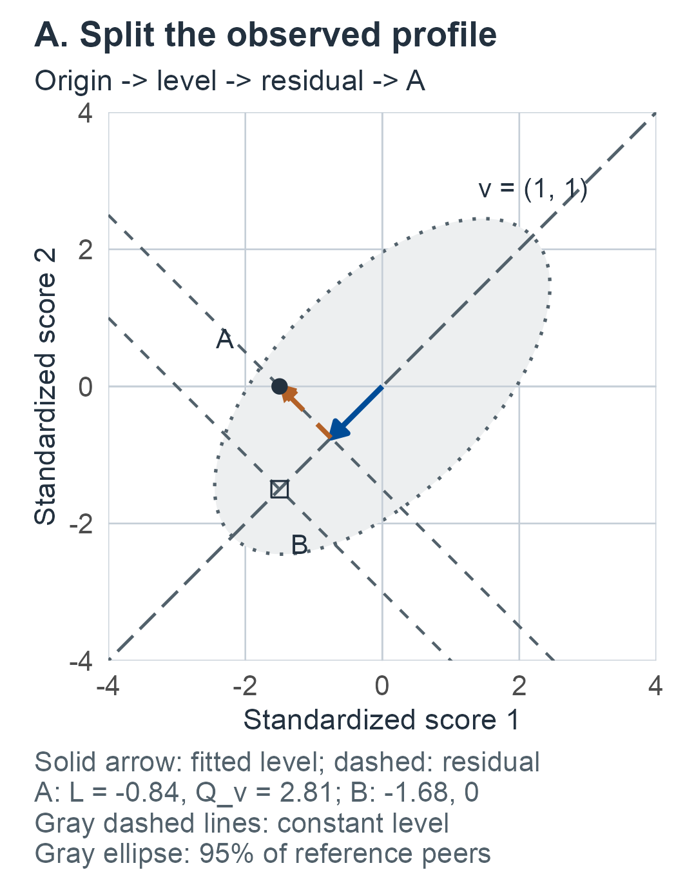
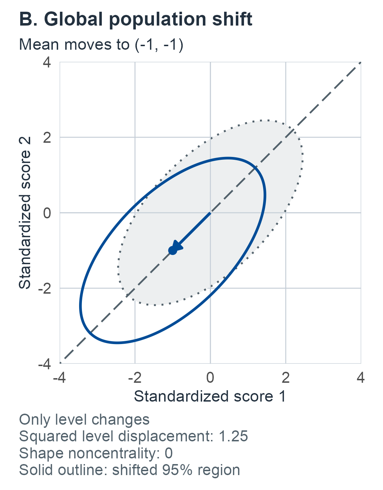
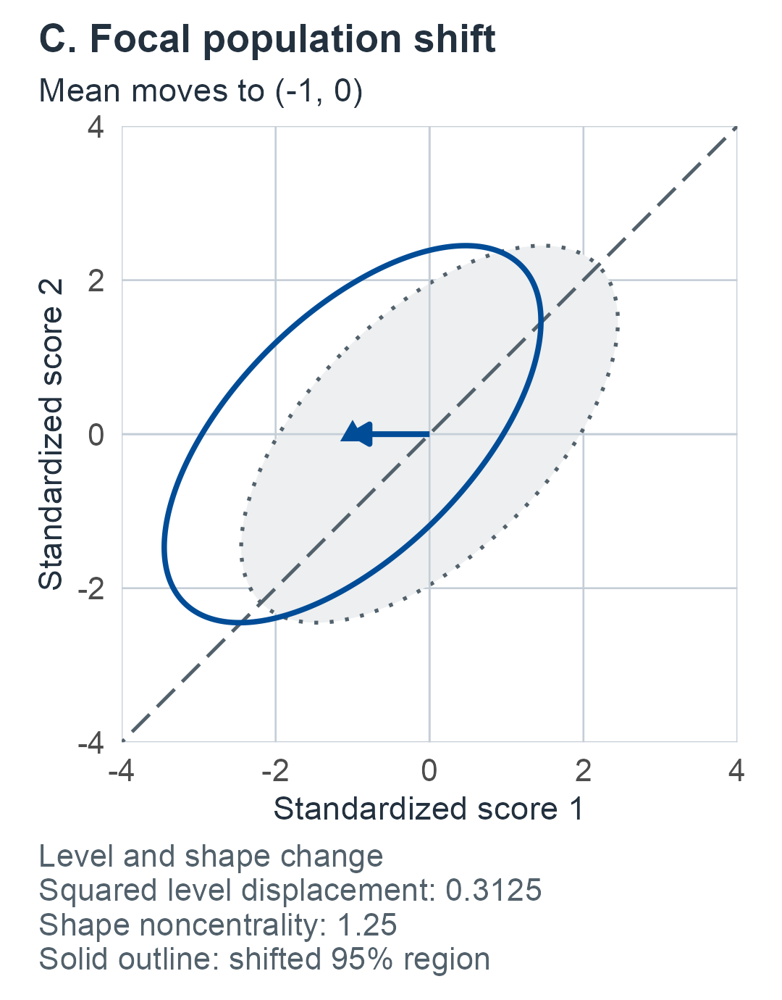
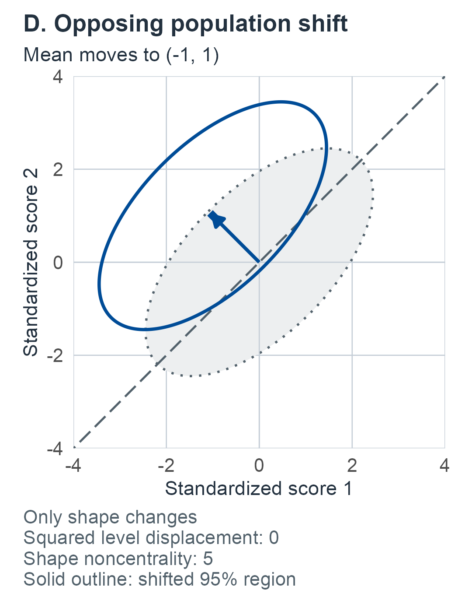

# Level, shape, and information loss {#sec-level-and-shape}

This chapter develops declared profile directions, residual shape, observed dispersion, replication comparisons and target-specific information loss.

## The same two profiles, summarized three ways {#sec-m04-question}

The [previous chapter](03-correlated-battery.md#sec-correlated-battery) followed two people who take the same two tests. Both tests are scored so that higher is better; among reference peers each has mean 50 and SD 10, and, in this synthetic illustration, the two scores have correlation .6. Person A scores $(35,50)$ and person B scores $(35,35)$. Suppose a report must describe each profile with one or two numbers.

- **An average.** About 20.1% of peers have an average at or below A's 42.5, and about 4.7% at or below B's 35. On this summary B is the more unusual profile.
- **A gap or spread.** A gap of 15 points or more, in either direction, occurs in about 9.4% of peers. B has no gap, and B's within-profile SD is zero.
- **The whole profile.** Once the correlation is taken into account, A is slightly farther from the reference center than B (squared distances about 3.52 and 2.81 on the standardized scale), and the two are far in different ways.

Each summary keeps something and discards something. A broadly low profile and a profile containing one unusually low score can have the same average. Conversely, two profiles with the same spread can point in opposite clinical directions, and a spread cannot say which score was low. None of the three summaries says whether it would come out the same on another occasion, or how well it separates people from a population of interest. Before summarizing a battery, specify the change or comparison that matters, the score scale on which it is defined, and which information the summary retains.

This chapter builds on the [joint observed-score comparisons](03-correlated-battery.md#sec-correlated-battery). It separates three questions: how a profile projects along a declared direction; how much variation remains across coordinates; and how well a summary distinguishes explicitly specified populations or reproduces across occasions. Rarity, discrimination and reproducibility are different targets. None alone identifies a person's latent ability, disease or appropriate action.

By the end of the chapter, a reader should be able to split a profile into level and residual shape relative to a declared direction; say what a squared shape statistic and an ordinary within-profile SD each discard; recognize that reproducibility needs a paired design and that SD and squared-spread reproducibility differ; and explain why a summary can add information beyond an inefficient summary but never beyond the full likelihood for a specified comparison.

## How the chapter is organized {#sec-m04-roadmap}

The chapter moves from one observed profile to increasingly demanding experiments. Each unit states its own observations, target and guarantee; a reader who needs one result can go directly to it.

:::: {.m04-scroll role="group" tabindex="0" aria-label="M04 table 1; scroll horizontally"}

| Unit | Question | Experiment |
|---|---|---|
| [Level and shape](#sec-m04-geometry) | How much of the profile lies along a declared direction, and how much is left over? | One profile, known reference law |
| [Mean displacement](#sec-m04-shift-posterior) | Which population mean shifts are compatible with the observed profile? | Known covariance; confidence set and proper posterior |
| [Dispersion](#sec-m04-dispersion) | What does the ordinary within-profile SD measure, and what is its reference law? | Known law |
| [Reproducibility](#sec-m04-replication) | Would a summary come out the same on another occasion? | Paired occasions; general model and a two-score example |
| [Floors](#sec-m04-floor) | Can small spread arise from scoring limits alone? | Deterministic trajectories |
| [Information and power](#sec-m04-information) | Which summary separates specified populations, and what does each discard? | Two supplied populations |
| [Finite norms](#sec-m04-finite) | How do estimated norms change a fixed comparison and its power? | Independent norm sample |
| [Learned directions](#sec-m04-learned-direction) | What changes when the direction itself is fitted? | Two-group training, separate calibration, posterior |

::::
The [lookup guide](#sec-m04-guide) near the end of the chapter collects the questions, targets and conditioning in one table, and the [closing section](#sec-m04-scope) states what the chapter establishes.

For a first reading, follow the [experiment](#sec-m04-experiment), [geometry](#sec-m04-geometry), [dispersion](#sec-m04-dispersion), [information comparison](#sec-m04-information) and [worked return](#sec-m04-power-example). The [displacement posterior](#sec-m04-shift-posterior) addresses a separate population-mean question. For retest questions, use the [replication unit](#sec-m04-replication), distinguishing its general model from the restricted two-score example. Estimated reference inputs require the [finite-norm experiment](#sec-m04-finite); fitted directions require the [training experiment](#sec-m04-learned-direction). Each route includes the conditions in its linked units: the known-law tour does not supply fitted-norm guarantees. Use the [lookup guide](#sec-m04-guide) to check that the observations and target match the calculation.

## The running example and reused symbols {#sec-m04-running}

The worked examples reuse the M03 teaching reference: means $(50,50)^T$, both SDs 10, observed-score correlation .6, and the profiles A $=(35,50)$ and B $=(35,35)$. After subtracting 50 and dividing by 10 they become $(-1.5,0)$ and $(-1.5,-1.5)$. Three stipulated population mean shifts, introduced in @sec-m04-geometry-example, recur in both power tables: a **global** shift $(-1,-1)$, a **focal** shift $(-1,0)$ and an **opposing** shift $(-1,1)$. Later units add separate synthetic inputs: a norm sample of $n=20$, paired-occasion summaries from $N=12$ people, and two training groups of five people each. All printed decimal examples use stipulated synthetic populations, data summaries or priors; they are not clinical norms or recommended cutoffs.

The R companion's M04 guide reproduces the worked examples step by step and identifies the target, units and numerical limits of each output table. Its general unknown-mean replication targets remain unevaluated, as in the chapter.

Because the chapter covers many experiments with a limited alphabet, several letters carry different meanings in different units. Each is defined where it is used; the likeliest confusions are:

:::: {.m04-scroll role="group" tabindex="0" aria-label="M04 table 2; scroll horizontally"}

| Symbol | Meanings, by unit |
|---|---|
| $a$ | Level weights $R^{-1}v/J$; stable-variance share in the nonidentification family; index of the kernels $H_a,K_a,G_a$; starting scores $a_j$ (floors) |
| $b$ | Shrinkage factors $b_L,b_S$; the $\pm1$ domain vector (battery-length example); slopes $b_j$ (floors); prior means $b_g$ (two-group posterior) |
| $c$ | Row-sum constant in @eq-m04-row-sums; direction rescaling factor; chi-square quantile $c_{r,q}$; correlation argument of $G_a(x;c)$; covariance ratio in the unequal-covariance example |
| $d$ | Paired-vector dimension $2p$; size of the focal shift; discriminant distance $d_*$; whitened displacement $R^{-1/2}\delta$ (training) |
| $D$ | Two-score shape coordinate; occasion contrasts $D_t$; binary population indicator |
| $h$ | Residual coordinates $V^TR^{-1/2}X$; prediction multiplier $h_n=1+1/n$ |
| $m$ | Paired mean vector; average of two scores (focal-loss example); pooled degrees of freedom $n_0+n_1-2$ |
| $v$, $V$ | Declared direction $v$; contrast $v_c$; contrast variances $v_1,v_2$; projected posterior variance $v_w$. Basis $V$ of the shape space; paired-contrast covariance $V$; projected covariance $BRB^T$ |
| $A$ | Dispersion matrix $C/(p-1)$ and general quadratic-form matrices $A_1,A_2$ (the book-wide notation reserves $A$ for administration conditions; here it is local to the dispersion and reproducibility units) |
| $Q$ | Residual shape $Q_v$; full squared radius $X^TR^{-1}X$; projected statistic $Q_B$ |
| $c_\delta$, $W_D$, $\rho_s$, $\operatorname{AUC}$ | Chosen to stay distinct from the letters above: $c_\delta=1/n_0+1/n_1$ and its posterior counterpart $c_\delta^*=1/\kappa_0^*+1/\kappa_1^*$ (training); uncentered contrast scatter $W_D$ and its correlation $r_W$; SD-correlation function $\rho_s(\rho)$, parallel to the squared-spread correlation $\rho_{s^2}$; area under the ROC curve $\operatorname{AUC}$, written as in the clinical-targets and design chapters |
| $\lambda$ | Noncentralities $\lambda_L,\lambda_Q,\lambda_B$; dispersion weights $\lambda_j$; squared mean shape displacement |

::::
## Observations, direction and reference experiment {#sec-m04-experiment}

The two profiles are instances of a general setup, which every later unit modifies in one declared way. Let $Z\in\mathbb R^p$, $p\ge2$, be the observed profile on prespecified score scales under a fixed battery, administration and scoring protocol. Supply a peer reference center $\mu_0$ and positive-definite covariance $R$, and write $X=Z-\mu_0$. In the initial experiment they are **known population inputs**, not fitted norms or within-person measurement-error quantities. Under the reference law $X\sim N_p(0,R)$. For power and sensitivity calculations we separately stipulate $X\sim N_p(\delta,R)$; the displacement $\delta$ describes another population's mean on these observed scales.

Choose a fixed nonzero direction $v$ before examining the case. A flat direction $v=\mathbf1$ describes equal score-unit shifts; another direction could represent a justified loading pattern. Calling $v$ a loading vector does not identify a latent construct or validate that model. Rescaling a direction changes the units of its coefficient; the line it spans remains the same. Lower values along the signed direction will be treated as the declared lower-tail alternative when that is the question. The timing matters: a direction chosen to point at the observed profile would make every profile look like pure level, with no residual shape at all. The keying of each score matters too: an elevation obtained by averaging depends on the direction in which each variable is scored, and is arbitrary when no scoring direction is preferred [@cronbach1953assessing, p. 464].

Known-law probabilities repeat independent people, not measurements of this person. A paired-occasion design and a finite norm sample are introduced explicitly in later units; neither is implicit in $R$. Gaussian distributional statements require the joint law, not merely normal margins or a covariance matrix.

Throughout, $\Phi$ and $\phi$ denote the standard normal CDF and density, $z_q=\Phi^{-1}(q)$, and $0<\alpha<1$ unless a result further restricts it. Write $t_{\nu,q}$ for a standard Student quantile and $f_{a,b;q}$ for a central F quantile. Central chi-square quantiles are denoted $c_{r,q}$ or $\chi^2_{r,q}$. Noncentral parameters and multivariate Student scale matrices are stated beside their experiments; a Student scale is not generally its standard deviation.

## Level and complementary shape {#sec-m04-geometry}

Level and shape answer a simple question: how much of the profile can be described as a multiple of the declared direction, and what is left over? We fit the best multiple $tv$ to the profile, measuring misfit with the reference covariance metric $R^{-1}$ rather than ordinary Euclidean distance. In that metric a departure in a direction where peers rarely vary counts for more than an equal departure in a direction where they commonly vary. The size of the fitted multiple is the level; the leftover vector is the shape. @prp-m04-projection shows that the two pieces add back to the profile exactly and that their squared sizes add to the profile's total squared distance from the reference center, a Pythagorean identity in the covariance metric. The idea is classical in profile analysis, which separates a person's profile into elevation (the person's mean), scatter (spread about that mean) and shape (the pattern left after equating both); removing elevation projects each profile onto the space orthogonal to the flat line [@cronbach1953assessing, p. 460]. Here the projection is taken in the reference covariance metric and along a declared direction, and the residual keeps both what Cronbach and Gleser called scatter and what they called shape. Define

:::: {.m04-scroll role="group" tabindex="0" aria-label="M04 equation 1; scroll horizontally"}

$$
\begin{aligned}
J&=v^TR^{-1}v>0,& a&=\frac{R^{-1}v}{J},\\
\ell&=a^TX,& L&=\sqrt J\,\ell,\\
P_v&=I-va^T,& r&=P_vX.
\end{aligned}
$$ {#eq-m04-level-definition}

::::

The scalar $\ell$ is an observed projection coefficient, with signed standardized coordinate $L$. The vector $r$ is the residual profile relative to the line $\{tv:t\in\mathbb R\}$. This is covariance-weighted geometry; $P_v$ need not be a symmetric Euclidean projection. Define

:::: {.m04-scroll role="group" tabindex="0" aria-label="M04 equation 2; scroll horizontally"}

$$
Q_v=r^TR^{-1}r=X^TR^{-1}X-L^2.
$$ {#eq-m04-shape-definition}

::::

::: {#prp-m04-projection}
## A complete level–shape decomposition

**Target and assumptions.** Use a fixed $R\succ0$, $v\ne0$ and the observed vector $X$; no probability model is required for the algebra.

**Result.** The unique minimizer of $(X-tv)^TR^{-1}(X-tv)$ is $t=\ell$, and

:::: {.m04-scroll role="group" tabindex="0" aria-label="M04 equation 3; scroll horizontally"}

$$
\begin{aligned}
a^Tv&=1,\quad P_vv=0,\quad v^TR^{-1}r=0,\\
X&=v\ell+r,\qquad X^TR^{-1}X=L^2+Q_v.
\end{aligned}
$$ {#eq-m04-decomposition}

::::

$Q_v\ge0$, with equality exactly when $X$ lies on the declared line. The pair $(\ell,r)$ determines the full profile; the pair $(\ell,Q_v)$ generally loses residual orientation.
:::

::: {.proof}
Expand the quadratic as $X^TR^{-1}X-2t v^TR^{-1}X+t^2J$. Completing its square gives $Q_v+J(t-\ell)^2$, proving uniqueness, nonnegativity and the identity. Since $a^Tv=1$, $P_v^2=P_v$ and its kernel is the one-dimensional span of $v$, so its rank is $p-1$. Orthogonality follows by substitution. Positive definiteness makes $Q_v=0$ equivalent to $r=0$. Finally $r$ and $-r$ give the same $Q_v$, even in dimension two where the residual space has only one axis.
:::

Thus shape here means deviation from a **declared direction**, relative to the supplied covariance metric. It need not equal the ordinary within-profile SD. A large $Q_v$ can arise from any residual direction, including opposing high and low scores. @fig-m04-level-shape (panel A) draws each object for the two running profiles.

::: {#fig-m04-level-shape .m04-content-figure fig-alt="Panel A. Standardized score 1 is horizontal and score 2 vertical, both from -4 to 4. A is (-1.5, 0). A solid level arrow runs from (0, 0) to (-0.75, -0.75); a dashed residual arrow ends at A. Its L is about -0.84 and Q_v about 2.81. Open-square B is (-1.5, -1.5), with L about -1.68 and Q_v zero. The gray ellipse contains 95% of reference peers; gray downward-sloping lines hold level constant in this equal-row-sum example. Panel B. The same axes and covariance show a global population mean shift to (-1, -1), along the declared diagonal. Compare the solid shifted 95% ellipse with the gray reference ellipse. Squared level displacement is 1.25 and shape noncentrality zero: only level changes. Panel C. The same axes and covariance show a focal population mean shift to (-1, 0). Squared level displacement is 0.3125 and shape noncentrality 1.25: both change. The solid outline is a shifted population 95% region, not a power or rejection probability. Panel D. The same axes and covariance show an opposing population mean shift to (-1, 1), across the declared diagonal. Squared level displacement is zero and shape noncentrality 5: only shape changes. This is a known-law population comparison, not an observed diagnosis."}

Level and shape in the supplied synthetic two-score reference (standardized scores, correlation .6). **A.** Profile A $=(-1.5,0)$ is reached from the origin by its fitted level $v\ell=(-.75,-.75)$ and residual $r=(-.75,.75)$; profile B lies on the declared line and has zero residual shape. Gray dashed lines show constant level; the gray ellipse contains 95% of reference peers. The perpendicular geometry here depends on equal covariance row sums; unequal row sums need not give Euclidean perpendicular projections. **B–D.** The global, focal and opposing population shifts from @sec-m04-geometry-example are separated into panels, with their unchanged covariance and complete shifted 95% ellipses: only level, both level and shape, or only shape changes. These regions are not power curves or clinical cutoffs. Each image links to its full-resolution file.

:::

::: {#prp-m04-gaussian-shape}
## Independent Gaussian level and shape coordinates

**Experiment.** Let $X\sim N_p(\delta,R)$ with the same fixed direction and known covariance. Set

:::: {.m04-scroll role="group" tabindex="0" aria-label="M04 equation 4; scroll horizontally"}

$$
\lambda_L=\frac{v^TR^{-1}\delta}{\sqrt J},\qquad
\lambda_Q=\delta^TR^{-1}\delta-\lambda_L^2\ge0.
$$ {#eq-m04-noncentralities}

::::

**Result.**

:::: {.m04-scroll role="group" tabindex="0" aria-label="M04 equation 5; scroll horizontally"}

$$
\begin{aligned}
L&\sim N(\lambda_L,1),\qquad Q_v\sim\chi^2_{p-1}(\lambda_Q),\\
L&\ \perp\ r,\qquad\text{and hence }L\ \perp\ Q_v.
\end{aligned}
$$ {#eq-m04-gaussian-laws}

::::

Under the reference $\delta=0$, a lower-tail level comparison is $\Phi(L)$ and an omnibus shape comparison is $1-F_{\chi^2_{p-1}}(Q_v)$. Each separately has uniform reference tails and an exact size-$\alpha$ threshold. Trying both and reporting the smaller value is a new multiple-comparison procedure.
:::

::: {.proof}
Take the symmetric positive-definite square root of $R$, set $W=R^{-1/2}X$ and $u=R^{-1/2}v/\sqrt J$. Then $u^Tu=1$. Extend $u$ to an orthonormal basis $[u,V]$, where $V$ has $p-1$ columns. The vector $(u^TW,V^TW)$ has identity covariance and jointly Gaussian law, so its coordinates are independent normals with means $u^TR^{-1/2}\delta$ and $V^TR^{-1/2}\delta$. This independence follows directly by factoring the identity-covariance Gaussian density. Here $L=u^TW$, $r=R^{1/2}VV^TW$ and $Q_v=\|V^TW\|^2$. A noncentral chi-square is defined as a sum of squares of independent unit-variance normals with squared means summing to its noncentrality. Pythagoras gives @eq-m04-noncentralities. Under the reference, continuous normal and chi-square CDF transforms give the stated calibration. The residual coordinates and their laws do not depend on the arbitrary orthonormal basis chosen within the shape space.
:::

For a known shifted population the power of the lower-tail level rule is $\Phi\{\Phi^{-1}(\alpha)-\lambda_L\}$. The shape rule's power is $1-F_{\chi^2_{p-1}(\lambda_Q)}(c_{p-1,1-\alpha})$, with $c$ the central chi-square quantile. These are exact distribution/CDF expressions, evaluated numerically when needed. Their different sensitivities follow from the chosen alternative, not from a ranking of clinical usefulness.

### When does an arithmetic mean give the same separation? {#sec-m04-arithmetic}

In practice level is most often summarized by the plain average of comparable scores. When does that familiar summary coincide with the covariance-weighted level, and when is it independent of the profile's shape? On comparable coordinate scales put $C=I-\mathbf1\mathbf1^T/p$, $\bar X=\mathbf1^TX/p$. For a flat declared direction, $C X$ is ordinary mean-centered shape, whereas the covariance-weighted level is generally a different weighted average.

::: {#prp-m04-mean-independence}
## Flat level, arithmetic mean and centered profile

For any finite-second-moment $X$ with covariance $R$, the flat-direction coefficient $\ell=\mathbf1^TR^{-1}X/(\mathbf1^TR^{-1}\mathbf1)$ has zero covariance with $C X$. Under a joint Gaussian law it is independent of the entire $C X$, hence of every measurable statistic of $C X$, including its SD. The arithmetic mean has this independence under a Gaussian law **if and only if**

:::: {.m04-scroll role="group" tabindex="0" aria-label="M04 equation 6; scroll horizontally"}

$$
CR\mathbf1=0\quad\Longleftrightarrow\quad R\mathbf1=c\mathbf1
$$ {#eq-m04-row-sums}

::::

for a scalar $c>0$. This is also exactly the condition under which the flat covariance-weighted level equals $\bar X$ for all profiles.
:::

::: {.proof}
$\operatorname{Cov}(CX,\ell)=CRa=C\mathbf1/J=0$. Also $\operatorname{Cov}(CX,\bar X)=CR\mathbf1/p$. Joint Gaussianity makes zero cross-covariance equivalent to independence, including the singular centered vector. The kernel of $C$ is the span of $\mathbf1$, giving the row-sum condition. Positive definiteness gives $c=\mathbf1^TR\mathbf1/p>0$. That condition implies $R^{-1}\mathbf1=\mathbf1/c$ and hence $a=\mathbf1/p$; conversely that equality for $a$ implies the row-sum condition.
:::

Without joint Gaussianity, zero covariance need not give independence. For example, if $U$ is standard normal, the coordinates $(U,U^2-1)$ have zero covariance and are dependent. Their distribution on a parabola is not jointly normal. Also zero correlation between the arithmetic mean and a squared dispersion under a centrally symmetric law can occur without independence from the residual profile; a single moment is weaker than the result above.

The result bears on a concern raised in the applied literature on intraindividual variability: because the battery mean is used to compute the individual SD, the two are said to be inherently non-independent [@delbene2026cognitive, p. 1800]. Sharing a computation does not by itself create statistical dependence. Under a joint Gaussian law the arithmetic mean is independent of the whole centered profile, and hence of its SD, exactly when the reference covariance has equal row sums; otherwise, or when the joint law is not Gaussian, dependence must be examined for the declared population.

### The original profiles and three declared shifts {#sec-m04-geometry-example}

Use the known M03 teaching reference: $\mu_0=(50,50)^T$, coordinate SDs 10 and correlation .6. On $Z=(Y-50\mathbf1)/10$, the centered reference has $\mu_0=0$ and

:::: {.m04-scroll role="group" tabindex="0" aria-label="M04 equation 7; scroll horizontally"}

$$
R=\begin{pmatrix}1&.6\\.6&1\end{pmatrix},\qquad v=\mathbf1,\qquad J=1.25.
$$ {#eq-m04-example-reference}

::::

The symbol $\mu_0=0$ in this standardized experiment replaces the raw center only after the stated transformation. In two dimensions the independent shape coordinate is $D=(X_1-X_2)/\sqrt{.8}$, so $Q_v=D^2$ and $L=(X_1+X_2)/\sqrt{3.2}$.

:::: {.m04-scroll role="group" tabindex="0" aria-label="M04 table 3; scroll horizontally"}

| Raw profile | Standardized $X$ | $\ell$ | $L$ | $Q_v$ | Total squared distance |
|---|---|---:|---:|---:|---:|
| $(35,50)$ | $(-1.5,0)$ | $-.75$ | $-.838525$ | $2.812500$ | $3.515625$ |
| $(35,35)$ | $(-1.5,-1.5)$ | $-1.50$ | $-1.677051$ | $0$ | $2.812500$ |

::::
These are observed reference comparisons, and they answer the opening questions. Because this correlation matrix has equal row sums, the flat covariance-weighted level is the ordinary average (@prp-m04-mean-independence), so the lower-tail level comparison $\Phi(L)$ is about $.201$ for A and $.047$ for B, the average tails quoted at the start. A's residual shape has known-law tail $1-F_{\chi^2_1}(2.8125)\approx.094$, the same 9.4% as the two-sided gap. The last column is the squared distance $X^TR^{-1}X=L^2+Q_v$, the squared Mahalanobis distance whose known-covariance chi-square reference is Huba's index of profile unusualness [@huba1985unusual, p. 322]: for A, $.703125+2.8125$; for B, $2.8125+0$. B's departure is entirely level; most of A's is shape.

Separately specify alternative population means, keeping $R$ unchanged:

:::: {.m04-scroll role="group" tabindex="0" aria-label="M04 table 4; scroll horizontally"}

| Alternative mean shift $\delta$ | Meaning on these scales | $\lambda_L^2$ | $\lambda_Q$ |
|---|---|---:|---:|
| $(-1,-1)$ | Global equal mean lowering | $1.250000$ | $0$ |
| $(-1,0)$ | Focal first-score mean lowering | $.312500$ | $1.250000$ |
| $(-1,1)$ | Opposing shifts | $0$ | $5.000000$ |

::::
A pure shift along $v$ changes level but leaves the shape reference law unchanged. An opposing shift can leave level unchanged while changing shape. These stipulated alternatives do not describe observed diagnoses or mechanisms. Panels B–D of @fig-m04-level-shape draw them.

## A posterior for a mean displacement {#sec-m04-shift-posterior}

Level and shape describe one observed profile. A different question is which population the profile might have come from: if people were drawn repeatedly from a shifted population, how large might that population's mean shift be? That question needs a parameter, and with it either a sampling guarantee or a prior. A projection of an observed score has no posterior uncertainty after it is observed. A posterior becomes meaningful when a parameter is declared. Here the target is the **mean displacement parameter of a stipulated Gaussian sampling population**, based on one observed profile with known $R$. It is not an individual's true ability or a probability of impairment. An individual latent model would require an explicit measurement/replication likelihood.

Keep the basis $[u,V]$ fixed and write $w=(L,h^T)^T$, where $h=V^TR^{-1/2}X$. For $\theta=(\theta_L,\theta_S^T)^T$, stipulate likelihood $w\mid\theta\sim N_p(\theta,I)$ and the proper independent prior

:::: {.m04-scroll role="group" tabindex="0" aria-label="M04 equation 8; scroll horizontally"}

$$
\theta_L\sim N(0,\tau_L^2),\quad
\theta_S\sim N_{p-1}(0,\tau_S^2I),\qquad 0<\tau_L^2,\tau_S^2<\infty.
$$ {#eq-m04-shift-prior}

::::

All densities refer to Lebesgue measure in these coordinates. The hyperparameters express assumptions about plausible population displacements, chosen before seeing the case.

::: {#prp-m04-shift-posterior}
## Proper normal shrinkage on declared level and shape axes

Set $b_L=\tau_L^2/(1+\tau_L^2)$ and $b_S=\tau_S^2/(1+\tau_S^2)$. The posterior is proper and factorizes as

:::: {.m04-scroll role="group" tabindex="0" aria-label="M04 equation 9; scroll horizontally"}

$$
\theta_L\mid w\sim N(b_LL,b_L),\qquad
\theta_S\mid w\sim N_{p-1}(b_Sh,b_SI).
$$ {#eq-m04-shift-posterior}

::::

Consequently $P(\theta_L<0\mid w)=\Phi(-\sqrt{b_L}L)$. If the same population supplies an independent next profile, its coordinate prediction is $w_{\mathrm{new}}\mid w\sim N_p((b_LL,b_Sh^T)^T,\operatorname{diag}(1+b_L,(1+b_S)I))$.
:::

::: {.proof}
For each coordinate, multiply $\exp\{-(w_j-\theta_j)^2/2\}$ by $\exp\{-\theta_j^2/(2\tau_j^2)\}$. Completing the square gives precision $1+1/\tau_j^2$, variance $b_j$ and mean $b_jw_j$. A finite positive precision gives a finite normalizing integral. Independence of likelihood and prior factors proves the posterior factorization. Standardizing the scalar posterior gives its sign probability. Adding the independent new-person unit normal variation gives predictive variance $1+b_j$.
:::

For teaching sensitivity, $\tau_L^2=\tau_S^2=1$ halves each coordinate's posterior mean and gives posterior variance $1/2$ per axis. For $(35,50)$, the level posterior mean is $-.419263$ and its SD is $.707107$. These numbers concern the declared displacement model. Smaller prior variances shrink more strongly; the limiting point prior at zero is a different degenerate model. The posterior sign probability is not the reference tail $\Phi(L)$, and the predictive variance includes new-person variation that the parameter posterior does not.

### Estimating a displacement is different from flagging a profile {#sec-m04-displacement-confidence}

The preceding posterior introduces a new unknown: the sampling population's mean displacement. A reference tail holds that mean at zero and asks about a random performance. To estimate the displacement instead, keep exactly the likelihood $w\mid\theta\sim N_p(\theta,I)$, with the supplied $R$, reference center and direction fixed, and let repeated observations redraw an independent person from the stipulated displaced population. In the original score units the parameter is $\delta=R^{1/2}[u,V]\theta$. It is still not a particular person's stable expected score.

::: {#prp-m04-displacement-confidence}
## Confidence and posterior inference for level and squared shape displacement

For every fixed $\theta$, the region

:::: {.m04-scroll role="group" tabindex="0" aria-label="M04 equation 10; scroll horizontally"}

$$
\mathcal C(w)=\{\theta:\|w-\theta\|^2\le\chi^2_{p,1-\alpha}\}
$$ {#eq-m04-displacement-region}

::::

has sampling coverage $1-\alpha$, $0<\alpha<1$. The marginal interval $L\pm z_{1-\alpha/2}$ has coverage $1-\alpha$ for $\theta_L$; simultaneous statements about all coordinates need the joint region or an explicitly allocated family error rate.

Put $r_S=p-1$ and $\lambda=\|\theta_S\|^2\ge0$. This parameter is the **squared mean shape displacement**, while the observed $Q_v=\|h\|^2$ also contains sampling variation. Denote the CDF of $\chi^2_{r_S}(\lambda)$ by $F_{r_S,\lambda}$. The random set

:::: {.m04-scroll role="group" tabindex="0" aria-label="M04 equation 11; scroll horizontally"}

$$
\mathcal C_\lambda(Q_v)=
\{\lambda\ge0:\alpha/2\le F_{r_S,\lambda}(Q_v)\le1-\alpha/2\}
$$ {#eq-m04-shape-parameter-confidence}

::::

has coverage exactly $1-\alpha$ for every fixed $\lambda\ge0$, regardless of $\theta_L$ and the orientation of $\theta_S$. It may be empty; this is possible even at the boundary $\lambda=0$.

Under the proper isotropic shape prior already declared, the posterior for this same target is

:::: {.m04-scroll role="group" tabindex="0" aria-label="M04 equation 12; scroll horizontally"}

$$
\lambda\mid w\ \overset d=\ b_S\,
\chi^2_{r_S}(b_S Q_v),\qquad
E(\lambda\mid w)=r_S b_S+b_S^2Q_v.
$$ {#eq-m04-shape-parameter-posterior}

::::

Its probability statements condition on the observed profile and prior. They do not generally equal the confidence-set probabilities. A continuous prior gives posterior probability zero to the exact null $\theta_S=0$; testing that point by a reference tail is not computing its posterior probability.
:::

::: {.proof}
At each fixed parameter, $w-\theta$ has independent standard normal coordinates. Squaring and summing proves the joint-region pivot; standardizing its level coordinate proves the marginal interval. Rotating the residual coordinates so their mean lies along their first axis gives $Q_v\sim\chi^2_{r_S}(\lambda)$, independent of $\theta_L$. Its CDF is continuous and strictly increasing for positive observed radius, so $F_{r_S,\lambda}(Q_v)$ is uniform at the true fixed $\lambda$. Inverting its central probability event proves the exact coverage, including the boundary. Restricting candidate values to $[0,\infty)$ does not change the event that the true parameter belongs to the set.

For computation, $F_{r_S,\lambda}(q)$ decreases continuously to zero as $\lambda\to\infty$ for fixed $q>0$. To check monotonicity without presuming a noncentral-CDF algorithm, write $Q_v=(G+\sqrt\lambda)^2+H$, with independent $G\sim N(0,1)$ and $H\sim\chi^2_{r_S-1}$, interpreting $H=0$ when $r_S=1$. Conditional on $H<q$, the probability is $\Phi(c-\sqrt\lambda)-\Phi(-c-\sqrt\lambda)$ with $c=\sqrt{q-H}>0$. Its derivative with respect to $\sqrt\lambda>0$ is $\phi(c+\sqrt\lambda)-\phi(c-\sqrt\lambda)<0$. Integrating proves strict decrease; bounded convergence proves continuity and the limit. Thus the set is an interval or empty. If $F_{r_S,0}(q)<\alpha/2$, no nonnegative candidate is allowed. Otherwise its upper endpoint solves $F_{r_S,\lambda}(q)=\alpha/2$; its lower endpoint is zero unless a positive root of $F_{r_S,\lambda}(q)=1-\alpha/2$ is needed. Empty sets are not silently replaced by a point at zero.

Finally $\theta_S\mid w\sim N_{r_S}(b_Sh,b_SI)$ by the completed-square posterior. Dividing those coordinates by $\sqrt{b_S}$ and summing their squares gives the displayed noncentral law and its mean. Its proper normalization follows from the already normalized Gaussian posterior and this measurable transformation. The posterior law has no atom at zero because a nondegenerate Gaussian assigns probability zero to that one point.
:::

For the synthetic profile $(35,50)$, $L=-.838525$ and $Q_v=2.8125$. At $95\%$, the fixed-displacement level interval is approximately $[-2.798489,1.121438]$ in the standardized level coordinate. The shape-displacement confidence set is $[0,13.227871]$, obtained by the noncentral CDF inversion above: at this level, the data cannot exclude any squared mean shape displacement up to about 13.2.

With the teaching prior $\tau_S^2=1$, $b_S=1/2$, the squared-shape posterior mean is $1.203125$ and its central $95\%$ credible interval is approximately $[.002002,4.948484]$. The prior, which expects a squared shape displacement of 1 before the data are seen, halves the observed residual coordinate, so the posterior is much narrower than the confidence set; the two intervals answer differently posed questions about the same parameter.

The positive lower credible endpoint does not reject the point null: every continuous posterior interval for a squared continuous coordinate can exclude the exact point zero while assigning considerable density close to it. For example, a zero observed residual still gives $\lambda\mid w\sim b_S\chi^2_{r_S}$, whereas the exact central confidence set at an observed $Q_v=0$ is empty. The latter is a probability-zero observation under the stated nondegenerate sampling experiment, and its convention supplies no biological conclusion.

These comparisons retain the same observations and population-mean target while exposing the different guarantees. A larger norm sample is needed when the center or covariance is uncertain; these known-input intervals do not absorb that uncertainty. A repeat-measurement model is needed when the target is this person's expected performance or latent state.

### Units and scope {#sec-m04-geometry-boundaries}

For a fixed nonsingular transformation $\widetilde X=H X$, transform $\widetilde R=HRH^T$ and $\widetilde v=Hv$. Direct substitution preserves $J$, $\ell$, $L$ and $Q_v$. Keeping $v=\mathbf1$ numerically after unequal changes of units instead chooses a different line. For direction scaling $\widetilde v=cv$, $\widetilde\ell=\ell/c$, $\widetilde L=\operatorname{sign}(c)L$ and $Q_v$ is unchanged. The signed direction, center and covariance travel with the question.

At $p=1$ there is no residual space and $Q_v=0$; the chi-square reference above was stated for $p\ge2$. At singular $R$ the inverse and whitening used here are unavailable; a pseudoinverse needs a different support/rank argument. Fitting $R$ or choosing $v$ after seeing the profile changes the experiment. The [covariance/battery discussion](03-correlated-battery.md#sec-m03-covariance-battery) explains why numerical invertibility does not by itself transfer calibration.

## Dispersion: a moment is not a reference distribution {#sec-m04-dispersion}

Use comparable coordinate scales and the fixed centering matrix $C=I-\mathbf1\mathbf1^T/p$. Define within-profile variance and SD by

:::: {.m04-scroll role="group" tabindex="0" aria-label="M04 equation 13; scroll horizontally"}

$$
s^2(X)=\frac{X^TCX}{p-1},\qquad s(X)=\sqrt{s^2(X)},\qquad A=\frac C{p-1}.
$$ {#eq-m04-dispersion-definition}

::::

This is cross-coordinate variation within one observed profile, not a sampling variance of an estimated personal mean. Subtracting a common reference center leaves it unchanged; subtracting different coordinate reference means can change it. The chosen norm origin must therefore be stated. A nonflat mean profile $\delta$ can contribute to dispersion even with constant covariance.

In the neuropsychological literature this within-profile SD of normed scores is the dispersion form of intraindividual variability, often written iSD around the overall test battery mean; its ratio to that mean is the coefficient of variation [@delbene2026cognitive, pp. 1796-1797]. Published conventions divide by either $p$ or $p-1$; this chapter uses $p-1$. Large spread is common even in healthy adults: in one normal-aging sample of 197 adults, 66% showed a difference above 3 SD between their highest and lowest of 32 z-scores [@schretlen2003examining, p. 864]. A spread therefore needs a reference distribution before it can be called unusual, which is what this unit supplies under a stated model.

How does this familiar spread relate to the shape statistic $Q_v$ for the flat direction? Both vanish exactly on flat profiles, but they weight departures differently: $s^2$ treats every pair of coordinates alike, whereas $Q_v$ uses the reference covariance. In the two-score teaching reference they are proportional ($s^2=.4Q_v$, shown below). With more scores and unequal correlations the two quadratic forms need not be proportional and can rank two profiles in opposite orders.

::: {#prp-m04-dispersion-law}
## Observed-score dispersion moments and Gaussian law

**Experiment and target.** Fix $A=C/(p-1)$ and let $X$ have mean $\delta$ and covariance $R$. Finite second moments suffice for

:::: {.m04-scroll role="group" tabindex="0" aria-label="M04 equation 14; scroll horizontally"}

$$
E(s^2)=\operatorname{tr}(AR)+\delta^TA\delta.
$$ {#eq-m04-dispersion-mean}

::::

If $X\sim N_p(\delta,R)$, then

:::: {.m04-scroll role="group" tabindex="0" aria-label="M04 equation 15; scroll horizontally"}

$$
\operatorname{Var}(s^2)=2\operatorname{tr}(ARAR)+4\delta^TARA\delta.
$$ {#eq-m04-dispersion-variance}

::::

Diagonalize $R^{1/2}AR^{1/2}=U\operatorname{diag}(\lambda_j)U^T$, with $\eta=U^TR^{-1/2}\delta$. For independent standard normals $G_j$,

:::: {.m04-scroll role="group" tabindex="0" aria-label="M04 equation 16; scroll horizontally"}

$$
s^2\ \overset d=\ \sum_{j:\lambda_j>0}\lambda_j(G_j+\eta_j)^2.
$$ {#eq-m04-dispersion-weighted-law}

::::

There are $p-1$ positive weights. This weighted noncentral chi-square representation specifies the full Gaussian reference law; its CDF generally needs an exact integral evaluated numerically. The two moments alone do not specify it.
:::

::: {.proof}
Write $X=\delta+\varepsilon$. Expanding $X^TAX$ and taking expectations gives the first result for any mean-zero $\varepsilon$ with covariance $R$. Under normality write $X=R^{1/2}(G+R^{-1/2}\delta)$ and rotate by $U$, which preserves independent unit-normal coordinates. This proves the weighted law. For each term, $E(G+\eta)^2=1+\eta^2$ and $\operatorname{Var}\{(G+\eta)^2\}=2+4\eta^2$, since $E G^3=0$ and $E G^4=3$ by Gaussian integration. Summing independent terms gives the trace expressions. Positive definiteness of $R$ preserves the rank $p-1$ of $A$ and positivity of its nonzero eigenvalues. Terms with zero weight contribute nothing, regardless of the rotated mean.
:::

If the observed coordinates have unit variance, let $\bar r=\sum_{i\ne j}R_{ij}/\{p(p-1)\}$. Then $E(s^2)=1-\bar r+\delta^TC\delta/(p-1)$. At a flat centered mean it reduces to $1-\bar r$ without normality. Use correlations of the **observed variables entering the statistic**. A latent Gaussian copula correlation or factor covariance is a different object; inserting it does not give the observed quadratic statistic a Gaussian law. Deterministic rounding also need not add independent noise: rounding $(.1,.2)$ to integers reduces its within-profile variance from $.005$ to zero.

For compound symmetry $R=(1-\rho)I+\rho\mathbf1\mathbf1^T$, with $-1/(p-1)<\rho<1$, all nonzero weights equal $(1-\rho)/(p-1)$. Thus

:::: {.m04-scroll role="group" tabindex="0" aria-label="M04 equation 17; scroll horizontally"}

$$
s^2\ \overset d=\ \frac{1-\rho}{p-1}\,
\chi^2_{p-1}\!\left(\frac{\delta^TC\delta}{1-\rho}\right).
$$ {#eq-m04-compound-dispersion}

::::

The common weight is a special case, not a general approximation for unequal correlations. Under the two-score teaching reference, $s^2=(X_1-X_2)^2/2=.4Q_v$; its central expectation is $.4$ and variance $.32$. For $(35,50)$ it is $1.125$; for $(35,35)$ it is zero. A zero spread does not imply ordinary level or absence of disease.

### Mean–dispersion association needs an origin and a mean {#sec-m04-level-dispersion}

For any fixed linear score $w^TX$ in the Gaussian experiment,

:::: {.m04-scroll role="group" tabindex="0" aria-label="M04 equation 18; scroll horizontally"}

$$
\operatorname{Cov}(w^TX,s^2)=2w^TRA\delta.
$$ {#eq-m04-linear-quadratic-covariance}

::::

To verify it, expand around $\delta$: the covariance with the centered quadratic is a centered Gaussian third moment and vanishes; the covariance with $2\delta^TA\varepsilon$ is the displayed term. With $\delta=0$ the covariance is zero for every $w$, although the variables need not be independent. With nonflat $\delta$, it need not vanish. For example, $R=\operatorname{diag}(2,1)$, $w=\mathbf1/2$, $p=2$ and $\delta=(1,0)^T$ give covariance $.5$. The flat covariance-weighted level remains independent of dispersion by @prp-m04-mean-independence, even at a nonflat mean. These statements distinguish central symmetry, a moment identity and full independence.

## Reproducibility requires a replication design {#sec-m04-replication}

Reference variation between different people cannot determine retest precision. Now explicitly observe the same fixed battery on two occasions, $(X_1,X_2)$, for independent people. The occasion subscripts denote complete profiles here. Specify means $\delta_1,\delta_2$, marginal covariances $R_1,R_2$ and cross-occasion covariance $K=\operatorname{Cov}(X_1,X_2)$. Assume this $2p$-dimensional joint law is Gaussian for the formulas below. Different choices of what persists, changes or is called error define different replication universes.

The unit proceeds in steps. @prp-m04-quadratic-replication gives the cross-occasion covariance of any two quadratic summaries. A family of models then shows that one-occasion data cannot identify reproducibility at all, and a Gaussian battery-length example shows how stable domain variation alone can make dispersion more reproducible as a battery grows. The last three subsections learn reproducibility from paired people: a conservative confidence construction, a proper posterior, and an evaluated two-score example that separates SD reproducibility from squared-spread reproducibility.

::: {#prp-m04-quadratic-replication}
## Linear and quadratic reproducibility

For fixed symmetric matrices $A_1,A_2$,

:::: {.m04-scroll role="group" tabindex="0" aria-label="M04 equation 19; scroll horizontally"}

$$
\operatorname{Cov}(X_1^TA_1X_1,X_2^TA_2X_2)
=2\operatorname{tr}(A_1KA_2K^T)
+4\delta_1^TA_1KA_2\delta_2.
$$ {#eq-m04-quadratic-cross-covariance}

::::

With equal centered occasion distributions, $R_1=R_2=R$, $\delta_1=\delta_2=0$, and $A_1=A_2=A$, their correlation, if its denominator is nonzero, is

:::: {.m04-scroll role="group" tabindex="0" aria-label="M04 equation 20; scroll horizontally"}

$$
\rho_{s^2}=\frac{\operatorname{tr}(AKA K^T)}{\operatorname{tr}(ARAR)}.
$$ {#eq-m04-quadratic-reproducibility}

::::

For a fixed nonzero linear score, the corresponding correlation is $\rho_w=w^TKw/(w^TRw)$. These are correlations of different statistics. In particular $\rho_{s^2}$ is not automatically the correlation of their square roots $s$.
:::

::: {.proof}
Center both vectors. The linear terms in their quadratic expansions contribute $4\delta_1^TA_1KA_2\delta_2$. Mixed terms of total odd degree vanish. For centered jointly normal coordinates, differentiating the moment generating function $\exp(t^T\Omega t/2)$ four times at zero pairs its indices in all three ways. Consequently $E(\varepsilon_i\varepsilon_j\zeta_k\zeta_l)=R_{1,ij}R_{2,kl}+K_{ik}K_{jl}+K_{il}K_{jk}$. Subtracting the product of the two expectations cancels the first pairing; summing with symmetric $A_1,A_2$ makes the other pairings equal and yields the trace term. Apply @eq-m04-dispersion-variance to both marginal quadratic forms and divide by their SDs. For the linear score, bilinearity of covariance gives the result without needing Gaussianity.
:::

One possible replication model is $X_t=T+e_t$, with stable person variation $T$ independent of mutually independent occasion errors $e_t$. If centered jointly Gaussian with covariances $R_T,R_E$, it gives $R=R_T+R_E$, $K=R_T$. This is an explicit elementary CTT bridge, not a decomposition learned from one cross-section. It requires paired observations or other identifying design information to separate $R_T$ and $R_E$. A repeatable test-specific feature can increase reproducibility while being irrelevant to the intended construct. General CTT, generalizability facets, factor/SEM and IRT distinctions are developed in [measurement and replication](05-measurement-and-replication.md#sec-measurement).

Even exact knowledge of the one-occasion law cannot resolve this decomposition. For each $a\in(0,1)$, independently for each person choose $T\sim N_p(0,aR)$ and $e_t\sim N_p(0,(1-a)R)$, with the stable term and all occasion errors independent. Every model gives the identical one-occasion distribution $X_t\sim N_p(0,R)$, but $K=aR$: the linear-score retest correlation is $a$, and the centered squared-dispersion correlation is $a^2$. The last equality follows by substituting $K=aR$ into the quadratic covariance formula, whose positive denominator cancels. Thus even unlimited independent people observed only once have the same entire data likelihood under distinct reproducibility values. A proper teaching prior $a\sim\operatorname{Beta}(a_0,b_0)$, $a_0,b_0>0$, stays exactly that prior after these one-occasion observations when $R$ is supplied: the likelihood is constant in $a$ and cancels from normalization. This counterexample family proves nonidentification without claiming that it exhausts all possible replication models. Paired observations can inform $K$ under declared sampling/measurement assumptions, but do not alone identify a unique cognitive mechanism.

### A Gaussian battery-length counterexample {#sec-m04-gaussian-length}

For even $p$, let $b$ have $p/2$ entries +1 and $p/2$ entries −1, and stipulate

:::: {.m04-scroll role="group" tabindex="0" aria-label="M04 equation 21; scroll horizontally"}

$$
X_{tj}=.6G+.3b_jF+\sqrt{.55}\,e_{tj},\qquad t=1,2,
$$ {#eq-m04-gaussian-length-model}

::::

where all variables are independent standard normals except that the same $G,F$ persist across occasions. Every score has unit variance and retest correlation .45. All within-occasion correlations are positive: .45 within each domain, .27 between domains. The joint distribution is entirely Gaussian, without a scale mixture or discrete class.

Here $R_T=.36\mathbf1\mathbf1^T+.09bb^T$, $R=R_T+.55I$ and $K=R_T$. Since $C\mathbf1=0$, $Cb=b$ and $b^Tb=p$, the centered covariance has one eigenvalue $.09p+.55$ in the domain-contrast direction and $p-2$ eigenvalues $.55$. Therefore @eq-m04-quadratic-reproducibility gives

:::: {.m04-scroll role="group" tabindex="0" aria-label="M04 equation 22; scroll horizontally"}

$$
\rho_{s^2}(p)=\frac{(.09p)^2}{(.09p+.55)^2+(p-2)(.55)^2}\longrightarrow1.
$$ {#eq-m04-gaussian-length-correlation}

::::

At $p=4,16,64,128$ the values are approximately $.090433$, $.253029$, $.566450$, $.722037$, respectively. Their exact values are recalculated from this stipulated model; they are not empirical reliability estimates. With four scores the squared dispersion barely reproduces; with 128 it reproduces strongly, although every individual score keeps the same retest correlation .45 throughout. Increasing dispersion reproducibility with battery length can therefore arise from stable Gaussian domain variation. It does not by itself identify a non-Gaussian scale trait, mixture or unique mechanism.

### Learning reproducibility from finitely many paired people {#sec-m04-replication-confidence}

Knowing the reference covariance on one occasion does not identify reproducibility. Even paired data leave sampling uncertainty. Retain the general Gaussian paired experiment $U_i\sim N_d(m,\Omega)$, $d=2p$, with independent people and both mean and covariance unknown. The target is the population correlation of the two **observed squared-dispersion statistics**, computed from the general noncentral quadratic covariance and marginal variances above. Denote it by $g(m,\Omega)$. It is not an individual reliability parameter and it can depend on the analysis origin through the two mean profiles.

Here is a finite-sample confidence construction for this same target that avoids assuming known nuisance parameters. For $N\ge2$, let $\bar U$ and $S_U$ be the ordinary paired sample mean and unbiased covariance. Use the fixed directions
$\mathcal A=\{e_j:1\le j\le d\}\cup\{e_j+e_k:j<k\}$, of size $q=d(d+1)/2$, and, for $0<\alpha<1$, put $\epsilon=\alpha/(d+q)$. Write $s_a^2=a^TS_Ua$, $\nu=N-1$, and define

:::: {.m04-scroll role="group" tabindex="0" aria-label="M04 equation 23; scroll horizontally"}

$$
\begin{aligned}
M_j&=\left[\bar U_j-t_{\nu,1-\epsilon/2}\sqrt{S_{U,jj}/N},
\bar U_j+t_{\nu,1-\epsilon/2}\sqrt{S_{U,jj}/N}\right],\\
V_a&=\left[\frac{\nu s_a^2}{\chi^2_{\nu,1-\epsilon/2}},
\frac{\nu s_a^2}{\chi^2_{\nu,\epsilon/2}}\right].
\end{aligned}
$$ {#eq-m04-paired-component-intervals}

::::

All these scalar sample variances are positive with probability one under $\Omega\succ0$, even if the full sample covariance is singular. Let $\mathcal R(\mathcal D)$ contain all $m,\Omega\succ0$ such that $m_j\in M_j$ and $a^T\Omega a\in V_a$ for every declared coordinate/direction. The region covers the true paired parameter with probability at least $1-\alpha$. Consequently

:::: {.m04-scroll role="group" tabindex="0" aria-label="M04 equation 24; scroll horizontally"}

$$
\left[\inf_{(m,\Omega)\in\mathcal R}g(m,\Omega),
\sup_{(m,\Omega)\in\mathcal R}g(m,\Omega)\right]
$$ {#eq-m04-paired-correlation-confidence}

::::

covers the same true population correlation with probability at least $1-\alpha$. An empty region is reported as empty. The extrema are an exact constrained-optimization specification; an unverified local numerical optimum cannot be substituted for them and still claim this coverage. The universal interval $[-1,1]$ is a safe but uninformative fallback when global bounds have not been computed.

To prove the region statement, orthogonally rotate the $N$ independent scalar normal observations in each direction into their mean and $N-1$ centered coordinates. The mean is normal independently of a scaled chi-square residual sum. This gives the mean Student interval and variance chi-square interval, each with error $\epsilon$. The union bound over $d+q$ intervals gives error at most $\alpha$; independence between the different directions is not assumed. On their joint coverage event the true $(m,\Omega)$ belongs to $\mathcal R$, and its correlation lies between the infimum and supremum. Nonzero symmetric dispersion matrices and positive covariance give positive marginal quadratic variances, so $g$ is defined on this region. Pairwise sum variances constrain the off-diagonals through $\Omega_{jk}=\{\operatorname{Var}(U_j+U_k)-\Omega_{jj}-\Omega_{kk}\}/2$. The construction is deliberately conservative, particularly for a large battery or small $N$.

The posterior calculation below conditions on the same paired data and integrates nuisance parameters instead. It supplies a distribution for $g$ under a declared prior; it does not turn this conservative confidence construction into an equal-tail posterior statement.

### Bayesian uncertainty about the same replication correlation {#sec-m04-replication-posterior}

When $N$ independent paired people provide $U_i=(X_{1i}^T,X_{2i}^T)^T\in\mathbb R^d$, $d=2p$, use likelihood $U_i\mid m,\Omega\sim N_d(m,\Omega)$. This learns the joint occasion law; it does not identify a particular stable/error causal decomposition. A proper teaching prior is $\Omega\sim\operatorname{IW}_d(\nu_0,\Psi_0)$, $m\mid\Omega\sim N_d(m_0,\Omega/\kappa_0)$, with $\nu_0>d-1$, $\Psi_0\succ0$, $\kappa_0>0$. Relative to distinct symmetric entries, the inverse-Wishart density is proportional to $|\Omega|^{-(\nu_0+d+1)/2}\exp\{-\operatorname{tr}(\Psi_0\Omega^{-1})/2\}$. Its normalizer and propriety were derived in the [M03 matrix integral](03-correlated-battery.md#prp-m03-vector-matrix-integral).

Set $\kappa_N=\kappa_0+N$, $m_N=(\kappa_0m_0+N\bar U)/\kappa_N$, $\nu_N=\nu_0+N$, and

:::: {.m04-scroll role="group" tabindex="0" aria-label="M04 equation 25; scroll horizontally"}

$$
\Psi_N=\Psi_0+\sum_i(U_i-\bar U)(U_i-\bar U)^T+
\frac{\kappa_0N}{\kappa_N}(\bar U-m_0)(\bar U-m_0)^T.
$$ {#eq-m04-paired-prior-update}

::::

Completing the joint mean square as in the [proper M03 update](03-correlated-battery.md#prp-m03-vector-proper) gives $\Omega\mid\mathcal D\sim\operatorname{IW}_d(\nu_N,\Psi_N)$ and $m\mid\Omega,\mathcal D\sim N_d(m_N,\Omega/\kappa_N)$. Positive-definite $\Psi_0$ makes the posterior proper even with singular empirical scatter.

At each $(m,\Omega)$, partition its means/covariance into the two occasion blocks, use @eq-m04-quadratic-cross-covariance and the two marginal variances in @eq-m04-dispersion-variance, and call the resulting correlation $g(m,\Omega)$. The exact posterior is specified by

:::: {.m04-scroll role="group" tabindex="0" aria-label="M04 equation 26; scroll horizontally"}

$$
P\{g\le c\mid\mathcal D\}=\int\mathbf1\{g(m,\Omega)\le c\}
\,p(m,\Omega\mid\mathcal D)\,dm\,d\Omega.
$$ {#eq-m04-replication-pushforward}

::::

This is a posterior for the same population quadratic correlation, with nuisance mean/covariance uncertainty integrated. It is not the ratio of posterior-mean numerator and denominator, a confidence guarantee, or the posterior of an individual ability. For positive-definite $\Omega$ and nonzero dispersion matrices the marginal denominators are positive. The equal-occasion centered formula cannot be used on every posterior draw unless those equality restrictions are explicitly part of the likelihood/prior. This unrestricted proper model allows differing occasion means/covariances and uses the general formula. Numerical posterior quantiles have not been computed here; the exact integral defines the target honestly.

### A worked paired-contrast experiment, including SD reproducibility {#sec-m04-paired-contrast-example}

For two comparable score coordinates, $s_t^2=D_t^2/2$ and $s_t=|D_t|/\sqrt2$, where $D_t=X_{t1}-X_{t2}$. Consider independent paired people with

:::: {.m04-scroll role="group" tabindex="0" aria-label="M04 equation 27; scroll horizontally"}

$$
\begin{aligned}
(D_1,D_2)^T&\sim N_2(0,V),\\
V&=\begin{pmatrix}v_1&\rho\sqrt{v_1v_2}\\
\rho\sqrt{v_1v_2}&v_2\end{pmatrix},\\
v_1,v_2&>0,\qquad -1<\rho<1.
\end{aligned}
$$ {#eq-m04-paired-contrast-law}

::::

The zero contrast means are now **known restrictions**, expressing flat population means within each occasion. They are not estimated and then silently set to zero. This is a consequential special case of the general paired model, not a substitute for its unknown-mean analysis. Ordinary profile levels can have any compatible joint Gaussian law; they do not enter the two-score dispersion.

::: {#prp-m04-paired-contrast-reproducibility}
## Squared spread and SD have distinct reproducibility functions

In this experiment,

:::: {.m04-scroll role="group" tabindex="0" aria-label="M04 equation 28; scroll horizontally"}

$$
\begin{aligned}
\operatorname{Corr}(s_1^2,s_2^2)&=\rho^2,\qquad
\operatorname{Corr}(s_1,s_2)=\rho_s(\rho),\\
\rho_s(\rho)&=\frac{(2/\pi)\{\sqrt{1-\rho^2}+\rho\arcsin\rho-1\}}
{1-2/\pi}.
\end{aligned}
$$ {#eq-m04-SD-reproducibility}

::::

Both depend on $|\rho|$ and range from zero to one as $|\rho|$ increases from zero to one, but they are different functions. For example, at $\rho=.75$, squared-dispersion correlation is $.5625$ while SD correlation is approximately $.521174$.
:::

::: {.proof}
The Gaussian fourth-moment calculation gives $\operatorname{Cov}(D_1^2,D_2^2)=2\rho^2v_1v_2$ and marginal variances $2v_t^2$, proving the first result. Standardize $D_1,D_2$ as $G$ and $\rho G+\sqrt{1-\rho^2}H$ for independent unit normals. Their polar representation is $G=R\cos\theta,H=R\sin\theta$, with uniform angle and independent $E(R^2)=2$. Put $\varphi=\arccos\rho$. Then

:::: {.m04-scroll role="group" tabindex="0" aria-label="M04 equation 29; scroll horizontally"}

$$
\begin{aligned}
E|G(\rho G+\sqrt{1-\rho^2}H)|
&=\frac1\pi\int_0^{2\pi}|\cos\theta\cos(\theta-\varphi)|\,d\theta\\
&=\frac2\pi\{\sqrt{1-\rho^2}+\rho\arcsin\rho\}.
\end{aligned}
$$ {#eq-m04-absolute-normal-product}

::::

For the last integral, split the angle at the zeros of its two cosines and integrate $\cos\theta\cos(\theta-\varphi)=\{\cos\varphi+\cos(2\theta-\varphi)\}/2$ with the sign appropriate to each interval. Each standardized absolute normal has mean $\sqrt{2/\pi}$ and variance $1-2/\pi$, so subtracting the product of means and dividing gives $\rho_s$. The formula is even; for positive $\rho$, its derivative is $(2/\pi)\arcsin\rho/(1-2/\pi)>0$. Direct limits give zero and one. Factors $\sqrt{v_t/2}$ cancel from the correlation of the two SDs.
:::

The two reproducibility functions above answer different questions about spread. The next derivation develops the sampling and posterior integrals; the **Synthetic paired data summaries** below give the numerical return. This subsection requires known zero contrast means. For unknown means, use the preceding [confidence construction](#sec-m04-replication-confidence) and [general posterior](#sec-m04-replication-posterior), whose target is not replaced by this restricted calculation.

Both frequentist and Bayesian uncertainty can now be calculated while retaining unknown marginal variances. Define for real $a>1$, $|r|<1$, $|c|<1$ the positive kernel

:::: {.m04-scroll role="group" tabindex="0" aria-label="M04 equation 30; scroll horizontally"}

$$
\begin{aligned}
H_a(z)&=\int_0^{\pi/2}
\frac{\sin(2t)^{a-1}}{\{1-z\sin(2t)\}^{a}}\,dt,\\
K_a(r;c)&=(1-r^2)^{(a-3)/2}H_a(cr),\\
G_a(x;c)&=\frac{\int_{-1}^{x}K_a(r;c)\,dr}
{\int_{-1}^{1}K_a(r;c)\,dr}.
\end{aligned}
$$ {#eq-m04-correlation-kernel}

::::

These are exact integrals, with numerical quadrature used below. Observe $N\ge2$ pairs, put $W_D=\sum_iD_iD_i^T$, and let $r_W=W_{D,12}/\sqrt{W_{D,11}W_{D,22}}$. Because the zero mean is known, **uncentered** sums are used. At every fixed true $V$, $r_W$ has CDF $G_N(\cdot;\rho)$, independent of the unknown marginal variances. Thus

:::: {.m04-scroll role="group" tabindex="0" aria-label="M04 equation 31; scroll horizontally"}

$$
\{\rho\in(-1,1):\alpha/2\le G_N(r_W;\rho)\le1-\alpha/2\}
$$ {#eq-m04-contrast-correlation-confidence}

::::

has exact $1-\alpha$ coverage for $\rho$. Its image under $\rho^2$ covers the squared-dispersion correlation with probability at least $1-\alpha$; mapping through $\rho_s$ similarly covers the SD correlation. If an interval crosses zero, the lower endpoint of either image is zero. Image coverage can be conservative because the signs merge.

For a proper Bayesian analysis of these same known-mean observations, choose $V\sim\operatorname{IW}_2(\nu_0,\Psi_0)$, $\nu_0>1$, $\Psi_0\succ0$. The covariance likelihood gives

:::: {.m04-scroll role="group" tabindex="0" aria-label="M04 equation 32; scroll horizontally"}

$$
V\mid\mathcal D\sim\operatorname{IW}_2(\nu_0+N,\Psi_0+W_D).
$$ {#eq-m04-contrast-covariance-posterior}

::::

Put $\nu_* =\nu_0+N$ and $c_*=(\Psi_0+W_D)_{12}/\sqrt{(\Psi_0+W_D)_{11}(\Psi_0+W_D)_{22}}$. After marginalizing both variances, the posterior CDF of $\rho$ is $G_{\nu_*}(\cdot;c_*)$. In particular, for $0\le q\le1$,

:::: {.m04-scroll role="group" tabindex="0" aria-label="M04 equation 33; scroll horizontally"}

$$
P(\rho^2\le q\mid\mathcal D)
=G_{\nu_*}(\sqrt q;c_*)-G_{\nu_*}(-\sqrt q;c_*).
$$ {#eq-m04-contrast-reproducibility-posterior}

::::

The prior and posterior are proper by the matrix integral with dimension two, and all correlation moments exist because the targets are bounded. This posterior concerns the same unknown reproducibility functions as the confidence sets, without claiming confidence/credible agreement.

For completeness, both uses of the kernel follow by integrating the nuisance scales, rather than by assuming a normal approximation for a sample correlation. The geometric route, in which a sample correlation is the cosine of the angle between two observation vectors, is Fisher's original derivation of the exact sampling distribution of a correlation coefficient [@fisher1915frequency, p. 510]; because the means here are known, the vectors are not centered and $N$ plays the role of Fisher's $n-1$. For the sampling law, first take independent standardized normal columns of length $N$. Their squared lengths $a,b$ are independent chi-squares with $N$ degrees; their angle cosine $r$ has density proportional to $(1-r^2)^{(N-3)/2}$. To obtain this last fact, rotate one column to the first axis: the other's squared first coordinate divided by its squared length is a ratio of independent chi-squares with degrees one and $N-1$, hence Beta$(1/2,(N-1)/2)$, with a fair independent sign. The beta density follows by the sum/ratio change of variables in the two gamma densities. Multiplying by the Gaussian density ratio for correlation $\rho$ yields a joint kernel
$(ab)^{N/2-1}(1-r^2)^{(N-3)/2}\exp[-\{a+b-2\rho r\sqrt{ab}\}/\{2(1-\rho^2)\}]$.
Setting $a=x^2,b=y^2$ and then using polar coordinates in the positive quadrant integrates the radius via $\int_0^\infty R^{2N-1}e^{-bR^2}\,dR=\Gamma(N)/(2b^N)$. The remaining angular factor is $H_N(\rho r)$, apart from constants independent of $r$. Normalizing gives $G_N$.

For the posterior, write $V_{11}=a,V_{22}=b,V_{12}=r\sqrt{ab}$. The symmetric-entry measure has Jacobian $\sqrt{ab}$ relative to $da\,db\,dr$. Insert the inverse-Wishart density, then substitute $x=1/\sqrt a,y=1/\sqrt b$ and rescale by the two positive diagonal entries of $\Psi_0+W_D$. Integrating its positive-quadrant radius in the same way leaves $(1-r^2)^{(\nu_*-3)/2}H_{\nu_*}(c_*r)$. Propriety of the original density justifies the resulting finite positive normalization. The two normalized CDFs describe different random objects: a sampling statistic in the first case and an unknown population correlation in the second.

The sampling CDF decreases in the candidate $\rho$, making the confidence endpoints reproducible by root inversion. To see this directly, generate standardized columns as $X$ and $\rho X+\sqrt{1-\rho^2}E$. With $t=\rho/\sqrt{1-\rho^2}$, their uncentered correlation is $(t\|X\|+b)/\sqrt{(t\|X\|+b)^2+c}$, where $b=X^TE/\|X\|$ and $c=\|E\|^2-b^2>0$ almost surely for $N\ge2$. It increases continuously in $t$. Its endpoint limits are $-1$ and one, giving the required stochastic ordering. Continuity and the positive normal density give the continuous CDF inversion used above. With $N\ge3$, demeaning the observations instead would change the effective degrees of freedom to $N-1$ and address an unknown-mean correlation statistic; that is not the known-mean experiment evaluated here.

**Synthetic paired data summaries.** Supply $N=12$ and $W_D=\left(\begin{smallmatrix}12&9\\9&12\end{smallmatrix}\right)$ in squared contrast-score units. These are possible reference summaries, not clinical observations. The uncentered correlation is $.75$, yielding plug-in squared-spread correlation $.5625$. At $95\%$, exact sampling-CDF inversion gives $\rho\in[.324322,.911750]$ and hence squared-spread correlation in $[.105185,.831288]$. Take a predetermined proper teaching prior $\nu_0=4,\Psi_0=2I_2$. Then $\nu_*=16$ and $\Psi_0+W_D=\left(\begin{smallmatrix}14&9\\9&14\end{smallmatrix}\right)$. Integrating the posterior correlation kernel gives squared-spread posterior mean $.422317$, median $.429584$ and central $95\%$ credible interval $[.066395,.746008]$. The SD-correlation posterior instead has mean $.388850$ and central interval $[.058489,.708639]$.

Read together, the sampling analysis leaves the squared-spread correlation plausibly anywhere between about .11 and .83. The posterior mean lies below the plug-in value .5625 because this prior, whose correlation distribution is centered at zero, pulls toward uncorrelated contrasts. The SD correlation is lower again, as the comparison at $\rho=.75$ in @prp-m04-paired-contrast-reproducibility leads us to expect.

A more concentrated predetermined prior $\nu_0=12,\Psi_0=10I_2$, at the unchanged data, gives squared-spread posterior mean $.191522$.

These two priors do not share a prior mean covariance. Because the inverse-Wishart mean is $\Psi_0/(\nu_0-3)$ in dimension two, the first has $E(V)=2I_2$ and the second $E(V)=(10/9)I_2$; for these diagonal-scale priors, the diagonal marginal is $\operatorname{IG}((\nu_0-1)/2,\Psi_{0,jj}/2)$. To verify it, write $V=\left(\begin{smallmatrix}a&a\gamma\\a\gamma&v+a\gamma^2\end{smallmatrix}\right)$ with $a,v>0$. Its determinant is $av$, its symmetric-entry Jacobian is $a$, and integrating $\gamma$ in the inverse-Wishart kernel leaves the $a$ factor $a^{-(\nu_0+1)/2}e^{-\Psi_{0,11}/(2a)}$. This is that inverse-gamma density after normalization, whose mean is $\Psi_{0,11}/(\nu_0-3)$; symmetry gives zero off-diagonal mean and the second diagonal result. Both priors center the contrast correlation at zero, but they differ in concentration as well as in mean covariance, so the change in posterior mean from $.422317$ to $.191522$ reflects both differences. Matching the prior means does not remove the sensitivity: the predetermined pair $\nu_0=4,\Psi_0=I_2$ and $\nu_0=12,\Psi_0=9I_2$, both with $E(V)=I_2$, gives squared-spread posterior means $.482955$ and $.206333$ at the same data.

The reported values use nested deterministic quadrature; an alternative precision-Cholesky gamma/normal quadrature agrees on the first posterior mean to better than $2\times10^{-9}$. This is numerical evaluation of proved integrals, not empirical validation or proof by simulation. The general unknown-mean posterior above still uses $g(m,\Omega)$ on the full paired parameter; it cannot be replaced by $\rho^2$ unless the zero-contrast-mean restriction is part of that model.

## Floors and summary compression {#sec-m04-floor}

Many tests have a lowest attainable score, and people who perform poorly can accumulate there. Can such a floor by itself make a profile look uniform? A common scoring floor supplies a precise compression result without a universal story about severity. For fixed $f$, put $T_f(x)=\max(f,x)$ and apply it coordinatewise. This map is nondecreasing and 1-Lipschitz, so $|T_f(x)-T_f(y)|\le|x-y|$.

::: {#prp-m04-floor-compression}
## Common-floor contraction and eventual compression

For every deterministic profile,

:::: {.m04-scroll role="group" tabindex="0" aria-label="M04 equation 34; scroll horizontally"}

$$
s^2(x)=\frac1{p(p-1)}\sum_{i<j}(x_i-x_j)^2,\qquad
s^2\{T_f(x)\}\le s^2(x).
$$ {#eq-m04-pairwise-dispersion}

::::

For trajectories $x_j(t)=a_j-b_jt$, $t\ge0$, with every $b_j>0$, all floored scores eventually equal $f$ for each finite vector $a$. Their dispersion therefore tends to zero. If $a$ is random with finite second moments, its expected floored dispersion also tends to zero. Equal slopes give nonincreasing dispersion along $t$; unequal slopes can give an increase followed by a decline, without a general unimodality theorem.
:::

::: {.proof}
Expanding the pairwise sum gives $\sum_{i<j}(x_i-x_j)^2=p\sum_j(x_j-\bar x)^2$, which proves the identity and, by the Lipschitz bound for each pair, contraction. For a fixed finite $a$, when $t\ge\max_j\{(a_j-f)/b_j,0\}$ every coordinate reaches its floor. For random $a$, $0\le T_f(a_j-b_jt)-f\le(a_j-f)_+$. Since $\sum_j(y_j-\bar y)^2\le\sum_j(y_j-f)^2$, a finite-second-moment integrable bound is $\sum_j(a_j-f)_+^2/(p-1)$. Dominated convergence gives expected dispersion tending to zero. For equal positive slopes, order each pair $a_i\ge a_j$. Its floored difference is first constant, then decreases linearly to zero, then stays zero; the pairwise sum is nonincreasing. Unequal slopes do not have this pairwise monotonicity property.
:::

For a deterministic two-score illustration, take $a=(0,0)$, $b=(1,2)$, $f=-10$. For $0\le t\le5$, neither score is below its floor and $s^2=t^2/2$. For $5\le t\le10$, it is $(10-t)^2/2$, and afterwards zero. Values at $t=0,5,10$ are $0,12.5,0$. A different starting profile, $a=(4,0)$ with slopes $(3,1)$ and the same floor, gives dispersion $8,0,128/9,0$ at $t=0,2,14/3,10$. It initially decreases, then rises, then falls, so even this deterministic common-floor family need not be unimodal. This particular trajectory has one peak; it does not establish the number of peaks for arbitrary initial profiles/slopes or population mixtures. With different coordinate floors $f_j$ and all positive slopes the limit is $s^2(f_1,\ldots,f_p)$, which need not vanish. Observed compression is compatible with scoring constraints and does not identify a unique disease mechanism or a severity scale.

## What information does a summary discard? {#sec-m04-information}

The preceding units described summaries. Now ask what a summary is for when the goal is to tell two specified populations apart, and what it loses compared with the full profile. Information is relative to an experiment and a target. To make the comparison precise, introduce an artificial binary population indicator $D\in\{0,1\}$ with supplied observed-score densities $f_0,f_1$. These stipulated populations are a mathematical discrimination experiment, not an empirically validated diagnostic model. Assume $f_0>0$ wherever $f_1>0$ and define the full likelihood ratio $\Lambda(X)=f_1(X)/f_0(X)$. Let $T(X)$ be any fixed measurable summary: a mean, a discriminant, dispersion, a count, or CoV. Conditional expectations below are under population 0.

::: {#prp-m04-compression}
## Likelihood information after deterministic compression

The likelihood ratio for the reduced observation $T$ is

:::: {.m04-scroll role="group" tabindex="0" aria-label="M04 equation 35; scroll horizontally"}

$$
\Lambda_T(T)=E_0\{\Lambda(X)\mid T\}.
$$ {#eq-m04-reduced-likelihood}

::::

The reduced observation retains the entire binary likelihood ratio exactly when $\Lambda(X)$ is a measurable function of $T$ (up to null sets). Every decision rule based on $T$ is also a rule available using $X$; compression cannot improve the optimal population discrimination achievable using the full observation at a fixed size.

For known prior class probability $0<\pi<1$, posterior odds after observing $T$ are

:::: {.m04-scroll role="group" tabindex="0" aria-label="M04 equation 36; scroll horizontally"}

$$
\frac{P(D=1\mid T)}{P(D=0\mid T)}=
\frac\pi{1-\pi}\,\Lambda_T(T).
$$ {#eq-m04-class-odds}

::::

These are class probabilities only under this specified class sampling model, densities and prior prevalence. They are not reference percentiles.
:::

::: {.proof}
For any bounded measurable function $h$, $E_1h(T)=E_0\{\Lambda(X)h(T)\}=E_0[E_0\{\Lambda\mid T\}h(T)]$. This identifies the reduced density ratio even when $T$ has atoms or its distribution has no ordinary Lebesgue density. Conditional expectation equals $\Lambda$ exactly when the latter is measurable with respect to $T$. A reduced randomized rule $\varphi(T)\in[0,1]$ is the full-data rule $\varphi(T(X))$, proving the attainable-rule inclusion. Finally Bayes' formula applied to the mixture $(1-\pi)f_0+\pi f_1$ gives the odds formula, with the reduced likelihood for reduced observations.
:::

The fixed-alternative likelihood-ratio construction is classical [@neyman1933efficient, sec. III(a)]. For a concrete proof in the present experiment, reject population 0 where $\Lambda>k$, randomizing on equality if needed to obtain size $\alpha$. If $\varphi_*$ is this rule and $\varphi$ any other rule of the same size, $(\varphi_*-\varphi)(f_1-kf_0)\ge0$ pointwise. Integration and equality of null sizes give $E_1\varphi_*\ge E_1\varphi$. Thus the true likelihood-ratio rule maximizes power for this **one specified alternative**. This proof supplies no ordering of imperfect fitted rules or of reliability coefficients.

The same class model supports decisions under a specified loss: with zero correct-decision loss and false-positive/false-negative costs $c_{10},c_{01}>0$, choose class 1 when posterior odds exceed $c_{10}/c_{01}$. This follows by comparing conditional losses $c_{10}P(D=0\mid X)$ and $c_{01}P(D=1\mid X)$. Real clinical actions need credible class/outcome evidence, prevalence and consequences; the algebra does not supply them.

### Equal-covariance shifts: which linear score is efficient? {#sec-m04-discriminant}

The linear separation criterion has a classical development in @fisher1936multiple. Here stipulate $f_0=N_p(0,R)$ and $f_1=N_p(\delta,R)$, with **known** $R\succ0$, nonzero $\delta$. Write $d_*^2=\delta^TR^{-1}\delta>0$.

::: {#prp-m04-discriminant}
## Optimal Gaussian linear ordering and target-specific power

Expanding the two normal densities gives

:::: {.m04-scroll role="group" tabindex="0" aria-label="M04 equation 37; scroll horizontally"}

$$
\log\Lambda(X)=\delta^TR^{-1}X-\tfrac12d_*^2.
$$ {#eq-m04-gaussian-likelihood}

::::

The standardized discriminant $W_*=(\delta^TR^{-1}X)/d_*$ has law $N(0,1)$ under population 0 and $N(d_*,1)$ under population 1. Its upper-tail size-$\alpha$ rule has power $\Phi(d_*-z_{1-\alpha})$ and area under its population ROC curve

:::: {.m04-scroll role="group" tabindex="0" aria-label="M04 equation 38; scroll horizontally"}

$$
\operatorname{AUC}_*=P(W_{*,1}>W_{*,0})=\Phi(d_*/\sqrt2).
$$ {#eq-m04-discriminant-performance}

::::

For any nonzero fixed linear score $w^TX$, choose its sign so that $w^T\delta\ge0$. Its standardized displacement $d_w=(w^T\delta)/\sqrt{w^TRw}$ satisfies

:::: {.m04-scroll role="group" tabindex="0" aria-label="M04 equation 39; scroll horizontally"}

$$
d_w^2\le d_*^2,
$$ {#eq-m04-linear-efficiency}

::::

with equality exactly when $w$ is proportional to $R^{-1}\delta$. Its corresponding power/AUC substitute $d_w$ for $d_*$. The arithmetic mean is therefore optimal for this mean-shift alternative exactly when $\delta$ is proportional to $R\mathbf1$, with the appropriate tail sign.
:::

::: {.proof}
Cancel the normalizing determinants and expand $(X-\delta)^TR^{-1}(X-\delta)-X^TR^{-1}X$ to get the log ratio. Gaussian linear transformation gives the two scalar laws. Standardizing the rejection threshold proves the power expression. Two independent scores from the two populations have difference $N(d_*,2)$, giving the AUC. Apply Cauchy–Schwarz to $R^{1/2}w$ and $R^{-1/2}\delta$ to obtain the inequality and its equality condition. The likelihood-ratio argument above supplies optimality among all size-$\alpha$ rules for these simple populations, not merely among linear scores. Fixed likelihood/prior prevalence then makes the discriminant also sufficient for the class posterior odds.
:::

A useful score for a global shift can be inefficient for a focal shift. Under the shared $.6$ correlation reference, the global, focal and opposing alternatives in @sec-m04-geometry-example have $d_*^2=1.25,1.5625,5$, respectively. The flat level retains squared displacements $1.25,.3125,0$. Their respective mean-based fractions $d_w^2/d_*^2$ are $1,.2,0$. No single direction is optimal for all three alternatives. A direction selected after seeing the case is not a prespecified test.

The same trade-off appears when composite outcomes are built for trials. Several composites for early Alzheimer's disease trials were assembled by seeking the largest standardized change, mean change divided by its SD [@schneider2020composite, pp. 4-5, 7]. That criterion is a target-specific standardized displacement of the same kind as $d_w$, computed for change rather than for a cross-sectional shift: a composite chosen to be sensitive to one pattern of decline need not be sensitive to another.

### Dispersion can add information beyond a mean {#sec-m04-focal-loss}

Can a spread statistic add anything once a mean is known? It can, when the mean is an inefficient summary for the alternative at hand. Here use a **separate** two-score experiment with $R=I_2$ to make the likelihood loss transparent. Set population 1's mean to $(-d,0)$, $d>0$. Let $m=(X_1+X_2)/2$ and $v_c=X_1-X_2$, so $s^2=v_c^2/2$. Under population 0, $m$ and $v_c$ are independent. Conditional on $m$ and $|v_c|$, the two signs of $v_c$ are equally likely under population 0. Averaging $\Lambda=\exp(-dX_1-d^2/2)$ over those signs gives exactly

:::: {.m04-scroll role="group" tabindex="0" aria-label="M04 equation 40; scroll horizontally"}

$$
\begin{aligned}
\Lambda_{(m,s^2)}&=\exp(-dm-d^2/2)\cosh(d|v_c|/2),\\
\Lambda_m&=\exp(-dm-d^2/4).
\end{aligned}
$$ {#eq-m04-mean-dispersion-likelihood}

::::

For the second expression, integrate the independent $v_c\sim N(0,2)$: $E\exp(-dv_c/2)=\exp(d^2/4)$. At fixed $m$, the first expression still varies with $s^2$, so dispersion adds likelihood information beyond the inefficient arithmetic mean. Equal covariance between the populations does not remove this gain. The full optimal discriminant is proportional to $-X_1$; dispersion cannot add class information beyond that exact score. The pair $(m,s^2)$ also discards which coordinate was low, since reversing $v_c$ leaves it unchanged.

If covariances instead differ, the Gaussian log ratio is generally quadratic:

:::: {.m04-scroll role="group" tabindex="0" aria-label="M04 equation 41; scroll horizontally"}

$$
\log\Lambda(x)=-\tfrac12\log\frac{|R_1|}{|R_0|}
-\tfrac12\{(x-\delta)^TR_1^{-1}(x-\delta)-x^TR_0^{-1}x\}.
$$ {#eq-m04-unequal-covariance-likelihood}

::::

For example, with zero means and $R_1=cR_0$, $c>1$, this becomes $-p\log(c)/2+(1-1/c)x^TR_0^{-1}x/2$. The omnibus squared radius is then a likelihood ordering. The simple equal-covariance linear sufficiency result cannot be imported into this different experiment.

### Counts, SD and CoV are different reductions {#sec-m04-count-cov}

Counts of low scores, the within-profile SD and the coefficient of variation (CoV) are common battery summaries; base rates of low-score counts are an established normative tool [@crawford2007percentage; @kiselica2024recent]. Each is a further compression, and the compression result above tells us what each can at most retain. Fix the cutoff event and battery before using a low-score count. With cutoff $-1$, profiles $(-2,0)$ and $(0,-2)$ both have count one. In the independent focal model their full likelihood ratios are $\exp(2d-d^2/2)$ and $\exp(-d^2/2)$, respectively. The count loses the identity of the low coordinate and its magnitude. Under a different alternative a symmetric count could be useful; its reduced likelihood must be evaluated for that question. [M03 count probabilities](03-correlated-battery.md#sec-m03-count) answer a reference-frequency question, not this class discrimination problem.

On a positive mean score scale, define $\operatorname{CoV}(z)=s(z)/\bar z$, only for $\bar z>0$. For a positive change of units $z\mapsto az$ it is unchanged, whereas adding a constant changes the denominator and generally changes CoV. Raw profiles $(35,50)$ and $(35,35)$ have means $42.5,35$ and SDs $10.606602,0$, giving CoV $.249567,0$. Standardizing by subtracting 50 produces a different origin and nonpositive means here; the positive-mean CoV convention is then unavailable. A convention using $s/|\bar z|$ is another statistic, still singular at zero. Applied guidance on intraindividual variability recommends T-scores rather than z-scores for CoV for this reason, since a z-score battery mean can be zero or negative [@delbene2026cognitive, p. 1797].

Even on positive scales, $(1,3)$ and $(2,6)$ share CoV $1/\sqrt2$ but have different means and SDs. Thus CoV is a function of $(\bar z,s)$ and usually a strict reduction of it. By @prp-m04-compression, its optimal population discrimination cannot exceed that based on the full pair. This does not imply that a flexible model **estimated** on that pair will outperform every fitted CoV rule in finite validation samples. Estimation, tuning, transport and loss choice enter that different experiment.

## Finite norms: fixed projections have their own dimension {#sec-m04-finite}

Everything so far treated the reference center and covariance as known. In practice they come from a finite norm sample, and the guarantee must then average over that sample as well as over the new person. Now let independent reference people $Z_1,\ldots,Z_n$ and an independent future person $Z_{\mathrm{new}}$ share $N_p(\mu,R)$ under the null; both $\mu,R$ are unknown. The case is excluded from the fit. Choose a fixed $k\times p$ full-row-rank matrix $B$, $1\le k\le p$, independently of these observations. Fit the projected observations $T_i=BZ_i$, not a covariance learned from the case. Put

:::: {.m04-scroll role="group" tabindex="0" aria-label="M04 equation 42; scroll horizontally"}

$$
\begin{aligned}
\bar T&=\frac1n\sum_iT_i,\qquad h_n=1+1/n,\\
S_T&=\frac1{n-1}\sum_i(T_i-\bar T)(T_i-\bar T)^T,\qquad n>k.
\end{aligned}
$$ {#eq-m04-projected-summaries}

::::

For shape relative to $v$, one may choose rows spanning its fixed contrast space, $Bv=0$, $k=p-1$. This observes the equivalence class modulo $v$; it does not require the unknown population GLS coefficient. A raw Euclidean contrast such as $B=(1,-1)$ is fixed. Choosing whitening weights from the fitted covariance or optimizing $B$ from data is a different procedure.

::: {#prp-m04-fixed-projection-prediction}
## Exact finite-reference prediction after a fixed linear reduction

Let $Q_B=(BZ_{\mathrm{new}}-\bar T)^TS_T^{-1}(BZ_{\mathrm{new}}-\bar T)$. Under the stated null,

:::: {.m04-scroll role="group" tabindex="0" aria-label="M04 equation 43; scroll horizontally"}

$$
F_B=\frac{n-k}{k(n-1)h_n}Q_B\sim F_{k,n-k}.
$$ {#eq-m04-projected-pivot}

::::

For $k=1$, the signed statistic $(BZ_{\mathrm{new}}-\bar T)/\sqrt{h_nS_T}$ is $t_{n-1}$, and its square is the displayed F statistic. Thus the dimension is $k$, with rank condition $n>k$, even when the original full battery cannot be inverted.

For the same projected likelihood, choose the comparison measure $p(m,V)\propto|V|^{-(k+1)/2}$ relative to $dm\,dV$ on the mean/covariance of $T$. It is improper but gives a proper posterior for $n>k$, $S_T\succ0$. Its posterior predictive distribution is multivariate Student with $n-k$ degrees and scale $h_n(n-1)S_T/(n-k)$, location $\bar T$. Its radial tail/region exactly matches the sampling rule above under this declared comparison prior.
:::

::: {.proof}
Linear Gaussian transformation gives independent $T_i\sim N_k(m,V)$, with $m=B\mu$, $V=BRB^T\succ0$. Orthogonally rotate the $n$ reference rows: the reference mean error is independent of the scatter, which can be written $V^{1/2}W V^{1/2}$ with $W=H^TH$ and $n-1$ independent standard normal rows in $H$. Independently, the new projected deviation minus the reference mean is $N_k(0,h_nV)$. Whitening gives $Q_B=(n-1)h_n G^TW^{-1}G$. The [inverse-scatter argument](03-correlated-battery.md#prp-m03-vector-scatter), which partitions normal columns and uses their orthogonal complement, gives $G^TW^{-1}G=U/H_0$ in distribution, with independent $U\sim\chi^2_k$, $H_0\sim\chi^2_{n-k}$. This proves the F law and rank condition. For $k=1$ the unsquared numerator is an independent standard normal and $W\sim\chi^2_{n-1}$, giving the signed Student law.

Multiplying the projected likelihood and comparison measure and completing its mean square gives $m\mid V,\mathcal D\sim N_k(\bar T,V/n)$ and $V\mid\mathcal D\sim\operatorname{IW}_k(n-1,(n-1)S_T)$. The inspected [matrix integral](03-correlated-battery.md#prp-m03-vector-matrix-integral) is finite exactly when $n-1>k-1$ and scale is positive. Integrating the mean adds multiplier $h_n$ to the new-person covariance; integrating $V$ gives Student degrees $(n-1)-k+1=n-k$ and the stated scale. A Student vector is a normal vector divided by an independent chi radius, so its squared radial coordinate divided by $k$ is $F_{k,n-k}$, proving matching for this prior and radial event. The signed scalar match follows from the same mixture.
:::

This coverage repeats both norm samples and the new person. It is neither a confidence interval for $\mu$ nor fixed-realized-norm content, and the compared person is not a repeated measurement of the case. The projected comparison prior is declared for this experiment; it is not silently asserted to be an induced marginal of every full-battery prior. It has the form of the Geisser and Cornfield reference prior with $v=k+1$ in their notation [@geisser1963posterior, p. 369], applied here to the projected scores and to prediction rather than to the posterior of the mean. With no reduction ($B=I_p$, $k=p$) the frequentist F rule is the multivariate normative comparison of @huizenga2007multivariate [eq. 2, p. 2536].

A proper projected NIW prior, stipulated before fitting, uses $V\sim\operatorname{IW}_k(\nu_0,\Psi_0)$, $m\mid V\sim N_k(m_0,V/\kappa_0)$ with $\nu_0>k-1$, $\Psi_0\succ0$, $\kappa_0>0$. Complete the same square using $n$ projected people to obtain

:::: {.m04-scroll role="group" tabindex="0" aria-label="M04 equation 44; scroll horizontally"}

$$
\begin{aligned}
\kappa_n&=\kappa_0+n,&m_n&=(\kappa_0m_0+n\bar T)/\kappa_n,\\
\nu_n&=\nu_0+n,&\Psi_n&=\Psi_0+(n-1)S_T+
\frac{\kappa_0n}{\kappa_n}(\bar T-m_0)(\bar T-m_0)^T.
\end{aligned}
$$ {#eq-m04-projected-proper-update}

::::

The same normalization gives proper predictive $t^{(k)}_{\nu_n-k+1}(m_n,(1+1/\kappa_n)\Psi_n/(\nu_n-k+1))$. Here the second argument is a scale matrix, not its covariance. To assess the **unchanged frequentist event** at observed $q$, integrate $\mathbf1\{(t-\bar T)^TS_T^{-1}(t-\bar T)\ge q\}$ against that density. A Student radial tail around $m_n$ and its own scale is generally a different event. Proper-prior prediction is available even when the ordinary sample inverse is absent, but does not validate that unavailable F rule.

For synthetic finite norms, stipulate $n=20$, raw $\bar Y=(50,50)$ and $S=100R$ with the same printed $.6$ correlation matrix. The summaries are hypothetical finite-sample inputs, a separate experiment from supplied known population parameters. Choose $B=(1,-1)/10$. Then $\bar T=0$, $S_T=.8$. For $(35,50)$, $T=-1.5$ and $Q_B=2.8125$, giving a two-sided Student/one-dimensional radial tail approximately $.118164$. The known-law shape tail is $.093533$. Different finite and known reference experiments can therefore lead to different thresholds. Here the finite-norm tail is the larger one: the same 15-point gap looks somewhat less unusual when its reference variance is estimated from 20 people than when it is known.

For proper-prior sensitivity at this same event, stipulate beforehand $k=1$, $m_0=0$, $\kappa_0=1$, $\nu_0=4$, $\Psi_0=1.6$. The posterior predictive has 24 degrees of freedom, location zero and squared scale $(1+1/21)16.8/24=.733333$. Its two-sided event probability is approximately $.092610$. These teaching hyperparameters are declared inputs, not learned from the sample; their numerical agreement with a printed contrast variance is intentional. The comparison-prior squared scale is $.84$, with 19 degrees; equality across arbitrary priors is not asserted.

### Power when the norm center and covariance are estimated {#sec-m04-finite-power}

Keep the independent reference sample, fixed $B$, dimension $k$, and $n>k$, but give the new person's population mean the fixed displacement $\delta$: reference people remain $N_p(\mu,R)$ and $Z_{\mathrm{new}}\sim N_p(\mu+\delta,R)$. Both $\mu$ and $R$ remain unknown parameters of the repeated-sampling experiment. Put $V=BRB^T$, $h_n=1+1/n$, and

:::: {.m04-scroll role="group" tabindex="0" aria-label="M04 equation 45; scroll horizontally"}

$$
\lambda_B=\frac{(B\delta)^TV^{-1}(B\delta)}{h_n}.
$$ {#eq-m04-finite-noncentrality}

::::

The statistic $F_B$ in @eq-m04-projected-pivot now has noncentral $F_{k,n-k}(\lambda_B)$ law. Thus its upper-tail size-$\alpha$ rule has power
$1-F_{F_{k,n-k}(\lambda_B)}(f_{k,n-k;1-\alpha})$. Here a noncentral F means the ratio $(U/k)/(H/(n-k))$ with independent $U\sim\chi^2_k(\lambda_B)$ and $H\sim\chi^2_{n-k}$. This power repeats norm estimation and the new case. It is not the rejection probability conditional on all realized norms.

To establish the law, whiten the projected deviation to $G\sim N_k(V^{-1/2}B\delta/\sqrt{h_n},I)$ independently of the standard reference scatter $W$ with $n-1$ normal rows. The earlier Schur-complement argument gives $u^TW^{-1}u\sim1/\chi^2_{n-k}$ for every fixed unit $u$. Since this conditional law is constant in $u$, choosing $u=G/\|G\|$ makes that inverse-scatter factor independent of the whole $G$, even though the shifted Gaussian's radius and direction need not be independent. Its radius squared is noncentral chi-square, so the displayed ratio follows. For a scalar signed projection the corresponding Student statistic is noncentral $t_{n-1}$ with noncentrality $(B\delta)/\sqrt{h_n V}$: its numerator is a shifted unit normal independently of the chi-square denominator. These facts derive alternative power under the same finite-reference fitting procedure as the null law.

For the shared two-score population covariance $R$ with correlation $.6$, use $n=20$ reference people. Prespecify the flat mean for a lower-tail level test, the fixed difference for a two-sided shape test, and both scores for the omnibus test. At size $.05$, the powers averaged over these norm samples and new people are:

:::: {.m04-scroll role="group" tabindex="0" aria-label="M04 table 5; scroll horizontally"}

| Stipulated mean displacement | Flat level | Shape | Full radius |
|---|---:|---:|---:|
| Global $(-1,-1)$ | $.276751$ | $.050000$ | $.133663$ |
| Focal $(-1,0)$ | $.131669$ | $.179268$ | $.156449$ |
| Opposing $(-1,1)$ | $.050000$ | $.544335$ | $.418042$ |

::::
The true covariance is supplied to **evaluate the data-generating power**; the procedure itself estimates its projected variance/covariance from each norm sample. Substituting one realized fitted covariance for the population parameter in this power formula would be another approximation. Comparison with the [known-law power table](#sec-m04-power-example) shows the effect of this specific finite reference experiment, not a universal ordering for arbitrary fitted or selected summaries.

### The fitted shape statistic that is invariant {#sec-m04-fitted-shape-bridge}

There is a useful exact bridge, rather than a general ban on fitted whitening. If the full unbiased sample covariance $S$ is positive definite, set $x=Z_{\mathrm{new}}-\bar Z$ and take a fixed full contrast basis $B$ of rank $p-1$ with $Bv=0$. Then

:::: {.m04-scroll role="group" tabindex="0" aria-label="M04 equation 46; scroll horizontally"}

$$
(Bx)^T(BSB^T)^{-1}(Bx)
=x^TS^{-1}x-\frac{(v^TS^{-1}x)^2}{v^TS^{-1}v}.
$$ {#eq-m04-fitted-shape-identity}

::::

To prove it, put $u=S^{-1/2}v/\sqrt{v^TS^{-1}v}$ and $D=BS^{1/2}$. Its row space is exactly $u^\perp$, so $D^T(DD^T)^{-1}D=I-uu^T$. Substitute $S^{-1/2}x$ on both sides. Thus this **same statistic** can be computed by fitted GLS residualization, yet its prediction law follows from the fixed contrast in dimension $p-1$. An invertible recoding of the contrast rows also leaves the quadratic unchanged. This does not establish independence of the fitted level and shape, nor validate a newly selected direction. When the full $S$ is singular, the right side is unavailable, while a fixed contrast covariance may still be invertible at $n=p$.

### Directional size is not a power ordering {#sec-m04-directional}

Let $Q=X^TR^{-1}X$ in the known centered Gaussian null, and fix a nonzero linear direction $a$. For $0<\alpha<1/2$, a signed-radius rule rejects when

:::: {.m04-scroll role="group" tabindex="0" aria-label="M04 equation 47; scroll horizontally"}

$$
a^TX<0\quad\text{and}\quad Q>c_{p,1-2\alpha}.
$$ {#eq-m04-signed-radius-rule}

::::

::: {#prp-m04-signed-radius}
## A symmetric-null size calculation with no uniform dominance

The rule in @eq-m04-signed-radius-rule has exact null size $\alpha$. With finite Gaussian norms, replace $X$ by $Z_{\mathrm{new}}-\bar Z$, $Q$ by its fitted full-vector squared distance, and the cutoff by its F-predictive radial threshold having tail $2\alpha$ from M03; the same size statement holds for $n>p$. In either experiment this size identity supplies no uniform power advantage over the size-$\alpha$ omnibus radial test.
:::

::: {.proof}
Under the known null, reflection $X\mapsto-X$ preserves the law and radial event, interchanges the two signs and assigns probability zero to $a^TX=0$. It splits the radial event of probability $2\alpha$ into two equal halves. For finite norms, the deviation is a centered normal independent of the scatter; reflection of that deviation leaves the joint sampling law and its fitted radius unchanged, giving the same argument after averaging norms.

For a counterexample to uniform dominance, whiten two dimensions with $R=I$, set $a=(1,0)$ and give the alternative mean $(-\epsilon,M)$, $\epsilon>0$. It lies in the negative half-space for every $M$. The signed rule's power is at most $P(X_1<0)=\Phi(\epsilon)$. As $M\to\infty$, the omnibus radius diverges in probability and its power tends to one. For $\epsilon=.1$ the signed bound is about $.539828$. Thus fixed size cannot imply uniform dominance even over this negative half-space. The finite-reference version has the same failure: with $n>2$ and $h_n=1+1/n$, the deviation has mean $(-\epsilon,M)$ and covariance $h_nI$, independently of the positive-definite reference scatter. Its sign probability is $\Phi(\epsilon/\sqrt{h_n})<1$. Conditional on any positive-definite scatter, the omnibus fitted radius diverges in probability as $M\to\infty$; averaging this bounded rejection probability over scatter makes omnibus power tend to one. The signed rule remains bounded by the sign probability.
:::

This argument does not claim an analogous ordering for a different restricted alternative set, such as a negative orthant, without further proof. Nor does a one-sided level rule coincide with a signed omnibus radius: they use different rejection regions. A selected direction or a direction estimated from a training sample needs its own sampling/validation analysis.

### What must be validated after fitting? {#sec-m04-validation}

The known-law efficiency bound compares population experiments. The projected F rule assumes a fixed transformation and a very specific sample mean/covariance estimator. The proper prior changes prediction according to its declared assumptions. None guarantees that an estimated discriminant, selected PCA direction, tuned count, ridge covariance or learned CoV model performs optimally on new people.

Freeze the complete scoring/training/tuning procedure and evaluate its target on independent data, including uncertainty from finite validation samples. If performance is intended to average over new training studies, repeat the training pipeline as part of that experiment. Full procedure design and validation belong to [M12](12-design-and-validation.md#sec-design); high-dimensional/robust fitting to [M10](10-heterogeneity-and-robustness.md#sec-robustness); score-dependent administration to [M09](09-administration-and-missingness.md#sec-administration). M04 supplies the declared ideal-law comparisons, fixed-projection extension and the explicit fitted Gaussian training experiment below, with boundaries on their use.

## Learning a direction: the whole training experiment {#sec-m04-learned-direction}

This unit separates performance from uncertainty about performance. The [first result](#prp-m04-trained-performance) gives future-person population AUC for the realized fitted rule and then averages that AUC over fresh training studies. The [parameter posterior](#sec-m04-trained-posterior) instead conditions on the observed training data to describe uncertainty about that realized rule; it does not refit the rule at each draw. [Separate calibration](#sec-m04-split-calibration) addresses reference prediction error. Class prediction is another target, requiring class models and a supplied prevalence as well as the observed profile.

The finite-norm unit fixed the comparison direction in advance. Many applied scores are instead learned: weights are fitted to separate two groups and then applied to new people. A finite-sample comparison must include how the summary was learned. Consider two stipulated Gaussian populations on a score scale fixed before fitting, with independent training samples
$X_{gi}\sim N_p(\mu_g,R)$, $g=0,1$, common unknown $R\succ0$ and fixed sample sizes $n_g\ge1$. These labels define a mathematical class experiment; they are not validated diagnoses. Put $\delta=\mu_1-\mu_0\ne0$, $c_\delta=1/n_0+1/n_1$, $m=n_0+n_1-2$, and let

:::: {.m04-scroll role="group" tabindex="0" aria-label="M04 equation 48; scroll horizontally"}

$$
\widehat\delta=\bar X_1-\bar X_0,\qquad
S_P=\frac1m\sum_{g,i}(X_{gi}-\bar X_g)(X_{gi}-\bar X_g)^T.
$$ {#eq-m04-training-summaries}

::::

Assume $m\ge p$ for the ordinary inverse, so $S_P\succ0$ almost surely. The fitted linear discriminant uses $\widehat w=S_P^{-1}\widehat\delta$, with larger scores assigned toward class 1. Its direction is learned from both groups. There is no tuning, predictor selection or fitted score transformation in this defined procedure. An exactly zero weight vector, a probability-zero event under this model, can be assigned a fixed nonzero fallback direction to define the rule everywhere. If $m<p$, this ordinary fitted rule is unavailable; a regularized fit is a different procedure.

::: {#prp-m04-trained-performance}
## Conditional performance and training-averaged performance

For independent future people from the two populations, conditional on the training data $\mathcal T$, the AUC of the fitted linear score is

:::: {.m04-scroll role="group" tabindex="0" aria-label="M04 equation 49; scroll horizontally"}

$$
\operatorname{AUC}(\mu_0,\mu_1,R;\widehat w)
=\Phi\!\left(\frac{\widehat w^T\delta}
{\sqrt{2\widehat w^TR\widehat w}}\right).
$$ {#eq-m04-trained-AUC}

::::

It is a population probability for that realized fitted rule. It need not equal its training-sample AUC. Averaging this expression over fresh training studies gives another target, $E_{\mathcal T}\operatorname{AUC}$.

To specify that average exactly, write $d=R^{-1/2}\delta$ and take independent $G\sim N_p(0,I)$ and $H$ with $m$ independent standard normal rows. Put $W=H^TH$ and $z=d+\sqrt{c_\delta}\,G$. Then the entire fitted procedure has training-averaged AUC

:::: {.m04-scroll role="group" tabindex="0" aria-label="M04 equation 50; scroll horizontally"}

$$
E_{G,H}\,\Phi\!\left\{
\frac{z^TW^{-1}d}{\sqrt{2z^TW^{-2}z}}\right\}.
$$ {#eq-m04-trained-AUC-integral}

::::

This is an exact normal integral, not the performance of a procedure supplied with the true covariance. If covariance is genuinely known and only the direction is learned, use $\widehat w=R^{-1}\widehat\delta$ instead; its integrand is $\Phi\{z^Td/(\sqrt2\|z\|)\}$. Both respect the oracle upper bound $\Phi(\|d\|/\sqrt2)$ for every realized nonzero direction, but no equality of their fitted performances follows.
:::

::: {.proof}
Two independent future scores have difference normal with mean $\widehat w^T\delta$ and variance $2\widehat w^TR\widehat w$ conditional on training. The probability that it is positive gives the AUC. Rotate the independent rows within each training group into its mean and centered contrasts. The mean difference is $N_p(\delta,c_\delta R)$, independently of the pooled scatter, and $mS_P=R^{1/2}W R^{1/2}$, with $m$ normal contrast rows. This is the actual two-group fit, including covariance estimation. Substitution into the score displacement cancels the scalar $m$ and yields the displayed integral. With known covariance only $z$ remains. Cauchy–Schwarz bounds every resulting standardized displacement above by $\|d\|$, giving the AUC bound, including directions with an incorrectly signed displacement. No training-sample performance or finite validation guarantee is substituted for this future-person calculation.
:::

In the known-covariance branch the probability that the learned direction points against the true displacement is $\Phi(-\|d\|/\sqrt{c_\delta})$: $z^Td$ is normal with mean $\|d\|^2$ and variance $c_\delta\|d\|^2$. A sign chosen from the training labels cannot subsequently be flipped using the unknown true displacement. At a zero true displacement every linear population AUC is $1/2$; that separate degenerate case does not use this sign formula. As both training groups grow at fixed dimension, $c_\delta\to0$ and $W/m\to I$ in probability (each entry is an average with finite variance). Bounded convergence in probability then gives approach to the oracle AUC for a fixed nonzero displacement. This asymptotic limit does not remove finite training uncertainty.

### An evaluated two-score training comparison {#sec-m04-trained-example}

In two whitened dimensions rotate $d$ to $(d_*,0)^T$, $d_*>0$, and let $\theta$ be the angle of $z$. Its density is

:::: {.m04-scroll role="group" tabindex="0" aria-label="M04 equation 51; scroll horizontally"}

$$
\begin{aligned}
b_t&=d_*\cos t/\sqrt{c_\delta},\qquad 0\le t<2\pi,\\
f_\theta(t)&=\frac{e^{-d_*^2/(2c_\delta)}}{2\pi}
\left[1+b_t\sqrt{2\pi}\,e^{b_t^2/2}\Phi(b_t)\right].
\end{aligned}
$$ {#eq-m04-training-angle}

::::

Indeed, integrate the bivariate normal density in polar coordinates: the radial integral after rescaling is $\int_0^\infty u e^{-u^2/2+b_tu}\,du=1+b_t\sqrt{2\pi}e^{b_t^2/2}\Phi(b_t)$, obtained by completing the square and integrating the derivative of the normal density. Thus known-covariance fitted AUC averages $\Phi(d_*\cos\theta/\sqrt2)$ against this density.

Covariance estimation adds a random angle $\psi$, independent of $\theta$, with density

:::: {.m04-scroll role="group" tabindex="0" aria-label="M04 equation 52; scroll horizontally"}

$$
f_\psi(u)=\frac{\Gamma((m+1)/2)}{\sqrt\pi\Gamma(m/2)}
\cos(u)^{m-1},\qquad -\pi/2<u<\pi/2.
$$ {#eq-m04-covariance-angle}

::::

To verify it, rotate the isotropic scatter so the given $z$ points along the first axis. The direction of $W^{-1}(1,0)^T$ is proportional to $(W_{22},-W_{12})^T$. Conditional on the second Gaussian column, $W_{12}/\sqrt{W_{22}}$ is standard normal independently of $W_{22}\sim\chi^2_m$. Therefore $\tan\psi$ is the negative of a standard Student $t_m$ divided by $\sqrt m$. Its change-of-variables density is the displayed cosine power; the beta integral normalizes it. Rotational invariance makes this same conditional distribution apply for every $\theta$, establishing independence. The unknown-covariance fitted AUC consequently averages $\Phi\{d_*\cos(\theta+\psi)/\sqrt2\}$ over **both** angles.

For a synthetic effect $d_*=1.25$ and five training people per group, $c_\delta=.4$ and $m=8$. The oracle AUC is approximately $.811620$. Learning only the direction with known covariance gives training-averaged AUC approximately $.766904$; learning the pooled covariance as well gives approximately $.751941$. These numbers are deterministic integrals over the complete declared fitting experiment, not simulated patients or an empirical comparison of clinical tools. The chance of a reversed known-covariance direction is approximately $.024053$. The limiting oracle and the finite training averages answer different questions; neither makes a guarantee for every realized training sample.

### Calibrating a learned score with separate norms {#sec-m04-split-calibration}

A learned direction need not prevent exact prediction when its fitting data are separate from the calibration experiment. After freezing any nonzero $\widehat w$ learned from $\mathcal T$, obtain $n\ge2$ independent class-0 norm observations and a new independent class-0 person, all with the same Gaussian law and independent of training. Compute the scalar norm mean $\bar T$ and unbiased variance $s_T^2$ of $T_i=\widehat w^TX_i$. Conditional on the entire training data,

:::: {.m04-scroll role="group" tabindex="0" aria-label="M04 equation 53; scroll horizontally"}

$$
\frac{\widehat w^TX_{\mathrm{new}}-\bar T}
{s_T\sqrt{1+1/n}}\sim t_{n-1}.
$$ {#eq-m04-trained-calibrated-pivot}

::::

The proof is the scalar normal mean/scatter argument with the now-frozen weights. Integrating its conditional size/coverage over training preserves that guarantee. This includes all randomness in this sample-split procedure. Reusing the training observations as if they were an independent norm sample does not follow this proof. A similarly training-learned full-rank $B$ can use the earlier projected F law conditional on training, provided the independent calibration sample has $n>\operatorname{rank}B$. The method controls the stated reference prediction error; it does not establish optimal discrimination or transport.

One can also give a frequentist confidence statement about the realized fitted rule's population AUC without pretending its weights were prespecified. Construct a joint parameter region $\mathcal R(\mathcal T)$ for $(\mu_0,\mu_1,R)$ using the component-interval construction in @sec-m04-replication-confidence: $2p$ coordinate-mean intervals now use $\bar X_{gj}\pm t_{m,1-\epsilon/2}\sqrt{S_{P,jj}/n_g}$, and the $q=p(p+1)/2$ variance-direction intervals use $m a^TS_Pa$ with chi-square $m$ quantiles. Set $\epsilon=\alpha/(2p+q)$ and intersect the covariance constraints with $R\succ0$. Normal mean/scatter independence proves the marginal intervals and the union bound gives joint coverage at least $1-\alpha$.

At the **observed fitted weights**, the infimum and supremum of @eq-m04-trained-AUC over this region cover the true AUC of that realized rule with probability at least $1-\alpha$ over training. This remains valid even though $\widehat w$ is learned from the same data: whenever the true parameter lies in the joint region, its performance at any data-determined weights lies in that region's image. The target varies with the realized training rule; it is not training-averaged performance. Computing guaranteed extrema requires global bounds, and no local optimum or training-sample AUC is reported as such a confidence interval here.

### Proper nuisance inference for the same two-group experiment {#sec-m04-trained-posterior}

For these same training samples choose a proper prior
$R\sim\operatorname{IW}_p(\nu_0,\Psi_0)$, $\nu_0>p-1$, $\Psi_0\succ0$, and conditionally independent $\mu_g\mid R\sim N_p(b_g,R/\kappa_g)$, $\kappa_g>0$. Prior hyperparameters are fixed before the training outcomes. Put

:::: {.m04-scroll role="group" tabindex="0" aria-label="M04 equation 54; scroll horizontally"}

$$
\begin{aligned}
\kappa_g^*&=\kappa_g+n_g,\\
b_g^*&=(\kappa_g b_g+n_g\bar X_g)/\kappa_g^*,\\
\nu_*&=\nu_0+n_0+n_1,\\
\Psi_*&=\Psi_0+ mS_P+
\sum_{g=0}^1\frac{\kappa_g n_g}{\kappa_g^*}
(\bar X_g-b_g)(\bar X_g-b_g)^T.
\end{aligned}
$$ {#eq-m04-two-group-posterior}

::::

Then $R\mid\mathcal T\sim\operatorname{IW}_p(\nu_*,\Psi_*)$ and the two means, conditional on $R,\mathcal T$, are independent $N_p(b_g^*,R/\kappa_g^*)$. Completing each group's mean square proves the update; integrating both normal means cancels their two conditional-prior determinant factors. The remaining covariance kernel has exactly this inverse-Wishart degree parameter. Positive $\Psi_0$ and the inspected matrix normalizer prove propriety. This is a model for mean and covariance uncertainty, rather than a prior directly on a training accuracy estimate.

For a new observed person in class $g$, the predictive density is multivariate Student with degrees $d_P=\nu_*-p+1$, location $b_g^*$ and scale matrix $(1+1/\kappa_g^*)\Psi_*/d_P$. Integrating the conditional normal mean first and covariance second, using the matrix gamma integral, proves this law. If an external class prevalence $0<\pi<1$ is supplied, class posterior odds at a new profile $x$ are $\pi f_1^{\mathrm{pred}}(x)/\{(1-\pi)f_0^{\mathrm{pred}}(x)\}$. The chosen training-group sample fractions are not automatically that prevalence. These densities and the resulting decision need not coincide with the fitted linear discriminant; parameter uncertainty changes the population experiment being averaged.

For uncertainty about the **population AUC of the realized linear rule**, freeze its observed nonzero weights $w=\widehat w(\mathcal T)$ and push the training-parameter posterior through @eq-m04-trained-AUC. This conditions on training and targets the same realized-rule performance as the confidence-region image. It does not redraw a new training procedure at each posterior draw. Let $a_w=w^T(b_1^*-b_0^*)$, $c_\delta^*=1/\kappa_0^*+1/\kappa_1^*$ and $q_w=w^T\Psi_*w>0$. The posterior variance coordinate $v_w=w^TRw$ has law $\operatorname{IG}(d_P/2,q_w/2)$. Conditional on it, the standardized latent class separation $w^T(\mu_1-\mu_0)/\sqrt{2v_w}$ is normal with mean $a_w/\sqrt{2v_w}$ and variance $c_\delta^*/2$. Thus for $0<u<1$,

:::: {.m04-scroll role="group" tabindex="0" aria-label="M04 equation 55; scroll horizontally"}

$$
P(\operatorname{AUC}\le u\mid\mathcal T)=
\int_0^\infty
\Phi\!\left\{\frac{\Phi^{-1}(u)-a_w/\sqrt{2v}}
{\sqrt{c_\delta^*/2}}\right\}
\operatorname{IG}(v;d_P/2,q_w/2)\,dv.
$$ {#eq-m04-trained-AUC-posterior}

::::

Its mean is the Student CDF

:::: {.m04-scroll role="group" tabindex="0" aria-label="M04 equation 56; scroll horizontally"}

$$
E(\operatorname{AUC}\mid\mathcal T)=
F_{t_{d_P}}\!\left(\frac{a_w}{\sqrt{(2+c_\delta^*)q_w/d_P}}\right).
$$ {#eq-m04-trained-AUC-posterior-mean}

::::

Here inverse-gamma uses density $b^av^{-a-1}e^{-b/v}/\Gamma(a)$ on positive $v$, and $F_{t_d}$ denotes the standard Student CDF. To establish the projected variance law, write $R=\Psi_*^{1/2}K^{-1}\Psi_*^{1/2}$, where the precision density is proportional to $|K|^{(\nu_*-p-1)/2}e^{-\operatorname{tr}K/2}$. Rotate $\Psi_*^{1/2}w$ onto the last axis and partition $K=\left(\begin{smallmatrix}B&z\\z^T&s+z^TB^{-1}z\end{smallmatrix}\right)$. This has Jacobian one, determinant $|B|s$ and trace $\operatorname{tr}B+s+z^TB^{-1}z$. Its density factors off $s\sim\chi^2_{\nu_*-p+1}$; the last inverse entry is $1/s$. Hence $v_w=q_w/s$, giving the inverse-gamma law even at real degree parameters. The conditional difference of the two normal means gives the stated standardized separation. Integrating its normal CDF proves the posterior AUC expression. Alternatively integrate a future class-score difference, normal with mean $a_w$ and variance $(2+c_\delta^*)v_w$, over the inverse-gamma: its Student probability of being positive gives the displayed posterior mean. This is a shared-parameter predictive pair probability, not a product of independently fitted class predictions.

For a **separate synthetic realized training sample**, stipulate $p=2$, $n_0=n_1=5$, $\bar X_0=(0,0)$, $\bar X_1=(1.25,0)$ and $S_P=I_2$. Fit $w=(1.25,0)$ as above. Predetermine $\nu_0=4,\Psi_0=I_2$, $b_0=b_1=0$, and $\kappa_0=\kappa_1=.5$. The posterior has $\nu_*=14$, $b_0^*=0$, $b_1^*=(1.136364,0)$ and $\Psi_*=\operatorname{diag}(9.710227,9)$. The realized-score AUC posterior has mean $.796046$, median $.818879$ and central $95\%$ credible interval $[.502869,.965791]$. These come from the exact one-dimensional integral. With separately supplied class prevalence $.2$, a new profile $(1.25,0)$ has class-1 posterior probability approximately $.392374$ from the two Student predictive densities. These condition on the observed training summaries, unlike the preceding averages over future training studies. The illustrative new profile enters only the class-prediction calculation; it is excluded from this training-only performance posterior. Angular quadrature at 64, 128 and 256 nodes agrees on the training averages within $2\times10^{-12}$, and a separate Cartesian normal integral checks the known-covariance value within $3\times10^{-9}$. Posterior CDF quadrature/root inversion uses absolute tolerances about $2\times10^{-11}$ and $10^{-12}$, respectively. These are numerical evaluations of exact integrals, with no clinical dataset or simulation claimed.

## Reading the global, focal and opposing alternatives {#sec-m04-power-example}

For the shared standardized known reference with correlation .6, prespecify each shift from @sec-m04-geometry-example and test at size $.05$. The columns compare a lower-tail flat level, two-sided residual shape, full omnibus radius and the simple-alternative optimal discriminant. The [finite-norm table](#sec-m04-finite-power) uses the same stipulated shifts but averages independent norm samples and new people; this table uses supplied reference inputs. Their powers are:

:::: {.m04-scroll role="group" tabindex="0" aria-label="M04 table 6; scroll horizontally"}

| Shift $\delta$ | Flat level | Shape | Full radius | Optimal discriminant |
|---|---:|---:|---:|---:|
| Global $(-1,-1)$ | $.299159$ | $.050000$ | $.155272$ | $.299159$ |
| Focal $(-1,0)$ | $.138776$ | $.200956$ | $.184172$ | $.346475$ |
| Opposing $(-1,1)$ | $.050000$ | $.608779$ | $.503666$ | $.722812$ |

::::
The optimal discriminant is a different **prespecified** direction for each row. These are prospective powers under three stipulated populations, not evidence obtained by choosing whichever rule looks best for a realized case. The two-sided shape rule detects either residual sign; it cannot use the known sign as efficiently as the simple-alternative discriminant. The flat level is efficient for this global shift because the correlation matrix has equal row sums, but has only null-size rejection under the opposing shift. None of these power numbers measures reliability or diagnostic accuracy in an actual clinical population.

For the original observed profiles, $(35,50)$ has both a negative level coordinate and residual shape, while $(35,35)$ has more negative level and zero residual shape relative to the flat line. The question determines which comparison matters. Ordinary spread, a squared whitened shape distance and a signed residual tell different stories because they retain different features. Reporting their values can clarify the profile; selecting the smallest reference probability would require a separately calibrated rule.

Returning to the opening, A and B cannot be ranked by one number because they depart from the reference in different ways. On the average, B is the more unusual profile (lower-tail level comparisons about .047 versus .201). On imbalance, only A departs (shape tail about .094). On whole-profile distance, A is slightly more unusual (two-dimensional radial tails about .172 versus .245). Which of these matters is fixed by the question, and whether any of them is useful for detecting a particular population is a matter of power against a declared alternative, as the two tables show.

## Lookup guide: choose the target before the summary {#sec-m04-guide}

This guide collects the chapter's questions after their experiments have been developed. Read the units for the reasoning; use the table when choosing a calculation, and check that the observations, target and guarantee in its row match the question being asked.

:::: {.m04-scroll role="group" tabindex="0" aria-label="M04 table 7; scroll horizontally"}

| Question | Target, observations and result |
|---|---|
| Is the observed profile low along a declared pattern? | Signed level $L$, supplied center/covariance and fixed $v$; [geometry](#sec-m04-geometry). A lower-tail comparison is not a latent deficit posterior. |
| Is there residual shape beyond that direction? | Covariance-weighted $Q_v$, with an omnibus residual ordering; [Gaussian laws](#prp-m04-gaussian-shape). Squaring discards orientation. |
| What mean displacement is compatible with an observation? | A stipulated population mean parameter with known sampling covariance; [confidence and proper posterior inference](#sec-m04-displacement-confidence). Observed $Q_v$ differs from its squared mean-shape parameter. |
| How spread out are these comparable scores? | Ordinary $s^2$, observed-score moments or a specified Gaussian weighted law; [dispersion](#sec-m04-dispersion). Its magnitude depends on covariance, mean pattern, origin and score scale. |
| Would the summary reproduce on another occasion? | Paired people, actual cross-time covariance and finite-parameter uncertainty; [replication](#sec-m04-replication). General unknown-mean inference and an [evaluated two-score covariance experiment](#sec-m04-paired-contrast-example) are distinguished; SD and squared-dispersion correlations differ. |
| Which summary distinguishes specified populations? | Supplied alternative densities, ordering, size or prior/loss; [information and power](#sec-m04-information). An efficient score for one alternative can discard another. |
| How do finite fitted norms change comparison and power? | Independent norms/new person, fixed projection and $n>k$; [finite prediction](#sec-m04-finite) and [noncentral power](#sec-m04-finite-power). Averaging norm samples differs from conditioning on their realized values. |
| What happens when the direction and covariance are learned? | The [whole Gaussian class-training experiment](#sec-m04-learned-direction), realized-rule versus training-averaged AUC, separate calibration and proper nuisance inference. The fitted rule, its performance posterior and class prediction are different objects. |
| Does small spread imply a uniformly preserved profile? | Score origin, floors and administration; [floor compression](#sec-m04-floor). A common floor can suppress spread without identifying a mechanism. |

::::
The likelihood targets are also different. With a completely supplied peer law, Bayesian prediction uses that same law and event as the known-law reference calculation; no uncertain parameters remain. The [proper displacement posterior](#sec-m04-shift-posterior) instead treats a population mean parameter as unknown. The [paired covariance posterior](#sec-m04-replication-posterior) concerns reproducibility. The [class posterior odds](#eq-m04-class-odds) require supplied class densities and prevalence; the [trained-model posterior](#sec-m04-trained-posterior) additionally learns uncertain class parameters. Neither class probability is a peer percentile or an individual's latent true-score posterior.

Algebraic decompositions and moment identities are exact statements under their stated moment conditions. Normal/chi-square/Student/F laws are exact under their local experiments. Weighted-quadratic CDFs, posterior pushforwards, constrained region images and training averages are exact specifications that can require numerical integration or global optimization. The general paired unknown-mean reproducibility posterior remains an unevaluated integral; the later two-score known-zero-contrast-mean covariance posterior is evaluated explicitly. Computed intervals, probabilities and powers are labelled by their actual experiments. The synthetic status of every printed example is stated in @sec-m04-running.

## What the chapter establishes and where it leads {#sec-m04-scope}

The essential core is a declared observed-score direction and covariance metric, explicit residual geometry, observed dispersion moments versus Gaussian reference laws, a paired-occasion reproducibility experiment, and information/power comparisons for fixed alternatives and summaries. The finite-reference extension derives null and alternative laws of a fixed projection, matching comparison-prior prediction and a proper-prior alternative at the unchanged event. Population mean displacement and squared mean-shape inference are distinct from the observed profile. Paired reproducibility has a general confidence-region image and proper nuisance posterior, with an evaluated unknown-covariance example distinguishing SD from squared spread. The learned-score experiment includes mean/covariance fitting, averages over actual training studies, calibrates predictions on separate norms, and propagates parameter uncertainty to a realized rule's AUC and to new class predictions. These displacement, reproducibility, predictive, performance and class-posterior targets have separate likelihoods and conditioning.

The central distinctions survive the examples. A stable Gaussian domain factor can raise dispersion reproducibility as battery length grows; this is not unique evidence for a scale mixture. A common scoring floor contracts pairwise differences and can force eventual compression; a general unimodal trajectory has not been proved. Dispersion can add information to an inefficient arithmetic mean under equal class covariance, while the exact likelihood score already retains all class evidence in that experiment. Exact directional size does not imply a uniform power advantage. A population information bound does not promise the finite-sample performance of a learned model.

To improve a reference comparison, obtain representative joint norms, justify score transformations and the prespecified question, and check the model/protocol and transport assumptions. To infer personal expected performance or measurement precision, supply a replication/measurement design; [M05](05-measurement-and-replication.md#sec-measurement) develops CTT/GT/factor/SEM bridges and [M06](06-items-and-scoring.md#sec-items-and-scoring) the item likelihood/scoring layer. Conditional norms/comparability and change belong to [M07](07-norms-invariance-linking.md#sec-norms) and [M08](08-change.md#sec-change). Selection, robustness and validation retain their M09/M10/M12 responsibilities. Real diagnosis, prognosis and action need the external outcome/prevalence/loss evidence in [M11](11-clinical-targets-and-decisions.md#sec-clinical-targets).

A correct derivation and deterministic numerical agreement do not establish empirical Gaussianity, model transport, construct validity or clinical usefulness.
