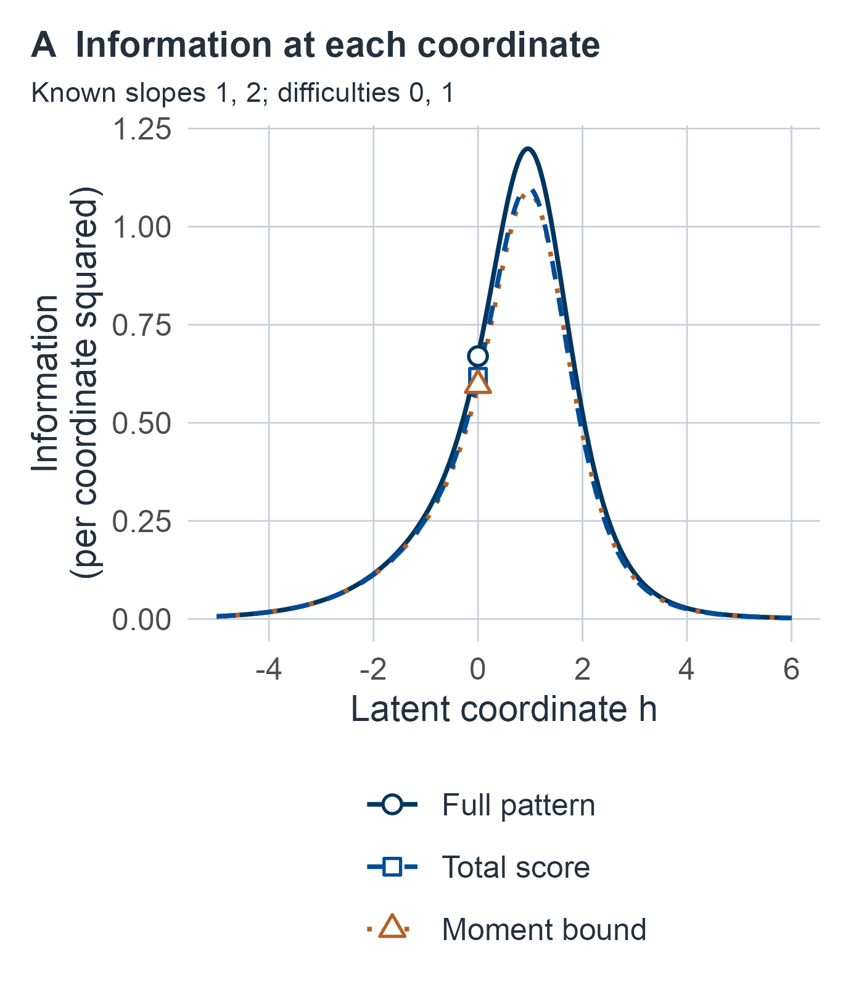
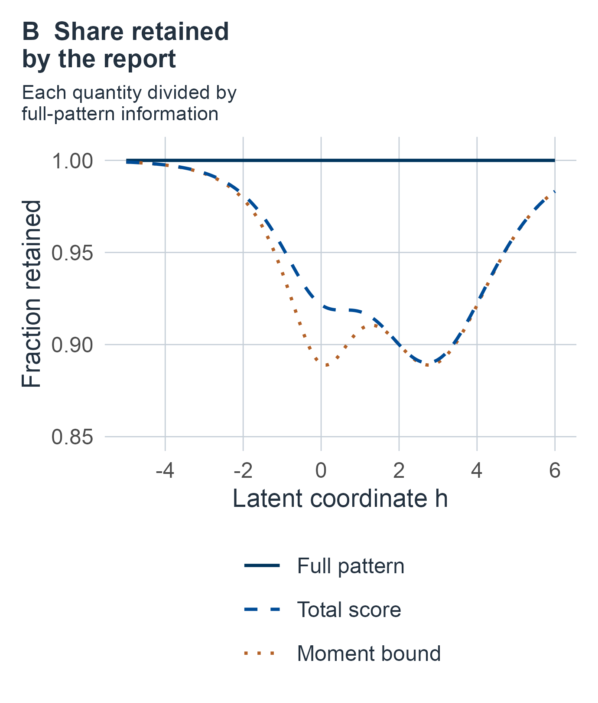
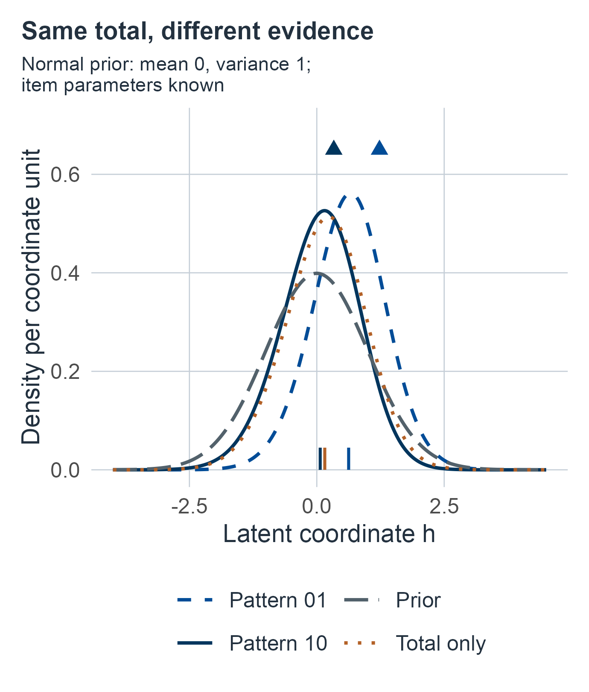

# Items and scoring {#sec-items-and-scoring}

## The same total from different answers {#sec-m06-question}

Two people answer the same two items and each earns one point. The first passes the easier item, whose success probability rises only gradually along the latent coordinate, and misses the harder one. The second misses the easier item but passes the harder one, whose success probability rises steeply near its difficulty. A report that records "1 of 2" treats them identically. Should it?

Under a declared item model the answer can be no. In this chapter's running example the two response patterns give likelihood estimates of about .33 and 1.23 on the latent coordinate, and posterior means of .07 and .63 under a standard normal teaching prior. Reporting only the total gives .16 for both. The same total arose from different evidence. Under another item model, in which every item is equally sensitive to the coordinate, the total would lose nothing. The chapter works out which situation holds, how much is lost when something is, and what follows for estimates, intervals and predictions.

More generally, two people can obtain the same number correct by succeeding on different items. When does that difference matter for estimating a declared ability coordinate? What changes when every response is wrong or correct, or when a scoring rule compresses several performances into one reported category?

We distinguish a stochastic response law from its deterministic scoring rule. A floor is a property of the possible reported observations; it is not a diagnosis or an identified mechanism. The target here is a scalar latent coordinate $H=h$, on a declared measurement scale. It is different from the scored performance, a peer percentile, a replication expectation and disease probability. [Measurement and replication](05-measurement-and-replication.md#sec-measurement) explains why an expected performance needs its replication universe and need not equal an intended construct.

By the end of the chapter, a reader should be able to separate the evidence in a response pattern from the evidence kept by its reported score, and both from the familiar moment approximation; say when a total is sufficient for a declared coordinate and when a weighted total is needed; explain why a short test gives no finite likelihood estimate for an all-correct or all-wrong pattern, and how confidence sets and proper-prior posteriors handle those patterns; describe what a floor, a ceiling, a rounding rule or a reporting category removes; and trace how uncertainty in item calibration reaches one person's score.

## How the chapter is organized {#sec-m06-roadmap}

The units move from the scoring operation itself, before any item model is chosen, to specific item models, to inference about one person, and finally to item parameters that must be estimated. Each unit states its own observations, target and guarantee.

For a first reading, follow [scoring loss](#sec-m06-information), [logistic items](#sec-m06-logistic) and the [latent metric](#sec-m06-metric), then [sufficiency](#sec-m06-sufficiency), [person inference](#sec-m06-inference), [floors and categories](#sec-m06-floors), and the [closing boundaries](#sec-m06-boundaries). Return to the technical counterexamples, crossed-facet model and prediction constructions for deeper study; read each result with its conditions and proof.

For fitted item parameters, continue through [calibration](#sec-m06-calibration), the [noisy-anchor model](#sec-m06-noisy-anchors), the [worked calibration](#sec-m06-fitted-calibration-example) and the [sufficiency counterexample](#sec-m06-uncertain-sufficiency). This return is necessary before applying known-item conclusions with estimated parameters. For consultation, use the [question-to-method guide](#sec-m06-guide) to locate the observation, target and assumptions for the result you need.

::::: {.m06-scroll role="group" tabindex="0" aria-label="M06 table 1; scroll horizontally"}

| Unit | Question | Experiment |
|---|---|---|
| [What a score retains](#sec-m06-information) | How much evidence about the coordinate does a reported score keep, compared with the full response pattern? | A fixed scoring map applied to a finite response kernel at a fixed coordinate; the same scoring under a proper prior |
| [Item kernels](#sec-m06-kernels) | Which item models supply the response law, and how do they connect to factor models, CTT and GT? | Logistic and probit items with known parameters; a dependent kernel and a crossed person-by-task design |
| [Score likelihood and sufficiency](#sec-m06-sufficiency) | How is the exact law of a total computed, and when does a total, or a weighted total, lose nothing? | Independent items with known parameters |
| [One person's coordinate](#sec-m06-inference) | What estimates, intervals and predictions follow from one response pattern? | Fixed-coordinate likelihood and confidence; proper-prior posterior; a fresh response vector |
| [Floors, ceilings and categories](#sec-m06-floors) | What do a finite battery, a rounding rule or a reporting category remove? | Fixed batteries; deterministic compression of a normal performance |
| [Calibration uncertainty](#sec-m06-calibration) | What changes when item parameters are estimated from calibration data? | Exact and noisy anchors, latent calibration people, joint posterior and conservative confidence |

:::::

The response and category experiments initially supply item slopes, difficulties, measurement noise and cutpoints as fixed known inputs. Their confidence statements repeat the responses under those inputs. The calibration section instead includes the observations used to estimate item and population quantities: its confidence procedure repeats calibration, anchors and the case, while its joint posterior integrates the unknown quantities using explicit priors. Exact finite sums and posterior integrals are distinguished from their numerical evaluations; curvature-based normal and likelihood-ratio approximations have no automatic short-battery guarantee. All examples are synthetic. Measurement/construct evidence and clinical outcomes require additional information. The [lookup guide](#sec-m06-guide) near the end collects the questions, experiments and targets in one table, and the [closing section](#sec-m06-boundaries) states what the chapter establishes.

## The running example and reused symbols {#sec-m06-running}

Every numerical example in this chapter is a synthetic teaching input, chosen so that results can be checked exactly. None is an instrument's item parameters, a value fitted to patients or a clinical cutoff. One setting recurs.

- **Two logistic items** with slopes $(1,2)$ and difficulties $(0,1)$ on a latent coordinate whose unit is fixed by the logistic parameterization. Item 1 is the easier, more gradual item; item 2 is the harder, steeper one. Its four response patterns carry the information counterexample at $h=0$, the likelihood estimates, the exact confidence interval for a total of one, the posterior comparison under the teaching prior $N(0,1)$, the coverage calculations and both prediction constructions. The opening's two people are the patterns $(1,0)$ and $(0,1)$. The calibration example also uses two items and the case pattern $(1,0)$, but it estimates the item parameters rather than supplying them.

Self-contained examples treat a nonmonotone second item (local equality without sufficiency), a three-point prior (a response that widens a posterior), a two-point population (observed independence without local independence), a transient occasion effect (dependent items), a crossed person-by-task probit design, three items with slopes $(1,1,2)$ (weighted compression), two steep items with separated difficulties (information with two peaks), a rounded score, a normal performance reported in three categories, and two equally likely difficulty vectors (sufficiency lost under parameter uncertainty).

The chapter covers many experiments with a limited alphabet, so several letters carry different meanings in different units. Each is defined where it is used; the likeliest confusions are:

::::: {.m06-scroll role="group" tabindex="0" aria-label="M06 table 2; scroll horizontally"}

| Symbol | Meanings, by unit |
|---|----------|
| $m$ | The number of items $m$; prior-predictive probabilities $m(u)$, $m(x)$; the fresh-task expected binary score $m(p)$ in the crossed facet; the prior mean $m_0$; posterior means $m_U$, $m_X$; the case marginal $m_\lambda(u)$; the posterior normalizer $Z_u$ equals $m(u)$ under the normal prior |
| $V$, $v$ | The conditional score variance $V(h)$ and weighted-score variance $V_a(h)$; continuous latent responses $V_j$ in the probit bridge; coupling uniforms $V_j$ in the confidence proof. Variances $v_0$ (prior), $v_P,v_T,v_e$ (facets), $v(p)$ and $v_\tau$ (facet scores) and $v$ (calibration population) |
| $a$, $b$ | Item slopes $a_j$ and difficulties $b_j$; inverse-gamma shapes and scales $a_t,b_t,a_s,b_s$; standardized truncation bounds $a,b$ in the category posterior; the bounds $a_{\min}$ and $B$ on item parameters; the slope sum $B_\lambda$ |
| $\alpha$, $\beta$ | Error rates $\alpha$, $\alpha_A,\alpha_B,\alpha_C$ and $\beta$; prior means $\alpha_j,\beta_j$ of log-slopes and difficulties; anchor coefficients $\beta_0,\beta_1$ |
| $s$, $S$ | The scoring map $s(u)$; the anchor error variance $s$; the predictive SD $s$ in the category posterior; prior SDs $s_{A,j},s_{b,j}$; derivative scores $\mathcal S_U,\mathcal S_X$; Gaussian derivative score $S$; rank-weighted calibration statistics $S_j$ and the sample variance $S_M^2$ |
| $t$, $T$ | The anchor total variance $t=v+s/2$; the conditional tail $t_c$; Student quantiles $t_{d,p}$; task effects $T_j$; the weighted total $T_a$; calibration item counts $T_j$ |
| $D$ | The transient occasion effect $D$; the logistic likelihood denominator $D(h)$. Calibration data are written $\mathcal D$, as elsewhere in the book |
| $C$, $c$, $d$ | Fiber sums $C_x$; the pooled statistic $C(u,v)$; confidence sets $\mathcal C(x)$, $\mathcal C_k$; pattern constants $c(u)$, $c_u$; cutpoints $c_k$ and the threshold $c$; affine constants $c,d$ in metric changes; the nuisance values $\pm d$ of the occasion effect; the discrepancy $d(u,v)$ |
| $Q$, $q$ | The score law $q_h(x)$ and partial-total probabilities $q_{j,k}$; the smoothed item curve $Q_j(x)$; sums of squares $Q_M,Q_Z$; a truncation probability $Q$ |
| $K$, $L$ | The number of internal cutpoints $K$; the shared-task covariance $K(p,l)$. Likelihoods $L_x,L_u,L_{\mathcal D},L_B,L_c$; the lower success bound $L$ in the bounded-parameter example |
| $g$, $G$, $w$ | Shrinkage $g$ and conditional variance $w$ of calibration abilities; a standard normal variable $G$ in the smoothed item curve; rank weights $w_r$ |
| $r$ | The nonmonotone item curve $r(h)$; the shrinkage ratio $r$ in the category posterior; the conditional law $r_\lambda(u\mid x)$; the calibration person index $r$ |
| $p$, $P$ | Response probabilities $p_h(u)$, $p_j(h)$; the person effect $P_i$ with value $p$; probability $P(\cdot)$ |
| $\phi$, $\varphi$ | The standard normal density $\phi$, with CDF $\Phi$; the normal density $\varphi(z;m,q)$ with mean $m$ and variance $q$ |

:::::

## Fixed scoring and the information correction {#sec-m06-information}

We begin with the scoring operation itself, before choosing any item model. The question is how much of the evidence about $h$ in the full response record survives the step from responses to a reported score. Fisher information measures that evidence locally. It is the variance of the derivative of the log-likelihood, so it is large when the likelihood changes quickly as $h$ moves and therefore singles out nearby coordinates sharply.

Let $U$ take values in a **fixed finite** response space $\mathcal U$, with known probabilities $p_h(u)>0$ for every $u\in\mathcal U$ and finite $h\in\mathbb R$. Assume each probability is differentiable in $h$ and sums to one. This positive common-support condition allows all derivatives below to pass through finite sums. The experiment redraws responses under this kernel at a fixed $h$, holding the battery, administration, scoring and item parameters fixed. No normal distribution of scored responses is assumed.

A prespecified map $X=s(U)$ produces a scored performance; it is an instance of the book's general $Y=s(U,A)$ notation with administration held fixed. Its attainable values form $\mathcal X=s(\mathcal U)$. The probability and likelihood of observing **only** $X=x$ are

::::: {.m06-scroll role="group" tabindex="0" aria-label="M06 equation 1; scroll horizontally"}

$$
q_h(x)=\sum_{u:s(u)=x}p_h(u),\qquad L_x(h)=q_h(x).
$$ {#eq-m06-score-law}

:::::

If the response vector is observed, its likelihood is instead $L_u(h)=p_h(u)$. Multiplying $p_h(u)$ by $q_h(s(u))$ would count deterministic information twice. The map and response support must not themselves depend on the unknown $h$ in these formulas.

A **score fiber** is the group of response patterns assigned the same reported score. For an ordinary two-item total, patterns $(1,0)$ and $(0,1)$ belong to the fiber for one point. Averaging their derivative scores using their conditional pattern probabilities as weights gives the derivative score retained by the report; the following conditional variance measures what was lost.

::: {#prp-m06-information}
## Exact information, scoring loss and the moment bound

Define the derivative scores and their Fisher informations by

::::: {.m06-scroll role="group" tabindex="0" aria-label="M06 equation 2; scroll horizontally"}

$$
\mathcal S_U(u;h)=\partial_h\log p_h(u),\quad
\mathcal S_X(x;h)=\partial_h\log q_h(x),
$$ {#eq-m06-derivative-scores}

:::::

::::: {.m06-scroll role="group" tabindex="0" aria-label="M06 equation 3; scroll horizontally"}

$$
I_U(h)=\sum_up_h(u)\mathcal S_U(u;h)^2,\qquad
I_X(h)=\sum_x\frac{\{q'_h(x)\}^2}{q_h(x)}.
$$ {#eq-m06-exact-information}

:::::

Then $E_h(\mathcal S_U)=E_h(\mathcal S_X)=0$ and

::::: {.m06-scroll role="group" tabindex="0" aria-label="M06 equation 4; scroll horizontally"}

$$
\mathcal S_X(X;h)=E_h(\mathcal S_U\mid X),\qquad
I_U-I_X=E_h\{\operatorname{Var}_h(\mathcal S_U\mid X)\}\ge0.
$$ {#eq-m06-information-loss}

:::::

For $\tau(h)=E_h(X)$ and $V(h)=\operatorname{Var}_h(X)>0$,

::::: {.m06-scroll role="group" tabindex="0" aria-label="M06 equation 5; scroll horizontally"}

$$
\frac{\tau'(h)^2}{V(h)}\ \le\ I_X(h)\ \le\ I_U(h).
$$ {#eq-m06-information-bound}

:::::

At the specified $h$, upper equality holds exactly when $\mathcal S_U$ is constant within each score fiber. Lower equality holds exactly when $\mathcal S_X(X;h)=c_h\{X-\tau(h)\}$ almost surely for some constant $c_h$. A local equality at one $h$ does not by itself establish global sufficiency.
:::

::: {.proof}
Differentiating $\sum_up_h(u)=1$ gives the first zero mean. For each score fiber,
$q'_h(x)=\sum_{u:s(u)=x}p_h(u)\mathcal S_U(u;h)$; dividing by $q_h(x)$ gives the conditional expectation identity. Summing $q'_h(x)$ gives the other zero mean. Total variance applied to the zero-mean derivative score gives the exact loss identity and its equality condition. Differentiating the finite expectation gives
$\tau'=\sum_x xq'_h(x)=E_h[(X-\tau)\mathcal S_X]$.
Cauchy–Schwarz therefore yields $\tau'^2\le V I_X$, with equality precisely when the two centered random variables are proportional, including $\mathcal S_X=0$. Positivity of $V$ permits division.
:::

**Reading the three quantities.** $I_U(h)$ measures how sharply the full response pattern distinguishes $h$ from nearby coordinates. $I_X(h)$ measures the same thing for the reported score alone. The exact loss identity says that their difference is an average, over the reported scores, of how much the full-pattern derivative score still varies among the response patterns that share a score. If every pattern within a fiber carries the same derivative score, nothing is lost at that $h$. The ratio $\tau'(h)^2/V(h)$ uses only the first two moments of the score: how far its expected value moves per unit of $h$, measured in conditional SDs of the score, then squared. It equals $I_X$ only when the score's own derivative score is an affine function of the score, $c_h\{X-\tau(h)\}$. Otherwise the shape of the score's law beyond its mean and variance carries evidence that the ratio misses. In short, the full pattern can carry more evidence than the score, and the score can carry more than its mean and variance reveal.

The expression $\tau'^2/V$ is a **moment-based lower bound**, not the definition of information in a total. In the classical item-response literature this squared slope of the mean score over its variance is called the information provided by a test and its scoring formula [@birnbaum1968some, p. 418]. It equals the exact information of the score only under the lower equality condition above. With a constant scored statistic, $V=0$ and the ratio is undefined; the exact score likelihood is constant in $h$ and its information is zero. Information has inverse-squared latent-coordinate units. It is not reliability, construct validity or an automatic finite-sample confidence guarantee. A one-to-one recoding of attainable scores preserves their likelihood information because its fibers are unchanged. Any further fixed coarsening can only reduce it by the same identity.

**Synthetic finite counterexample.** Consider two independent binary responses with success probabilities $p_j(h)=\{1+\exp[-a_j(h-b_j)]\}^{-1}$, slopes $(a_1,a_2)=(1,2)$, difficulties $(b_1,b_2)=(0,1)$, and $h=0$. Use the unweighted total $X=U_1+U_2$. Direct differentiation and enumeration give:

::::: {.m06-scroll role="group" tabindex="0" aria-label="M06 table 3; scroll horizontally"}

| Response $u$ | $p_0(u)$ | $\mathcal S_U(u;0)$ |
|---|---|---|
| $(0,0)$ | $.44039854$ | $-.73840584$ |
| $(0,1)$ | $.05960146$ | $1.26159416$ |
| $(1,0)$ | $.44039854$ | $.26159416$ |
| $(1,1)$ | $.05960146$ | $2.26159416$ |

:::::

The total probabilities are approximately $(.44039854,.5,.05960146)$ and their derivatives are $(-.32519285,.19039854,.13479432)$. The two responses with total one have different derivative scores. Exact finite sums yield

::::: {.m06-scroll role="group" tabindex="0" aria-label="M06 equation 6; scroll horizontally"}

$$
\tau'^2/V\approx .59603386,\qquad
I_X\approx .61747755,\qquad I_U\approx .66997434.
$$ {#eq-m06-information-counterexample}

:::::

Thus both inequalities can be strict, even with independent logistic items and known parameters. The values show that the moment ratio cannot be taken as the exact information of a total; they are synthetic, not clinical measurements. The general proof above establishes the distinction independently of this numerical example. Common-slope conditions under which the expressions do agree are derived below.

@fig-m06-information draws the three quantities for the same two items across the coordinate. Over this range the total keeps between about 89 and 100 percent of the full-pattern information. At $h=0$ it keeps .922, and the moment ratio describes .890; the share kept by the total is lowest, about .89, near $h=2.7$, and returns toward one in both directions as all three quantities fall toward zero in the tails.

:::: {#fig-m06-information .m06-content-figure fig-alt="Two panels plotted against the latent coordinate h from minus 5 to 6. Left panel: three bell-shaped curves of Fisher information peaking near h equals 1. The solid curve for the full response pattern peaks at about 1.2; the dashed curve for the total score and the dotted curve for the moment bound nearly coincide and peak at about 1.1. Markers at h equals 0 show 0.670, 0.617 and 0.596. All three curves approach zero in both tails. Right panel: shares of the full-pattern information. A solid reference line at 1. The dashed curve for the total falls from near 1 at h equals minus 5 to 0.922 at h equals 0, reaches a minimum near 0.89 around h equals 2.7, and rises toward 0.98 at h equals 6. The dotted curve for the moment bound lies on or below it, at 0.890 at h equals 0, and nearly merges with it above h equals 1.5."}

Information about the latent coordinate in the two-item synthetic example (logistic items with slopes 1 and 2, difficulties 0 and 1, parameters known). **A.** Exact information in the full response pattern (solid), exact information in the unweighted total (dashed) and the moment ratio $\tau'(h)^2/V(h)$ (dotted). Markers at $h=0$ are the values in @eq-m06-information-counterexample. **B.** The two lower curves as shares of the full-pattern information. The total never retains all of it, because the slopes differ; the moment ratio is never above the total's exact information. All values are exact finite sums computed from the stated model.

::::

[Full-size information panel](figures/m06-items-1.png) · [Full-size retained-share panel](figures/m06-items-2.png)

### Local equality and global sufficiency {#sec-m06-local-global}

Equality at one parameter value concerns derivatives there. Sufficiency concerns likelihood ratios throughout the parameter family. The distinction can be demonstrated within the finite positive-support experiment. Let $U_1,U_2$ be independent given $h$, with probabilities $p(h)=\operatorname{expit}(h)$ and $r(h)=\operatorname{expit}(h^2)$, where $\operatorname{expit}(z)=1/(1+e^{-z})$, and retain only $X=U_1$. This second response curve is deliberately nonmonotone; it is an example of the general kernel, not the increasing-item model developed below. Its full derivative score is

::::: {.m06-scroll role="group" tabindex="0" aria-label="M06 equation 7; scroll horizontally"}

$$
\mathcal S_U=(U_1-p)+2h(U_2-r),\qquad
I_U=p(1-p)+4h^2r(1-r).
$$ {#eq-m06-local-equality-example}

:::::

The score-only information and its moment bound both equal $p(1-p)$. At $h=0$, all three informations are $1/4$, and the full derivative score is constant on each fiber of $X$. Nevertheless, $P_h(U_2=1\mid X)=r(h)$ changes with $h$, so $X$ is not globally sufficient. For $h\ne0$ the full-information loss is strictly positive.

There is also a useful global statement under the present assumptions. If the upper equality holds at **every** $h$ in a connected open parameter interval, then the statistic is sufficient on that interval. For two responses $u,v$ in the same fiber, equality says
$\partial_h\log\{p_h(u)/p_h(v)\}=0$ throughout the interval. The mean-value theorem makes that likelihood ratio constant there. Taking one reference response in each fiber and normalizing shows that $p_h(u)/q_h(s(u))$ is independent of $h$, which is the required conditional response law. Conversely, if that conditional law is independent of $h$, differentiating $p_h(u)=q_h(s(u))c(u)$ gives the upper equality everywhere. Positivity, fixed support and a connected interval matter; equality at an isolated point does not supply this argument.

### The same scoring operation in a Bayesian experiment {#sec-m06-coarse-posterior}

The same scoring step can be described with a population prior in place of a fixed coordinate. What is lost is then posterior accuracy, averaged over people drawn from that prior, rather than Fisher information at one coordinate.

Specify a proper population prior $\pi(h)$ for the same latent coordinate and kernel, for example $N(m_0,v_0)$ with $v_0>0$. Define prior-predictive probabilities $m(u)=\int p_h(u)\pi(h)\,dh$ and $m(x)=\sum_{u:s(u)=x}m(u)$. Positivity and bounded likelihood imply $0<m(u),m(x)\le1$, so both response and score posteriors are proper.

::: {#prp-m06-posterior-coarsening}
## Posterior mixing and average squared-error loss from scoring

The score-only posterior is the exact mixture

::::: {.m06-scroll role="group" tabindex="0" aria-label="M06 equation 8; scroll horizontally"}

$$
\pi(h\mid x)=\sum_{u:s(u)=x}\frac{m(u)}{m(x)}\,\pi(h\mid u).
$$ {#eq-m06-posterior-mixture}

:::::

If the prior has a finite second moment, let $m_U=E(H\mid U)$ and $m_X=E(H\mid X)$. Under the joint prior/response experiment,

::::: {.m06-scroll role="group" tabindex="0" aria-label="M06 equation 9; scroll horizontally"}

$$
E\{(H-m_X)^2\}
=E\{(H-m_U)^2\}+E\{(m_U-m_X)^2\}.
$$ {#eq-m06-bayes-scoring-risk}

:::::

The loss is an average over that declared prior and kernel; it need not imply a pointwise ordering of posterior variances for every observed response pattern.
:::

::: {.proof}
In each mixture term substitute $\pi(h\mid u)=p_h(u)\pi(h)/m(u)$. Summing the fiber gives $q_h(x)\pi(h)/m(x)$, proving the density identity. Iterated expectation gives $m_X=E(m_U\mid X)$. Expand $H-m_X=(H-m_U)+(m_U-m_X)$; the cross term vanishes because $E(H-m_U\mid U)=0$ and the second factor is determined by $U$. Finite prior second moment makes all terms integrable. This proves the risk decomposition.
:::

These are the frequentist fixed-$h$ and Bayesian population-prior descriptions of the **same scoring experiment**, with different summaries of information or error. Neither says that an observed total is uncertain after it has been computed. Rather, the total can discard evidence about the latent target. If a score is sufficient for the kernel, retaining the whole response pattern adds no posterior information about $h$ under any proper prior with the item parameters known. That global statement requires the likelihood factorization developed later.

### A response can increase a conditional posterior variance {#sec-m06-pointwise-variance}

The average squared-error result does not say that every additional response narrows a particular posterior. For an exact example, use a proper three-point prior with masses $1/20,9/10,1/20$ at $H=-1,0,1$. Observe a binary response with the smooth positive kernel
$p_h(1)=.01+.98\sin^2(\pi h/2)$ and $p_h(0)=1-p_h(1)$. Compare retaining $U$ with a score $X$ that reports the same category for both responses. The prior and score-only posterior have mean zero and variance $.1$. The prior-predictive probability of $U=1$ is $.108$. Bayes' rule gives

::::: {.m06-scroll role="group" tabindex="0" aria-label="M06 equation 10; scroll horizontally"}

$$
\begin{aligned}
\operatorname{Var}(H\mid U=1)&=\frac{.099}{.108}
=\frac{11}{12},\\
\operatorname{Var}(H\mid U=0)&=\frac{.001}{.892}
=\frac1{892}.
\end{aligned}
$$ {#eq-m06-pointwise-posterior-variance}

:::::

Both conditional means are zero by symmetry. Observing $U=1$ increases the variance because it favors either extreme over the center. Averaging the two conditional variances gives
$.108(11/12)+.892/892=.1$, agreeing with the risk decomposition: here retaining the response improves inference about magnitude without changing the posterior mean or its squared-error risk. The integrals in the preceding posterior argument become weighted sums for this explicitly discrete prior. A different observed response or prior can give different conditional precision; the proved risk comparison is an average under the declared experiment.

## Item kernels and their measurement bridges {#sec-m06-kernels}

The first unit allowed any positive response kernel. Practical scoring needs a specific one: a model for how each item's success probability depends on the coordinate, and an assumption about how the items combine. This unit states the standard choices, what each asserts, and how each connects to the factor, CTT and GT models of [Measurement and replication](05-measurement-and-replication.md#sec-measurement). @reise2009item review how these models have been used with clinical measures and note differences between cognitive and clinical measures that matter for the modeling.

A binary response $U_j=1$ denotes a prespecified success; $U_j=0$ denotes its complement. It need not mean that an omitted or invalid response was an observed failure. Fix $m\ge1$ items before administration, retain every response, and initially supply their parameters as known. Conditional independence means that the response law **given all included latent influences** factors as

::::: {.m06-scroll role="group" tabindex="0" aria-label="M06 equation 11; scroll horizontally"}

$$
p_h(u)=\prod_{j=1}^m p_j(h)^{u_j}\{1-p_j(h)\}^{1-u_j},
\qquad u\in\{0,1\}^m.
$$ {#eq-m06-local-independence}

:::::

Zero observed item correlation does not establish this conditional factorization. Conditional independence is a statement at fixed included latent influences. Mixing over $H$ generally induces observed dependence even when this conditional factorization is correct. Conversely, conditioning on an incomplete latent coordinate need not remove dependence. The fixed battery and complete-response experiment here supply no automatic calibration for adaptive item selection or informative missingness.

The converse distinction can be made with an exact finite population. Let $H=-1,1$ be equally likely. At $H=-1$ set the two item margins to $(.4,.6)$; at $H=1$ reverse them to $(.6,.4)$. At both values use conditional probabilities $P(11\mid H)=P(00\mid H)=.25$; the probabilities of $10,01$ are respectively $(.15,.35)$ or $(.35,.15)$. Every probability is positive. Conditional covariance is $.25-(.4)(.6)=.01$, so the items are not conditionally independent. Averaging over $H$ gives probability $1/4$ to each pattern: the observed responses are independent Bernoulli$(1/2)$ variables. Here a negative covariance between the two conditional means cancels the positive within-person covariance. Even observed independence does not establish a locally independent measurement kernel.

### Logistic items {#sec-m06-logistic}

Use $p_j(h)=\operatorname{expit}\{a_j(h-b_j)\}$, where $\operatorname{expit}(z)=1/(1+e^{-z})$, $a_j>0$ is the known slope and $b_j\in\mathbb R$ is the known difficulty. Larger $h$ increases success probability; $p_j(b_j)=1/2$. A common slope $a_j=a$ is the common-slope logistic branch; fixing its latent unit so that $a=1$ gives the Rasch parameterization used here [@birnbaum1968some, p. 402]. The unequal-slope version is the two-parameter logistic model; @chen2025irt [sec. 2.1] review both and their origins. Unequal slopes allow different sensitivity to the same coordinate; they do not identify multiple cognitive dimensions.

::: {#prp-m06-logistic-kernel}
## Logistic likelihood, moments and full-response information

Under conditional independence,

::::: {.m06-scroll role="group" tabindex="0" aria-label="M06 equation 12; scroll horizontally"}

$$
\begin{aligned}
\ell_u(h)&=\log p_h(u)
=\sum_j\big[u_ja_j(h-b_j)-\log\{1+e^{a_j(h-b_j)}\}\big],\\
\ell'_u(h)&=\sum_j a_j\{u_j-p_j(h)\},\\
-\ell''_u(h)&=\sum_j a_j^2p_j(h)\{1-p_j(h)\}=I_U(h).
\end{aligned}
$$ {#eq-m06-logistic-likelihood}

:::::

For the unweighted total $X=\sum_jU_j$,

::::: {.m06-scroll role="group" tabindex="0" aria-label="M06 equation 13; scroll horizontally"}

$$
\begin{aligned}
\tau(h)&=\sum_jp_j(h),\\
V(h)&=\sum_jp_j(h)\{1-p_j(h)\},\\
\tau'(h)&=\sum_ja_jp_j(h)\{1-p_j(h)\}.
\end{aligned}
$$ {#eq-m06-logistic-moments}

:::::
:::

::: {.proof}
Taking the logarithm of the Bernoulli product gives the first expression. Differentiate using $p'_j=a_jp_j(1-p_j)$ to obtain the next two. At fixed $h$, centered independent responses have zero cross covariance and variance $p_j(1-p_j)$, so the variance of $\ell'_u$ is the stated information. Adding their expectations/variances and differentiating the expectation gives the total-score moments. No between-person distribution or normal approximation enters this proof.
:::

The full-pattern information is a sum because the item derivative scores are conditionally uncorrelated under the stated product model. Its units depend on the latent scale. The expression $(\sum_jp'_j)^2/V$ is still only the total's moment bound unless an equality condition is proved. Difficulties need not be equal even when slopes are common.

### Normal-ogive items and thresholded factors {#sec-m06-probit}

Let instead $p_j(h)=\Phi\{a_j(h-b_j)\}$, with $a_j>0$ and finite $b_j$, and write $\Phi$ for the standard normal CDF and $\phi$ for its density. The model is often called a normal-ogive or probit item model [@chen2025irt, sec. 2.1]. It is a model for a binary observation; it does not assert that the reported total is Gaussian.

::: {#prp-m06-probit-kernel}
## Probit information and the continuous-response bridge

With conditional independence and $z_j=a_j(h-b_j)$,

::::: {.m06-scroll role="group" tabindex="0" aria-label="M06 equation 14; scroll horizontally"}

$$
\mathcal S_U=\sum_j
 \frac{a_j\phi(z_j)}{p_j(1-p_j)}(U_j-p_j),\qquad
I_U=\sum_j\frac{a_j^2\phi(z_j)^2}{p_j(1-p_j)}.
$$ {#eq-m06-probit-information}

:::::

Total-score mean and variance remain $\sum_jp_j$ and $\sum_jp_j(1-p_j)$, now with derivative $\tau'=\sum_ja_j\phi(z_j)$.

An exact observation-kernel bridge starts from continuous latent responses
$V_j=\nu_j+\lambda_jh+\varepsilon_j$, with independent $\varepsilon_j\sim N(0,\theta_j)$, $\theta_j>0$, $\lambda_j>0$, and records $U_j=\mathbf1\{V_j>c_j\}$. It gives this probit model with
$a_j=\lambda_j/\sqrt{\theta_j}$ and $b_j=(c_j-\nu_j)/\lambda_j$.
:::

::: {.proof}
For any differentiable Bernoulli probability in $(0,1)$, differentiating its log likelihood gives $p'_j(U_j-p_j)/\{p_j(1-p_j)\}$. Under the product law its variance is the sum of $p_j'^2/\{p_j(1-p_j)\}$. Substitute $p'_j=a_j\phi(z_j)$. Moments follow by summation. Finally,
$P(V_j>c_j\mid h)=\Phi\{(\nu_j+\lambda_jh-c_j)/\sqrt{\theta_j}\}$ by normal symmetry. Independent continuous residuals give independent binary observations conditional on $h$, establishing the exact threshold bridge.
:::

This connects a continuous factor measurement model to IRT through the specified thresholding kernel. With a normal population for the coordinate, the corresponding equivalence of marginal likelihoods for the two-parameter normal-ogive model and factor analysis of dichotomized variables was proved by @takane1987relationship. If $H$ is also Gaussian in the person population, the underlying $V$ vector is jointly Gaussian. Observed binary correlations remain different quantities from underlying-response correlations. A logistic curve and a normal-ogive curve are different links; a numerical rescaling that approximates them over one range is not an exact identity or a justification for transferring every likelihood calculation.

For either link, the induced total $\tau(h)$ is a replication expectation if $h$ contains every stable influence on that response kernel. Its CTT residual has conditional mean zero and variance $V(h)$ by definition. Across a declared population distribution of $H$, total variance gives $\operatorname{Var}(X)=\operatorname{Var}\{\tau(H)\}+E\{V(H)\}$. These are the item-level ingredients of the M05 bridge, not evidence that $X$ and $H$ share the same scale or that every stable influence measures the intended construct.

### A dependence model that changes the information calculation {#sec-m06-dependence}

To see what the product assumption contributes, let $D$ be a transient occasion influence independent of fixed $h$, equally likely to be $d$ or $-d$. Conditional on $(h,D)$ give two items independent success probability $p(h,D)=\operatorname{expit}(h+D)$. Redraw $D$ on each replication. The correct conditional-on-$h$ joint kernel is

::::: {.m06-scroll role="group" tabindex="0" aria-label="M06 equation 15; scroll horizontally"}

$$
\begin{aligned}
p_h(u)&=\tfrac12\prod_{j=1}^2p(h,d)^{u_j}\{1-p(h,d)\}^{1-u_j}\\
&\quad+\tfrac12\prod_{j=1}^2p(h,-d)^{u_j}\{1-p(h,-d)\}^{1-u_j}.
\end{aligned}
$$ {#eq-m06-dependent-kernel}

:::::

The conditional covariance of the responses is $\operatorname{Var}_D\{p(h,D)\}$: their conditional covariance given $D$ is zero and their two conditional means are the same random probability. This follows from total covariance. It is positive for $d\ne0$. Scoring means still add, but score variance now includes twice that covariance.

At $h=0,d=\log3$, the probabilities at the two nuisance values are $3/4$ and $1/4$. Joint pattern probabilities $(00,01,10,11)$ are $(5,3,3,5)/16$, while derivatives in that order are $(-3,0,0,3)/16$. Thus exact joint information is $9/40=.225$. Each marginal probability is $1/2$ with derivative $3/16$, giving marginal item information $9/64$. Adding the two marginal informations gives $9/32=.28125$, which is **not** the joint information. The response covariance is $1/16$. The first section's exact finite-space information/loss identities still apply to this correct dependent kernel; the independent-item sums do not.

A random task or rater effect can likewise enter a response link, connecting item models with GT designs. Averaging a nonlinear response probability over that effect generally differs from evaluating the link at its mean. Variance components on the link or underlying-response scale are not observed-score GT components. If an influence is stable for a person, it belongs in that person's retained state when defining replications; integrating it out as freshly transient changes the target. Additional paired/multi-indicator/facet observations can help assess these assumptions; a single observed residual correlation cannot name its cause.

### A crossed facet on the underlying and scored scales {#sec-m06-binary-facet}

A simple crossed experiment makes the GT bridge explicit. Let persons and tasks be independently sampled. All entries within each of the following Gaussian arrays are independent and identically distributed, and the three arrays are mutually independent:

::::: {.m06-scroll role="group" tabindex="0" aria-label="M06 equation 16; scroll horizontally"}

$$
\begin{aligned}
Z_{ij}&=\mu+P_i+T_j+\epsilon_{ij},\qquad
U_{ij}=\mathbf1\{Z_{ij}>0\},\\
P_i&\sim N(0,v_P),\quad T_j\sim N(0,v_T),\quad
\epsilon_{ij}\sim N(0,v_e),\qquad v_e>0.
\end{aligned}
$$ {#eq-m06-binary-facet-model}

:::::

Supply $\mu,v_P,v_T,v_e$ as known for these calculations, with $v_P,v_T\ge0$ and $v_e>0$. The variances here are in **underlying-response** squared units, whereas $U$ is binary. The entire conditional response kernel, given the person and task effects, is a product of Bernoulli probabilities
$\Phi\{(\mu+P_i+T_j)/\sqrt{v_e}\}$. Integrating a shared $T_j$ produces dependence between that task's responses. It does not produce independent Bernoulli observations with the random effect replaced by zero.

For a fixed person with $P_i=p$, repeat using an entirely new independently sampled task and fresh cell noise. The operational expected **binary score** is

::::: {.m06-scroll role="group" tabindex="0" aria-label="M06 equation 17; scroll horizontally"}

$$
m(p)=\Phi\!\left(\frac{\mu+p}{\sqrt{v_T+v_e}}\right),
\qquad v(p)=m(p)\{1-m(p)\}.
$$ {#eq-m06-binary-facet-target}

:::::

Indeed $T+\epsilon$ is normal with variance $v_T+v_e$; thresholding that sum gives this Bernoulli law and variance. Retaining one named task with realized effect $t$ instead gives target
$\Phi\{(\mu+p+t)/\sqrt{v_e}\}$. The target is neither $p$ nor a mean obtained by thresholding at the mean of the random task effect. For example, at $\mu=0,p=1,v_T=v_e=1$, the fresh-task mean is approximately $.760250$, while the link evaluated at the task mean is $\Phi(1)\approx .841345$. These are different operations, not rounding error.

For two fixed persons $p,l$ using the same independently sampled task, let
$f_p(t)=\Phi\{(\mu+p+t)/\sqrt{v_e}\}$ and define

::::: {.m06-scroll role="group" tabindex="0" aria-label="M06 equation 18; scroll horizontally"}

$$
K(p,l)=E_T\{f_p(T)f_l(T)\}-m(p)m(l).
$$ {#eq-m06-binary-facet-covariance}

:::::

Conditional on the task, the two cell noises are independent. Total covariance therefore gives $K(p,l)$ as their scored-response covariance. For their averages over $J$ independent shared tasks, the error in the observed difference relative to $m(p)-m(l)$ has variance

::::: {.m06-scroll role="group" tabindex="0" aria-label="M06 equation 19; scroll horizontally"}

$$
\frac{m(p)\{1-m(p)\}+m(l)\{1-m(l)\}-2K(p,l)}{J}.
$$ {#eq-m06-binary-shared-task-error}

:::::

Distinct tasks give independent task blocks, so their difference variances add and averaging divides by $J$. If tasks are instead sampled independently for each person, the covariance term is zero. At $\mu=p=l=0,v_T=v_e=1$, $\Phi(T)$ is uniform on $(0,1)$: $P\{\Phi(T)\le u\}=u$. Hence $E\{\Phi(T)^2\}=1/3$, $K=1/12$, and shared-task difference error variance is $1/(3J)$, compared with $1/(2J)$ under separate task samples. Each single response still has variance $1/4$. Task sharing affects the comparison, but on the binary scale it is not an additive common shift that cancels identically. The additive GT variance formulas on the $Z$ scale cannot simply be attached to $U$.

For an explicit CTT population bridge also take $P\sim N(0,1)$ and $\mu=0,v_T=v_e=1$. The marginal binary variance is $1/4$ by normal symmetry. The variance of the expected replication score and its reliability are

::::: {.m06-scroll role="group" tabindex="0" aria-label="M06 equation 20; scroll horizontally"}

$$
\begin{aligned}
v_\tau&=\int_{-\infty}^{\infty}
\{\Phi(p/\sqrt2)-1/2\}^2\phi(p)\,dp,\\
\rho_{\mathcal M}&=4v_\tau\approx .216347.
\end{aligned}
$$ {#eq-m06-binary-facet-reliability}

:::::

This is an exact one-dimensional integral, numerically evaluated here; total variance gives mean conditional error variance $1/4-v_\tau$. It is not the underlying Gaussian variance ratio $v_P/(v_P+v_T+v_e)=1/3$. The nonlinear observation kernel changes the scored-scale variance decomposition. These calculations supply consequences of a specified crossed threshold model. They do not validate its facets, a factor interpretation or any clinical outcome. Estimating its unknown effects and parameters requires the actual joint calibration likelihood; the later calibration section supplies concrete uncertain-parameter experiments.

### Fixing the latent metric {#sec-m06-metric}

For either link, $h^*=c+dh$, $d>0$, $a_j^*=a_j/d$ and $b_j^*=c+db_j$ preserve every response probability. Item calibration therefore needs a metric convention or external anchors; a common convention fixes the latent mean and variance [@chen2025irt, sec. 2.1]. Under a coherent recoding, $I_{h^*}=I_h/d^2$ by the derivative chain rule, and a prior density transforms as $\pi^*(h^*)=\pi\{(h^*-c)/d\}/d$. Numerically larger information under a smaller latent unit does not mean more observations were obtained. Link slope, prior scale and the intended meaning of a one-unit difference must be reported together.

## Total-score likelihood and sufficiency {#sec-m06-sufficiency}

With an explicit kernel we can return to the opening question. Two calculations are needed: the exact probability law of a total, and a criterion for when that total retains everything the response pattern says about $h$.

Under the independent-item kernel, a total's law can be computed without treating it as Gaussian or as a binomial count with identical success probabilities. The probability generating polynomial is

::::: {.m06-scroll role="group" tabindex="0" aria-label="M06 equation 21; scroll horizontally"}

$$
E_h(z^X)=\prod_{j=1}^m\{1-p_j(h)+p_j(h)z\}.
$$ {#eq-m06-generating-polynomial}

:::::

Its coefficient of $z^k$ is the exact probability of total $k$. Differing item probabilities generally give a Poisson-binomial law; a binomial law is the additional equal-probability case.

::: {#prp-m06-total-recursion}
## Finite recursion for total probabilities and derivatives

Start $q_{0,0}=1$, $q'_{0,0}=0$, with entries zero outside $0\le k\le j$. For $j=1,\ldots,m$,

::::: {.m06-scroll role="group" tabindex="0" aria-label="M06 equation 22; scroll horizontally"}

$$
q_{j,k}=(1-p_j)q_{j-1,k}+p_jq_{j-1,k-1},
$$ {#eq-m06-total-recursion}

:::::

::::: {.m06-scroll role="group" tabindex="0" aria-label="M06 equation 23; scroll horizontally"}

$$
\begin{aligned}
q'_{j,k}={}&(1-p_j)q'_{j-1,k}+p_jq'_{j-1,k-1}\\
&+p'_j\{q_{j-1,k-1}-q_{j-1,k}\}.
\end{aligned}
$$ {#eq-m06-total-derivative-recursion}

:::::

Then $q_{m,k}=P_h(X=k)$ and $q'_{m,k}$ is its derivative. The exact total information is $\sum_{k=0}^m q_{m,k}'^2/q_{m,k}$.
:::

::: {.proof}
Condition on the last binary response. Independence gives the sum of the probability of no last success and the probability of one last success, producing the first recurrence. Differentiate its two products for the second. Induction from the empty response vector proves both interpretations. Substitution in the finite score information definition proves the final statement.
:::

This is the recursion that @lord1984comparison [p. 454] gave for the number-correct distribution at a fixed ability, adding one item at a time. It requires order $m^2$ scalar updates for all partial totals; it avoids enumerating $2^m$ patterns for this product model. Finite arithmetic can still underflow at extreme coordinates or large batteries. Stable likelihood computation and derivative checks are numerical implementation issues, not reasons to replace the exact law by an unnamed approximation. With local dependence, the score law must instead sum the correct joint kernel or integrate its conditional score laws over the nuisance distribution; the simple product recursion does not apply directly to dependent marginals. Extensions for clusters of items that share a nuisance dimension run the recursion within each cluster over the joint latent space and then integrate that dimension out [@huang2021lord].

### When a total loses nothing about the latent coordinate {#sec-m06-common-slope}

::: {#prp-m06-logistic-sufficiency}
## Common-slope total sufficiency and its limits

For independent logistic items with known positive slopes and known finite difficulties, the ordinary total $X=\sum_jU_j$ is sufficient for $h$ when all slopes equal $a$. Its pattern likelihood factors as

::::: {.m06-scroll role="group" tabindex="0" aria-label="M06 equation 24; scroll horizontally"}

$$
p_h(u)=\underbrace{\exp\{-a\textstyle\sum_jb_ju_j\}}_{c(u)}
\frac{e^{ahX}}{\prod_j\{1+e^{a(h-b_j)}\}}.
$$ {#eq-m06-common-factorization}

:::::

If $C_x=\sum_{u:\sum u_j=x}c(u)$, then
$q_h(x)=C_xe^{ahx}/\prod_j\{1+e^{a(h-b_j)}\}$ and
$p_h(u\mid X=x)=c(u)/C_x$, independent of $h$. Therefore the full-pattern and total posteriors for $h$ agree under every proper prior, and

::::: {.m06-scroll role="group" tabindex="0" aria-label="M06 equation 25; scroll horizontally"}

$$
I_U(h)=I_X(h)=a^2V(h)=\tau'(h)^2/V(h).
$$ {#eq-m06-common-information}

:::::

For $m\ge2$, the total is sufficient on the entire real parameter line **only if** all slopes are equal. With unequal slopes the weighted statistic $T_a=\sum_ja_jU_j$ is sufficient, but may preserve nearly or exactly the whole response pattern rather than compress it.
:::

::: {.proof}
Factor the logistic product into its numerator exponent and common denominator. In the common-slope case, all $h$ dependence in the numerator is $ahX$, proving the first factorization. Summing a fiber yields $q_h(x)$ and the $h$-free conditional distribution. Multiplying either likelihood by the same prior cancels the factor independent of $h$, so the posterior is unchanged. The derivative score is $a(X-\tau)$, while $\tau'=aV$; the first information result's two equality conditions give the information identity.

For necessity, compare two patterns having a single success, at items $j$ and $k$. Their probability ratio is
$\exp\{(a_j-a_k)h-a_jb_j+a_kb_k\}$. If the total is sufficient, their conditional probability ratio given total one must be independent of $h$, forcing $a_j=a_k$ for every pair. For general slopes, the product numerator is $\exp\{hT_a-\sum_ja_jb_ju_j\}$, which factors through $T_a$ with the same denominator. Its conditional fibers are therefore independent of $h$, proving weighted sufficiency.
:::

Birnbaum noted that for logistic items the slope-weighted score carries all the information about the coordinate that is available in a response pattern, whatever the difficulties [@birnbaum1968some, p. 401]. Conversely, for binary items, if a minimal sufficient statistic for the person parameter exists and is the same whatever the item parameters, it is the raw score and the model is of Rasch type; @andersen1977sufficient summarizes this characterization and extends it to multiple-choice items.

Sufficiency is relative to this one-coordinate kernel and its **known** parameters. It does not establish a person's diagnosis or the validity of the coordinate. With slopes $(1,2)$ the four weighted sums $0,2,1,3$ distinguish all four patterns, so weighted sufficiency produces no compression. In the earlier unequal-slope example, $(1,0)$ and $(0,1)$ have total one but likelihood ratio $\exp(2-h)$; their latent posteriors generally differ. The ratio falls as $h$ rises. At $h=0$ the first person's pattern is $e^2\approx7.4$ times as probable as the second's; the two are equally probable at $h=2$; above $h=2$ the pattern that passes only the steep, harder item is the more probable one. That is why the second person's likelihood estimate and posterior sit higher on the coordinate. Common difficulties are not needed for sufficiency; common slopes are.

### Exact weighted compression and a reporting boundary {#sec-m06-weighted-report}

There can be useful compression even with unequal slopes. For three items with $a=(1,1,2)$, the eight response patterns give only five weighted totals, $T_a=0,1,2,3,4$. For example, $u=(0,0,1)$ and $v=(1,1,0)$ both give $T_a=2$. With difficulties $b=(0,.5,1)$, their likelihood ratio is $e^{-1.5}$ for every $h$, so conditioning on the weighted total discards no evidence about this coordinate. Their ordinary totals differ, showing that the sufficient likelihood summary need not be number correct.

More generally, a fixed report $R=s(U)$ is sufficient in this known logistic family **if and only if** $T_a$ is constant within every report fiber. For sufficiency, the displayed likelihood factorization then places all $h$ dependence in $R$. For necessity, two patterns in the same fiber have likelihood ratio
$\exp\{h[T_a(u)-T_a(v)]-\sum_j a_jb_j(u_j-v_j)\}$. A sufficient report requires that ratio to be independent of $h$ on the real line, forcing equal weighted totals. Thus two different exact weighted values cannot be merged while preserving sufficiency. For example, slopes $(1,1.04)$ rounded to $(1,1)$ merge the single-success patterns. Their true weighted totals differ by $.04$ and their likelihood ratio still depends on $h$. Approximate weights and exact weights define different reports; the finite likelihood must use what was actually retained.

With the exact weighted statistic, define $\mu_a(h)=E_h(T_a)$ and $V_a(h)=\operatorname{Var}_h(T_a)$. Independence gives

::::: {.m06-scroll role="group" tabindex="0" aria-label="M06 equation 26; scroll horizontally"}

$$
\mu_a'(h)=V_a(h)=\sum_j a_j^2p_j(h)\{1-p_j(h)\}=I_U(h).
$$ {#eq-m06-weighted-information}

:::::

Consequently its exact information and its mean-slope bound both equal $I_U$. This follows from the sufficient likelihood and the actual weighted mean/variance; it does not repair the unequal-slope **unweighted** total's generally different information. The known slopes determine this likelihood summary. Fitted weights require their calibration uncertainty and do not by themselves give a clinically justified composite or a prior for the coordinate.

For an ordinary total with at least two unequal slopes, the upper information inequality is in fact strict at every finite $h$. Two single-success patterns share total one but have derivative scores differing by $a_j-a_k\ne0$. Both have positive probability, so their fiber's conditional derivative-score variance is positive. The exact loss identity then gives $I_X(h)<I_U(h)$. This statement concerns the upper inequality; it does not assert that the lower moment bound is strict at every parameter value.

The mean-slope bound also depends on how a statistic is numerically coded. For two equal logistic items with $a=1,b=0$ at $h=0$, $X\sim\operatorname{Binomial}(2,1/2)$ and $I_X=1/2$. Recode its three attainable values one-to-one as $Y=X^2$. Its exact information remains $1/2$. However, $E(Y)=3/2$, $\operatorname{Var}(Y)=9/4$, and $\partial_hE(Y)=1$, so its mean-slope bound is $4/9$. No information was lost by the recoding, although this particular moment summary became a less complete description of it.

A frequentist likelihood calculation may discard the pattern under the proven sufficiency conditions without changing evidence about $h$. A Bayesian calculation may do the same with the same fixed item parameters and prior. If calibration parameters are uncertain, their pattern-dependent likelihood factors can convey information about those nuisance parameters and hence about $h$ after integration. The [final calibration counterexample](#sec-m06-uncertain-sufficiency) explains why known-parameter sufficiency must not automatically be transferred to that different experiment.

## Inference about one person's coordinate {#sec-m06-inference}

The response law now supplies a likelihood for a fixed unknown $h$. Frequentist calculations hold that target fixed and repeat the stated response experiment. Bayesian calculations combine the same likelihood with a declared population prior for that target. A rare response pattern is not automatically evidence about a separate disease variable.

The unit answers the opening question in four ways: a likelihood estimate, a finite-sample confidence set, a proper-prior posterior, and predictions of a fresh response vector. Each has its own conditioning and guarantee. A further subsection explains why a finite posterior interval and a confidence set with a guarantee at every coordinate cannot coincide for a short battery.

### Likelihood estimates, including extreme responses {#sec-m06-mle}

::: {#prp-m06-mle}
## Logistic likelihood maxima

With independent known positive-slope logistic items, $\ell_u(h)$ is strictly concave for every finite $h$. If the pattern includes at least one success and one failure, there is a unique finite maximum likelihood estimate solving

::::: {.m06-scroll role="group" tabindex="0" aria-label="M06 equation 27; scroll horizontally"}

$$
\sum_ja_ju_j=\sum_ja_jp_j(\widehat h).
$$ {#eq-m06-mle-equation}

:::::

For an all-failure pattern the likelihood has its supremum as $h\to-\infty$; for an all-success pattern it has its supremum as $h\to+\infty$. Neither has a finite maximum on $\mathbb R$.
:::

::: {.proof}
The earlier derivative formula gives $\ell''_u(h)=-\sum_ja_j^2p_j(1-p_j)<0$. Write $T_a=\sum_ja_ju_j$ and $A=\sum_ja_j$. The strictly decreasing derivative tends to $T_a$ at $-\infty$ and $T_a-A$ at $+\infty$. A mixed pattern has $0<T_a<A$, so continuity gives exactly one zero, the global maximum. At all failures the derivative is strictly negative at finite $h$; at all successes it is strictly positive. Their limiting product probabilities are one in the respective directions, establishing the supremum claims.
:::

A finite response battery need not yield a finite unpenalized likelihood estimate. Replacing infinity by an arbitrary extreme score is a scoring convention, not a derived estimate. For the two-item unequal-slope example, patterns $(1,0)$ and $(0,1)$ give maximum likelihood estimates approximately $.3336$ and $1.2301$ despite identical totals. The maximum likelihood equation generally uses the weighted success statistic, not just the number correct.

The often-used local standard error $I_U(\widehat h)^{-1/2}$ describes likelihood curvature. Treating it as a normal sampling SD, or comparing twice the log-likelihood drop to a chi-square quantile, requires a justified asymptotic experiment and regularity, such as suitably informative sequences of independent items. Increasing the number of reference people does not by itself make one person's fixed short item vector asymptotically normal. At extreme patterns no finite $\widehat h$ exists. No finite-battery normal or chi-square coverage claim is made here.

### A finite-sample confidence construction {#sec-m06-tail-confidence}

::: {#prp-m06-tail-confidence}
## Inclusive-tail confidence set for the same fixed coordinate

For a fixed independent logistic or probit battery with known positive slopes, let $q_h(k)=P_h(X=k)$ be the exact total law and $0<\alpha<1$. Write $X_{-j}=\sum_{k\ne j}U_k$ for the other-item total used in the proof. Define

::::: {.m06-scroll role="group" tabindex="0" aria-label="M06 equation 28; scroll horizontally"}

$$
\mathcal C(x)=\left\{h\in\mathbb R:
 \sum_{k=0}^{x}q_h(k)\ge\alpha/2,\quad
 \sum_{k=x}^{m}q_h(k)\ge\alpha/2\right\}.
$$ {#eq-m06-exact-confidence}

:::::

Then $P_h\{h\in\mathcal C(X)\}\ge1-\alpha$ for every finite fixed $h$. These are **conservative exact-law** confidence sets, not an assertion of exactly $1-\alpha$ coverage.

For $0<x<m$, the set is an interval. Its lower endpoint solves $P_h(X\ge x)=\alpha/2$ and its upper endpoint solves $P_h(X\le x)=\alpha/2$. At $x=0$ the interval is unbounded below; at $x=m$ it is unbounded above.
:::

::: {.proof}
At any fixed $h$, the inclusive lower-tail variable $F_h(X)=P_h(X'\le X)$ is super-uniform in the sense $P_h\{F_h(X)<t\}\le t$: the indices with $F_h(k)<t$ form an initial segment and their total probability is its last CDF value, below $t$. The inclusive upper tail has the analogous property. Noncoverage is the union of the two events with tail value below $\alpha/2$, so the union bound gives the coverage lower bound.

For the interval assertion, couple responses at all coordinates using fixed independent uniforms $V_j\sim\operatorname{Uniform}(0,1)$ and $U_j(h)=\mathbf1\{V_j\le p_j(h)\}$. Positive slopes make each response nondecreasing in $h$. Every nontrivial total tail is continuous and strictly monotone: its derivative with respect to $p_j$ is $P_h(X_{-j}=x-1)>0$ for $P_h(X\ge x)$, and $-P_h(X_{-j}=x)<0$ for $P_h(X\le x)$, when the indices are in range. These probabilities are positive under full binary support. At the two infinite-coordinate limits the total degenerates at zero or $m$. Thus each nontrivial tail equation has exactly one root. Intersecting its two half-lines gives the stated interval; for an extreme observed total one tail is identically one and supplies no finite endpoint. The lower endpoint cannot exceed the upper: at the lower root, the lower inclusive tail is at least $1-\alpha/2>\alpha/2$.
:::

The construction inverts two inclusive tail probabilities in the way @clopper1934binomial did for a binomial proportion; here the coordinate enters through the exact law of the total. The confidence set uses the same fixed latent target and known-item experiment as the likelihood estimate. It remains valid for unequal slopes even though the total then loses pattern information. For the two-item example and $x=1$, the $95\%$ interval is approximately $[-3.6671,3.8172]$. Its width reflects the limited data and this conservative construction. More informative fixed items or repeated independent responses under a stable target can improve inference; imposing a prior is a different inferential choice.

### Proper posterior scores and predictions {#sec-m06-person-posterior}

Choose explicitly $H\sim N(m_0,v_0)$, $v_0>0$, with density $\pi$. At observed pattern $u$, write

::::: {.m06-scroll role="group" tabindex="0" aria-label="M06 equation 29; scroll horizontally"}

$$
Z_u=\int_{\mathbb R}p_h(u)\pi(h)\,dh,\qquad
\pi(h\mid u)=p_h(u)\pi(h)/Z_u.
$$ {#eq-m06-person-posterior}

:::::

The normalizer $Z_u$ is the prior-predictive probability $m(u)$ of the scoring unit, now under the normal prior. The posterior mean (often called the expected a posteriori score, EAP), variance and CDF are integrals of $h$, $(h-E(H\mid u))^2$ and $\mathbf1\{h\le c\}$ against this density. The maximum a posteriori score (MAP) maximizes its density on the chosen latent coordinate scale [@chen2025irt, sec. 3.2.1]. A monotone nonlinear reparameterization can change the MAP, because a density's Jacobian changes its mode; a transformed mean need not be the mean of the transformed target.

::: {#prp-m06-proper-person-posterior}
## Proper Gaussian-prior individual inference

Under the stated positive finite response kernel, $0<Z_u\le1$ and the normal-prior posterior is proper with all finite moments. For the independent logistic **pattern** likelihood it has a unique finite MAP, solving

::::: {.m06-scroll role="group" tabindex="0" aria-label="M06 equation 30; scroll horizontally"}

$$
\sum_ja_j\{u_j-p_j(h)\}-(h-m_0)/v_0=0.
$$ {#eq-m06-map-equation}

:::::

This includes all-success and all-failure patterns. A flat improper prior on $\mathbb R$ instead gives an improper posterior for either extreme pattern.
:::

::: {.proof}
The likelihood is strictly positive and at most one. Its integral against a proper normal density is therefore positive and finite; each absolute posterior moment is bounded by the corresponding finite normal-prior absolute moment divided by $Z_u$. For logistic patterns the log-posterior second derivative is $-I_U(h)-1/v_0<0$. Its first derivative tends to $+\infty$ as $h\to-\infty$ and $-\infty$ as $h\to+\infty$ because of the prior term. Exactly one root gives a finite unique maximum. With a flat prior and all failures, $p_h(u)\to1$ at $-\infty$, so its integral over that tail diverges. For all successes the corresponding positive tail diverges.
:::

For total-only observations, substitute $q_h(x)$ for $p_h(u)$ in the posterior integral. Propriety follows from the same bound, but strict pattern log-concavity must not be presumed for an arbitrary scored likelihood or mixture. At common slopes and known item parameters the sufficiency proof makes pattern and total posteriors identical; otherwise use the posterior mixture already derived.

**Synthetic posterior comparison.** Keep the earlier two logistic items and use the proper teaching prior $N(0,1)$ on the declared coordinate. Deterministic integration gives:

::::: {.m06-scroll role="group" tabindex="0" aria-label="M06 table 4; scroll horizontally"}

| Observation retained | Posterior mean | Posterior variance | Central $95\%$ credible interval |
|---|---|---|---|
| Pattern $(1,0)$ | $.0667$ | $.5906$ | $[-1.5097,1.5080]$ |
| Pattern $(0,1)$ | $.6250$ | $.5343$ | $[-.8477,2.0414]$ |
| Only total $X=1$ | $.1567$ | $.6236$ | $[-1.4525,1.6537]$ |

:::::

The total-only posterior averages the two pattern posteriors using their prior-predictive probabilities, not equal weights. Those probabilities are approximately $.340662$ and $.065462$, respectively. At pattern $(1,0)$, widening the prior to $N(0,4)$ changes its posterior mean to $.0282$ and variance to $1.1579$. At all failures under $N(0,1)$, the MAP is approximately $-.4806$ and posterior mean $-.5696$; at all successes the MAP is $1.1230$ and posterior mean $1.1541$. Finite estimates at these extremes depend materially on the proper population prior. They do not mean that the short battery supplied equally strong evidence at every coordinate.

These values evaluate exact one-dimensional posterior integrals by quadrature and CDF inversion, with independent quadrature cross-checks; the saved calculations report tolerances and numerical error estimates. They are not Laplace/normal approximations or clinical population estimates. A credible interval has its stated posterior probability conditional on this observation/prior. It has no automatically matching fixed-$h$ frequentist coverage; the exact confidence set above has its own sampling guarantee and can be much wider.

**Back to the two people.** With known item parameters, the person who passed the steep, harder item has the higher likelihood estimate (1.23 against .33) and the higher posterior mean (.63 against .07). A report of the total alone gives both people the same posterior, with mean .16. That posterior is close to the first person's because, under the teaching prior, the pattern $(1,0)$ was about five times as probable in advance as $(0,1)$ (.341 against .065), so it dominates the mixture. The exact $95\%$ confidence interval for a total of one, $[-3.67,3.82]$, is identical for both people because it uses only the total. @fig-m06-two-patterns shows the three posteriors.

:::: {#fig-m06-two-patterns .m06-content-figure fig-alt="Posterior densities plotted against the latent coordinate h from minus 4 to 4.5. A grey standard normal prior density peaks at 0.40 at h equals 0. A solid curve for pattern (1,0) peaks near 0.53 just above 0 with mean 0.07. A dashed curve for pattern (0,1) is shifted right, peaking near 0.56 around h equals 0.65 with mean 0.63. A dotted curve for the total-only posterior nearly overlaps the solid curve, with mean 0.16. Triangles at the top mark likelihood estimates 0.33 and 1.23."}

Posterior densities for the latent coordinate in the two-item synthetic example under the teaching prior $N(0,1)$ (grey), with item parameters known. Solid: pattern $(1,0)$, passing only the easier, gradual item. Dashed: pattern $(0,1)$, passing only the harder, steep item. Dotted: the posterior when only the total of one is reported. Short vertical lines mark posterior means (.07, .63 and .16); triangles mark the likelihood estimates .33 and 1.23. All curves are computed from the stated model by one-dimensional integration.

::::

[Full-size posterior panel](figures/m06-items-3.png)

### Why finite posterior intervals cannot have uniform coverage {#sec-m06-finite-coverage-boundary}

A fixed finite battery has finitely many possible response patterns. Suppose a nonrandomized procedure assigns a bounded latent interval to every pattern. The union of those finitely many intervals is bounded. At any fixed $h$ outside that union, its sampling coverage is exactly zero, regardless of which pattern occurs. Thus such a procedure cannot have coverage bounded below by $1-\alpha>0$ over the entire real latent line. This explains why the earlier confidence procedure leaves an extreme-pattern interval unbounded in the corresponding direction. A finite proper-prior posterior interval answers a different question.

For example, the central $95\%$ intervals for the four pattern posteriors under $N(0,1)$ all have upper endpoints below 4. This conclusion does not depend on rounding the displayed endpoints. On $[-1,1]$, every pattern likelihood in this two-item example exceeds $1/(4\cdot82)$, using $e<3$, and the standard normal prior assigns that interval probability greater than $1/2$. Hence $Z_u>1/656$. Its posterior upper tail beyond 4 is less than $656\phi(4)/4<.025$: the normal prior tail is at most $\phi(4)/4$, by integrating $t\phi(t)/4$ over $t\ge4$. Thus all four upper quantiles are below 4, and fixed-$h$ coverage at $h=4$ is zero. Exact finite-pattern summation gives coverage approximately $1$ at $h=0$, $.865529$ at $h=1$ and $.880797$ at $h=2$. These are sampling properties of the stated intervals, not changes in their conditional posterior probability.

Nevertheless, average coverage under this same proper population prior is exactly $.95$. Multiply each pattern's posterior interval probability by its prior-predictive probability and sum over patterns; this is the joint probability that the random $H$ lies in the reported interval. The posterior densities are positive and continuous, so their central quantiles give exactly $.95$ conditional probability. This averaging identity does not replace the fixed-target confidence guarantee.

For a future response $U_j^{\mathrm{new}}$ from an independently repeated kernel retaining the same $H$, the posterior success probability is $\int p_j(h)\pi(h\mid u)\,dh$. The predictive expected total is $E\{\tau(H)\mid u\}$, generally different from $\tau\{E(H\mid u)\}$ because the link is nonlinear. Full posterior prediction integrates the whole new-response kernel, not merely its mean. This presumes the specified target remains stable and the repeats do not introduce recall, practice or a changed measurement relation. A posterior for ability is not a posterior for decline, response validity or diagnosis.

### The full future-response distribution {#sec-m06-full-prediction}

For the same fixed battery repeated independently given $H$, denote its future response vector by $U^{\mathrm{new}}$. The proper posterior predictive kernel is

::::: {.m06-scroll role="group" tabindex="0" aria-label="M06 equation 31; scroll horizontally"}

$$
P(U^{\mathrm{new}}=v\mid u)=\int p_h(v)\,\pi(h\mid u)\,dh.
$$ {#eq-m06-full-predictive-kernel}

:::::

It is normalized because the finite future probabilities sum to one before integration. It generally induces dependence between future items even when the responses are independent **given** $H$: the posterior uncertainty in $H$ is shared. For the future total, conditional variance and total variance give

::::: {.m06-scroll role="group" tabindex="0" aria-label="M06 equation 32; scroll horizontally"}

$$
\begin{aligned}
E(X_{\mathrm{new}}\mid u)&=E\{\tau(H)\mid u\},\\
\operatorname{Var}(X_{\mathrm{new}}\mid u)
&=E\{V(H)\mid u\}+\operatorname{Var}\{\tau(H)\mid u\}.
\end{aligned}
$$ {#eq-m06-future-total-variance}

:::::

Here $V(h)$ is the earlier conditional **score variance**. The future total and the expected replication score $\tau(H)$ have different variances.

At pattern $(1,0)$ with prior $N(0,1)$, future pattern probabilities in order $(00,01,10,11)$ are approximately
$(.414011,.070167,.377268,.138555)$. The expected future total is $.724544$, not the $.650621$ obtained by inserting the posterior mean of $H$ into $\tau$. Its variance is approximately $.476689$, split into expected conditional variance $.346048$ and variance of the expected score $.130641$. The two future responses have marginal success probabilities about $.515823,.208721$ and covariance $.030891$. These numbers are evaluations of the joint posterior predictive integral, not independent Bernoulli predictions at a fitted coordinate. All future scored outcomes are observed categories; uncertainty concerns which new responses will occur and the latent target that generates them.

### A finite conditional prediction set without a population prior {#sec-m06-conditional-prediction}

There is also a finite frequentist prediction construction for that **same future pattern**, when both administrations are independent draws from the same known logistic kernel at a fixed $h$. Put
$c_u=\exp\{-\sum_j a_jb_ju_j\}$, so $p_h(u)=c_u e^{hT_a(u)}/D(h)$, with $D(h)$ the earlier common likelihood denominator. For an observed first pattern $u$ and candidate future pattern $v$, define the pooled weighted statistic
$C(u,v)=T_a(u)+T_a(v)$. Conditional on $C=c$, the pair $(U,U^{\mathrm{new}})$ has probabilities proportional to $c_uc_v$ on the finite space
$\Omega_c=\{(r,s):C(r,s)=c\}$. The factors $e^{hc}/D(h)^2$ cancel, eliminating the fixed nuisance coordinate exactly.

Choose discrepancy $d(u,v)=|T_a(u)-T_a(v)|$. Its inclusive conditional tail is

::::: {.m06-scroll role="group" tabindex="0" aria-label="M06 equation 33; scroll horizontally"}

$$
t_c(u,v)=\frac{
\displaystyle\sum_{(r,s)\in\Omega_c:\ d(r,s)\ge d(u,v)}c_rc_s}
{\displaystyle\sum_{(r,s)\in\Omega_c}c_rc_s}.
$$ {#eq-m06-conditional-predictive-tail}

:::::

The denominator is positive. The prediction set

::::: {.m06-scroll role="group" tabindex="0" aria-label="M06 equation 34; scroll horizontally"}

$$
\mathcal P_\alpha(u)=\{v:t_{C(u,v)}(u,v)\ge\alpha\}
$$ {#eq-m06-conditional-prediction-set}

:::::

has $P_h\{U^{\mathrm{new}}\in\mathcal P_\alpha(U)\}\ge1-\alpha$ for every fixed finite $h$, averaging over **both** administrations. To prove it, within any pooled-statistic space, the outcomes with inclusive upper-tail probability less than $\alpha$ form an extreme tail of total conditional probability at most $\alpha$. Conditional noncoverage is therefore at most $\alpha$ for every attainable $c$; averaging over $C$ proves the result. Ties make this construction conservative. There is no claim of a constant conditional coverage after fixing the realized first pattern $u$.

For the two-item example, enumerating all 16 first/future pairs gives smallest conditional tail
$2e^{-2}/(1+2e^{-2})\approx .213014$. Thus at $95\%$ this particular rule retains all four future patterns for every first pattern. The guarantee is valid and coarse; it is not asserted to be an optimal prediction rule. The posterior kernel above supplies different conditional probabilities using the proper population prior, with a different guarantee. Both calculations predict a fresh response vector, rather than a latent interval, and both require the same stable target, fixed battery and independent repeat protocol. Fitted item parameters, changed forms, practice or informative administration require their own experiment.

## Floors, ceilings and deterministic compression {#sec-m06-floors}

A short test reaches its limits quickly: a person may pass every item or fail every item. The previous unit showed what that does to likelihood estimates and intervals. This unit asks a prior question: how well can such a battery, or a rounding or reporting rule applied after it, distinguish nearby coordinates at all?

The question is practical. Severe ceiling effects have been reported for widely used verbal memory tests; in a study of 208 undergraduates, healthy young adults remembered much more than those tests' normative data suggest [@uttl2005measurement]. In 1,207 patients seen for dementia evaluations, an item response analysis found that two cognitive screening measures departed from linear measurement, especially at low and high ability levels [@mungas2000application]. The results below are properties of stated models; they do not reproduce or evaluate those empirical findings.

A finite total takes values only in $\{0,\ldots,m\}$. Near a response floor or ceiling, many distinct latent coordinates can produce nearly indistinguishable scores. That is a limitation of the observation kernel, separate from the numerical convention used to report an extreme estimated ability.

::: {#prp-m06-saturation}
## Saturation and vanishing fixed-battery information

For a fixed finite independent logistic or probit battery with positive finite slopes and finite difficulties, as $h\to-\infty$ the total converges in probability to zero, and as $h\to+\infty$ it converges in probability to $m$. At either limit $V(h)\to0$ and

::::: {.m06-scroll role="group" tabindex="0" aria-label="M06 equation 35; scroll horizontally"}

$$
0\le I_X(h)\le I_U(h)\longrightarrow0.
$$ {#eq-m06-saturation}

:::::

At every finite $h$, response probabilities remain strictly between zero and one, so the score information formulas remain defined. A moment ratio at an idealized zero-variance limiting point must not be assigned a value by writing $0/0$.
:::

::: {.proof}
Each success probability tends to zero or one. At the lower end $P_h(X>0)\le\sum_jp_j(h)\to0$; at the upper end $P_h(X<m)\le\sum_j\{1-p_j(h)\}\to0$. Each Bernoulli variance vanishes, and there are only finitely many items. For logistic items,
$p_j(1-p_j)\le e^{-|a_j(h-b_j)|}$, so the finite full-information sum tends to zero. For probit, write $z=a_j(h-b_j)$. When $z\ge0$, $\Phi(z)\ge1/2$ and
$1-\Phi(z)\ge\int_z^{z+1}\phi(t)\,dt\ge\phi(z+1)$.
Thus $\phi(z)^2/[\Phi(z)\{1-\Phi(z)\}]\le2\phi(z)^2/\phi(z+1)$, which tends to zero since its exponent is $-z^2/2+z+1/2$. Symmetry gives the other tail. Multiplying by the finite slopes' squares and summing proves the probit limit. Information contraction gives the total-information limit.
:::

Vanishing conditional information does not mean that people at a floor have identical abilities. It means that this fixed response design distinguishes them poorly under its model. More accessible or harder items, depending on the end of the scale, may be needed; whether they measure the same construct must be established separately. A wider battery can change these limits along a sequence of designs, so the proposition deliberately holds the finite battery fixed.

Nor must information be unimodal across the coordinate. With two logistic items having slopes $(4,4)$ and difficulties $(-3,3)$, full information at $h=-3$ and $3$ is approximately $4$ at each, whereas at zero it is approximately $.0001966$. The symmetric function has separated informative regions, so it cannot have a single unimodal peak. No universal inverted-U information or clinical trajectory follows from the tail limits.

### Rounding and category thresholds {#sec-m06-rounding}

A scoring rule can introduce an additional floor after the response has been generated. Suppose a raw scored response is $.1$ or $.2$, with probability of the latter equal to $\operatorname{expit}(h)$. Before rounding it identifies the binary response and has Fisher information $p(h)\{1-p(h)\}$. Rounding both values to the nearest integer gives zero always and information zero. At $h=0$ its raw-score variance is $.0025$ and its rounded variance is zero. Deterministic rounding is not independent uniform noise added to the original score. Its error $g(Y)-Y$ is determined by $Y$, and its effect on moments depends on the distribution and scoring boundaries.

::: {#prp-m06-normal-threshold}
## A continuous-to-binary information benchmark

Let a continuous performance be $Y\mid h\sim N(h,\sigma^2)$ with supplied $\sigma>0$. Retain only $B=\mathbf1\{Y>c\}$ at a fixed threshold $c$, independent of the evaluated observation. Then

::::: {.m06-scroll role="group" tabindex="0" aria-label="M06 equation 36; scroll horizontally"}

$$
P_h(B=1)=\Phi\{(h-c)/\sigma\},\quad
I_Y(h)=1/\sigma^2,
$$ {#eq-m06-normal-threshold-law}

:::::

and, writing $z=(h-c)/\sigma$,

::::: {.m06-scroll role="group" tabindex="0" aria-label="M06 equation 37; scroll horizontally"}

$$
I_B(h)=\frac{\phi(z)^2}{\sigma^2\Phi(z)\{1-\Phi(z)\}},\qquad
I_B(c)=\frac2{\pi\sigma^2}.
$$ {#eq-m06-normal-threshold-information}

:::::

The binary information tends to zero as $|h-c|\to\infty$, while the continuous information remains $1/\sigma^2$.
:::

::: {.proof}
Normal symmetry gives the binary success probability. The continuous derivative score is $(Y-h)/\sigma^2$, with variance $1/\sigma^2$. The Bernoulli derivative formula gives the binary information; at zero, $\phi(0)^2=1/(2\pi)$ and $\Phi(0)=1/2$, giving the stated value. The probit tail argument above proves its limit. This calculation directly derives both observation experiments rather than treating an underlying continuous score as still observed after dichotomization.
:::

At $h=c$, retaining just which side of the threshold was crossed preserves a fraction $2/\pi\approx .6366$ of this model's local continuous information. That value is conditional on this target/normal kernel/threshold; it is not a universal cost of clinical classification. @cohen1983cost documents the related costs, in variance accounted for and in statistical power, of splitting a normal variable at its mean. Different bins, scales, targets or unknown parameters require the appropriate likelihood. The binary normal-threshold experiment can use the earlier positive-slope probit confidence construction and proper-prior posterior, with $m=1$ and the stated scale. A single binary response still cannot support a finite unpenalized estimate at both extremes, and posterior precision depends on the prior.

### Several categories, including a reported floor {#sec-m06-category-likelihood}

The observation likelihood can describe a whole scoring table. Consider a separate known measurement kernel $Y\mid h\sim N(h,\sigma^2)$, $\sigma>0$, and fixed ordered cutpoints
$-\infty=c_0<c_1<\cdots<c_K<c_{K+1}=\infty$, with finite $K\ge1$ and finite internal cuts. Retain only $X=k$ when $c_k<Y\le c_{k+1}$. The target remains the location $h$ on the underlying continuous score metric, not the category number or its population percentile. The unreported $Y$ is part of the observation model, rather than an available exact measurement.

For $k=0,\ldots,K$,

::::: {.m06-scroll role="group" tabindex="0" aria-label="M06 equation 38; scroll horizontally"}

$$
\begin{aligned}
q_h(k)&=\Phi\{(c_{k+1}-h)/\sigma\}
       -\Phi\{(c_k-h)/\sigma\},\\
q_h'(k)&=\frac{\phi\{(c_k-h)/\sigma\}
                    -\phi\{(c_{k+1}-h)/\sigma\}}{\sigma},\\
I_X(h)&=\sum_{k=0}^K q_h'(k)^2/q_h(k).
\end{aligned}
$$ {#eq-m06-category-likelihood}

:::::

Use $\phi(\pm\infty)=0$. Every bin has positive probability at finite $h$, even if subtracting two floating-point CDF values would lose numerical precision. A floor report $X=0$ has likelihood $\Phi\{(c_1-h)/\sigma\}$; it is not the normal density evaluated at $c_1$. A ceiling is treated analogously. Relabelling the bins one-to-one does not recover the lost within-bin observation.

The continuous information bound can be proved here without importing the finite-support argument unchanged. The Gaussian derivative score is $S=(Y-h)/\sigma^2$, with mean zero and variance $1/\sigma^2$. Differentiating a bin integral gives $q_h'(k)=\int_{c_k}^{c_{k+1}} S f_h(y)\,dy$; the derivative is integrable for the Gaussian density. Therefore $q_h'(X)/q_h(X)=E_h(S\mid X)$, and total variance yields

::::: {.m06-scroll role="group" tabindex="0" aria-label="M06 equation 39; scroll horizontally"}

$$
\frac1{\sigma^2}-I_X(h)
=E_h\{\operatorname{Var}_h(S\mid X)\}>0.
$$ {#eq-m06-category-information-loss}

:::::

Strictness follows because each nonempty bin retains a nondegenerate continuous conditional distribution of $Y$. With at least one finite cut, $I_X(h)>0$: for example, the first-bin derivative is $-\phi\{(c_1-h)/\sigma\}/\sigma\ne0$. Thus finite categorization loses some local information at every finite location while retaining some, rather than making every finite floor-region parameter exactly equivalent. At $h=0,\sigma=1$ with cuts $(-1,1)$, the three probabilities are approximately $(.158655,.682689,.158655)$ and information is $.738076$, compared with continuous information 1.

For any such **fixed finite** scoring table, $I_X(h)\to0$ in either distant tail. To see this at $h\to\infty$, express $Y=h+\sigma Z$, $Z\sim N(0,1)$, and $S=Z/\sigma$. The ceiling event $A_h=\{X=K\}$ has probability tending to one. By conditional Cauchy–Schwarz the sum of information contributions from all other bins is at most $E\{S^2\mathbf1_{A_h^c}\}\to0$. The ceiling's contribution is $[E\{S\mathbf1_{A_h}\}]^2/P(A_h)\to0$, since $E(S)=0$ and $S$ is integrable. Dominated convergence justifies both limits. The floor event gives the other tail. Changing the cuts or adding categories along a design sequence is a different limit.

### Confidence and posterior inference from the actual category {#sec-m06-category-inference}

The same category can support both inferential constructions for $h$. Define $z_u=\Phi^{-1}(u)$. For $0<\alpha<1$ and $z=z_{1-\alpha/2}$, a conservative confidence interval is

::::: {.m06-scroll role="group" tabindex="0" aria-label="M06 equation 40; scroll horizontally"}

$$
\mathcal C_k=[c_k-\sigma z,\ c_{k+1}+\sigma z].
$$ {#eq-m06-category-confidence}

:::::

Infinite category endpoints remain infinite. Under the underlying normal experiment, the continuous interval $[Y-\sigma z,Y+\sigma z]$ covers every fixed $h$ with probability $1-\alpha$. Whenever $Y$ lies in bin $k$, this interval is contained in $\mathcal C_k$. Hence the reported-category interval has coverage at least $1-\alpha$, without pretending that $Y$ was observed. The inclusive-tail inversion gives the same endpoints; bin widths account for its additional conservatism.

For a proper Bayesian counterpart use $H\sim N(m_0,v_0)$, $v_0>0$, and the identical category likelihood $q_h(k)$. Its normalizer is positive and at most one; bounded likelihood and the normal prior give all finite posterior moments. There is also a convenient constructive representation. Put $s^2=v_0+\sigma^2$ and $r=v_0/s^2$. Before observing the category, $Y\sim N(m_0,s^2)$; after it, this predictive density is truncated to $(c_k,c_{k+1}]$. Conditional on an exact $Y=y$, completing the joint normal square gives

::::: {.m06-scroll role="group" tabindex="0" aria-label="M06 equation 41; scroll horizontally"}

$$
H\mid Y=y\sim N\{m_0+r(y-m_0),\ r\sigma^2\}.
$$ {#eq-m06-category-posterior-mixture}

:::::

Integrate this conditional normal law over the **truncated** predictive law of the unreported $Y$. That mixture, rather than a normal density at an imputed cutpoint, is the category posterior. Its moments satisfy

::::: {.m06-scroll role="group" tabindex="0" aria-label="M06 equation 42; scroll horizontally"}

$$
\begin{aligned}
E(H\mid X=k)&=m_0+r\{E(Y\mid X=k)-m_0\},\\
\operatorname{Var}(H\mid X=k)&=r\sigma^2
+r^2\operatorname{Var}(Y\mid X=k).
\end{aligned}
$$ {#eq-m06-category-posterior-moments}

:::::

For completeness these truncated moments need no unspecified estimation step. Let $a=(c_k-m_0)/s$, $b=(c_{k+1}-m_0)/s$, $Q=\Phi(b)-\Phi(a)>0$ and $\eta=\{\phi(a)-\phi(b)\}/Q$. Integration by parts using $\phi'(t)=-t\phi(t)$ gives

::::: {.m06-scroll role="group" tabindex="0" aria-label="M06 equation 43; scroll horizontally"}

$$
\begin{aligned}
E(Y\mid X=k)&=m_0+s\eta,\\
\operatorname{Var}(Y\mid X=k)&=s^2
\left[1+\frac{a\phi(a)-b\phi(b)}{Q}-\eta^2\right].
\end{aligned}
$$ {#eq-m06-truncated-predictive-moments}

:::::

At infinite bounds take $a\phi(a)$ or $b\phi(b)$ to be zero by its limit. Credible quantiles use the actual mixture CDF or the equivalent posterior density proportional to $q_h(k)\pi(h)$; the two moment expressions do not establish a Gaussian posterior.

**Synthetic floor observation.** Take $\sigma=1$, cuts $(-1,1)$ and report the floor $X=0$, meaning $Y\le-1$. The $95\%$ confidence interval for the fixed location is $(-\infty,.959964]$. With the predetermined proper prior $N(0,1)$, the correct category posterior has mean approximately $-.916353$, variance $.618474$ and central $95\%$ interval $[-2.498296,.589530]$. Direct category-likelihood integration and integration of the conditional normal mixture agree. Treating the report as an exact observation $Y=-1$ would instead give posterior mean $-.5$ and variance $.5$, because it uses a different likelihood. A floor report supplies a range of possible underlying performances, not a known exact performance or a known latent bound. In reporting terms, a result recorded only as "below the first cutoff" leaves the underlying location anywhere below about .96 at $95\%$ confidence under this kernel. Under the teaching prior, the posterior sits lower than the boundary-as-score shortcut (mean $-.92$ rather than $-.5$), because every performance below the cutoff, not only one at the cutoff, could have produced the report. The finite prior interval retains the same coverage limitation established for finite reports above; neither interval establishes a cognitive mechanism or a clinical cutoff.

Scoring and coarsening should therefore be described before interpreting numerical precision. Floors and ceilings can be compatible with several measurement or clinical explanations. They do not identify a unique cognitive mechanism, establish preserved function, prove decline or validate a diagnostic cutoff.

## Calibration uncertainty and the latent scale {#sec-m06-calibration}

Item parameters learned from calibration responses are not known constants. In an achievement-test application, @tsutakawa1990effect found that treating pretest item estimates as known may seriously underestimate the uncertainty in estimated ability when the pretest sample is only moderately large. Their uncertainty can affect individual scores, predictive intervals and whether a total is sufficient after nuisance integration. We first give an exact-coordinate baseline, then model noisy anchors, latent calibration people and estimated population and item quantities explicitly.

The exact-coordinate baseline below introduces the posterior mixture. In the [noisy-anchor model](#sec-m06-noisy-anchors), paired readings inform the population distribution of coordinates and anchor error. Each calibration person's joint item pattern is then integrated over that person's uncertain coordinate. The [joint posterior](#sec-m06-noisy-anchor-posterior) also uses the case likelihood to update parameter weights before mixing the case posteriors. The separate [confidence construction](#sec-m06-noisy-anchor-confidence) intersects anchor, calibration and case criteria while retaining all nuisance parameters, then projects the accepted joint set onto the case coordinate. The [worked calibration](#sec-m06-fitted-calibration-example) shows how these operations affect uncertainty; the final counterexample revisits sufficiency when item parameters are uncertain.

Suppose $n$ calibration people have externally supplied, exactly known coordinates $h_1,\ldots,h_n$ on the chosen metric and responses $\mathcal D=(u_{rj})$. Give the case a response vector $u$ and unknown $H$. Conditional on item parameters and these coordinates, all calibration and case responses are independent under the logistic product kernels. The case and calibration people share the same item-response relation and administration. Exact coordinates are a teaching assumption; the paired-anchor experiment below supplies a likelihood when they are measured with error.

Parameterize slopes by $A_j=\log a_j\in\mathbb R$ and write $\lambda=(A_1,\ldots,A_m,b_1,\ldots,b_m)$. The likelihood is

::::: {.m06-scroll role="group" tabindex="0" aria-label="M06 equation 44; scroll horizontally"}

$$
L_{\mathcal D}(\lambda)=\prod_{r=1}^n\prod_{j=1}^m
p_j(h_r;\lambda)^{u_{rj}}\{1-p_j(h_r;\lambda)\}^{1-u_{rj}}.
$$ {#eq-m06-calibration-likelihood}

:::::

Choose independent proper priors $A_j\sim N(\alpha_j,s_{A,j}^2)$ and $b_j\sim N(\beta_j,s_{b,j}^2)$, with positive finite variances, and an independent proper $H\sim N(m_0,v_0)$, $v_0>0$. All hyperparameters are fixed before using these outcomes. Densities for $\lambda$ are relative to $dA\,db$; expressing them relative to $da\,db$ would require the lognormal factors $1/a_j$. This first experiment gives a general posterior representation; an evaluated calibration with noisy anchors follows below.

::: {#prp-m06-calibration-posterior}
## Proper joint calibration and person inference

The joint posterior is

::::: {.m06-scroll role="group" tabindex="0" aria-label="M06 equation 45; scroll horizontally"}

$$
\pi(h,\lambda\mid\mathcal D,u)
=\frac{L_{\mathcal D}(\lambda)p_{h,\lambda}(u)\pi(h)\pi(\lambda)}
{\displaystyle\iint L_{\mathcal D}(t)p_{z,t}(u)\pi(z)\pi(t)\,dz\,dt}.
$$ {#eq-m06-joint-calibration-posterior}

:::::

It is proper, and the marginal posterior of $H$ has all finite moments. Define $m_\lambda(u)=\int p_{h,\lambda}(u)\pi(h)\,dh$. The posterior for the nuisance parameters in the person mixture has weights/density

::::: {.m06-scroll role="group" tabindex="0" aria-label="M06 equation 46; scroll horizontally"}

$$
\pi(\lambda\mid\mathcal D,u)\ \propto\ L_{\mathcal D}(\lambda)\pi(\lambda)m_\lambda(u),
$$ {#eq-m06-case-updated-parameters}

:::::

so that

::::: {.m06-scroll role="group" tabindex="0" aria-label="M06 equation 47; scroll horizontally"}

$$
\operatorname{Var}(H\mid\mathcal D,u)
=E_{\lambda\mid\mathcal D,u}\{\operatorname{Var}(H\mid u,\lambda)\}
+\operatorname{Var}_{\lambda\mid\mathcal D,u}\{E(H\mid u,\lambda)\}.
$$ {#eq-m06-calibration-total-variance}

:::::
:::

::: {.proof}
All component response probabilities lie strictly between zero and one at finite parameters. The joint likelihood is therefore strictly positive and at most one. Its integral against the proper joint prior is positive and at most one, proving propriety. Integrating $|h|^k$ times this bounded likelihood is at most the finite normal-prior $k$th absolute moment, so each posterior absolute moment is finite after division by the positive normalizer. Integrating over $h$ gives the stated nuisance density. Given $\lambda$, calibration responses are independent of $H$ and inform it only through $\lambda$, so the conditional individual posterior is $\pi(h\mid u,\lambda)$. Iterated expectation and the law of total variance, justified by the finite second moment, give the decomposition.
:::

Averaging conditional person posteriors over $\pi(\lambda\mid\mathcal D)$ alone generally differs from the joint Bayesian posterior above, because it omits the case-dependent factor $m_\lambda(u)$. A reference-only parameter-fitting convention can be specified as a different analysis; it must not be silently called the same joint conditioning. Similarly, a mixture variance includes between-parameter variation, but need not exceed the conditional variance at an arbitrarily chosen point estimate, since the first term also averages over parameters.

These are exact posterior-integral representations. Numerical evaluation must include the stated fitted quantities and treatment of the case, with appropriate integration checks and prior sensitivity. Proper priors can stabilize finite estimates, but do not turn a weak or unidentified likelihood into evidence for a unique metric or construct.

### What anchors identify, and what they do not {#sec-m06-anchors}

At the population level, if the two probabilities $p_j(h_1),p_j(h_2)$ are supplied at distinct known $h_1,h_2$, let $z_r=\log\{p_j(h_r)/(1-p_j(h_r))\}$. The logistic model gives
$a_j=(z_2-z_1)/(h_2-h_1)$ and $b_j=h_1-z_1/a_j$, assuming the resulting slope is positive. This proves an elementary anchored identification statement. Finite response data do not supply those two probabilities without uncertainty; separation and extreme calibration outcomes can still complicate estimation. A single anchor value identifies only $a_j(h_1-b_j)$, not its slope and difficulty separately.

When all person coordinates are unknown, the earlier affine reparameterization preserves the observation likelihood unless a metric convention or anchors break it. Fixing a latent population distribution can impose a model-based convention; it is not independent empirical proof of the scale's clinical meaning. Invariance, DIF and linking across populations require the additional designs and assumptions owned by [Norms, invariance and linking](07-norms-invariance-linking.md#sec-norms).

### Noisy anchors and latent calibration people {#sec-m06-noisy-anchors}

Exactly known calibration abilities are a special design. Now observe $n\ge2$ calibration people and $m\ge1$ fixed items. Each person supplies two continuous anchor readings $W_{r1},W_{r2}$ and a complete item response vector $u_r$. The calibration abilities $H_r$ are unobserved. Use the model

::::: {.m06-scroll role="group" tabindex="0" aria-label="M06 equation 48; scroll horizontally"}

$$
\begin{aligned}
H_r\mid\mu,v,s,\lambda&\sim N(\mu,v),\\
W_{r\ell}\mid H_r,s&\sim N(H_r,s),\quad \ell=1,2,\quad s>0,\\
P(U_{rj}=1\mid H_r,\lambda)&=\operatorname{expit}\{a_j(H_r-b_j)\}.
\end{aligned}
$$ {#eq-m06-noisy-anchor-model}

:::::

Conditional on all population and item parameters $(\mu,v,s,\lambda)$, the calibration coordinates are independent draws whose normal law depends only on $\mu,v$. Given all these coordinates and the population/item parameters, all anchor errors and item response draws are mutually independent. The common item parameters $\lambda=(\log a,b)$ are unknown, with positive slopes. The anchor loading 1 and intercept 0 fix the coordinate on the observed $W$ metric. Under this kernel, $H_r$ is also that person's expected anchor reading over fresh anchor errors; it is not the expected item total. This is a substantive measurement assumption, as are independent unbiased anchor errors and a stable coordinate across the paired readings and items. It does not establish that the coordinate measures the intended cognitive construct.

A new case supplies an observed full item pattern $u$. Its fixed-target likelihood remains $p_{h,\lambda}(u)$. For the Bayesian analysis below, additionally draw the case's $H\mid\mu,v,s,\lambda\sim N(\mu,v)$ independently of the calibration coordinates conditional on all these parameters. Given all coordinates and parameters, the case's item response errors are independent of the calibration experiment and of future response errors. A future administration retains $H,\lambda$ and redraws only its response errors. The frequentist case analysis treats $h$ as fixed and needs the common item kernel, rather than that case-population prior. A clinical population requiring a different prior must specify it.

Write

::::: {.m06-scroll role="group" tabindex="0" aria-label="M06 equation 49; scroll horizontally"}

$$
\begin{aligned}
M_r&=(W_{r1}+W_{r2})/2,& Z_r&=(W_{r1}-W_{r2})/\sqrt2,\\
t&=v+s/2,&\theta&=(\mu,t,s),\quad v=t-s/2\ge0.
\end{aligned}
$$ {#eq-m06-anchor-coordinates}

:::::

Gaussian transformation gives independent arrays $M_r\sim N(\mu,t)$ and $Z_r\sim N(0,s)$. The contrast mean is known zero under this repeated-anchor model, so use $Q_Z=\sum_r Z_r^2$, not a variance after estimating another mean. Put $Q_M=\sum_r(M_r-\bar M)^2$. For $v>0$, completing the conditional normal square gives

::::: {.m06-scroll role="group" tabindex="0" aria-label="M06 equation 50; scroll horizontally"}

$$
\begin{aligned}
g&=v/t,& w&=vs/(2t),\\
H_r\mid W,\theta&\sim N\{\mu+g(M_r-\mu),w\},
\end{aligned}
$$ {#eq-m06-conditional-calibration-ability}

:::::

independently across people. At $v=0$ this conditional distribution is the point mass at $\mu$. The noisy readings inform a distribution for each calibration ability; they are not substituted as exact abilities. Integrating the **joint** item pattern over this distribution gives the binary calibration factor

::::: {.m06-scroll role="group" tabindex="0" aria-label="M06 equation 51; scroll horizontally"}

$$
L_B(\theta,\lambda)=\prod_{r=1}^n
\int p_{z,\lambda}(u_r)
\,\varphi\{z;\mu+g(M_r-\mu),w\}\,dz,
$$ {#eq-m06-latent-calibration-likelihood}

:::::

where $\varphi(z;m,q)$ denotes a normal density with mean $m$ and variance $q$. The point-mass interpretation applies at $w=0$. The latent $H_r$ is shared by all items for that person, so multiplying the separate itemwise marginal success probabilities would generally give the wrong joint pattern likelihood.

### What this anchor design identifies {#sec-m06-noisy-anchor-identification}

In the population, $E(W_{r1})=\mu$, $\operatorname{Cov}(W_{r1},W_{r2})=v$ and $\operatorname{Var}(W_{r1})=v+s$ identify the anchor mean and both variances. With $v>0$, $g>0$ and the conditional mean $x=\mu+g(\xi-\mu)$ spans the real line as an anchor average $M_r=\xi$ varies. At the identified conditional variance $w$, an item's conditional success curve is

::::: {.m06-scroll role="group" tabindex="0" aria-label="M06 equation 52; scroll horizontally"}

$$
Q_j(x)=E_G\left[\operatorname{expit}\{a_j(x+\sqrt w G-b_j)\}\right],
\qquad G\sim N(0,1).
$$ {#eq-m06-smoothed-item-curve}

:::::

This curve identifies its positive slope and difficulty within the stated family. Indeed,

::::: {.m06-scroll role="group" tabindex="0" aria-label="M06 equation 53; scroll horizontally"}

$$
\lim_{x\to-\infty}e^{-a_jx}Q_j(x)
=\exp\{-a_jb_j+a_j^2w/2\}.
$$ {#eq-m06-smoothed-item-tail}

:::::

To prove the limit, divide the logistic function by its leading exponential. Its ratio tends to one, and $\operatorname{expit}(z)\le e^z$ bounds the rescaled integrand by $\exp\{a_j\sqrt w G-a_jb_j\}$, which has the displayed finite Gaussian expectation. Dominated convergence applies. Consequently $\lim_{x\to-\infty}\log Q_j(x)/x=a_j$; the limiting constant then determines $b_j$. Thus the full population joint law identifies these parameters under positive population spread and the declared anchor relation. Finite data do not supply this entire conditional curve, and this argument is not a guarantee of precise finite calibration.

The boundary illustrates why the design matters. If $v=0$, every calibration ability equals $\mu$. For any item, keeping $z_j=a_j(\mu-b_j)$ fixed while choosing any other $a_j'>0$ and $b_j'=\mu-z_j/a_j'$ leaves the **entire** anchor/item calibration law unchanged. More calibration people at that single coordinate cannot identify the slope separately. If instead the anchor equation were $W=\beta_0+\beta_1H+e$ with both coefficients unknown, there would also be a full scale ambiguity. For any $d>0$, set $H^*=c+dH$, $\mu^*=c+d\mu$, $v^*=d^2v$, $a_j^*=a_j/d$, $b_j^*=c+db_j$, $\beta_1^*=\beta_1/d$ and $\beta_0^*=\beta_0-\beta_1c/d$, keeping the anchor error variance fixed. Both the anchor mean $\beta_0+\beta_1H$ and every item probability remain identical; transforming the latent normal law preserves the whole observed joint law. Declaring the anchor relation removes this particular ambiguity by assumption. Priors can impose a convention or favor some parameters; they do not independently validate the relation or the clinical meaning of the coordinate.

### A proper posterior with all these quantities estimated {#sec-m06-noisy-anchor-posterior}

One proper teaching prior makes the anchor part computable before the binary responses are used. Independently start with $t\sim\operatorname{IG}(a_t,b_t)$ and $s\sim\operatorname{IG}(a_s,b_s)$, restrict their product to $t>s/2$, and set $\mu\mid t\sim N(\mu_0,t/\kappa_0)$, $\kappa_0>0$. Use $a_t,a_s>2$, $b_t,b_s>0$, with inverse-gamma density $b^a x^{-a-1}e^{-b/x}/\Gamma(a)$ on $x>0$. The restricted product has a finite positive normalizer. The restriction changes its moments; means of unrestricted factors must not be called the restricted prior means. Give the log-slopes and difficulties independent proper normal priors as in the exact-anchor experiment, independently of $\theta$. These priors put no mass on exactly zero slope or zero population variance; a scientific point-null comparison would need declared boundary masses.

Let $\pi_A(\theta\mid W)$ denote the posterior using only the paired continuous readings. Completing the normal mean square gives

::::: {.m06-scroll role="group" tabindex="0" aria-label="M06 equation 54; scroll horizontally"}

$$
\begin{aligned}
\kappa_n&=\kappa_0+n,&
\mu_n&=(\kappa_0\mu_0+n\bar M)/\kappa_n,\\
a_t^*&=a_t+n/2,&
b_t^*&=b_t+Q_M/2+
\frac{\kappa_0n(\bar M-\mu_0)^2}{2\kappa_n},\\
a_s^*&=a_s+n/2,& b_s^*&=b_s+Q_Z/2.
\end{aligned}
$$ {#eq-m06-anchor-parameter-update}

:::::

Its $(t,s)$ density is the product of the updated inverse-gamma densities restricted to $t>s/2$, and $\mu\mid t,s,W\sim N(\mu_n,t/\kappa_n)$. To verify the update, expand $\sum_r(M_r-\mu)^2=Q_M+n(\bar M-\mu)^2$, combine the latter square with the prior mean square, and integrate its normal kernel. The remaining power of $t$ adds $n/2$ to the inverse-gamma shape. The independent zero-mean $Z$ likelihood adds $n/2$ and $Q_Z/2$ to the other factor. All updated shapes/scales are positive, and the cone has positive probability under their proper unrestricted product, proving anchor-posterior propriety for every finite dataset.

Define the case marginal probability

::::: {.m06-scroll role="group" tabindex="0" aria-label="M06 equation 55; scroll horizontally"}

$$
L_c(\theta,\lambda;u)=\int p_{h,\lambda}(u)\,
\varphi(h;\mu,v)\,dh.
$$ {#eq-m06-noisy-anchor-case-marginal}

:::::

The full posterior over unknown anchor, population and item parameters has density

::::: {.m06-scroll role="group" tabindex="0" aria-label="M06 equation 56; scroll horizontally"}

$$
\pi(\theta,\lambda\mid W,U_{\mathrm{cal}},u)
\ \propto\ \pi_A(\theta\mid W)\pi(\lambda)
L_B(\theta,\lambda)L_c(\theta,\lambda;u).
$$ {#eq-m06-noisy-anchor-parameter-posterior}

:::::

Given those parameters and the data, the case density is proportional to $p_{h,\lambda}(u)\varphi(h;\mu,v)$, normalized by $L_c$. Integrate it over this **case-updated** parameter posterior. Calibration-only parameter weights omit $L_c$ and generally give a different analysis.

These posteriors are proper: $L_B$ and $L_c$ are strictly positive and at most one on the proper anchor/item prior support. This bound is applied after establishing the continuous-anchor update; the normal anchor densities themselves need not be bounded by one. The case's second posterior moment is finite as well. Under the anchor-informed proposal, $E(H^2\mid\theta)=\mu^2+v$, and $v<t$; the updated inverse-gamma factor has finite $E(t)$ even after restriction. Together with $E(\mu^2\mid t,W)=\mu_n^2+t/\kappa_n$, this gives a finite prior-proposal second moment. Multiplication by the bounded binary likelihood and division by a positive normalizer preserve finiteness. This proves the first two case moments; the variance mixing here does not justify a claim of all hierarchical moments. The same bounded binary factor preserves the finite second moments of the updated anchor/population parameters and normal or lognormal item priors, justifying their reported posterior SDs.

For another independent administration of the same items retaining $H$, prediction integrates $p_{h,\lambda}(u^{\mathrm{new}})$ over the full joint posterior of $H,\theta,\lambda$. It retains uncertainty in item parameters and the population/anchor quantities as well as the person's coordinate. A plug-in item curve or a mixture that ignores the case's contribution to parameter learning is not this predictive distribution.

### Finite confidence with calibration and anchor nuisance uncertainty {#sec-m06-noisy-anchor-confidence}

A frequentist counterpart can target the same fixed case coordinate while repeating all calibration, anchor and case observations. Here is an explicit conservative construction without substituting fitted parameters as truth. Choose positive errors $\alpha_A,\alpha_B,\alpha_C$ with sum $\alpha<1$.

First form a joint anchor-parameter region $\mathcal A(W)$ using three marginal intervals, each with error $\epsilon=\alpha_A/3$. With $S_M^2=Q_M/(n-1)$, use

::::: {.m06-scroll role="group" tabindex="0" aria-label="M06 equation 57; scroll horizontally"}

$$
\begin{aligned}
\mu&\in\bar M\ \pm\
t_{n-1,1-\epsilon/2}S_M/\sqrt n,\\
t&\in\left[Q_M/\chi^2_{n-1,1-\epsilon/2},
             Q_M/\chi^2_{n-1,\epsilon/2}\right],\\
s&\in\left[Q_Z/\chi^2_{n,1-\epsilon/2},
             Q_Z/\chi^2_{n,\epsilon/2}\right].
\end{aligned}
$$ {#eq-m06-anchor-confidence-region}

:::::

Here $t_{d,p}$ and $\chi^2_{d,p}$ denote Student and chi-square quantiles. Intersect with $t\ge s/2,s>0$. Orthogonal Gaussian mean/contrast coordinates give the Student pivot, $Q_M/t\sim\chi^2_{n-1}$ and $Q_Z/s\sim\chi^2_n$. The union bound gives simultaneous anchor coverage at least $1-\alpha_A$; independence of the three **interval events** is not assumed. The regular experiment has $S_M^2,Q_Z>0$ almost surely; on a zero-probability singular observed configuration one may return the whole parameter domain instead.

Next condition on the actual $W$. At candidate $\theta,\lambda$, the marginal probability for calibration item $j$ in person $r$ is the integral of its success curve against the conditional ability law in @eq-m06-conditional-calibration-ability. Across people these binary responses are independent. Within a person the items need not be independent after integrating $H_r$, so no product of their marginal columns is asserted. Fix integer weights $w_r=2\operatorname{rank}(M_r)-n-1$, with a deterministic index tie-break, and use two statistics per item:

::::: {.m06-scroll role="group" tabindex="0" aria-label="M06 equation 58; scroll horizontally"}

$$
T_j=\sum_r U_{rj},\qquad S_j=\sum_r w_rU_{rj}.
$$ {#eq-m06-calibration-statistics}

:::::

Their finite marginal laws are obtained by summing the independent-person Bernoulli kernel. For each statistic require its inclusive lower and upper tail probabilities, evaluated at the observed value under the candidate parameters, to be at least $\beta/2$, where $\beta=\alpha_B/(2m)$. The finite inclusive-tail argument gives noncoverage at most $\beta$ per statistic. Conditional on every $W$, the union bound controls all $2m$ criteria at error $\alpha_B$, even with within-person item dependence. The rank fitting is included: it is a fixed measurable function after conditioning on $W$.

Finally impose the earlier exact case-total confidence criterion at error $\alpha_C$, with candidate $\lambda$ and target $h$. Call the set of all $(h,\theta,\lambda)$ satisfying the anchor region and every calibration/case criterion $\mathcal J_\alpha$, then project this joint set onto $h$. At the true parameter, the anchor event fails with probability at most $\alpha_A$, the calibration criteria with unconditional probability at most $\alpha_B$ by their conditional bound, and the case criterion with probability at most $\alpha_C$. Hence the projected set covers every fixed $h$ with probability at least $1-\alpha$. The repeated experiment includes anchor errors, latent calibration people and their responses; it does not condition on a single realized calibration fit. This construction retains every unknown continuous parameter in the set. It need not be a narrow or optimal confidence procedure.

The full joint region also supplies a frequentist prediction counterpart for a future independent pattern under estimated calibration. Construct $\mathcal J_\delta$ by scaling the three error allocations by $\delta/\alpha$, and choose $\eta>0$ with $\delta+\eta=\alpha$. For a candidate $(h,\lambda)$ define

::::: {.m06-scroll role="group" tabindex="0" aria-label="M06 equation 59; scroll horizontally"}

$$
\begin{aligned}
A_\eta(h,\lambda)&=\{z:p_{h,\lambda}(z)\ge\eta/2^m\},\\
\mathcal F_\alpha(W,U_{\mathrm{cal}},u)
&=\bigcup_{(h,\theta,\lambda)\in\mathcal J_\delta}
A_\eta(h,\lambda).
\end{aligned}
$$ {#eq-m06-calibrated-future-confidence}

:::::

At known $(h,\lambda)$, the excluded patterns have total probability at most $2^m(\eta/2^m)=\eta$. If the true triple is in $\mathcal J_\delta$ and the future response belongs to its $A_\eta$, the union forecast includes that response. The union bound therefore gives future-pattern coverage at least $1-\delta-\eta=1-\alpha$, repeating calibration, the first case and future administration. This is an explicit conservative projection, not a guarantee conditional on a realized calibration fit. Empty joint regions give empty forecasts. It predicts the same future scored vector as the posterior predictive kernel, with a different construction and guarantee.

### Worked calibration: what the data and priors contribute {#sec-m06-fitted-calibration-example}

For a reproducible synthetic example take $n=4,m=2$, anchor summaries
$M=(-1.5,-.5,.5,1.5)$ and $Z=(-.4,.3,-.2,.5)$, and calibration patterns $(00,10,10,11)$ in that order. The actual observed readings are $W_{r1}=M_r+Z_r/\sqrt2$ and $W_{r2}=M_r-Z_r/\sqrt2$. No true calibration abilities are supplied. Here $\bar M=0,Q_M=5,Q_Z=.54$. The case pattern is $(1,0)$.

For the confidence construction use $(\alpha_A,\alpha_B,\alpha_C)=(.01,.02,.02)$. The anchor intervals are approximately $\mu\in[-5.535250,5.535250]$, $t\in[.329313,146.098922]$ and $s\in[.031158,4.585874]$, intersected with the physical constraint. This region contains $(\mu,t,s)=(0,1.5,.5)$. The observed item counts are $T=(3,1)$, the rank weights are $(-3,-1,1,3)$ and $S=(3,3)$.

For these data the projected confidence set is the entire real line. This can be established with explicit feasible parameters rather than an unchecked numerical search. At the accepted anchor parameters above, the conditional calibration abilities have means $(5/6)M_r$ and variance $5/24$. For **any** finite candidate $h$, set $b_1=b_2=0$ and $a_1=a_2=.01/(1+|h|)>0$. The logistic function has derivative at most $1/4$, so each calibration success probability differs from $1/2$ by at most $a_jE(|H_r|\mid W,\theta)/4$. Coupling the four Bernoulli draws with common uniforms bounds the change in probability of any item-column statistic event by the sum of those four differences. Since
$\sum_r E|H_r|\le10/3+4\sqrt{5/24}$, that change is at most $.012898$.

Under four independent Bernoulli$(1/2)$ draws, the smallest of the observed $T$ tails is $5/16$ and the smallest of the observed $S$ tails is $3/16$. Thus every calibration tail remains above $.1746$, well above $\beta/2=.0025$. For the case, the product-kernel coupling bound is at most $a_j|h|/2<.005$ away from two fair responses; its two total-one tails are consequently at least $.745$, above $.01$. Every candidate $h$ therefore has positive slopes and other nuisance parameters satisfying **all** criteria. This proves the projection is $\mathbb R$ for this procedure and dataset. It is not a proof that the population model is unidentified, or that every possible confidence method must be uninformative. The future-pattern construction at $\delta=\eta=.025$ likewise retains all four patterns: its joint region contains the $h=0$ witness, whose two case/future probabilities are exactly $1/2$ and whose pattern probabilities are $1/4$. Each exceeds $\eta/4$. This evaluates the full forecast under unknown calibration, rather than applying the earlier known-item prediction rule to fitted weights.

For the Bayesian analysis choose the predetermined prior $t\sim\operatorname{IG}(3,3)$, $s\sim\operatorname{IG}(3,1)$ restricted to $t>s/2$, and $\mu\mid t\sim N(0,t)$. Let the independent log-slopes have means $(\log1,\log1.5)$ and SD $.35$, and difficulties have means $(-.5,.5)$ and SD $.75$. The unrestricted inverse-gamma means are $1.5$ and $.5$; the cone changes their joint moments. The continuous-anchor posterior has factors $\operatorname{IG}(5,5.5)$ and $\operatorname{IG}(5,1.27)$ under the same restriction, with $\mu\mid t,s,W\sim N(0,t/5)$. The binary calibration and case factors still have to update all these quantities and the item parameters; the anchor update alone is not the fitted item posterior.

Numerical evaluation of the joint posterior gives the following case results. The alternative prior doubles the normal SDs for the log-slopes and difficulties to $.70$ and $1.50$, keeping their normal means fixed. This preserves slope medians, but changes their arithmetic prior means as well as their dispersion; it is not a same-mean sensitivity analysis on the slope scale.

::::: {.m06-scroll role="group" tabindex="0" aria-label="M06 table 5; scroll horizontally"}

| Item prior | Posterior mean of $H$ | Posterior variance | Approximate central $95\%$ interval |
|---|---:|---:|---|
| First prior | $-.064$ | $.813$ | $[-1.90,1.68]$ |
| Wider normal priors | $-.047$ | $.877$ | $[-1.95,1.78]$ |

:::::

Under the first prior, fitted parameter summaries are:

::::: {.m06-scroll role="group" tabindex="0" aria-label="M06 table 6; scroll horizontally"}

| Parameter | Posterior mean (SD) |
|---|---|
| Population mean $\mu$ | $-.01\ (.50)$ |
| Population variance $v$ | $1.20\ (.73)$ |
| Anchor error variance $s$ | $.295\ (.151)$ |
| Item slopes $(a_1,a_2)$ | $(1.15\ (.41),\ 1.70\ (.60))$ |
| Difficulties $(b_1,b_2)$ | $(-.88\ (.61),\ .89\ (.56))$ |

:::::

These summaries are not substituted back into a known-item posterior. The case's variance decomposes approximately as $.680+.133=.813$: average conditional person variance plus variance of conditional means over the full case-updated parameter posterior. The conditional person law uses its actual logistic likelihood and normal population prior, rather than a fitted Gaussian approximation. Using calibration-only parameter weights in the person mixture would instead give a mean about $-.071$, illustrating the effect of the omitted case factor.

The calibration-only comparison also has well-defined moments here. At fixed parameters let $B_\lambda=\sum_j a_j$ and $R_\lambda=E\{(H-\mu)^2\mid u,\theta,\lambda\}$. Integrating the derivative of $(h-\mu)\pi(h\mid u,\theta,\lambda)$ over the normal-tailed conditional posterior gives
$R_\lambda/v=1+E\{(H-\mu)\ell_u'(H)\}\le1+B_\lambda\sqrt{R_\lambda}$.
Consequently $R_\lambda\le2v^2B_\lambda^2+2v$. The calibration-only parameter posterior has finite $E(\mu^2)$, $E(v)$ and $E(v^2B_\lambda^2)$: the anchor factors have finite second variance moments, the independent lognormal slopes have finite second moments, and their update is by the bounded binary calibration factor. Thus integrating the conditional person laws with those alternative weights also has a finite second moment. This moment argument does not make the alternative conditioning identical to the joint posterior.

For the next independent administration of the same two items, the joint posterior predictive probabilities in order $(00,01,10,11)$ are approximately $(.267,.057,.480,.196)$ under the first prior, and $(.217,.036,.580,.167)$ under the wider item priors. The unchanged data can therefore give different predictions under materially different item-prior assumptions. Both calculations estimate the anchor/population quantities and integrate the latent calibration abilities and case coordinate; neither uses exact externally supplied abilities or item parameters.

These are numerical evaluations of the stated posterior integrals. Separately scrambled integrations refine the nuisance calculation; the case CDF is also evaluated by direct quadrature over its standardized normal **prior** coordinate, not by assuming a normal posterior. An independent rejection calculation draws all latent calibration abilities and the case coordinate, accepting with the product of their actual binary likelihoods, bounded by one after the proper anchor update. Its accepted density is the full joint posterior because proposal times acceptance probability is proportional to that posterior. No quadrature is used in that acceptance step. The case CDF calculation used eight separately scrambled groups of $2^{16}$ nuisance points, with higher-order quadrature comparisons. Observed endpoint ranges were below $.0006$ for the first prior and $.0016$ for the wider prior; increasing both quadrature orders changed an endpoint by less than $.00012$. Separate augmented integrations used eight groups of $2^{18}$ points, and the rejection calculation retained 100000 draws under each prior. Checked means, future probabilities and endpoint CDFs differed by at most about 2.3 estimated Monte Carlo standard errors. These are computational diagnostics, not guaranteed quadrature error bounds; the printed last digits are approximate numerical summaries, not clinical precision estimates.

The finite posterior interval and the unbounded confidence set are compatible. The confidence procedure retains weak positive slopes that this small calibration does not exclude, whereas the posterior uses the specified item priors and case-population distribution. This comparison does not establish that every confidence procedure must be unbounded or that a narrow prior-based interval has uniform fixed-person coverage.

Additional justified restrictions can change the confidence conclusion. In the different parameter family $a_j\ge a_{\min}>0$, $|b_j|\le B$, the mixed two-item case criterion implies the finite outer bound

::::: {.m06-scroll role="group" tabindex="0" aria-label="M06 equation 60; scroll horizontally"}

$$
-B-\frac{\operatorname{logit}\sqrt{1-\alpha_C/2}}{a_{\min}}
\ \le h\le\
B+\frac{\operatorname{logit}\sqrt{1-\alpha_C/2}}{a_{\min}}.
$$ {#eq-m06-bounded-item-confidence}

:::::

Here $\operatorname{logit}(q)=\log\{q/(1-q)\}$. For $h\ge B$, both success probabilities are at least $L=\operatorname{expit}\{a_{\min}(h-B)\}$. Therefore $P_h(X\le1)=1-p_1p_2\le1-L^2$; the required case tail is at least $\alpha_C/2$ only within the displayed upper bound. The lower bound follows from the analogous upper bound on success probabilities for $h\le-B$. With $a_{\min}=.5,B=2,\alpha_C=.02$, this outer interval is approximately $[-12.581566,12.581566]$. These are external measurement restrictions, not conclusions from the four people, not restrictions secretly imposed by the unbounded normal item priors, and not a claim to have optimized the joint confidence region. More informative calibration or independently justified item constraints can supply information that the present sample and confidence construction lack.

### Known-parameter sufficiency need not survive integration {#sec-m06-uncertain-sufficiency}

The [common-slope sufficiency result](#sec-m06-common-slope) holds with item parameters known. Here we revisit that condition when difficulties are uncertain.

With a known common slope, the response factorization has form
$p_{h,\lambda}(u)=r_\lambda(u\mid x)q_{h,\lambda}(x)$, where $r_\lambda$ is independent of $h$ but can depend on uncertain difficulties. Integrating over $\lambda$ need not leave a factor independent of $h$: the pattern can inform nuisance parameters that affect the latent-coordinate likelihood.

For an explicit **different synthetic prior experiment**, take $H\in\{-1,1\}$ with equal probabilities and known common slope $a=1$. Independently assign equal prior probabilities to difficulty vectors $(0,0)$ and $(-1,2)$; use no calibration observations in this small counterexample. Each parameter choice separately makes the total sufficient for $H$. Exact finite summation over the four $(H,\lambda)$ possibilities gives

::::: {.m06-scroll role="group" tabindex="0" aria-label="M06 equation 61; scroll horizontally"}

$$
\begin{aligned}
P(H=1\mid U=(1,0))&\approx .555380,\\
P(H=1\mid U=(0,1))&\approx .509294,\\
P(H=1\mid X=1)&\approx .544836.
\end{aligned}
$$ {#eq-m06-uncertain-sufficiency-example}

:::::

The first two observations have the same total. Their different posteriors prove that conditional-known-parameter sufficiency is insufficient to guarantee sufficiency for the integrated experiment. For pattern $(1,0)$, the posterior probabilities of the two difficulty states are approximately $(.259824,.740176)$, rather than their original equal weights. This finite calculation is a counterexample to an overbroad inference, not an assertion that every uncertain common-slope model loses total sufficiency. Additional symmetry or factorization conditions can preserve it.

## Lookup guide: choose the observation and target {#sec-m06-guide}

Specify what was retained before interpreting the estimated coordinate or its precision. The table collects the chapter's questions with the experiment and target each one uses, and the section where it is developed.

::::: {.m06-scroll role="group" tabindex="0" aria-label="M06 table 7; scroll horizontally"}

| Reader question | Experiment and target | Development |
|---|---|---|
| What information does a reported score retain? | Fixed scoring map and finite response kernel at a fixed latent coordinate | [Exact information and its bound](#sec-m06-information) |
| How does scoring affect a latent posterior? | Same kernel and proper population prior; pattern or score observed | [Posterior coarsening](#sec-m06-coarse-posterior) |
| Which item model supplies the likelihood? | Known logistic/probit parameters and stated conditional independence, or an explicit dependent kernel | [Item kernels](#sec-m06-kernels) |
| When is a total enough? | Global sufficiency for the specified target with item parameters known | [Score likelihood and sufficiency](#sec-m06-sufficiency) |
| What can one person's responses tell us about a coordinate? | Fixed-target likelihood/confidence, or proper-prior posterior on the same coordinate | [Individual inference](#sec-m06-inference) |
| What happens at a floor, ceiling or scoring threshold? | Fixed finite battery or a specified deterministic compression | [Saturation and coarsening](#sec-m06-floors) |
| What does a reported range tell us? | A normal performance is categorized; infer its underlying location from the actual bin | [Category confidence and posterior](#sec-m06-category-inference) |
| Which responses might occur on an independent repeat? | Same stable coordinate and known battery, with fresh response errors | [Full posterior prediction](#sec-m06-full-prediction) and [finite conditional prediction](#sec-m06-conditional-prediction) |
| How do estimated item parameters change inference? | Noisy anchors and unobserved calibration abilities; estimate item and population parameters with the case coordinate | [Calibration model](#sec-m06-noisy-anchors), [joint posterior](#sec-m06-noisy-anchor-posterior) and [finite confidence and prediction](#sec-m06-noisy-anchor-confidence) |

:::::

## What the score can support {#sec-m06-boundaries}

Return to the two people who each earned one point. Under the two-item model with known parameters, their response patterns are different evidence: likelihood estimates .33 and 1.23, posterior means .07 and .63. Reporting only the total blends them into one posterior with mean .16, weighted by how probable each pattern was in advance. Had the two items been equally steep, the total would have lost nothing. Whether the difference matters in practice depends on item parameters that are themselves estimated, on whether the coordinate measures what the test intends, and on the decision the score will inform.

A response kernel, scoring rule and identified latent metric turn discrete observations into explicit likelihoods. Exact finite sums distinguish the information in a pattern from the information retained in its total and from a moment-based bound. Likelihood confidence procedures and proper-prior latent posteriors can then address the same coordinate with different conditioning and guarantees. Floors, ceilings and finite calibration data make their limitations consequential.

[Norms, invariance and linking](07-norms-invariance-linking.md#sec-norms) takes up the next comparison: which reference population and measurement relation justify interpreting a score across people or forms? The present likelihood estimates a coordinate under its measurement assumptions; it does not supply a peer percentile or establish an invariant link. A calibrated response relation and a conditional reference distribution answer different questions.

The mathematics does not establish that one latent coordinate captures the intended construct, that a person's responses are valid, or that a latent score is a disease or action probability. Better item-level calibration, independent checks of local dependence, appropriately informative items, replication and representative populations can improve the measurement argument. Change, selected administration, robust extensions, clinical outcomes and validated design choices retain their separate later-chapter responsibilities. A numerically precise estimate cannot substitute for that evidence.
