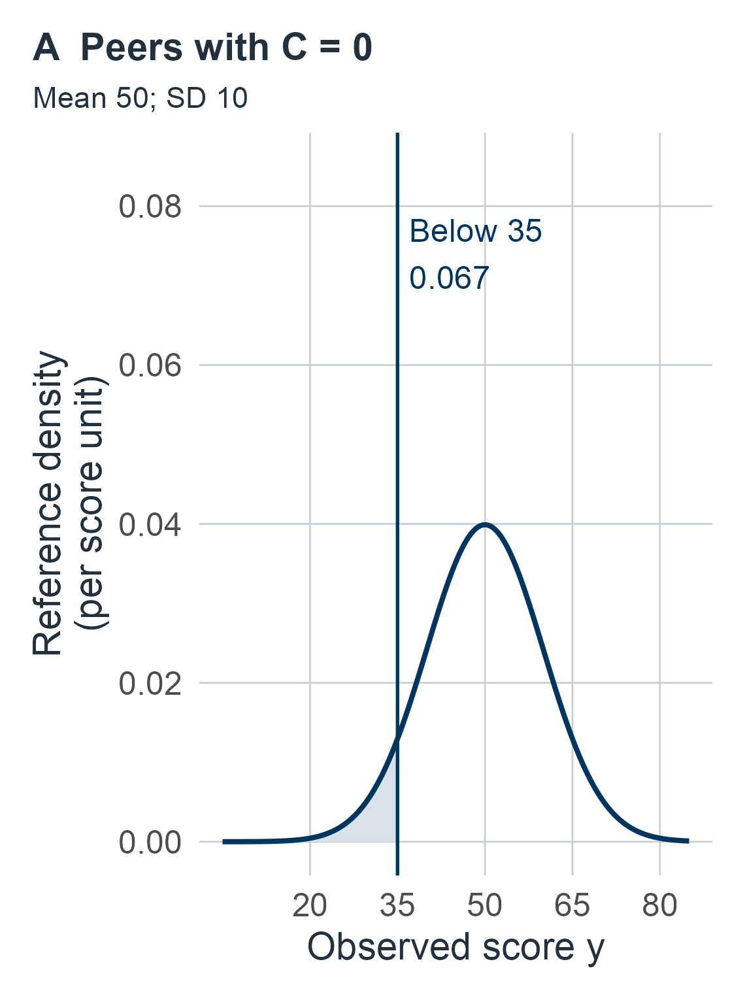
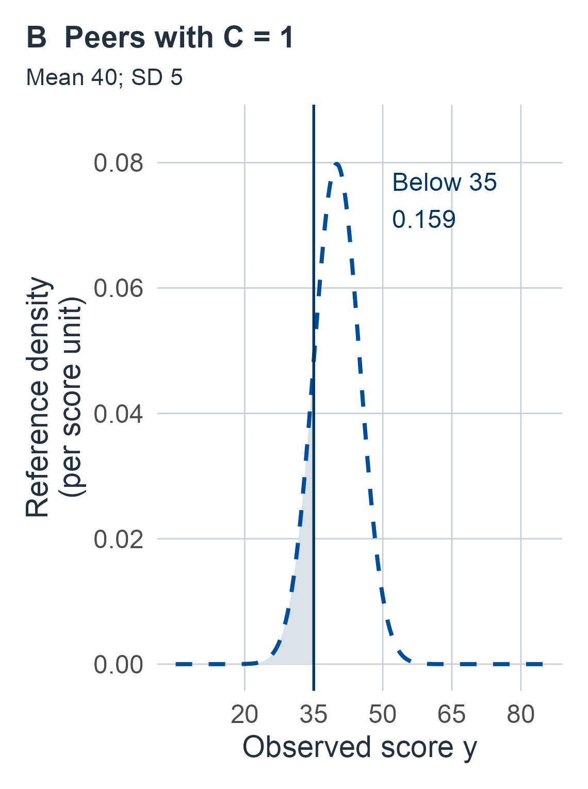
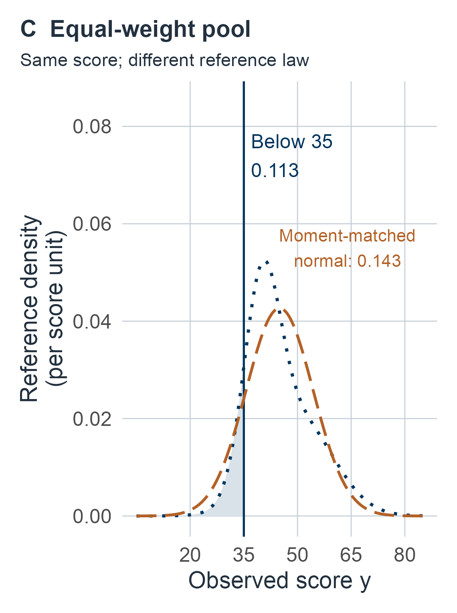
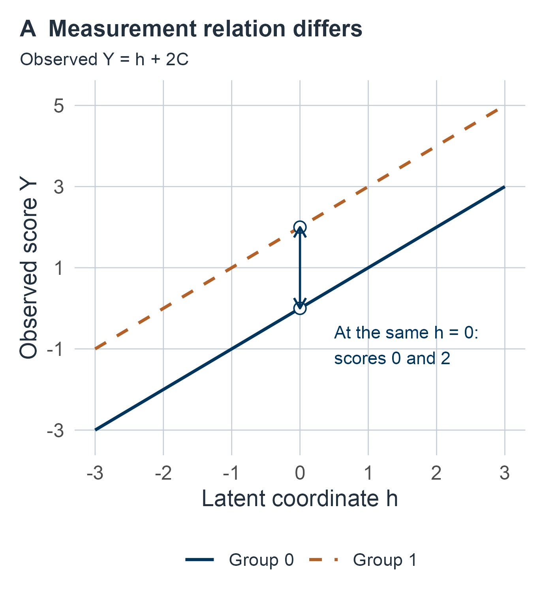
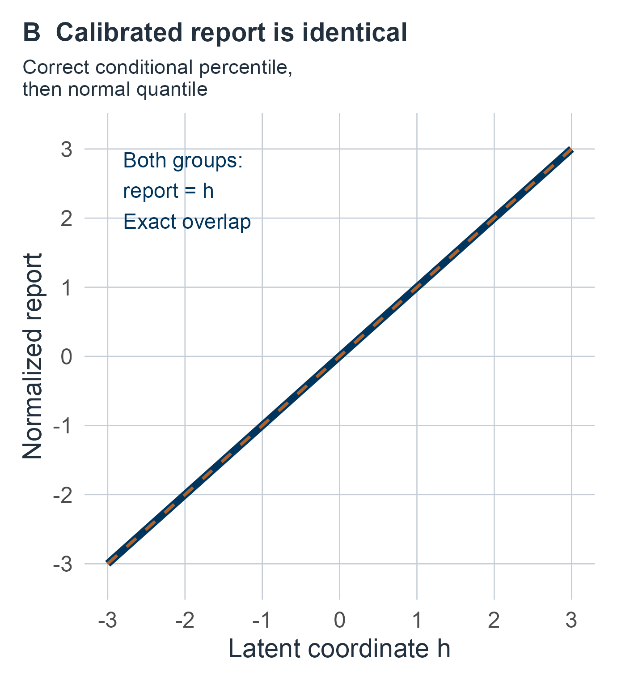

# Norms, invariance, and linking {#sec-norms}

## Relative to whom, and on which scale? {#sec-m07-question}

A person obtains a score of 35. In a synthetic teaching setting, the reference sample records one background covariate $C$, coded 0 or 1, and the reference scores follow $N(50,100)$ when $C=0$ and $N(40,25)$ when $C=1$ (variances in the second argument). Among peers with $C=0$ the score of 35 lies at about the 7th percentile. Among peers with $C=1$ it lies at about the 16th, and in an equal-weight pool of the two groups at about the 11th. A colleague whose clinic uses a second form, with reference law $N(100,15^2)$, asks what the 35 corresponds to there; matching percentiles within the $C=0$ law $N(50,10^2)$ gives 77.5. That makes four numbers for one performance. Each is correct for its own question, and none of them says whether the two groups, or the two forms, measure the same attribute in the same way.

That last point is the chapter's central caution. A percentile can be exactly calibrated within each group while the measurement itself differs between groups. In an example developed below, the normalized report equals the person's latent coordinate in both groups, yet the same latent value produces observed scores two points apart. Choosing peers, measuring on a shared scale and converting between forms are different operations, and each needs its own evidence. @fig-m07-three-references shows the first three numbers.

:::: {#fig-m07-three-references .book-process-figure}

Three reference comparisons for the same observed score of 35, using the chapter's synthetic known laws (normal laws written with their variance). **A.** Peers with $C=0$, $N(50,100)$: the shaded area below 35 is .067. **B.** Peers with $C=1$, $N(40,25)$: .159. **C.** The equal-weight mixture of A and B (dotted): .113. The long-dashed curve in C is the normal law with the mixture's mean and variance, $N(45,87.5)$, which would give .143; the mixture is not that normal law. The performance is the same in every panel; only the reference population changes. All values are exact normal CDF evaluations.

::::

More generally, a performance can be ordinary among one set of peers and unusual among another. A demographic adjustment can change that comparison without establishing why the groups differ. Two tests can report the same percentile while measuring different attributes. These questions require separate reference, measurement and scale arguments.

Let $Y$ be an observed performance under a fixed scoring/administration protocol and $C$ measured background covariates. For a declared reference population, supply the conditional CDF

::::: {.m07-scroll role="group" tabindex="0" aria-label="M07 equation 1; scroll horizontally"}

$$
F(y\mid c)=P_{\mathrm{ref}}(Y\le y\mid C=c).
$$ {#eq-m07-conditional-cdf}

:::::

A case's lower inclusive percentile is $F(y_0\mid c_0)$ at externally fixed observed $(y_0,c_0)$. It describes observed performances among those peers, not the person's latent attribute $H$, a counterfactual score without a covariate, or disease probability. The supplied conditional law specifies the version used at the evaluated $c_0$, even when conditioning on a continuous covariate value has probability zero. Covariate measurement error, selected administration and extrapolation need additional modelling.

By the end of the chapter, a reader should be able to say which peers and which weights define a reported percentile; explain why a covariate-adjusted norm, a measurement-invariance claim, a latent link and an equating claim need different evidence; describe what screening or selection does to a reference law and what selected records can and cannot estimate; separate a marginal rank conversion from a prediction of the same person's score on another form; and carry estimation uncertainty in a norm or a link through to one person's comparison.

## How the chapter is organized {#sec-m07-roadmap}

The units move from reference populations, to measurement relations, to conversions between forms, and finally to norms and links that must be estimated.

::::: {.m07-scroll role="group" tabindex="0" aria-label="M07 table 1; scroll horizontally"}

| Unit | Question | Experiment and inputs |
|---|---|---|
| [Conditional ranks](#sec-m07-conditional) | Which peers define a percentile, and what do ties, normal scores and pooling change? | Known conditional laws; known pooling weights |
| [Invariance](#sec-m07-invariance) | Can norm adjustment separate a latent group difference from a measurement difference? | Same-metric measurement models; an invariant anchor with known loading, then estimated variance, then a bounded offset |
| [Selection](#sec-m07-selection) | What does screening do to a reference law, and what can selected records estimate? | Known inclusion probabilities; screening counts with unobserved outcomes; a Gaussian screen |
| [Transport and links](#sec-m07-linking) | What does a shared percentile establish across forms, and what connects two latent metrics? | Supplied margins; paired records; full-curve item anchors |
| [Estimated norms](#sec-m07-fitted-norms) | How uncertain is a percentile computed from fitted reference data? | Normal regression norms; categorical shapes with a separate composition sample |
| [Estimated links](#sec-m07-link-uncertainty) | How uncertain is a conversion fitted from anchors, including for a case measured with noise? | Known source coordinates; repeated noisy source readings |

:::::

For a first reading, follow [conditional ranks](#sec-m07-conditional), [ties and calibration](#sec-m07-rank-boundaries) and [pooled peers](#sec-m07-pooled), then [invariance](#sec-m07-invariance) and the [known-loading anchor](#sec-m07-anchor-contrast). Continue through the [selection identities](#prp-m07-selected-law) and [screening example](#sec-m07-screening), then [rank transport](#sec-m07-rank-transport) and [full-curve anchors](#sec-m07-affine-link). This route develops the distinctions under supplied laws and explicit measurement assumptions.

Before applying fitted conclusions, return to the anchor's [estimated variance](#sec-m07-anchor-unknown-variance) and [offset sensitivity](#sec-m07-anchor-offset-sensitivity), the [finite selected-record](#sec-m07-fitted-selection) and [screening-count](#sec-m07-finite-selection-bounds) experiments, and [paired calibration](#sec-m07-paired-score-calibration). Then study [estimated norms](#sec-m07-fitted-norms) and [shapes/composition](#sec-m07-fitted-shapes), followed by [known-source](#sec-m07-link-uncertainty) and [noisy-source link calibration](#sec-m07-uncertain-source-anchors). These returns supply the uncertainty analyses for their respective designs. For consultation, use the [question-to-method guide](#sec-m07-guide).

The first four units mostly take reference laws or links as supplied, although the anchor, selection and paired-record sections each add a finite experiment of their own. The last two units estimate norms and links and carry that uncertainty into a single comparison. Wherever an experiment has unknown parameters, the chapter gives a frequentist procedure and a proper Bayesian analysis of the same retained data.

The known-law rank identities and fitted procedures have different guarantees. The finite norm examples include both Gaussian mean/scale fitting and estimated categorical shapes with estimated population weights. Selection-weighted fitting assumes supplied inclusion probabilities; the missing-support experiment instead retains observed inclusion counts and an unlearned outcome split. Neither procedure learns an arbitrary unobserved selection mechanism merely from its name.

The group-anchor experiment assumes an externally known loading. The later noisy-source experiment estimates its own affine loading under a unit source metric and independent repeat errors; it does not automatically calibrate every item or group measurement model. For fitted norm comparisons the fixed case is excluded from the reference likelihood. In paired and noisy-source measurement analyses, observed case information has an explicit likelihood and can update nuisance parameters. The noisy-source posterior additionally gives the case a population prior, whereas its frequentist confidence construction holds the case coordinate fixed.

All examples are synthetic. Confidence regions, parameter posteriors, identified sets and new-response predictions concern declared targets; none supplies measurement validity, a causal effect, disease probability or clinical interchangeability. Exact laws and integral representations are distinguished from approximations and numerical evaluations. The [lookup guide](#sec-m07-guide) near the end collects every question with its observations, target and section.

## Synthetic examples and reused symbols {#sec-m07-examples}

Every numerical example is a synthetic teaching input chosen so that results can be checked exactly; none is an instrument's norms, a value fitted to patients or a clinical cutoff. Because the chapter covers several different experiments, it uses several small examples rather than one running case.

::::: {.m07-scroll role="group" tabindex="0" aria-label="M07 table 2; scroll horizontally"}

| Example | Inputs | What it shows | Where |
|---|---|---|---|
| Two reference groups | $N(50,100)$ and $N(40,25)$; score 35 | Conditional, pooled and moment-matched percentiles differ | [Conditional ranks](#sec-m07-conditional), [pooled peers](#sec-m07-pooled) |
| Tied categories | probabilities $(.1,.7,.2)$ and $(.2,.4,.4)$ | Strict, inclusive, midpoint and randomized ranks | [Ties](#sec-m07-rank-boundaries) |
| Calibrated but not invariant | $Y=H+2C$ | A correct conditional percentile with a group-dependent measurement relation | [Ties](#sec-m07-rank-boundaries), @fig-m07-calibrated-not-invariant |
| Group anchor | $\lambda_a=2$, $\sigma_a=6$, $n_0=n_1=50$, $\widehat\delta=4$ | A latent group contrast with known variance, estimated variance and a bounded anchor offset | [Anchor contrast](#sec-m07-anchor-contrast) to [offset sensitivity](#sec-m07-anchor-offset-sensitivity) |
| Selected records | inclusion probabilities $(1/4,1/2,1,1)$; counts $(6,12,9,3)$ | Undoing known selection, with a confidence band and a posterior | [Selected-score example](#sec-m07-selection-example) |
| Screening counts | 10 low, 20 high, 20 excluded, of 50 | Bounds when excluded outcomes are never observed | [Screening counts](#sec-m07-finite-selection-bounds) |
| Gaussian screen | $\rho=.8$; inclusion when $X>0$ or $\lvert X\rvert>1$ | Screening can shrink or inflate a correlation | [Gaussian screen](#sec-m07-screening) |
| Form conversion | $N(50,10^2)$ to $N(100,15^2)$; Bernoulli $1/2$ to Bernoulli $3/4$ | Rank transport and the joint laws it leaves open | [Rank transport](#sec-m07-rank-transport), [coupling](#sec-m07-discrete-coupling) |
| Paired records | counts $(8,12,2,18)$ | What paired data learn about alternate-form success | [Paired calibration](#sec-m07-paired-score-calibration) |
| Item-anchor link | $A=10$, $B=2$ | Full-curve anchors fix an affine latent link | [Affine link](#sec-m07-affine-link) |
| Six-person regression norm | covariates $(0,0,1,1,2,2)$; score 42 at $c_0=1$ | Confidence and posterior for a fitted percentile | [Fitted norms](#sec-m07-fitted-norms) |
| Two-stratum shapes | counts $(8,16,4,12)$ and $(12,4,16,8)$; composition 20 of 60 | Equal mean and variance with different percentiles; uncertain composition | [Shape example](#sec-m07-shape-example) |
| Anchor-fitted link and noisy case | three exact anchors; then 24 calibration triples and two case readings | Link uncertainty, then a case whose source coordinate is measured with noise | [Link uncertainty](#sec-m07-link-uncertainty), [noisy-anchor example](#sec-m07-source-link-example) |

:::::

Where an earlier chapter already named the same object, this chapter uses that name: $c_\delta=1/n_0+1/n_1$ for a two-group mean difference, as in [Level, shape, and information loss](04-level-and-shape.md#sec-level-and-shape), and $c$ for a chi-square quantile, as in [Finite reference information](02-finite-reference.md#sec-finite-reference). Several letters are reused in separate units, each with a local definition. The reuses most likely to cause confusion are:

- $A,B$: two forms in the rank-transport unit; intercept and slope of the affine latent link from [the affine-link section](#sec-m07-affine-link) onward, in the order the [reference-curves chapter](13-reference-curves.md#sec-reference-curves) uses for a positive affine score change $A+BY$.
- $\eta$: the inclusion fraction $P(S=1)$ in the selection unit; the latent residual in @eq-m07-direct-latent-model; the transformed parameter vector in the noisy-anchor unit.
- $\theta$: the composition weight $P(C=0)$ in the fitted-shape unit; the link parameters $(A,B)^T$ in the link unit; conditional success probabilities $\theta_i$ in the paired-record unit.
- $\nu$: the measurement intercept in @eq-m07-direct-latent-model; degrees of freedom elsewhere.
- $G$: the residual CDF $G_c$, the covariate distribution $G_C$, the item link function $G$ and gamma variables $G_j$.
- $K$, $L$, $d$, $q$, $s$, $t$ and $w$ also carry different local meanings in different units (for example $K$ is the number of anchors, a coupling kernel and an expected target reading).

## Conditional location, scale, shape and ranks {#sec-m07-conditional}

A useful representation is

::::: {.m07-scroll role="group" tabindex="0" aria-label="M07 equation 2; scroll horizontally"}

$$
Y=\mu(C)+\sigma(C)\varepsilon_C,\quad \sigma(c)>0,\qquad
F(y\mid c)=G_c\!\left(\frac{y-\mu(c)}{\sigma(c)}\right).
$$ {#eq-m07-location-scale-shape}

:::::

Here $G_c$ is the conditional CDF of the standardized residual. If it has mean zero and variance one, $\mu(c)$ and $\sigma(c)$ are the conditional mean and SD. Without those moments they remain declared location/scale parameters, not automatically mean/SD. Taking $G_c=G$ assumes common shape across covariate values; taking $G=\Phi$ further assumes conditional normality. Adjusting only a mean does not establish constant variance or common shape.

For example, supply $Y\mid C=0\sim N(50,100)$ and $Y\mid C=1\sim N(40,25)$. At $y_0=35$, conditional percentiles are approximately $.066807$ and $.158655$, respectively. The observed value is the same; both the expected score and spread differ. Even equal mean and SD are insufficient to identify a percentile: a standard normal residual and a uniform residual on $[-\sqrt3,\sqrt3]$ both have mean zero/variance one, but at residual $-1$ their CDFs are approximately $.158655$ and $.211325$.

::: {#prp-m07-conditional-ranks}
## Conditional percentile calibration and ties

Fix $c$ and a known conditional law. If its CDF is continuous, including a continuous law with gaps in its support, then

::::: {.m07-scroll role="group" tabindex="0" aria-label="M07 equation 3; scroll horizontally"}

$$
\begin{aligned}
U=F(Y\mid c)\mid C=c&\sim\operatorname{Uniform}(0,1),\\
\Phi^{-1}(U)\mid C=c&\sim N(0,1).
\end{aligned}
$$ {#eq-m07-conditional-pit}

:::::

For a finite discrete score, define $F(y^-\mid c)=P(Y<y\mid c)$ and $\Delta F(y\mid c)=P(Y=y\mid c)$. With an explicitly added independent $V\sim\operatorname{Uniform}(0,1)$,

::::: {.m07-scroll role="group" tabindex="0" aria-label="M07 equation 4; scroll horizontally"}

$$
U^*=F(Y^-\mid c)+V\Delta F(Y\mid c)
$$ {#eq-m07-randomized-rank}

:::::

is uniform conditional on $c$. Without this randomization, the inclusive rank $F(Y\mid c)$ satisfies $P\{F(Y\mid c)\le t\mid c\}\le t$ for $0\le t\le1$, and is generally not uniform.
:::

::: {.proof}
In the continuous case, define the generalized quantile $Q_c(t)=\inf\{y:F(y\mid c)\ge t\}$ for $0<t<1$. It is finite because the CDF has limits zero and one. Continuity gives $F(Q_c(t)\mid c)=t$, even if the CDF has flat regions. For an auxiliary uniform $V$, $Q_c(V)$ has CDF $F$: the event $Q_c(V)\le y$ is equivalent to $V\le F(y\mid c)$. Hence $F\{Q_c(V)\mid c\}=V$, proving the rank law for any $Y$ with this CDF. Applying the inverse normal CDF proves the normal marginal law. For discrete scores, each atom of probability $p_k$ assigns $U^*$ uniformly to the interval between its strict and inclusive CDF values, of length $p_k$. Multiplying its interval density $1/p_k$ by its selection probability $p_k$ gives density one on that interval. The adjacent intervals partition $(0,1)$, proving uniformity. For the inclusive rank, atoms with cumulative probability at most $t$ form an initial segment whose total mass is at most $t$.
:::

Randomization is an additional reporting operation, not an observed within-category ordering; the same construction defines the randomized quantile residuals used to check regression models for discrete outcomes [@dunn1996randomized]. At a score with a large mass, strict and inclusive ranks can differ substantially. A midpoint convention is another specified summary and is not automatically uniform. At values outside a continuous reference support, the percentile can be zero or one; an inverse-normal report is then infinite, not an infinite latent ability estimate. Normalizing each coordinate's margins does not establish a joint Gaussian law, a Gaussian copula or a common cognitive factor.

### Ties, marginal normality and what calibration means {#sec-m07-rank-boundaries}

A three-category example makes the reporting choices concrete. Let the attainable scores be $0,1,2$. Supply the following two conditional reference laws; the entries are probabilities, not fitted frequencies.

::::: {.m07-scroll role="group" tabindex="0" aria-label="M07 table 3; scroll horizontally"}

| Reference group | $P(Y=0)$ | $P(Y=1)$ | $P(Y=2)$ |
|---|---:|---:|---:|
| $C=0$ | $.1$ | $.7$ | $.2$ |
| $C=1$ | $.2$ | $.4$ | $.4$ |

:::::

At the same observed score $Y=1$, the strict and inclusive ranks are $(.1,.8)$ in group 0 and $(.2,.6)$ in group 1. The corresponding midpoint ranks are $.45$ and $.4$. These are different declared summaries of the actual tied category. In group 0, for example, the midpoint report has probabilities $(.1,.7,.2)$ at values $(.05,.45,.9)$. Its probability of being at most $.5$ is $.8$, rather than $.5$. It is not uniform, nor does it have the inclusive rank's super-uniform guarantee. At the highest category, the inclusive rank is exactly one with positive probability, so applying $\Phi^{-1}$ to that convention produces an infinite report even though the observed score is finite and attainable.

The randomized report instead spreads each atom across its entire rank interval. Writing $P_k=P(Y\le k\mid c)$ and $p_k=P(Y=k\mid c)>0$, direct summation gives, for $0\le t\le1$,

::::: {.m07-scroll role="group" tabindex="0" aria-label="M07 equation 5; scroll horizontally"}

$$
P(U^*\le t\mid c)=\sum_k\min\{p_k,\max(0,t-P_{k-1})\}=t,
\qquad P_{-1}=0.
$$ {#eq-m07-discrete-rank-cdf}

:::::

Each term is the length of the part of the $k$th rank interval lying below $t$, and these adjacent intervals cover $(0,1)$. This proves the calibration for both groups, with their different probabilities, without inventing an ordering among tied performances. Randomization is useful for this probability statement; whether it is an appropriate clinical reporting convention is a separate choice.

Marginal normalization also leaves joint dependence to be specified. Let $Z\sim N(0,1)$ and let an independent sign $S$ equal $-1$ or $1$ with equal probabilities. Set

::::: {.m07-scroll role="group" tabindex="0" aria-label="M07 equation 6; scroll horizontally"}

$$
Y_1=Z,\qquad Y_2=SZ.
$$ {#eq-m07-normal-margins-counterexample}

:::::

Both margins are standard normal, and their covariance is $E(S)E(Z^2)=0$. Nevertheless $|Y_1|=|Y_2|$ with probability one. They are dependent: the events $|Y_1|\le1$ and $|Y_2|\le1$ coincide and have a probability strictly between zero and one. A jointly Gaussian vector with these marginal variances and zero covariance would have density $\phi(y_1)\phi(y_2)$ and hence independent coordinates, so this vector is not jointly Gaussian. Applying the correct marginal percentile and inverse-normal transformations leaves it unchanged. Individually normal reports therefore do not justify a multivariate normal reference law or an independent-item measurement model.

There is a useful joint implication of correctly specified conditional ranks. If the continuous conditional rank is uniform for almost every reference value of $C$, then for any measurable covariate set $B$,

::::: {.m07-scroll role="group" tabindex="0" aria-label="M07 equation 7; scroll horizontally"}

$$
P(U\le t,\ C\in B)=E\{\mathbf1_{C\in B}P(U\le t\mid C)\}
=tP(C\in B).
$$ {#eq-m07-rank-covariate-independence}

:::::

Thus this rank is independent of $C$ in that reference population. The randomized discrete rank has the same property when its added randomizer is independent of the score and covariates. This is calibration under the reference law, not a causal or measurement-invariance result. For instance, let $H\sim N(0,1)$ independently of $C$, with $P(C=0)=P(C=1)=1/2$, and let the measurement be $Y=H+2C$. Its correct conditional CDF is $\Phi(y-2c)$; the normalized report is exactly $H$, independent of $C$. Yet the measurement relation at the same $H=h$ is $Y=h+2c$ and differs between groups. A covariate-calibrated report alone cannot establish an invariant measurement relation. @fig-m07-calibrated-not-invariant draws the example. The invariance unit, after a short note on pooled peers, studies that identification question explicitly.

:::: {#fig-m07-calibrated-not-invariant .book-process-figure}

The synthetic example $Y=H+2C$, with $H\sim N(0,1)$ independent of the group indicator $C$. **A.** The measurement relation: at the same latent value $h$ the observed score is $h$ in group 0 (solid) and $h+2$ in group 1 (dashed). **B.** The normalized report $\Phi^{-1}\{F(Y\mid C)\}$, computed from each group's correct conditional reference law, equals $h$ in both groups, so the two lines coincide. A correctly calibrated covariate-conditional percentile is therefore compatible with a measurement relation that differs between groups. Exact; nothing is estimated.

::::

### Conditional and pooled peers answer different questions {#sec-m07-pooled}

::: {#prp-m07-pooled-norms}
## Population mixing and pooled ranks

If reference covariates have distribution $G_C$, the pooled observed-score CDF is

::::: {.m07-scroll role="group" tabindex="0" aria-label="M07 equation 8; scroll horizontally"}

$$
F_{\mathrm{pool}}(y)=\int F(y\mid c)\,dG_C(c).
$$ {#eq-m07-pooled-cdf}

:::::

For finite groups with prespecified weights $w_g$, this is $\sum_gw_gF_g(y)$. With finite second moments and $\mu(c)=E(Y\mid c)$, $\sigma^2(c)=\operatorname{Var}(Y\mid c)$,

::::: {.m07-scroll role="group" tabindex="0" aria-label="M07 equation 9; scroll horizontally"}

$$
E(Y)=E\{\mu(C)\},\qquad
\operatorname{Var}(Y)=E\{\sigma^2(C)\}+\operatorname{Var}\{\mu(C)\}.
$$ {#eq-m07-pooled-moments}

:::::

Under the preceding continuous-support conditions, the pooled CDF calibrates a rank for a person drawn from the **pooled** law; it generally does not calibrate ranks within each covariate stratum. Changing $G_C$ can change pooled ranks even if every conditional score law stays fixed.
:::

::: {.proof}
Iterated expectation applied to $\mathbf1\{Y\le y\}$ yields the CDF mixture. Iterated expectation and total variance give the moment identities. If the conditional CDFs are continuous for almost every reference $c$, bounded dominated convergence along any $y_n\to y$ proves that their mixture CDF is continuous. The preceding generalized-quantile argument therefore calibrates its pooled rank, including when the support has gaps. Conditional on a fixed $c$, applying the pooled continuous quantile instead gives
$P\{F_{\mathrm{pool}}(Y)\le u\mid c\}=F\{F_{\mathrm{pool}}^{-1}(u)\mid c\}$ on strictly increasing supports, not generally $u$. The mixture formula explicitly contains $G_C$, proving the possible effect of a weight change.
:::

In the two normal groups above, equal weights give a pooled percentile at 35 of $.112731$, compared with $.066807$ and $.158655$ conditionally. The pooled mean is $45$ and variance $87.5$, but the mixture is not thereby $N(45,87.5)$: that normal law would give percentile approximately $.142525$ at 35. Changing the group weights to $(.7,.3)$ while retaining the same two conditional laws gives percentile $.094362$, mean $47$ and variance $98.5$. These changes concern the reference composition, not a change in the case's observed performance. Pooling strata with the study's sampling fractions targets that particular mixture; targeting a different population composition requires the intended weights and their uncertainty. A covariate-adjusted norm and a pooled norm can both be mathematically correct for different reference questions.

For the supplied known laws, frequentist statements here are reference probabilities under the specified population/covariate experiment. Bayesian prediction before observing a new reference performance can use the same known conditional or pooled kernel; no nondegenerate norm-parameter posterior is required. After $(y_0,c_0)$ is observed, its known percentile is a fixed comparison. Fitted norm parameters and uncertain mixture weights require their own likelihoods/priors; the later finite-reference unit treats an explicit case. None of these rank identities supplies a likelihood for the person's latent state or a causal effect of adjusting $C$.

## Covariate adjustment, invariance and DIF {#sec-m07-invariance}

The calibrated-but-not-invariant example left a tension. Each group's percentile was correct, and the normalized report even equalled the latent coordinate, yet two people with the same latent value obtained observed scores two points apart. Covariate adjustment answered the question it was built for: how unusual is this score among these peers? It did not answer a different question: would two people with the same standing on the intended attribute produce the same response law, whichever group they belong to? The first question concerns the reference distribution of observed scores. The second concerns the measurement relation that connects a latent coordinate to an observed score, and observed-score norms cannot settle it alone.

Several different claims are made with a shared score scale. They have different targets and need different evidence.

::::: {.m07-scroll role="group" tabindex="0" aria-label="M07 table 4; scroll horizontally"}

| Claim (where developed) | Target | Evidence it needs | What it does not establish |
|---|---|---|---|
| [Reference rank](#sec-m07-conditional) | $F(y_0\mid c_0)$ for declared peers | A correct or well-estimated reference law from a representative sample; declared pooling weights | The same attribute across groups; a prediction for the person; latent status |
| Covariate-adjusted norm (this unit) | The observed-score law given $C$ | The above, with conditional location, scale and shape modelled | That the removed association was a measurement nuisance; fairness; a causal effect of $C$ |
| Measurement invariance (this unit) | The same response law at the same latent coordinate in every group | A shared latent metric, justified invariant anchors, multi-group item or indicator data | Equal observed distributions; a causal group difference |
| [Latent link](#sec-m07-affine-link) | An affine map between two latent calibrations | Full-curve invariant anchors and their calibration uncertainty ([estimated links](#sec-m07-link-uncertainty)) | Interchangeable observed scores; construct equivalence |
| [Rank transport](#sec-m07-rank-transport) | Equal marginal percentiles across forms | Two supplied or estimated score distributions | The same person's score on the other form; a common construct |
| [Equating](#sec-m07-linking) | Interchangeable scores for a stated purpose | A data-collection design, a measurement argument and evidence for the intended use | Clinical validity of either form |

:::::

This unit first shows the ambiguity in a binary item model, then states it as a formal result for a continuous model, and then asks what an invariant anchor contributes: with a known sampling variance, with an estimated one, and when the anchor is only approximately invariant.

A measurement-invariance claim concerns the response law at the **same latent coordinate and protocol** across groups. For example, in a binary item model
$P(U_j=1\mid H=h,C=g)=\operatorname{expit}\{a_{jg}(h-b_{jg})\}$,
a difference across $g$ at a common identified $h$ is differential item functioning (DIF) in this model. Equal slopes but different difficulties give a constant group difference on the logit scale; different slopes allow that difference to depend on $h$. The comparison presupposes a shared latent metric. Differences in marginal success rates alone do not identify DIF, since groups can have different latent distributions. @meredith1993measurement gives a general definition of measurement invariance and relates it to factorial invariance.

The ambiguity also occurs in the binary response kernel itself. Consider independent logistic items given $H,C$, with invariant positive slopes $a_j$, difficulties $b_j$, and group populations $H\mid C=g\sim N(\Delta g,1)$ for $g=0,1$. Define $H^*=H-\Delta C$. The alternative model has the same $N(0,1)$ latent population in both groups, the same slopes and group-specific difficulties $b_{jg}^*=b_j-\Delta g$. For every realization,

::::: {.m07-scroll role="group" tabindex="0" aria-label="M07 equation 10; scroll horizontally"}

$$
a_j(H-b_j)=a_j(H^*-b_{jg}^*).
$$ {#eq-m07-binary-group-equivalence}

:::::

The full response-vector probabilities and their group mixtures are therefore identical. One description has invariant item curves and different latent means; the other has equal latent populations and a common difficulty shift across items. Without restrictions tying the group metrics, these observed laws cannot choose between them. This does not say that every item-specific pattern of DIF can be represented by one population shift. A justified invariant anchor excludes this particular group-origin transformation.

A continuous measurement example exposes the same issue. Let $C\in\{0,1\}$ be a group indicator and use

::::: {.m07-scroll role="group" tabindex="0" aria-label="M07 equation 11; scroll horizontally"}

$$
H=\beta C+\eta,\qquad
Y=\nu+\lambda H+\gamma C+\varepsilon,
$$ {#eq-m07-direct-latent-model}

:::::

where $Y,\nu,\lambda,\gamma$ are $p$-vectors, $\eta$ is scalar with mean zero/variance $v_H$, and centered $\varepsilon$ has covariance $\Theta$. Supply common $\nu,\lambda,\Theta,v_H$, with $\lambda\ne0$, and assume $\eta,\varepsilon,C$ independent. The group association $\beta$ concerns the latent mean; $\gamma$ represents group-dependent measurement offsets at the same $h$. This is an observational model, not a causal interpretation of the covariate.

::: {#prp-m07-confounding}
## Observed norm regression does not identify latent versus direct effects

The conditional observed mean and covariance are

::::: {.m07-scroll role="group" tabindex="0" aria-label="M07 equation 12; scroll horizontally"}

$$
E(Y\mid C)=\nu+(\lambda\beta+\gamma)C,\qquad
\operatorname{Cov}(Y\mid C)=\lambda v_H\lambda^T+\Theta.
$$ {#eq-m07-observed-covariate-law}

:::::

For every $d\in\mathbb R$, set $H^*=H+dC$, $\beta^*=\beta+d$ and $\gamma^*=\gamma-\lambda d$. They give the same observed $Y,C$ law. Without an identifying restriction or anchor, the observed contrast $\kappa=\lambda\beta+\gamma$ cannot separate $\beta$ from $\gamma$.
:::

::: {.proof}
Substitute the latent equation into the observation equation. Independence and centering give the conditional moments. Substituting $H^*$ and $\gamma^*$ into the measurement equation cancels $\lambda dC$ exactly, preserving $Y$ for every realization, not merely its mean/covariance. The changed latent equation has the same residual $\eta$ and coefficient $\beta+d$. Thus all decompositions related by this transformation are observationally equivalent unless additional restrictions exclude them.
:::

Residualizing $Y$ by its norm regression removes the combination $\kappa C$. It does not show that the removed association was a nuisance measurement effect rather than a difference in the intended attribute. In the scalar $\lambda=1$ example, $\beta=1,\gamma=-1$ yields identical group observed distributions if the residual laws are common, despite different measurement offsets at fixed $h$. Conversely $\beta=1,\gamma=0$ gives different group observed means with an invariant kernel. Equalizing distributions is not a test of measurement invariance.

Even perfect knowledge of $\kappa$ leaves every real $\beta$ compatible with some $\gamma$. Bayesian inference can be proper without resolving that identification limit. For a scalar score, independently choose proper priors $\beta\sim N(0,s_\beta^2)$ and $\gamma\sim N(0,s_\gamma^2)$ with both variances positive. Conditional on an exactly known $\kappa=\lambda\beta+\gamma$, completing the square gives

::::: {.m07-scroll role="group" tabindex="0" aria-label="M07 equation 13; scroll horizontally"}

$$
\beta\mid\kappa\sim N\!\left(
\frac{\lambda s_\beta^2\kappa}{\lambda^2s_\beta^2+s_\gamma^2},
\frac{s_\beta^2s_\gamma^2}{\lambda^2s_\beta^2+s_\gamma^2}\right).
$$ {#eq-m07-nonidentified-posterior}

:::::

Indeed, its density is proportional to
$\exp[-\{\beta^2/s_\beta^2+(\kappa-\lambda\beta)^2/s_\gamma^2\}/2]$;
the Jacobian for replacing $\gamma$ by $\kappa$ is one. The conditional variance remains positive even with the observed contrast supplied without error. Its allocation between latent and direct effects depends on the priors. This posterior concerns a group parameter, not a person's latent state, and does not turn an unanchored decomposition into a data-identified one.

### What an explicit invariant anchor contributes {#sec-m07-anchor-contrast}

::: {#prp-m07-anchor-contrast}
## Anchored group contrast: confidence and proper posterior

Assume a designated score coordinate has known nonzero loading $\lambda_a$, invariant intercept and **zero direct group offset** $\gamma_a=0$. In a fixed two-group calibration design, sample independent $n_0,n_1\ge1$ persons with Gaussian observed anchor scores, common known variance $\sigma_a^2>0$ and means $\nu_a$ and $\nu_a+\lambda_a\beta$. The contrast experiment retains $\widehat\delta=\bar Y_{a1}-\bar Y_{a0}$; no model for a disease outcome is involved. Write $\omega=\sigma_a^2(1/n_0+1/n_1)$.

Then $\widehat\beta=\widehat\delta/\lambda_a$ is normal with mean $\beta$ and variance $\omega/\lambda_a^2$, and

::::: {.m07-scroll role="group" tabindex="0" aria-label="M07 equation 14; scroll horizontally"}

$$
\widehat\beta\ \pm\ z_{1-\alpha/2}\sqrt\omega/|\lambda_a|
$$ {#eq-m07-anchor-confidence}

:::::

has coverage $1-\alpha$ for the fixed $\beta$, repeating this group-sampling experiment. For the **same contrast likelihood** and a proper prior $\beta\sim N(b_0,v_0)$, $v_0>0$,

::::: {.m07-scroll role="group" tabindex="0" aria-label="M07 equation 15; scroll horizontally"}

$$
\begin{aligned}
V_\beta&=(v_0^{-1}+\lambda_a^2/\omega)^{-1},\\
m_\beta&=V_\beta(b_0/v_0+\lambda_a\widehat\delta/\omega),\\
\beta\mid\widehat\delta&\sim N(m_\beta,V_\beta).
\end{aligned}
$$ {#eq-m07-anchor-posterior}

:::::
:::

::: {.proof}
Independent Gaussian group means give $\widehat\delta\sim N(\lambda_a\beta,\omega)$. Divide by the nonzero loading and standardize to obtain the confidence interval. Multiplying this contrast likelihood by the proper normal prior gives quadratic precision $v_0^{-1}+\lambda_a^2/\omega>0$; completing the square yields the normalized posterior. Both methods target the same group parameter using only the retained contrast. Treating full raw data with an unknown intercept in a different Bayesian model would require declaring that nuisance prior as well.
:::

**Synthetic anchor example.** Supply $\lambda_a=2$, $\sigma_a=6$, $n_0=n_1=50$ and observed contrast $\widehat\delta=4$. The estimate is $2$ with sampling SE $.6$ and a $95\%$ confidence interval approximately $[.8240,3.1760]$. A proper teaching prior $N(0,4)$ instead gives posterior mean $1.8349$ and variance $.3303$. These are group-level illustrations, not clinical differences inferred from actual patients.

The identifying force comes from the invariant-anchor restriction and known metric/loading. If its actual direct offset is $\gamma_a\ne0$, the same estimator has expectation $\beta+\gamma_a/\lambda_a$. That bias does not shrink with sample size. At fixed nonzero violation the stated confidence interval's coverage of $\beta$ tends to zero as both group samples grow, and the assumed-model posterior can concentrate at the wrong decomposition. Multiple justified anchors can provide compatibility checks and improve precision; agreement alone does not prove the construct or every anchor restriction. Uncertain loadings/anchor parameters need calibration uncertainty, addressed in the linking units. A statistically successful norm regression is not a substitute for this measurement argument. For example, at $\gamma_a=2$ and the preceding $\lambda_a=2,\sigma_a=6,n_0=n_1=50$, the assumed-model $95\%$ normal confidence interval has actual coverage approximately $.615209$. This follows from
$\Phi(z-.6^{-1})-\Phi(-z-.6^{-1})$, with $z=z_{.975}$: the sampling bias is one latent unit and its SE is $.6$. The failure is a consequence of the specified anchor violation, even with the variance correctly supplied.

### Estimating variance in the same anchor experiment {#sec-m07-anchor-unknown-variance}

Knowing the loading and justifying the anchor offset do not make its sampling variance known. Keep the independent Gaussian two-group design and $\gamma_a=0$, but now let $u=\sigma_a^2>0$ be unknown. Retain both the observed contrast and the within-group sum of squares,

::::: {.m07-scroll role="group" tabindex="0" aria-label="M07 equation 16; scroll horizontally"}

$$
\begin{aligned}
c_\delta&=1/n_0+1/n_1,& \nu&=n_0+n_1-2>0,\\
S_w&=\sum_{g=0}^1\sum_{i=1}^{n_g}
(Y_{agi}-\bar Y_{ag})^2,& s_a^2&=S_w/\nu.
\end{aligned}
$$ {#eq-m07-anchor-residual-data}

:::::

Write $d=\lambda_a\beta$. An orthogonal decomposition of each group's Gaussian observations separates its mean from its centered contrasts. The latter provide $\nu$ independent standardized normal coordinates in total; the standardized difference of means is another independent standard normal coordinate. Thus the retained experiment is

::::: {.m07-scroll role="group" tabindex="0" aria-label="M07 equation 17; scroll horizontally"}

$$
\widehat\delta\mid d,u\sim N(d,uc_\delta),\qquad
S_w/u\sim\chi^2_\nu,
\quad\text{independently}.
$$ {#eq-m07-anchor-unknown-variance-law}

:::::

The statistic $(\widehat\delta-d)/(s_a\sqrt{c_\delta})$ is the ratio of an independent standard normal and $\sqrt{\chi^2_\nu/\nu}$, hence has a Student distribution with $\nu$ degrees of freedom. Therefore the interval

::::: {.m07-scroll role="group" tabindex="0" aria-label="M07 equation 18; scroll horizontally"}

$$
\frac{\widehat\delta}{\lambda_a}
\ \pm\ t_{\nu,1-\alpha/2}
\frac{s_a\sqrt{c_\delta}}{|\lambda_a|}
$$ {#eq-m07-anchor-student-confidence}

:::::

has coverage exactly $1-\alpha$ for every fixed $\beta,u$ under this experiment. Here $t_{\nu,p}$ is a Student quantile. On the probability-zero event $S_w=0$, return the whole real line to define the procedure everywhere. No estimated variance has been substituted into a known-variance normal guarantee. Unequal group variances or a non-Gaussian observation model would require a different argument.

A proper Bayesian analysis can use the identical retained data without assigning a prior to a discarded common intercept. Specify

::::: {.m07-scroll role="group" tabindex="0" aria-label="M07 equation 19; scroll horizontally"}

$$
u\sim\operatorname{IG}(a_u,b_u),\qquad
d\mid u\sim N(m_d,u/k_d),
$$ {#eq-m07-anchor-variance-prior}

:::::

where $a_u>1$, $b_u,k_d>0$, and the inverse-gamma density is $b^a u^{-a-1}e^{-b/u}/\Gamma(a)$. These are predetermined teaching inputs. The prior is on the observed anchor contrast $d$, with $\beta=d/\lambda_a$; it is not an independent fixed-variance prior on $\beta$. Multiplying the joint contrast/residual likelihood by this prior and completing the square gives

::::: {.m07-scroll role="group" tabindex="0" aria-label="M07 equation 20; scroll horizontally"}

$$
\begin{aligned}
k_d^*&=k_d+1/c_\delta,\\
m_d^*&=(k_dm_d+\widehat\delta/c_\delta)/k_d^*,\\
a_u^*&=a_u+(\nu+1)/2,\\
b_u^*&=b_u+\frac12\left[
S_w+\frac{k_d}{1+k_dc_\delta}(\widehat\delta-m_d)^2\right],\\
u\mid\widehat\delta,S_w&\sim\operatorname{IG}(a_u^*,b_u^*),\\
d\mid u,\widehat\delta,S_w&\sim N(m_d^*,u/k_d^*).
\end{aligned}
$$ {#eq-m07-anchor-variance-posterior}

:::::

For verification, the likelihood kernel is
$u^{-(\nu+1)/2}\exp[-\{S_w+(\widehat\delta-d)^2/c_\delta\}/(2u)]$.
Combine its contrast square with $k_d(d-m_d)^2$ and integrate the resulting normal kernel in $d$. The remaining inverse-gamma exponent has the stated shape and positive scale. This constructs a finite positive normalizer; propriety is not inferred merely from putting a proper prior against an unbounded continuous likelihood.

Integrating $u$ yields a Student law for $\beta$, with degrees of freedom $2a_u^*$, location $m_d^*/\lambda_a$ and **scale squared**
$b_u^*/(a_u^* k_d^*\lambda_a^2)$. Indeed, substituting $v=1/u$ in the normal/inverse-gamma integral gives a gamma integral proportional to
$[1+k_d^*(d-m_d^*)^2/(2b_u^*)]^{-(a_u^*+1/2)}$.
Its mean and variance are

::::: {.m07-scroll role="group" tabindex="0" aria-label="M07 equation 21; scroll horizontally"}

$$
E(\beta\mid\widehat\delta,S_w)=\frac{m_d^*}{\lambda_a},
\qquad
\operatorname{Var}(\beta\mid\widehat\delta,S_w)
=\frac{b_u^*}{(a_u^*-1)k_d^*\lambda_a^2}.
$$ {#eq-m07-anchor-variance-moments}

:::::

The variance is different from the Student scale squared. The assumed $a_u>1$ ensures both moments exist; positive prior shapes would suffice for propriety, with moment existence checked separately. This posterior concerns the same group parameter and retained experiment as the Student confidence interval, with its own conditioning and prior.

For an evaluated synthetic dataset, take $n_0=n_1=50$, $\lambda_a=2$, $\widehat\delta=4$ and now observe $S_w=98(36)=3528$. The estimated sampling SE is $.6$, but the $95\%$ Student interval is $[.80932,3.19068]$. Choose $a_u=3,b_u=72,m_d=0,k_d=2.25$. The prior mean of $u$ is 36. The induced marginal prior for $\beta$ has mean zero and variance $E(u)/(k_d\lambda_a^2)=4$, matching the earlier normal prior in its first two moments. It is a Student prior dependent on $u$, so these are different joint prior assumptions. The update gives
$k_d^*=27.25,m_d^*\approx3.669725,a_u^*=52.5,b_u^*\approx1852.513761$.
The posterior mean of $\beta$ is approximately $1.834862$, variance $.330010$ and central $95\%$ interval $[.706704,2.963021]$. These values integrate the unknown variance rather than treating $s_a^2$ as its true value.

### Uncertain anchor offsets and identified sets {#sec-m07-anchor-offset-sensitivity}

An exact zero direct offset is a substantive restriction. Suppose instead that independent measurement knowledge justifies $|\gamma_a|\le\Gamma$ for a declared finite $\Gamma\ge0$, while the loading remains known and nonzero. The observed mean contrast is now $d=\lambda_a\beta+\gamma_a$. Its Gaussian contrast/residual experiment is unchanged, but it does not identify a unique $\beta$ when $\Gamma>0$. At a population contrast $d$, the sharp identified set is

::::: {.m07-scroll role="group" tabindex="0" aria-label="M07 equation 22; scroll horizontally"}

$$
\mathcal B(d)=
\left[\frac d{\lambda_a}-\frac{\Gamma}{|\lambda_a|},
      \frac d{\lambda_a}+\frac{\Gamma}{|\lambda_a|}\right].
$$ {#eq-m07-anchor-identified-set}

:::::

For every value in this interval, choosing $\gamma_a=d-\lambda_a\beta$ satisfies the bound and leaves the entire observed anchor law unchanged. Values outside require a prohibited offset. This establishes sharpness for the stated anchor experiment, rather than interpreting a large standard error as nonidentification.

The finite sampling uncertainty can cover this **whole identified set**. Let $q=t_{\nu,1-\alpha/2}s_a\sqrt{c_\delta}$ and form

::::: {.m07-scroll role="group" tabindex="0" aria-label="M07 equation 23; scroll horizontally"}

$$
\mathcal C_{\mathcal B}=
\left[\frac{\widehat\delta}{\lambda_a}
          -\frac{q+\Gamma}{|\lambda_a|},
      \frac{\widehat\delta}{\lambda_a}
          +\frac{q+\Gamma}{|\lambda_a|}\right].
$$ {#eq-m07-anchor-set-confidence}

:::::

The containment event $\mathcal B(d)\subseteq\mathcal C_{\mathcal B}$ is exactly
$|\widehat\delta-d|\le q$, so it has probability $1-\alpha$. It consequently also covers every fixed compatible $\beta$ with probability at least $1-\alpha$. The full-set and point-parameter coverage statements have different targets; @imbens2004confidence develop this distinction between covering an identified set and covering the parameter. For $\Gamma=0$ they reduce to the earlier identified contrast. For $\Gamma=1$ in the synthetic data, the $95\%$ set-confidence interval is $[.30932,3.69068]$. Its width retains the allowed anchor offset as sampling error shrinks.

A Bayesian sensitivity calculation must also declare how it assigns the unidentified component. For $\Gamma>0$, retain the proper prior on $(d,u)$ above and independently assign
$\gamma_a\sim\operatorname{Uniform}[-\Gamma,\Gamma]$, then set
$\beta=(d-\gamma_a)/\lambda_a$. This defines a proper joint prior on $(\beta,\gamma_a,u)$ by transformation, with density factor $|\lambda_a|$. It generally makes $\beta$ and $\gamma_a$ dependent a priori. It is a different prior from independently assigning a normal $\beta$ and an offset prior.

Because the retained data depend on $d,u$ alone, the posterior of $\gamma_a$ is exactly its unchanged uniform prior, independent of the updated $(d,u)$. The posterior of $\beta$ is the convolution of the Student contrast posterior and that uniform offset under the linear transformation. It is generally not a Student or normal law. Its mean is $m_d^*/\lambda_a$, and its variance is

::::: {.m07-scroll role="group" tabindex="0" aria-label="M07 equation 24; scroll horizontally"}

$$
\operatorname{Var}(\beta\mid\widehat\delta,S_w)
=\frac{b_u^*}{(a_u^*-1)k_d^*\lambda_a^2}
+\frac{\Gamma^2}{3\lambda_a^2}.
$$ {#eq-m07-anchor-offset-posterior-variance}

:::::

Let $F_d$ be the updated Student CDF for $d$. For $\lambda_a>0$ the actual posterior CDF is

::::: {.m07-scroll role="group" tabindex="0" aria-label="M07 equation 25; scroll horizontally"}

$$
P(\beta\le b\mid\widehat\delta,S_w)
=\frac1{2\Gamma}\int_{-\Gamma}^{\Gamma}
F_d(\lambda_ab+g)\,dg.
$$ {#eq-m07-anchor-offset-posterior-cdf}

:::::

For a negative loading replace the integrand by $1-F_d(\lambda_ab+g)$; the equality event has probability zero. At $\Gamma=0$ use the direct transformed Student law. Thus credible quantiles are computed from the actual mixture, not from its variance alone. Additional calibration precision can reduce uncertainty in $d$ while leaving the offset prior unlearned under this declared prior. Additional justified anchors or an external bound on their direct effects would change the measurement argument; agreement of fitted contrasts alone cannot supply that information.

For the same synthetic data, the evaluated posterior sensitivity is:

::::: {.m07-scroll role="group" tabindex="0" aria-label="M07 table 5; scroll horizontally"}

| Offset prior bound $\Gamma$ | Posterior mean of $\beta$ | Posterior variance | Central $95\%$ credible interval |
|---|---:|---:|---|
| $0$ (zero offset) | $1.834862$ | $.330010$ | $[.706704,2.963021]$ |
| $1$ | $1.834862$ | $.413344$ | $[.576474,3.093251]$ |
| $2$ | $1.834862$ | $.663344$ | $[.273756,3.395969]$ |

:::::

These bounds are sensitivity assumptions, not quantities estimated from the 100 anchor observations. The unchanged mean follows from the symmetric zero-mean offset prior; it does not mean the offset uncertainty vanished. The variances and intervals retain it. Direct integration of the conditional normal/inverse-gamma posterior and the Student/uniform convolution give the same credible probabilities. The finite set-confidence interval and these posterior intervals quantify different guarantees for the same anchor experiment; neither establishes that an anchor is invariant or that the group contrast is causal.

## Selection defines a reference population {#sec-m07-selection}

So far the reference population was declared and its law supplied. Reference samples, however, are assembled by rules: people are recruited, screened, retained or excluded. This unit asks what such rules do to the law a norm describes. It moves from known selection probabilities (a population identity, then a finite experiment that fits a distribution from selected records), to screening counts whose excluded outcomes stay unknown, and finally to a Gaussian screen that changes a correlation.

“Screened,” “robust,” “pooled” and “contemporary” norms do not name a single probability law. A screened sample can exclude people by observed performance, history or future outcomes. In neuropsychology, for example, "robust" normative samples exclude people who later develop cognitive impairment during longitudinal follow-up [@sliwinski1996effects; @kaser2023impact]. Robust estimation can instead mean reduced sensitivity to unusual observations within a declared population. Those are different procedures and targets. Neither label establishes that one reference law is universally preferable.

Let $S=1$ mean inclusion in a reference sample and $O=(Y,C)$ denote the relevant observed variables. Supply $w(o)=P(S=1\mid O=o)$ and $\eta=P(S=1)>0$. The selected law below is a weighted distribution in the sense of @patil1978weighted, with weight function $w$. The following identities concern population laws; replacing them by estimated weights or finite empirical distributions requires sampling and uncertainty analysis.

::: {#prp-m07-selected-law}
## Selected distributions, weighting and missing support

If the original joint law has density or mass $f(o)$, the selected law is

::::: {.m07-scroll role="group" tabindex="0" aria-label="M07 equation 26; scroll horizontally"}

$$
f_1(o)=f(o)w(o)/\eta.
$$ {#eq-m07-selected-density}

:::::

At a covariate value with positive inclusion probability,

::::: {.m07-scroll role="group" tabindex="0" aria-label="M07 equation 27; scroll horizontally"}

$$
F_1(y\mid c)
=\frac{E\{\mathbf1(Y\le y)w(Y,c)\mid C=c\}}
{E\{w(Y,c)\mid C=c\}}.
$$ {#eq-m07-selected-conditional}

:::::

If $w>0$ almost surely under the target law and $g$ is integrable, then

::::: {.m07-scroll role="group" tabindex="0" aria-label="M07 equation 28; scroll horizontally"}

$$
E_f\{g(O)\}
=\frac{E_1\{g(O)/w(O)\}}{E_1\{1/w(O)\}}.
$$ {#eq-m07-selection-weighting}

:::::

If only the selected CDF $F_1$ and inclusion fraction $\eta$ are supplied, without restrictions on the unselected law, the full-population CDF at a fixed $y$ is only bounded by

::::: {.m07-scroll role="group" tabindex="0" aria-label="M07 equation 29; scroll horizontally"}

$$
\eta F_1(y)\ \le\ F(y)\ \le\ \eta F_1(y)+1-\eta.
$$ {#eq-m07-selection-bounds}

:::::

These bounds are sharp at a fixed $y$ when the unrestricted unselected score law can place mass on either side of that threshold. Known score-support or screening restrictions can tighten them. Deterministic exclusion of target-support regions violates the positivity condition needed for the weighting identity.
:::

::: {.proof}
Bayes' rule for selection gives the density identity and, after conditioning on $C=c$, the conditional CDF ratio. Under positivity,
$E_1(g/w)=E_f(g)/\eta$ and $E_1(1/w)=1/\eta$, with finite integrals for integrable $g$, proving the ratio. Without observation of unselected scores, total probability gives
$F=\eta F_1+(1-\eta)F_0$ with $0\le F_0(y)\le1$. Place all unselected score mass above or below the fixed threshold to attain the endpoints, absent additional support/selection restrictions. On a target set of positive probability where $w=0$, no selected observations supply its missing contribution, so inverse weighting cannot recover it. Zeros on a target-null set do not violate the almost-sure positivity condition.
:::

For a concrete nonidentification example, use scores $0,1,2,3$ and known inclusion probabilities $(1,0,1,0)$. Target laws $(.25,.5,.25,0)$ and $(.25,0,.25,.5)$ both have inclusion fraction $.5$ and give equal selected probabilities to scores 0 and 2. Thus even their full observed inclusion/selected-score laws agree, while their target CDFs at score 1 are $.75$ and $.25$. The excluded support straddles that threshold. If the known excluded support were entirely on one side, it would instead restrict the missing contribution.

If selection depends only on $C$, conditional score laws are preserved wherever $w(c)>0$, but pooled covariate weights can change. If selection depends on $Y$ within covariate strata, even the conditional norms can change. Weighting each selected record by the reciprocal of its inclusion probability is the device of the Horvitz-Thompson estimator of a finite-population total [@horvitz1952generalization, p. 669]; @eq-m07-selection-weighting is a population-law ratio form that divides by the average weight, so it does not need the inclusion fraction $\eta$. The known-weight population identity is not a guarantee that unstable or estimated weights provide accurate finite-sample percentiles. When a deterministic screen is known, its support restrictions can tighten the generic bounds, but cannot justify pretending excluded outcomes were sampled.

Knowing the full strictly positive selection function supplies more information than knowing only the selected CDF and inclusion fraction: the weighting identity can then identify the full law. The generic bounds above deliberately use the smaller information set. They are the worst-case bounds for a distribution with missing outcomes [@manski2003partial].

For the same missing-support problem, a Bayesian prior can describe rather than eliminate the missing information. At a fixed score let $r_0=F_0(y)$ have a proper $\operatorname{Beta}(a,b)$ prior, $a,b>0$, with $F_1(y),\eta$ treated as supplied and no unselected outcome data. The selected-data experiment provides no likelihood factor for $r_0$ under this unrestricted decomposition. Its posterior remains the prior, and the induced full-population percentile is $\eta F_1(y)+(1-\eta)r_0$. This is prior-dependent inference inside the same frequentist identified bounds, not evidence that the missing region has been learned. Unknown $\eta$ or selection probabilities need their own data/model; they are not known merely because a screening rule has a name.

### Fitting a distribution from positively selected records {#sec-m07-fitted-selection}

The population identities can be used in an actual finite calibration experiment. Within one declared covariate stratum, suppress $c$ and let a fixed scoring table have categories $0,\ldots,L-1$, $L\ge2$. The target probabilities $p_j=P_{\mathrm{ref}}(Y=j)$ are unknown. Supply prespecified inclusion probabilities $0<w_j\le1$ for these categories. They are known design inputs in this experiment, rather than estimates silently treated as truth. Observe exactly $n\ge1$ independent selected records, with counts $n_j$ and $\sum_jn_j=n$. No screening counts or excluded outcomes are retained.

The observed conditional probabilities and their inverse are

::::: {.m07-scroll role="group" tabindex="0" aria-label="M07 equation 30; scroll horizontally"}

$$
\begin{aligned}
q_j&=\frac{p_jw_j}{\eta(p)},&
\eta(p)&=\sum_jp_jw_j,\\
p_j&=\frac{q_j/w_j}{\sum_iq_i/w_i},&
\eta(p)&=\left(\sum_iq_i/w_i\right)^{-1}.
\end{aligned}
$$ {#eq-m07-fitted-selection-map}

:::::

Substitution verifies both inverses. Strict positivity of the known $w_j$ makes the map a continuous bijection of the closed probability simplex, including zero target probabilities. Thus the full population shape is identified in this declared model. This is different from the unrestricted missing-support experiment. The selected-count likelihood is multinomial in $q$, or, up to factors independent of $p$,

::::: {.m07-scroll role="group" tabindex="0" aria-label="M07 equation 31; scroll horizontally"}

$$
L(p)\ \propto\
\frac{\prod_j(p_jw_j)^{n_j}}{\eta(p)^n}.
$$ {#eq-m07-fitted-selection-likelihood}

:::::

The denominator depends on every unknown target probability. Dropping it and treating the selected records as unselected observations gives a different likelihood. If numbers screened or recruitment failures are retained, their binomial or stopping-count law must be added according to the actual design. The present likelihood describes only the stated fixed number of selected records.

#### Finite confidence for the target distribution {#sec-m07-selection-confidence}

Each marginal count has law $\operatorname{Binomial}(n,q_j)$, although the counts are dependent. Choose total error $0<\alpha<1$ and put $\epsilon=\alpha/L$. For observed count $k$, define a lower bound $\ell(k)=0$ at $k=0$; otherwise solve
$P_{\ell(k)}\{\operatorname{Binomial}(n,\ell(k))\ge k\}=\epsilon/2$.
Define an upper bound $u(k)=1$ at $k=n$; otherwise solve the corresponding lower-tail equation
$P_{u(k)}\{\operatorname{Binomial}(n,u(k))\le k\}=\epsilon/2$.
The binomial tails are continuous and strictly monotone in their success parameter in these cases, so each interior root is unique.

These are the equal-tailed exact intervals of @clopper1934binomial. The inclusive-tail argument from the finite-response experiment gives coordinate coverage at least $1-\epsilon$. The joint region

::::: {.m07-scroll role="group" tabindex="0" aria-label="M07 equation 32; scroll horizontally"}

$$
\mathcal Q=
\left\{q:\ q_j\ge0,\ \sum_jq_j=1,\
\ell(n_j)\le q_j\le u(n_j)\ \text{for every }j\right\}
$$ {#eq-m07-selected-simplex-confidence}

:::::

therefore covers the entire true selected probability vector with probability at least $1-\alpha$, by the union bound. No independence of the interval events is assumed. Transforming every $q\in\mathcal Q$ by @eq-m07-fitted-selection-map gives a confidence set for the full target distribution. In particular, minimizing and maximizing its cumulative sums gives simultaneous bands for all population CDF values at the scoring categories. This guarantee repeats the selected sampling and includes the fitting and nonlinear normalization.

These extrema are computable without fixing the other probabilities. Set

::::: {.m07-scroll role="group" tabindex="0" aria-label="M07 equation 33; scroll horizontally"}

$$
t=\left(\sum_jq_j/w_j\right)^{-1},\qquad x_j=tq_j.
$$ {#eq-m07-selection-fractional-coordinates}

:::::

The constraints become

::::: {.m07-scroll role="group" tabindex="0" aria-label="M07 equation 34; scroll horizontally"}

$$
\begin{aligned}
\sum_jx_j&=t,& \sum_jx_j/w_j&=1,\\
\ell(n_j)t&\le x_j\le u(n_j)t,&
\min_jw_j&\le t\le\max_jw_j.
\end{aligned}
$$ {#eq-m07-selection-linear-constraints}

:::::

The target $F(k)=\sum_{j\le k}p_j$ is the linear objective $\sum_{j\le k}x_j/w_j$. Conversely these constraints, with positive $t$, recover $q=x/t$ and the original region. The bounds on $t$ follow from its reciprocal weighted average and make the feasible set compact. When the feasible set is nonempty, both extrema are attained. An independent calculation can enumerate the vertices of the box/simplex region: along a line segment the original fractional objective is a positive-denominator weighted average of its endpoint values, so an extremum occurs at a vertex. If the fitted region is empty, report the whole target simplex, and hence $[0,1]$ for an unconstrained CDF value, to define a conservative procedure everywhere.

For numerical evaluation the tail roots can also be written as beta quantiles:
$\ell(k)=B^{-1}_{\epsilon/2}(k,n-k+1)$ for $k>0$ and
$u(k)=B^{-1}_{1-\epsilon/2}(k+1,n-k)$ for $k<n$.
Here $B^{-1}_v(a,b)$ denotes a $\operatorname{Beta}(a,b)$ quantile. To verify this identity, differentiate the binomial upper tail in its success probability: the derivative is the beta density with shapes $k,n-k+1$, and the tail is zero at parameter zero. The lower-tail relation follows by complementing successes. The coverage proof uses the finite binomial law, not a normal approximation.

#### A proper posterior under the same selection experiment {#sec-m07-selection-posterior}

Declare a proper teaching prior $q\sim\operatorname{Dirichlet}(\zeta_0,\ldots,\zeta_{L-1})$, all $\zeta_j>0$. Its density on simplex coordinates is proportional to $\prod_jq_j^{\zeta_j-1}$. Multiplying the actual selected likelihood gives

::::: {.m07-scroll role="group" tabindex="0" aria-label="M07 equation 35; scroll horizontally"}

$$
q\mid(n_j)\sim\operatorname{Dirichlet}(A_0,\ldots,A_{L-1}),
\qquad A_j=\zeta_j+n_j.
$$ {#eq-m07-selected-dirichlet-posterior}

:::::

Positive shapes give a finite normalizer. Equivalently, the multinomial likelihood is bounded and positive on the interior of the proper prior support. The target probabilities, inclusion fraction and percentile have their joint posterior by the exact inverse map; they are not computed by substituting the posterior mean of $q$.

A prior uniform in selected probabilities induces a nonuniform target-probability prior when the selection weights are unequal. Relative to the first $L-1$ simplex coordinates, the map $p\mapsto q$ has Jacobian

::::: {.m07-scroll role="group" tabindex="0" aria-label="M07 equation 36; scroll horizontally"}

$$
\left|\frac{\partial(q_0,\ldots,q_{L-2})}
{\partial(p_0,\ldots,p_{L-2})}\right|
=\frac{\prod_jw_j}{\eta(p)^L}.
$$ {#eq-m07-selection-jacobian}

:::::

Indeed $\eta=w_{L-1}+\sum_{j<L-1}(w_j-w_{L-1})p_j$. Differentiation gives a diagonal matrix with entries $w_j/\eta$ minus the rank-one matrix with entries
$w_jp_j(w_i-w_{L-1})/\eta^2$.
Expanding this rank-one correction multiplies the diagonal determinant by
$1-\sum_{j<L-1}p_j(w_j-w_{L-1})/\eta=w_{L-1}/\eta$,
which proves the formula. The induced prior density for $p$ is consequently proportional to
$\prod_jp_j^{\zeta_j-1}/\eta(p)^{\sum_j\zeta_j}$, with known weight factors absorbed into its normalizer. An independently chosen Dirichlet prior on $p$ is another analysis and is generally not conjugate after selection.

For a constructive posterior representation, draw independent
$G_j\sim\operatorname{Gamma}(A_j,\text{rate }1)$ and put $q_j=G_j/\sum_iG_i$.
The change of variables to their sum and normalized proportions factors the gamma product density into a gamma density and the stated Dirichlet density. Writing $\omega_j=1/w_j$ gives

::::: {.m07-scroll role="group" tabindex="0" aria-label="M07 equation 37; scroll horizontally"}

$$
F(k)=\frac{\sum_{j\le k}\omega_jG_j}
           {\sum_j\omega_jG_j}.
$$ {#eq-m07-selected-percentile-gamma-ratio}

:::::

This is a ratio of random sums, not the ratio of their expectations. All its moments exist because it lies in $[0,1]$. Exact one-dimensional integrals for its first two moments are useful for numerical checks. Define

::::: {.m07-scroll role="group" tabindex="0" aria-label="M07 equation 38; scroll horizontally"}

$$
\begin{aligned}
\mathcal P(t)&=\prod_j(1+\omega_jt)^{-A_j},\\
\mathcal M_k(t)&=\sum_{j\le k}\frac{A_j\omega_j}{1+\omega_jt},\\
\mathcal V_k(t)&=\sum_{j\le k}\frac{A_j\omega_j^2}{(1+\omega_jt)^2}.
\end{aligned}
$$ {#eq-m07-selection-laplace-terms}

:::::

Then

::::: {.m07-scroll role="group" tabindex="0" aria-label="M07 equation 39; scroll horizontally"}

$$
\begin{aligned}
E\{F(k)\mid(n_j)\}
&=\int_0^\infty\mathcal M_k(t)\mathcal P(t)\,dt,\\
E\{F(k)^2\mid(n_j)\}
&=\int_0^\infty t\{\mathcal M_k(t)^2+\mathcal V_k(t)\}
\mathcal P(t)\,dt.
\end{aligned}
$$ {#eq-m07-selection-percentile-moments}

:::::

For the proof use $1/T=\int_0^\infty e^{-tT}dt$ and
$1/T^2=\int_0^\infty te^{-tT}dt$ for $T>0$.
Gamma integration gives the factors $\mathcal P$, the tilted numerator mean $\mathcal M_k$ and its tilted variance $\mathcal V_k$. Nonnegative integrands justify the interchanges by Tonelli; the bounded ratio ensures finite final moments.

#### Evaluated selected-score example {#sec-m07-selection-example}

Take four categories, known inclusion probabilities $(1/4,1/2,1,1)$ and observed selected counts $(6,12,9,3)$. The selected maximum likelihood proportions are $(.2,.4,.3,.1)$. Inverting them gives target estimates $(.4,.4,.15,.05)$ and inclusion fraction $.5$. Thus the fitted target percentile at score 1 is $.8$, whereas the empirical selected percentile is $.6$. These are estimates, not supplied true population probabilities.

At total error $.05$, the joint binomial region gives the following simultaneous target CDF band. Linear optimization under @eq-m07-selection-linear-constraints and direct enumeration of the 12 feasible vertices agree.

::::: {.m07-scroll role="group" tabindex="0" aria-label="M07 table 6; scroll horizontally"}

| Score threshold $k$ | Lower confidence bound for $F(k)$ | Upper confidence bound |
|---|---:|---:|
| $0$ | $.125982$ | $.697738$ |
| $1$ | $.446885$ | $.952311$ |
| $2$ | $.769944$ | $.995415$ |

:::::

At the maximum attainable category the CDF is exactly one. The band is conservative; it retains uncertainty in all four fitted probabilities and the selection normalization. It does not presume a Gaussian score law.

With the predetermined prior shapes all equal to 1, the posterior selected shapes are $(7,13,10,4)$. The target percentile $F(1)$ has posterior mean approximately $.789306$, variance $.00350740$ and central $95\%$ interval $[.658546,.888880]$. Transforming the posterior mean of $q$ instead gives $.794118$, a different quantity. With all prior shapes changed to $1/2$, the posterior mean is $.791863$, variance $.00367172$ and interval $[.657574,.893124]$. These are explicit prior choices in selected-probability coordinates.

For these weights the actual CDF is also a one-dimensional integral. Write
$A_L=A_0+A_1$, $A_H=A_2+A_3$. Gamma factorization gives independent
$R=G_0/(G_0+G_1)\sim\operatorname{Beta}(A_0,A_1)$ and
$Z=(G_0+G_1)/\sum_jG_j\sim\operatorname{Beta}(A_L,A_H)$.
The ratio above becomes $(2+2R)Z/\{1+(1+2R)Z\}$. Hence, for $0<f<1$,

::::: {.m07-scroll role="group" tabindex="0" aria-label="M07 equation 40; scroll horizontally"}

$$
P\{F(1)\le f\mid(n_j)\}
=E_R\left[
B_{A_L,A_H}\left\{\frac{f}{(2+2R)(1-f)+f}\right\}\right],
$$ {#eq-m07-selected-percentile-cdf}

:::::

where $B_{a,b}$ is a beta CDF. Solving the ratio inequality for $Z$ proves the expression; factorization of the gamma density into group totals and within-group proportions proves their independence. Credible endpoints use this CDF, with separate Laplace-moment and independent gamma-draw checks. The confidence band and posterior intervals concern the same target distribution and selected observations, with different conditioning and guarantees. Positivity is a design/model assumption here. Estimated inclusion probabilities would require their validation likelihood and uncertainty; this example supplies no plug-in guarantee for learned weights.

### Screening counts when excluded outcomes remain unknown {#sec-m07-finite-selection-bounds}

Now change the retained observations. At an externally fixed threshold $y_0$ within the attainable score range, sample $N\ge1$ independent target people. Record inclusion $S$ for everyone and whether $Y\le y_0$ only when $S=1$. Keep all three cell counts: selected low $n_L$, selected high $n_H$ and excluded $n_0$, summing to $N$. No known outcome-dependent selection probabilities or further restrictions on excluded outcomes are supplied in this experiment.

Let their unknown probabilities be $\xi_L,\xi_H,\xi_0$, summing to one. With
$r_0=P(Y\le y_0\mid S=0)$ when $\xi_0>0$,

::::: {.m07-scroll role="group" tabindex="0" aria-label="M07 equation 41; scroll horizontally"}

$$
F(y_0)=\xi_L+\xi_0r_0,\qquad
\mathcal I(\xi)=[\xi_L,\ 1-\xi_H].
$$ {#eq-m07-finite-selection-identified-set}

:::::

The interval is sharp: assign any allowed fraction $r_0\in[0,1]$ to the unobserved low outcomes while keeping all observed cell probabilities unchanged. Both low and high outcomes must be possible under the declared score support. At $\xi_0=0$ its value is irrelevant and the interval is a point; when everyone is excluded the interval is $[0,1]$. Known screening support restrictions could narrow this model, but cannot be silently inferred from the label screened.

For confidence, let $L_L,L_H$ be one-sided binomial lower bounds for $\xi_L,\xi_H$, each with error at most $\alpha/2$, using denominator $N$. For count $k>0$ the lower bound solves $P_p\{\operatorname{Binomial}(N,p)\ge k\}=\alpha/2$; at $k=0$ use zero. Then

::::: {.m07-scroll role="group" tabindex="0" aria-label="M07 equation 42; scroll horizontally"}

$$
\mathcal C_{\mathcal I}=[L_L,\ 1-L_H]
$$ {#eq-m07-finite-selection-set-confidence}

:::::

contains the entire true identified interval with probability at least $1-\alpha$. The two lower-bound events jointly hold by the union bound, even though the counts are dependent; on that event their interval contains both identified endpoints. If an empty reported interval were encountered, use $[0,1]$. This procedure includes finite uncertainty in the inclusion fraction and the selected low-score probability. It does not use the selected sample size as if it were a fixed complete population sample.

A proper Bayesian counterpart can keep the unidentified component explicit. Give
$\xi\sim\operatorname{Dirichlet}(\zeta_L,\zeta_H,\zeta_0)$, positive shapes, and independently $r_0\sim\operatorname{Beta}(a,b)$, $a,b>0$. The observed multinomial likelihood updates only

::::: {.m07-scroll role="group" tabindex="0" aria-label="M07 equation 43; scroll horizontally"}

$$
\xi\mid\text{counts}\sim
\operatorname{Dirichlet}(\zeta_L+n_L,\zeta_H+n_H,\zeta_0+n_0).
$$ {#eq-m07-screening-cell-posterior}

:::::

The posterior of $r_0$ remains its unchanged prior, independent of the updated $\xi$. Propriety follows from positive Dirichlet/beta normalizers or the bounded observed-cell likelihood. The posterior for $F(y_0)$ is the image $\xi_L+\xi_0r_0$, not a posterior that treats missing labels as observed. Writing $m=E(r_0)$ and $v=\operatorname{Var}(r_0)$ gives

::::: {.m07-scroll role="group" tabindex="0" aria-label="M07 equation 44; scroll horizontally"}

$$
\begin{aligned}
E\{F(y_0)\mid\text{counts}\}&=E(\xi_L)+mE(\xi_0),\\
\operatorname{Var}\{F(y_0)\mid\text{counts}\}
&=E(\xi_0^2)v+\operatorname{Var}(\xi_L+m\xi_0).
\end{aligned}
$$ {#eq-m07-screening-percentile-moments}

:::::

Independence and total variance prove these formulas. Here
$m=a/(a+b)$ and $v=ab/\{(a+b)^2(a+b+1)\}$.
For the three observed cells put $A_i=\zeta_i+n_i$, $i=L,H,0$, and $A_+=A_L+A_H+A_0$. The needed moments are explicitly

::::: {.m07-scroll role="group" tabindex="0" aria-label="M07 equation 45; scroll horizontally"}

$$
\begin{aligned}
E(\xi_i)&=A_i/A_+,\\
E(\xi_0^2)&=\frac{A_0(A_0+1)}{A_+(A_++1)},\\
\operatorname{Var}(\xi_L+m\xi_0)
&=\frac{(A_L+m^2A_0)/A_+
-\{(A_L+mA_0)/A_+\}^2}{A_++1}.
\end{aligned}
$$ {#eq-m07-screening-dirichlet-moments}

:::::

Multiplying the Dirichlet density by a coordinate or a product of coordinates and taking the ratio of its gamma normalizers proves these identities. In particular
$E(\xi_L\xi_0)=A_LA_0/\{A_+(A_++1)\}$,
so the covariance between these two cells is negative; discarding it would give a different variance. The beta moments follow by the same beta-normalizer ratios. All moments exist because the percentile is bounded.

There is a finite beta-mixture representation when $\zeta_0=a+b$. This prior can equivalently be specified as a four-cell Dirichlet law on selected-low, selected-high, excluded-low and excluded-high probabilities, with shapes $(\zeta_L,\zeta_H,a,b)$. Aggregating the last two cells gives the stated three-cell prior and an independent beta split. Expand the observed factor $(p_{\mathrm{excluded,low}}+p_{\mathrm{excluded,high}})^{n_0}$ in the likelihood. The posterior percentile CDF is obtained by setting $A_{Lk}=A_L+a+k$ and $A_{Hk}=A_H+b+n_0-k$, using the observed-cell posterior shapes above:

::::: {.m07-scroll role="group" tabindex="0" aria-label="M07 equation 46; scroll horizontally"}

$$
\begin{aligned}
P\{F(y_0)\le f\mid\text{counts}\}
&=\sum_{k=0}^{n_0}\omega_k
B_{A_{Lk},A_{Hk}}(f),\\
\omega_k&=\binom{n_0}{k}
\frac{\mathrm B(a+k,b+n_0-k)}{\mathrm B(a,b)}.
\end{aligned}
$$ {#eq-m07-screening-beta-mixture}

:::::

Here $\mathrm B$ is the beta function. Each polynomial term updates a four-cell Dirichlet density, whose two low-score cells aggregate to the displayed beta law. Integrating the beta prior for the unobserved split gives the weights; their sum is one because the binomial probabilities sum to one before that integration. The latent allocation index $k$ has not become observed. Averaging its components still leaves the posterior of $r_0$ equal to its prior.

For a synthetic example observe $(n_L,n_H,n_0)=(10,20,20)$ among $N=50$ people. The empirical identified interval is $[.2,.6]$, with the finite $95\%$ whole-set confidence interval approximately $[.100302,.735922]$. Use the same identifiable prior $\operatorname{Dirichlet}(1,1,4)$ in all three sensitivity analyses below; its posterior is $\operatorname{Dirichlet}(11,21,24)$. Keep $a+b=4$, changing only the unobserved split prior.

::::: {.m07-scroll role="group" tabindex="0" aria-label="M07 table 7; scroll horizontally"}

| Prior for $r_0$ | Posterior mean of $F(y_0)$ | Posterior variance | Central $95\%$ credible interval |
|---|---:|---:|---|
| $\operatorname{Beta}(1,3)$ | $.303571$ | $.00934815$ | $[.148134,.519890]$ |
| $\operatorname{Beta}(2,2)$ | $.410714$ | $.01176490$ | $[.209908,.620583]$ |
| $\operatorname{Beta}(3,1)$ | $.517857$ | $.01001947$ | $[.303141,.691399]$ |

:::::

These intervals integrate all learned cell probabilities and the unlearned split. A posterior interval can extend beyond the empirical interval $[.2,.6]$ because it also integrates uncertainty in those observed-cell probabilities. They are evaluated from the actual finite beta-mixture CDF, with separate Dirichlet-moment and independent sampling checks. The observed information and its prior have been held fixed across rows. The changes therefore display uncertainty about excluded outcomes, not evidence learned about those outcomes. Better retained screening data can improve the observed-cell estimates; identifying $r_0$ needs outcome information or justified selection/support restrictions. No narrow prior interval can replace that measurement and sampling argument.

### Screening can shrink or inflate a correlation {#sec-m07-screening}

::: {#prp-m07-screening-correlation}
## Selection can decrease or increase observed correlations

Let $X,E$ be independent standard normals and $Y=\rho X+\sqrt{1-\rho^2}E$, $|\rho|<1$. Include persons when $X\in A$, with positive probability and conditional screening variance $v_A=\operatorname{Var}(X\mid X\in A)>0$. Then

::::: {.m07-scroll role="group" tabindex="0" aria-label="M07 equation 47; scroll horizontally"}

$$
\operatorname{Corr}(X,Y\mid X\in A)
=\frac{\rho\sqrt{v_A}}{\sqrt{1-\rho^2+\rho^2v_A}}.
$$ {#eq-m07-screened-correlation}

:::::

For $\rho\ne0$, its absolute value is smaller than $|\rho|$ if $v_A<1$ and larger if $v_A>1$. There is no universal direction implied by the label screened norms.
:::

::: {.proof}
Conditioning on a function of $X$ preserves independence of $E$ and $X$, and the standard normal law of $E$. Thus conditional covariance is $\rho v_A$ and conditional $Y$ variance is $\rho^2v_A+1-\rho^2$. Dividing by the two conditional SDs gives the formula. Its squared magnitude is $\rho^2v_A/(1-\rho^2+\rho^2v_A)$, an increasing function of positive $v_A$ for $0<|\rho|<1$; at $v_A=1$ it equals $\rho^2$.
:::

For the half-line $A=(0,\infty)$, direct normal integration gives $E(X\mid A)=\sqrt{2/\pi}$ and $E(X^2\mid A)=1$, so $v_A=1-2/\pi$. At $\rho=.8$, the selected correlation is approximately $.626$, below the original $.8$. An assertion that unscreened correlations must be lower would therefore be false here. For a two-sided tail screen $A=\{|X|>1\}$, symmetry gives mean zero, while integration by parts yields $v_A=1+\phi(1)/\{1-\Phi(1)\}>1$, making the selected absolute correlation larger. Positive affine standardization within either reference does not undo these population changes. @eq-m07-screened-correlation is the single-variable case of Karl Pearson's formulae for the effect of selection on variances and covariances; @lawley1944note showed that those formulae hold under much more general conditions than normality before and after selection.

These are exact known-law moment calculations, not a recommendation for screening or a covariance model validated in clinical samples. A supplied selected law can be used as a Bayesian predictive comparison for a new selected reference person, just as it can for frequentist reference probabilities. Estimating unknown model parameters from independently sampled selected persons instead requires the selected likelihood
$\prod_i f_\theta(o_i)w_\theta(o_i)/\eta_\theta$;
reference sampling counts or other observed screening information can add further likelihood terms. Parameter priors and posterior propriety must be specified for that experiment. A fit that silently treats selected observations as an unselected iid sample targets a different law.

### Pooled and contemporary norms {#sec-m07-cohorts}

The earlier mixture identity also describes pooling cohorts, sites or demographic strata with stated weights. It does not establish transport to a case from a different composition or protocol. For time/cohort $T=t$, define $F_t(y\mid c)$ explicitly. A changed cohort percentile at the same observed $(y,c)$ can reflect a changed reference distribution, not personal decline or improvement. Comparisons of published norms from different periods suggest such cohort gains on some neuropsychological tests, such as the Trail Making Test, but not on others [@dickinson2011flynn]. If both mixture weights and conditional laws change, reweighting alone need not recover a contemporary target.

Screening on future stability additionally conditions on future information; it is not automatically equivalent to screening only on baseline scores. Robust norms built from people who kept a normal diagnosis for at least four years are an instance [@desanti2008robust]. The choice is consequential: in one comparison using National Alzheimer's Coordinating Center data, demographically adjusted scores normed on a robust group classified scores as low more often among people diagnosed with MCI or dementia than scores normed on a conventional group, while discrimination between MCI and dementia was similar [@kaser2023impact]. Whether such a population is the desired comparison is a clinical target choice requiring evidence, not an algebraic consequence of having cleaner norms. Measurement invariance across the selected/reference populations is also separate from correctly estimating their score distributions.

## Rank transport, latent linking and equating {#sec-m07-linking}

Return to the colleague's question from the opening: what does a score of 35, at about the 7th percentile among $C=0$ peers, correspond to on a second form? The answer depends on which of three operations is meant. A rank transformation connects two observed distributions. A latent link connects two coordinate systems for an intended attribute. Equating asks whether scores can be treated as interchangeable for a stated purpose under a justified design and measurement argument; @kolen2014test give a full treatment of equating designs and methods. The first mathematical operation alone does not establish the other claims.

The unit begins with rank transport for continuous and discrete scores and the joint laws it leaves undetermined, then shows what paired records can learn, and then turns to item anchors that connect two latent metrics.

### What equal percentiles establish {#sec-m07-rank-transport}

::: {#prp-m07-rank-transport}
## Continuous distribution transport by matching ranks

Supply two continuous CDFs $F_A,F_B$, strictly increasing on their respective supporting intervals, and write $Q_B=F_B^{-1}$ on $(0,1)$. For source values satisfying $0<F_A(y)<1$, define

::::: {.m07-scroll role="group" tabindex="0" aria-label="M07 equation 48; scroll horizontally"}

$$
e_{AB}(y)=Q_B\{F_A(y)\}.
$$ {#eq-m07-rank-map}

:::::

For an interior source value with $0<F_A(y)<1$, $F_B(e_{AB}(y))=F_A(y)$. If $Y_A\sim F_A$, then $e_{AB}(Y_A)\sim F_B$. On these interior supporting intervals the inverse is $e_{BA}$, and three such supplied laws satisfy $e_{BC}\circ e_{AB}=e_{AC}$. These are distributional/ordering identities, not an assertion about a person's response on another form.
:::

::: {.proof}
The inverse CDF identity gives equality of ranks. The earlier probability transform makes $F_A(Y_A)$ uniform; applying $Q_B$ gives CDF $F_B$. Composing inverses cancels the intervening CDF/quantile pair, proving the inverse and composition statements on the supporting intervals.
:::

For example, $F_A=N(50,10^2)$ and $F_B=N(100,15^2)$ give $e_{AB}(y)=100+1.5(y-50)$. A source score of $35$ maps to $77.5$, retaining its lower-tail rank. This does not predict that the same person will score $77.5$ on another test. The joint law of paired observations has not been supplied.

An exact non-implication is available even with identical margins. Let $Y_A=H$ and $Y_B=K$, where $H,K$ are independent stable standard normals representing different attributes. Both ranks use the same CDF, and the rank map is the identity, yet the same person's scores are independent. Alternatively set $K=H$; all marginal rank calculations are unchanged, while paired agreement becomes perfect. Marginal distributions cannot distinguish these experiments. Common percentiles therefore do not establish a common construct, individual agreement or interchangeability of measurement precision.

With discrete scores, generalized inverse CDFs remain useful, but a deterministic rank map need not reproduce the target law. A source Bernoulli distribution with equal masses cannot be deterministically mapped to another binary distribution having success probability $3/4$: retaining two distinct outputs gives masses $1/2,1/2$, and merging them gives one mass of one. Explicit randomized ranks $U^*$ from the earlier finite-atom construction followed by the generalized target quantile do reproduce its marginal law, because $P\{Q_B(U^*)\le y\}=P\{U^*\le F_B(y)\}=F_B(y)$. They do not supply an observed ordering within the source ties or an individual clinical equivalence.

Known-law frequentist repetition and Bayesian prediction before observing a source score can both use this same pushforward law. After $y$ is observed and both CDFs are supplied, $e_{AB}(y)$ is fixed; a posterior for an unobserved alternate-form performance requires a joint measurement likelihood. Common-person data can inform paired agreement under an appropriate order/practice model; randomized form allocation can inform comparable marginal laws; common-item designs can connect latent metrics under anchor assumptions. Each design supplies different information. Calling a marginal transport an equating procedure requires a separately stated interchangeability claim and evidence for its intended use. One such check is population invariance: equating functions are expected to be the same in every subpopulation, so a linking function that changes across subpopulations is not an equating [@dorans2000population].

### Support gaps and the scope of inversion {#sec-m07-transport-support}

The stochastic pushforward needs less than pointwise invertibility. A continuous CDF can have gaps in its support and still give a uniform rank by the generalized-quantile proof. But two numerical values with the same CDF cannot be distinguished by that rank map. For example, let $F_A$ give equal weight to uniforms on $[-2,-1]$ and $[1,2]$, and let $F_B=\Phi$. At the fixed value $y=0$ in the gap, $F_A(0)=1/2$, so the forward map gives zero. The generalized reverse map gives $Q_A(1/2)=-1$, not the original zero. A draw from $F_A$ still maps to a standard normal law; the gap itself has zero reference probability.

With continuous $F_A$, the round trip $Q_A\{F_A(Y_A)\}=Y_A$ holds almost surely: represent $Y_A$ as $Q_A(U)$ and use $F_A\{Q_A(U)\}=U$ for an interior uniform $U$. This does not establish pointwise inversion for every externally supplied number. The strict support condition in the preceding result controls that stronger claim. At fixed ranks 0 or 1, an endpoint-limit convention must be declared; an unbounded target quantile then yields an extended-real report, rather than a finite alternate-form performance or a latent bound.

### Randomized transport chooses a joint law {#sec-m07-discrete-coupling}

For finite score categories let $p_{Ai},p_{Bj}$ be supplied marginal probabilities. A source category with $p_{Ai}>0$ occupies the rank interval
$I_i=(F_A(i^-),F_A(i)]$; target category $j$ occupies
$J_j=(F_B(j^-),F_B(j)]$. Drawing a uniform rank within $I_i$ and applying the target quantile constructs a mapped report $Y_B^{\mathrm{map}}$ with

::::: {.m07-scroll role="group" tabindex="0" aria-label="M07 equation 49; scroll horizontally"}

$$
\begin{aligned}
P(Y_A=i,Y_B^{\mathrm{map}}=j)&=|I_i\cap J_j|,\\
K_{ij}=P(Y_B^{\mathrm{map}}=j\mid Y_A=i)
&=\frac{|I_i\cap J_j|}{p_{Ai}}.
\end{aligned}
$$ {#eq-m07-discrete-transport-kernel}

:::::

Here interval length is
$\max[0,\min\{F_A(i),F_B(j)\}-\max\{F_A(i^-),F_B(j^-)\}]$.
The target rank intervals partition $(0,1)$, so each row of $K$ sums to one. Summing the intersection lengths over source categories gives $p_{Bj}$, proving that the mapped marginal is correct. Rows outside the source law's support may be assigned any declared probability vector; they never occur in a reference draw, and their behavior is not identified by the supplied margins. This is a deliberately constructed coupling of a source observation and a converted report. It is not a discovered joint law for two actual tests.

For the earlier source Bernoulli$(1/2)$ and target Bernoulli$(3/4)$ example, the constructed joint matrix and its conditional kernel are

::::: {.m07-scroll role="group" tabindex="0" aria-label="M07 equation 50; scroll horizontally"}

$$
J^{\mathrm{map}}=
\begin{pmatrix}.25&.25\\0&.5\end{pmatrix},
\qquad
K=\begin{pmatrix}.5&.5\\0&1\end{pmatrix},
$$ {#eq-m07-binary-quantile-coupling}

:::::

with rows/source and columns/target ordered 0,1. A source zero is randomly split between the two mapped outputs; a source one maps to one. The output frequencies match the target, but the artificial randomizer supplies no observed ordering inside a source tie.

To describe an actual same-person pair $(Y_A,Y_B)$, the same margins permit the entire family

::::: {.m07-scroll role="group" tabindex="0" aria-label="M07 equation 51; scroll horizontally"}

$$
J(t)=
\begin{pmatrix}
t-.25&.75-t\\
.5-t&t
\end{pmatrix},
\qquad .25\le t\le.5.
$$ {#eq-m07-binary-coupling-family}

:::::

The row and column sums are the specified margins. Nonnegativity gives exactly the displayed range, so these bounds are sharp. Every value defines a valid joint experiment. The rank construction selects $t=.5$; independent scores use $t=.375$. Yet the same observed source score leaves the actual alternate-form success probabilities only bounded by

::::: {.m07-scroll role="group" tabindex="0" aria-label="M07 equation 52; scroll horizontally"}

$$
P_t(Y_B=1\mid Y_A=0)=1.5-2t,\qquad
P_t(Y_B=1\mid Y_A=1)=2t,
$$ {#eq-m07-binary-conditional-bounds}

:::::

each ranging over $[.5,1]$. These are structural bounds with the margins supplied exactly, not finite-sample confidence intervals. A deterministic prediction set required to cover $Y_B$ with probability at least $.95$ conditional on either observed source value and uniformly over this family must include both 0 and 1. A singleton 1 has worst-case coverage $.5$; a singleton 0 has worst-case coverage zero. This is a completed limitation for this information set, rather than a claim that paired data cannot help.

Declared reporting randomization changes that necessity statement. For either fixed source value in this supplied-margin family, write $\vartheta=P_t(Y_B=1\mid Y_A=i)\in[.5,1]$. Independently of the future response, report $\{1\}$ with probability $.1$ and $\{0,1\}$ with probability $.9$. Conditional on the observed source value, but averaging this added randomizer, coverage is $.9+.1\vartheta\ge.95$. Conditional on actually reporting the singleton, coverage can still be $.5$. The rule learns no paired relation and does not give the singleton a $95\%$ conditional guarantee. At $\vartheta=.5$, coverage of any such independent random set equals half its expected size; uniform $95\%$ coverage therefore requires expected size at least 1.9. This construction attains that bound, while every deterministic valid set has size 2. These claims concern this exact supplied-margin family; the next experiment estimates both margins from paired records.

A proper Bayesian comparison needs an explicit joint-model prior. Put
$s=4t-1\in[0,1]$ and assign $s\sim\operatorname{Beta}(a,b)$, $a,b>0$. With only these supplied margins and one observed source value, the likelihood is $P_t(Y_A=i)=1/2$ for every $t$. The posterior for $s$ is therefore its unchanged proper prior. Its alternate-form predictions are

::::: {.m07-scroll role="group" tabindex="0" aria-label="M07 equation 53; scroll horizontally"}

$$
\begin{aligned}
P(Y_B=1\mid Y_A=0)&=1-\tfrac12 E(s),\\
P(Y_B=1\mid Y_A=1)&=\tfrac12\{1+E(s)\},
\qquad E(s)=a/(a+b).
\end{aligned}
$$ {#eq-m07-coupling-prior-prediction}

:::::

The uncertainty in either conditional success probability has variance
$ab/\{4(a+b)^2(a+b+1)\}$; its quantiles are the corresponding affine images of beta quantiles. No observed alternate response has updated it.

::::: {.m07-scroll role="group" tabindex="0" aria-label="M07 table 8; scroll horizontally"}

| Prior for $s$ | Predictive success after $Y_A=0$ | Predictive success after $Y_A=1$ |
|---|---:|---:|
| $\operatorname{Beta}(1,1)$ | $.75$ | $.75$ |
| $\operatorname{Beta}(1,3)$ | $.875$ | $.625$ |
| $\operatorname{Beta}(3,1)$ | $.625$ | $.875$ |

:::::

All rows keep the same score margins and have full prior support on the compatible joint family. The differences come from the coupling assumption. For example, $\operatorname{Beta}(19,1)$ would give predictive success $.975$ after source one and allow a posterior predictive singleton 1 at level $.95$. It would not have the uniform conditional guarantee above: another compatible true joint law can give success probability $.5$. Properness and the correct marginal ranks alone do not validate this individual's forecast.

### What an actual paired calibration can learn {#sec-m07-paired-score-calibration}

Paired records provide information absent from supplied margins. Now change the experiment: neither margin is known, and observe $N$ independent complete pairs under one fixed joint administration/scoring protocol. Let the four unknown joint cell probabilities be $\pi_{ij}$, with positive source-row probabilities for the conditional targets. Retain all counts $n_{ij}$, summing to $N$. The targets for an independent new person under the same protocol are
$\theta_i=P(Y_B=1\mid Y_A=i)=\pi_{i1}/\pi_{i+}$.

Conditional on the observed row size $n_{i+}$, the success count $n_{i1}$ is $\operatorname{Binomial}(n_{i+},\theta_i)$. The finite inclusive-tail interval at row error $\alpha/2$ therefore covers each $\theta_i$ with probability at least $1-\alpha/2$, conditional on every positive row size. Use $[0,1]$ for a zero observed row. Averaging over row sizes and using the union bound gives simultaneous coverage at least $1-\alpha$ for both conditional probabilities. This accounts for the fitted random row sizes; no estimated margin is supplied as truth.

For the same full paired multinomial likelihood, a proper joint prior
$\pi\sim\operatorname{Dirichlet}(\zeta_{00},\zeta_{01},\zeta_{10},\zeta_{11})$,
all shapes positive, gives posterior shapes $\zeta_{ij}+n_{ij}$. Grouping the independent gamma representation within each row yields

::::: {.m07-scroll role="group" tabindex="0" aria-label="M07 equation 54; scroll horizontally"}

$$
\theta_i\mid(n_{ij})\sim
\operatorname{Beta}(\zeta_{i1}+n_{i1},\ \zeta_{i0}+n_{i0}).
$$ {#eq-m07-paired-conditional-posterior}

:::::

The row probability masses and within-row proportions factor in the Dirichlet density. Thus this marginal posterior integrates the unknown row masses, rather than inserting fitted margins. All priors/posteriors are proper; the observed likelihood is bounded and positive on the interior. Zero observed cells do not require an improper prior or an arbitrary extreme estimate.

For a synthetic example take counts $(n_{00},n_{01},n_{10},n_{11})=(8,12,2,18)$ and all prior shapes equal to 1. The empirical margins happen to be $(.5,.5)$ and $(.25,.75)$, but these are now fitted proportions, not the exact population facts supplied in the preceding coupling example. The posteriors are $\theta_0\sim\operatorname{Beta}(13,9)$ and $\theta_1\sim\operatorname{Beta}(19,3)$. Their finite-law summaries are:

::::: {.m07-scroll role="group" tabindex="0" aria-label="M07 table 9; scroll horizontally"}

| Source value $i$ | Posterior mean of $\theta_i$ | Marginal $95\%$ credible interval | Simultaneous $95\%$ confidence interval |
|---|---:|---|---|
| $0$ | $.590909$ | $[.384354,.781803]$ | $[.331890,.830369]$ |
| $1$ | $.863636$ | $[.696226,.969511]$ | $[.651363,.991464]$ |

:::::

The confidence column uses row error $.025$ and tails $.0125$ so that the two intervals cover both fixed conditional probabilities together with probability at least $.95$. The credible intervals each have posterior probability $.95$; under this factorized posterior the probability that both hold is $.95^2=.9025$, not $.95$. They do not supply a frequentist coverage guarantee. No normal approximation was used.

A new case observed only on source form $A$ also has a likelihood contribution. Its source value $i$ multiplies the joint-parameter posterior by the row mass $\pi_{i+}$. Under this particular Dirichlet factorization, that updates the row masses while leaving $\theta_i$ unchanged, because the within-row proportions and row probability masses are independent. Its posterior predictive success probability on form $B$ is therefore the row mean in the table. This equality is a property of the stated model/prior, not a general permission to omit case updating. At these probabilities a deterministic $95\%$ posterior predictive set for the future binary response still includes both outcomes; learning a success probability does not remove new-response variability.

This paired model concerns observed score agreement under the declared protocol. It does not establish measurement invariance or equating. Order, practice, selected completion and a different administration protocol would require their joint observation model. Common-item designs address a different measurement question: whether justified item curves connect two latent metrics.

### Invariant item curves and a positive affine latent link {#sec-m07-affine-link}

Let $h_A,h_B$ be two latent calibrations, with proposed link $h_B=A+Bh_A$, $B>0$. Here $A,B$ denote link parameters, not observed scores or group membership. For a common anchor item, use the same strictly increasing link function $G$ (logistic or standard normal CDF) on both forms:

::::: {.m07-scroll role="group" tabindex="0" aria-label="M07 equation 55; scroll horizontally"}

$$
p_{Aj}(h_A)=G\{a_{Aj}(h_A-b_{Aj})\},\quad
p_{Bj}(h_B)=G\{a_{Bj}(h_B-b_{Bj})\},
$$ {#eq-m07-anchor-curves}

:::::

with supplied positive slopes and finite difficulties. Invariance means equality of these response probabilities at corresponding coordinates, across the entire declared parameter line. It is a substantive assumption about the same item/response protocol, not merely equality of two fitted difficulties.

::: {#prp-m07-affine-anchors}
## Identification and checks from full-curve anchors

A proposed positive affine link makes anchor item $j$ invariant exactly when

::::: {.m07-scroll role="group" tabindex="0" aria-label="M07 equation 56; scroll horizontally"}

$$
a_{Aj}=Ba_{Bj},\qquad b_{Bj}=A+Bb_{Aj}.
$$ {#eq-m07-anchor-constraints}

:::::

One anchor with both slopes/difficulties supplied therefore determines
$B=a_{Aj}/a_{Bj}>0$ and $A=b_{Bj}-Bb_{Aj}$. Every additional invariant anchor must give the same pair. If only anchor difficulties are available, two distinct source difficulties identify a candidate affine map, but do not establish full-curve invariance without the slope constraints. Its slope is $(b_{B2}-b_{B1})/(b_{A2}-b_{A1})$; the candidate belongs to the positive-link family only if this value is positive.
:::

::: {.proof}
Injectivity of $G$ makes equality of the curves equivalent to
$a_{Aj}(h_A-b_{Aj})=a_{Bj}(A+Bh_A-b_{Bj})$ for every $h_A$. Matching its linear and constant coefficients gives the two constraints; substitution proves sufficiency. Positive supplied slopes give a unique positive $B$ from one full curve, then a unique $A$. With only difficulties, two distinct source values solve two linear equations for $A,B$, while those equations contain no information about the missing slope constraints.
:::

**Synthetic link example.** Let $A=10,B=2$. Source slopes $(1,1.5)$ and difficulties $(-1,1)$ correspond to target slopes $(.5,.75)$ and difficulties $(8,12)$. Substitution reproduces every anchor probability under either common link function. A third item's incompatible slope or difficulty can falsify that exact supplied-parameter link assumption; with fitted parameters, sampling/calibration uncertainty must be included before diagnosing incompatibility. Choosing anchors because they match after inspecting the same outcomes changes the procedure and requires its own validation.

A single full-curve anchor can algebraically fix the coordinate conversion in this supplied-parameter experiment. It cannot provide an independent empirical test of its own invariance. Additional justified anchors give overidentifying checks, not proof that all items or constructs are invariant. Matching only test-score distributions leaves these item-level restrictions untested.

For a known true affine link, any fixed-target confidence set for $h_A$ maps to one for $h_B$ with exactly the same coverage event. Every proper posterior measure also pushes forward, whether discrete or continuous:

::::: {.m07-scroll role="group" tabindex="0" aria-label="M07 equation 57; scroll horizontally"}

$$
P(H_B\le x\mid D)=P\{H_A\le(x-A)/B\mid D\}.
$$ {#eq-m07-general-affine-posterior}

:::::

Only when the source posterior is absolutely continuous with density $\pi_A$ does this give the Lebesgue density
$\pi_B(h_B\mid D)=\pi_A\{(h_B-A)/B\mid D\}/B$.
For $N(m,v)$, $v>0$, the target is $N(A+Bm,B^2v)$. A posterior assigning masses $.3,.7$ to $H_A=-1,1$ instead assigns those same masses to $H_B=8,12$ under $A=10,B=2$; no continuous density is created by changing units. The CDF identity applies to both cases.

These transformations add no measurement evidence. They require coherent priors and a justified common-attribute interpretation. An uncertain source coordinate with a known link is handled by the pushforward itself. When $A,B$ are also estimated, integrate their joint uncertainty with the source coordinate, including any dependence induced by shared calibration data; treating fitted links as supplied constants is a different analysis. The later link-uncertainty experiment develops that nuisance fitting explicitly.

## Uncertainty in an estimated conditional norm {#sec-m07-fitted-norms}

The remaining units drop the convenience of supplied laws. Norms are computed from finite reference samples and links from finite calibration data, so the percentile or the converted score is itself an estimate. This unit treats a fitted Gaussian regression norm, then a fitted categorical distribution with an estimated population composition, and ends by showing that fitting changes the calibration of the reported rank.

The [fixed-score regression percentile](02-finite-reference.md#sec-m02-regression-percentile) in the finite-reference chapter has the same Gaussian target and fixed-design, reference-only experiment used here. Its [noncentral Student inversion](02-finite-reference.md#sec-m02-reg-percentile-confidence) gives pointwise confidence limits. Here a joint mean/SD region shows how uncertainty propagates to a percentile and, at a fixed predictor vector, an entire reference curve.

A known conditional CDF and its fitted estimate are different objects. An uncertainty interval for $F(y_0\mid c_0)$ concerns a reference-population proportion at a fixed observed score/covariate, not an interval for a new score or an individual's latent state. We give an explicit finite normal-regression branch, retaining uncertainty in both conditional location and population scale.

Observe reference outcomes $y\in\mathbb R^n$ under $y=X\beta+\epsilon$, with fixed known full-column-rank $n\times k$ design $X$, $n>k$, and $\epsilon\sim N_n(0,vI_n)$, $v>0$. All fitted coefficients, including an intercept when used, count in $k$. The reference people are independent under this model; no case outcome is included in fitting. Fix $x_0\ne0$ and observed $y_0$ externally. The target is

::::: {.m07-scroll role="group" tabindex="0" aria-label="M07 equation 58; scroll horizontally"}

$$
\pi(\beta,v)=\Phi\!\left(\frac{y_0-x_0^T\beta}{\sqrt v}\right).
$$ {#eq-m07-percentile-target}

:::::

Set $\widehat\beta=(X^TX)^{-1}X^Ty$, $\nu=n-k$, $s^2=\|y-X\widehat\beta\|^2/\nu>0$, $\widehat m=x_0^T\widehat\beta$ and $h_0=x_0^T(X^TX)^{-1}x_0>0$. The notation $h_0$ here is a design leverage, not an individual's latent coordinate $H$. This model is homoscedastic Gaussian regression on the observed scale, not a guarantee for arbitrary conditional shapes or selected/fitted predictors.

::: {#prp-m07-norm-confidence}
## A joint-region image for the conditional percentile

For desired $0<\alpha<1$, put $\delta=1-\sqrt{1-\alpha}$, $z=\Phi^{-1}(1-\delta/2)$ and let $w_l,w_u$ be the $\delta/2,1-\delta/2$ quantiles of $\chi^2_\nu$. Write

::::: {.m07-scroll role="group" tabindex="0" aria-label="M07 equation 59; scroll horizontally"}

$$
\sigma_L=s\sqrt{\nu/w_u},\qquad
\sigma_U=s\sqrt{\nu/w_l},\qquad d=y_0-\widehat m.
$$ {#eq-m07-norm-scale-region}

:::::

Then the fixed target $\pi(\beta,v)$ is covered with probability at least $1-\alpha$ by $[\pi_L,\pi_U]$, where

::::: {.m07-scroll role="group" tabindex="0" aria-label="M07 equation 60; scroll horizontally"}

$$
\begin{aligned}
\pi_L&=\Phi\left\{\min(d/\sigma_L,d/\sigma_U)-z\sqrt{h_0}\right\},\\
\pi_U&=\Phi\left\{\max(d/\sigma_L,d/\sigma_U)+z\sqrt{h_0}\right\}.
\end{aligned}
$$ {#eq-m07-norm-confidence}

:::::

The guarantee repeats reference outcomes at fixed $X,x_0,y_0,\beta,v$. The underlying joint mean/SD region has exact probability $1-\alpha$; the percentile image can be conservative. The same region also yields simultaneous envelopes for all real $y_0$ at this fixed $x_0$.
:::

::: {.proof}
Orthogonal Gaussian projections onto the design column space and its complement are independent. Thus $\widehat\beta\sim N_k\{\beta,v(X^TX)^{-1}\}$ and $W=\nu s^2/v\sim\chi^2_\nu$ independently. With $m=x_0^T\beta$ and $\sigma=\sqrt v$, $Z=(\widehat m-m)/(\sigma\sqrt{h_0})$ is standard normal independent of $W$. The event $|Z|\le z$, $w_l\le W\le w_u$ has probability $(1-\delta)^2=1-\alpha$. Its parameter region is
$\sigma_L\le\sigma\le\sigma_U$ and $\widehat m-z\sigma\sqrt{h_0}\le m\le\widehat m+z\sigma\sqrt{h_0}$.
At a fixed allowed $\sigma$, the standardized percentile argument ranges from $d/\sigma-z\sqrt{h_0}$ to $d/\sigma+z\sqrt{h_0}$. The extrema of $d/\sigma$ over the positive interval occur at its endpoints, with order depending on the sign of $d$. Applying the increasing normal CDF gives the exact extrema of this region. Inclusion of the true parameter pair therefore implies coverage of the percentile. That inclusion event is the same for every $y_0$, proving the simultaneous fixed-$x_0$ envelope claim.
:::

The simultaneous statement can be sharpened in this branch: the entire true normal CDF curve at this fixed $x_0$ lies inside the band if and only if the underlying mean/SD pair lies in the stated joint region. To see necessity, apply the increasing $\Phi^{-1}$ to the envelopes and the true CDF. The envelopes become the minimum/maximum of two lines in the score, with slopes $1/\sigma_L,1/\sigma_U$ and offsets $\mp z\sqrt{h_0}$ at the common score $\widehat m$. Inclusion for arbitrarily large positive and negative scores forces the true slope $1/\sigma$ between those endpoint slopes. Inclusion at score $\widehat m$ forces $|(\widehat m-m)/\sigma|\le z\sqrt{h_0}$. These are exactly the scale and mean constraints; their sufficiency was proved above. Thus this whole-curve coverage is exactly $1-\alpha$, although a single-score interval can overcover. It is not simultaneous coverage for additional covariates. Under $v>0,n>k$, zero residual variance has probability zero; defining the band as $[0,1]$ there makes the confidence procedure total without changing its coverage.

The propagation principle is more general than this Gaussian calculation: if an actually justified joint confidence region $\mathcal R(D)$ covers a parameter $\theta$ with probability at least $1-\alpha$, infima/suprema of a declared transformation $F_\theta(y\mid c)$ over the region give simultaneous envelopes on that same inclusion event. An approximate region carries only its approximate guarantee; a selected/fitted model needs the corresponding procedure analysis. Obtaining valid regions for heteroscedasticity, shape, mixture weights or selection parameters requires those models' own data and assumptions. The principle does not manufacture missing identification or calibration.

### Proper posterior propagation of location and scale {#sec-m07-norm-posterior}

For the same reference-only likelihood, specify $v\sim\operatorname{IG}(a_0,d_0)$, $a_0,d_0>0$, with density $d_0^{a_0}v^{-a_0-1}\exp(-d_0/v)/\Gamma(a_0)$ relative to $dv$, and $\beta\mid v\sim N_k(b_0,vV_0)$ with $V_0\succ0$. These are proper parameter priors, not a prior for a case's latent ability.

::: {#prp-m07-norm-posterior}
## Proper percentile posterior and predictive-mean identity

Define

::::: {.m07-scroll role="group" tabindex="0" aria-label="M07 equation 61; scroll horizontally"}

$$
\begin{aligned}
V_n&=(V_0^{-1}+X^TX)^{-1},\quad
b_n=V_n(V_0^{-1}b_0+X^Ty),\\
a_n&=a_0+n/2,\\
d_n&=d_0+\tfrac12(y^Ty+b_0^TV_0^{-1}b_0-b_n^TV_n^{-1}b_n).
\end{aligned}
$$ {#eq-m07-regression-posterior-parameters}

:::::

Then $d_n>0$, $v\mid y\sim\operatorname{IG}(a_n,d_n)$ and $\beta\mid v,y\sim N_k(b_n,vV_n)$ form a proper posterior. Put $m_n=x_0^Tb_n$ and $h_n=x_0^TV_nx_0>0$. For $0<t<1$, its induced percentile CDF is

::::: {.m07-scroll role="group" tabindex="0" aria-label="M07 equation 62; scroll horizontally"}

$$
\begin{aligned}
&P\{\pi(\beta,v)\le t\mid y\}\\
&\quad=\int_0^\infty
\Phi\!\left(\frac{m_n-y_0+\sqrt v\,\Phi^{-1}(t)}{\sqrt{vh_n}}\right)
\operatorname{IG}(v;a_n,d_n)\,dv .
\end{aligned}
$$ {#eq-m07-percentile-posterior-cdf}

:::::

All percentile moments exist because $0<\pi<1$. Its posterior mean is the posterior predictive CDF at $y_0$ of

::::: {.m07-scroll role="group" tabindex="0" aria-label="M07 equation 63; scroll horizontally"}

$$
Y_{\mathrm{new}}\mid y,x_0\sim
 t_{2a_n}\!\left(m_n,\sqrt{\frac{d_n}{a_n}(1+h_n)}\right),
$$ {#eq-m07-predictive-mean-law}

:::::

where the second argument is the Student scale, not its SD.
:::

::: {.proof}
Complete the square in
$\|y-X\beta\|^2+(\beta-b_0)^TV_0^{-1}(\beta-b_0)$.
The remaining constant is its nonnegative minimum, so $d_n\ge d_0>0$. Multiplying the likelihood and proper prior and integrating the completed normal factor gives the stated inverse-gamma shape/scale and normal conditional posterior, all normalized. Conditional on $v,y$, $x_0^T\beta\sim N(m_n,vh_n)$. The event $\pi\le t$ is equivalent to $x_0^T\beta\ge y_0-\sqrt v\Phi^{-1}(t)$, yielding the integrand after a normal tail calculation. For a new independent observed reference performance, integrating $\beta$ first gives $N(m_n,v(1+h_n))$; integrating this density over the inverse-gamma using the gamma integral gives the displayed Student law. Finally,
$E\{\pi(\beta,v)\mid y\}=P(Y_{\mathrm{new}}\le y_0\mid y,x_0)$ by iterated probability. This identity equates a posterior mean probability with a predictive CDF value, not the two distributions or their intervals.
:::

**Synthetic finite-reference example.** Use six covariate values $(0,0,1,1,2,2)$, design columns $(1,C)$ and reference scores $(52,48,43,47,39,41)$. Evaluate $y_0=42$ at $c_0=1$. Then $\widehat\beta=(50,-5)^T$, $s^2=4.5$, $\nu=4$, $\widehat m=45$ and $h_0=1/6$. The fitted percentile is $.078650$. The $95\%$ region-image interval is approximately $[.000295,.692473]$; its broadness reflects scale/location uncertainty in six reference persons and the conservative joint construction.

As predetermined teaching priors choose $b_0=(50,-5)^T$, $V_0=\operatorname{diag}(100,25)$, $a_0=3,d_0=9$. Their agreement with some sample summaries is by construction, not a rule for fitting hyperparameters to these outcomes. The posterior has $a_n=6,d_n\approx18$. Deterministic evaluation of the percentile CDF gives its central $95\%$ credible interval approximately $[.002852,.255047]$, median $.045415$ and mean $.067374$. The mean also matches the predictive Student CDF at 42. These different outputs are not interchangeable with the fitted percentile or the confidence interval.

The confidence statements average over repeated norms; the posterior conditions on the observed reference data and chosen proper priors. Numerical quadrature/root inversion evaluates exact integral representations, not a normal approximation to a percentile. The calculations include a second quadrature-rule check and recorded numerical tolerances. No general confidence/credible matching or clinical normality/transport guarantee is established. Covariate uncertainty, learned norm transformations, cohort selection or changing conditional shape require the corresponding expanded experiment, not a silent reuse of these homoscedastic formulas.

### Estimating conditional shapes and population composition {#sec-m07-fitted-shapes}

A mean and SD need not determine a score distribution. To estimate shape as well, consider one fixed scoring table with attainable scores $0,1,2,3$ and two predeclared, observed strata $C=0,1$. Let $p_{gj}=P_{\mathrm{ref}}(Y=j\mid C=g)$, with each unknown vector $p_g$ in the probability simplex. Observe independent reference samples of fixed sizes $n_0,n_1\ge1$ within these strata, with multinomial counts $n_{gj}$. Independently sample $N_C\ge1$ people representatively from the target reference population, recording only their stratum; let $M$ have law $\operatorname{Binomial}(N_C,\theta)$, where $\theta=P_{\mathrm{ref}}(C=0)$. Thus population composition is estimated from its own observations. The proportions recruited into the fixed stratum samples do not estimate $\theta$.

All people in these three samples are independent under the declared design. The case's fixed score and stratum enter neither likelihood. There is no unknown selection mechanism in this experiment; representative sampling within each stratum and for the composition sample is an assumption. For an attainable threshold $k$ the targets are

::::: {.m07-scroll role="group" tabindex="0" aria-label="M07 equation 64; scroll horizontally"}

$$
\begin{aligned}
F_g(k)&=\sum_{j\le k}p_{gj},&
F_{\mathrm{pool}}(k)&=\theta F_0(k)+(1-\theta)F_1(k),\\
D(k)&=F_0(k)-F_1(k).
\end{aligned}
$$ {#eq-m07-fitted-shape-targets}

:::::

The full likelihood, apart from observed combinatorial factors, is
$\prod_{g,j}p_{gj}^{n_{gj}}\theta^M(1-\theta)^{N_C-M}$, with zero counts contributing factors one. It identifies both conditional laws and the mixture weight at the population-law level: equality of the multinomial laws implies equality of their marginal count expectations, and equality of the binomial laws implies equality of $\theta$. Identification does not mean precise estimates from small samples. Without the composition observations or an externally justified weight, the fixed-stratum sampling law contains no $\theta$ factor. The pooled percentile is then unidentified whenever the two conditional percentiles differ.

#### A joint finite confidence procedure {#sec-m07-shape-confidence}

Use the inclusive binomial-tail intervals defined in @sec-m07-selection-confidence, now giving each of the eight $p_{gj}$ coordinates and $\theta$ total error $\epsilon=\alpha/9$. Write their bounds as $L_{gj},U_{gj}$ and $L_\theta,U_\theta$. Each category count is marginally binomial with its stratum's sample size; independence of category counts is unnecessary. To recall the coverage argument, failure of a lower bound requires an observed upper-tail count whose probability under the true parameter is at most $\epsilon/2$. Because the count space is ordered, the union of these failure counts is itself an upper tail of probability at most $\epsilon/2$. The upper bound has the corresponding lower-tail argument. The boundary definitions $L(0)=0,U(n)=1$ retain coverage at population probabilities zero and one.

Define $\mathcal Q_g$ by the simplex constraints and all four coordinate intervals. The product region
$\mathcal R=\mathcal Q_0\times\mathcal Q_1\times[L_\theta,U_\theta]$
covers the full true parameter with probability at least $1-\alpha$, by the union bound over nine coordinate events. If a region is empty, define the output using the whole parameter domain instead. This conservative fallback makes the procedure total.

The conditional CDF extrema have a closed form, with $j$ ranging over the four score categories:

::::: {.m07-scroll role="group" tabindex="0" aria-label="M07 equation 65; scroll horizontally"}

$$
\begin{aligned}
\ell_g(k)&=\max\left\{\sum_{j\le k}L_{gj},
                         1-\sum_{j>k}U_{gj}\right\},\\
u_g(k)&=\min\left\{\sum_{j\le k}U_{gj},
                         1-\sum_{j>k}L_{gj}\right\}.
\end{aligned}
$$ {#eq-m07-shape-cdf-extrema}

:::::

For a nonempty box/simplex intersection these are attained. Indeed, the sum of coordinates in either group can take every value between the sums of its lower and upper bounds: the box is convex and its sum is continuous, with both endpoint sums attained. Intersect the low-group interval with one minus the high-group interval to obtain exactly the displayed range. This also proves feasibility of the corresponding allocations.

The pooled and contrast extrema over the full region are

::::: {.m07-scroll role="group" tabindex="0" aria-label="M07 equation 66; scroll horizontally"}

$$
\begin{aligned}
\ell_{\mathrm{pool}}(k)
 &=\min_{q\in\{L_\theta,U_\theta\}}
       \{q\ell_0(k)+(1-q)\ell_1(k)\},\\
u_{\mathrm{pool}}(k)
 &=\max_{q\in\{L_\theta,U_\theta\}}
       \{q u_0(k)+(1-q)u_1(k)\},\\
D(k)&\in[\ell_0(k)-u_1(k),
             u_0(k)-\ell_1(k)].
\end{aligned}
$$ {#eq-m07-shape-mixture-extrema}

:::::

For any fixed $q\in[0,1]$ the weights are nonnegative, so independent attainable conditional endpoints give the pooled endpoints. Optimization over $q$ is linear and hence takes an endpoint. Conditional endpoints from independent stratum regions likewise attain the contrast endpoints. On the single event that the true parameter lies in $\mathcal R$, every displayed band covers its target for every threshold and both strata simultaneously. This is finite-sample coverage including all fitted probabilities and the composition weight; it does not presume Gaussian shape or independent coordinate interval events. The component bands are images of one joint region, rather than a claim that all combinations of their endpoints describe one score law.

#### A proper posterior for the same experiment {#sec-m07-shape-posterior}

Prespecify independent $p_g\sim\operatorname{Dirichlet}(\zeta_{g0},\ldots,\zeta_{g3})$, all shapes positive, and independently $\theta\sim\operatorname{Beta}(a_\theta,b_\theta)$ with positive shapes. The posterior factorizes as

::::: {.m07-scroll role="group" tabindex="0" aria-label="M07 equation 67; scroll horizontally"}

$$
\begin{aligned}
p_g\mid\mathcal D&\sim\operatorname{Dirichlet}(A_{g0},\ldots,A_{g3}),
 & A_{gj}&=\zeta_{gj}+n_{gj},\\
\theta\mid\mathcal D&\sim\operatorname{Beta}(a_\theta+M,
                                  b_\theta+N_C-M).
\end{aligned}
$$ {#eq-m07-shape-joint-posterior}

:::::

Here $\mathcal D$ contains all three samples. Multiplying the likelihood and priors gives these normalized laws; their normalizers are finite because all updated shapes are positive. Thus all nuisance probabilities and the weight remain unknown and integrated. Priors coupling shape and composition would require their joint posterior instead of this factorization.

For an interior threshold put $A_{gL}=\sum_{j\le k}A_{gj}$ and $A_{gH}=\sum_{j>k}A_{gj}$. Then $F_g(k)\mid\mathcal D\sim\operatorname{Beta}(A_{gL},A_{gH})$. One proof writes independent gamma variables of shapes $A_{gj}$, normalizes their sum to obtain $p_g$, and groups low versus high gamma totals. Changing to their ratio and total gives the beta density. This also supplies a constructive joint posterior of the entire score distribution. CDFs at different thresholds in the same stratum are dependent.

Let $B_g$ denote this beta CDF, extended by zero/one outside $[0,1]$, and write $b_g$ for its density. Denote the composition posterior density by $b_\theta$. At a fixed threshold, the exact pooled-percentile CDF is

::::: {.m07-scroll role="group" tabindex="0" aria-label="M07 equation 68; scroll horizontally"}

$$
\begin{aligned}
P(F_{\mathrm{pool}}\le f\mid\mathcal D)
 &=\int_0^1\int_0^1
 B_0\left(\frac{f-(1-q)x}{q}\right)
 b_1(x)b_\theta(q)\,dx\,dq .
\end{aligned}
$$ {#eq-m07-shape-pooled-posterior-cdf}

:::::

The posterior has $0<\theta<1$ almost surely, so division by $q$ causes no atom at zero. Conditioning on $(\theta,F_1)=(q,x)$ and solving the pooled inequality for $F_0$ proves the formula. Nonnegative bounded integrands justify the integration. Similarly
$P(D\le d\mid\mathcal D)=\int_0^1B_0(d+x)b_1(x)\,dx$.
These integrate learned shapes and composition, rather than substitute fitted nuisance values. All moments exist because the percentiles are bounded.

For transparent moment calculations let $m_g=E(F_g\mid\mathcal D)$, $v_g=\operatorname{Var}(F_g\mid\mathcal D)$, $m_\theta=E(\theta\mid\mathcal D)$ and $v_\theta=\operatorname{Var}(\theta\mid\mathcal D)$. Then

::::: {.m07-scroll role="group" tabindex="0" aria-label="M07 equation 69; scroll horizontally"}

$$
\begin{aligned}
E(F_{\mathrm{pool}}\mid\mathcal D)
 &=m_\theta m_0+(1-m_\theta)m_1,\\
\operatorname{Var}(F_{\mathrm{pool}}\mid\mathcal D)
 &=E(\theta^2\mid\mathcal D)v_0\\
 &\quad+E\{(1-\theta)^2\mid\mathcal D\}v_1
       +v_\theta(m_0-m_1)^2.
\end{aligned}
$$ {#eq-m07-shape-pooled-moments}

:::::

Conditional on $\theta$, independence of the two stratum posteriors gives the first two variance terms; variance of the conditional mean supplies the last. The beta mean and variance for shapes $(a,b)$ are $a/(a+b)$ and $ab/\{(a+b)^2(a+b+1)\}$, obtained by ratios of beta normalizers. These identities show exactly where composition uncertainty enters. At different thresholds the same learned $\theta$ is reused, not redrawn as an unrelated population weight.

#### Fitted shape example and interpretation {#sec-m07-shape-example}

Use constructed reference counts $(8,16,4,12)$ in stratum 0 and $(12,4,16,8)$ in stratum 1, each of size 40. Independently observe 20 people in stratum 0 and 40 in stratum 1 in the composition sample. Both empirical score distributions have mean 1.5 and variance 1.25 when divided by 40, while their empirical CDFs at score 1 are $.6$ and $.4$. Thus equal fitted mean and variance do not determine fitted percentile shape. These are observed counts, not supplied true population probabilities. The fitted pooled percentile is $(1/3)(.6)+(2/3)(.4)=.466667$; using the equal recruitment fractions from the two score samples would instead give $.5$, answering a different mixture question.

At total error $.05$, the nine-coordinate construction gives $[.177977,.519573]$ for $\theta$. The resulting simultaneous CDF bands are:

::::: {.m07-scroll role="group" tabindex="0" aria-label="M07 table 10; scroll horizontally"}

| Threshold $k$ | $F_0(k)$ | $F_1(k)$ | $F_{\mathrm{pool}}(k)$ |
|---|---|---|---|
| $0$ | $[.061916,.421309]$ | $[.125181,.529913]$ | $[.092310,.510584]$ |
| $1$ | $[.260874,.860149]$ | $[.139851,.739126]$ | $[.161390,.802006]$ |
| $2$ | $[.470087,.874819]$ | $[.578691,.938084]$ | $[.522263,.926824]$ |

:::::

At score 3 all CDFs equal one. The same joint region gives the simultaneous contrast interval $[-.478252,.720298]$ at threshold 1. These broad bands reflect a deliberately conservative finite construction; they cover the same conditional and pooled proportions whose posterior is evaluated below.

With all prior Dirichlet shapes equal to 1 and composition prior $\operatorname{Beta}(1,1)$, the posterior shapes are $(9,17,5,13)$ and $(13,5,17,9)$, while $\theta\mid\mathcal D\sim\operatorname{Beta}(21,41)$. Thus $F_0(1)$ and $F_1(1)$ have independent beta posteriors with shapes $(26,18)$ and $(18,26)$. Their posterior means are $.590909$ and $.409091$, and their marginal central $95\%$ intervals are $[.444100,.729886]$ and $[.270114,.555900]$. These two marginal intervals do not constitute a $95\%$ simultaneous statement; their joint posterior probability is $.95^2$.

The pooled percentile has posterior mean $.470674$, variance $.00312117$, median $.470428$ and central $95\%$ interval $[.362181,.580562]$. The contrast $D(1)$ has central $95\%$ interval $[-.024655,.380640]$ and posterior probability $.958053$ of being positive. These probabilities concern reference-distribution parameters under the specified model. They are not diagnostic probabilities. Changing the Dirichlet shapes to $1/2$, while retaining the composition prior, gives pooled mean $.469278$, variance $.00326186$ and interval $[.358484,.581697]$. The contrast interval becomes $[-.020652,.393216]$ and its positive probability $.961687$. The posterior therefore describes uncertainty under explicit shape and composition priors, rather than treating the empirical distributions as truth.

The displayed endpoints are numerical evaluations of exact beta-integral formulas. Successive quadrature orders and direct draws of the full unknown distributions provide separate numerical checks; neither is the confidence proof. All such intervals concern population proportions, not prediction intervals for an ordinal score. For a hypothetical new reference person at known stratum $g$, iterated probability gives
$P(Y_{\mathrm{new}}\le k\mid\mathcal D,C=g)=E(F_g(k)\mid\mathcal D)$.
For a representative new person with unobserved stratum it gives $E(F_{\mathrm{pool}}(k)\mid\mathcal D)$. These identities require the stated reference sampling model. The fixed clinical comparison itself does not make the case exchangeable with that reference population.

#### Location and scale remain uncertain functionals {#sec-m07-shape-location-scale}

The full fitted laws also determine $\mu_g=\sum_jjp_{gj}$ and population variance $V_g=\sum_jj^2p_{gj}-\mu_g^2$. They are not separate supplied mean/SD inputs. Let $A_{g+}=\sum_jA_{gj}$, $\bar\mu_g=\sum_jjA_{gj}/A_{g+}$ and $\bar s_g=\sum_jj^2A_{gj}/A_{g+}$. Ratios of Dirichlet normalizers give
$E(p_jp_l)=A_j(A_l+\mathbf1_{j=l})/\{A_+(A_++1)\}$.
Summing this identity yields

::::: {.m07-scroll role="group" tabindex="0" aria-label="M07 equation 70; scroll horizontally"}

$$
\begin{aligned}
\operatorname{Var}(\mu_g\mid\mathcal D)
 &=\frac{\bar s_g-\bar\mu_g^2}{A_{g+}+1},\\
E(V_g\mid\mathcal D)
 &=\bar s_g-\bar\mu_g^2-
                  \operatorname{Var}(\mu_g\mid\mathcal D).
\end{aligned}
$$ {#eq-m07-shape-location-variance}

:::::

Their sum is the posterior predictive score variance within stratum $g$. In the example with all prior shapes equal to 1, $\bar\mu_g=1.5$, $\bar s_g=3.5$, $\operatorname{Var}(\mu_g\mid\mathcal D)=1/36$ and $E(V_g\mid\mathcal D)=11/9$ for either stratum. Predictive score variance is 1.25, even though the two percentile posteriors differ. Reversing the four score categories maps one posterior to the other, so these two population-variance functionals even have the same posterior distribution. This symmetry does not equate their CDFs at score 1.

For the pooled population,

::::: {.m07-scroll role="group" tabindex="0" aria-label="M07 equation 71; scroll horizontally"}

$$
\begin{aligned}
\mu_{\mathrm{pool}}&=\theta\mu_0+(1-\theta)\mu_1,\\
V_{\mathrm{pool}}&=\theta V_0+(1-\theta)V_1
                  +\theta(1-\theta)(\mu_0-\mu_1)^2 .
\end{aligned}
$$ {#eq-m07-shape-population-variance-mixture}

:::::

Expanding the pooled second moment minus squared pooled mean proves the variance identity. Under the independent posterior, write $w_g=\operatorname{Var}(\mu_g\mid\mathcal D)$ and $e_g=E(V_g\mid\mathcal D)$. The same conditional-variance argument gives
$\operatorname{Var}(\mu_{\mathrm{pool}}\mid\mathcal D)
=E(\theta^2)w_0+E\{(1-\theta)^2\}w_1+
v_\theta(\bar\mu_0-\bar\mu_1)^2$.
Also
$E(V_{\mathrm{pool}}\mid\mathcal D)
=m_\theta e_0+(1-m_\theta)e_1+
E\{\theta(1-\theta)\}\{w_0+w_1+(\bar\mu_0-\bar\mu_1)^2\}$;
all expectations here condition on $\mathcal D$. In the example these are $.01553166$ and $1.23446834$, whose sum is again predictive variance 1.25. Ignoring uncertain stratum means would drop the between-stratum contribution in this posterior calculation.

The posterior law of the SD is the image $\sqrt{V_g}$ of the same full Dirichlet draw, not $\sqrt{E(V_g\mid\mathcal D)}$ treated as a known SD. Finite confidence for these functionals also follows from the actual joint region, with computable conservative bounds: minimize/maximize the linear mean and second-moment objectives on $\mathcal Q_g$, obtaining $[\mu_L,\mu_U]$ and $[s_L,s_U]$. As scores are nonnegative, an outer variance interval is
$[\max(0,s_L-\mu_U^2),\min(9/4,s_U-\mu_L^2)]$.
For nonempty regions this contains every attainable variance. The upper constant follows from $Y^2\le3Y$, hence
$\operatorname{Var}(Y)\le3\mu-\mu^2\le9/4$.
Take square roots for SD bounds. The arithmetic endpoints need not be exact joint extrema because the mean and second moment are dependent. This is an explicit conservative image bound, not a claim that they vary independently.

### Fitting changes rank calibration {#sec-m07-fitted-rank-calibration}

Even correct model specification does not give a fitted CDF the known-law probability integral transform. For example, in the intercept-only normal branch let $n>1$ independent reference scores and an independent new reference score have the same $N(\mu,\sigma^2)$ law. With fitted mean $\bar Y$ and unbiased variance $s^2$, independence of the reference residual variance from $(Y_{\mathrm{new}},\bar Y)$ gives
$(Y_{\mathrm{new}}-\bar Y)/\{s\sqrt{1+1/n}\}\sim t_{n-1}$.
Consequently, for $0<t<1$,

::::: {.m07-scroll role="group" tabindex="0" aria-label="M07 equation 72; scroll horizontally"}

$$
P\left\{\Phi\left(\frac{Y_{\mathrm{new}}-\bar Y}{s}\right)\le t\right\}
=T_{n-1}\left(\frac{\Phi^{-1}(t)}{\sqrt{1+1/n}}\right).
$$ {#eq-m07-fitted-rank-law}

:::::

This generally differs from $t$; the fitting is part of the sampling calculation. Here the comparison score is random only to assess repeated-reference calibration, unlike the fixed-score percentile estimands above. The earlier known-CDF continuous or randomized transform results remain valid for their stated true laws. Applying them to fitted norms, learned covariates or a selected transformation requires analysis of that complete procedure. Evidence of percentile calibration would still not identify measurement invariance, latent status, diagnosis or an action.

## Uncertainty in an estimated link {#sec-m07-link-uncertainty}

The item-anchor section treated the link parameters as known exactly from supplied item curves. In practice they are estimated from calibration data, and the case's own source coordinate may itself be measured with error. This unit first estimates the link from anchors with known source coordinates, then propagates uncertainty in a case's source coordinate, and finally treats a design in which the source coordinates of calibration people and of the case are all read with noise.

A fitted affine conversion is uncertain even when its anchor assumptions are accepted. Consider $K\ge2$ anchors with **known source coordinates** $d_j$ and directly observed target calibration-coordinate measurements

::::: {.m07-scroll role="group" tabindex="0" aria-label="M07 equation 73; scroll horizontally"}

$$
\begin{aligned}
z_j&=A+Bd_j+e_j,\qquad B>0,\\
e_j&\ \text{independent }N(0,s_j^2),\qquad s_j>0 .
\end{aligned}
$$ {#eq-m07-noisy-link}

:::::

At least two source coordinates differ. Let $X_d$ have rows $(1,d_j)$, $S=\operatorname{diag}(s_j^2)$, $\theta=(A,B)^T$, $V=(X_d^TS^{-1}X_d)^{-1}$ and $\widehat\theta=VX_d^TS^{-1}z$. This is an explicitly stipulated Gaussian anchor-measurement experiment. If $z_j$ are instead fitted IRT difficulties with only asymptotic normality, its Gaussian claims are approximations whose adequacy and covariance must be assessed. Several methods for estimating such a transformation from separately calibrated item parameters are discussed by @stocking1983developing. Known independent errors are not automatic for estimates from overlapping calibration samples.

### Confidence for the whole affine conversion {#sec-m07-link-confidence}

::: {#prp-m07-link-confidence}
## Finite-anchor region and simultaneous link band

In this design, $\widehat\theta\sim N_2(\theta,V)$. For $c=\chi^2_{2,1-\alpha}$, the region

::::: {.m07-scroll role="group" tabindex="0" aria-label="M07 equation 74; scroll horizontally"}

$$
\mathcal R(z)=\{\theta:(\theta-\widehat\theta)^TV^{-1}
(\theta-\widehat\theta)\le c\}
$$ {#eq-m07-link-region}

:::::

has exact coverage $1-\alpha$. Intersecting it with $B>0$ preserves coverage for a true positive-slope parameter; the intersection can be empty for some observed data. With $f_h=(1,h)^T$, the bands

::::: {.m07-scroll role="group" tabindex="0" aria-label="M07 equation 75; scroll horizontally"}

$$
f_h^T\widehat\theta\ \pm\ \sqrt{c\,f_h^TVf_h}
$$ {#eq-m07-link-band}

:::::

cover the true link $A+Bh$ simultaneously for all real source coordinates $h$ with probability at least $1-\alpha$. These displayed extrema use the unrestricted ellipsoid; restricting to $B>0$ can tighten them.
:::

::: {.proof}
Weighted linear transformation of the Gaussian $z$ gives mean $\theta$ and covariance $V$. Full rank of $X_d$ makes $V$ positive definite. Whitening gives two independent standard normals, so the quadratic statistic is chi-square with two degrees of freedom. Intersecting with a domain that contains the true parameter leaves its inclusion event unchanged. To find link extrema, write $\theta=\widehat\theta+V^{1/2}u$, $\|u\|\le\sqrt c$. Cauchy–Schwarz bounds $f_h^TV^{1/2}u$ by $\sqrt{cf_h^TVf_h}$, attained in the corresponding direction. On the joint-region inclusion event these bounds hold for every $h$, proving the simultaneous coverage lower bound.
:::

This is the band that @working1929applications [pp. 82-84] obtained for a fitted straight-line trend with known standard errors, as the envelope of all lines whose two coefficients lie in a chi-square ellipse with two degrees of freedom. An empty positive-slope confidence region should be reported, not repaired by silently clipping a negative slope estimate to zero. Two distinct anchors identify the assumed line algebraically, but leave no extra anchors for checking departures from that line. More anchors can assess compatibility and precision within the model. Difficulty-coordinate agreement alone still does not verify the full item-curve slope restrictions or construct equivalence established as additional assumptions in the preceding unit.

### A proper positive-slope posterior {#sec-m07-link-posterior}

Choose a proper bivariate $N_2(t_0,V_0)$ prior conditioned on $B>0$, $V_0\succ0$. Its truncation probability is $\Phi(t_{0B}/\sqrt{(V_0)_{BB}})>0$, so it is normalized. This is an explicit positive-orientation convention, not evidence against negative or nonlinear relations.

::: {#prp-m07-link-posterior}
## Normalized link posterior and transformed-coordinate CDF

Put

::::: {.m07-scroll role="group" tabindex="0" aria-label="M07 equation 76; scroll horizontally"}

$$
V_*=(V_0^{-1}+X_d^TS^{-1}X_d)^{-1},\qquad
m_*=V_*(V_0^{-1}t_0+X_d^TS^{-1}z).
$$ {#eq-m07-link-posterior-parameters}

:::::

The posterior density is the proper truncated normal

::::: {.m07-scroll role="group" tabindex="0" aria-label="M07 equation 77; scroll horizontally"}

$$
\pi(\theta\mid z)=
\frac{\varphi_2(\theta;m_*,V_*)\mathbf1\{B>0\}}
{\Phi(m_{*B}/\sqrt{(V_*)_{BB}})}.
$$ {#eq-m07-link-posterior}

:::::

Here $m_*,V_*$ describe the **untruncated** Gaussian, not generally the actual posterior mean/covariance. Define $s_B^2=(V_*)_{BB}$, $r=(V_*)_{AB}/s_B^2$ and $s_{A\mid B}^2=(V_*)_{AA}-(V_*)_{AB}^2/s_B^2>0$. At a fixed source $h$, the exact posterior CDF of the converted coordinate is

::::: {.m07-scroll role="group" tabindex="0" aria-label="M07 equation 78; scroll horizontally"}

$$
P(A+Bh\le t\mid z)=
\frac{\displaystyle\int_0^\infty
\Phi\left\{\frac{t-hb-m_{*A}-r(b-m_{*B})}{s_{A\mid B}}\right\}
\varphi(b;m_{*B},s_B^2)\,db}
{\Phi(m_{*B}/s_B)}.
$$ {#eq-m07-linked-coordinate-cdf}

:::::

In these density notations, $\varphi$ and $\varphi_2$ use variance/covariance arguments. The resulting scalar distribution need not be normal.
:::

::: {.proof}
Completing the likelihood/prior quadratic gives the stated positive-definite Gaussian precision and mean. The original prior indicator restricts that same completed density to $B>0$. Its positive finite Gaussian probability gives the denominator and establishes propriety. Conditional on $B=b$ in the untruncated Gaussian, completing the square for $A$ gives normal mean $m_{*A}+r(b-m_{*B})$ and variance $s_{A\mid B}^2$; positive definiteness ensures that variance is positive. Integrate $P(A\le t-hb\mid B=b)$ against its marginal normal density over positive $b$ and normalize. The half-space truncation is retained, so a generic linear marginal cannot simply be replaced by an untruncated normal.
:::

**Synthetic anchor calculation.** Supply $d=(-1,0,1)$, $z=(8,10,12)$ and $s_j=1$. Then $\widehat\theta=(10,2)^T$ and $V=\operatorname{diag}(1/3,1/2)$. The $95\%$ simultaneous band at source $h=.5$ is approximately $[9.3429,12.6571]$. Use a teaching prior with untruncated $t_0=(10,2)^T$ and $V_0=\operatorname{diag}(100,4)$, conditioned on a positive slope. The posterior untruncated mean is still $(10,2)^T$ and covariance is approximately $\operatorname{diag}(.332226,.444444)$. Its positive-slope normalizer is $.998650$. Numerical integration gives the linked-coordinate central $95\%$ credible interval at $.5$ of approximately $[9.7001,12.3054]$. It is not the simultaneous confidence band and has no automatically matching sampling coverage.

### Propagating uncertainty in the source coordinate too {#sec-m07-joint-link-uncertainty}

If a proper source-coordinate posterior is independent of the link posterior, with mean $m_H$ and variance $v_H$, the target $A+BH$ has

::::: {.m07-scroll role="group" tabindex="0" aria-label="M07 equation 79; scroll horizontally"}

$$
\begin{aligned}
E(A+BH)&=E(A)+E(B)m_H,\\
\operatorname{Var}(A+BH)&=\operatorname{Var}(A)+2m_H\operatorname{Cov}(A,B)\\
&\quad+m_H^2\operatorname{Var}(B)+v_HE(B^2).
\end{aligned}
$$ {#eq-m07-source-link-variance}

:::::

All expectations here condition on the declared data/prior analysis. Conditional on $A,B$, the target has mean $A+Bm_H$ and variance $B^2v_H$; total expectation and variance prove the identities. Replacing $B$ by its posterior mean would miss, among other terms, $v_H\operatorname{Var}(B)$. Independence requires a justified factorization of the joint prior/likelihood, not just separate software fits. Shared anchors, overlapping calibration data or common measurement parameters can induce dependence; then integrate the actual joint posterior instead.

In the synthetic link example, an independently supplied source posterior with mean $.5$ and variance $.25$ gives converted mean approximately $11.0015$ and variance $1.5544$ after propagation. Those moments still do not specify a same-person alternate-form performance distribution: that prediction adds its own measurement kernel and possible dependence. If source anchor coordinates $d_j$ themselves are estimated, the [joint noisy-source model](#sec-m07-uncertain-source-anchors) expands the fixed-design anchor experiment to include their observation likelihood and uncertainty. A precise fitted conversion cannot establish invariant measurement, transport, or clinical interchangeability.

### Repeated noisy source anchors and unknown calibration noise {#sec-m07-uncertain-source-anchors}

The [known-source-coordinate experiment](#sec-m07-link-uncertainty) does not describe source anchors estimated with error. The [independent source-posterior propagation](#sec-m07-joint-link-uncertainty) also requires its stated factorization; noisy calibration readings instead need their joint measurement likelihood. Now observe $n\ge3$ independent calibration people, each with two source readings $W_{r1},W_{r2}$ and one target reading $Z_r$. Their true source coordinates $H_r$ are unobserved. Conditional on all parameters, use

::::: {.m07-scroll role="group" tabindex="0" aria-label="M07 equation 80; scroll horizontally"}

$$
\begin{aligned}
H_r&\sim N(\mu,v),& v&>0,\\
W_{r\ell}\mid H_r&\sim N(H_r,s),&
s&>0,\quad \ell=1,2,\\
Z_r\mid H_r&\sim N(A+BH_r,\tau),&
\tau&>0,\quad B>0.
\end{aligned}
$$ {#eq-m07-repeated-source-model}

:::::

Given all coordinates and parameters, all source and target reading errors are mutually independent. Conditional on all parameters, the calibration coordinates are independent draws. Here $s,\tau$ are variances, whereas the earlier $s_j$ were known SDs. The source anchor's unit loading and zero intercept fix the source metric. Thus $H_r$ is its expected source reading under this kernel, and $K_r=A+BH_r$ is its expected target reading. Stable coordinates, unbiased independent source errors and an affine target mean are substantive measurement assumptions. They do not establish the cognitive meaning of either coordinate or invariant item curves.

The two source readings serve different jobs after reduction. Their average carries information about the person's coordinate; their contrast isolates source-error variation. Together they distinguish coordinate variation across people from reading noise. Regressing the target reading on the noisy source average then gives an attenuated slope, which must be converted back to the physical link slope using that noise information. The reconstruction couples the population, source-noise and regression parameters, so final inference must respect their joint physical restrictions. We then propagate this uncertainty into the case's expected target reading; predicting a future observed target reading additionally retains its measurement noise. The confidence construction holds the case coordinate fixed, while the posterior also updates on the case's readings under a declared population prior.

All six parameters $\mu,v,s,A,B,\tau$ are unknown. The full observed calibration likelihood is a product of integrals

::::: {.m07-scroll role="group" tabindex="0" aria-label="M07 equation 81; scroll horizontally"}

$$
\begin{aligned}
L_{\mathrm{cal}}
 &=\prod_{r=1}^n\int_{\mathbb R}\varphi(h;\mu,v)\\
 &\quad\times\varphi(W_{r1};h,s)\varphi(W_{r2};h,s)\\
 &\quad\times\varphi(Z_r;A+Bh,\tau)\,dh .
\end{aligned}
$$ {#eq-m07-repeated-source-likelihood}

:::::

where every normal density uses a variance argument. The product is over people, not over separately integrated within-person measurements. Integrating the shared coordinate induces their dependence.

Let

::::: {.m07-scroll role="group" tabindex="0" aria-label="M07 equation 82; scroll horizontally"}

$$
\begin{aligned}
M_r&=(W_{r1}+W_{r2})/2,&
D_r&=(W_{r1}-W_{r2})/\sqrt2,\\
t&=v+s/2,& g&=v/t,& w&=vs/(2t).
\end{aligned}
$$ {#eq-m07-source-sum-difference}

:::::

A Gaussian change of variables and conditional square completion give independent $M$ and $D$ arrays, with $M_r\sim N(\mu,t)$ and $D_r\sim N(0,s)$. Conditional on its observed source readings,
$H_r\sim N\{\mu+g(M_r-\mu),w\}$.
The contrast is independent also of the target reading: it contains only the source-error difference, independent of their average, $H_r$ and target error. Hence, with

::::: {.m07-scroll role="group" tabindex="0" aria-label="M07 equation 83; scroll horizontally"}

$$
\begin{aligned}
a&=A+B\mu(1-g),&
b&=Bg,&
q&=\tau+B^2w,
\end{aligned}
$$ {#eq-m07-source-conditional-regression}

:::::

the target readings conditional on $M$ are independent
$Z_r\mid M_r\sim N(a+bM_r,q)$, independently of the contrast array. This is a regression on noisy averages with a different slope $b$ from the sought $B$. Here $g=v/t$ is the reliability ratio of the source average (true-coordinate variance over observed variance), and $b=Bg$ is the familiar attenuation of a least-squares slope by that ratio [@fuller1987measurement, pp. 5-7].

The transformation is invertible on the physical parameter domain:

::::: {.m07-scroll role="group" tabindex="0" aria-label="M07 equation 84; scroll horizontally"}

$$
\begin{aligned}
v&=t-s/2,& B&=b/g,\\
A&=a-B\mu(1-g),&
\tau&=q-\frac{b^2ts}{2t-s}.
\end{aligned}
$$ {#eq-m07-source-parameter-inverse}

:::::

In the coordinates $\eta=(\mu,t,s,a,b,q)$ that domain is

::::: {.m07-scroll role="group" tabindex="0" aria-label="M07 equation 85; scroll horizontally"}

$$
\mathcal C=
\left\{t>s/2,\ s>0,\ b>0,
              q>\frac{b^2ts}{2t-s}\right\}.
$$ {#eq-m07-source-physical-domain}

:::::

The observed likelihood is, up to the constant from the data transformation,
$\prod_r\varphi(M_r;\mu,t)\varphi(D_r;0,s)
\varphi(Z_r;a+bM_r,q)$.
The last two displays follow by substituting $B=b/g$ and $v=t-s/2$ into $B^2w$. The physical restrictions couple the population, source noise and regression parameters. They cannot be imposed by fitting three models independently and combining their unrestricted outputs as though all combinations were possible.

#### Identification and the information in repeats {#sec-m07-source-link-identification}

The full observed Gaussian law has

::::: {.m07-scroll role="group" tabindex="0" aria-label="M07 equation 86; scroll horizontally"}

$$
\begin{aligned}
E(W_{r1})&=\mu,&
\operatorname{Cov}(W_{r1},W_{r2})&=v,\\
\operatorname{Var}(W_{r1})&=v+s,&
\operatorname{Cov}(W_{r1},Z_r)&=Bv,\\
E(Z_r)&=A+B\mu,&
\operatorname{Var}(Z_r)&=B^2v+\tau.
\end{aligned}
$$ {#eq-m07-repeated-link-moments}

:::::

These moments identify $\mu,v,s$ and, when $v>0$, identify $B,A,\tau$ in that order. All are estimated from data in the present experiment; the moment equalities do not make their finite-sample estimates exact. With $v=0$, a boundary model, the coordinates all equal $\mu$ and the observations identify $A+B\mu$ rather than $A,B$ separately. For any two positive slopes, changing the intercept to preserve that sum gives the same complete observation law.

Even positive $v$ does not suffice if the second source reading is omitted and both noise variances are unknown. Set $\mu=0,A=10$. Parameters
$(v,s,B,\tau)=(1,.5,1.1,1)$ and
$(.8,.7,1.375,.6975)$
give the same joint normal law of the single source and target readings: variances $1.5,2.21$ and covariance $1.1$. Their conversion slopes differ. The second source reading distinguishes them through covariance $v$. Survey studies estimate the same kind of attenuation factor from two determinations of one characteristic on the same people [@fuller1987measurement, pp. 7-8]. Correlated source errors would change that covariance and require further identification information. A fitted slope is therefore inseparable from its repeat/error assumptions.

#### Finite confidence including the noisy case source {#sec-m07-source-link-confidence}

Suppose a case supplies only two source readings. Write their average and contrast as $M_c,D_c$. For frequentist inference hold the unknown case coordinate $h$ fixed, repeat its source errors independently of calibration, and target the fixed expected target reading $K=A+Bh$. Then $M_c\sim N(h,s/2)$ and $D_c\sim N(0,s)$ independently. The case is not assumed to be a random reference person for this guarantee.

Let $X_M$ have rows $(1,M_r)$, $\widehat\psi=(\widehat a,\widehat b)^T$ be its least-squares fit to $Z$, $V_M=(X_M^TX_M)^{-1}$, and define

::::: {.m07-scroll role="group" tabindex="0" aria-label="M07 equation 87; scroll horizontally"}

$$
\begin{aligned}
Q_M&=\sum_r(M_r-\bar M)^2,&
Q_D&=\sum_rD_r^2+D_c^2,\\
Q_Z&=\|Z-X_M\widehat\psi\|^2,&
\psi&=(a,b)^T .
\end{aligned}
$$ {#eq-m07-source-link-statistics}

:::::

The contrast mean is known zero, so its sum of squares uses $n+1$ degrees of freedom, not an estimated-mean residual. Positive $t,q$ make $X_M$ full rank and both residual sums positive almost surely. On the null exceptional samples define the confidence output as the whole target line.

::: {#prp-m07-source-link-confidence}
## A finite joint region with all source and link parameters unknown

For total error $0<\alpha<1$, put $\delta=1-(1-\alpha)^{1/6}$ and $z_\delta=\Phi^{-1}(1-\delta/2)$. For each $(Q,d)=(Q_M,n-1),(Q_D,n+1),(Q_Z,n-2)$ set

::::: {.m07-scroll role="group" tabindex="0" aria-label="M07 equation 88; scroll horizontally"}

$$
I(Q,d)=
\left[
 \frac{Q}{\chi^2_{d,1-\delta/2}},
 \frac{Q}{\chi^2_{d,\delta/2}}
\right].
$$ {#eq-m07-source-variance-regions}

:::::

Call the three intervals $[t_L,t_U],[s_L,s_U],[q_L,q_U]$, and set $c=\chi^2_{2,1-\delta}$. The joint region consists of all $\eta\in\mathcal C$ and $h\in\mathbb R$ satisfying those variance intervals and

::::: {.m07-scroll role="group" tabindex="0" aria-label="M07 equation 89; scroll horizontally"}

$$
\begin{aligned}
|\bar M-\mu|&\le z_\delta\sqrt{t/n},\\
(\psi-\widehat\psi)^TV_M^{-1}
       (\psi-\widehat\psi)&\le cq,\\
|M_c-h|&\le z_\delta\sqrt{s/2}.
\end{aligned}
$$ {#eq-m07-source-joint-confidence}

:::::

Its true-parameter inclusion probability is exactly $1-\alpha$. Projecting it through $A+Bh$ therefore gives confidence for the same fixed converted case target with coverage at least $1-\alpha$. Images of its nuisance coordinates also give simultaneous confidence bands for the entire affine line at all fixed source coordinates.
:::

::: {.proof}
The standardized source mean is normal, independent of $Q_M/t\sim\chi^2_{n-1}$. Independently $Q_D/s\sim\chi^2_{n+1}$. Conditional on every full-rank $M$, the normal regression yields independent
$(\widehat\psi-\psi)^TV_M^{-1}(\widehat\psi-\psi)/q\sim\chi^2_2$
and $Q_Z/q\sim\chi^2_{n-2}$. Their joint law is constant in $M$, so this pair is independent of the source mean/residual statistics as well. The case-average normal pivot is independent of calibration and of all contrast errors. Thus the six pivot events are mutually independent and each has probability $1-\delta$; their joint probability is $(1-\delta)^6=1-\alpha$. Inversion gives the displayed constraints. Intersecting with the physical domain preserves this inclusion event because the true parameters lie there. Applying the target maps proves both coverage lower bounds; empty projections are permitted and are not repaired by plugging in favorable variances.
:::

Here is a directly computable conservative bound, useful when evaluating the exact nonlinear projection is difficult. If $t_L>s_U/2$, define

::::: {.m07-scroll role="group" tabindex="0" aria-label="M07 equation 90; scroll horizontally"}

$$
\begin{aligned}
g_L&=1-\frac{s_U}{2t_L},&
g_U&=1-\frac{s_L}{2t_U},\\
[\mu_L,\mu_U]&=\bar M\pm z_\delta\sqrt{t_U/n},&
[h_L,h_U]&=M_c\pm z_\delta\sqrt{s_U/2}.
\end{aligned}
$$ {#eq-m07-source-outer-box}

:::::

For a fixed link input $x$, the value
$\xi=\mu+(x-\mu)/g$ ranges inside the minimum/maximum of its four values at the $\mu,g$ rectangle's corners. For the converted case, let $x$ additionally range over $[h_L,h_U]$ and use all eight corners. To prove the endpoint assertion, the function is affine in $\mu$ and $x$ at fixed $g$, while at any fixed $\mu,x$ it is monotone or constant in positive $g$. Sequential endpoint optimization therefore suffices.

For the resulting interval $[\xi_L,\xi_U]$ put $f_\xi=(1,\xi)^T$. An outer band is

::::: {.m07-scroll role="group" tabindex="0" aria-label="M07 equation 91; scroll horizontally"}

$$
\begin{aligned}
L&=\min_{\xi\in\{\xi_L,\xi_U\}}
 \{f_\xi^T\widehat\psi-\sqrt{cq_U f_\xi^TV_Mf_\xi}\},\\
U&=\max_{\xi\in\{\xi_L,\xi_U\}}
 \{f_\xi^T\widehat\psi+\sqrt{cq_U f_\xi^TV_Mf_\xi}\}.
\end{aligned}
$$ {#eq-m07-source-evaluated-outer-band}

:::::

Indeed $A+Bx=a+b\xi$. Enlarging the coefficient region to the ellipsoid with $q_U$ yields its exact support-function bounds at any $\xi$. The lower bound is concave in $\xi$ and the upper bound convex, so their interval extrema take endpoints. This expanded region can include physically impossible combinations, which widens rather than invalidates its bounds. It is not claimed to be the exact physical-region projection. If the scale rectangle touches $g=0$, use the whole real line for this particular outer procedure instead of claiming a finite bound.

A future independent target reading at the fixed case coordinate adds $N(0,\tau)$ noise. On a joint-region event, $\tau<q\le q_U$. If $[L,U]$ is the converted-case confidence interval at error $0<\alpha_R<1$, choose $0<\epsilon<1-\alpha_R$ and put $z_\epsilon=\Phi^{-1}(1-\epsilon/2)$. Then
$[L-z_\epsilon\sqrt{q_U},U+z_\epsilon\sqrt{q_U}]$
covers that future reading with probability at least $1-\alpha_R-\epsilon$. The normal future-error event and the joint-region event suffice; the union bound supplies the guarantee without conditioning on a favorable realized fit. This prediction interval and the converted-coordinate confidence interval answer different questions.

#### A proper constrained posterior and case updating {#sec-m07-source-link-posterior}

For a Bayesian treatment of the same source-reading likelihood, additionally give the case coordinate the reference-population law $H\mid\eta\sim N(\mu,v)$, independently of calibration given all parameters. Given all coordinates and parameters, its two source errors and its future target error are mutually independent and independent of all calibration errors. This prior can be unsuitable for a clinical population; it is an explicit extra assumption. The target remains the case's expected target reading $K=A+BH$, with a separate kernel for a future observed target score.

Specify a prior in the transformed coordinates. Before imposing $\mathcal C$, take $t,s,q$ mutually independent with respective laws $\operatorname{IG}(a_t,d_t)$, $\operatorname{IG}(a_s,d_s)$ and $\operatorname{IG}(a_q,d_q)$. Conditional on these variances, take $\mu$ and $\psi$ independent with laws $N(m_t,t/\kappa_t)$ and $N_2(m_\psi,qV_\psi)$. All shapes/scales and $\kappa_t$ are positive, and $V_\psi\succ0$. Use the earlier inverse-gamma density convention. Then condition this entire proper prior on $\mathcal C$. Its conditioning probability is positive: the unrestricted density is positive on every interior point, and $t>s/2,b>0$ with sufficiently large $q$ defines a nonempty open set. It is finite because it is a probability. This is a coupled prior on the physical parameters, not independent priors for $A,B,H$.

The full posterior is particularly tractable as a constrained product of conjugate distributions. Include the case average with the source averages: put $N=n+1$, $\bar M_*=(\sum_rM_r+M_c)/N$ and $Q_*=\sum_{r=1}^n(M_r-\bar M_*)^2+(M_c-\bar M_*)^2$, so the case contributes once. Define

::::: {.m07-scroll role="group" tabindex="0" aria-label="M07 equation 92; scroll horizontally"}

$$
\begin{aligned}
\kappa_*&=\kappa_t+N,\\
m_*&=(\kappa_t m_t+N\bar M_*)/\kappa_*,\\
a_{t*}&=a_t+N/2,\\
d_{t*}&=d_t+\tfrac12
 \{Q_*+\kappa_t N(\bar M_*-m_t)^2/\kappa_*\},\\
a_{s*}&=a_s+(n+1)/2,\\
d_{s*}&=d_s+Q_D/2 .
\end{aligned}
$$ {#eq-m07-source-population-posterior}

:::::

For the conditional target regression use only the calibration target observations:

::::: {.m07-scroll role="group" tabindex="0" aria-label="M07 equation 93; scroll horizontally"}

$$
\begin{aligned}
V_*&=(V_\psi^{-1}+X_M^TX_M)^{-1},\\
m_{\psi*}&=V_*(V_\psi^{-1}m_\psi+X_M^TZ),\\
a_{q*}&=a_q+n/2,\\
d_{q*}&=d_q+\tfrac12
 \{Z^TZ+m_\psi^TV_\psi^{-1}m_\psi
       -m_{\psi*}^TV_*^{-1}m_{\psi*}\}.
\end{aligned}
$$ {#eq-m07-source-regression-posterior}

:::::

Let $\Pi_*$ be the unrestricted product law: $t,s,q$ independently inverse-gamma with these updated parameters, $\mu\mid t\sim N(m_*,t/\kappa_*)$, $\psi\mid q\sim N_2(m_{\psi*},qV_*)$. Then the actual parameter posterior is

::::: {.m07-scroll role="group" tabindex="0" aria-label="M07 equation 94; scroll horizontally"}

$$
d\Pi(\eta\mid\mathcal D)
=\frac{\mathbf1_{\mathcal C}(\eta)\,d\Pi_*(\eta)}
       {\Pi_*(\mathcal C)} .
$$ {#eq-m07-source-physical-posterior}

:::::

To verify this, integrate the case coordinate in its two-reading likelihood. Its average has law $N(\mu,t)$ and its contrast $N(0,s)$, independent of calibration given the parameters. These are the additional likelihood factors already included in the source updates. Complete the source and regression squares exactly as in the earlier normal-regression derivation. All updated scales are strictly positive; all shapes are positive. Thus $\Pi_*$ is proper, and its positive density on the nonempty physical domain gives $0<\Pi_*(\mathcal C)\le1$. Conditioning proves posterior propriety. Merely calling a prior proper would not establish this for an arbitrary unbounded normal likelihood; the explicit update supplies the normalization.

No parameter Jacobian is needed when the prior and posterior are defined in $\eta$ and transformed by their image. If a density in $(\mu,v,s,A,B,\tau)$ is desired, the Jacobian of its map to $\eta$ is $g$: at fixed source parameters the $(A,B,\tau)$ block has diagonal determinant $1\cdot g\cdot1$, while the remaining source transformation has determinant one. That factor belongs to the transformed parameter density, not an extra factor in the data likelihood.

After all data and parameters are conditioned on,

::::: {.m07-scroll role="group" tabindex="0" aria-label="M07 equation 95; scroll horizontally"}

$$
\begin{aligned}
H\mid\eta,\mathcal D
 &\sim N\{\mu+g(M_c-\mu),w\},\\
K\mid\eta,\mathcal D
 &\sim N\left(a+bM_c,\frac{b^2ts}{2v}\right),\\
Z_{\mathrm{new}}\mid\eta,\mathcal D
 &\sim N(a+bM_c,q).
\end{aligned}
$$ {#eq-m07-source-converted-case-laws}

:::::

The first square completion uses both noisy case readings. Applying $A+BH$ gives the second law, since $B^2w=b^2ts/(2v)$. Adding its independent target-reading variance $\tau$ gives $q$. The conditional cancellation of $\mu$ in the mean of $K$ is an algebraic identity under the common measurement model, not independence of the source and link posteriors. Their parameter constraints and the case likelihood remain in $\Pi$.

For example the exact converted-case posterior CDF is

::::: {.m07-scroll role="group" tabindex="0" aria-label="M07 equation 96; scroll horizontally"}

$$
P(K\le k\mid\mathcal D)
=\int_{\mathcal C}
 \Phi\left(\frac{k-a-bM_c}{\sqrt{b^2ts/(2v)}}\right)
 d\Pi(\eta\mid\mathcal D).
$$ {#eq-m07-source-converted-posterior-cdf}

:::::

Replacing the conditional mean/variance by those of the other two laws gives their CDFs. A link evaluated at a supplied fixed source coordinate instead uses $A+Bx$ in the same joint parameter posterior; it is not the case's uncertain-coordinate distribution.

If $a_{q*}>1$, the converted posterior has finite second moment. Under the unrestricted posterior, $E(q)<\infty$ and the normal coefficient mixture has finite second moments. Restricting to an event of positive probability preserves their integrability. On $\mathcal C$, $0<b^2ts/(2v)<q$. Thus both the conditional mean's squared moment and conditional variance integrate finitely. In particular,

::::: {.m07-scroll role="group" tabindex="0" aria-label="M07 equation 97; scroll horizontally"}

$$
\begin{aligned}
E(K\mid\mathcal D)&=E_\Pi(a+bM_c),\\
\operatorname{Var}(K\mid\mathcal D)
 &=E_\Pi\left(\frac{b^2ts}{2v}\right)
       +\operatorname{Var}_\Pi(a+bM_c).
\end{aligned}
$$ {#eq-m07-source-full-case-moments}

:::::

The worked source-coordinate variance is finite too: when $a_{t*}>1$, $E_{\Pi_*}(t)<\infty$ and $\mu\mid t$ has finite second moment. Since $0<g<1$ and $w<t$, the source conditional mean and variance above are integrable after restriction to $\mathcal C$.

All expectations here use the case-updated constrained posterior. Omitting the case likelihood from the parameter weights and then mixing its conditional person posteriors is a different analysis. Likewise, replacing the random source coordinate by its mean before applying an independently fitted link does not implement these joint laws.

#### Evaluated noisy-anchor example {#sec-m07-source-link-example}

Construct 24 calibration triples with observed source averages centered at zero and sample variance 1.25, source contrasts alternating $\pm\sqrt{.3}$, and target readings from a line with intercept 10, slope 1.1 and an orthogonal residual of sum of squares 11. The actual readings are $W_{r1}=M_r+D_r/\sqrt2$, $W_{r2}=M_r-D_r/\sqrt2$; every result below depends on the calibration readings only through the summaries in the next sentences. These are constructed observed readings, with no supplied true $H_r$. Their summaries are $Q_M=28.75,\sum_rD_r^2=7.2,Q_Z=11$ and $\widehat\psi=(10,1.1)^T$. The case readings are approximately $.641421$ and $.358579$, giving $M_c=.5,D_c=.2$.

For $95\%$ joint confidence, the six-event construction has $z_\delta=2.631038$ and $c=9.532452$. It yields variance intervals approximately

::::: {.m07-scroll role="group" tabindex="0" aria-label="M07 equation 98; scroll horizontally"}

$$
\begin{aligned}
t&\in[.642359,3.172561],\\
s&\in[.152360,.702493],\\
q&\in[.253671,1.301443].
\end{aligned}
$$ {#eq-m07-source-example-variance-intervals}

:::::
The outer $g$ interval is $[.453193,.975988]$, so its lower endpoint is positive. The outer band at a fixed source coordinate $.5$ is $[9.224,14.131]$. The converted-case confidence interval is much broader, $[3.756,20.080]$, because its source coordinate is itself measured twice with noise and the outer procedure compounds several simultaneous bounds. These are conservative confidence outputs with fitted nuisance parameters, not credible intervals. A physical feasible witness exists: $\mu=0,t=1.25,s=.2896,a=10,b=1.1,q=.5,h=.5$ satisfies the constraints, with fitted $B\approx1.244119$ and $\tau\approx.301837$. This witness checks nonemptiness; it is not supplied population truth. Allocating $.025$ each to joint-region failure and fresh target error instead gives the $95\%$ outer future-score prediction interval $[-2.468,27.398]$. Its broadness reflects this conservative construction, not a claim of optimal prediction.

For predetermined teaching priors use
$(a_t,d_t,\kappa_t,m_t)=(3,3,.25,0)$,
$(a_s,d_s)=(3,.6)$,
$(a_q,d_q)=(3,1)$ and
$m_\psi=(10,1.2)^T,V_\psi=\operatorname{diag}(25,4)$,
then impose $\mathcal C$ as above. Choices related to the constructed summaries are fixed by this teaching example, not hyperparameter estimation from the same outcomes. The unrestricted updated source parameters are $\kappa_*=25.25,m_*\approx.019802$, $a_{t*}=a_{s*}=15.5$, $d_{t*}\approx17.495050,d_{s*}=4.22$. The conditional regression update has $a_{q*}=15,d_{q*}\approx6.501239$, mean $(10,1.100862)^T$ and diagonal covariance factor approximately $(.0415973,.0344828)$. Its off-diagonal entry is zero in exact arithmetic for these centered observations and diagonal prior.

The unrestricted posterior probability of $\mathcal C$ is approximately $.9672$; it must be included in normalization. The fully integrated posterior results are:

::::: {.m07-scroll role="group" tabindex="0" aria-label="M07 table 11; scroll horizontally"}

| Target | Mean | Variance | Central $95\%$ interval |
|---|---:|---:|---|
| Case source coordinate $H$ | $.4395$ | $.1248$ | $[-.260,1.132]$ |
| Case expected target reading $K$ | $10.5487$ | $.2242$ | $[9.628,11.502]$ |
| Future observed target reading $Z_{\mathrm{new}}$ | $10.5487$ | $.4917$ | $[9.166,11.932]$ |

: Posterior targets under the repeated-source model. {#tbl-m07-source-posterior-example}

:::::

The fixed-input link at source $.5$ instead has median $10.6247$ and interval $[10.308,10.953]$. Its greater precision does not remove uncertainty in the case's source coordinate. Changing only the prior source-error scale from $.6$ to 1.8 gives constrained posterior probability $.8792$, case $K$ mean 10.5448, variance $.2775$ and interval $[9.518,11.602]$. The future observed-score interval is then $[9.150,11.942]$. Both source and target noise remain unknown and integrated in both analyses.

For comparison, retaining the baseline parameter posterior from calibration alone and mixing the case's conditional kernel without its parameter-weight update gives $K$ mean 10.5484, variance $.2294$ and interval $[9.617,11.513]$. The difference is small here but the analyses are mathematically different. The reported joint posterior includes the case information; its agreement with a separate fit cannot be assumed.

Numerical integration uses the normal/gamma representation after analytically integrating some coefficients. In particular, at given $t,q$, the physical domain requires $s<2t$ and
$0<b<\sqrt{q(2t-s)/(ts)}$.
Integrating over these truncated conditional laws and weighting by their truncation probabilities represents exactly the constrained integral. Integrating the conditional normal $a$ and $\mu$ laws supplies smooth CDF integrands for all four targets. The R companion evaluates these smooth integrands with deterministic shifted-Halton rules. Point-count refinement and a second fixed shift check numerical stability. The intervals are rounded to three decimal places; refinement and draw agreement are diagnostics, not rigorous quadrature error bounds or confidence proofs.

The frequentist construction holds the case coordinate fixed, while the posterior also assumes a population prior for it and conditions on its actual readings. Both retain the same case measurement kernel and converted-coordinate target. Neither proves invariant item response functions, interchangeability across protocols, the absence of practice/state effects, or diagnostic/clinical utility. Two repeated anchors with independent errors and a target reading are a specific informative design, not a universal recipe for equating instruments.

## Lookup guide: choose peers, measurements and a link {#sec-m07-guide}

Declare the population, retained observations, score metric and target before choosing an adjustment or conversion. The same numerical report can otherwise answer different questions. The table collects the chapter's questions with the observations and target each one uses, and the section where it is developed.

::::: {.m07-scroll role="group" tabindex="0" aria-label="M07 table 12; scroll horizontally"}

| Reader question | Observations and target | Development |
|---|---|---|
| Which peers define this percentile? | Supplied conditional law at a fixed observed score/covariate; pooled population weights declared separately | [Conditional and pooled ranks](#sec-m07-conditional) |
| Does adjustment separate latent and direct group effects? | Same-metric response laws; invariant known-loading group anchor, unknown sampling variance and bounded-offset sensitivity | [Invariance and anchor contrasts](#sec-m07-invariance) |
| What can selected reference records estimate? | Fixed selected counts, known positive inclusion probabilities and a full unknown score distribution | [Fitted selection](#sec-m07-fitted-selection) |
| What remains unknown without excluded outcomes? | Screening/inclusion counts with missing low/high outcomes; identified bounds, finite uncertainty and explicit split priors | [Missing reference support](#sec-m07-finite-selection-bounds) |
| Does a common rank predict another score? | Supplied margins versus actual paired calibration; constructed transport, unidentified couplings and learned conditional response probabilities | [Transport and paired observations](#sec-m07-linking) |
| What connects two latent metrics? | Supplied common-item curves, positive affine constraints and additional-anchor compatibility | [Full-curve anchors](#sec-m07-affine-link) |
| How uncertain is a Gaussian fitted percentile? | Fixed-design reference scores, unknown regression coefficients/variance and an externally fixed comparison | [Normal reference fitting](#sec-m07-fitted-norms) |
| How uncertain are fitted shape and population composition? | Stratified category counts and a separate representative covariate sample; unknown conditional laws and mixture weight | [Fitted distributional norms](#sec-m07-fitted-shapes) |
| How uncertain is a fixed-input conversion? | Noisy target anchors at supplied source coordinates and known error variances; positive link parameters | [Known-source calibration](#sec-m07-link-uncertainty) |
| How uncertain is a case conversion with noisy source readings? | Two source readings and one target reading per calibration person; two case source readings; all population/link/noise parameters unknown | [Joint noisy-source calibration](#sec-m07-uncertain-source-anchors) |

:::::

## What improves the comparison? {#sec-m07-boundaries}

Return to the score of 35. Among $C=0$ peers it sits at about the 7th percentile, among $C=1$ peers at about the 16th, and in an equal-weight pool at about the 11th; changing the pool's weights to $(.7,.3)$ moves it to about the 9th. Each is a correct reference statement for its declared population. Converting it to 77.5 on a second form preserves its marginal rank but predicts nothing about the same person's performance on that form without a joint measurement model. None of these numbers shows that the groups or forms measure the same attribute in the same way; that requires invariant anchors or another explicit measurement argument. When the reference laws are estimated rather than supplied, each number also carries the sampling uncertainty developed in the last two units.

Better representative reference data can sharpen an explicitly chosen conditional or pooled percentile. A justified selection model or data on excluded persons can improve transport to a different target population. Invariant anchors and appropriate multi-group/item designs can separate some measurement and latent-scale ambiguities. More calibration information can reduce uncertainty in a conversion; it does not by itself validate its construct or clinical use.

The fixed reference contrasts and profile summaries in [Level, shape, and information loss](04-level-and-shape.md#sec-level-and-shape), and the personal replication/measurement kernels in [Measurement and replication](05-measurement-and-replication.md#sec-measurement) and [Items and scoring](06-items-and-scoring.md#sec-items-and-scoring), require their own declared population and metric. A changed norm can change a percentile without changing the observed performance; an observed-rank transform does not supply personal measurement precision.

For two latent occasions under the same justified known link $K_t=A+BH_t$, subtraction gives $K_2-K_1=B(H_2-H_1)$. The common intercept cancels. If the slope is estimated, its uncertainty and dependence with both coordinates remain part of the joint change analysis. The analysis of [repeated testing and change](08-change.md#sec-change) therefore needs an explicit joint-occasion experiment and a coherent choice of reference transformations. Different occasion-specific norms or protocols cannot be treated as a shared fixed link by notation alone.

The selected-record density in this chapter is conditional on a declared recruitment/retention design. The [administration and missingness](09-administration-and-missingness.md#sec-administration) analysis must use the full retained administration and missingness histories for its experiment; observing screening counts or partial response records changes the likelihood, as the two selection experiments here already demonstrate.

The chapter keeps those tasks separate from personal change, disease probability, response validity and action. A changed percentile can come from a changed reference, an adjusted covariate or a different scoring rule. A common numerical scale can come from distribution matching without common measurement. [Repeated testing and change](08-change.md#sec-change) needs an explicit joint-occasion design; later clinical/design chapters require their own outcomes, losses and validation. No such guarantees follow from these norm/link identities alone.
