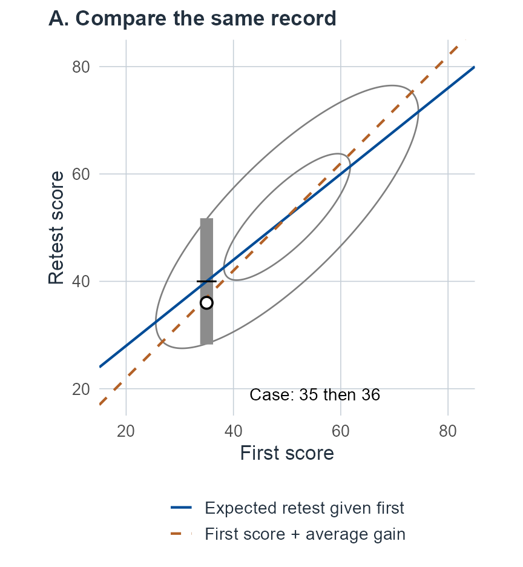
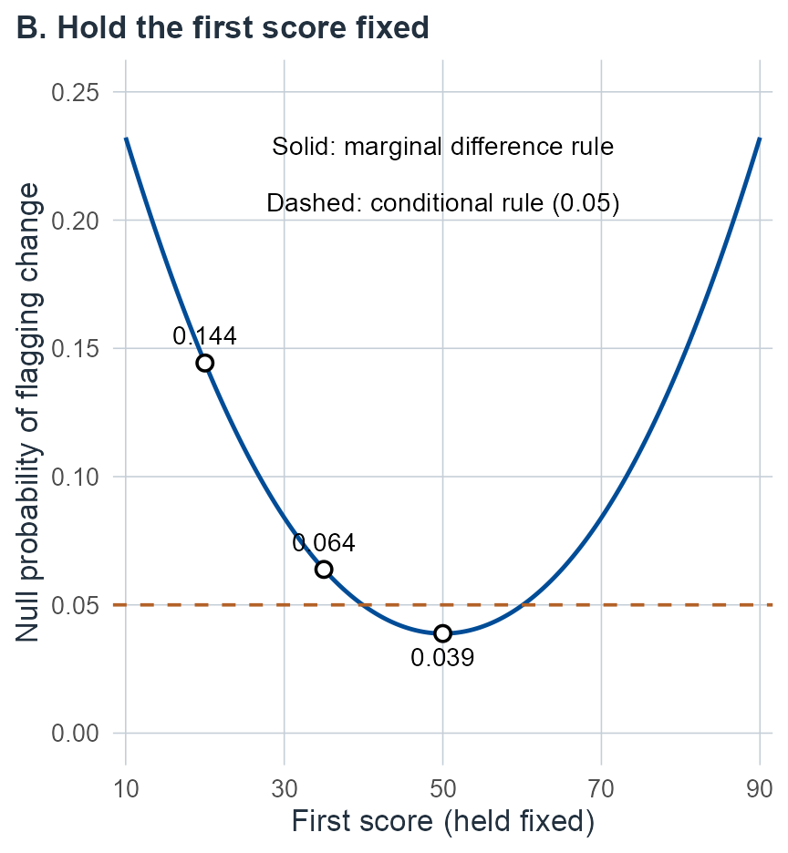

# Repeated testing and change {#sec-change}

## What has changed? {#sec-m08-question}

Consider a synthetic record. A person scores 35 on a memory test and, at a planned retest, 36. The raw score rose by one point. Now place the person among reference peers tested under the same protocol, whose first and second scores average 50 and 52, each with SD 10, and correlate .8. Among those peers, people who first score 35 retest at about 40 on average, with SD 6. Measured against them, the retest of 36 is two-thirds of an SD lower than expected. The same pair of scores is a small gain on one comparison and an unexpectedly low retest on another.

A second synthetic person moves from 50 to 48 over an interval in which the reference mean for their age falls from 50 to 45. The raw score declined by 2 points; the position among same-age peers rose from the mean to .3 SD above it. Deciding which person has “declined” requires choosing a comparison. The retest can be compared with the first score or with the retest expected from that score. Other comparisons use a reference population that changes with age, a latent state measured with error at both visits, an earlier healthy level, or the outcome the person would have had without a treatment. Each comparison is a legitimate question, and each needs different information. The first person's two comparisons are drawn in @fig-m08-two-comparisons, in the first unit.

In general, a score can fall while its age-relative position rises. A retest can be unexpectedly low given the first score without being lower than it. A latent state can change even when a coarse reported score stays constant. None of these observations, alone, identifies a treatment effect or a person's premorbid level.

Specify the person population, score scale, administration history, interval and intended target. In this chapter $Y_1,Y_2$ are observed performances at two occasions under a declared protocol. A null longitudinal reference law describes the comparison trajectory, which may include ordinary aging or practice; “null” need not mean zero raw difference. It is not a claim that the assessed person belongs to that population. Unless explicitly fitted below, population and measurement inputs are supplied as known. Missing visits and selected stopping require their observation mechanisms, developed in @sec-administration.

## How the chapter is organized {#sec-m08-roadmap}

The units follow the comparisons listed above. Most begin with a supplied (known) reference or measurement law, where the algebra is exact and the target is easiest to see, and then estimate what was supplied.

::::: {.m08-scroll role="group" tabindex="0" aria-label="M08 table 1; scroll horizontally"}

| Unit | Question | Experiment and inputs |
|---|---|---|
| [Joint occasions](#sec-m08-joint) | Is the raw difference unusual, or is the retest unexpected given the first score? What does a declared direction add? | A supplied same-person joint law for two occasions |
| [Fitted references](#sec-m08-calibration) | What changes when the reference means and covariance are estimated from paired reference people? | Regression of retest scores on fixed predictors in a finite reference sample, for one or several outcomes; marginal paired differences |
| [Practice, forms and states](#sec-m08-design) | Can practice, form, interval and stable versus state variance be separated? | The design matrix of an actual study; repeated reference records under a structured serial covariance |
| [Latent change](#sec-m08-latent) | Has an anchored latent state changed? | Known Gaussian and item measurement kernels; then noisy anchors and items calibrated jointly with the case |
| [Trajectories](#sec-m08-trajectories) | Is the person declining in raw units, along a personal line, or relative to peers? | Reference curves; several visits of one person; jointly fitted age norms |
| [Baseline and causal effects](#sec-m08-baseline) | Has the person lost ground from an earlier level, and would a treatment have changed the outcome? | A baseline proxy with bias and precision models; randomized and incompletely observed trials |

:::::

For a first reading, follow the [two observed-score comparisons](#sec-m08-joint), then the [anchored latent contrast](#sec-m08-latent), [raw and peer-relative trajectories](#sec-m08-trajectories), and [historical baseline and treatment questions](#sec-m08-baseline). Keep each model's conditions beside its interpretation. These passages distinguish the questions before the longer fitted calculations; the [lookup guide](#sec-m08-guide) provides a route back to a specific target.

Before using estimated inputs, return to the corresponding fitted analysis: [paired references](#sec-m08-calibration), [practice and state designs](#sec-m08-design), [noisy anchors and items](#sec-m08-joint-item-calibration), [personal slopes](#sec-m08-estimated-slope), [age norms](#sec-m08-fitted-norm-trajectory), or [trial effects](#sec-m08-causal-estimated-trial). Follow the branch matching the observations and target, including its uncertainty and identification limits. A supplied-input example does not justify substituting estimates while retaining its known-input guarantee.

Throughout, $0<\alpha<1$, $\Phi$ is the standard normal CDF, $z_q=\Phi^{-1}(q)$, and $t_{\nu,q}$ is the $q$ quantile of the standard Student law. We likewise write $\chi^2_{r,q}$ and $F_{r,s;q}$ for chi-square and F quantiles, with degrees of freedom before the probability. In $t_\nu(m,s)$, $m$ is location and $s>0$ is scale, not generally SD. Supplied Gaussian laws give exact calculations under their stated assumptions. The fitted branches below retain uncertainty in their specified regression, structured serial and measurement models. An unrestricted serial covariance, selected follow-up or noninvariant measurement needs its corresponding observation model and inference. All numerical examples are synthetic. Exact integrals are distinguished from their numerical evaluations, and no change probability is automatically a disease or treatment-benefit probability.

The [lookup guide](#sec-m08-guide) near the end collects each reader question with its observation experiment, target and sections.

## Synthetic examples and reused symbols {#sec-m08-examples}

Every numerical example is a synthetic teaching input chosen so that results can be checked; none is an instrument's norms, a value fitted to patients or a clinical cutoff. Because the units use different observation experiments, the chapter uses several small examples rather than one running case.

::::: {.m08-scroll role="group" tabindex="0" aria-label="M08 table 2; scroll horizontally"}

| Example | Inputs | What it shows | Where |
|---|---|---|---|
| Two-occasion reference | means 50 and 52, SDs 10, correlation .8; record (35, 36) | Marginal difference versus conditional innovation; a directional magnitude | [Joint occasions](#sec-m08-joint), @fig-m08-two-comparisons, [direction](#sec-m08-direction-magnitude) |
| Fitted scalar retest | six reference people; case predictor $-1.5$, retest 32 | Finite-reference prediction and offset inference | [Fitted references](#sec-m08-calibration) |
| Two fitted outcomes | eight reference people; case baseline (35, 55), retest (32, 36.5) | Joint, scalar and marginal statements disagree | [Two-response example](#sec-m08-matrix-example) |
| Marginal paired differences | six reference pairs; case (50, 50) to (51, 49) | A marginal analysis with no baseline conditioning | [Paired differences](#sec-m08-paired-difference-example) |
| Factorial and aliased designs | 16 independent people; eight form-A-then-B differences | Separable and aliased practice and form effects | [Fitted design](#sec-m08-design-fitted), [alias](#sec-m08-practice-alias) |
| Serial covariance | diagonal 13, lags 7, 5.5, 4.75; then 64 records over four visits | What three and four occasions identify; estimation | [Serial shape](#sec-m08-unknown-serial) to [records](#sec-m08-state-example) |
| Gaussian latent states | readings (50, 42), error variance 9 | Latent contrast confidence and posterior | [Latent change](#sec-m08-latent) |
| Four-item counts | counts 3 and 1 of 4 | Exact item confidence, posterior and point null | [Item confidence](#sec-m08-item-confidence), [contrast example](#sec-m08-item-contrast-example) |
| Noisy anchors and items | four reference people and two case occasions, two items | Calibration estimated jointly with change; drift | [Joint example](#sec-m08-item-joint-example), [drift](#sec-m08-item-anchor-drift) |
| Age-relative record | 50 to 48; reference mean 50 to 45 | Raw loss with peer-relative gain | [Trajectories](#sec-m08-trajectories) |
| Personal line and age norms | six annual scores 51 to 41; 12 reference people aged 60 to 65 | Personal slope, prediction and normed trajectory contrast | [Estimated slope](#sec-m08-estimated-slope) to [norm example](#sec-m08-fitted-trajectory-example) |
| Proxy and precision pilot | proxy 55, current 40; eight repeated pairs | Premorbid change under bias and estimated precision | [Baseline](#sec-m08-baseline), [precision](#sec-m08-proxy-estimated-precision) |
| Trials | 16 randomized people; 3 and 7 of 12; 20 per arm with noncompletion | Average effects, unidentified benefit, missing outcomes | [Causal effects](#sec-m08-causal) and its subsections |

:::::

Where an earlier chapter already named the same object, this chapter uses that name: the declared direction $v$ of [Level, shape, and information loss](04-level-and-shape.md#sec-m04-experiment); the conditional coefficients $B$ and covariance $V$ of a known joint law, the leverage multipliers $h$, $h_n$, the inverse-Wishart scale $\Psi$ and the predictive Student scale matrix $\Lambda$ of [A correlated battery](03-correlated-battery.md#sec-m03-conditional-vector); the trait, specificity, state and noise variances $g,s,a,e$ of [Measurement and replication](05-measurement-and-replication.md#sec-m05-state); and the item slopes $a_j$, anchor noise $s$, anchor-average variance $t=v+s/2$, gain $g$ and normal density $\varphi(\,\cdot\,;m,q)$ of [Items and scoring](06-items-and-scoring.md#sec-m06-running). Footnotes mark the few places where an earlier name could not be carried over without a clash. Several letters are still reused in separate units, each defined where it is introduced and confined to its unit:

- $c$: a fixed first-score value in the joint unit; the contrast vector $(-1,1)^T$ in the latent and proxy units. $C$ is a known correlation shape in the personal-slope unit and the current expectation in the proxy unit.
- $K$: the stable variance total $g+s$; the cutoff $K_\alpha$; the two-occasion item kernel $K(u\mid h)$.
- $S$: stable test specificity; residual sum-of-products matrices ($S$, $S_Y$, $S_D$); item-count totals $S_t$; completion indicators $S(a)$.
- $s$: a residual variance estimate $s^2$; the specificity variance; the anchor noise variance.
- $a$: the state variance in $aR_A$; age $a(t)$; item slopes $a_j$; inverse-gamma shapes such as $a_0$. $A$ is treatment in the causal unit.
- $\eta$, $\lambda$, $q$, $t$, $B$, $G$, $L$, $Q$ and $D$ also carry different local meanings. For example, $\eta$ is an inverse-Wishart degrees parameter, a vector of estimable coordinates and a state-prior correlation; $t$ is an occasion index and, in the anchor unit, the variance $v+s/2$.

The personal line in the trajectory unit has coefficients $\theta=(\theta_0,\theta_1)^T$, intercept and slope, so that its slope $\theta_1$ stands beside the reference age slope $\beta_1$.

## Joint occasions, reliable change and conditional innovation {#sec-m08-joint}

Start with the first person's record. One supplied description of how reference people perform on both occasions supports two different comparisons. The *raw difference* $Y_2-Y_1$ can be compared with the differences of reference people; the *retest* can be compared with the retests of reference people who obtained the same first score. The first comparison ignores where the person started; the second conditions on it. When scores on the two occasions are positively but imperfectly related, a low first score predicts a retest that is low but partly recovered, so the two comparisons can disagree in sign, as they do for the record 35 then 36. The proposition below gives both comparisons, and a third that treats a shift in the expected retest as an unknown to be estimated.

Supply a joint Gaussian observed-score law with $Y_t\in\mathbb R^p$,

::::: {.m08-scroll role="group" tabindex="0" aria-label="M08 equation 1; scroll horizontally"}

$$
\begin{pmatrix}Y_1\\Y_2\end{pmatrix}\sim
N_{2p}\!\left[\begin{pmatrix}\mu_1\\\mu_2\end{pmatrix},
\begin{pmatrix}\Sigma_{11}&\Sigma_{12}\\\Sigma_{21}&\Sigma_{22}\end{pmatrix}\right],
\qquad \Sigma\succ0.
$$ {#eq-m08-joint-law}

:::::

The covariance describes two performances from the **same** reference person. It includes their dependence; substituting two independent cross-sectional samples changes the experiment. Intervals, forms and exposure histories must match the supplied joint law.

::: {#prp-m08-joint-change}
## Marginal difference, conditional innovation and a fixed shift

Define

::::: {.m08-scroll role="group" tabindex="0" aria-label="M08 equation 2; scroll horizontally"}

$$
\begin{aligned}
D_Y&=Y_2-Y_1,& d_{\mathrm{ref}}&=\mu_2-\mu_1,\\
V_D&=\Sigma_{22}+\Sigma_{11}-\Sigma_{21}-\Sigma_{12},\\
B&=\Sigma_{21}\Sigma_{11}^{-1},&
m(c)&=\mu_2+B(c-\mu_1),\\
R&=Y_2-m(Y_1),&V&=\Sigma_{22}-\Sigma_{21}\Sigma_{11}^{-1}\Sigma_{12}.
\end{aligned}
$$ {#eq-m08-change-summaries}

:::::

Then $D_Y\sim N_p(d_{\mathrm{ref}},V_D)$, while $R\sim N_p(0,V)$ independently of $Y_1$. Both covariances are positive definite. Thus the marginal quadratic difference has null law
$(D_Y-d_{\mathrm{ref}})^TV_D^{-1}(D_Y-d_{\mathrm{ref}})\sim\chi^2_p$;
the conditional innovation has law $R^TV^{-1}R\mid Y_1=c\sim\chi^2_p$ at every fixed $c$.

For a **different, explicitly shifted conditional family**,
$Y_2\mid Y_1=c,\delta\sim N_p\{m(c)+\delta,V\}$ with fixed unknown $\delta$, $R\mid c\sim N_p(\delta,V)$. The ellipsoid

::::: {.m08-scroll role="group" tabindex="0" aria-label="M08 equation 3; scroll horizontally"}

$$
\{\delta:(R-\delta)^TV^{-1}(R-\delta)\le\chi^2_{p,1-\alpha}\}
$$ {#eq-m08-shift-confidence}

:::::

has coverage $1-\alpha$ for this conditional mean offset, repeating the retest at fixed $c,\delta$. For the same likelihood and proper prior $\delta\sim N_p(d_0,Q)$, $Q\succ0$,

::::: {.m08-scroll role="group" tabindex="0" aria-label="M08 equation 4; scroll horizontally"}

$$
\begin{aligned}
V_\delta&=(Q^{-1}+V^{-1})^{-1},\\
m_\delta&=V_\delta(Q^{-1}d_0+V^{-1}r),\\
\delta\mid r,c&\sim N_p(m_\delta,V_\delta).
\end{aligned}
$$ {#eq-m08-shift-posterior}

:::::

:::

::: {.proof}
A difference is a full-row-rank linear image of the joint normal vector, giving its mean/covariance and positive definiteness. The residual is another linear image; its covariance with $Y_1$ is $\Sigma_{21}-B\Sigma_{11}=0$. Joint Gaussianity makes these blocks independent. Completing the block square, or integrating the independent residual, gives the stated conditional law; the Schur covariance is positive because $( -\Sigma_{11}^{-1}\Sigma_{12}x,x)^T$ has positive joint quadratic form for nonzero $x$. Whitening each Gaussian contrast gives the chi-square laws and confidence statement. In the shift likelihood the prior times likelihood has positive precision $Q^{-1}+V^{-1}$; completing its square gives the proper normal posterior.
:::

The fixed offset $\delta$ is an observed conditional-mean parameter, not automatically latent decline or a causal effect. With no shift parameter and the known null law, a Bayesian predictive comparison uses the same $N_p\{m(c),V\}$ kernel; no parameter posterior is needed. A small null tail probability is not a posterior probability that the person has changed.

**Synthetic two-occasion comparison.** Let $\mu_1=50,\mu_2=52$, both SDs $10$ and correlation $.8$. Then $V_D=40$, $m(c)=52+.8(c-50)$ and $V=36$. At $(y_1,y_2)=(35,36)$ the marginal standardized difference is $(1-2)/\sqrt{40}\approx-.1581$, but conditional innovation is $(36-40)/6=-.6667$. In fact, for any $y_2<40$ the conditional residual is negative, even when $y_2>35$. With the proper teaching shift prior $N(0,9)$ the offset posterior is $N(-.8,7.2)$; its spread is not the retest predictive SD or disease uncertainty.

Read the two standardized values against the opening question. The difference of one point is $.16$ SD below the average reference gain of 2 points, an ordinary value among reference differences. The retest of 36 is $.67$ conditional SD below the retest of 40 expected from a first score of 35. Peers who start 15 points below the first-occasion mean are expected to gain 5 points: the 2-point average gain plus 3 points of regression toward the mean, $.2$ times the 15-point deficit. Against that expectation, a one-point gain is low. Neither number is a probability that the person has declined. Panel A of @fig-m08-two-comparisons shows both comparisons in the same reference law.

:::: {#fig-m08-two-comparisons}

::: {.m08-figure-panels .m08-comparison-panels}

:::

Two comparisons for the synthetic record (35, 36) under the chapter's known two-occasion law: means 50 and 52, SD 10 on each occasion, correlation .8. **A.** The grey ellipses enclose 50% and 95% of reference pairs. The dashed line adds the average difference of 2 to the first score; the case lies one point below it, a standardized difference of $-.16$ (difference SD $\sqrt{40}$). The solid line is the expected retest given the first score; at a first score of 35 it is 40, and the grey bar marks the central 95% of retests among those peers (conditional SD 6). The case lies $.67$ of that SD below 40. **B.** The marginal two-sided 5% rule for the difference has a different null error rate among peers with each fixed first score: .144 at 20, .064 at 35 and .039 at 50; averaged over reference first scores it is exactly .05. The conditional innovation rule has error .05 at every first score (dashed). All values are exact normal calculations from the stated law.

Open [panel A](figures/m08-panel-a.png) or [panel B](figures/m08-panel-b.png) at full size.

::::

A familiar special case connects the marginal difference to classical test theory. In a scalar parallel-CTT model, $Y_t=\tau+e_t$, $\tau$ has variance $v_\tau$, centered errors are independent of $\tau$ and one another with variance $v_e$, and no systematic mean change occurs. If $s_Y^2=v_\tau+v_e>0$, reliability is $\rho=v_\tau/s_Y^2$ and
$\operatorname{Var}(Y_2-Y_1)=2v_e=2s_Y^2(1-\rho)$.
A reliable-change standardization divides by this SD only when $v_e>0$; its normal tail interpretation additionally needs a Gaussian difference law. This SD is the standard error of the difference in the reliable change index of @jacobson1991clinical; @duff2012evidence [pp. 253–255] reviews that index with its practice-adjusted and regression-based variants. At $v_e=0$ the same stable coordinate gives difference zero deterministically, rather than a normal ratio. If both components vanish, even the reliability ratio is undefined.

For any scalar pair with finite moments, the covariance identity gives
$\operatorname{Var}(D_Y)=s_1^2+s_2^2-2\operatorname{Cov}(Y_1,Y_2)$.
With equal positive observed variances this becomes $2s_Y^2(1-r_{12})$, where $r_{12}$ is the observed retest correlation, whether or not a CTT decomposition is justified. Under the parallel assumptions above it equals reliability. Retain independence from $\tau$, but allow equal error variances with error covariance $c_e$. Then the error-difference variance is instead $2v_e-2c_e$ and the observed correlation is $r_{12}=(v_\tau+c_e)/(v_\tau+v_e)$. Thus an observed correlation can describe raw difference variation without identifying the required personal measurement-error universe. Unequal variances, state changes and mean practice effects likewise require their explicit joint law; a cross-person retest correlation is not automatically a reliability coefficient. Published reliable-change methods share this structure but differ in how they form the predicted retest and its standard error [@hintonbayre2010deriving].

### Marginal calibration and baseline-conditional calibration {#sec-m08-marginal-conditioning}

A rule calibrated over reference baselines need not have the same error rate at each fixed baseline. In the scalar example, the marginal two-sided $5\%$ rule rejects when $|D_Y-2|>z_{.975}\sqrt{40}$. Conditional on $Y_1=c$,

::::: {.m08-scroll role="group" tabindex="0" aria-label="M08 equation 5; scroll horizontally"}

$$
D_Y-2\mid Y_1=c
\sim N\{-.2(c-50),36\}.
$$ {#eq-m08-marginal-rule-conditional-law}

:::::

This follows by subtracting the fixed $c$ from the conditional retest mean. Let $q=z_{.975}\sqrt{40}$ and $\xi(c)=-.2(c-50)$. The conditional rejection probability is

::::: {.m08-scroll role="group" tabindex="0" aria-label="M08 equation 6; scroll horizontally"}

$$
\Phi\left(\frac{-q-\xi(c)}6\right)
+1-\Phi\left(\frac{q-\xi(c)}6\right).
$$ {#eq-m08-marginal-rule-conditional-error}

:::::

It is approximately $.144300$ at $c=20$, $.063820$ at $c=35$ and $.038830$ at $c=50$; panel B of @fig-m08-two-comparisons plots the whole curve. Averaging over the stated reference $Y_1\sim N(50,100)$ gives exactly $.05$, as the marginal difference law proves. In contrast, the innovation rule uses its conditional mean and SD and has conditional error $.05$ at every fixed baseline under this known model. Neither guarantee says the person belongs to that reference or identifies a latent cause. The choice is between a marginal trajectory question and a conditional retest question, not a universal claim that one statistic has greater power against every alternative.

### A directional question needs a directional alternative {#sec-m08-optimality}

::: {#prp-m08-conditional-direction}
## Optimality for one fixed-covariance mean direction

At fixed baseline $c$, fix a nonzero direction $v\in\mathbb R^p$ independently of outcomes. Test the conditional null $R\sim N_p(0,V)$ against $R\sim N_p(-d v,V)$, $d>0$, with the **same** known $V\succ0$ throughout. For $0<\alpha<1$, reject when

::::: {.m08-scroll role="group" tabindex="0" aria-label="M08 equation 7; scroll horizontally"}

$$
T=-\frac{v^TV^{-1}R}{\sqrt{v^TV^{-1}v}}>z_{1-\alpha}.
$$ {#eq-m08-direction-rule}

:::::

This has conditional null size $\alpha$ and power
$1-\Phi\{z_{1-\alpha}-d\sqrt{v^TV^{-1}v}\}$.
It maximizes power among conditional tests of size at most $\alpha$ for every $d>0$ in this one-direction family.
:::

::: {.proof}
Linear normal transformation gives $T\sim N(d\sqrt I,1)$, $I=v^TV^{-1}v>0$. For fixed $d>0$, the alternative/null density ratio is $L(r)=\exp(d\sqrt I\,T-d^2I/2)$, strictly increasing in $T$. Let $\varphi_*$ be the stated upper-tail rule and choose its likelihood-ratio threshold $k$. For any competing test $0\le\varphi\le1$, $(\varphi_*-\varphi)(L-k)\ge0$ pointwise. Integrating under the null and using $E_0\varphi_*\ge E_0\varphi$ gives $E_1\varphi_*\ge E_1\varphi$. The same threshold rule applies to every positive $d$, proving the restricted uniform statement.
:::

The argument is the Neyman–Pearson construction of a best critical region against a simple alternative [@neyman1933efficient], applied to each member of the one-direction family. This does not order power against all multivariate alternatives, justify choosing $v$ after seeing the profile, or establish a clinically optimal action. The optimality claim for conditional change requires the unchanged conditional covariance stated here. For example, under scalar null $N(0,1)$ and alternative $N(-1,4)$,
$\log L(r)=-\log2-(r+1)^2/8+r^2/2$ is quadratic: large positive and negative values can favor the alternative. A rule based only on the lower tail is no longer the likelihood-ratio ordering. Nor is an apparent gain from conditioning evidence for a unique latent mechanism.

The fixed-direction restriction can be checked on an actual case-selected rule. If one chooses $v=-R$ after observing $R\ne0$, the same statistic becomes $T=\sqrt{R^TV^{-1}R}$. At $R=0$ choose any nonzero direction; that event has probability zero under the known positive-definite Gaussian null. Reusing the one-sided critical value $z_{.95}$ then gives conditional null size $P(\chi^2_p>z_{.95}^2)$, approximately $.258523$ at $p=2$, rather than $.05$. The quadratic statistic's own chi-square calibration gives a valid omnibus innovation comparison under the known model, with a different alternative question. Prespecifying a direction and letting the case select it are different procedures; the calculation includes the selection rather than treating its result as fixed.

### Inference for a declared direction's magnitude {#sec-m08-direction-magnitude}

Keep the same known conditional family $R\mid c,d\sim N_p(-dv,V)$. Fix both the direction and its scale before examining the case: rescaling $v$ also changes the units of the magnitude $d$. For estimation allow $d\ge0$, including the reference $d=0$; the preceding alternative has $d>0$. Put

::::: {.m08-scroll role="group" tabindex="0" aria-label="M08 equation 8; scroll horizontally"}

$$
I=v^TV^{-1}v,\qquad
\widehat d=-\frac{v^TV^{-1}r}{I}.
$$ {#eq-m08-direction-magnitude-statistic}

:::::

Then $\widehat d\sim N(d,1/I)$ at every fixed $c,d$. Thus

::::: {.m08-scroll role="group" tabindex="0" aria-label="M08 equation 9; scroll horizontally"}

$$
\left[\widehat d-\frac{z_{1-\alpha/2}}{\sqrt I},\
      \widehat d+\frac{z_{1-\alpha/2}}{\sqrt I}\right]
\cap[0,\infty)
$$ {#eq-m08-direction-magnitude-confidence}

:::::

has exact coverage $1-\alpha$ for every fixed nonnegative $d$, including zero. The intersection may be empty; it preserves the inclusion event for every parameter in the declared domain. It is a two-sided confidence procedure for magnitude, distinct from the preceding one-sided level-$\alpha$ test.

For the identical likelihood choose a proper normal prior conditioned on $d>0$: an underlying $N(m_0,s_0^2)$ with finite $m_0$ and $s_0>0$. Its normalizing probability is $\Phi(m_0/s_0)>0$. The parameters describe the underlying normal, not its truncated mean and variance.

::: {#prp-m08-direction-posterior}
## A proper posterior within the one-direction alternative

Set

::::: {.m08-scroll role="group" tabindex="0" aria-label="M08 equation 10; scroll horizontally"}

$$
v_d=(s_0^{-2}+I)^{-1},\qquad
m_d=v_d(m_0/s_0^2+I\widehat d).
$$ {#eq-m08-direction-posterior-parameters}

:::::

The posterior density is

::::: {.m08-scroll role="group" tabindex="0" aria-label="M08 equation 11; scroll horizontally"}

$$
\pi(d\mid r,c)
=\frac{\varphi(d;m_d,v_d)\mathbf1\{d>0\}}
       {\Phi(m_d/\sqrt{v_d})},
$$ {#eq-m08-direction-posterior}

:::::

where $\varphi(\,\cdot\,;m,q)$ is a normal density with variance $q$. For $x>0$ its CDF is

::::: {.m08-scroll role="group" tabindex="0" aria-label="M08 equation 12; scroll horizontally"}

$$
P(d\le x\mid r,c)=
\frac{\Phi\{(x-m_d)/\sqrt{v_d}\}
      -\Phi(-m_d/\sqrt{v_d})}
     {\Phi(m_d/\sqrt{v_d})},
$$ {#eq-m08-direction-posterior-cdf}

:::::

and it is zero for $x\le0$. Define $\ell_d=-m_d/\sqrt{v_d}$ and
$\lambda_d=\phi(\ell_d)/\{1-\Phi(\ell_d)\}$, with $\phi$ the standard normal density. Its actual moments are

::::: {.m08-scroll role="group" tabindex="0" aria-label="M08 equation 13; scroll horizontally"}

$$
\begin{aligned}
E(d\mid r,c)&=m_d+\sqrt{v_d}\lambda_d,\\
\operatorname{Var}(d\mid r,c)
 &=v_d(1+\ell_d\lambda_d-\lambda_d^2).
\end{aligned}
$$ {#eq-m08-direction-posterior-moments}

:::::

:::

::: {.proof}
Expand the conditional likelihood quadratic:
$(r+dv)^TV^{-1}(r+dv)
=I(d-\widehat d)^2+r^TV^{-1}r-I\widehat d^2$.
The second part does not depend on $d$. Linear Gaussian transformation gives the stated sampling law for $\widehat d$ and its confidence event. Multiplying its likelihood factor by the normal prior and completing the scalar square gives $N(m_d,v_d)$ restricted to $d>0$, with $v_d>0$. The positive finite truncation probability proves normalization and propriety. Integrating the density up to $x$ gives its CDF. For a standard normal truncated below $\ell$, integration of $-\phi'(z)=z\phi(z)$ gives its mean $\lambda$, and integration by parts gives second moment $1+\ell\lambda$. Transforming its mean and variance proves the formulas.
:::

For the earlier scalar case use $v=1,r=-4,V=36$, hence $I=1/36$ and $\widehat d=4$. The $95\%$ confidence interval is approximately $[0,15.760]$; the separate one-sided null-test $p$ value is $.252493$. At true magnitude $d=4$, the level-$.05$ directional test has power approximately $.163991$.

Predetermine two teaching priors with $m_0=0$ and underlying SDs 3 or 6, each conditioned on $d>0$. Their same-data posterior summaries are:

::::: {.m08-scroll role="group" tabindex="0" aria-label="M08 table 3; scroll horizontally"}

| Underlying prior SD $s_0$ | Actual posterior mean | Actual posterior variance | Central $95\%$ interval |
|---|---:|---:|---|
| $3$ | $2.459000$ | $3.120518$ | $[.107879,6.592860]$ |
| $6$ | $4.222991$ | $8.612331$ | $[.200261,10.991374]$ |

:::::

For the first row the underlying posterior parameters are $m_d=.8,v_d=7.2$ and truncation probability $.617203$; they are not the actual posterior mean/variance. The second row has underlying parameters $m_d=2,v_d=18$, with probability $.681324$. These values follow the normalized CDF/moment formulas and direct prior-times-likelihood integration. A positive-only prior excludes the reference magnitude by assumption, so a positive credible interval does not by itself establish evidence against the reference model. A posterior point-null comparison would need a deliberately assigned prior mass at zero. The frequentist test's size and power concern its stated conditional experiment; neither the test nor this magnitude posterior is a probability of latent decline or disease.

### When the conditional covariance changes {#sec-m08-changed-covariance}

For the scalar alternative $N(-1,4)$ against reference $N(0,1)$, completing the quadratic gives

::::: {.m08-scroll role="group" tabindex="0" aria-label="M08 equation 14; scroll horizontally"}

$$
\log L(r)=\frac38(r-1/3)^2-\log2-\frac16.
$$ {#eq-m08-changed-covariance-lr}

:::::

Its likelihood ratio increases with distance from $1/3$. For any desired size $\alpha$, the likelihood-ratio rule rejects outside
$[1/3-R_\alpha,1/3+R_\alpha]$, where

::::: {.m08-scroll role="group" tabindex="0" aria-label="M08 equation 15; scroll horizontally"}

$$
\Phi(1/3-R_\alpha)+1-\Phi(1/3+R_\alpha)=\alpha.
$$ {#eq-m08-changed-covariance-size}

:::::

The left side decreases continuously from one to zero as $R_\alpha$ runs from zero to infinity, with strictly negative derivative, so the positive root is unique. The same likelihood-ratio inequality used above proves optimality for this simple alternative. It does not prove uniform optimality over unspecified covariance changes.

At size $.05$, the rejection region is approximately
$r<-1.730784$ or $r>2.397450$. Its alternative power is

::::: {.m08-scroll role="group" tabindex="0" aria-label="M08 equation 16; scroll horizontally"}

$$
\Phi\{(-1.730784+1)/2\}
+1-\Phi\{(2.397450+1)/2\}\approx .402095,
$$ {#eq-m08-changed-covariance-power}

:::::

using the rounded thresholds. The lower-tail rule $r<z_{.05}\approx-1.644854$ has the same null size but power only $.373565$ against this alternative. This evaluates why the unchanged-covariance restriction matters; the extra upper-tail evidence comes from the broader alternative distribution.

### Normal marginal reports do not supply the joint change law {#sec-m08-normal-margin-boundary}

The [normal-margin construction](07-norms-invariance-linking.md#sec-m07-rank-boundaries) gives a direct countercheck. Let $Z\sim N(0,1)$ and let an independent sign $S$ be equally likely to be $-1$ or 1. Take $Y_1=Z,Y_2=SZ$. Both margins are standard normal, their covariance is zero and their covariance matrix is positive definite. But

::::: {.m08-scroll role="group" tabindex="0" aria-label="M08 equation 17; scroll horizontally"}

$$
D_Y=(S-1)Z\sim
\tfrac12\delta_0+\tfrac12N(0,4),
$$ {#eq-m08-normal-margin-change-mixture}

:::::

where $\delta_0$ denotes a unit point mass at zero. The actual difference variance is 2, as the covariance identity gives, while $D_Y/\sqrt2$ is not standard normal. A nominal $5\%$ Gaussian quadratic rule has actual size

::::: {.m08-scroll role="group" tabindex="0" aria-label="M08 equation 18; scroll horizontally"}

$$
\frac12P\left\{\chi^2_1>
                 \frac{\chi^2_{1,.95}}2\right\}
\approx .082888.
$$ {#eq-m08-normal-margin-false-positive}

:::::

Indeed, half the differences are zero, and the other half have squared standardized value $2Z^2$. For the innovation, the covariance-based Gaussian calculation would set $B=0,V=1$. Conditional on $Y_1=c$, however, $R=Y_2$ takes values $c,-c$ with equal probabilities, so $R^2=c^2$ is fixed, rather than conditionally chi-square. Its marginal law is nevertheless $R^2=Z^2\sim\chi^2_1$. That marginal match does not restore the conditional guarantee. Marginal normalization cannot repair that missing joint law.

Joint Gaussianity is a sufficient convenient model for the collection of laws above, rather than a necessary condition for every valid difference comparison. For example, take a stable $\tau$ equal to $-1$ or 1 with equal probabilities and Gaussian errors $e_t\sim N(0,v_e)$, $v_e>0$, with $\tau,e_1,e_2$ mutually independent. Then $D_Y=e_2-e_1\sim N(0,2v_e)$ even though the scores' fourth moment is $1+6v_e+3v_e^2$, different from the Gaussian value $3(1+v_e)^2$. Thus their pair is not jointly Gaussian. This yields a valid Gaussian marginal difference without supplying all the conditional Gaussian claims. Specify the law of the statistic and the conditioning used; neither matching margins nor matching covariances establishes it.

## Change comparisons fitted from paired reference data {#sec-m08-calibration}

The first unit treated the reference law as known. In practice its means, regression slope and residual spread are estimated from a finite sample of reference people tested twice, and those estimates carry uncertainty into every comparison. This unit fits the retest regression for one outcome and then for several outcomes with an estimated error covariance, gives a proper Bayesian analysis of each, and works two examples: one conditional on the baseline and one for marginal paired differences.

A known population covariance is different from a fitted change rule. Collect paired observations from $n$ independent reference persons under the intended null protocol. Condition on a prespecified full-rank design $X\in\mathbb R^{n\times k}$, $n>k$, and model their retest outcomes $W=X\beta+\epsilon$, $\epsilon\sim N_n(0,vI)$, $v>0$. Columns may include an intercept, observed baseline, interval, form and exposure predictors, but must be fixed without selecting them using these outcomes. Baseline measurement error does not invalidate an explicitly correct **observed-baseline conditional** model; it does invalidate silently interpreting its slope as a latent relationship.

At fixed external case predictors $x_0$, let
$W_0=x_0^T\beta+\delta+\epsilon_0$, $\epsilon_0\sim N(0,v)$ independently of the reference errors. The null predictive comparison fixes $\delta=0$. A separate inference family treats $\delta$ as the case's fixed conditional mean offset. Its noise and calibration uncertainty do not themselves decompose into personal latent change. Write $\widehat\beta=(X^TX)^{-1}X^TW$, $\nu=n-k$, $s^2=\|W-X\widehat\beta\|^2/\nu>0$, $h_0=x_0^T(X^TX)^{-1}x_0$ and $r_0=w_0-x_0^T\widehat\beta$.

::: {#prp-m08-calibrated-change}
## Finite-reference retest prediction and fixed-offset inference

At every fixed $\beta,v,\delta$,

::::: {.m08-scroll role="group" tabindex="0" aria-label="M08 equation 19; scroll horizontally"}

$$
\frac{W_0-x_0^T\widehat\beta-\delta}{s\sqrt{1+h_0}}\sim t_\nu.
$$ {#eq-m08-retest-pivot}

:::::

Consequently $r_0\pm t_{\nu,1-\alpha/2}s\sqrt{1+h_0}$ is an exact $1-\alpha$ confidence interval for $\delta$ across reference outcomes and a new retest at fixed $X,x_0,\beta,v,\delta$. Setting $\delta=0$ instead gives an exact null prediction interval for $W_0$. The leverage term is essential; coverage does not condition on all realized reference outcomes.

For the reference likelihood alone, the separately declared improper measure $p(\beta,v)\propto1/v$ relative to $d\beta\,dv$ yields a proper posterior when $n>k$ and residual sum of squares is positive. Its null posterior predictive law is

::::: {.m08-scroll role="group" tabindex="0" aria-label="M08 equation 20; scroll horizontally"}

$$
W_0\mid W,X,x_0,\delta=0\sim
 t_\nu\{x_0^T\widehat\beta,\ s\sqrt{1+h_0}\},
$$ {#eq-m08-retest-reference-predictive}

:::::

where the second argument is Student scale, not SD. Alternatively using the joint measure $p(\beta,v,\delta)\propto1/v$ relative to $d\beta\,dv\,d\delta$ with the case likelihood gives a proper posterior whose marginal is
$\delta\mid W,w_0\sim t_\nu\{r_0,s\sqrt{1+h_0}\}$.
The latter equals the confidence endpoints for this particular measure/experiment, not for every prior or latent target.
:::

::: {.proof}
Orthogonal Gaussian projection gives $\widehat\beta\sim N_k\{\beta,v(X^TX)^{-1}\}$ independently of $\nu s^2/v\sim\chi^2_\nu$. Independence of the new error makes the numerator normal with variance $v(1+h_0)$, independent of that chi-square, proving the pivot. Completing the reference likelihood square gives $\beta\mid v,W\sim N_k\{\widehat\beta,v(X^TX)^{-1}\}$ and $v\mid W\sim\operatorname{IG}(\nu/2,\nu s^2/2)$. Positive shape/scale and the full-rank normal integral establish propriety. Integrating $\beta$ adds $vh_0$ to the new error variance; integrating $v$ using its inverse-gamma density gives the Student law. For offset inference, integrating the case likelihood over the flat $\delta$ gives one, leaving the same reference posterior for $\beta,v$. Conditional on these and $w_0$, $\delta$ is $N(w_0-x_0^T\beta,v)$; the two successive integrals give the stated Student marginal and propriety.
:::

Here $\operatorname{IG}(a,d)$ uses shape $a$ and scale $d$, with density $d^av^{-a-1}e^{-d/v}/\Gamma(a)$ relative to $dv$, for $a,d,v>0$. The improper measures above have no normalized prior predictive distribution. They are comparison conventions with proved posterior domains, not beliefs that every real offset is equally plausible in a proper population.

In neuropsychology, predicting a retest from a reference regression is the standardized regression-based approach to change [@mcsweeny1993interpreting; @duff2012evidence, p. 255]. That approach has often divided the residual by the regression's residual SD alone; the prediction standard error of @crawford1998regression adds the leverage term [@hammers2021application, p. 342]. In one development sample of 167 older adults retested after a week the two standard errors were nearly identical [@hammers2021application]. Under the pivot above, the difference grows with smaller reference samples and with case predictors far from the reference mean, because both raise $h_0$.

For a marginal reliable-change comparison, fit the paired differences $D_i=Y_{i2}-Y_{i1}$ with an intercept only ($k=1$, $x_0=1$, $h_0=1/n$). Under independent $D_i\sim N(m,v_D)$ and an independent new-case $D_0\sim N(m+\delta,v_D)$, $v_D>0$, the same proof gives $(D_0-\bar D)/\{s_D\sqrt{1+1/n}\}\sim t_{n-1}$ under the marginal null $\delta=0$. This accounts for estimating both mean practice change and difference variance. It does not become a baseline-conditional guarantee; its conditional error rate can vary with baseline. Independent persons are required; treating the two occasions as independent records is incorrect.

::: {#prp-m08-proper-calibration}
## Proper calibration priors and joint offset propagation

For the same reference experiment choose proper $v\sim\operatorname{IG}(a_0,d_0)$ and $\beta\mid v\sim N_k(b_0,vV_0)$, with $a_0,d_0>0$, $V_0\succ0$. Then

::::: {.m08-scroll role="group" tabindex="0" aria-label="M08 equation 21; scroll horizontally"}

$$
\begin{aligned}
V_n&=(V_0^{-1}+X^TX)^{-1},\\
b_n&=V_n(V_0^{-1}b_0+X^TW),\\
a_n&=a_0+n/2,\\
d_n&=d_0+\tfrac12\bigl(W^TW+b_0^TV_0^{-1}b_0\\
&\hspace{5em}-b_n^TV_n^{-1}b_n\bigr).
\end{aligned}
$$ {#eq-m08-calibration-update}

:::::

and $\beta\mid v,W\sim N_k(b_n,vV_n)$, $v\mid W\sim\operatorname{IG}(a_n,d_n)$, with $d_n>0$. The **null predictive** distribution is

::::: {.m08-scroll role="group" tabindex="0" aria-label="M08 equation 22; scroll horizontally"}

$$
t_{2a_n}\!\left\{x_0^Tb_n,
\sqrt{\frac{d_n}{a_n}(1+x_0^TV_nx_0)}\right\}.
$$ {#eq-m08-proper-retest}

:::::

For proper **offset inference** also choose $\delta\mid v\sim N(d_*,vq_*)$, $q_*>0$, conditionally independent of $\beta$. Stack $\theta=(\beta^T,\delta)^T$, $b_*=(b_0^T,d_*)^T$, $V_* =\operatorname{diag}(V_0,q_*)$, responses $u=(W^T,w_0)^T$ and design

::::: {.m08-scroll role="group" tabindex="0" aria-label="M08 equation 23; scroll horizontally"}

$$
\mathcal X=\begin{pmatrix}X&0\\x_0^T&1\end{pmatrix}.
$$ {#eq-m08-offset-design}

:::::

Apply the update above with $(X,W,b_0,V_0,n)$ replaced by $(\mathcal X,u,b_*,V_*,n+1)$, obtaining $(\widetilde V,\widetilde b,\widetilde a,\widetilde d)$. The offset marginal is Student with degrees of freedom $2\widetilde a$, location $\widetilde b_{k+1}$ and scale $\sqrt{\widetilde d\widetilde V_{k+1,k+1}/\widetilde a}$. It generally differs from the flat-offset result and permits the case to inform calibration through the proper joint model.
:::

::: {.proof}
Complete the coefficient square in the likelihood times conditional normal prior. Integrating its normalized $k$-variate normal factor leaves inverse-gamma shape $a_0+n/2$ and scale $d_n$. The scale increment equals half the minimum of $\|W-X\beta\|^2+(\beta-b_0)^TV_0^{-1}(\beta-b_0)$, hence is nonnegative and $d_n\ge d_0>0$. The normal predictive integral adds $v$ to the conditional mean's variance; mixing over $v$ gives the Student scale. The stacked model is exactly the same normal likelihood/conjugate-prior calculation with one extra coefficient and observation; its positive prior precision guarantees a proper update. Integrating its scalar offset conditional normal over inverse-gamma $v$ gives the stated marginal.
:::

**Synthetic fitted retest.** Use predictor values $c=(-1,-1,0,0,1,1)$, columns $(1,c)$ and retest scores $(38,42,49,47,54,58)$. At external $c_0=-1.5,w_0=32$, the fit has $\widehat\beta=(48,8)^T$, $s^2=4.5$, $\nu=4$ and $h_0=35/48$. The fitted null retest prediction is $36$; the fitted conditional residual is $-4$. Predetermined teaching priors $b_0=(48,8)^T$, $V_0=\operatorname{diag}(100,25)$, $a_0=3,d_0=9$ give $a_n=6,d_n=18$ by construction; this agreement with the fit is not a rule for learning hyperparameters from the same outcomes. The proper predictive center is still $36$, but its scale and degrees of freedom differ. For offset inference choose $d_*=0,q_*=4$; those outputs address a different target than the null predictive interval.

To reconstruct the calculation, first fit the intercept, slope and residual variance from the reference outcomes. Evaluate the fitted line at the external case predictor, then subtract that expected retest from the observed retest. In the [sampling pivot](#eq-m08-retest-pivot), leverage accounts for uncertainty in the fitted expectation; the additional observation-noise term accounts for variation in a new performance. For a proper posterior, use the [calibration update](#eq-m08-calibration-update) for null prediction, or the [stacked case model](#eq-m08-offset-design) when the target is the conditional mean offset.

For these synthetic data the reference-measure $95\%$ offset interval is approximately $[-11.7449,3.7449]$, equivalently a null predictive interval $[28.2551,43.7449]$ for retest. The proper null predictive interval is $[31.0459,40.9541]$. The proper offset posterior instead has location $-2.7956$ and central $95\%$ interval $[-6.8914,1.3002]$. These are distinct conditioning/target statements, not interchangeable measures of personal latent loss.

Reference data must match the interval/exposure/form regime. Learned predictor selection, heterogeneous residual variance, small-sample nonnormal errors and case-dependent administration need additional analysis. A plug-in normal residual rule has neither of the exact finite-reference guarantees proved here. Covariate and norm-transformation uncertainty belong in an expanded likelihood, rather than an unlabelled standard-error adjustment.

### Several retest outcomes with estimated covariance {#sec-m08-matrix-calibration}

A profile comparison needs the covariance of fitted retest errors, as well as fitted means. Let $W\in\mathbb R^{n\times p}$ now contain the **observed retest vectors** of the paired reference people. Keep the fixed, prespecified, full-rank observed-baseline design $X$ with $n>k$, and assume

::::: {.m08-scroll role="group" tabindex="0" aria-label="M08 equation 24; scroll horizontally"}

$$
\begin{aligned}
W&=XB+E,& E_i&\sim N_p(0,\Omega),\\
Y_0&=B^Tx_0+\delta+\epsilon_0,
&\epsilon_0&\sim N_p(0,\Omega).
\end{aligned}
$$ {#eq-m08-matrix-experiment}

:::::

All reference error rows and the case error are mutually independent conditional on the entire parameter $(B,\Omega,\delta)$ and fixed $(X,x_0)$. Every entry of $B\in\mathbb R^{k\times p}$ and the positive-definite $\Omega\in\mathbb R^{p\times p}$ is unknown. The fixed vector $\delta\in\mathbb R^p$ is a conditional mean offset in these observed score units. It is neither a supplied latent loss nor a random draw from the reference population. Null prediction sets $\delta=0$; offset inference retains it as the target.

Define the quantities actually fitted from the observed reference records:

::::: {.m08-scroll role="group" tabindex="0" aria-label="M08 equation 25; scroll horizontally"}

$$
\begin{aligned}
\widehat V&=(X^TX)^{-1},
&\widehat B&=\widehat V X^TW,\\
\nu&=n-k,
&S&=(W-X\widehat B)^T(W-X\widehat B),\\
h_0&=x_0^T\widehat Vx_0,
&h&=1+h_0,\\
r_0&=y_0-\widehat B^Tx_0.
\end{aligned}
$$ {#eq-m08-matrix-fit}

:::::

Here $S$ is a residual **sum-of-products matrix**; the residual covariance estimate is $S/\nu$.^[[A correlated battery](03-correlated-battery.md#sec-m03-conditional-vector) writes a residual sum-of-products matrix as $E$ and uses $S$ for covariance estimates. Here $E$ is already the error matrix of @eq-m08-matrix-experiment, so $S$ denotes the sum, and $S/\nu$ the estimate. $S$ is also the stable specificity in the state unit; the two never appear together.] Confusing those matrices changes the cutoff by a factor of $\nu$.

::: {#prp-m08-matrix-finite-change}
## Joint finite-reference confidence and prediction

If $\nu\ge p$, put $f=\nu-p+1$. Then $S\succ0$ almost surely and

::::: {.m08-scroll role="group" tabindex="0" aria-label="M08 equation 26; scroll horizontally"}

$$
\frac{f}{ph}(r_0-\delta)^TS^{-1}(r_0-\delta)
\sim F_{p,f}.
$$ {#eq-m08-matrix-f-pivot}

:::::

Thus an exact $1-\alpha$ confidence set for the fixed vector $\delta$ is

::::: {.m08-scroll role="group" tabindex="0" aria-label="M08 equation 27; scroll horizontally"}

$$
\begin{aligned}
\mathcal C_\alpha
&=\{d:(r_0-d)^TS^{-1}(r_0-d)\le K_\alpha\},\\
K_\alpha&=\frac{hp}{f}F_{p,f;1-\alpha}.
\end{aligned}
$$ {#eq-m08-matrix-confidence}

:::::

Coverage repeats both the reference outcomes and the case outcome at fixed $X,x_0,B,\Omega,\delta$. For $\delta=0$, moving the center to $\widehat B^Tx_0$ gives a joint prediction region for a new retest vector. This is not a frequentist coverage statement conditional on the realized fitted reference outcomes.
:::

::: {.proof}
Take an orthonormal basis of the column space of $X$ and its orthogonal complement. Multiplying $E$ by this orthogonal row transformation gives independent normal rows with covariance $\Omega$: their joint density is unchanged because their quadratic sum is unchanged. The first $k$ rows determine $\widehat B-B$; the remaining $\nu$ rows determine $S$. Hence $r_0-\delta\sim N_p(0,h\Omega)$ independently of $S$. After whitening by $\Omega^{-1/2}$ for the proof, the latter is $Z^TZ$ for a $\nu\times p$ matrix of independent standard normals. This Gram law defines the Wishart distribution used here; its column rank is $p$ almost surely when $\nu\ge p$.

Write $u=\Omega^{-1/2}(r_0-\delta)/\sqrt h$ and $G=\Omega^{-1/2}S\Omega^{-1/2}$. Then $u\sim N_p(0,I)$ independently of $G$. An orthogonal rotation taking $u$ to its first axis leaves the conditional law of $G$ unchanged, so the rotated $G$ remains independent of $u$. Partition the correspondingly rotated standard-normal matrix as $(z_1,Z_2)$. Block inversion gives

::::: {.m08-scroll role="group" tabindex="0" aria-label="M08 equation 28; scroll horizontally"}

$$
u^TG^{-1}u
=\frac{\|u\|^2}{z_1^T(I-P_{Z_2})z_1}.
$$ {#eq-m08-matrix-schur}

:::::

The numerator is $\chi^2_p$. Conditional on $Z_2$, the denominator is the squared length of the projection of an independent standard normal onto a space of dimension $\nu-p+1$, hence $\chi^2_f$. Its law is constant in $Z_2$ and it is independent of the numerator. For $p=1$, $Z_2$ is empty. Dividing the two chi-squares by their degrees of freedom proves the pivot, including the factor $h$. Inverting its central event proves confidence and null prediction.
:::

This also gives a useful interpretation of simultaneous directions. For **every** nonzero weight vector $w$, projection of the same ellipsoid is

::::: {.m08-scroll role="group" tabindex="0" aria-label="M08 equation 29; scroll horizontally"}

$$
w^Tr_0\ \pm\sqrt{K_\alpha\,w^TSw}.
$$ {#eq-m08-matrix-projection}

:::::

Indeed, write $r_0-d=S^{1/2}z$, $\|z\|^2\le K_\alpha$ and apply Cauchy–Schwarz; equality is attainable along $S^{1/2}w$. On the ellipsoid coverage event, these intervals contain $w^T\delta$ for all $w$ at once. This simultaneous statement permits reporting a direction chosen after seeing the data, with its corresponding selected target. It supplies no uniformly most powerful fitted-covariance test.

A **prespecified fixed** nonzero $w$ also admits a different, scalar reduction:

::::: {.m08-scroll role="group" tabindex="0" aria-label="M08 equation 30; scroll horizontally"}

$$
\frac{w^T(r_0-\delta)}
{\sqrt{h\,w^TSw/\nu}}\sim t_\nu.
$$ {#eq-m08-matrix-fixed-contrast}

:::::

The proof projects each normal error row onto this fixed $w$, so the residual sum is $(w^T\Omega w)\chi^2_\nu$, independent of the numerator. This argument requires only $\nu>0$, even if $\nu<p$ and $S$ is singular. In that case, coordinate intervals using $t_{\nu;1-\alpha/(2p)}$ give a simultaneous rectangle by the union bound. Their coverage is at least $1-\alpha$; it is not claimed to be exact. If $\nu=0$, this residual-scale construction is unavailable; a covariance estimate cannot be recovered by inverting a zero-rank residual matrix. Additional variance information or a whole-space report is needed. A weight fitted from $S$ or selected from the case does not automatically inherit the prespecified scalar pivot.

These distinctions matter at small reference sizes. Even a rule that includes leverage but calibrates
$Q=r_0^T(S/\nu)^{-1}r_0/h$ by $\chi^2_p$ has, under the null, actual size

::::: {.m08-scroll role="group" tabindex="0" aria-label="M08 equation 31; scroll horizontally"}

$$
P\!\left\{
F_{p,f}>
\frac{f}{p\nu}\chi^2_{p;1-\alpha}
\right\}.
$$ {#eq-m08-matrix-naive-size}

:::::

It uses the covariance fitting in $S$ but the wrong reference law. Omitting leverage changes this size again. Likewise, replacing $V$ by an estimated covariance in the earlier known-law directional theorem requires a new argument; that theorem's optimality conclusion does not follow by substitution.

There is a distinct **marginal paired-change** version. Put the observed within-person differences $D_i=Y_{i2}-Y_{i1}$ in the rows of $W$ and use an intercept-only $X$. Under independent $N_p(m,\Omega_D)$ differences and a new case difference with mean $m+\delta$, the same theorem has $\nu=n-1$, $f=n-p$, $h=1+1/n$ and requires $n>p$. It estimates mean practice change and covariance of differences. It does not condition on the case baseline. Independent cross-sectional samples cannot replace these paired records without a different experiment.

### Integrating coefficient and covariance uncertainty {#sec-m08-matrix-bayes}

We next treat the **same** matrix experiment with an explicit proper prior. To keep score covariance separate from a Student scale, define the covariance prior carefully. For $\eta>p-1$ and $\Psi\succ0$, write $\Omega\sim\operatorname{IW}_p(\eta,\Psi)$ for the probability density proportional to^[As in [A correlated battery](03-correlated-battery.md#sec-m03-vector-proper), $\Psi$ is the inverse-Wishart scale, $B$ the coefficient matrix, $\Lambda$ the scale matrix of the predictive Student law and $h=1+h_0$, $h_n$ the leverage multipliers. That chapter writes the inverse-Wishart degrees parameter as $\nu$ and the Student degrees as $d$. Here $\nu=n-k$ is already the residual degrees of freedom, the convention of [Finite reference information](02-finite-reference.md#sec-finite-reference), and $d$ is an offset value, so these are written $\eta$ and $f$.]

::::: {.m08-scroll role="group" tabindex="0" aria-label="M08 equation 32; scroll horizontally"}

$$
|\Omega|^{-(\eta+p+1)/2}
\exp\{-\tfrac12\operatorname{tr}(\Psi\Omega^{-1})\}
\quad(\Omega\succ0).
$$ {#eq-m08-inverse-wishart}

:::::

A construction both normalizes this family and specifies its domain. Let $C$ be lower triangular with positive diagonal, with **all** the following entries independent:
$C_{jj}^2\sim\chi^2_{\eta-j+1}$ and $C_{ij}\sim N(0,1)$ for $i>j$. Put $G=CC^T$ and
$\Omega=\Psi^{1/2}G^{-1}\Psi^{1/2}$, using the symmetric positive square root. All chi-square shapes are positive and the matrix is positive definite almost surely.

For completeness, the Cholesky transformation has Jacobian
$2^p\prod_j C_{jj}^{p+1-j}$. This follows by adjoining the last row: its off-diagonal block multiplies by the previous triangular factor, giving determinant $|C_{\mathrm{prev}}|$, and its last diagonal derivative is $2C_{pp}$; induction gives the product. The independent entry densities divided by that Jacobian give
$|G|^{(\eta-p-1)/2}\exp\{-\operatorname{tr}(G)/2\}$ up to their finite normalizing constant. On symmetric matrices the inversion Jacobian is $|\Omega|^{-(p+1)}$: in a diagonal eigenbasis the derivative multiplies diagonal coordinates by $\lambda_i^{-2}$ and off-diagonal coordinates by $(\lambda_i\lambda_j)^{-1}$; their product is the stated determinant. Congruence by $A$ has Jacobian $|A|^{p+1}$, by the same coordinate calculation. These transformations give exactly the density kernel above and establish its propriety without assuming an unnamed covariance integral. At $p=1$ it is $\operatorname{IG}(\eta/2,\Psi/2)$ in the shape/scale convention already stated.

The construction also yields a useful marginal fact:

::::: {.m08-scroll role="group" tabindex="0" aria-label="M08 equation 33; scroll horizontally"}

$$
w^T\Omega w\ \overset d=\ 
\frac{w^T\Psi w}{U},
\qquad U\sim\chi^2_{\eta-p+1},
\quad w\ne0.
$$ {#eq-m08-iw-projection}

:::::

To see this, rotate $\Psi^{1/2}w$ to the last axis. The density of $G$ is orthogonally invariant. The reciprocal of $(G^{-1})_{pp}$ is the last Schur complement, which in its Cholesky representation is $C_{pp}^2$. Thus it has the stated chi-square law. Since
$E(U^{-1})=1/(f-2)$ for $f=\eta-p+1>2$, by integrating the gamma density, polarization gives
$E(\Omega)=\Psi/(\eta-p-1)$ when $\eta>p+1$. Propriety alone does not imply this moment exists.

::: {#prp-m08-matrix-proper-calibration}
## Proper joint calibration and vector offset posterior

Choose $\Omega\sim\operatorname{IW}_p(\eta_0,\Psi_0)$, $\eta_0>p-1$, $\Psi_0\succ0$. Conditional on $\Omega$, give $B$ the matrix-normal law
$\operatorname{MN}_{k,p}(B_0,V_0,\Omega)$, where $V_0\succ0$: equivalently
$B=B_0+V_0^{1/2}Z\Omega^{1/2}$ with the entries of $Z$ independent standard normals and $Z$ independent of $\Omega$. All hyperparameters are specified independently of the case and reference outcomes. Then the reference posterior is

::::: {.m08-scroll role="group" tabindex="0" aria-label="M08 equation 34; scroll horizontally"}

$$
\begin{aligned}
V_n&=(V_0^{-1}+X^TX)^{-1},\\
B_n&=V_n(V_0^{-1}B_0+X^TW),\\
\eta_n&=\eta_0+n,\\
\Psi_n&=\Psi_0+W^TW
+B_0^TV_0^{-1}B_0
-B_n^TV_n^{-1}B_n,\\
\Omega\mid W,X&\sim\operatorname{IW}_p(\eta_n,\Psi_n),\\
B\mid\Omega,W,X
&\sim\operatorname{MN}_{k,p}(B_n,V_n,\Omega).
\end{aligned}
$$ {#eq-m08-matrix-posterior}

:::::

Define $t_p(f,m,\Lambda)$ as the law of $m+Z/\sqrt{U/f}$, with $Z\sim N_p(0,\Lambda)$ and $U\sim\chi^2_f$ independent, $\Lambda\succ0$, $f>0$. Here $\Lambda$ is a **scale matrix**. Every fixed projection is scalar Student with scale $\sqrt{w^T\Lambda w}$. The location is the mean only for $f>1$; the covariance is $f\Lambda/(f-2)$ only for $f>2$.

The null predictive law, conditional on the reference outcomes, is

::::: {.m08-scroll role="group" tabindex="0" aria-label="M08 equation 35; scroll horizontally"}

$$
\begin{aligned}
Y_0\mid W,X,x_0,\delta=0
&\sim t_p(f_n,B_n^Tx_0,\Lambda_n),\\
f_n&=\eta_n-p+1,\\
\Lambda_n&=\frac{1+x_0^TV_nx_0}{f_n}\Psi_n.
\end{aligned}
$$ {#eq-m08-matrix-proper-predictive}

:::::

For offset inference instead declare
$\delta\mid\Omega\sim N_p(d_*,q_*\Omega)$, $q_*>0$, **independent of $B$ conditional on $\Omega$**. Let $M_*=(B_0^T,d_*)^T$ denote the $(k+1)\times p$ prior mean obtained by appending the row $d_*^T$, and use row covariance $\operatorname{diag}(V_0,q_*)$. Append $y_0^T$ to $W$ and use the stacked design $\mathcal X$ in the scalar offset construction. Apply the matrix update with $n+1$ observations to obtain $(\widetilde V,\widetilde B,\widetilde\eta,\widetilde\Psi)$. If $j=k+1$, then

::::: {.m08-scroll role="group" tabindex="0" aria-label="M08 equation 36; scroll horizontally"}

$$
\begin{aligned}
\delta\mid W,y_0,X,x_0
&\sim t_p(\widetilde f,\widetilde B_{j,:}^T,
                \Lambda_\delta),\\
\widetilde f&=\widetilde\eta-p+1,\\
\Lambda_\delta&=\widetilde V_{jj}\widetilde\Psi/\widetilde f.
\end{aligned}
$$ {#eq-m08-matrix-offset-posterior}

:::::

Every posterior is proper on the declared prior domain. The case updates covariance and coefficients; replacing this joint calculation by an independent final offset distribution changes the model.
:::

::: {.proof}
The conditional matrix-normal coefficient density contains $|\Omega|^{-k/2}$ and quadratic matrix
$(B-B_0)^TV_0^{-1}(B-B_0)$. Complete its square together with the reference likelihood. The remaining matrix is

::::: {.m08-scroll role="group" tabindex="0" aria-label="M08 equation 37; scroll horizontally"}

$$
\begin{aligned}
\Psi_n-\Psi_0
={}&(W-XB_n)^T(W-XB_n)\\
&+(B_n-B_0)^TV_0^{-1}
                         (B_n-B_0)\succeq0.
\end{aligned}
$$ {#eq-m08-matrix-positive-scale}

:::::

Integration of the normalized coefficient factor removes its $|\Omega|^{-k/2}$ term; the remaining power and quadratic are the inverse-Wishart posterior with $\eta_0+n$ degrees parameter and positive-definite $\Psi_n$. This proves both posterior factors and propriety.

Conditional on $\Omega$ and the references, the null prediction error is normal with covariance $h_n\Omega$, where $h_n=1+x_0^TV_nx_0$. For each fixed $w$, the inverse-Wishart projection just proved makes its marginal scalar Student with degrees $f_n$ and scale $\sqrt{h_nw^T\Psi_nw/f_n}$. These are also all linear marginals of the declared multivariate Student construction; equality of the characteristic functions in every direction identifies the whole joint law, including dependence. Alternatively, integrating the covariance kernel gives a density proportional to

::::: {.m08-scroll role="group" tabindex="0" aria-label="M08 equation 38; scroll horizontally"}

$$
\begin{aligned}
&|\Psi_n+ee^T/h_n|^{-(\eta_n+1)/2}\\
&\quad=|\Psi_n|^{-(\eta_n+1)/2}
 \left(1+\frac{e^T\Psi_n^{-1}e}{h_n}\right)^{-(\eta_n+1)/2},
\end{aligned}
$$ {#eq-m08-matrix-student-kernel}

:::::

where $e=y-B_n^Tx_0$ and the determinant identity follows by diagonalizing the rank-one update. Integrating the standard-normal/chi-square Student construction gives precisely this exponent and scale. Since both laws are normalized, the identified kernels agree as densities. Its moment restrictions follow from the one-dimensional Student mixture and $E(U^{-1})$; undefined moments must not be reported as zero or as the location.

The stacked model has the same conditionally independent normal rows and a positive-definite row prior covariance. The identical square completion proves its joint posterior and propriety. Its last coefficient row, conditionally normal with covariance $\widetilde V_{jj}\Omega$, integrated over the fitted inverse-Wishart covariance gives the offset law. Nothing in this step treats $\Omega$ as known.
:::

A simpler form makes the case's nuisance update visible. Using the proper **reference** posterior above, put $r_n=y_0-B_n^Tx_0$ and $h_n=1+x_0^TV_nx_0$. The same stacked calculation gives

::::: {.m08-scroll role="group" tabindex="0" aria-label="M08 equation 39; scroll horizontally"}

$$
\begin{aligned}
\widetilde\eta&=\eta_n+1,\\
\widetilde\Psi
&=\Psi_n+\frac{(r_n-d_*)(r_n-d_*)^T}{h_n+q_*},\\
E(\delta\mid\Omega,W,y_0)
&=d_*+\frac{q_*}{h_n+q_*}(r_n-d_*),\\
\operatorname{Var}(\delta\mid\Omega,W,y_0)
&=\frac{q_*h_n}{h_n+q_*}\Omega .
\end{aligned}
$$ {#eq-m08-matrix-case-update}

:::::

Here the expectation is conditional on $\Omega$; the integrated Student mean still requires its stated degrees condition. To derive these equations directly, integrate $B$ first: $r_n\mid\delta,\Omega,W\sim N_p(\delta,h_n\Omega)$. Multiplying by the proper conditional offset prior completes a scalar-weighted vector normal square, while the marginal case likelihood is $N_p(d_*,(h_n+q_*)\Omega)$. Its determinant factor $|\Omega|^{-1/2}$ and quadratic give exactly the covariance update. The off-diagonal elements of $\widetilde V$ retain dependence between coefficient and offset uncertainty.

### What agrees under a reference measure {#sec-m08-matrix-reference}

For comparison, explicitly choose the improper measure
$\pi(B,\Omega)\propto|\Omega|^{-(p+1)/2}$ relative to all coefficient entries and the independent symmetric covariance entries. The reference likelihood square gives

::::: {.m08-scroll role="group" tabindex="0" aria-label="M08 equation 40; scroll horizontally"}

$$
\begin{aligned}
\Omega\mid W,X&\sim\operatorname{IW}_p(\nu,S),\\
B\mid\Omega,W,X
&\sim\operatorname{MN}_{k,p}(\widehat B,\widehat V,\Omega).
\end{aligned}
$$ {#eq-m08-matrix-reference-posterior}

:::::

This posterior is proper when $S\succ0$ and $\nu>p-1$, as the inverse-Wishart construction and full-rank normal integral establish. In the current integer-residual design this is the $\nu\ge p$ domain. The reference null predictive law is
$t_p(f,\widehat B^Tx_0,hS/f)$.

Appending a Lebesgue measure for the unrestricted vector offset, with the same covariance measure, gives a proper joint posterior on that domain. Indeed, integrating the case normal likelihood over all $\delta\in\mathbb R^p$ gives one; it leaves the reference posterior for $(B,\Omega)$. Given these parameters and the case, the offset is normal with covariance $\Omega$ and mean $y_0-B^Tx_0$. Thus

::::: {.m08-scroll role="group" tabindex="0" aria-label="M08 equation 41; scroll horizontally"}

$$
\delta\mid W,y_0,X,x_0
\sim t_p(f,r_0,hS/f).
$$ {#eq-m08-matrix-reference-offset}

:::::

For the Student construction, $(\delta-r_0)^T(hS/f)^{-1}(\delta-r_0)$ has law $pF_{p,f}$: whiten its normal numerator and divide its independent $\chi^2_p$ radius by $U/f$. Hence its central joint credible ellipsoid is exactly $\mathcal C_\alpha$. This is a proved agreement for a declared measure, target and experiment. Neither improper measure has a normalized prior predictive distribution.

The agreement concerns the **joint ellipsoid**. A marginal of this full reference posterior has $f=\nu-p+1$ Student degrees, whereas the prespecified fixed-contrast frequentist pivot has $\nu$ degrees. Its marginal credible endpoints and those scalar confidence endpoints generally differ when $p>1$; projection of the joint ellipsoid is a third interval. Beginning with a reduced scalar likelihood and the scalar reference measure is a different nuisance-prior convention from projecting the full covariance model. At $p=1$ the scalar laws coincide. Marginal $95\%$ intervals in a multivariate Student vector also do not give joint $95\%$ probability; covariance and the shared mixing variable induce dependence.

The [worked interval table](#tbl-m08-matrix-intervals) returns to these three constructions for the same observed residual.

Nor does an arbitrarily broad conditional normal prior automatically become the flat reference measure. For example, with the proper calibration prior fixed and $q_*\to\infty$, the case quadratic increment in $\widetilde\Psi$ tends to zero, but the case still changes $\eta_n$ to $\eta_n+1$. After normalizing, its covariance likelihood retains $|\Omega|^{-1/2}$. A Lebesgue offset measure integrates the case likelihood to one instead. Broad-prior limits and improper reference comparisons must therefore be derived for the actual measure used.

### A fitted two-response example {#sec-m08-matrix-example}

The following constructed records are teaching data, with observed baseline and retest scores in two coordinates. All error covariance and regression coefficients will be estimated. The centering 50 and scaling 10 are fixed scoring inputs, not norms estimated from these eight people. Use predictors $(1,(Y_{11}-50)/10,(Y_{12}-50)/10)$. The case baseline is $(35,55)$ and the case retest is $(32,36.5)$.

::::: {.m08-scroll role="group" tabindex="0" aria-label="M08 table 4; scroll horizontally"}

| Person | Baseline 1 | Baseline 2 | Retest 1 | Retest 2 |
|---|---:|---:|---:|---:|
| 1 | 40 | 40 | 39.677051 | 31.064839 |
| 2 | 40 | 40 | 39.677051 | 33.071771 |
| 3 | 40 | 60 | 40.322949 | 38.928229 |
| 4 | 40 | 60 | 40.322949 | 40.935161 |
| 5 | 60 | 40 | 52.322949 | 24.928229 |
| 6 | 60 | 40 | 52.322949 | 26.935161 |
| 7 | 60 | 60 | 59.677051 | 29.064839 |
| 8 | 60 | 60 | 59.677051 | 31.071771 |

: Constructed observed paired records. Displayed scores are rounded; the calculations retain twelve decimal places. {#tbl-m08-matrix-records}

:::::

Fitting these raw records gives, to the shown precision,

::::: {.m08-scroll role="group" tabindex="0" aria-label="M08 equation 42; scroll horizontally"}

$$
\begin{aligned}
X^TX&=8I_3,
&\widehat B&=
 \begin{pmatrix}48&32\\8&-4\\2&3\end{pmatrix},\\
S/5&=\begin{pmatrix}4.5&-2.5\\-2.5&3\end{pmatrix},
&\nu&=5,\quad f=4.
\end{aligned}
$$ {#eq-m08-matrix-example-fit}

:::::

For $x_0=(1,-1.5,.5)^T$, the fitted null retest is $(37,39.5)^T$, $r_0=(-5,-3)^T$, $h_0=.4375$ and $h=1.4375$. The exact joint $F$ statistic is approximately $7.31154$, with null tail probability $.046134$. Its $95\%$ ellipsoid has $K_{.05}=4.99120$ and excludes the zero offset, although both coordinate projections contain zero. Negative error covariance makes two jointly negative residuals harder to reconcile with the null than either alone.

::::: {.m08-scroll role="group" tabindex="0" aria-label="M08 table 5; scroll horizontally"}

| Interval for an offset coordinate | First coordinate | Second coordinate |
|---|---:|---:|
| Each prespecified scalar $95\%$ confidence interval ($t_5$) | $[-11.538,1.538]$ | $[-8.338,2.338]$ |
| Each marginal reference $95\%$ credible interval ($t_4$) | $[-12.895,2.895]$ | $[-9.446,3.446]$ |
| Projections of the joint $95\%$ ellipsoid | $[-15.597,5.597]$ | $[-11.653,5.653]$ |

: Distinct scalar, marginal-posterior and joint-region statements for the same observed residual. Only the last row derives from a region with the proved joint $95\%$ guarantee. {#tbl-m08-matrix-intervals}

:::::

Read the table's rows against the [fixed scalar pivot](#eq-m08-matrix-fixed-contrast), [reference offset posterior](#eq-m08-matrix-reference-offset), and [joint-region projection](#eq-m08-matrix-projection), respectively.

This distinction is consequential even before priors are considered. For this design, the fitted chi-square rule above has exact null size $.206933$ when it includes leverage. If it also omits leverage, the size is $.297436$. These are analytic probabilities under the entire fitted procedure, not estimates obtained by pretending its sample covariance is a population parameter.

For proper inference set the teaching prior mean $B_0$ equal to the displayed coefficient matrix, $V_0=\operatorname{diag}(100,25,25)$, $\eta_0=5$, and

::::: {.m08-scroll role="group" tabindex="0" aria-label="M08 equation 43; scroll horizontally"}

$$
\Psi_0=\begin{pmatrix}9&-2\\-2&6\end{pmatrix}.
$$ {#eq-m08-matrix-example-prior}

:::::

These are predetermined choices for this constructed experiment; matching its coefficient fit is not empirical Bayes estimation from the outcomes. The prior is proper and its covariance mean is $\Psi_0/2$. Reference updating gives $\eta_n=13$ and
$\Psi_n=\left(\begin{smallmatrix}31.5&-14.5\\-14.5&21\end{smallmatrix}\right)$, with $h_n=1.435789$. The null predictive Student has 12 degrees, the same center $(37,39.5)^T$, and scale matrix approximately

::::: {.m08-scroll role="group" tabindex="0" aria-label="M08 equation 44; scroll horizontally"}

$$
\Lambda_n=\begin{pmatrix}
3.768947&-1.734912\\-1.734912&2.512631
\end{pmatrix}.
$$ {#eq-m08-matrix-example-prediction}

:::::

Its marginal $95\%$ retest intervals are $[32.770,41.230]$ and $[36.046,42.954]$; its joint $95\%$ region has coordinate projections $[31.588,42.412]$ and $[35.081,43.919]$. These posterior predictive probabilities condition on the observed reference outcomes and the prior. They are not asserted to be the fixed-parameter frequentist prediction probabilities.

For the **offset** posterior use $d_*=(0,0)^T$, $q_*=4$. Joint updating yields $\widetilde\eta=14$, Student degrees 13, location $(-3.679319,-2.207591)^T$ and

::::: {.m08-scroll role="group" tabindex="0" aria-label="M08 equation 45; scroll horizontally"}

$$
\begin{aligned}
\widetilde\Psi&\approx
\begin{pmatrix}36.099148&-11.740511\\-11.740511&22.655693\end{pmatrix},\\
\Lambda_\delta&\approx
\begin{pmatrix}2.933875&-.954183\\-.954183&1.841289\end{pmatrix}.
\end{aligned}
$$ {#eq-m08-matrix-example-offset}

:::::

Its covariance is $13\Lambda_\delta/11$, not $\Lambda_\delta$. The posterior mean of $\Omega$ changes from the reference-only matrix with entries $(3.15,-1.45,2.10)$ to the case-updated entries $(3.281741,-1.067319,2.059608)$, listed as first variance, covariance and second variance. Thus the reported case inference actually integrates and updates the covariance nuisance.

::::: {.m08-scroll role="group" tabindex="0" aria-label="M08 table 6; scroll horizontally"}

| Proper prior setting | Offset posterior location | First marginal $95\%$ interval | Second marginal $95\%$ interval |
|---|---|---|---|
| $q_*=1$, original $\Psi_0$ | $(-2.053,-1.232)$ | $[-5.026,.920]$ | $[-3.518,1.054]$ |
| $q_*=4$, original $\Psi_0$ | $(-3.679,-2.208)$ | $[-7.380,.021]$ | $[-5.139,.724]$ |
| $q_*=16$, original $\Psi_0$ | $(-4.588,-2.753)$ | $[-8.535,-.641]$ | $[-5.943,.437]$ |
| $q_*=4$, doubled $\Psi_0$ | $(-3.679,-2.208)$ | $[-7.815,.457]$ | $[-5.504,1.089]$ |

: Actual proper joint offset posteriors under changes in offset dispersion and covariance scale. All rows retain coefficient and covariance uncertainty and the case's update; they are marginal intervals, not simultaneous regions. {#tbl-m08-matrix-sensitivity}

:::::

The prior sensitivity is material at this reference size. Neither a negative posterior location, a small joint-null tail probability, nor a prior-sensitive marginal interval identifies neuronal loss, disease or treatment effect. The target is an observed conditional mean offset under a matched retest model. Measurement evidence, repeated case observations, form/exposure information, and a model for learned scoring or norms would answer additional questions. The later latent and trajectory developments must propagate those inputs through their actual joint likelihood.

### A separate marginal paired-difference experiment {#sec-m08-paired-difference-example}

To work the marginal branch directly, consider these six different constructed pairs. Retain their within-person differences as the observations for inference. Assume $D_i\sim N_2(m,\Omega_D)$ independently across reference people, with **both** $m$ and $\Omega_D\succ0$ unknown. Assume the independent new-case difference has law $N_2(m+\delta,\Omega_D)$. This is a declared marginal difference model. It does not follow from the preceding fixed-baseline regression model and gives no baseline-conditional guarantee.

::::: {.m08-scroll role="group" tabindex="0" aria-label="M08 table 7; scroll horizontally"}

| Person | Baseline 1 | Baseline 2 | Retest 1 | Retest 2 |
|---|---:|---:|---:|---:|
| 1 | 40 | 45 | 39 | 45 |
| 2 | 45 | 50 | 46 | 52 |
| 3 | 50 | 40 | 52 | 39 |
| 4 | 55 | 55 | 57 | 58 |
| 5 | 60 | 50 | 63 | 50 |
| 6 | 45 | 60 | 50 | 62 |

: Separate constructed paired scores for an iid marginal difference analysis. Pairing is retained; the likelihood here uses the differences and does not condition on baseline. {#tbl-m08-marginal-records}

:::::

The fitted difference mean is $\bar D=(2,1)^T$, the residual sum matrix is
$S_D=\left(\begin{smallmatrix}20&4\\4&12\end{smallmatrix}\right)$, and $\widehat\Omega_D=S_D/5$. A case baseline $(50,50)$ and retest $(51,49)$ give $d_0=(1,-1)^T$, hence residual $r_D=(-1,-2)^T$. The intercept-only matrix theorem has $\nu=5$, $f=4$, $h=7/6$. Its exact joint statistic is $.581633$, with null tail probability $.600166$. Its $95\%$ confidence ellipsoid for the fixed marginal offset has center $r_D$, shape $S_D$ and cutoff $K_{.05}=4.050825$, and contains zero. The corresponding null difference prediction region is centered at $\bar D$, using that same sum matrix and cutoff. The reference-measure offset posterior is $t_2(4,r_D,(7/24)S_D)$.

For proper inference in **this same marginal experiment**, specify
$\Omega_D\sim\operatorname{IW}_2(4,\Psi_{D0})$,
$m\mid\Omega_D\sim N_2(0,\Omega_D)$, where
$\Psi_{D0}=\left(\begin{smallmatrix}4&1\\1&4\end{smallmatrix}\right)$.
Both priors are proper; all hyperparameters are predetermined teaching choices. The matrix update with intercept design gives

::::: {.m08-scroll role="group" tabindex="0" aria-label="M08 equation 46; scroll horizontally"}

$$
\begin{aligned}
m_n&=(12/7,6/7)^T,& V_n&=1/7,\\
\eta_n&=10,&
\Psi_{Dn}&=\frac17
 \begin{pmatrix}192&47\\47&118\end{pmatrix}.
\end{aligned}
$$ {#eq-m08-marginal-reference-update}

:::::

The proper null difference prediction is $t_2(9,m_n,(8/63)\Psi_{Dn})$; its marginal $95\%$ intervals are approximately $[-2.508,5.936]$ and $[-2.453,4.167]$. These predict a new observed difference under $\delta=0$ and are distinct from the offset intervals below.

For a proper offset also use $\delta\mid\Omega_D\sim N_2(0,4\Omega_D)$ independently of $m$ conditional on $\Omega_D$. Here $h_n=8/7$, so the case update gives

::::: {.m08-scroll role="group" tabindex="0" aria-label="M08 equation 47; scroll horizontally"}

$$
\begin{aligned}
\widetilde\eta&=11,&\widetilde f&=10,\\
\widetilde\Psi_D&=\frac1{36}
  \begin{pmatrix}991&251\\251&631\end{pmatrix},\\
m_\delta&=(-5/9,-13/9)^T,&
\Lambda_\delta&=\frac4{45}\widetilde\Psi_D .
\end{aligned}
$$ {#eq-m08-marginal-case-update}

:::::

Thus the fully integrated offset posterior is $t_2(10,m_\delta,\Lambda_\delta)$, with marginal central $95\%$ intervals approximately $[-4.041,2.930]$ and $[-4.226,1.337]$. The added outer product and increase in covariance degrees show the case's actual nuisance update; these intervals do not condition on a known $\Omega_D$. For a joint posterior region, use
$(\delta-m_\delta)^T\Lambda_\delta^{-1}(\delta-m_\delta)\le2F_{2,10;.95}$, rather than assigning $95\%$ joint probability to the two marginal intervals. The prior/reference differences here concern the marginal expected difference, which remains distinct from the earlier conditional offset and from latent change.

## Practice, forms, intervals and state–trait structure {#sec-m08-design}

The reference regressions above take the retest protocol as given: one form sequence, one interval, one exposure history. Their average gain therefore bundles whatever the protocol bundles. This unit asks which parts of that gain, and which parts of score variance, a design can separate. It treats mean effects first (an estimability criterion, a design that varies the factors and a design that aliases them), then covariance: stable trait, specificity, serial state and noise, with three and four occasions, finite confidence regions and a proper posterior for 64 constructed reference records.

An average retest gain can mix exposure, elapsed time, form difficulty and population composition. Including their names in a regression does not separate effects if the design cannot vary them independently. A model such as
$E(Y_{it})=\beta_0+\beta_a\,\text{age}_{it}+\pi\,\text{prior exposures}_{it}+\phi\,\mathbf1(\text{form B})_{it}$
is an observational mean model unless supported by a causal design. A linear age or exposure term is a local assumption, not a universal practice curve. Nonlinear terms/interactions require corresponding design support.

::: {#prp-m08-design-identification}
## Estimable design contrasts and prior-dependent decompositions

For observed $w\in\mathbb R^N$, let $w=Z_d\theta+\epsilon$, $\epsilon\sim N_N(0,\Omega_e)$ with known $\Omega_e\succ0$ and fixed design $Z_d$. The subscript distinguishes this local design from reported/normed scores. A scalar contrast $l^T\theta$ is identified by this likelihood exactly when $l$ belongs to the row space of $Z_d$.

If $Z_d$ has full column rank, $V_\theta=(Z_d^T\Omega_e^{-1}Z_d)^{-1}$ and $\widehat\theta=V_\theta Z_d^T\Omega_e^{-1}w$ give

::::: {.m08-scroll role="group" tabindex="0" aria-label="M08 equation 48; scroll horizontally"}

$$
l^T\widehat\theta\ \pm\ z_{1-\alpha/2}\sqrt{l^TV_\theta l}
$$ {#eq-m08-design-confidence}

:::::

as an exact confidence interval for any nonzero $l$. A proper prior $\theta\sim N(b_*,Q_*)$, $Q_*\succ0$, gives, for either full or deficient rank,

::::: {.m08-scroll role="group" tabindex="0" aria-label="M08 equation 49; scroll horizontally"}

$$
\begin{aligned}
Q_n&=(Q_*^{-1}+Z_d^T\Omega_e^{-1}Z_d)^{-1},\\
b_n&=Q_n(Q_*^{-1}b_*+Z_d^T\Omega_e^{-1}w),\\
\theta\mid w&\sim N(b_n,Q_n).
\end{aligned}
$$ {#eq-m08-design-posterior}

:::::

Posterior propriety does not make an aliased decomposition identified by the observations.
:::

::: {.proof}
If $Z_d h=0$, parameters $\theta$ and $\theta+h$ induce the same whole distribution. Their contrasts agree for every such $h$ exactly when $l$ is orthogonal to the null space, equivalently in the row space. For such $l$ one can write $l=Z_d^Ta$ and $E(a^Tw)=l^T\theta$, establishing identification. In full rank, the weighted least-squares estimator is a normal linear transformation with mean $\theta$ and covariance $V_\theta$; standardizing its contrast proves coverage. Completing the likelihood/prior quadratic gives the posterior with positive precision because the prior precision is positive definite. Along an observationally null direction, any posterior distinction comes from the specified prior and its dependencies, not a likelihood contrast between equivalent parameter points.
:::

For a two-visit design in which every person first takes form A without exposure and then form B after one interval, the columns for second visit, exposure and form B coincide. Only their summed mean effect is identified; arbitrarily adding $u$ to a practice coefficient and subtracting $u$ from the form coefficient preserves the likelihood. Repeating this design with more people improves precision for that sum but not its decomposition. Counterbalancing forms helps separate form from occasion under a suitable no-carryover/interaction model. Separating age/time from exposure needs variation such as different exposure schedules, retest intervals or comparable test-naive participants, with the relevant transport and interaction assumptions. A Bayesian prior can encode external form calibration; its influence must be reported.

A known $\Omega_e$ can model within-person dependence; treating all visits as independent changes the variance and guarantee. If covariance is estimated, these exact normal intervals do not automatically survive; the finite homoscedastic branch above supplies one explicit alternative. GT facet definitions similarly depend on whether forms/occasions are fixed, sampled or deliberately retained.

### Estimable effects when residual variance is fitted {#sec-m08-design-fitted}

The preceding normal intervals treat the residual covariance as known. A useful finite alternative estimates its scale while keeping a declared shape. Suppose
$w=Z_d\theta+\epsilon$, $\epsilon\sim N_N(0,vC)$, with fixed $C\succ0$, unknown $v>0$ and design rank $r$, $1\le r<N$. This includes independent persons with $C=I$; a supplied within-person shape needs its own scientific justification. It does not cover learning that shape and then calling it known.

Choose a matrix $R$ whose $r$ orthonormal rows span the row space of $Z_d$. Put $\eta=R\theta$ and $A=Z_dR^T$. Then $Z_d\theta=A\eta$ and $A$ has full column rank. For an estimable nonzero contrast $l=R^T\lambda$, $l^T\theta=\lambda^T\eta$. Define

::::: {.m08-scroll role="group" tabindex="0" aria-label="M08 equation 50; scroll horizontally"}

$$
\begin{aligned}
V_\eta&=(A^TC^{-1}A)^{-1},\\
\widehat\eta&=V_\eta A^TC^{-1}w,\\
s^2&=\frac{(w-A\widehat\eta)^TC^{-1}
                  (w-A\widehat\eta)}{N-r}.
\end{aligned}
$$ {#eq-m08-design-scale-fit}

:::::

Whitening by $C^{-1/2}$ and projecting onto the $r$ fitted columns gives $\widehat\eta\sim N_r(\eta,vV_\eta)$ independently of $(N-r)s^2/v\sim\chi^2_{N-r}$. The same orthogonal Gaussian density factorization used above proves independence. Therefore

::::: {.m08-scroll role="group" tabindex="0" aria-label="M08 equation 51; scroll horizontally"}

$$
\lambda^T\widehat\eta
\ \pm\ t_{N-r;1-\alpha/2}
           s\sqrt{\lambda^TV_\eta\lambda}
$$ {#eq-m08-design-scale-confidence}

:::::

has exact coverage for this fixed mean contrast. There is **no** additional observation-noise term $1+h_0$: the target is a coefficient contrast, not a new person's retest. Residual degrees use the actual rank. No residual-scale Student interval is supplied by this construction when $N=r$. An unestimable contrast still changes along a null direction without changing the whole observed law; estimating variance cannot repair that alias.

For the same estimable coordinates, declare proper
$v\sim\operatorname{IG}(a_0,d_0)$ and
$\eta\mid v\sim N_r(m_0,vV_0)$, $a_0,d_0>0$, $V_0\succ0$. Completion of the weighted coefficient square gives

::::: {.m08-scroll role="group" tabindex="0" aria-label="M08 equation 52; scroll horizontally"}

$$
\begin{aligned}
V_n&=(V_0^{-1}+A^TC^{-1}A)^{-1},\\
m_n&=V_n(V_0^{-1}m_0+A^TC^{-1}w),\\
a_n&=a_0+N/2,\\
d_n&=d_0+\tfrac12\bigl(w^TC^{-1}w
                         +m_0^TV_0^{-1}m_0\\
&\hspace{6em}-m_n^TV_n^{-1}m_n\bigr).
\end{aligned}
$$ {#eq-m08-design-scale-posterior}

:::::

Here $v\mid w\sim\operatorname{IG}(a_n,d_n)$,
$\eta\mid v,w\sim N_r(m_n,vV_n)$, and the contrast posterior is

::::: {.m08-scroll role="group" tabindex="0" aria-label="M08 equation 53; scroll horizontally"}

$$
\lambda^T\eta\mid w
\sim t_{2a_n}\!\left(
 \lambda^Tm_n,\sqrt{\frac{d_n}{a_n}\lambda^TV_n\lambda}
\right).
$$ {#eq-m08-design-scale-contrast}

:::::

To check propriety, $d_n-d_0$ is half the minimum of the positive weighted residual square plus the prior penalty, so $d_n\ge d_0>0$. The normalized coefficient integral leaves shape $a_0+N/2$, not $a_0+(N-r)/2$; the positive normal and inverse-gamma integrals are finite. Integrating the latter over the normal contrast gives the Student scale displayed. This prior is on the identified coordinates; it does not pretend to estimate an omitted null-space component.

**A design that actually varies the factors.** Consider independent persons assigned a short or long interval ($T_d=0,1$), no prior exposure or one prior exposure ($E_d=0,1$), and outcome form A or B ($F_d=0,1$). Each cell below contains **two different persons**, each contributing one outcome. Assume the conditional mean
$\beta_0+\beta_TT_d+\pi E_d+\phi F_d$ and independent normal errors with common unknown $v$. The interval coefficient compares these two intervals; it is not a universal linear aging effect.

::::: {.m08-scroll role="group" tabindex="0" aria-label="M08 table 8; scroll horizontally"}

| Interval code | Exposure | Form B | Outcome, person 1 | Outcome, person 2 |
|---|---:|---:|---:|---:|
| 0 | 0 | 0 | 48.775255 | 51.224745 |
| 0 | 0 | 1 | 49.775255 | 52.224745 |
| 0 | 1 | 0 | 51.775255 | 54.224745 |
| 0 | 1 | 1 | 52.775255 | 55.224745 |
| 1 | 0 | 0 | 46.775255 | 49.224745 |
| 1 | 0 | 1 | 47.775255 | 50.224745 |
| 1 | 1 | 0 | 49.775255 | 52.224745 |
| 1 | 1 | 1 | 50.775255 | 53.224745 |

: Constructed independent-person factorial records, rounded for display; fits retain twelve decimals. Exposure and form vary at each interval. {#tbl-m08-factorial-records}

:::::

The four design columns are independent: changing exposure while holding interval/form fixed isolates its column, and the same argument isolates form and interval, then the intercept. Fitting the actual outcomes gives $(\widehat\beta_0,\widehat\beta_T,\widehat\pi,\widehat\phi)=(50,-2,3,1)$, residual sum $24$, residual degrees 12 and $s^2=2$. The inverse design cross-product has exposure diagonal $1/4$, so its prespecified $95\%$ confidence interval is $[1.45935,4.54065]$.

For a proper analysis use the full coefficient coordinates with predetermined mean $(50,0,0,0)$, row covariance $\operatorname{diag}(100,25,25,25)$ and $v\sim\operatorname{IG}(3,4)$. All coefficients and variance remain unknown. The posterior has $a_n=11,d_n\approx16.277228$; its practice contrast is a Student law with $22$ degrees of freedom, location $2.970309$, scale $.605019$ and central $95\%$ interval $[1.71558,4.22504]$. Changing only the three slope prior row variances from $25$ to $1$ gives location $2.400200$ and interval $[1.10086,3.69954]$, after refitting the full joint posterior. These are actual prior-sensitive estimates of the same conditional exposure contrast.

The mathematics conditions on this design. Randomized exposure, form and interval assignment, together with consistency, no interference and a suitable mean model, can support their causal contrast interpretation. Observational assignment alone does not. A common additive exposure effect additionally assumes no relevant interactions; a factorial design can support fitting and checking interactions, but the particular main-effect likelihood above does not already include them. Test-naive people contribute an outcome without the prior exposure, so the records cannot be treated as two observed target-test visits for everyone. Actual repeated outcomes require their covariance in a different likelihood.

### An aliased design: confidence and proper sensitivity {#sec-m08-practice-alias}

Now let every reference person first take form A and then form B after the same interval. Assume their independent differences satisfy
$D_i\sim N(q,v)$, $q=\pi+\phi$, with both $q$ and $v>0$ unknown. Here $\phi$ is the form contribution and $\pi$ the remaining mean change over this interval. Calling $\pi$ a pure practice effect additionally requires that other time or maturation effects are zero or independently accounted for. This alias experiment does not inherit the factorial design's exposure contrast.

For every real $u$, $(\pi+u,\phi-u,v)$ gives the same complete difference likelihood. With an external bound $|\phi|\le\Gamma$, $0\le\Gamma<\infty$, the sharp compatible set for $\pi$ at known $q$ is

::::: {.m08-scroll role="group" tabindex="0" aria-label="M08 equation 54; scroll horizontally"}

$$
\mathcal I_\pi(q)=[q-\Gamma,q+\Gamma].
$$ {#eq-m08-practice-identified-set}

:::::

Every endpoint and interior value is realized by an allowed $\phi$, so the bound is not an identification assumption supplied by these differences. For $n\ge2$, write $\bar D$, residual sample variance $s_D^2>0$, and

::::: {.m08-scroll role="group" tabindex="0" aria-label="M08 equation 55; scroll horizontally"}

$$
\begin{aligned}
L&=\bar D-t_{n-1;1-\alpha/2}s_D/\sqrt n,\\
U&=\bar D+t_{n-1;1-\alpha/2}s_D/\sqrt n.
\end{aligned}
$$ {#eq-m08-practice-total-confidence}

:::::

Then $[L-\Gamma,U+\Gamma]$ contains the **entire true identified set** with probability exactly $1-\alpha$: this containment is equivalent to $L\le q\le U$. It is generally conservative for one particular $\pi=q-\phi$. The distinction between covering an identified set and covering one parameter in it follows @imbens2004confidence. Enlarging the aliased sample improves estimation of $q,v$; it does not shrink the population width $2\Gamma$ or learn the bound itself.

For proper inference specify
$v\sim\operatorname{IG}(a_0,d_0)$,
$q\mid v\sim N(q_0,v/\kappa_0)$, with positive $a_0,d_0,\kappa_0$, and independently set
$\phi=\Gamma(2B-1)$, $B\sim\operatorname{Beta}(a_\phi,b_\phi)$, $a_\phi,b_\phi>0$. When $\Gamma=0$, use the point mass $\phi=0$ instead. The linear map $(q,\phi)\mapsto(\pi=q-\phi,\phi)$ has unit Jacobian; this is a proper joint prior for the original two effects. The likelihood depends only on $q,v$. Hence the entire prior for $\phi$ remains unchanged and independent of their posterior, while

::::: {.m08-scroll role="group" tabindex="0" aria-label="M08 equation 56; scroll horizontally"}

$$
\begin{aligned}
\kappa_n&=\kappa_0+n,&q_n&=\frac{\kappa_0q_0+n\bar D}{\kappa_n},\\
a_n&=a_0+n/2,\\
d_n&=d_0+\tfrac12\sum_i(D_i-\bar D)^2\\
&\quad+\frac{\kappa_0n}{2\kappa_n}(\bar D-q_0)^2,\\
q\mid D&\sim t_{2a_n}
 \left(q_n,\sqrt{d_n/(a_n\kappa_n)}\right).
\end{aligned}
$$ {#eq-m08-practice-total-posterior}

:::::

The same normal square and positive inverse-gamma integral prove this update and propriety. The posterior for $\pi$ is its full convolution with the unchanged form prior:

::::: {.m08-scroll role="group" tabindex="0" aria-label="M08 equation 57; scroll horizontally"}

$$
P(\pi\le z\mid D)
=E_B\!\left[
 F_{t_{2a_n}}\!\left(
 \frac{z+\Gamma(2B-1)-q_n}
 {\sqrt{d_n/(a_n\kappa_n)}}\right)
\right].
$$ {#eq-m08-practice-component-cdf}

:::::

It integrates fitted mean and variance, as well as the unlearned form component.

For actual constructed differences $(-1,1,2,2,4,4,5,7)$, $\bar D=3$, residual sum $44$ and $n-1=7$. The total-mean $95\%$ confidence interval is $[.903985,5.096015]$. With $q_0=0,\kappa_0=.1,a_0=3,d_0=12$, the proper posterior has $\kappa_n=8.1,q_n=2.962963,a_n=7,d_n=34.444444$ and a Student law with $14$ degrees of freedom and scale $.779414$. Directly integrating its convolution gives:

::::: {.m08-scroll role="group" tabindex="0" aria-label="M08 table 9; scroll horizontally"}

| External form assumption | Entire-set $95\%$ confidence interval for $\pi$ | Posterior mean of $\pi$ | Marginal central $95\%$ credible interval |
|---|---|---:|---|
| $\Gamma=0$, fixed form effect $0$ | $[.904,5.096]$ | $2.963$ | $[1.291,4.635]$ |
| $\Gamma=1$, uniform form effect | $[-.096,6.096]$ | $2.963$ | $[.970,4.956]$ |
| $\Gamma=2$, uniform form effect | $[-1.096,7.096]$ | $2.963$ | $[.293,5.633]$ |
| $\Gamma=2$, $B\sim\operatorname{Beta}(8,2)$ | $[-1.096,7.096]$ | $1.763$ | $[-.104,3.730]$ |

: The data estimate the sum; the form bound or prior controls its decomposition. All rows include unknown $q,v$. {#tbl-m08-practice-alias-sensitivity}

:::::

The last two frequentist rows use the same bound and therefore the same identified set construction; the two proper priors on that support give different posterior decompositions. An external form calibration, or a design varying form separately from exposure and interval, supplies information these aliased differences cannot contain.

::: {#prp-m08-state-trait}
## Repeated scores do not identify every trait and state component

For one test at $T$ occasions, let

::::: {.m08-scroll role="group" tabindex="0" aria-label="M08 equation 58; scroll horizontally"}

$$
Y_t=\mu_t+G+S+A_t+e_t,
$$ {#eq-m08-state-trait-model}

:::::

with mutually independent centered Gaussian stable intended trait $G$, stable test specificity $S$, state vector $A$ and noise vector $e$. Write $\operatorname{Var}G=g$, $\operatorname{Var}S=s$, $\operatorname{Cov}A=aR_A$, $\operatorname{Cov}e=eI$, with nonnegative components and supplied correlation matrix $R_A$. Then

::::: {.m08-scroll role="group" tabindex="0" aria-label="M08 equation 59; scroll horizontally"}

$$
\operatorname{Cov}(Y)=(g+s)\mathbf1\mathbf1^T+aR_A+eI.
$$ {#eq-m08-state-trait-covariance}

:::::

The model is globally nonidentifiable in the $g/s$ allocation: for every fixed positive total $K=g+s$, all $g\in[0,K]$, $s=K-g$ give the same repeated-score law. If the observed law identifies $K=0$, however, nonnegativity forces $g=s=0$, so this split is point-identified within the stated variance model. If $R_A=I$, the covariance contains $a,e$ only through $a+e$. A positive identified sum has a nontrivial allocation interval, while an identified zero sum forces both to zero. If the known matrices $\mathbf1\mathbf1^T,R_A,I$ are linearly independent, their coefficients $K,a,e$ are identified by the population covariance. The $g/s$ allocation then remains unidentified exactly when $K>0$.

For equally spaced $T=3$ with supplied $R_{A,tu}=\rho^{|t-u|}$, $0<\rho<1$, off-diagonal covariances $c_1=K+a\rho$, $c_2=K+a\rho^2$ give
$a=(c_1-c_2)/(\rho-\rho^2)$, $K=c_1-a\rho$, $e=\operatorname{Var}(Y_t)-K-a$. These are population identities under the supplied $\rho$, not unconstrained finite-sample variance estimates.
:::

::: {.proof}
Independence adds covariances, giving the displayed law. Reallocate any allowed amount between $g$ and $s$ while keeping their sum; when $R_A=I$, likewise reallocate between $a$ and $e$. The Gaussian mean/covariance and thus entire observed law are unchanged. If the three matrices are linearly independent, equality of two covariance representations forces all three coefficient differences to zero. In the three-occasion example, off-diagonal equations give the two stated coefficients because $\rho-\rho^2\ne0$; the diagonal then gives $e$. Distinct lag-one and lag-two entries also establish the required matrix independence.
:::

Here $K=g+s$ is the stable total.^[[Measurement and replication](05-measurement-and-replication.md#sec-m05-state) writes this stable total as $t=g+s$ and the transient total as $r=a+e$. In this unit $t$ and $u$ index occasions, so the stable total is written $K$; it is the same quantity.] For instance $(g,s,a,e)=(4,5,1,3)$ and $(8,1,3,1)$ with $R_A=I$ both give diagonal $13$, off-diagonal $9$ for any number of occasions. Their intended stable/state variances differ despite identical longitudinal likelihoods. No frequentist procedure can distinguish these equivalent laws from these observations alone; proper Bayesian component priors can give different answers but cannot remove this equality of likelihoods.

Additional same-occasion replicates can help under explicit independence. If $Y_{tr}=\mu_t+G+S+A_t+e_{tr}$ with independent noises of variance $e$, the difference of two replicates at fixed $t$ has variance $2e$. An average of $m$ such replicates reduces that noise to $e/m$ while retaining the current state. Across occasions, identical stable loadings cancel $G+S$ from differences, leaving state change and measurement noise. Changed loadings/forms can prevent that cancellation. Multiple justified indicators, externally calibrated forms and longitudinal invariance restrictions add information; simply calling a residual “state” or “error” does not identify it. This is the CTT/GT-to-SEM bridge with the replication universe stated, not an inference that one cognitive mechanism caused the pattern.

### Serial shape is an unknown parameter {#sec-m08-unknown-serial}

Supplying $R_A$ is a substantial restriction. Suppose instead that
$R_\rho(t,u)=\rho^{|t-u|}$, with unknown $0<\rho<1$. For a direct construction take $A_1\sim N(0,a)$ and independent standard normal innovations $Z_t$, with $A_1$, the entire innovation array and $(G,S,e)$ mutually independent, and set
$A_t=\rho A_{t-1}+\sqrt{a(1-\rho^2)}\,Z_t$. Induction gives variance $a$ and covariance $a\rho^{|t-u|}$. For $a>0$, $0<\rho<1$, the triangular map from these independent normal coordinates to $A$ has nonzero diagonal, proving positive definiteness of its covariance. The resulting observed Gaussian covariance is

::::: {.m08-scroll role="group" tabindex="0" aria-label="M08 equation 60; scroll horizontally"}

$$
\Sigma(K,a,e,\rho)=KJ_T+aR_\rho+eI_T,
\qquad K=g+s.
$$ {#eq-m08-serial-covariance}

:::::

Here $J_T=\mathbf1\mathbf1^T$. At the endpoints define $R_0=I_T$ and $R_1=J_T$ by continuity. Components are nonnegative and the observed $\Sigma$ must be positive definite. For example, positive $e$ suffices; positive $a$ with interior $\rho$ also suffices. Different occasion means $\mu_t$ are allowed and must be fitted. A state label does not identify a biological mechanism. This trait, autoregressive-state and error structure is the trait–state–error model of @kenny1995trait, who note that it can in principle be estimated with four or more waves [@kenny1995trait, p. 53]; the population-covariance results below show why three occasions generally do not identify it.

With **three** occasions let $v_*=K+a+e$ be the common diagonal, $c_1=K+a\rho$ the lag-one covariance, $c_2=K+a\rho^2$ the lag-two covariance, and $d=c_1-c_2>0$. Every compatible interior serial parameter gives

::::: {.m08-scroll role="group" tabindex="0" aria-label="M08 equation 61; scroll horizontally"}

$$
\begin{aligned}
a(\rho)&=\frac{d}{\rho(1-\rho)},\\
K(\rho)&=c_1-\frac{d}{1-\rho},\\
e(\rho)&=v_*-c_1-\frac{d}{\rho}.
\end{aligned}
$$ {#eq-m08-serial-equivalence-family}

:::::

Conversely these components reproduce all entries of the same observed covariance. Their nonnegativity is exactly

::::: {.m08-scroll role="group" tabindex="0" aria-label="M08 equation 62; scroll horizontally"}

$$
\frac{d}{v_*-c_1}\le\rho\le\frac{c_2}{c_1},
\qquad 0<\rho<1.
$$ {#eq-m08-serial-feasible-shape}

:::::

The denominators are positive under this $a>0$, interior-$\rho$ model. An empty interval refutes that representation; a single feasible point can occur at a boundary. A nontrivial interval gives a whole-law nonidentification family, even with infinitely many reference people. Equal covariance and mean imply equal Gaussian distributions, not merely a few matching moments. Each split $g\in[0,K(\rho)]$, $s=K(\rho)-g$ remains possible.

For example, common diagonal $13$ and lag covariances $7$ and $5.5$ give $\rho\in[1/4,11/14]$. The triples $(K,a,e)=(5,8,0),(4,6,3),(1,8,4)$ at $\rho=1/4,1/2,3/4$ have the same entire three-occasion law. Across the full family the sharp component ranges are

::::: {.m08-scroll role="group" tabindex="0" aria-label="M08 equation 63; scroll horizontally"}

$$
K\in[0,5],\qquad
a\in[6,98/11],\qquad
e\in[0,45/11].
$$ {#eq-m08-serial-sharp-ranges}

:::::

Indeed $K$ decreases and $e$ increases with $\rho$, and $a$ decreases up to $\rho=1/2$ and then increases; evaluating the two endpoints and that minimum gives these ranges. Independent Gaussian constructions realize every feasible point, including the zero-component boundaries. Thus the intended stable-trait variance share $g/13$ ranges sharply over $[0,5/13]$. For the current-state target $G+A_t$, the share $(g+a)/13$ ranges over $[6/13,1]$: its lower endpoint is $g=0,a=6$ and its upper endpoint occurs when $e=s=0$. Continuity on the connected feasible family fills the intervals. The separate component ranges must not be freely combined as if all their endpoint choices occurred together.

With **four** occasions there is an additional covariance $c_3=K+a\rho^3$. On the interior branch $a>0$, $0<\rho<1$,

::::: {.m08-scroll role="group" tabindex="0" aria-label="M08 equation 64; scroll horizontally"}

$$
\rho=\frac{c_2-c_3}{c_1-c_2}.
$$ {#eq-m08-serial-fourth-lag}

:::::

Substitution into the preceding formulas uniquely recovers $a,K,e$. This is population identification under this covariance structure, not a claim that four measurements of one person estimate the covariance precisely. A positive $K$ still has an unidentified $g/s$ allocation; identified $K=0$ instead forces both to zero. If $a=0$, $\rho$ is unidentifiable; at $\rho=0$, a positive state-plus-noise total is aliased; at $\rho=1$, a positive state-plus-stable total is aliased. A zero combined total has only its zero allocation. Those cases must not be passed through the ratio. At the example's $\rho=1/2$, $c_3=4.75$; the competing $\rho=3/4$ decomposition gives $c_3=4.375$ and is distinguishable with this extra design information.

A same-occasion replicate can provide a different missing restriction. Under the explicit independent-noise replicate model above, its difference variance is $2e$, so a replicate population identifies $e$. With three occasions and $d>0$, this gives
$\rho=d/(v_*-c_1-e)$, if the denominator is positive and the result lies in the allowed domain. Identical stable loadings do not separate a positive $g/s$ total; the zero-total exception is as above. Indicators with justified distinct loadings or external restrictions are needed for that scientific distinction.

### Finite confidence for covariance components and their identified sets {#sec-m08-state-finite-confidence}

Now observe $n\ge2$ **independent reference people**, each with the whole $T$-occasion vector, and assume $Y_i\sim N_T(\mu,\Sigma)$ under the declared serial model. The mean vector $\mu$ and all covariance components/serial parameters are unknown. Define the centered residual sum
$S_Y=\sum_i(Y_i-\bar Y)(Y_i-\bar Y)^T$, $\nu_Y=n-1$. For any prespecified nonzero vector $z$,

::::: {.m08-scroll role="group" tabindex="0" aria-label="M08 equation 65; scroll horizontally"}

$$
\frac{z^TS_Yz}{z^T\Sigma z}\sim\chi^2_{\nu_Y}.
$$ {#eq-m08-state-variance-pivot}

:::::

This follows by projecting the independent scalar normal scores $z^TY_i$ onto their constant mean and its orthogonal complement. Means of occasion differences are fitted, not silently set to zero.

Take the fixed directions $z=e_t$ and $z=e_t-e_u$ for $t<u$, a total of $m=T(T+1)/2$. For each direction form

::::: {.m08-scroll role="group" tabindex="0" aria-label="M08 equation 66; scroll horizontally"}

$$
\begin{aligned}
L_z&=\frac{z^TS_Yz}{\chi^2_{\nu_Y;1-\alpha/(2m)}},\\
U_z&=\frac{z^TS_Yz}{\chi^2_{\nu_Y;\alpha/(2m)}}.
\end{aligned}
$$ {#eq-m08-state-variance-bands}

:::::

The union bound gives probability at least $1-\alpha$ that **all** these intervals contain their true variances. Their dependence is retained; no product of marginal probabilities is used. Invert them through the full structured covariance map:

::::: {.m08-scroll role="group" tabindex="0" aria-label="M08 equation 67; scroll horizontally"}

$$
\begin{aligned}
\mathcal R_\alpha=\{&(g,s,a,e,\rho):
 g,s,a,e\ge0,\ 0\le\rho\le1,\ \Sigma\succ0,\\
&L_z\le z^T\Sigma(g+s,a,e,\rho)z\le U_z
          \text{ for every retained }z\}.
\end{aligned}
$$ {#eq-m08-state-confidence-region}

:::::

This is a genuine finite-sample confidence region; the shape is not plugged in before constructing it. On the simultaneous variance event, it contains **every** parameter point with the true observed covariance, including the entire population equivalence family and every allowed $g/s$ split. Thus its images cover the entire sharp identified set for a target such as $g/v_*$, at least $1-\alpha$. It can be empty if the observations and restrictions conflict. Grid approximations or local fitted extrema are not exact projections of this continuous region.

Useful explicit outer bounds can be reported without solving that inverse problem. Put

::::: {.m08-scroll role="group" tabindex="0" aria-label="M08 equation 68; scroll horizontally"}

$$
\begin{aligned}
V_U&=\min_t U_{e_t},\\
B_L&=\tfrac12\max_{t<u}L_{e_t-e_u},\\
B_U&=\tfrac12\min_{t<u}U_{e_t-e_u}.
\end{aligned}
$$ {#eq-m08-state-outer-inputs}

:::::

For $0\le\rho\le1$,
$\operatorname{Var}(Y_t-Y_u)/2=a(1-\rho^{|t-u|})+e$
lies between $e$ and $a+e=v_*-K$. Every point in a nonempty $\mathcal R_\alpha$ consequently satisfies

::::: {.m08-scroll role="group" tabindex="0" aria-label="M08 equation 69; scroll horizontally"}

$$
\begin{aligned}
0&\le e\le B_U,&0&\le a\le V_U,\\
0&\le K\le V_U-B_L,&
0&\le \frac{g}{v_*}\le1-\frac{B_L}{V_U}.
\end{aligned}
$$ {#eq-m08-state-outer-bounds}

:::::

For the last inequality use $g\le K\le v_*-B_L$ and $v_*\le V_U$. If $B_L>V_U$, the region is necessarily empty. These are conservative outer enclosures, not sharp region extrema. They retain the whole-identified-set coverage even when a serial-shape interval is uninformative. More precise bounds require the actual continuous constrained inversion.

### Proper inference with unknown shape, scale and occasion means {#sec-m08-state-joint-posterior}

A prior on an unrestricted covariance cannot simply be conditioned onto a lower-dimensional component surface without specifying a new measure. Instead give the structured parameters their own proper hierarchical prior. Write

::::: {.m08-scroll role="group" tabindex="0" aria-label="M08 equation 70; scroll horizontally"}

$$
\begin{aligned}
\Sigma&=v_*C(w,\rho),\\
C(w,\rho)&=w_KJ_T+w_aR_\rho+w_eI_T,\\
(w_K,w_a,w_e)&\in\{w_j>0:\textstyle\sum_jw_j=1\}.
\end{aligned}
$$ {#eq-m08-state-fraction-model}

:::::

Thus $K=v_*w_K$, $a=v_*w_a$, $e=v_*w_e$. Specify mutually independent
$v_*\sim\operatorname{IG}(a_0,d_0)$,
$w\sim\operatorname{Dirichlet}(\alpha_K,\alpha_a,\alpha_e)$,
$\rho\sim\operatorname{Beta}(a_\rho,b_\rho)$ and
$\zeta=g/K\sim\operatorname{Beta}(a_g,b_g)$,
all hyperparameters positive. Conditional on $\Sigma$, give the **unknown** full mean vector the proper law
$\mu\sim N_T(m_0,\Sigma/\kappa_0)$, $\kappa_0>0$, with no additional dependence on $\zeta$. This prior puts no point mass on exactly zero components or boundary serial shapes; a point-null analysis would need declared masses. In particular $K=v_*w_K>0$ on this prior support, so $\zeta=g/K$ is defined almost surely. At a frequentist $K=0$ boundary, $g/v_*=0$ is defined without using $g/K$.

One can construct the Dirichlet prior using independent
$B_1\sim\operatorname{Beta}(\alpha_K,\alpha_a+\alpha_e)$ and
$B_2\sim\operatorname{Beta}(\alpha_a,\alpha_e)$, setting
$w_K=B_1$, $w_a=(1-B_1)B_2$ and $w_e=(1-B_1)(1-B_2)$. The transformation has Jacobian $1-B_1$ and gives the normalized simplex density proportional to $\prod_jw_j^{\alpha_j-1}$; hence this part of the hierarchy is proper without an implicit covariance-surface measure.

Define

::::: {.m08-scroll role="group" tabindex="0" aria-label="M08 equation 71; scroll horizontally"}

$$
\begin{aligned}
\kappa_n&=\kappa_0+n,&
\mu_n&=\frac{\kappa_0m_0+n\bar Y}{\kappa_n},\\
A_Y&=S_Y+\frac{\kappa_0n}{\kappa_n}
                  (\bar Y-m_0)(\bar Y-m_0)^T,\\
a_n&=a_0+nT/2,\\
d_n(w,\rho)&=d_0+
 \tfrac12\operatorname{tr}\{C(w,\rho)^{-1}A_Y\}.
\end{aligned}
$$ {#eq-m08-state-joint-update}

:::::

The joint posterior factors are

::::: {.m08-scroll role="group" tabindex="0" aria-label="M08 equation 72; scroll horizontally"}

$$
\begin{aligned}
\mu\mid v_*,w,\rho,Y
&\sim N_T(\mu_n,v_*C/\kappa_n),\\
v_*\mid w,\rho,Y
&\sim\operatorname{IG}\{a_n,d_n(w,\rho)\},\\
\pi(w,\rho\mid Y)
&=\frac{1}{Z_Y}\,
 \pi_w(w)\pi_\rho(\rho)|C|^{-n/2}
                   d_n(w,\rho)^{-a_n}.
\end{aligned}
$$ {#eq-m08-state-structured-posterior}

:::::

Here $Z_Y$ is the integral of the displayed nonnegative shape density. The prior for $\zeta$ is exactly unchanged and independent of all these posterior factors, because neither the likelihood nor the other priors depends on this split.

To derive the update, complete the mean square as
$A_Y+\kappa_n(\mu-\mu_n)(\mu-\mu_n)^T$ inside the trace with $\Sigma^{-1}$. Integrating the normalized normal mean factor leaves
$|\Sigma|^{-n/2}\exp\{-\operatorname{tr}(\Sigma^{-1}A_Y)/2\}$ times constants independent of $(w,\rho,v_*)$. Its power uses $n$, because the proper mean prior also contains $|\Sigma|^{-1/2}$. Substitution $\Sigma=v_*C$ and the inverse-gamma integral give the stated $a_n,d_n$ and shape density. The frequentist variance pivot instead uses $n-1$; these are different integrations/conditioning statements.

Propriety is explicit on the sufficient domain $S_Y\succ0$, which holds almost surely for this Gaussian model when $n>T$. Let $b>0$ be the smallest eigenvalue of $A_Y$ and let $x_1,\ldots,x_T$ be the positive eigenvalues of $C^{-1}$. Then

::::: {.m08-scroll role="group" tabindex="0" aria-label="M08 equation 73; scroll horizontally"}

$$
|C|^{-n/2}d_n^{-a_n}
\le
\frac{\{(\sum_jx_j)/T\}^{nT/2}}
     {\{d_0+(b/2)\sum_jx_j\}^{a_0+nT/2}}.
$$ {#eq-m08-state-propriety-bound}

:::::

The trace inequality follows from $A_Y\succeq bI$, and the determinant inequality is arithmetic–geometric mean on the $x_j$. The right side is bounded for every positive sum. A proper shape prior therefore has a finite positive $Z_Y$; positivity follows from positive likelihood on the interior. The normal and inverse-gamma factors are normalized, proving full posterior propriety. This bound does not establish propriety for singular observed $S_Y$.

For a variance component $v_*w_j$ its CDF at $x>0$ is the posterior shape integral of
$F_{\operatorname{IG}(a_n,d_n)}(x/w_j)$, rather than a calculation at fitted $w,\rho$. For $0\le h\le1$, the intended-trait share has CDF

::::: {.m08-scroll role="group" tabindex="0" aria-label="M08 equation 74; scroll horizontally"}

$$
P(g/v_*\le h\mid Y)
=
E_{w,\rho\mid Y}
 \left[F_{\operatorname{Beta}(a_g,b_g)}
       \{\min(1,h/w_K)\}\right].
$$ {#eq-m08-state-trait-share-cdf}

:::::

This separates covariance uncertainty from the unlearned scientific split without discarding either. Conditional moments of $v_*$ use the inverse-gamma formulas. For the integrated moments used below, $a_0>1$ suffices for the mean and $a_0>2$ for the second moment on this positive-$S_Y$ domain: multiplying the propriety integrand by its conditional moment replaces $a_n$ by $a_n-1$ or $a_n-2$, leaving the same bounded-sum argument. Thus component moments and
$\operatorname{Var}(\mu\mid Y)=E(\Sigma\mid Y)/\kappa_n$ exist for the chosen $a_0=3$. Propriety by itself would not justify these moments.

### Observed repeated records: fitted covariance and prior sensitivity {#sec-m08-state-example}

Here are $64$ constructed reference people measured at four occasions, with no supplied population covariance or latent coordinates. The likelihood treats all occasion means, total variance, covariance fractions and serial correlation as unknown. Values below are rounded to six decimals; calculations retain twelve. These are teaching records, not evidence for a clinical instrument's measurement assumptions.

::::: {.m08-scroll role="group" tabindex="0" aria-label="M08 table 10; scroll horizontally"}

| Person | Visit 1 | Visit 2 | Visit 3 | Visit 4 |
|---|---:|---:|---:|---:|
| 1 | 55.057503 | 57.981125 | 60.178561 | 62.080668 |
| 2 | 55.045319 | 57.933559 | 60.065068 | 61.866492 |
| 3 | 55.020980 | 57.838838 | 59.840224 | 61.445203 |
| 4 | 54.984546 | 57.697778 | 59.508268 | 60.830674 |
| 5 | 54.936103 | 57.511598 | 59.075452 | 60.043088 |
| 6 | 54.875769 | 57.281902 | 58.549909 | 59.108217 |
| 7 | 54.803688 | 57.010666 | 57.941488 | 58.056494 |
| 8 | 54.720035 | 56.700224 | 57.261550 | 56.921933 |
| 9 | 54.625011 | 56.353239 | 56.522738 | 55.740908 |
| 10 | 54.518845 | 55.972684 | 55.738716 | 54.550869 |
| 11 | 54.401793 | 55.561811 | 54.923892 | 53.389011 |
| 12 | 54.274137 | 55.124121 | 54.093123 | 52.290972 |
| 13 | 54.136183 | 54.663333 | 53.261414 | 51.289588 |
| 14 | 53.988266 | 54.183349 | 52.443614 | 50.413763 |
| 15 | 53.830740 | 53.688216 | 51.654118 | 49.687483 |
| 16 | 53.663985 | 53.182090 | 50.906577 | 49.129028 |
| 17 | 53.488404 | 52.669196 | 50.213625 | 48.750391 |
| 18 | 53.304419 | 52.153792 | 49.586637 | 48.556930 |
| 19 | 53.112473 | 51.640125 | 49.035497 | 48.547275 |
| 20 | 52.913029 | 51.132396 | 48.568416 | 48.713480 |
| 21 | 52.706567 | 50.634720 | 48.191779 | 49.041408 |
| 22 | 52.493585 | 50.151085 | 47.910025 | 49.511353 |
| 23 | 52.274596 | 49.685323 | 47.725580 | 50.098855 |
| 24 | 52.050127 | 49.241066 | 47.638826 | 50.775682 |
| 25 | 51.820719 | 48.821720 | 47.648115 | 51.510946 |
| 26 | 51.586924 | 48.430433 | 47.749822 | 52.272302 |
| 27 | 51.349307 | 48.070062 | 47.938447 | 53.027188 |
| 28 | 51.108439 | 47.743155 | 48.206752 | 53.744060 |
| 29 | 50.864901 | 47.451924 | 48.545932 | 54.393574 |
| 30 | 50.619279 | 47.198225 | 48.945820 | 54.949670 |
| 31 | 50.372165 | 46.983548 | 49.395122 | 55.390516 |
| 32 | 50.124155 | 46.808998 | 49.881673 | 55.699282 |
| 33 | 49.875845 | 46.675293 | 50.392705 | 55.864716 |
| 34 | 49.627835 | 46.582755 | 50.915135 | 55.881490 |
| 35 | 49.380721 | 46.531309 | 51.435852 | 55.750325 |
| 36 | 49.135099 | 46.520492 | 51.942000 | 55.477872 |
| 37 | 48.891561 | 46.549452 | 52.421263 | 55.076369 |
| 38 | 48.650693 | 46.616962 | 52.862126 | 54.563085 |
| 39 | 48.413076 | 46.721437 | 53.254122 | 53.959571 |
| 40 | 48.179281 | 46.860946 | 53.588052 | 53.290753 |
| 41 | 47.949873 | 47.033237 | 53.856181 | 52.583903 |
| 42 | 47.725404 | 47.235758 | 54.052393 | 51.867525 |
| 43 | 47.506415 | 47.465686 | 54.172313 | 51.170209 |
| 44 | 47.293433 | 47.719955 | 54.213391 | 50.519484 |
| 45 | 47.086971 | 47.995288 | 54.174946 | 49.940731 |
| 46 | 46.887527 | 48.288231 | 54.058159 | 49.456182 |
| 47 | 46.695581 | 48.595187 | 53.866042 | 49.084060 |
| 48 | 46.511596 | 48.912454 | 53.603346 | 48.837880 |
| 49 | 46.336015 | 49.236260 | 53.276452 | 48.725940 |
| 50 | 46.169260 | 49.562804 | 52.893203 | 48.751033 |
| 51 | 46.011734 | 49.888294 | 52.462730 | 48.910368 |
| 52 | 45.863817 | 50.208982 | 51.995224 | 49.195724 |
| 53 | 45.725863 | 50.521205 | 51.501707 | 49.593815 |
| 54 | 45.598207 | 50.821418 | 50.993771 | 50.086860 |
| 55 | 45.481155 | 51.106235 | 50.483311 | 50.653322 |
| 56 | 45.374989 | 51.372458 | 49.982255 | 51.268808 |
| 57 | 45.279965 | 51.617109 | 49.502284 | 51.907067 |
| 58 | 45.196312 | 51.837464 | 49.054569 | 52.541062 |
| 59 | 45.124231 | 52.031074 | 48.649518 | 53.144078 |
| 60 | 45.063897 | 52.195795 | 48.296532 | 53.690803 |
| 61 | 45.015454 | 52.329806 | 48.003800 | 54.158357 |
| 62 | 44.979020 | 52.431628 | 47.778105 | 54.527214 |
| 63 | 44.954681 | 52.500139 | 47.624674 | 54.781997 |
| 64 | 44.942497 | 52.534583 | 47.547061 | 54.912095 |

: All $64$ constructed observed reference records. Occasion means and covariance are fitted from these scores. {#tbl-m08-state-records}

:::::

Fitting the raw records gives $\bar Y=(50,51,52,53)^T$ and the centered sample covariance

::::: {.m08-scroll role="group" tabindex="0" aria-label="M08 equation 75; scroll horizontally"}

$$
\frac{S_Y}{63}\approx
\begin{pmatrix}
13&7&5.5&4.75\\
7&13&7&5.5\\
5.5&7&13&7\\
4.75&5.5&7&13
\end{pmatrix}
$$ {#eq-m08-state-observed-covariance}

:::::

to the shown precision. This matrix is a fitted sample summary, not a known population input. Its moment representation has approximately $\rho=.5$, $K=4,a=6,e=3$. Numerically maximizing the full structured Gaussian likelihood instead gives fitted $\mu=\bar Y$, $\rho\approx.5$ and $(K,a,e)\approx(3.9375,5.90625,2.953125)$. Both scale and serial shape are fitted; the covariance normalization differs from the sample $S_Y/63$.

An unrestricted likelihood bound checks this numerical fit. First minimize the mean quadratic at $\bar Y$. For any proposed positive-definite covariance, its negative log-likelihood difference from the unrestricted optimum $S_Y/n$ is
$(n/2)\sum_j(x_j-\log x_j-1)\ge0$, where $x_j>0$ are the eigenvalues of $\Sigma^{-1}(S_Y/n)$. If $S_Y/n$ belongs exactly to the structured family, equality gives an exact structured maximum. For the stored rounded records membership is approximate; the displayed fitted covariance agrees with the unrestricted likelihood bound within $10^{-10}$, checked from the actual records. This is a numerical fit check, not an assertion of exact equality for rounded scores.

With only the first three visits, a structured fitted covariance still has its entire feasible $\rho$ family. At the shown precision its endpoints are $[1/4,11/14]$, with components scaled by $63/64$ from the earlier example. Positive fitted stable totals retain their unidentified $g/s$ allocations.

At $\alpha=.05$, compute the variance bands from these actual records, using six directions for three visits and ten for four. The following are analytic outer summaries of the **whole** confidence construction:

::::: {.m08-scroll role="group" tabindex="0" aria-label="M08 table 11; scroll horizontally"}

| Retained visits | Common diagonal variance interval | Noise variance upper bound | Intended-trait share outer interval |
|---|---|---:|---|
| 3 | $[8.481,21.931]$ | $10.122$ | $[0,.776906]$ |
| 4 | $[8.264,22.729]$ | $10.490$ | $[0,.769258]$ |

: Simultaneous finite confidence enclosures from fitted variances, including whole identified sets. Each row is its own at-least-$95\%$ construction; the two analyses use overlapping records and are not independent. {#tbl-m08-state-confidence}

:::::

The stable-total upper bounds are $17.038$ and $17.484$, respectively; state-variance upper bounds are the diagonal upper endpoints. These conservative summaries leave $\rho$ within $[0,1]$; no sharp continuous projection for $\rho$ is claimed. They do not invalidate the fourth lag's population identification. Identifiability with exact covariance and precision from $64$ people are different questions. All covariance fitting is included in the confidence construction.

For proper inference use the hierarchy above with $a_0=3,d_0=28$, Dirichlet fractions $(2,2,2)$, $\rho\sim\operatorname{Beta}(2,2)$, $\kappa_0=.25$ and predetermined $m_0=(50,51,52,53)^T$. The mean prior matches this constructed sample mean by teaching design, not by learning hyperparameters from these outcomes; its nonzero covariance leaves every occasion mean uncertain. For the three-visit analysis retain the first three entries of $m_0$. Then $a_n=99$ or $131$ and $A_Y=S_Y$; covariance shape and variance are still unknown and jointly integrated.

Numerical integration of the three shape coordinates, with scale and means analytically integrated, gives the following posterior summaries. Each interval is a central marginal $95\%$ credible interval.

::::: {.m08-scroll role="group" tabindex="0" aria-label="M08 table 12; scroll horizontally"}

| Visits | Serial prior | Posterior mean of $\rho$ | Interval for $\rho$ |
|---|---|---:|---|
| 3 | $\operatorname{Beta}(2,2)$ | $.5100$ | $[.1338,.8696]$ |
| 3 | $\operatorname{Beta}(8,2)$ | $.7634$ | $[.4931,.9576]$ |
| 4 | $\operatorname{Beta}(2,2)$ | $.5189$ | $[.1767,.8410]$ |
| 4 | $\operatorname{Beta}(8,2)$ | $.7371$ | $[.4818,.9316]$ |

: Actual unknown-serial-parameter posterior and prior sensitivity; all other prior inputs fixed. {#tbl-m08-state-rho-posterior}

:::::

::::: {.m08-scroll role="group" tabindex="0" aria-label="M08 table 13; scroll horizontally"}

| Visits | Serial prior | Variance component | Posterior mean | Marginal $95\%$ interval |
|---|---|---|---:|---|
| 3 | $\operatorname{Beta}(2,2)$ | Stable total $K$ | $4.246$ | $[1.034,7.908]$ |
| 3 | $\operatorname{Beta}(2,2)$ | Serial state $a$ | $4.748$ | $[.979,9.380]$ |
| 3 | $\operatorname{Beta}(2,2)$ | Noise $e$ | $3.861$ | $[.939,6.664]$ |
| 3 | $\operatorname{Beta}(8,2)$ | Stable total $K$ | $3.448$ | $[.641,7.175]$ |
| 3 | $\operatorname{Beta}(8,2)$ | Serial state $a$ | $4.644$ | $[.905,9.454]$ |
| 3 | $\operatorname{Beta}(8,2)$ | Noise $e$ | $4.969$ | $[2.280,7.247]$ |
| 4 | $\operatorname{Beta}(2,2)$ | Stable total $K$ | $4.022$ | $[1.048,7.370]$ |
| 4 | $\operatorname{Beta}(2,2)$ | Serial state $a$ | $5.190$ | $[1.550,9.219]$ |
| 4 | $\operatorname{Beta}(2,2)$ | Noise $e$ | $3.664$ | $[.921,6.338]$ |
| 4 | $\operatorname{Beta}(8,2)$ | Stable total $K$ | $3.154$ | $[.598,6.561]$ |
| 4 | $\operatorname{Beta}(8,2)$ | Serial state $a$ | $5.214$ | $[1.450,9.488]$ |
| 4 | $\operatorname{Beta}(8,2)$ | Noise $e$ | $4.725$ | $[2.238,6.943]$ |

: Full nuisance-aware variance-component marginals. Their intervals are not a joint rectangular credible region. {#tbl-m08-state-component-posterior}

:::::

For four visits under the original serial prior, the posterior mean total variance is $12.8756$, with central interval $[10.4182,16.0713]$. The posterior mean vector is $(50,51,52,53)^T$, but each mean has posterior variance about $.20040$, from the fully integrated $E(\Sigma\mid Y)/64.25$. Treating these means or covariance components as known would discard this uncertainty. The three-visit serial posterior can extend beyond the known-covariance feasible interval $[1/4,11/14]$, because the covariance itself is uncertain.

Finally hold the four-visit likelihood and original serial prior fixed and change only the independent split prior:

::::: {.m08-scroll role="group" tabindex="0" aria-label="M08 table 14; scroll horizontally"}

| Prior for $\zeta=g/K$ | Posterior mean of $g/v_*$ | Marginal $95\%$ interval for $g/v_*$ |
|---|---:|---|
| $\operatorname{Beta}(1,1)$ | $.154577$ | $[.006095,.394830]$ |
| $\operatorname{Beta}(2,8)$ | $.061831$ | $[.006017,.175078]$ |

: The intended-trait versus specificity split remains prior-dependent after full mean/covariance calibration. {#tbl-m08-state-split-sensitivity}

:::::

The likelihood does not update $\zeta$ in either row. It does update the uncertain stable fraction $w_K$; the displayed share posterior integrates their product. The calculations used increasing scrambled quasi-Monte Carlo integrations and explicit inverse-gamma and beta CDF mixtures. Product Gauss–Jacobi quadrature and differently ordered adaptive integrals separately checked and refined the displayed values. They are numerical evaluations of the proved integrals, not exact decimal constants or evidence of clinical validity. At the finest four integrations, component interval endpoints varied by less than $.0007$ and serial interval endpoints by less than $.0002$; these observed differences are not certified integration-error bounds. The model's observation and independence assumptions remain substantive. The next latent-change analysis must use an anchored measurement likelihood and propagate actual calibration uncertainty, rather than treating this covariance decomposition as a recovered personal state.

## Latent change requires a longitudinal measurement model {#sec-m08-latent}

The state–trait unit decomposed score variance across people; it did not say how far a particular person's underlying state moved. That question needs a measurement model linking each observation to a latent coordinate on a scale fixed across occasions. The unit starts with a known Gaussian kernel and shows what is lost when that kernel does not identify both states. It then turns to item responses and estimates the anchor and item model jointly with the case. The final comparison examines what shared drift in all second-occasion channels would do to the target.

Observed-score innovation is not a measurement-error correction for change. Let $h=(h_1,h_2)^T$ be two scalar latent states on a **shared anchored metric**; the target is $\Delta_H=c^Th$, $c=(-1,1)^T$. Stack the two occasions' observations as

::::: {.m08-scroll role="group" tabindex="0" aria-label="M08 equation 76; scroll horizontally"}

$$
y=\nu_L+Lh+\epsilon_L,\qquad \epsilon_L\sim N_m(0,R_L),\qquad R_L\succ0,
$$ {#eq-m08-latent-measurement}

:::::

where known $\nu_L,L,R_L$ match the protocol and $L$ has column rank two. For example, a block-diagonal $L$ uses invariant or externally linked indicator loadings at each occasion. Shared wording is not evidence of invariant intercepts/loadings. If $h_2^*=h_2+b$ and its occasion intercept changes by minus its loading times $b$, the same observed law can describe a different latent change. Calibration/anchor restrictions must exclude such recodings. For general definitions of measurement and factorial invariance, see @meredith1993measurement.

::: {#prp-m08-latent-change}
## Gaussian latent contrast: fixed-target confidence and proper posterior

In this measurement experiment, treating $h$ as fixed, define
$V_f=(L^TR_L^{-1}L)^{-1}$, $\widehat h=V_fL^TR_L^{-1}(y-\nu_L)$. Then

::::: {.m08-scroll role="group" tabindex="0" aria-label="M08 equation 77; scroll horizontally"}

$$
\widehat\Delta=c^T\widehat h,\qquad
\widehat\Delta\ \pm\ z_{1-\alpha/2}\sqrt{c^TV_fc}
$$ {#eq-m08-latent-confidence}

:::::

is an exact $1-\alpha$ interval for the fixed $\Delta_H$, repeating measurement errors under this same kernel. For the same likelihood and proper state prior $h\sim N_2(b_H,Q_H)$, $Q_H\succ0$,

::::: {.m08-scroll role="group" tabindex="0" aria-label="M08 equation 78; scroll horizontally"}

$$
\begin{aligned}
V_H&=(Q_H^{-1}+L^TR_L^{-1}L)^{-1},\\
m_H&=V_H\{Q_H^{-1}b_H+L^TR_L^{-1}(y-\nu_L)\},\\
\Delta_H\mid y&\sim N(c^Tm_H,c^TV_Hc).
\end{aligned}
$$ {#eq-m08-latent-change-posterior}

:::::

Thus $P(\Delta_H<d\mid y)=\Phi\{(d-c^Tm_H)/\sqrt{c^TV_Hc}\}$. This is a latent contrast posterior, not the posterior predictive difference between two new noisy scores.
:::

::: {.proof}
Full column rank and positive $R_L$ make $L^TR_L^{-1}L$ positive definite. The estimator equals $h+V_fL^TR_L^{-1}\epsilon_L$, a normal vector of mean $h$ and covariance $V_f$. Its nonzero contrast has positive variance and standard normal pivot, proving confidence coverage. Multiplying the normal kernel by the proper Gaussian prior and completing the positive quadratic gives $N_2(m_H,V_H)$ with finite normalizer. A linear contrast gives the displayed scalar posterior and its CDF.
:::

**Synthetic measurement example.** Take $L=I_2$, $\nu_L=0$, $R_L=9I_2$, $y=(50,42)^T$, $b_H=(50,50)^T$ and $Q_H=\left(\begin{smallmatrix}25&20\\20&25\end{smallmatrix}\right)$. The observed contrast is $-8$; fixed-state measurement variance is $18$. Its prior contrast variance is $10$, and the posterior contrast has mean $-20/7$ and variance $45/7$. This contraction reflects that explicit prior and its correlation between occasions, not a universal “reliability correction.” A posterior probability of a negative latent contrast is conditional on this measurement and state model.

A stable test-specific random influence retained across occasions can enter a declared marginal Gaussian kernel through off-diagonal covariance; then the fixed-$h$ guarantee averages over that random influence. It is not automatically a same-person guarantee conditional on a fixed unmodelled specificity. If identical loadings make it cancel from a contrast, prove that cancellation. Correlated error terms and state innovations must likewise be included rather than inferred from retest reliability alone. If calibration is estimated, integrate its uncertainty or provide a justified repeated-calibration analysis; plugging it into these formulas removes their exact known-input interpretation.

### When the contrast is estimable but the states are not {#sec-m08-latent-rank}

Full column rank is sufficient for estimating both states. A particular change contrast needs less. Now allow $L$ to have deficient column rank, keeping $R_L\succ0$ and $c=(-1,1)^T$. Put $G=L^TR_L^{-1}L$. Its null space equals that of $L$, because $q^TGq=\|R_L^{-1/2}Lq\|^2$. Therefore $\Delta_H=c^Th$ is identified exactly when $c$ belongs to the row space of $L$, equivalently the range of $G$.

If this condition holds, define $G^+$ by inverting the positive eigenvalues of the symmetric positive-semidefinite $G$ and leaving its zero eigenspace at zero. Then

::::: {.m08-scroll role="group" tabindex="0" aria-label="M08 equation 79; scroll horizontally"}

$$
\begin{aligned}
\widehat\Delta_H&=c^TG^+L^TR_L^{-1}(y-\nu_L),\\
V_\Delta&=c^TG^+c,\\
\widehat\Delta_H&\sim N(\Delta_H,V_\Delta).
\end{aligned}
$$ {#eq-m08-latent-estimable-contrast}

:::::

Indeed $G^+G$ is the orthogonal projection onto the range containing $c$, giving the stated mean. Its covariance uses $G^+GG^+=G^+$; $V_\Delta>0$ for a nonzero estimable $c$. The central normal interval is exact, even if the separate states are unidentified. If $c$ is outside the row space, there is a $q$ with $Lq=0$, $c^Tq\ne0$. Every $h+uq$, $u\in\mathbb R$, gives the same whole observed law while its contrast ranges over $\mathbb R$. A procedure that always reports finite contrast endpoints cannot have uniform coverage in this unrestricted family: under that common data law its probability of containing an arbitrarily large contrast tends to zero. A proper state prior can yield a proper posterior, but cannot remove this likelihood equality.

For a proper full state prior with $Q_H\succ0$, the posterior formula above still holds at deficient rank: $Q_H^{-1}+G\succ0$, and completion of the normal square gives a finite normalized Gaussian integral. An unidentified direction can remain strongly prior-sensitive, including through prior dependence on identified coordinates.

For a direct example, one reading $Y=h_2-h_1+\epsilon$, $\epsilon\sim N(0,4)$, identifies the change despite not identifying either state. At $y=-3$ its $95\%$ confidence interval is $-3\pm1.959964(2)$. With prior covariance
$\left(\begin{smallmatrix}1&.5\\.5&1\end{smallmatrix}\right)$ and zero state means, its change posterior is $N(-.6,.8)$ by the same square completion.

One sum reading $Y=h_1+h_2+\epsilon$ does something different. The entire law $N(4,4)$ is shared by
$h=(2-d/2,2+d/2)$ for every real $d$, so its change is unrestricted. Under the preceding symmetric prior the change posterior remains its prior $N(0,1)$: the prior sum and difference have zero covariance and are jointly normal, and the likelihood only uses the sum. A different prior variance for that difference produces a different answer at the same likelihood.

### Retaining specificity and predicting a new measurement {#sec-m08-latent-replication}

For an explicit specificity example let
$Y_1=h_1+S+\epsilon_1$,
$Y_2=h_2+bS+\epsilon_2$,
where $S\sim N(0,u)$ and the two $N(0,1)$ transient errors are mutually independent, with the same nuisance law at every fixed $h$. Then

::::: {.m08-scroll role="group" tabindex="0" aria-label="M08 equation 80; scroll horizontally"}

$$
Y_2-Y_1=\Delta_H+(b-1)S+\epsilon_2-\epsilon_1.
$$ {#eq-m08-specificity-change}

:::::

At $b=1$ specificity cancels even conditional on its fixed personal value. At $b\ne1$, a marginal normal comparison averages it and has variance $(b-1)^2u+2$. Conditional on a person's retained $S=s_0$, however, its mean is $\Delta_H+(b-1)s_0$ and its noise variance is 2. For $b=2,u=4,s_0=4$, using the marginal normal $95\%$ interval gives conditional coverage about $.714415$, rather than $.95$. If $S$ is instead an unrestricted fixed nuisance, the transformation
$(h_1,h_2,S)\mapsto(h_1-q,h_2-bq,S+q)$ preserves the observation means but changes the intended contrast whenever $b\ne1$. A target retaining specificity and one excluding it therefore need different kernels or additional indicators.

A further distinction concerns a **new noisy measurement** of the same retained states. Suppose a future unbiased contrast is
$D^{\mathrm{new}}=\Delta_H+\epsilon_*$, with $\epsilon_*\sim N(0,v_*)$, known $v_*>0$, and new error independent of the first measurement and states in the stated kernel. When $c$ is estimable,

::::: {.m08-scroll role="group" tabindex="0" aria-label="M08 equation 81; scroll horizontally"}

$$
D^{\mathrm{new}}-\widehat\Delta_H
\sim N(0,v_*+V_\Delta)
$$ {#eq-m08-latent-future-pivot}

:::::

gives a frequentist prediction interval repeating both measurements at fixed $h$. Under the proper Gaussian state prior, its posterior predictive mean is $c^Tm_H$ and variance $c^TV_Hc+v_*$. These are different constructions for the same new observation.

In the $R_L=9I_2$ example, the fixed-state confidence interval for $\Delta_H$ is $[-16.3154,.3154]$, and its posterior has mean $-20/7$, variance $45/7$ and $P(\Delta_H<0\mid y)\approx.870102$. A new pair of independent errors with covariance $9I_2$ adds $v_*=18$ to the posterior variance; the predicted difference has variance $171/7$ and probability of a negative value about $.718393$. This redraws measurement error while retaining $h_1,h_2$; it does not predict how the actual states evolve to a third occasion. Retained random influences previously integrated into $R_L$ require their cross-measurement covariance. In particular, a retained $S$ is not an independent fresh error: the variance of a difference of current and future contrasts includes their covariance term.

### Longitudinal item responses and bounded observations {#sec-m08-items}

For binary responses $U_{jt}$, supply known finite item parameters $a_{jt}>0,b_{jt}$ and
$p_{jt}(h_t)=G\{a_{jt}(h_t-b_{jt})\}$, where $G$ is logistic or standard normal CDF. A shared latent coordinate requires justified invariant anchors or calibrated links across occasions/forms. Under explicit conditional independence across all retained items and occasions given $(h_1,h_2)$, the pattern likelihood is^[[Items and scoring](06-items-and-scoring.md#sec-m06-running) writes the probability of a response pattern as $p_h(u)$; the finite confidence construction below uses that name, $p_h(u)=K(u\mid h)$. Here $K$ keeps the two-occasion kernel and its calibrated version $K_{\mathrm{cal}}$ visibly distinct from the item curves $p_{jt}$.]

::::: {.m08-scroll role="group" tabindex="0" aria-label="M08 equation 82; scroll horizontally"}

$$
K(u\mid h)=\prod_{t=1}^2\prod_j
p_{jt}(h_t)^{u_{jt}}\{1-p_{jt}(h_t)\}^{1-u_{jt}}.
$$ {#eq-m08-item-likelihood}

:::::

Memory, repeated items or shared unmodelled states can break this factorization. A specified dependent kernel can replace it; independence is not a consequence of calling the variables latent.

The item material proceeds in two halves. With item parameters known, it gives an exact posterior, finite confidence procedures (including one that conditions on the total score) and an explicit point-null comparison, all for a four-item count example. With the measurement model estimated from noisy anchor readings, it establishes what the reference design identifies, gives a proper joint posterior and a finite confidence region that both retain every calibration nuisance, and works one complete calibration-and-change example.

::: {#prp-m08-item-change}
## Proper item-pattern posterior and an induced change distribution

Let $\pi_H(h_1,h_2)$ be a proper density, for example the declared bivariate normal state prior. With a finite binary pattern and the finite logistic/probit parameters above, define $Z_u=\int_{\mathbb R^2}K(u\mid h)\pi_H(h)\,dh$. Then $0<Z_u\le1$ and

::::: {.m08-scroll role="group" tabindex="0" aria-label="M08 equation 83; scroll horizontally"}

$$
P(\Delta_H\le d\mid u)=
\frac{\int_{\mathbb R^2}\mathbf1(h_2-h_1\le d)
K(u\mid h)\pi_H(h)\,dh}{Z_u}.
$$ {#eq-m08-item-change-cdf}

:::::

This is an exact integral representation, generally requiring numerical evaluation. For every finite pattern the likelihood is positive at every finite $h$, so the posterior is proper even at floors/ceilings. It need not be Gaussian, and equality of total scores does not force equality of latent states or their posterior contrasts.

With unknown shared item/link parameters $\vartheta$, supply a strictly positive normalized finite calibration-pattern kernel $K_{\mathrm{cal}}(u_{\mathrm{cal}}\mid\vartheta)$, conditionally independent of the case responses given $(h,\vartheta)$. Its internal response dependence is part of that kernel. The joint posterior can instead be proportional to
$K(u\mid h,\vartheta)K_{\mathrm{cal}}(u_{\mathrm{cal}}\mid\vartheta)\pi(h,\vartheta)$.
For a proper joint prior supported on finite parameters and finite binary calibration data, integrating the indicator over $(h,\vartheta)$ and dividing by the same evidence gives the corresponding change CDF; its normalizer is again finite and positive.
:::

::: {.proof}
Every logistic/probit success and failure probability is strictly between zero and one at finite inputs. A finite product therefore lies in $(0,1]$. Its integral against a proper density is at most one and is strictly positive: a positive random variable cannot have expectation zero. Bayes' formula normalizes the likelihood times prior, and integrating the event indicator gives the stated CDF. The same boundedness/positivity argument applies to the product of two finite binary-response kernels under a proper joint prior. No Gaussian approximation is used.
:::

### Finite confidence from the item experiment {#sec-m08-item-confidence}

A fixed finite item kernel also supplies sampling procedures for the **same fixed** $\Delta_H=h_2-h_1$. With known finite item parameters, enumerate the response-pattern probabilities $p_h(u)=K(u\mid h)$. One valid point test at candidate $h$ has inclusive probability-order value

::::: {.m08-scroll role="group" tabindex="0" aria-label="M08 equation 84; scroll horizontally"}

$$
p_{\mathrm{ord}}(h;u)
=\sum_{\{z:p_h(z)\le p_h(u)\}}p_h(z).
$$ {#eq-m08-item-pattern-pvalue}

:::::

To verify its calibration, sort the finitely many outcome probabilities into blocks of equal mass. The value for a block is the cumulative probability through that block. The union of blocks whose value is at most $\alpha$ has total probability at most $\alpha$. Thus $P_h\{p_{\mathrm{ord}}(h;U)\le\alpha\}\le\alpha$, with ties retained. Inverting this test and projecting onto $h_2-h_1$ gives a confidence set with coverage at least $1-\alpha$. This is an exact finite construction; a numerical grid does not by itself supply exact global projection endpoints. A specified dependent kernel can be used if it is the actual normalized pattern law.

A tractable count experiment gives explicit intervals. Suppose occasion $t$ has $J_t$ conditionally independent items with common known curve $p(h)=\operatorname{expit}\{a(h-b)\}$, $a>0$. Retain the two totals $S_t\sim\operatorname{Bin}(J_t,p(h_t))$, independent given fixed states. A central exact binomial interval for each $p(h_t)$ at error $\alpha/2$, transformed by $b+\operatorname{logit}(p)/a$, gives intervals $[L_t,U_t]$ with simultaneous coverage at least $1-\alpha$. The binomial intervals are Clopper–Pearson intervals [@clopper1934binomial]. Their difference enclosure is $[L_2-U_1,U_2-L_1]$. The endpoints $0$ and $1$ map to infinite latent endpoints, as the model requires.

For completeness, at coordinate error $\beta=\alpha/2$, an observed count $k$ from $\operatorname{Bin}(J,p)$ gives probability endpoints $p_L,p_U$ as follows. Set $p_L=0$ at $k=0$; otherwise solve
$P_{p_L}(S\ge k)=\beta/2$.
Set $p_U=1$ at $k=J$; otherwise solve
$P_{p_U}(S\le k)=\beta/2$.
The nonconstant binomial tails are continuous and strictly monotone between their boundary limits, so these roots exist uniquely. An inclusive tail value at the true $p$ is superuniform: the most extreme count block whose tail value is at most $x$ has probability at most $x$. Therefore the chance that the lower endpoint exceeds the true $p$ is at most $\beta/2$, as is the chance that the upper endpoint falls below it. The coordinate interval covers at least $1-\beta$; the two-occasion union bound gives at least $1-\alpha$. No large-count approximation or strictly interior endpoint is assumed.

For a constructed example with $J_1=J_2=4$, $a=1,b=0$ and observed counts $(3,1)$, these intervals are approximately
$h_1\in[-1.717217,5.760465]$,
$h_2\in[-5.760465,1.717217]$,
and hence $\Delta_H\in[-11.520931,3.434433]$.

In this common-curve model, conditioning on the total $S=S_1+S_2$ removes the unknown common latent level and can give a tighter procedure. Put $\mathcal K_s=\{\max(0,s-J_1),\ldots,\min(J_2,s)\}$. The conditional law is

::::: {.m08-scroll role="group" tabindex="0" aria-label="M08 equation 85; scroll horizontally"}

$$
P_{\Delta_H}(S_2=k\mid S=s)
=
\frac{\binom{J_2}{k}\binom{J_1}{s-k}e^{a\Delta_H k}}
{\displaystyle\sum_{\ell\in\mathcal K_s}
 \binom{J_2}{\ell}\binom{J_1}{s-\ell}
                     e^{a\Delta_H\ell}}.
$$ {#eq-m08-item-conditional-change-law}

:::::

Indeed the joint binomial kernel factors into the combinatorial term times
$(1-p_1)^{J_1}(1-p_2)^{J_2}
 \{p_1/(1-p_1)\}^{s}e^{a\Delta_H k}$.
The terms outside the exponential and combinatorial factor cancel on conditioning. The common difficulty cancels as well; the known positive discrimination fixes the change unit.

For a nontrivial support, inclusive lower and upper tails in this finite law give a central confidence interval. Its lower endpoint solves
$P_\Delta(S_2\ge k_{\mathrm{obs}}\mid S=s)=\alpha/2$ unless the observation is the smallest support point, when the endpoint is $-\infty$. The upper endpoint solves
$P_\Delta(S_2\le k_{\mathrm{obs}}\mid S=s)=\alpha/2$ unless the observation is the largest point, when it is $+\infty$. Tails are monotone: differentiating the finite exponential sum gives $a\operatorname{Cov}\{f(S_2),S_2\}$ for any tail indicator $f$, whose sign follows from the indicator's monotonicity. Nontrivial tails have the required limits at $\Delta\to\pm\infty$. Inclusive-tail calibration at each $s$, followed by averaging over $S$, proves coverage at least $1-\alpha$ for every fixed $(h_1,h_2)$. It is a conditional sampling guarantee, not a Gaussian approximation or a posterior interval.

The corresponding two-sided conditional point-test value is
$\min\{1,2\min[P_\Delta(S_2\le k_{\mathrm{obs}}\mid S=s),P_\Delta(S_2\ge k_{\mathrm{obs}}\mid S=s)]\}$.
The same inclusive-tail union bound calibrates it; it is not generally the probability-order value of the full pattern experiment.

When $S=0$ or $S=J_1+J_2$, the support has one point and this conditional law has no change information; its interval is $\mathbb R$. Opposite extremes can instead give a one-sided unbounded interval. For example, counts $(4,0)$ at $J_1=J_2=4$ give an upper endpoint approximately $-.291977$ and lower endpoint $-\infty$ at $95\%$; the inclusive two-sided null value is $2/70\approx.028571$. Same extreme scores on both occasions do not prove zero latent change. The known finite-logistic population model remains identifiable; one finite pattern can still leave an unbounded confidence set.

The unbounded endpoints have a substantive sampling reason. A deterministic finite upper endpoint on an all-success outcome cannot give uniform coverage for a single unbounded $h$, since that outcome's probability tends to one as $h\to+\infty$. With successes on both occasions, both states can tend to $+\infty$ while their difference tends to either sign of infinity. Randomized procedures can occasionally report bounded sets while spending some error probability; the unqualified claim that every realized confidence set must be unbounded would be too strong.

### Proper contrast inference and an explicit point-null model {#sec-m08-item-contrast-example}

For the same four-item count experiment with observed $(S_1,S_2)=(3,1)$, the conditional count interval is approximately $[-6.439739,1.552417]$, narrower than the coordinate-rectangle enclosure but still containing zero. Its two-sided conditional null value is about $.485714$. Exact enumeration of the 25 possible count pairs verifies the calculation at selected parameter values; the finite-tail argument, rather than that numerical grid, supplies its guarantee.

A proper Bayesian counterpart conditions on these same two counts. Specify
$(H_1,H_2)^T\sim N_2(0,Q_H)$ with equal marginal variance $\sigma_H^2$ and correlation $\rho_H$, $|\rho_H|<1$. The prior average $A_H=(H_1+H_2)/2$ and difference $\Delta_H=H_2-H_1$ are independent normals, because their covariance is zero and their joint law is Gaussian:

::::: {.m08-scroll role="group" tabindex="0" aria-label="M08 equation 86; scroll horizontally"}

$$
\begin{aligned}
A_H&\sim N\{0,\sigma_H^2(1+\rho_H)/2\},\\
\Delta_H&\sim N\{0,2\sigma_H^2(1-\rho_H)\}.
\end{aligned}
$$ {#eq-m08-item-average-difference-prior}

:::::

Let $L_S(h_1,h_2)$ be the product of the two binomial count probabilities. The change posterior CDF is exactly

::::: {.m08-scroll role="group" tabindex="0" aria-label="M08 equation 87; scroll horizontally"}

$$
\frac{\displaystyle
 \int_{\delta\le d}\int_{\mathbb R}
 L_S(m-\delta/2,m+\delta/2)
 \,\varphi_A(m)\varphi_\Delta(\delta)\,dm\,d\delta}
{\displaystyle
 \int_{\mathbb R}\int_{\mathbb R}
 L_S(m-\delta/2,m+\delta/2)
 \,\varphi_A(m)\varphi_\Delta(\delta)\,dm\,d\delta}.
$$ {#eq-m08-item-count-change-cdf}

:::::

Here $\varphi_A,\varphi_\Delta$ are the stated normal prior densities. The linear transformation has absolute Jacobian 1. Its denominator is positive and at most one; bounded binary likelihood also preserves all polynomial moments of this Gaussian prior. The resulting posterior need not be normal.

::::: {.m08-scroll role="group" tabindex="0" aria-label="M08 table 15; scroll horizontally"}

| State prior $(\sigma_H,\rho_H)$ | Posterior mean of $\Delta_H$ | Central $95\%$ interval | $P(\Delta_H<0\mid S)$ | Probability of a negative new total difference |
|---|---:|---|---:|---:|
| $(1,.5)$ | $-.692$ | $[-2.335,.937]$ | $.7969$ | $.5383$ |
| $(2,.5)$ | $-1.535$ | $[-4.097,.891]$ | $.8900$ | $.6881$ |
| $(1,0)$ | $-1.067$ | $[-3.139,.954]$ | $.8481$ | $.6192$ |

: Numerically evaluated non-Gaussian item posteriors under explicit proper priors; new totals retain the two states and redraw response errors. {#tbl-m08-known-item-change}

:::::

For the first prior the posterior variance of the latent contrast is approximately $.695488$. Its posterior mean **expected item-total difference** is about $-.616096$, while the observed total difference was $-2$. The first two quantities have different score units and the last also contains measurement noise. Prediction of new totals sums the 25 possible pairs of binomial counts inside the joint posterior integral. It redraws measurement responses at these same states; a later actual state needs an evolution model.

A joint state density with respect to two-dimensional Lebesgue measure assigns zero mass to the line $H_1=H_2$, and the positive finite likelihood preserves that zero. “Continuous” alone is not a sufficient description: a proper common $H\sim N(0,.75)$ with $H_1=H_2=H$ has no point atoms in state space but puts all its mass on that line. A point-null comparison therefore needs explicit competing prior measures.

For example, give the average $A_H$ the same $N(0,.75)$ prior under both models. Let model 0 set $\Delta_H=0$ and model 1 independently use $\Delta_H\sim N(0,1)$, which reproduces the first two-dimensional prior in the table. Both use the same count likelihood and common-level prior. Their finite positive marginal probabilities are approximately $Z_0=.03995814$ and $Z_1=.04676222$, giving $Z_1/Z_0\approx1.17028$. With prior model 0 probability $\pi_0$, its posterior probability is

::::: {.m08-scroll role="group" tabindex="0" aria-label="M08 equation 88; scroll horizontally"}

$$
P(H_1=H_2\mid S)
=\frac{\pi_0Z_0}{\pi_0Z_0+(1-\pi_0)Z_1}.
$$ {#eq-m08-item-point-null}

:::::

At $\pi_0=.5$, this is approximately $.460770$ and the model-averaged **strict** decline probability is about $.429700$. These differ from the table's $.796877$, which conditions on the continuous alternative model. Changing the prior null probability to $.2$ or $.8$ gives posterior null probabilities about $.176022$ or $.773652$. The contrast's prior measure is part of the scientific model, not a consequence of observing a low total. Clinically meaningful thresholds can also be evaluated on a justified metric, with the measurement, invariance and prior assumptions stated.

The finite confidence constructions and proper posterior answer their stated fixed-kernel questions. Construct validity, local dependence, practice-induced item changes and transport of calibration require additional evidence. The boundedness argument for binary observations alone does not establish propriety for an additional continuous-anchor likelihood; that update must be normalized explicitly.

### Estimating the measurement model from noisy anchors {#sec-m08-joint-item-calibration}

A fitted item curve is not a known input. Now observe $n\ge2$ reference people, each with two anchor readings and a complete $J$-item pattern, plus the same case at two occasions. **Within each occasion**, both anchor readings measure the same current coordinate. Every reference coordinate is unobserved. Use the model

::::: {.m08-scroll role="group" tabindex="0" aria-label="M08 equation 89; scroll horizontally"}

$$
\begin{aligned}
H_i\mid\mu,v,\lambda,s&\sim N(\mu,v),\\
W_{ir}\mid H_i,s&\sim N(H_i,s),\quad r=1,2,\\
P(U_{ij}=1\mid H_i,\lambda)
&=\operatorname{expit}\{a_j(H_i-b_j)\},\\
W_{ctr}\mid h_t,s&\sim N(h_t,s),\quad t=1,2.
\end{aligned}
$$ {#eq-m08-noisy-item-calibration-model}

:::::

Here $v\ge0$, $s>0$, $a_j>0$, $b_j\in\mathbb R$, and
$\lambda=(\log a,b)$; all population, noise and item parameters are unknown. At $v=0$ the reference coordinate is the point mass at $\mu$. Conditional on **all** population/item/noise parameters, reference coordinates are independent draws and are independent of the case states under the Bayesian prior specified below. Shared unknown population parameters generally induce marginal dependence after integration. Given all coordinates and all parameters, every anchor error and item-response draw is mutually independent across people, readings, items and occasions. The two fixed case states have the same item kernel as the references.

The anchor loading 1 and intercept 0 fix the coordinate in observed anchor units. Under this model $h_t$ is also the expected anchor reading over fresh anchor errors at that occasion. It need not be the intended common cognitive factor or the expected item total. Stable influences retained in that operational expectation belong to this coordinate. An unbiased invariant anchor relation, independent fresh errors, shared $s$ and invariant item curves are substantive assumptions. Two widely separated measurements of a changing state cannot be substituted as same-state noise replicates.

Transform each pair, including both case occasions, to^[As in [Items and scoring](06-items-and-scoring.md#sec-m06-running), $t=v+s/2$ is the variance of an anchor average and $g=v/t$ its gain. Where an occasion index is needed alongside it, occasions are written $t'$.]

::::: {.m08-scroll role="group" tabindex="0" aria-label="M08 equation 90; scroll horizontally"}

$$
\begin{aligned}
M&=(W_1+W_2)/2,&D&=(W_1-W_2)/\sqrt2,\\
t&=v+s/2,&g&=v/t,\qquad w=vs/(2t).
\end{aligned}
$$ {#eq-m08-item-anchor-coordinates}

:::::

For reference people the arrays are independent $M_i\sim N(\mu,t)$ and $D_i\sim N(0,s)$. For fixed case states,
$M_{ct}\sim N(h_t,s/2)$ and $D_{ct}\sim N(0,s)$, with independent anchor errors throughout. These claims follow by the normal linear transformation: the sum and difference of the two equal-variance errors have zero covariance, and the difference also has zero covariance with the latent coordinate. All $D$ means are known zero in this model.

Conditional on the actual reference readings and parameters,

::::: {.m08-scroll role="group" tabindex="0" aria-label="M08 equation 91; scroll horizontally"}

$$
H_i\mid M_i,D_i,\mu,t,s
\sim N\{\mu+g(M_i-\mu),w\}.
$$ {#eq-m08-item-reference-coordinate}

:::::

Completing the scalar normal square proves this distribution; $D_i$ has no further coordinate information. At $v=0$ it is interpreted as a point mass. The reference binary likelihood is

::::: {.m08-scroll role="group" tabindex="0" aria-label="M08 equation 92; scroll horizontally"}

$$
L_{\mathrm{cal}}(\mu,t,s,\lambda)
=\prod_{i=1}^n
 \int \ell(u_i;h,\lambda)
 \,\varphi\{h;\mu+g(M_i-\mu),w\}\,dh,
$$ {#eq-m08-item-calibration-mixture}

:::::

where $\ell(u;h,\lambda)$ is the product of the item's success/failure probabilities at that same $h$, and $\varphi(\,\cdot\,;m,q)$ denotes a normal density with mean $m$ and variance $q$. A shared $H_i$ remains inside each integral. Multiplying separate itemwise marginal success probabilities would lose their dependence after integrating that coordinate. The gain $g=v/(v+s/2)$ is the CTT repeatability ratio of the anchor **average** under this fresh-error experiment; it is not automatically a reliability coefficient of the item total or the intended factor.

### What this reference design identifies {#sec-m08-item-calibration-identification}

The reference anchor law identifies $\mu$, $s=\operatorname{Var}(D)$ and $v=\operatorname{Cov}(W_1,W_2)$. If $v>0$, $g>0$ and the conditional reference mean $x=\mu+g(M-\mu)$ spans $\mathbb R$. An item's conditional success curve is

::::: {.m08-scroll role="group" tabindex="0" aria-label="M08 equation 93; scroll horizontally"}

$$
Q_j(x)=E_Z\!\left[
 \operatorname{expit}\{a_j(x+\sqrt w Z-b_j)\}
\right],\qquad Z\sim N(0,1).
$$ {#eq-m08-item-smoothed-curve}

:::::

The curves are continuous. Equality of two observed reference laws gives equality of their conditional curves almost everywhere under a positive normal density, hence everywhere by continuity. Their left tails satisfy

::::: {.m08-scroll role="group" tabindex="0" aria-label="M08 equation 94; scroll horizontally"}

$$
\lim_{x\to-\infty}e^{-a_jx}Q_j(x)
=\exp\{-a_jb_j+a_j^2w/2\}.
$$ {#eq-m08-item-smoothed-tail}

:::::

For the proof, use $\operatorname{expit}(z)\le e^z$ to dominate the rescaled integrand by
$\exp(a_j\sqrt w Z-a_jb_j)$, with finite normal expectation. The ratio of the logistic function to its leading exponential tends to one, so dominated convergence gives the limit. Thus
$\lim_{x\to-\infty}\log Q_j(x)/x=a_j$ identifies the positive slope, and the remaining constant identifies $b_j$. This is whole-law identification from a design with positive spread, not a claim that four reference people estimate an entire tail curve precisely.

Small positive spread and nearly zero positive slopes can still give very weak finite calibration information; whole-law identification supplies no uniform finite precision near these boundaries.

If the reference spread is zero, its data alone identify only $a_j(\mu-b_j)$. Replacing $a_j$ by any other positive $a_j'$ and setting
$b_j'=\mu-a_j(\mu-b_j)/a_j'$ preserves the complete reference anchor/item law. Case anchors at distinct state values can add information; the reference-only failure must not be generalized to every augmented design. A whole-experiment counterexample remains when $v=0$ and both case states also equal $\mu$: the same transformation then preserves every anchor and item probability in the complete experiment.

If the anchor intercept and loading were both free, a different ambiguity would remain even with positive spread. Under
$W=\beta_0+\beta_1H+\epsilon$, a positive affine recoding
$H^*=c+dH$, $d>0$, accompanied by

::::: {.m08-scroll role="group" tabindex="0" aria-label="M08 equation 95; scroll horizontally"}

$$
\begin{aligned}
\mu^*&=c+d\mu,&v^*&=d^2v,\\
a_j^*&=a_j/d,&b_j^*&=c+db_j,\\
\beta_1^*&=\beta_1/d,&
\beta_0^*&=\beta_0-\beta_1c/d
\end{aligned}
$$ {#eq-m08-item-anchor-recoding}

:::::

preserves every observation mean/probability and the transformed latent normal law. A nonzero contrast becomes $d\Delta_H$. A positive recoding preserves its sign and zero, while leaving its numerical unit and thresholds unanchored. Fixing the anchor relation removes this ambiguity by a measurement assumption; a prior convention alone does not validate its cognitive meaning.

A probit analogue also has an explicit bridge. If $p_j(h)=\Phi\{a_j(h-b_j)\}$, introduce an independent standard normal threshold error $E$. Conditional on the noisy anchor,

::::: {.m08-scroll role="group" tabindex="0" aria-label="M08 equation 96; scroll horizontally"}

$$
\begin{aligned}
Q_j(x)
&=P\{E-a_j\sqrt w Z\le a_j(x-b_j)\}\\
&=\Phi\!\left\{\frac{a_j(x-b_j)}
                         {\sqrt{1+a_j^2w}}\right\}.
\end{aligned}
$$ {#eq-m08-item-probit-anchor-bridge}

:::::

At known $w$, its effective slope $k_j=a_j/\sqrt{1+a_j^2w}$ determines
$a_j=k_j/\sqrt{1-k_j^2w}$ and then $b_j$, with $k_j^2w<1$ for finite $a_j$. The same positive-spread qualification applies. This is a thresholded Gaussian measurement kernel, connecting the item model to a latent-response SEM; the observed binary scores are still not Gaussian measurements. The closed form is a **marginal** success curve, not a product formula for the joint item pattern. The logistic conditional-count elimination above relies on logistic odds and does not automatically transfer to probit. Numerical examples below use logistic items.

### A proper joint posterior including both occasions {#sec-m08-item-joint-posterior}

For Bayesian inference on the same conditional measurement likelihood, additionally give the case states the proper conditional prior

::::: {.m08-scroll role="group" tabindex="0" aria-label="M08 equation 97; scroll horizontally"}

$$
\begin{aligned}
(H_1,H_2)^T\mid\mu,v,s,\lambda
&\sim N_2(\mu\mathbf1,vC_\eta),\\
C_\eta&=\begin{pmatrix}1&\eta\\\eta&1\end{pmatrix},
\qquad |\eta|<1 .
\end{aligned}
$$ {#eq-m08-item-case-population-prior}

:::::

They are independent of the reference coordinates conditional on all these parameters. The scalar $\eta$ is a **conditional state-prior correlation**, not the retest correlation of observed scores. Shared unknown $\mu,v$ induce additional dependence after mixing. Applying the reference population distribution to this case is an extra assumption; a different clinical prior needs its own specification.

Choose independent unrestricted factors
$t\sim\operatorname{IG}(a_t,b_t)$ and
$s\sim\operatorname{IG}(a_s,b_s)$, then condition their product on $t>s/2$. Set
$\mu\mid t,s\sim N(\mu_0,t/\kappa_0)$.
Use $a_t,a_s>2$, positive scales and $\kappa_0>0$, with the shape/scale inverse-gamma convention already defined. Give every log-slope and difficulty independent proper normal priors, independently of the population/anchor parameters. The variance constraint has positive probability under the unrestricted proper product, so this prior is normalized after conditioning. It puts no mass on zero slope or zero population variance.

There is a convenient exact anchor-only update for $\eta=0$. After integrating the reference and case states, all $N=n+2$ anchor averages have law $N(\mu,t)$ and all $N$ contrasts have law $N(0,s)$. Let their average be $\bar M_A$, and put $Q_A=\sum(M-\bar M_A)^2$. Then

::::: {.m08-scroll role="group" tabindex="0" aria-label="M08 equation 98; scroll horizontally"}

$$
\begin{aligned}
\kappa_A&=\kappa_0+N,&
\mu_A&=\frac{\kappa_0\mu_0+N\bar M_A}{\kappa_A},\\
a_{tA}&=a_t+N/2,\\
b_{tA}&=b_t+Q_A/2+
 \frac{\kappa_0N}{2\kappa_A}(\bar M_A-\mu_0)^2,\\
a_{sA}&=a_s+N/2,&
b_{sA}&=b_s+\tfrac12\sum D^2 .
\end{aligned}
$$ {#eq-m08-item-all-anchor-update}

:::::

The anchor-only density $\pi_{A0}(\mu,t,s\mid W)$ is the product of these updated inverse-gamma factors restricted to $t>s/2$, times
$N(\mu_A,t/\kappa_A)$ for $\mu$. The standard normal mean-square identity and independent zero-mean contrast likelihood give this update. Positive shapes/scales and positive probability of the cone prove propriety for every finite anchor dataset. Both case occasions have already updated the shared parameters here. The reference-only frequentist experiment treats their states as fixed and does not make this case-population integration assumption.

For general $\eta$, the case anchor averages instead have covariance

::::: {.m08-scroll role="group" tabindex="0" aria-label="M08 equation 99; scroll horizontally"}

$$
V_{M,\eta}=vC_\eta+(s/2)I_2.
$$ {#eq-m08-item-case-anchor-covariance}

:::::

Use the proper $\eta=0$ anchor posterior as an integration base, multiplied by
$R_\eta(\mu,t,s)=
 \varphi_2(M_c;\mu\mathbf1,V_{M,\eta})/
 \varphi_2(M_c;\mu\mathbf1,tI_2)$.
Conditional on parameters and case anchors, completing the Gaussian state square gives

::::: {.m08-scroll role="group" tabindex="0" aria-label="M08 equation 100; scroll horizontally"}

$$
\begin{aligned}
V_\eta&=\{(vC_\eta)^{-1}+(2/s)I_2\}^{-1},\\
m_\eta&=V_\eta\{(vC_\eta)^{-1}\mu\mathbf1+(2/s)M_c\}.
\end{aligned}
$$ {#eq-m08-item-case-anchor-state}

:::::

This normal distribution precedes the case item update. Define
$B_c(h;\lambda)=\ell(u_{c1};h_1,\lambda)\ell(u_{c2};h_2,\lambda)$
and

::::: {.m08-scroll role="group" tabindex="0" aria-label="M08 equation 101; scroll horizontally"}

$$
\overline B_{c,\eta}(\mu,t,s,\lambda)
=\int B_c(h;\lambda)\,
       \varphi_2(h;m_\eta,V_\eta)\,dh .
$$ {#eq-m08-item-case-binary-evidence}

:::::

Read this update as a sequence of integrations and reweightings. The [anchor-only update](#eq-m08-item-all-anchor-update) supplies an integration base using reference and both case occasions at zero conditional state-prior correlation; the density ratio above adjusts the case-anchor contribution for other correlations. The [calibration mixture](#eq-m08-item-calibration-mixture) averages each reference person's whole item pattern over that person's shared uncertain coordinate. The [case binary evidence](#eq-m08-item-case-binary-evidence) then reweights parameter values using both case patterns. Finally, the [change CDF](#eq-m08-item-fully-calibrated-change-cdf) integrates the contrast event with these full weights and the item-updated case states. The anchor-conditioned Gaussian alone is only an intermediate distribution.

The **full case-updated** parameter posterior is

::::: {.m08-scroll role="group" tabindex="0" aria-label="M08 equation 102; scroll horizontally"}

$$
\pi(\mu,t,s,\lambda\mid\mathcal O)
\ \propto\
\pi_{A0}(\mu,t,s\mid W)\pi_\lambda(\lambda)
 R_\eta L_{\mathrm{cal}}\overline B_{c,\eta}.
$$ {#eq-m08-item-full-parameter-posterior}

:::::

Here $\mathcal O$ denotes all reference and case readings/patterns. Given the parameters and all data, the case state density is proportional to
$B_c(h;\lambda)\varphi_2(h;m_\eta,V_\eta)$ and normalized by $\overline B_{c,\eta}$. It generally is not Gaussian. In particular, for $d\in\mathbb R$ the full change CDF is the ratio

::::: {.m08-scroll role="group" tabindex="0" aria-label="M08 equation 103; scroll horizontally"}

$$
\frac{\displaystyle
 \int \pi_{A0}\pi_\lambda R_\eta L_{\mathrm{cal}}
 \int_{\{h_2-h_1\le d\}}
 B_c(h;\lambda)\varphi_2(h;m_\eta,V_\eta)
 \,dh\,d(\mu,t,s,\lambda)}
{\displaystyle
 \int \pi_{A0}\pi_\lambda R_\eta L_{\mathrm{cal}}
       \overline B_{c,\eta}\,d(\mu,t,s,\lambda)}.
$$ {#eq-m08-item-fully-calibrated-change-cdf}

:::::

All these densities use the declared $(\mu,t,s,\log a,b)$ coordinates. A reference-only mixture would omit case-anchor information and case-item reweighting. Even after updating on all anchors, weights that omit $\overline B_{c,\eta}$ generally give a different analysis. The change variance decomposes into the mean conditional variance and the variance of conditional means **under the full parameter posterior**; using $\pi_{A0}$ alone is not that decomposition.

For $\eta=0$, anchor propriety has already been proved and
$0<L_{\mathrm{cal}},\overline B_{c,0}\le1$ on its support. This proves a finite positive binary-update normalizer. For other $|\eta|<1$, propriety can be proved without assuming an unbounded density ratio is bounded. Start instead from the proper reference-average/all-contrast posterior. The two eigenvalues of $V_{M,\eta}$ are $t+\eta v,t-\eta v$, so

::::: {.m08-scroll role="group" tabindex="0" aria-label="M08 equation 104; scroll horizontally"}

$$
\varphi_2(M_c;\mu\mathbf1,V_{M,\eta})
\le \frac{1}{2\pi t\sqrt{1-\eta^2}} .
$$ {#eq-m08-item-correlated-anchor-bound}

:::::

The reference inverse-gamma factor has finite $E(1/t)$, proving a finite positive case-anchor evidence. Bounded positive item factors then preserve propriety. This argument applies equally to logistic or probit item kernels.

The state moments used here are finite as well. The conditional anchor-state gain has eigenvalues between 0 and 1, and $V_\eta\preceq(s/2)I_2$. Hence its second moment is bounded by a constant times
$1+\|M_c\|^2+\mu^2+s$. Multiplying by the preceding case-anchor bound needs finite
$E\{(1+\mu^2+s)/t\}$ under the proper reference/all-contrast base. It is finite because
$E(\mu^2\mid t)=\mu_{\mathrm{ref}}^2+t/\kappa_{\mathrm{ref}}$,
inverse-gamma inverse moments are finite, and $s/t<2$ on the cone. The bounded item likelihood preserves finiteness after division by its positive evidence. The same reasoning, with $v<t$ and the chosen finite-moment priors, justifies reported population/noise/item posterior means and SDs. It does not assert all hierarchical moments exist.

### Finite confidence with all calibration nuisance retained {#sec-m08-item-calibrated-confidence}

For frequentist inference return to fixed case states $(h_1,h_2)$ and $\Delta_H=h_2-h_1$. Reference coordinates remain random draws from $N(\mu,v)$, as specified in the observed experiment. Write $\theta=(\mu,t,s,\lambda)$, with $s>0,t\ge s/2$, and use Lebesgue measure for all $(M,D)$ and counting measure for all item bits. Integrating only the unobserved reference coordinates gives the **observed** density

::::: {.m08-scroll role="group" tabindex="0" aria-label="M08 equation 105; scroll horizontally"}

$$
\begin{aligned}
p_{\theta,h}(\mathcal O)
={}&
 \left\{\prod_{i=1}^n\varphi(M_i;\mu,t)\right\}
 \left\{\prod_{r=1}^{n+2}\varphi(D_r;0,s)\right\}\\
&{}\times
 \left\{\prod_{t'=1}^2\varphi(M_{ct'};h_{t'},s/2)\right\}
 L_{\mathrm{cal}}(\theta)B_c(h;\lambda).
\end{aligned}
$$ {#eq-m08-item-observed-likelihood}

:::::

The index $t'$ denotes occasion, whereas $t=v+s/2$ denotes variance. Each raw-reading pair has transformation determinant
$|\partial(W_1,W_2)/\partial(M,D)|=\sqrt2$.
Thus its raw-$W$ density is the displayed density divided by $\sqrt2$ per pair. A likelihood ratio must use the same measure in numerator and denominator.

Here is one finite construction that avoids treating fitted calibration values as known. As part of the procedure, fix a normalized comparison law $q_0$ independently of the observations. For this example choose independent $M_r\sim N(0,4)$, $D_r\sim N(0,1)$ and independent fair item bits, for the actual fixed sample/item design. The numbers 0, 4 and 1 specify this procedure; they must not be estimated or tuned from the evaluated dataset. This artificial law need not belong to the measurement family. Because the true density is positive everywhere on the observation space,

::::: {.m08-scroll role="group" tabindex="0" aria-label="M08 equation 106; scroll horizontally"}

$$
E_{\theta,h}
 \left\{\frac{q_0(\mathcal O)}
               {p_{\theta,h}(\mathcal O)}\right\}=1.
$$ {#eq-m08-item-density-ratio-expectation}

:::::

Markov's inequality therefore proves that

::::: {.m08-scroll role="group" tabindex="0" aria-label="M08 equation 107; scroll horizontally"}

$$
\mathcal G_\alpha(\mathcal O)
=\{(\theta,h):p_{\theta,h}(\mathcal O)
                     \ge\alpha q_0(\mathcal O)\}
$$ {#eq-m08-item-full-confidence-region}

:::::

contains the true **entire** parameter/state vector with probability at least $1-\alpha$. Its projection contains the fixed change with that coverage. The construction is the expected-likelihood-ratio argument of universal inference [@wasserman2020universal, p. 16881], used here with a fixed comparison density in place of a fitted one. This is a finite-sample confidence construction under the declared whole experiment, including unknown item slopes/difficulties, population distribution and noise variance. It neither conditions on their estimates nor uses posterior evidence as a cutoff. The guarantee concerns a fixed comparison procedure; selecting one of several comparison laws after seeing the responses would require a new argument.

A globally valid outer interval can be evaluated without claiming to solve a numerical projection. Put

::::: {.m08-scroll role="group" tabindex="0" aria-label="M08 equation 108; scroll horizontally"}

$$
\begin{aligned}
Q_M&=\sum_{i=1}^n(M_i-\bar M)^2,&
Q_D&=\sum_{r=1}^{n+2}D_r^2,\\
\Delta_M&=M_{c2}-M_{c1},&
r_0&=(n+4)/2,\\
B_M&=\left(\frac{2\pi e Q_M}{n}\right)^{-n/2},&
C_0&=\frac{B_M(2\pi)^{-(n+2)/2}}{\pi}.
\end{aligned}
$$ {#eq-m08-item-profile-constants}

:::::

For $Q_M>0$, $B_M$ is the unrestricted normal reference-average likelihood maximum: completing the mean square gives $\mu=\bar M$, and maximizing over $t>0$ gives $t=Q_M/n$. Dropping the cone constraint only enlarges that bound. Both binary factors are at most one. At fixed $\Delta$, minimizing
$\sum_{t'=1}^2(M_{ct'}-h_{t'})^2$ over a common state level gives
$(\Delta-\Delta_M)^2/2$. Consequently every feasible nuisance vector obeys

::::: {.m08-scroll role="group" tabindex="0" aria-label="M08 equation 109; scroll horizontally"}

$$
\begin{aligned}
p_{\theta,h}(\mathcal O)
&\le
 C_0s^{-r_0}
 \exp\left[-\frac{Q_D+(\Delta-\Delta_M)^2}{2s}\right]\\
&\le
 C_0\left\{\frac{2r_0}
 {Q_D+(\Delta-\Delta_M)^2}\right\}^{r_0}e^{-r_0}.
\end{aligned}
$$ {#eq-m08-item-likelihood-profile-bound}

:::::

The last step maximizes $s^{-r_0}e^{-Q/(2s)}$ at $s=Q/(2r_0)$, for $Q>0$. Membership in $\mathcal G_\alpha$ thus requires

::::: {.m08-scroll role="group" tabindex="0" aria-label="M08 equation 110; scroll horizontally"}

$$
|\Delta-\Delta_M|
\le
\left[
 \frac{2r_0}{e}
 \left\{\frac{C_0}{\alpha q_0(\mathcal O)}\right\}^{1/r_0}
 -Q_D
\right]^{1/2}.
$$ {#eq-m08-item-finite-confidence-outer}

:::::

A negative radicand means the full region is empty. At $Q_M=0$ the preceding unrestricted maximum is not finite, so report $\mathbb R$ instead of using this bound; these zero-residual reference samples have probability zero under $t>0,n\ge2$. A zero $Q$ in the maximization likewise gives an infinite upper bound. These conventions preserve coverage. The reported interval encloses the projection; no sharpness or optimality is claimed.

The replicated anchors supply another exact procedure for this **same** fixed change. Let $\nu=n+2$. Under the model,

::::: {.m08-scroll role="group" tabindex="0" aria-label="M08 equation 111; scroll horizontally"}

$$
\frac{\Delta_M-\Delta_H}{\sqrt{Q_D/\nu}}
\sim t_\nu .
$$ {#eq-m08-item-anchor-change-pivot}

:::::

Indeed the numerator is $N(0,s)$, $Q_D/s$ is chi-squared with $\nu$ degrees of freedom, and they are independent. There is no estimated mean in the $D$ sample, because its mean is known zero. At $Q_D=0$ report $\mathbb R$; this event has probability zero under $s>0$. This interval uses the anchor readings alone; its coverage still holds in the full experiment with item responses present. It requires the shared fresh-error variance assumption and the invariant unbiased anchor relation.

For the observed records below, $\Delta_M=-1.4$, $Q_M=5$, $Q_D=.59$ and $\nu=6$. The all-nuisance likelihood outer interval at $95\%$ is approximately $[-12.235,9.435]$. The exact anchor interval is $[-2.1673,-.6327]$, with two-sided zero-change value approximately $.004262$. The first interval is loose because its envelope discards item and reference restrictions; it is not evidence that the anchored change is population-unidentified. A candidate $(\mu,t,s,h,a,b)=(0,1.25,.59/6,(.8,-.6),(1,1.5),(-.5,.5))$ is certified inside the full $95\%$ region by the elementary likelihood lower bound described below.

Intersecting two independently advertised $95\%$ sets does not automatically retain $95\%$ coverage. If the procedure intersects the anchor interval and the projection of $\mathcal G$, allocate error, for example $\alpha_A=\alpha_G=.025$. The union bound proves coverage at least $.95$ regardless of dependence. The evaluated outer intersection is $[-2.3309,-.4691]$; the likelihood outer bound at its allocated error is $[-13.2199,10.4199]$. Its width is a property of this valid construction, not a posterior interval or a claim of exact $.95$ attained coverage.

### A finite forecast under the same nuisance uncertainty {#sec-m08-item-calibrated-forecast}

For a fresh complete item administration at each of the **same retained states**, let $u^*$ range over the $2^{2J}$ binary patterns. Conditional on $(\theta,h)$, redraw response errors independently of all current observations, with the same invariant item curves. For a chosen error $\epsilon$, define
$A_\epsilon(\theta,h)=\{u^*:p_{\theta,h}^*(u^*)\ge\epsilon/2^{2J}\}$.
Its complement has total probability at most $\epsilon$, since there are at most $2^{2J}$ excluded patterns, each of probability below $\epsilon/2^{2J}$.

Take the union of $A_\epsilon(\theta,h)$ over $(\theta,h)\in\mathcal G_\delta(\mathcal O)$. If the true parameters are inside $\mathcal G_\delta$, their own $A_\epsilon$ is inside this union. The failure probability is therefore at most $\delta+\epsilon$: one contribution from the confidence region, one from future responses at the true parameter. Applying the total-difference score to this union preserves coverage. This proves a finite frequentist forecast under all the unknown calibration nuisance, without assigning a prior to fixed case states.

For these data and $\delta=\epsilon=.025$, this particular union is **all 16 patterns**, hence all total differences $\{-2,-1,0,1,2\}$. To establish that result without a projection grid, use the candidate
$\mu=0,t=1.25,s=.5,h=(0,0),a=(.01,.01),b=(0,0)$.
Its actual likelihood has an analytic lower bound exceeding
$\delta q_0(\mathcal O)$ by a log margin greater than 4.42. Every future bit then has probability $.5$, so each pattern has probability $1/16$, greater than $\epsilon/16$. This one feasible candidate puts every future pattern in the union.

For both feasibility certificates, restrict each reference conditional normal coordinate to one SD about its conditional mean. Its standard normal mass is at least $2\varphi(1)$, by the minimum density on $[-1,1]$. On that interval, monotonicity supplies a lower bound for each success probability at the lower endpoint and for each failure probability at the upper endpoint. Multiply these bounds **inside each same-coordinate pattern**, then multiply across reference people and by the exact positive anchor/case-item likelihoods. The log margins for the two candidates exceed 13.35 and 4.42 respectively. These are analytic enclosures evaluated with ample numerical slack; neither feasibility conclusion relies on an estimated integral. This uninformative forecast concerns this procedure and dataset. It is not a universal impossibility result for frequentist prediction or for identifying the anchored coordinate.

### An observed calibration-and-change example {#sec-m08-item-joint-example}

The following constructed observations are the complete input. No reference latent coordinates, true noise variance or fitted covariance matrix is supplied. The two case rows are the same person at different occasions; within each row the two readings are same-state replicates.

::::: {.m08-scroll role="group" tabindex="0" aria-label="M08 table 16; scroll horizontally"}

| Record | $W_1$ | $W_2$ | Item 1 | Item 2 |
|---|---:|---:|---:|---:|
| Reference 1 | $-1.782843$ | $-1.217157$ | 0 | 0 |
| Reference 2 | $-.287868$ | $-.712132$ | 1 | 0 |
| Reference 3 | $.358579$ | $.641421$ | 1 | 0 |
| Reference 4 | $1.853553$ | $1.146447$ | 1 | 1 |
| Case, occasion 1 | $.870711$ | $.729289$ | 1 | 1 |
| Case, occasion 2 | $-.741421$ | $-.458579$ | 0 | 0 |

: Complete observed replicated-anchor/item records, displayed rounded; calculations use the archived twelve-decimal readings. {#tbl-m08-joint-item-data}

:::::

For the proper prior choose
$a_t=a_s=3,b_t=3,b_s=1,\mu_0=0,\kappa_0=1$,
$\log a_j\sim N(\log a_{0j},.35^2)$ with $a_0=(1,1.5)$,
and $b_j\sim N(b_{0j},.75^2)$ with $b_0=(-.5,.5)$, with the independence and variance cone specified above. These are proper modeling choices, not estimated calibration constants. The baseline case prior has $\eta=0$. In its anchor-only integration base,

::::: {.m08-scroll role="group" tabindex="0" aria-label="M08 equation 112; scroll horizontally"}

$$
\begin{aligned}
\kappa_A&=7,&\mu_A&=.2/7,\\
a_{tA}&=6,&b_{tA}&=5.997142857\ldots,\\
a_{sA}&=6,&b_{sA}&=1.295 .
\end{aligned}
$$ {#eq-m08-item-example-anchor-update}

:::::

The normal/inverse-gamma factors remain conditioned on $t>s/2$. If sampling $t$ from its untruncated inverse-gamma factor and then $s$ from its conditional restriction $s<2t$, the integration weight must include
$P\{s<2t\mid t\}$ under that factor. Omitting it changes the joint prior/posterior. The case-correlation sensitivity also includes $R_\eta$; a change in $\eta$ does not merely alter the final contrast covariance.

For the wider-item-prior row, replace the log-slope prior SD $.35$ by $.70$ and the difficulty prior SD $.75$ by $1.50$, retaining their stated normal centers, $\eta=0$ and all other hyperparameters. Both widths change together. The same prior defines the corresponding prediction row below.

::::: {.m08-scroll role="group" tabindex="0" aria-label="M08 table 17; scroll horizontally"}

| Prior choice | Mean $\Delta_H$ | Central $95\%$ posterior interval | Decline probability |
|---|---:|---|---:|
| Baseline, $\eta=0$ | $-1.42$ | $[-2.31,-.54]$ | $.9986$ |
| Wider item priors, $\eta=0$ | $-1.44$ | $[-2.33,-.56]$ | $.9987$ |
| Original item priors, $\eta=.7$ | $-1.20$ | $[-2.035,-.337]$ | $.9960$ |

: Fully joint posterior fits with unknown population, noise, item parameters and both case states; numerical integrations, not exact decimal values. {#tbl-m08-joint-item-inference}

:::::

The final column is $P(\Delta_H<0\mid\mathcal O)$. In row order, probabilities of $\Delta_H<-.5$ are approximately $.9794,.9813,.9464$, and posterior mean expected item-total differences are approximately $-.72,-.74,-.61$.

Doubling the log-slope SD retains its prior median, not its prior mean. All three rows retain the same observed likelihood. The state-prior change is conditional on unknown population parameters and changes their posterior as well. The threshold $-.5$ is in anchor units and is illustrative; the example supplies no clinical threshold validation.

Under the baseline posterior the nuisance means are approximately
$\mu=.03,v=1.14,s=.24,a_1=1.15,a_2=1.72,b_1=-.62,b_2=.62$.
Their uncertainty is not suppressed: approximate posterior SDs are
$.42,.63,.11,.41,.60,.58,.51$ respectively.
The case means are about $.81,-.61$, and the contrast variance is about $.200$.
Its law-of-total-variance terms are approximately $.1924$ within parameter draws and $.0073$ between their conditional contrast means, using the **full** posterior parameter weights. The two case states have posterior covariance about $.0013$ despite $\eta=0$: shared uncertain calibration/population parameters and conditioning can couple them after integration. The identity
$\operatorname{Var}(\Delta_H\mid\mathcal O)
=\operatorname{Var}(H_1\mid\mathcal O)
+\operatorname{Var}(H_2\mid\mathcal O)
-2\operatorname{Cov}(H_1,H_2\mid\mathcal O)$
must retain that term. Integrating nuisance can change both marginal uncertainties and their covariance; it does not universally increase contrast variance relative to every possible plug-in analysis.

For expected item totals define
$m(h;\lambda)=\sum_j\operatorname{expit}\{a_j(h-b_j)\}$.
The expected difference $m(H_2;\lambda)-m(H_1;\lambda)$ has item-score units. Since each shared positive-slope curve is strictly increasing, its sign equals the sign of $\Delta_H$ pointwise in this invariant model, although its magnitude and units differ. That equivalence can fail when the item curves change by occasion.

For fresh complete item responses at the retained two states, define
$q_t(k\mid h_t,\lambda)$ by the coefficients of

::::: {.m08-scroll role="group" tabindex="0" aria-label="M08 equation 113; scroll horizontally"}

$$
\prod_{j=1}^J\{1-p_j(h_t)+p_j(h_t)z\}
=\sum_{k=0}^Jq_t(k\mid h_t,\lambda)z^k .
$$ {#eq-m08-item-total-prediction-polynomial}

:::::

Conditional independence gives
$P(S_2^*-S_1^*=d\mid\mathcal O)
=E_{\mathrm{post}}\sum_{k:\,0\le k,k+d\le J}
 q_1(k\mid H_1,\lambda)q_2(k+d\mid H_2,\lambda)$.
The expectation uses the same shared parameter draw and state pair on both occasions, not independent fitted marginals.

::::: {.m08-scroll role="group" tabindex="0" aria-label="M08 table 18; scroll horizontally"}

| Prior choice | $d=-2$ | $d=-1$ | $d=0$ | $d=1$ | $d=2$ |
|---|---:|---:|---:|---:|---:|
| Baseline | $.189$ | $.425$ | $.307$ | $.073$ | $.006$ |
| Wider item priors | $.193$ | $.432$ | $.303$ | $.067$ | $.005$ |
| $\eta=.7$ | $.157$ | $.407$ | $.337$ | $.091$ | $.008$ |

: Posterior probabilities of a new item-total difference, conditional on retaining the same two states. {#tbl-m08-joint-item-prediction}

:::::

Thus the baseline probability of a negative new total difference is about $.615$, far below the probability of negative latent change. Response noise can reverse the new observed ordering. Neither this prediction nor the finite forecast above specifies a third evolving state.

These numbers use full nuisance integration with scrambled low-discrepancy points and conditional Gaussian quadrature. A different coordinate ordering integrates the two case states conditional on each other and evaluates contrast CDFs directly, rather than assuming a normal posterior. Enlarging the quadrature orders checks the inner integrations. Independent rejection sampling starts from a reference-anchor posterior, samples all four unobserved reference coordinates and both case states, and accepts using the raw item probabilities and case-anchor likelihood. It uses no item-mixture quadrature in its acceptance step. Its means and future probabilities agree within Monte Carlo uncertainty. Raw latent-density/observed-likelihood factorizations, including the reading transformation, are checked separately. Numerical consistency supports the reported rounded values; it is not a certified total quadrature bound or a proof of the model's measurement validity.

### Shared occasion drift: what these data cannot separate {#sec-m08-item-anchor-drift}

The preceding change is on an invariant **expected-anchor coordinate**. Suppose the scientific target is instead the difference on an old common metric, but every second-occasion channel can share an unknown offset $\lambda_d$. Write
$K_2=H_2-\lambda_d$.
Let the second-occasion anchor expectation be $K_2$, and its item success probabilities be
$\operatorname{expit}\{a_j(H_2-b_j-\lambda_d)\}
=\operatorname{expit}\{a_j(K_2-b_j)\}$.
Keep the first occasion and calibration experiment as before. The observations identify the operational contrast
$\Delta_K=K_2-H_1$ under the anchored model; the old-metric target is

::::: {.m08-scroll role="group" tabindex="0" aria-label="M08 equation 114; scroll horizontally"}

$$
\Delta_H=\Delta_K+\lambda_d .
$$ {#eq-m08-item-drift-target}

:::::

For any real $c_d$, the transformation
$(H_2,\lambda_d)\mapsto(H_2+c_d,\lambda_d+c_d)$
preserves **every** observation law while changing $\Delta_H$ by $c_d$. More repetitions of those same drifting channels do not separate them. This is whole-experiment observational equivalence, not merely a large standard error in a fitted model.

An external bound $|\lambda_d|\le\Gamma$, $\Gamma\ge0$, gives the sharp old-metric identified set
$[\Delta_K-\Gamma,\Delta_K+\Gamma]$.
Every endpoint and intermediate value is attained by an admissible drift at the same observed law. Expanding any valid confidence interval $[L_K,U_K]$ for $\Delta_K$ by $\Gamma$ gives
$[L_K-\Gamma,U_K+\Gamma]$ for the **entire** true identified set. For finite $\Gamma$, containment of that whole set is equivalent to $\Delta_K\in[L_K,U_K]$; the exact anchor interval therefore retains exact $1-\alpha$ entire-set coverage. A fixed member's coverage can be larger. With no finite drift restriction the old-metric set is $\mathbb R$.

For these observations the exact $95\%$ anchor interval expands as follows:

::::: {.m08-scroll role="group" tabindex="0" aria-label="M08 table 19; scroll horizontally"}

| External drift bound $\Gamma$ | Confidence enclosure of the entire old-metric identified set |
|---:|---|
| 0 | $[-2.1673,-.6327]$ |
| $.5$ | $[-2.6673,-.1327]$ |
| 1 | $[-3.1673,.3673]$ |

: Finite confidence under an explicit external measurement-drift bound. {#tbl-m08-drift-confidence}

:::::

A proper sensitivity analysis requires stating **which coordinates receive the prior**. Keep the full fitted operational-state/population/item model above, now interpreting its second state as $K_2$, and independently give $\lambda_d$ a proper prior supported on $[-\Gamma,\Gamma]$. Then set $H_2=K_2+\lambda_d$. The observed likelihood does not involve $\lambda_d$, so its whole prior remains unchanged and posterior-independent of the operational parameters/states. In particular,

::::: {.m08-scroll role="group" tabindex="0" aria-label="M08 equation 115; scroll horizontally"}

$$
F_{\Delta_H\mid\mathcal O}(d)
=\int F_{\Delta_K\mid\mathcal O}(d-\lambda_d)
                    \,\pi_d(d\lambda_d).
$$ {#eq-m08-item-drift-posterior}

:::::

Means add and variances add under this independence. A prior independently specified on the **old-metric** $H_2$ instead would generally induce dependence between $K_2$ and $\lambda_d$, producing a different posterior; it cannot be silently substituted.

Using the baseline full calibration fit, uniform drift on $[-\Gamma,\Gamma]$ gives the following sensitivity. The last row instead sets $(\lambda_d+1)/2\sim\operatorname{Beta}(8,2)$, a proper asymmetric prior on $[-1,1]$, with mean $.6$ and variance $64/1100$.

::::: {.m08-scroll role="group" tabindex="0" aria-label="M08 table 20; scroll horizontally"}

| Drift prior | Mean old-metric change | Central $95\%$ posterior interval | $P(\Delta_H<0\mid\mathcal O)$ |
|---|---:|---|---:|
| Point mass 0 | $-1.42$ | $[-2.31,-.54]$ | $.9986$ |
| Uniform, $\Gamma=.5$ | $-1.42$ | $[-2.46,-.38]$ | $.9960$ |
| Uniform, $\Gamma=1$ | $-1.42$ | $[-2.8,-.05]$ | $.9795$ |
| Scaled $\operatorname{Beta}(8,2)$, $\Gamma=1$ | $-.82$ | $[-1.85,.16]$ | $.9510$ |

: Fully calibrated posterior sensitivity; no drift prior is learned from these observations. {#tbl-m08-drift-posterior}

:::::

The numerical calculation integrates each drift CDF conditional on the jointly fitted operational state/parameter draws; independent posterior draws check the resulting CDFs. For the uniform priors the change variance increases by $\Gamma^2/3$; the asymmetric row increases it by $64/1100$ and moves its mean by $.6$. Changing only this independent drift prior leaves **all observed-channel posterior predictions** in the earlier table unchanged, while changing the old-metric scientific target distribution.

This counterexample allows **all** second-occasion channels to drift together. Item-only differential functioning does not automatically destroy change identification when an actually invariant unit anchor remains. Additional information must distinguish the equivalent parameters: for example, a separate stable-unit reading $A_2$ with expectation $H_2$, paired at the same state with a drifting reading of expectation $H_2-\lambda_d$, gives
$E(A_2-W_2)=\lambda_d$. With specified unbiased errors and an adequate bridge design, these differences identify and estimate the offset with their own finite uncertainty. A bound or informative prior on drift is another explicit assumption, not an empirical conclusion from the current channels. Invariance and construct meaning therefore remain part of measurement validity, even when every likelihood calculation is internally correct.

## Raw, age-relative and latent trajectories {#sec-m08-trajectories}

The opening's second person, whose score fell from 50 to 48 while the reference mean fell from 50 to 45, raised a different question: change relative to whom? This unit treats scores as functions of age or time. It separates raw and peer-relative change, shows what several visits do and do not determine about the path between them, estimates a personal slope with its noise scale, predicts a later performance, and finally compares the personal line with jointly fitted age norms.

Let $a(t)$ be age and let $y(t)$ be a differentiable score curve or modelled expected-score curve. Differentiability here is a mathematical description of that curve, not a claim that noisy discrete visits form a smooth stochastic path. Supply a reference mean $\mu(a)$ and positive SD $\sigma(a)$ for the declared population/protocol. A mean/SD-standardized coordinate is $z(t)=\{y(t)-\mu(a(t))\}/\sigma(a(t))$. It is not automatically a normal percentile or a latent state.

::: {#prp-m08-relative-trajectory}
## Reference-relative slopes and changing ranks

With differentiable $y,a,\mu,\sigma$,

::::: {.m08-scroll role="group" tabindex="0" aria-label="M08 equation 116; scroll horizontally"}

$$
\frac{dz}{dt}
=\frac{y'(t)-\mu'(a(t))a'(t)}{\sigma(a(t))}
-z(t)\frac{\sigma'(a(t))a'(t)}{\sigma(a(t))}.
$$ {#eq-m08-standardized-trajectory}

:::::

For two visits, the exact finite difference is
$\{y_2-\mu(a_2)\}/\sigma(a_2)-\{y_1-\mu(a_1)\}/\sigma(a_1)$;
it is generally not $(y_2-y_1)/\sigma(a_1)$. If a supplied continuous CDF $F(y\mid a)$ is jointly continuously differentiable in a neighborhood of the curve, its rank curve $u(t)=F(y(t)\mid a(t))$ instead satisfies

::::: {.m08-scroll role="group" tabindex="0" aria-label="M08 equation 117; scroll horizontally"}

$$
u'(t)=\partial_yF(y(t)\mid a(t))\,y'(t)
+\partial_aF(y(t)\mid a(t))\,a'(t).
$$ {#eq-m08-rank-trajectory}

:::::

The time-specific reference law can change mean, scale and shape. Neither derivative is a causal aging effect or a latent-state slope without additional assumptions.
:::

::: {.proof}
Apply the quotient rule to the standardized difference, using the chain rule for $\mu(a(t))$ and $\sigma(a(t))$; the derivative of the denominator yields the last term. Direct subtraction gives the finite difference. The multivariate chain rule for $F(y,a)$ gives the rank derivative. No distributional normality is used in these identities.
:::

For a separate synthetic age-relative comparison, let raw scores move from $50$ to $48$ while the chosen reference mean moves from $50$ to $45$, both SDs $10$. Raw change is $-2$ while the standardized position rises from $0$ to $.3$. Under normal reference shapes the percentile rises from $.5$ to $\Phi(.3)$, approximately $.6179$. This is compatible with raw loss and relative improvement, not evidence that either reference is the right clinical target. Cross-sectional age norms can include cohort, selection and exposure differences; their age gradient need not equal the within-person no-treatment trajectory. For example, undetected preclinical dementia in a normative sample [@sliwinski1996effects] and cohort differences between published norms [@dickinson2011flynn] both enter cross-sectional comparisons.

Even a common increasing transformation preserves ordering at each visit but need not preserve differences or linear slopes. A percentile difference is bounded and nonlinear; treating it as a Gaussian raw difference requires a new justified law. A reported floor can hide change below its threshold. For a smooth expected-score curve $E(Y_t\mid H_t)=g(H_t)$ with invariant known kernel, its slope is $g'(H_t)H_t'$; an identity between observed-score and latent slopes requires a suitable identified linear map. When uncertain, $E\{g(H)\mid y\}$ generally differs from $g\{E(H\mid y)\}$. For example if $H\mid y\sim N(m,v)$, then $E\{\Phi(H)\mid y\}=\Phi\{m/\sqrt{1+v}\}$: introduce an independent $N(0,1)$ variable $E$ and evaluate $P(E\le H\mid y)$. At $m=v=1$ this differs from $\Phi(1)$.

With supplied known $F$, two observed ranks are fixed once the observations are recorded; there is no remaining parameter posterior for those ranks. With fitted norms or latent states, form the intended contrast as a function of the **joint** parameter/state posterior and integrate its event indicator, as in the latent-change unit. Shared norm/calibration data usually induce dependence across occasions; separate marginal uncertainty intervals do not specify the contrast distribution. A frequentist counterpart can map a justified joint confidence region through that same function, preserving at least its coverage, but requires the underlying region to have its claimed guarantee.

### A curve between visits needs a shape assumption {#sec-m08-between-visit-curve}

A smooth curve is not identified merely because several visits are observed. Suppose the measurement law at fixed times $t_1,\ldots,t_T$ depends on a latent curve $h$ only through $h(t_j)$, with its specified invariant measurement errors. Let $u_1,\ldots,u_K$ be the **distinct** sampled time values; repeated readings at the same time do not create another distinct value. For any smooth starting curve and any real $c_0$,

::::: {.m08-scroll role="group" tabindex="0" aria-label="M08 equation 118; scroll horizontally"}

$$
h^*(t)=h(t)+c_0\prod_{j=1}^K(t-u_j)
$$ {#eq-m08-curve-equivalence}

:::::

has the same value at every observed visit, hence the **same whole observation law**. At a time between visits the added value can be arbitrary. At an observed time $u_j$ its derivative changes by
$c_0\prod_{i\ne j}(u_j-u_i)$, also arbitrary. For an unobserved derivative at $t_0$, instead add
$c_0(t-t_0)\prod_j(t-u_j)$; it preserves all sampled values and changes that derivative by the nonzero multiple $c_0\prod_j(t_0-u_j)$. Thus neither an unobserved intermediate state nor the instantaneous derivative at any fixed time is identified in this unrestricted smooth-curve family. This does not prevent inference on an endpoint contrast when the endpoint measurement model identifies it.

A finite basis assumption changes that question. Specify the full stacked measurement law
$Y_B=\nu_B+Z_B\vartheta+e_B$ with known $\nu_B$,
$e_B\sim N(0,R_B)$ and known $R_B\succ0$ independent of $\vartheta$. With
$h(t)=B(t)^T\vartheta$ and a known linear measurement loading $\lambda_j$ at each visit, $Z_B$ has rows $\lambda_jB(t_j)^T$. A contrast $h(t_b)-h(t_a)$ uses coefficient vector $B(t_b)-B(t_a)$; a derivative at $t_0$ uses $B'(t_0)$ when the basis is differentiable there. Either is identified exactly when its coefficient belongs to that design's row space. Equal means give the same full Gaussian law here, and unequal means give different laws. Along $\ker Z_B$ the coefficient must therefore be constant, which is exactly the row-space condition. This argument requires the stated fixed error law, not only an assumption about the mean. A specified linear trajectory has $B(t)=(1,t)^T$ and reduces to a slope experiment, but finite observations do not themselves validate this basis or its extrapolation.

An external curvature restriction gives a different, explicit answer. On two visit times $a<b$, assume $h$ is twice continuously differentiable and $|h''(t)|\le M$, with fixed supplied $M\ge0$. Let
$\ell(t)=\{(b-t)h(a)+(t-a)h(b)\}/(b-a)$.
Then

::::: {.m08-scroll role="group" tabindex="0" aria-label="M08 equation 119; scroll horizontally"}

$$
|h(t)-\ell(t)|
\le B_M(t):=\frac{M}{2}(t-a)(b-t),
\qquad a\le t\le b .
$$ {#eq-m08-curvature-interpolation-bound}

:::::

For an interior $t$, subtract from $h-\ell$ the quadratic
$c(t'-a)(t'-b)$ that also vanishes at this $t$. The resulting function has three zeros, so two applications of Rolle's theorem give
$c=h''(\xi)/2$ at some $\xi\in(a,b)$. Its value at $t$ proves the bound. The endpoint cases are immediate. The two curves
$\ell(t)\pm(M/2)(t-a)(b-t)$ attain both limits and satisfy the derivative bound, so the interval is sharp at each fixed intermediate time. The curvature restriction is additional scientific information, not estimated from two endpoint observations.

There are finite inferential counterparts. For anchored Gaussian observations
$Y_a=h(a)+e_a,Y_b=h(b)+e_b$ with independent $N(0,4)$ errors, the midpoint estimate $(Y_a+Y_b)/2$ is normal with variance 2. Expanding its exact $95\%$ interval by $M(b-a)^2/8$ covers the **entire** midpoint identified set with exact $.95$ probability: containment of the whole set is equivalent to containment of its center. It can overcover any one particular curve's midpoint. This is a known-error example, separate from the estimated-variance slope developed below.

For a proper Bayesian sensitivity model, keep the same endpoint likelihood, use
$(H_a,H_b)^T\sim N_2\{\,(50,50)^T,\left(\begin{smallmatrix}25&20\\20&25\end{smallmatrix}\right)\,\}$,
and set
$H(t)=\ell_H(t)+(\kappa/2)(t-a)(b-t)$
with independent $\kappa\sim\operatorname{Unif}[-M,M]$; at $M=0$ use a point mass 0. This is a proper prior on a quadratic subfamily of the curvature-restricted curves. The likelihood observes no $\kappa$, so its entire prior is unchanged and independent of the posterior endpoints. Gaussian completion gives the endpoint posterior, and the midpoint is its linear-average normal posterior convolved with an independent uniform shift of radius $M(b-a)^2/8$. This is uncertainty about an actual intermediate state under a curve model, not a fresh noisy measurement of an endpoint.

For a one-year interval $a=0,b=1$, with $h$ in score points and $M$ in score points per year squared, and observed $(50,48)$, the posterior linear midpoint is normal with mean $49.081633$ and variance $1.836735$. Direct normal/uniform integration gives:

::::: {.m08-scroll role="group" tabindex="0" aria-label="M08 table 21; scroll horizontally"}

| Curvature bound $M$ | Confidence enclosure for entire midpoint set | Central $95\%$ posterior interval |
|---:|---|---|
| 0 | $[46.228,51.772]$ | $[46.425,51.738]$ |
| 4 | $[45.728,52.272]$ | $[46.366,51.797]$ |
| 8 | $[45.228,52.772]$ | $[46.198,51.965]$ |

: Fixed curvature restrictions and proper unlearned-curvature sensitivity on the same endpoint experiment. {#tbl-m08-curve-sensitivity}

:::::

The posterior midpoint mean remains $49.081633$ in these symmetric sensitivity rows; its variance adds the squared uniform radius divided by 3. Repeating the endpoint protocol can sharpen the endpoint center without learning curvature. Intermediate measurements, a scientifically justified basis or an external curvature restriction address that missing information.

A nonlinear measurement curve adds a further scale issue. For an invariant known mean kernel $g(h)=4\operatorname{expit}(h)$, latent states $-4$ and $-5$ differ by $-1$, while their expected item totals are about $.071945$ and $.026771$, a difference of only $-.045173$. The mean-curve derivative is $g'(h)h'$; near the lower asymptote $g'(h)$ is small. This is a known expected-curve calculation, not an estimate from two observed floor scores. When $g$ is invertible with $g'\ne0$, a known smooth mean curve can be converted by $h'=m'/g'(h)$; a zero derivative or an estimated/unaligned kernel requires its own argument. Free scale recodings of the latent coordinate also rescale its slope, as in the preceding anchor analysis. An observed floor can conceal change without making every finite-logistic population model nonidentifiable.

### A personal slope needs repeated-person observations {#sec-m08-personal-slope}

::: {#prp-m08-personal-slope}
## Slope inference with a declared longitudinal covariance

For $T\ge2$ visits at fixed distinct times $t_j$, let $X_t$ have rows $(1,t_j)$ and assume $Y=X_t\theta+e$, $e\sim N_T(0,R_t)$ with known $R_t\succ0$. Here $\theta=(\theta_0,\theta_1)^T$ is the person's expected observed-score intercept/slope under the stated repetition universe, not a population age coefficient. Put

::::: {.m08-scroll role="group" tabindex="0" aria-label="M08 equation 120; scroll horizontally"}

$$
V_s=(X_t^TR_t^{-1}X_t)^{-1},\qquad
\widehat\theta=V_sX_t^TR_t^{-1}Y.
$$ {#eq-m08-slope-estimate}

:::::

Then $\widehat\theta_1\pm z_{1-\alpha/2}\sqrt{(V_s)_{22}}$ has exact fixed-$\theta$ coverage $1-\alpha$. For the same likelihood and proper $\theta\sim N_2(b_s,Q_s)$, $Q_s\succ0$,

::::: {.m08-scroll role="group" tabindex="0" aria-label="M08 equation 121; scroll horizontally"}

$$
\widetilde V_s=(Q_s^{-1}+X_t^TR_t^{-1}X_t)^{-1},\qquad
\widetilde b_s=\widetilde V_s(Q_s^{-1}b_s+X_t^TR_t^{-1}Y),
$$ {#eq-m08-slope-posterior}

:::::

and the slope posterior is $N((\widetilde b_s)_2,(\widetilde V_s)_{22})$. A future performance adds its specified observation variance/cross-covariance; the slope posterior alone is not that prediction.
:::

::: {.proof}
Distinct times make the two columns independent. Positive $R_t$ makes the information matrix invertible. The linear estimator is normal with mean $\theta$ and covariance $V_s$, establishing the scalar pivot. Prior multiplication adds positive precision; completing the square yields the displayed proper normal posterior. Its second coordinate gives the slope marginal. Prediction requires the joint law including the future residual, which is absent from a parameter marginal.
:::

**Synthetic personal trajectory.** At times $(0,1,2)$ observe $(50,48,46)$ and supply $R_t=4I_3$. Then $\widehat\theta_1=-2$ and its variance is $2$, giving a $95\%$ interval approximately $[-4.7718,.7718]$. With time centered at one, the design columns are orthogonal. Predetermined independent priors for the centered intercept and slope, $N(48,100)$ and $N(0,4)$, give a slope posterior $N(-4/3,4/3)$. The prior-centered intercept is local to this example. If adjacent-visit errors are correlated, use their actual $R_t$; independent-error standard errors are not an automatic conservative approximation.

### Estimating the personal noise scale {#sec-m08-estimated-slope}

The known $R_t$ example does not estimate measurement precision from three exactly linear scores. Now observe a fixed personal visit vector with
$Y=X_t\theta+e$, $e\sim N_T(0,vC)$, where $C\succ0$ is a **known** longitudinal correlation shape, $v>0$ is unknown, and the two design columns are full rank. Times/design and protocol are fixed in advance. This is a person's expected **observed-score** line under this repetition universe. It becomes a latent line only through a justified anchored measurement relation.

Put

::::: {.m08-scroll role="group" tabindex="0" aria-label="M08 equation 122; scroll horizontally"}

$$
\begin{aligned}
A_C&=X_t^TC^{-1}X_t,&
V_C&=A_C^{-1},\\
\widehat\theta&=V_CX_t^TC^{-1}Y,&
Q_C&=(Y-X_t\widehat\theta)^TC^{-1}
                       (Y-X_t\widehat\theta),\\
\nu_C&=T-2,&\widehat v&=Q_C/\nu_C .
\end{aligned}
$$ {#eq-m08-estimated-slope-statistics}

:::::

For $T>2$ and $Q_C>0$,

::::: {.m08-scroll role="group" tabindex="0" aria-label="M08 equation 123; scroll horizontally"}

$$
\frac{\widehat\theta_1-\theta_1}
     {\sqrt{\widehat v(V_C)_{22}}}\sim t_{\nu_C}.
$$ {#eq-m08-estimated-slope-pivot}

:::::

To prove this, whiten by any matrix whose product with $C$ and its transpose is the identity. The orthogonal projection of the whitened normal errors onto the design space gives
$\widehat\theta\sim N_2(\theta,vV_C)$; the orthogonal complement gives $Q_C/v$ as the sum of squares of $\nu_C$ independent standard normals. The two projections are independent. Their scalar normal/chi-square ratio is the stated Student pivot. Its interval estimates the line's slope; it has no added new-observation variance.

Under $v>0,T>2$ and full rank, $Q_C>0$ almost surely; define the interval as $\mathbb R$ if $Q_C=0$. Two visits have no residual scale degrees of freedom. If the design loses rank, the same row-space criterion applies to a proposed coefficient contrast; identical times do not identify a slope by increasing the number of rows. A fitted $C$ is not a known shape, and its estimation cannot be omitted from this pivot.

For a full proper Bayesian counterpart specify
$v\sim\operatorname{IG}(a_0,d_0)$,
$\theta\mid v\sim N_2(m_0,vV_0)$ with $a_0,d_0>0,V_0\succ0$. Define

::::: {.m08-scroll role="group" tabindex="0" aria-label="M08 equation 124; scroll horizontally"}

$$
\begin{aligned}
V_n&=(V_0^{-1}+A_C)^{-1},\\
m_n&=V_n(V_0^{-1}m_0+X_t^TC^{-1}Y),\\
a_n&=a_0+T/2,\\
d_n&=d_0+\tfrac12\left\{
Y^TC^{-1}Y+m_0^TV_0^{-1}m_0
-m_n^TV_n^{-1}m_n\right\}.
\end{aligned}
$$ {#eq-m08-estimated-slope-posterior}

:::::

Then $v\mid Y\sim\operatorname{IG}(a_n,d_n)$ and
$\theta\mid v,Y\sim N_2(m_n,vV_n)$, properly normalized. Indeed complete the square in the weighted residual plus prior coefficient quadratic. Its remaining constant is its nonnegative minimum, so $d_n\ge d_0>0$. Integrating the completed coefficient normal leaves the indicated inverse-gamma shape/scale and finite positive normalizer. Integrating $v$ by the substitution $1/v$ in its gamma integral gives

::::: {.m08-scroll role="group" tabindex="0" aria-label="M08 equation 125; scroll horizontally"}

$$
\theta_1\mid Y\sim
t_{2a_n}\left((m_n)_2,\,
       \sqrt{\frac{d_n}{a_n}(V_n)_{22}}\right).
$$ {#eq-m08-estimated-slope-student}

:::::

The second argument is the Student **scale**, not its SD. This full coefficient/variance prior differs from the preceding known-variance independent normal prior. At a deficient design the proper posterior can still exist by positive prior precision and $d_0>0$; it does not supply likelihood identification of a missing slope. At zero residual degrees of freedom the prior can still normalize scale inference, but an estimated-scale frequentist $t_0$ pivot does not exist.

For an actual constructed personal record, use six fixed times $(0,1,2,3,4,5)$ years and scores $(51,47,46,44,41,41)$. Center time at $2.5$ years, so the intercept is the expected score there. With $C=I_6$, fitting both coefficients gives centered intercept 45, slope $-2$, $Q_C=4$, $\nu_C=4$ and $\widehat v=1$. These are estimates from the six observations, not supplied true parameters.

Choose the predetermined proper teaching prior
$m_0=(45,0)^T,V_0=\operatorname{diag}(25,4),a_0=3,d_0=2$.
Its intercept center is a modeling choice; no intercept or variance is held known. The posterior has $a_n=6$, $d_n\approx4.492958$, slope mean $-1.971831$ and $E(v\mid Y)\approx.898592$. The following rows show why covariance/prior choices are part of the inference.

::::: {.m08-scroll role="group" tabindex="0" aria-label="M08 table 22; scroll horizontally"}

| Assumptions | $95\%$ confidence interval for slope | Posterior slope mean | Central $95\%$ posterior interval |
|---|---|---:|---|
| $C=I$, stated prior | $[-2.664,-1.336]$ | $-1.972$ | $[-2.419,-1.524]$ |
| $C_{ij}=.5^{|i-j|}$, same prior | $[-3.108,-.892]$ | $-1.963$ | $[-2.590,-1.337]$ |
| $C=I$, prior slope factor $(V_0)_{22}=.5$ | $[-2.664,-1.336]$ | $-1.795$ | $[-2.350,-1.240]$ |

: Unknown-scale personal-slope inference, in score points per year, with all other stated priors retained. {#tbl-m08-estimated-slope}

:::::

The serial-shape row uses its own fitted intercept, residual quadratic and scale; $Q_C=8.5$ and $\widehat v=2.125$. Start $A_1\sim N(0,1)$ independently of independent standard normal innovations, then set $A_j=.5A_{j-1}+\sqrt{1-.5^2}\,Z_j$. This stationary Gaussian recursion constructs the stated correlation shape; its triangular innovation map has nonzero diagonal, proving positive definiteness. It is supplied as a sensitivity model, not estimated and then called known. The stronger slope prior also changes the learned noise scale: $E(v\mid Y)$ is about $1.517949$ in its row. Updating only the slope mean while retaining the baseline scale would not be this full posterior. General serial covariance learning needs its corresponding likelihood and sampling analysis, as in the earlier repeated-state calibration; independent-error intervals are not automatically conservative.

### Predicting a later performance in the longitudinal model {#sec-m08-trajectory-prediction}

A personal slope is a parameter; a later noisy performance is an observation. Suppose its linear mean is $x_*^T\theta$ and the **joint Gaussian** residual covariance is

::::: {.m08-scroll role="group" tabindex="0" aria-label="M08 equation 126; scroll horizontally"}

$$
v\begin{pmatrix}C&k\\k^T&c_{**}\end{pmatrix},
\qquad q_*=c_{**}-k^TC^{-1}k>0 .
$$ {#eq-m08-trajectory-future-covariance}

:::::

All shapes/cross-covariances here are known in this branch. Conditional Gaussian projection gives
$e_*=k^TC^{-1}e+\xi$ with independent
$\xi\sim N(0,vq_*)$. Put $l_*=x_*-X_t^TC^{-1}k$.
Thus, conditional on $\theta,v,Y$, the new observation is normal with mean
$k^TC^{-1}Y+l_*^T\theta$ and variance $vq_*$.
For fixed $\theta,v$, the prediction error using
$k^TC^{-1}Y+l_*^T\widehat\theta$ is independent of $Q_C$ and is normal with variance
$v\{q_*+l_*^TV_Cl_*\}$. For $T>2$ and $Q_C>0$, the full prediction statistic is

::::: {.m08-scroll role="group" tabindex="0" aria-label="M08 equation 127; scroll horizontally"}

$$
\frac{Y_*-k^TC^{-1}Y-l_*^T\widehat\theta}
 {\sqrt{\widehat v\{q_*+l_*^TV_Cl_*\}}}
\sim t_{\nu_C}.
$$ {#eq-m08-trajectory-future-pivot}

:::::

Use $\mathbb R$ on $Q_C=0$. Under the proper posterior above, normal then inverse-gamma integration gives

::::: {.m08-scroll role="group" tabindex="0" aria-label="M08 equation 128; scroll horizontally"}

$$
Y_*\mid Y\sim
t_{2a_n}\left(
 k^TC^{-1}Y+l_*^Tm_n,\,
 \sqrt{\frac{d_n}{a_n}
              \{q_*+l_*^TV_nl_*\}}
\right).
$$ {#eq-m08-trajectory-predictive-student}

:::::

The residual cross-covariance changes both the prediction center and variance. It is not added as an independent noise term after fitting. For a year 6 performance in the independent-error example, the posterior predictive location is about $38.099$ and its central $95\%$ interval is $[35.530,40.667]$. With the supplied stationary serial shape extended through year 6, $k_j=.5^{6-t_j}$ and $q_*=.75$, the location is about $38.706$ and the interval $[36.160,41.252]$. The corresponding exact frequentist prediction intervals are $[34.207,41.793]$ and $[34.148,43.102]$, centered at $38$ and $38.625$ and using $t_4$ rather than the posterior $t_{12}$. Both covariance choices use the same observed personal records, each with its own full fitted sampling calculations and proper posterior. They extrapolate the declared linear mean; six points do not establish that extrapolation, biological change or treatment causation. Missing/selected visit times require the additional observation model developed in @sec-administration.

### A trajectory contrast with jointly fitted age norms {#sec-m08-fitted-norm-trajectory}

Consider a change in the peer-relative position of the person's **expected observed-score line**. Supply the raw-score metric and protocol, known visit/age coordinates and fixed designs, but estimate both the personal line and the reference distribution. Observe independent reference people under

::::: {.m08-scroll role="group" tabindex="0" aria-label="M08 equation 129; scroll horizontally"}

$$
R=X_R\beta+\epsilon_R,\qquad
\epsilon_R\sim N_N(0,\tau I_N),\quad \tau>0,
$$ {#eq-m08-trajectory-reference-model}

:::::

with rows $(1,a_i-\bar a_0)$, where the centering constant is fixed. Separately observe the personal vector
$Y=X_t\theta+e$, $e\sim N_T(0,vC)$ as above, with its **own unknown** $v>0$. Both designs have column rank 2 and $N,T>2$. The two experiments are independent conditional on all fixed parameters. In particular, the population reference spread $\tau$ is not assumed equal to personal residual variance $v$.

At fixed visit/age pair $(t_j,a_j)$ let
$f_j=(1,t_j-\bar t_0)^T$, $g_j=(1,a_j-\bar a_0)^T$.
The expected-score normative coordinate is

::::: {.m08-scroll role="group" tabindex="0" aria-label="M08 equation 130; scroll horizontally"}

$$
z_j=\frac{f_j^T\theta-g_j^T\beta}{\sqrt\tau}.
$$ {#eq-m08-trajectory-normed-target}

:::::

It is not a posterior latent ability or a new noisy score. With a common reference SD, for visits $b>a$ and forward age coordinates put
$p=t_b-t_a>0,q=a_b-a_a>0$. The target simplifies to

::::: {.m08-scroll role="group" tabindex="0" aria-label="M08 equation 131; scroll horizontally"}

$$
D_z=z_b-z_a=\frac{p\theta_1-q\beta_1}{\sqrt\tau}.
$$ {#eq-m08-joint-relative-change-target}

:::::

Both intercepts cancel **algebraically**; they are still fitted in the likelihoods and their degrees of freedom. The same learned slope and SD appear at both visits. The reference age coefficient is cross-sectional; this subtraction does not make it a person's natural-history or causal aging slope. Reference selection, invariance, cohort and transport assumptions remain substantive.

#### Finite confidence in the two-scale experiment {#sec-m08-fitted-trajectory-confidence}

Let $\widehat\theta,V_C,\widehat v,\nu_C$ be the personal estimates above, and let
$\widehat\beta=(X_R^TX_R)^{-1}X_R^TR$,
$V_R=(X_R^TX_R)^{-1}$,
$Q_R=\|R-X_R\widehat\beta\|^2$ and $\nu_R=N-2$.
For $\gamma=1-(1-\alpha)^{1/3}$ use the personal slope interval

::::: {.m08-scroll role="group" tabindex="0" aria-label="M08 equation 132; scroll horizontally"}

$$
[\theta_L,\theta_U]
=\widehat\theta_1\ \pm\
t_{\nu_C,1-\gamma/2}
       \sqrt{\widehat v(V_C)_{22}}.
$$ {#eq-m08-joint-trajectory-slope-region}

:::::

Put $z_\gamma=\Phi^{-1}(1-\gamma/2)$, and define

::::: {.m08-scroll role="group" tabindex="0" aria-label="M08 equation 133; scroll horizontally"}

$$
\begin{aligned}
\sigma_L&=\sqrt{\frac{Q_R}
                       {\chi^2_{\nu_R,1-\gamma/2}}},&
\sigma_U&=\sqrt{\frac{Q_R}
                       {\chi^2_{\nu_R,\gamma/2}}},\\
D_L&=p\theta_L-q\widehat\beta_1,&
D_U&=p\theta_U-q\widehat\beta_1,\\
B_\beta&=qz_\gamma\sqrt{(V_R)_{22}} .
\end{aligned}
$$ {#eq-m08-joint-trajectory-norm-region}

:::::

Then a confidence interval for the **fixed** $D_z$ is

::::: {.m08-scroll role="group" tabindex="0" aria-label="M08 equation 134; scroll horizontally"}

$$
\left[
 \min\!\left(\frac{D_L}{\sigma_L},
             \frac{D_L}{\sigma_U}\right)-B_\beta,\quad
 \max\!\left(\frac{D_U}{\sigma_L},
             \frac{D_U}{\sigma_U}\right)+B_\beta
\right].
$$ {#eq-m08-joint-trajectory-confidence}

:::::

For the proof, the personal Student pivot has central probability $1-\gamma$. Reference normal projection gives
$(\widehat\beta_1-\beta_1)/
 \sqrt{\tau(V_R)_{22}}\sim N(0,1)$
independently of $Q_R/\tau\sim\chi^2_{\nu_R}$. These three pivots are independent across the declared experiments and projections, so their central event has probability
$(1-\gamma)^3=1-\alpha$. On this event
$\sigma_L\le\sqrt\tau\le\sigma_U$ and
$|\widehat\beta_1-\beta_1|/\sqrt\tau
 \le z_\gamma\sqrt{(V_R)_{22}}$,
in addition to the personal slope interval. At any allowed SD the numerator's personal part ranges from $D_L$ to $D_U$, and the reference slope adds the displayed bounded standardized term. Maximizing/minimizing over the positive SD interval gives the endpoints, including either sign of $D_L,D_U$. Thus image coverage is **at least** $1-\alpha$, although the underlying three-pivot event has exact probability $1-\alpha$. At either residual quadratic 0 report $\mathbb R$; those events have probability zero under the stated positive variances/full ranks.

A nonlinear percentile-change target needs a different transformation:
$D_u=\Phi(z_b)-\Phi(z_a)$.
One conservative finite procedure starts with the whole personal coefficient ellipsoid
$(\theta-\widehat\theta)^TA_C(\theta-\widehat\theta)
 \le2\widehat vF_{2,\nu_C;1-\gamma}$,
the reference ellipsoid
$(\beta-\widehat\beta)^T(X_R^TX_R)(\beta-\widehat\beta)
 \le\tau\chi^2_{2,1-\gamma}$,
and the same SD interval. The three events again have joint probability $1-\alpha$. Projection at each of the two fixed visits gives simultaneous $z_j$ bounds. Explicitly, put

::::: {.m08-scroll role="group" tabindex="0" aria-label="M08 equation 135; scroll horizontally"}

$$
\begin{aligned}
A_j^{\,f}&=f_j^T\widehat\theta-g_j^T\widehat\beta,\\
r_{cj}&=\sqrt{2\widehat vF_{2,\nu_C;1-\gamma}
                      f_j^TV_Cf_j},\\
r_{Rj}&=\sqrt{\chi^2_{2,1-\gamma}\,g_j^TV_Rg_j},\\
L_j&=\min_{\sigma\in\{\sigma_L,\sigma_U\}}
             \frac{A_j^{\,f}-r_{cj}}{\sigma}-r_{Rj},\\
U_j&=\max_{\sigma\in\{\sigma_L,\sigma_U\}}
             \frac{A_j^{\,f}+r_{cj}}{\sigma}+r_{Rj}.
\end{aligned}
$$ {#eq-m08-joint-trajectory-rank-region}

:::::

The ellipsoid projection follows from the Cauchy–Schwarz inequality in its information metric. Dividing by a positive SD and checking its two endpoints gives these exact coordinate extrema of the separate ellipsoid projections. Therefore
$[\Phi(L_b)-\Phi(U_a),\Phi(U_b)-\Phi(L_a)]$
covers $D_u$ with probability at least $1-\alpha$.
It is an outer enclosure; simultaneous shared-parameter constraints can make its endpoints unattainable. No numerical grid is called a sharp global image.

#### Full proper posterior and shared norm uncertainty {#sec-m08-fitted-trajectory-posterior}

Give the personal $(\theta,v)$ the full normal/inverse-gamma prior above. Independently choose
$\tau\sim\operatorname{IG}(a_{R0},d_{R0})$,
$\beta\mid\tau\sim N_2(b_{R0},\tau B_{R0})$ with positive shapes/scales and $B_{R0}\succ0$.
The reference update has the same completed-square form with $X_R,R,I_N$.
Denote the resulting proper factors by

::::: {.m08-scroll role="group" tabindex="0" aria-label="M08 equation 136; scroll horizontally"}

$$
\begin{aligned}
v\mid Y&\sim\operatorname{IG}(a_c,d_c),&
\theta\mid v,Y&\sim N_2(m_c,vV_c),\\
\tau\mid R&\sim\operatorname{IG}(a_R,d_R),&
\beta\mid\tau,R&\sim N_2(b_R,\tau B_R).
\end{aligned}
$$ {#eq-m08-joint-trajectory-full-posterior}

:::::

The two full parameter vectors remain independent here because the likelihood and prior factor that way. Reference parameters do not occur in the personal **raw-score** likelihood in this experiment; they enter the target. This is not a reference-only approximation to a shared-parameter measurement model. A population prior for this case depending on $\beta,\tau$, or shared item/link parameters, would couple the experiments and require the corresponding case update.

Let $A= p(m_c)_2-q(b_R)_2$. Conditional on both variances, the contrast is normal with mean $A/\sqrt\tau$ and variance
$p^2v(V_c)_{22}/\tau+q^2(B_R)_{22}$.
Hence its exact CDF is

::::: {.m08-scroll role="group" tabindex="0" aria-label="M08 equation 137; scroll horizontally"}

$$
\int_0^\infty\!\!\int_0^\infty
 \Phi\!\left[
 \frac{d-A/\sqrt\tau}
 {\sqrt{p^2v(V_c)_{22}/\tau+q^2(B_R)_{22}}}
 \right]\,
 \pi_c(v)\pi_R(\tau)\,dv\,d\tau,
$$ {#eq-m08-joint-trajectory-change-cdf}

:::::

where $\pi_c,\pi_R$ are the stated normalized inverse-gamma posterior densities. Proper square completion for both full regressions proves the normalization; this is not a ratio using plug-in norm estimates. The integral retains unknown personal noise, reference population scale and both fitted slopes. For $a_c>1$ its first two moments are

::::: {.m08-scroll role="group" tabindex="0" aria-label="M08 equation 138; scroll horizontally"}

$$
\begin{aligned}
E(D_z\mid\mathcal O)&=A\,E(\tau^{-1/2}),\\
\operatorname{Var}(D_z\mid\mathcal O)
&=p^2(V_c)_{22}E(v)E(\tau^{-1})
 +q^2(B_R)_{22}
 +A^2\operatorname{Var}(\tau^{-1/2}).
\end{aligned}
$$ {#eq-m08-joint-trajectory-change-moments}

:::::

The gamma substitution gives
$E(\tau^{-k/2})=d_R^{-k/2}
 \Gamma(a_R+k/2)/\Gamma(a_R)$ for $k>0$,
and $E(v)=d_c/(a_c-1)$. These are finite under the stated conditions. All percentiles are bounded, so their moments need no corresponding variance-moment restriction.

Shared norm parameters do not imply positive covariance at every pair of ages. Put
$A_j=f_j^Tm_c-g_j^Tb_R$. Total covariance gives

::::: {.m08-scroll role="group" tabindex="0" aria-label="M08 equation 139; scroll horizontally"}

$$
\begin{aligned}
\operatorname{Cov}(z_j,z_k\mid\mathcal O)
={}&E(v)E(\tau^{-1})\,f_j^TV_cf_k
       +g_j^TB_Rg_k\\
&{}+A_jA_k\operatorname{Var}(\tau^{-1/2}).
\end{aligned}
$$ {#eq-m08-joint-trajectory-coordinate-covariance}

:::::

Indeed, conditional covariance includes personal and reference coefficient uncertainty, while conditional means are $A_j/\sqrt\tau$. The contrast variance subtracts twice the resulting covariance. Treating the two fitted normed coordinates as independent can either increase or decrease the implied contrast uncertainty.

For the percentile contrast, conditional on $v,\tau$ the pair $(z_a,z_b)$ is bivariate normal with mean $(A_a,A_b)/\sqrt\tau$ and covariance entries
$(v/\tau)f_j^TV_cf_k+g_j^TB_Rg_k$.
Its CDF for $D_u$ integrates the event
$\Phi(z_b)-\Phi(z_a)\le d$ under that **joint** law and then over the two variances. This can be evaluated by conditioning on $z_a$: at a given value, the upper threshold for $z_b$ is
$\Phi^{-1}\{\Phi(z_a)+d\}$ when that argument lies in $(0,1)$, with probabilities $0$ or $1$ at its two outer ranges. The conditional $z_b$ normal supplies the inner probability. This is a fully specified integral, not two independently transformed marginal posteriors. For its mean, the independent normal-threshold identity gives
$E\{\Phi(z_j)\mid v,\tau,\mathcal O\}
=\Phi\{(A_j/\sqrt\tau)/\sqrt{1+\operatorname{Var}(z_j\mid v,\tau,\mathcal O)}\}$;
then integrate both variance posteriors.

#### Observed norms and an evaluated trajectory comparison {#sec-m08-fitted-trajectory-example}

Use the same six personal observations. Independently observe two different reference people at **each** age 60–65, under the same score protocol; no reference person is followed across ages.

::::: {.m08-scroll role="group" tabindex="0" aria-label="M08 table 23; scroll horizontally"}

| Time from age 60 | Age | Two independent reference scores | Personal score |
|---:|---:|---|---:|
| 0 | 60 | 45,55 | 51 |
| 1 | 61 | 42,52 | 47 |
| 2 | 62 | 39,49 | 46 |
| 3 | 63 | 36,46 | 44 |
| 4 | 64 | 33,43 | 41 |
| 5 | 65 | 30,40 | 41 |

: Complete constructed observations for separate personal and reference regressions. {#tbl-m08-fitted-trajectory-data}

:::::

Center time at $2.5$ years and actual age at $62.5$ years; equivalently, subtract $60$ from age and center that coordinate at $2.5$. The norm fit gives centered intercept $42.5$, slope $-3$, $Q_R=300$, $\nu_R=10$ and fitted variance 30. The personal fit with $C=I$ has slope $-2$ and fitted residual variance 1. Raw fitted personal change over five years is $-10$, while the fitted reference mean changes by $-15$. The plug-in expected-score standardized change is therefore
$5/\sqrt{30}\approx.912871$. The population reference spread and personal noise were separately estimated, rather than equated.

For the full reference prior choose
$b_{R0}=(42.5,0)^T$,
$B_{R0}=\operatorname{diag}(100,10)$,
$a_{R0}=3,d_{R0}=40$.
Together with the personal prior above, these are predetermined teaching choices, not rules for estimating prior centers from the evaluated data. The reference posterior has $a_R=9,d_R\approx190.448718$. The exact three-pivot image at $\alpha=.05$ gives
$D_z\in[-1.991760,4.746386]$;
the full coefficient-region percentile-change outer enclosure is about
$[-.905110,.993964]$.
These are finite sampling guarantees under the declared Gaussian regressions, not normality/transport tests.

::::: {.m08-scroll role="group" tabindex="0" aria-label="M08 table 24; scroll horizontally"}

| Proper modeling choice | Mean $D_z$ | Central $95\%$ interval | $P(D_z>0\mid\mathcal O)$ | Mean $D_u$ |
|---|---:|---|---:|---:|
| Baseline personal/norm priors, $C=I$ | $1.093$ | $[-.660,2.860]$ | $.8887$ | $.3310$ |
| Supplied serial shape $.5$ | $1.102$ | $[-.708,2.937]$ | $.8829$ | $.3236$ |
| Personal prior slope factor $.5$ | $1.283$ | $[-.514,3.103]$ | $.9186$ | $.3827$ |
| Reference prior slope factor $.2$ | $.667$ | $[-.959,2.302]$ | $.7888$ | $.2096$ |

: Joint fitted normative-trajectory posteriors; factor changes replace the indicated conditional prior variance coefficient and retain all other stated priors. {#tbl-m08-fitted-trajectory-inference}

:::::

Every row integrates its own complete updated coefficients/scales; the prior factor is not an externally known slope variance. The fourth row changes $d_R$ to $209.6875$, while the stronger personal prior changes its learned $v$ as above. The frequentist interval is unaffected by a prior choice; supplying a different $C$ changes its fitting and its interval, to about $[-2.823224,5.633142]$ in the serial row.

For the baseline, the joint posterior means of $(z_a,z_b)$ are approximately
$(-.010517,1.082464)$ and their covariance matrix is

::::: {.m08-scroll role="group" tabindex="0" aria-label="M08 equation 140; scroll horizontally"}

$$
\begin{pmatrix}
.283313&-.103041\\
-.103041&.316297
\end{pmatrix}.
$$ {#eq-m08-joint-trajectory-example-covariance}

:::::

Consequently $\operatorname{Var}(D_z\mid\mathcal O)\approx.805691$.
Falsely treating the two coordinates as independent gives about $.599609$ instead. The negative covariance is compatible with shared fitted intercept/slope/scale uncertainty; “shared” is not synonymous with a positive covariance contribution. The posterior mean $1.092981$ also differs from the plug-in $.912871$ because scales and coefficients are uncertain.

The nonlinear baseline percentile-change posterior has central $95\%$ interval approximately $[-.221,.789]$ and mean $.330983$. Its sign agrees pointwise with $D_z$, since the same increasing $\Phi$ is applied to both coordinates, but its units, magnitude and uncertainty distribution differ. It concerns percentile position of the expected-score line; it is not a predictive percentile for a noisy new performance. In particular, neither an age-normalized apparent improvement nor a fitted negative personal slope identifies recovery, deterioration in a particular biological mechanism or a treatment effect.

Changing only the reference prior changes this normative comparison while leaving the personal raw-performance prediction unchanged under the declared independent model. Neither quantity is substituted for the other.

The contrast CDF is evaluated by two positive-variance integrations, and checked by a different ordering that first integrates the personal coefficients/scale to their Student marginal. The percentile contrast uses the conditional bivariate normal threshold integral and is checked by full joint posterior draws. Larger quadrature orders and independent scrambles check numerical stability. The finite confidence calculations use analytic pivotal regions and extrema, so their guarantees do not depend on posterior numerical approximation.

## Premorbid level, personal baseline and causal effects {#sec-m08-baseline}

The last unit takes up two questions often brought to a retest that the preceding comparisons cannot answer by themselves: whether the person has lost ground from an earlier level, and whether a treatment changed the outcome. Both need information about something not observed at the current visit, a premorbid level or a counterfactual outcome.

A low current state and an acquired loss are different targets. Let $P$ be a person's premorbid latent level on a declared invariant metric and let $\Delta$ be change from that level, so current state is $P+\Delta$. An earlier observed performance is evidence about a state at that earlier time, which may already differ from the intended premorbid level. The word “baseline” does not settle that historical target.

::: {#prp-m08-premorbid}
## Current-level nonidentification and an explicit baseline proxy

With current observation $Y=P+\Delta+e_Y$, $e_Y\sim N(0,v_Y)$, known $v_Y>0$, the fixed parameters $(P,\Delta)$ and $(P+b,\Delta-b)$ yield the same observed law for every real $b$. Current performance alone cannot identify acquired change.

Add a deliberately assumed unaffected proxy or pre-change measurement $W=P+e_W$, with $e_W\sim N(0,v_W)$, $v_W>0$, independent of $e_Y$. Then $Y-W\sim N(\Delta,v_Y+v_W)$, giving exact fixed-$(P,\Delta)$ confidence interval

::::: {.m08-scroll role="group" tabindex="0" aria-label="M08 equation 141; scroll horizontally"}

$$
Y-W\ \pm\ z_{1-\alpha/2}\sqrt{v_Y+v_W}.
$$ {#eq-m08-proxy-confidence}

:::::

For the same two observations let $\theta=(P,\Delta)^T$, $u=(W,Y)^T$, $L_P=\left(\begin{smallmatrix}1&0\\1&1\end{smallmatrix}\right)$, $R_P=\operatorname{diag}(v_W,v_Y)$ and proper prior $\theta\sim N_2(b_P,Q_P)$, $Q_P\succ0$. Its proper posterior has

::::: {.m08-scroll role="group" tabindex="0" aria-label="M08 equation 142; scroll horizontally"}

$$
V_P=(Q_P^{-1}+L_P^TR_P^{-1}L_P)^{-1},\quad
m_P=V_P(Q_P^{-1}b_P+L_P^TR_P^{-1}u).
$$ {#eq-m08-proxy-posterior}

:::::

The second coordinate is the induced normal posterior for change; the first is for premorbid level, and the sum is for current state. They are different, correlated quantities.
:::

::: {.proof}
The current likelihood depends on $P,\Delta$ only through their sum, preserved by the translation. The proxy contrast cancels $P$, and independent Gaussian errors give the stated variance and pivot. For the joint proxy likelihood, multiplying by the proper normal prior gives positive precision $Q_P^{-1}+L_P^TR_P^{-1}L_P$. Completing its square gives the normalized normal posterior and coordinate marginals.
:::

**Synthetic proxy example.** Supply $W=55,Y=40$, $v_W=16,v_Y=9$, and predetermined independent priors $P\sim N(50,100)$, $\Delta\sim N(0,25)$. The unshrunk contrast is $-15$, with sampling SD $5$. The posterior premorbid mean is approximately $50.1804$, while change has posterior mean $-7.4856$ and variance $11.9228$. Its posterior uses both observations and these priors; it is not just the conditional expectation of premorbid ability from one regression predictor. A verbal or reading-based proxy must actually have the assumed relationship to premorbid state and remain unaffected by the process in question; those are empirical measurement assumptions, not consequences of a covariance fit. A recalled personal level has a different observation-error model.

### Proxy bias changes the identified target {#sec-m08-proxy-bias}

The unaffected-proxy assumption has identifying content. With
$W=P+q+e_W$ and $Y=P+\Delta+e_Y$, define the operational expectations
$Q=P+q$, $C=P+\Delta$, and $d=C-Q=\Delta-q$.
For any real $b$, replacing $(P,q,\Delta)$ by
$(P+b,q-b,\Delta-b)$ preserves **both full observation laws** under the fixed error kernel. Thus even two precise readings cannot separate premorbid level, proxy bias and acquired change without restrictions.

For an external finite bound $q_L\le q\le q_U$, the sharp projected sets are

::::: {.m08-scroll role="group" tabindex="0" aria-label="M08 equation 143; scroll horizontally"}

$$
\begin{aligned}
\Delta&\in[d+q_L,d+q_U],\\
P&\in[Q-q_U,Q-q_L].
\end{aligned}
$$ {#eq-m08-proxy-bias-identified-sets}

:::::

Every point is attained by the corresponding admissible bias. The **joint** set is the line segment
$(P,\Delta)=(Q-q,d+q)$; the two projected intervals cannot be combined arbitrarily because their sum is the fixed current expectation $C$.

If an exact interval $[L_d,U_d]$ covers the operational contrast $d$, then
$[L_d+q_L,U_d+q_U]$ covers its **entire** change identified set with the same exact probability: containing that full set is equivalent to $L_d\le d\le U_d$. The same argument applies to a confidence interval for $Q$ expanded in the reverse bias direction for $P$. These are per-target statements; advertising them both at $95\%$ does not make them a simultaneous $95\%$ statement. The earlier known-error formula is one instance. With no finite bound, the premorbid/change decomposition is unrestricted.

A proper bias prior needs its joint coordinates stated. For example, give $\psi=(Q,C)^T$ a proper prior independently of a proper bias $q$, and define
$P=Q-q,\Delta=C-Q+q$. Since the likelihood depends only on $\psi$, the whole bias prior remains unchanged and posterior-independent of $\psi$. Therefore

::::: {.m08-scroll role="group" tabindex="0" aria-label="M08 equation 144; scroll horizontally"}

$$
P(\Delta\le z\mid\mathcal O)
=\int F_{d\mid\mathcal O}(z-q)\,\pi_q(dq).
$$ {#eq-m08-proxy-bias-posterior}

:::::

This is not generally the result of assigning independent priors to $(P,\Delta,q)$ instead. As a concrete comparison in the **known** $16/9$ error example, take
$\psi\sim N_2\{(50,50)^T,
\left(\begin{smallmatrix}100&100\\100&125\end{smallmatrix}\right)\}$
independently of $q\sim N(0,36)$.
At $q=0$ this reproduces the original independent $P,\Delta$ prior.
With bias uncertain, the change posterior has mean $-7.485570$ and variance $47.922799$; its central $95\%$ interval is about $[-21.054,6.083]$, and the bias prior is unchanged.

By contrast, assign independent
$P\sim N(50,100),\Delta\sim N(0,25),q\sim N(0,36)$
and use the full two-reading likelihood. Completing its three-dimensional normal square gives posterior bias mean $5.798611$ and variance $19.25$; change has mean $-4.870756$ and interval $[-12.671,2.929]$. These are different **joint priors**, not an inconsistency of reparameterizing a fixed prior. Data can update bias through prior restrictions linking it to operational expectations while the likelihood equivalence still remains. Neither calculation establishes that a reading-based or recalled proxy is unaffected by disease or accurately measures the intended historical level.

### Estimating proxy/current precision from a repeated calibration {#sec-m08-proxy-estimated-precision}

Now make the paired error covariance unknown. Observe $n\ge3$ independent paired repetitions in a precision study,

::::: {.m08-scroll role="group" tabindex="0" aria-label="M08 equation 145; scroll horizontally"}

$$
Z_i\sim N_2(\eta,R),\quad i=1,\ldots,n,
\qquad
u=(W,Y)^T\sim N_2(\psi,R),
$$ {#eq-m08-proxy-noise-calibration}

:::::

with unknown $\eta,\psi\in\mathbb R^2$ and $R\succ0$, the case independent of the calibration repetitions. The pilot's pair of expected readings stays fixed across its repetitions; it is not supplied as a known true latent coordinate. The two case expectations $\psi=(Q,C)^T$ are unrestricted. Shared $R$ is an explicit transport assumption about fresh errors in this protocol. Pilot learning or changing state, retained specificity, or a case with different error variance can invalidate it. This study estimates precision; it does not test the proxy-bias restriction.

Let $\bar Z=n^{-1}\sum Z_i$ and
$S=\sum(Z_i-\bar Z)(Z_i-\bar Z)^T$, $\nu=n-1$.
For the fixed operational contrast $d=c^T\psi$, $c=(-1,1)^T$,

::::: {.m08-scroll role="group" tabindex="0" aria-label="M08 equation 146; scroll horizontally"}

$$
\frac{c^Tu-d}{\sqrt{c^TSc/\nu}}\sim t_\nu .
$$ {#eq-m08-proxy-estimated-contrast-pivot}

:::::

Indeed Gaussian orthogonal projection of the $n$ paired repetitions gives
$S\sim W_2(R,\nu)$; for the fixed $c$,
$c^TSc/(c^TRc)$ is a sum of $\nu$ independent squared standard normals. The external case contrast is independently $N(d,c^TRc)$, giving the ratio. The unknown pilot mean $\eta$ was estimated by $\bar Z$, costing one calibration degree of freedom. This scalar result works without inverting $S$; a zero contrast residual event can be assigned $\mathbb R$. It has probability zero under $R\succ0,\nu>0$. It does not treat an estimated covariance as known. Its bias-expanded interval has the entire-set guarantee above.

A proper joint posterior can retain **all** calibration and case information. Use the inverse-Wishart prior $R\sim\operatorname{IW}_2(\nu_0,\Psi_0)$, $\nu_0>1,\Psi_0\succ0$, with density relative to the three free symmetric-matrix coordinates

::::: {.m08-scroll role="group" tabindex="0" aria-label="M08 equation 147; scroll horizontally"}

$$
\frac{|\Psi_0|^{\nu_0/2}}
 {2^{\nu_0}\Gamma_2(\nu_0/2)}
 |R|^{-(\nu_0+3)/2}
 \exp\{-\tfrac12\operatorname{tr}(\Psi_0R^{-1})\}.
$$ {#eq-m08-proxy-covariance-prior}

:::::

Here

::::: {.m08-scroll role="group" tabindex="0" aria-label="M08 equation 148; scroll horizontally"}

$$
\Gamma_2(x)=\sqrt\pi\,\Gamma(x)\Gamma(x-\tfrac12).
$$ {#eq-m08-proxy-multigamma}

:::::

Its propriety can be seen constructively. Take independent
$T_{11}=\sqrt{\chi^2_{\nu_0}}$,
$T_{22}=\sqrt{\chi^2_{\nu_0-1}}$ and $T_{21}\sim N(0,1)$, with $T$ lower triangular. Choose the Cholesky factor $A$ with positive diagonal and $AA^T=\Psi_0$, and set
$R=A(TT^T)^{-1}A^T$. Positive diagonal entries give a positive-definite matrix; the normalized gamma/normal factors give a probability distribution. The triangular map's Jacobian is $4T_{11}^2T_{22}$ in dimension 2, giving the normalized Wishart density of $W=TT^T$. Put $\Omega=R^{-1}$, so $W=A^T\Omega A$. In the three symmetric coordinates, this congruence has Jacobian $|A|^3=|\Psi_0|^{3/2}$. Also $|W|=|\Psi_0||\Omega|$ and $\operatorname{tr}(W)=\operatorname{tr}(\Psi_0\Omega)$. Combining these powers gives $|\Psi_0|^{\nu_0/2}$; inversion contributes $|R|^{-3}$ and yields the displayed $|R|^{-(\nu_0+3)/2}$ power and normalizer.

Independently conditional on $R$, choose
$\eta\mid R\sim N_2(m_0,R/\kappa_0)$ and
$\psi\mid R\sim N_2(b_0,R/k_0)$ with $\kappa_0,k_0>0$.
The full observed likelihood is the product of all $n$ pilot normal densities and the external case normal density; no pilot mean or case reweighting is discarded. Define

::::: {.m08-scroll role="group" tabindex="0" aria-label="M08 equation 149; scroll horizontally"}

$$
\begin{aligned}
\kappa_n&=\kappa_0+n,&
m_n&=\frac{\kappa_0m_0+n\bar Z}{\kappa_n},\\
k_n&=k_0+1,&
b_n&=\frac{k_0b_0+u}{k_n},\\
\nu_n&=\nu_0+n+1,\\
\Psi_n&=\Psi_0+S
 +\frac{\kappa_0n}{\kappa_n}
       (\bar Z-m_0)(\bar Z-m_0)^T\\
&\quad+\frac{k_0}{k_n}(u-b_0)(u-b_0)^T.
\end{aligned}
$$ {#eq-m08-proxy-full-calibration-update}

:::::

Then $R\mid\mathcal O\sim\operatorname{IW}_2(\nu_n,\Psi_n)$,
and conditional on $R,\mathcal O$, the two means are independent
$\eta\sim N_2(m_n,R/\kappa_n)$,
$\psi\sim N_2(b_n,R/k_n)$.
To prove this, complete the pilot and case mean squares separately. Their residual matrix is the displayed $\Psi_n$, which is positive definite because $\Psi_0\succ0$. Integrating both completed normal factors leaves the indicated inverse-Wishart density, proper since $\nu_n>1$. Thus both case readings update the shared covariance rather than being analyzed against a fixed calibration posterior.

Integrating $R$ also gives a usable contrast law:

::::: {.m08-scroll role="group" tabindex="0" aria-label="M08 equation 150; scroll horizontally"}

$$
d\mid\mathcal O\sim
t_f\left(c^Tb_n,\sqrt{\frac{c^T\Psi_nc}{k_nf}}\right),
\qquad f=\nu_n-1 .
$$ {#eq-m08-proxy-full-contrast-posterior}

:::::

For a direct derivation, integrate the conditional mean density against its inverse-Wishart factor. In precision coordinates the matrix integral replaces $\Psi_n$ by
$\Psi_n+k_n(\psi-b_n)(\psi-b_n)^T$ and raises its determinant to $-(\nu_n+1)/2$.
The determinant lemma reduces this to the multivariate Student kernel with degrees of freedom $\nu_n-2+1$. Its normalized marginal mean law can equivalently be constructed as $\psi=b_n+Z/\sqrt G$, with independent $Z\sim N_2(0,\Psi_n/k_n)$ and $G\sim\chi^2_f$: integrating $G$ gives that same kernel and its finite normalizer. The scalar $c^TZ$ is normal with variance $c^T\Psi_nc/k_n$, so division by $\sqrt G$ proves the displayed Student contrast law and scale. This representation concerns the marginal mean law; the covariance parameter still has its full matrix posterior. This is a normalized normal/matrix-mixture calculation, not a normal approximation. When $f>2$ its contrast variance is $c^T\Psi_nc/\{k_n(f-2)\}$.
The frequentist $t_{n-1}$ and proper posterior $t_f$ use the same observed pilot/case experiment and target $d$. Their conditioning and use of a proper joint prior differ; the posterior degrees of freedom include that prior and the case update, so the two laws need not match.

For actual constructed calibration data, the complete paired repetitions are
$(49,47),(54,43),(52,44),(55,48),(48,42),(51,46),(56,45),(47,41)$.
They give $\bar Z=(51.5,44.5)^T$ and
$S=\left(\begin{smallmatrix}78&28\\28&42\end{smallmatrix}\right)$.
With case $(55,40)$ the estimated-covariance contrast interval is
$[-22.150,-7.850]$ at $95\%$; $c^TSc=64$ and $\nu=7$.
These are observed calibration scores, not true state/noise inputs.

Choose $\nu_0=5,\Psi_0=\operatorname{diag}(32,18)$,
$m_0=b_0=(50,50)^T,\kappa_0=k_0=.1$ as proper teaching inputs. The prior mean covariance happens to be $\operatorname{diag}(16,9)$; it is **not** held known. The full posterior has $\nu_n=14$,
$b_n=(54.545455,40.909091)^T$, and

::::: {.m08-scroll role="group" tabindex="0" aria-label="M08 equation 151; scroll horizontally"}

$$
\Psi_n\approx
\begin{pmatrix}
112.494949&22.639731\\
22.639731&72.078563
\end{pmatrix}.
$$ {#eq-m08-proxy-example-scale}

:::::

The posterior noise covariance mean is approximately
$\left(\begin{smallmatrix}10.226814&2.058157\\2.058157&6.552597\end{smallmatrix}\right)$.
The operational change has $t_{13}$ location $-13.636364$ and scale $3.121032$, giving interval $[-20.379,-6.894]$.
Expected proxy $Q$ and current expectation $C$ have posterior means $54.545455$ and $40.909091$, with intervals $[48.486,60.605]$ and $[36.059,45.759]$.
At bias 0 these are respectively premorbid and current expectations; at nonzero bias $P=Q-q$ changes while $C$ does not. They are not the actual recorded values or a future observed score.

Retain this full operational hierarchy independently of bias. For uniform $q$ on $[-\Gamma,\Gamma]$, and one asymmetric choice $(q/6+1)/2\sim\operatorname{Beta}(8,2)$ at $\Gamma=6$, the evaluated acquired-change posterior is:

::::: {.m08-scroll role="group" tabindex="0" aria-label="M08 table 25; scroll horizontally"}

| Bias prior | Mean $\Delta$ | Central $95\%$ interval | $P(\Delta<0\mid\mathcal O)$ |
|---|---:|---|---:|
| Point mass 0 | $-13.636$ | $[-20.379,-6.894]$ | $.9996$ |
| Uniform, $\Gamma=6$ | $-13.636$ | $[-22.907,-4.365]$ | $.9980$ |
| Uniform, $\Gamma=12$ | $-13.636$ | $[-27.509,.236]$ | $.9721$ |
| Scaled $\operatorname{Beta}(8,2)$, $\Gamma=6$ | $-10.036$ | $[-17.433,-2.827]$ | $.9954$ |

: Proper joint covariance/case inference with an explicitly unlearned proxy-bias prior. {#tbl-m08-proxy-bias-sensitivity}

:::::

The corresponding whole-set confidence intervals for $\Gamma=6,12$ are
$[-28.150,-1.850]$ and $[-34.150,4.150]$.
These external bounds/priors are illustrative assumptions; the precision study supplies no empirical justification for them.
The case-mean prior also matters: changing only $k_0$ from $.1$ to 1 gives $d$ posterior location $-7.5$, interval $[-13.944,-1.056]$ and a different covariance posterior. With uniform bias radius 6 that change interval becomes $[-16.543,1.543]$.
All these rows update the full covariance/means, not only a final offset.

### A proxy may itself change with the process {#sec-m08-proxy-affectedness}

A bias offset is not the only failure of an unaffected proxy. Suppose
$W=P+q+\lambda\Delta+e_W$ but $Y=P+\Delta+e_Y$. In this extension the operational proxy expectation is $Q=P+q+\lambda\Delta$, so $d=C-Q=(1-\lambda)\Delta-q$.
For known $\lambda\ne1$,

::::: {.m08-scroll role="group" tabindex="0" aria-label="M08 equation 152; scroll horizontally"}

$$
\Delta=\frac{d+q}{1-\lambda}.
$$ {#eq-m08-proxy-affectedness-target}

:::::

If $\lambda=1$, both expectations measure current level plus the proxy offset; premorbid level/change cannot be separated. More precise readings do not fix this rank failure. With external $0\le\lambda\le L<1$ and finite $q$ bounds, the sharp change set is the minimum/maximum of
$(d+q)/(1-\lambda)$ over the four bound corners. At fixed $q$ it is monotone in $\lambda$ with sign determined by $d+q$, and at fixed $\lambda$ it increases in $q$, proving the endpoint claim and attained bounds. Mapping the operational contrast confidence interval through these same corners gives a finite whole-set confidence enclosure. The positive denominator restriction is essential; these formulas cannot be carried through a support including 1 without checking compatibility and unbounded cases.

For proper sensitivity, give $\lambda\sim\operatorname{Unif}[0,L]$ independently of the full operational model and bias, with a point mass 0 at $L=0$. Both priors remain unchanged by these observations. The prior is specified in operational coordinates; its induced density in $(P,\Delta)$ includes the Jacobian $|1-\lambda|$ for fixed $q,\lambda$. Then

::::: {.m08-scroll role="group" tabindex="0" aria-label="M08 equation 153; scroll horizontally"}

$$
P(\Delta\le z\mid\mathcal O)
=E_{\lambda,q}
 F_{d\mid\mathcal O}\{(1-\lambda)z-q\}.
$$ {#eq-m08-proxy-affectedness-cdf}

:::::

At $L=.5$, uniform bias radius 6 and the baseline covariance hierarchy, its mean is about $-18.904014$ and central $95\%$ interval $[-36.310,-5.624]$, versus $-13.636364$ and $[-22.907,-4.365]$ at $L=0$. Direct bounded integration gives these values; the moment check uses
$E\{(1-\lambda)^{-1}\}=-\log(1-L)/L$ and
$E\{(1-\lambda)^{-2}\}=1/(1-L)$, with both moments equal to 1 at $L=0$ by continuity.
Because the multiplier is positive, the probability of negative change is unchanged for the same bias prior, although magnitude and uncertainty change. A calibrated relationship to an actual unaffected historical measurement, additional invariant indicators, or external evidence restricting $q,\lambda$ would distinguish these otherwise equivalent explanations. Precision alone cannot establish premorbid validity.

### Unexpected change does not identify treatment effect {#sec-m08-causal}

Let $A\in\{0,1\}$ indicate treatment between baseline and follow-up.^[The [book-wide notation](../appendices/notation.md#sec-notation) uses $A$ for administration conditions and testing history. A treatment received between the two visits is part of that history; here $A$ records only that indicator, as is usual in causal inference.] Write $Y_2(a)$ for the follow-up performance that would occur under treatment $a$, with all measurement/exposure conventions held as specified. Consistency states $Y_2=Y_2(A)$. A person's causal effect on that outcome is $Y_2(1)-Y_2(0)$; the observed time difference is $Y_2(A)-Y_1$. They subtract different quantities. This potential-outcomes formulation, in which each person has an outcome under each treatment and the causal effect is their difference, follows @rubin1974estimating [p. 689]; because the two outcomes can never both be observed for the same person and occasion [@rubin1974estimating, p. 690], an individual effect is not directly measured. Practice, natural history and concurrent influences can change $Y_2(0)-Y_1$.

::: {#prp-m08-causal-boundary}
## Missing counterfactuals and an identified average under randomization

For an unrestricted real-valued follow-up outcome, in a treated-only longitudinal sample, observed $(Y_1,Y_2(1))$ is compatible, for any real $k$, with $Y_2(0)=Y_2(1)-k$. Thus the same complete observed law permits arbitrary constant individual treatment effect $k$.

If treatment is randomized independently of $(Y_1,Y_2(0),Y_2(1))$, both arms have positive probability, the baseline and both potential follow-up outcomes are integrable, consistency holds and one person's treatment does not alter another's outcome, then

::::: {.m08-scroll role="group" tabindex="0" aria-label="M08 equation 154; scroll horizontally"}

$$
\begin{aligned}
E\{Y_2(1)-Y_2(0)\}
&=E(Y_2\mid A=1)-E(Y_2\mid A=0)\\
&=E(Y_2-Y_1\mid A=1)\\
&\quad-E(Y_2-Y_1\mid A=0).
\end{aligned}
$$ {#eq-m08-randomized-average}

:::::

Known outcome bounds restrict feasible shifts in the preceding construction but generally do not identify effects; the bounded binary example in the proof also shows individual nonidentification. This identifies an average effect on the specified measured outcome, not the missing pair of outcomes for an individual. Even randomization generally leaves the within-person joint potential-outcome distribution unidentified.
:::

::: {.proof}
Changing only the unobserved $Y_2(0)$ in the treated-only sample changes no observed variable, while the causal contrast becomes $k$. Under randomization, independence and consistency imply $E(Y_2\mid A=a)=E\{Y_2(a)\}$. Subtracting yields the first equality. The baseline distribution is the same across randomized arms, so its expectation cancels in the difference of mean changes. For failure of individual identification, take binary potential outcomes with both marginals Bernoulli $(1/2)$. One coupling has $Y_2(1)=Y_2(0)$; another has $Y_2(1)=1-Y_2(0)$. Both give identical randomized observed arm laws and average effect zero, but in the first everyone has effect zero, while in the second half have effect one and half minus one.
:::

For bounded outcomes $\ell\le Y_2(a)\le u$, a treated-only population instead has the sharp average-effect interval
$[E\{Y_2(1)\}-u,E\{Y_2(1)\}-\ell]$.
Every point is attained by setting the unobserved control outcome to the corresponding constant in $[\ell,u]$ without changing any observation. A treated person's observed follow-up value $y$ likewise permits effects throughout $[y-u,y-\ell]$. These are identification sets under outcome bounds, not repeated-measurement confidence intervals. An untreated comparison arm with randomization can identify the mean contrast; it still does not observe the individual's pair.

For an explicit **statistical** counterpart after identifying/design assumptions, suppose independent observed changes in two fixed randomized groups have laws $N(\mu_a,v)$, common known $v>0$ and positive group sizes $n_0,n_1$. Then $\widehat\tau=\bar D_1-\bar D_0\sim N(\tau,\omega)$ with $\tau=\mu_1-\mu_0$, $\omega=v(1/n_1+1/n_0)$. A confidence interval is $\widehat\tau\pm z_{1-\alpha/2}\sqrt\omega$. For the same retained contrast likelihood and proper $\tau\sim N(t_0,q_0)$, $q_0>0$, posterior variance is $(q_0^{-1}+\omega^{-1})^{-1}$ and mean is that variance times $(t_0/q_0+\widehat\tau/\omega)$. These follow by the independent-normal contrast and completing its scalar square. The Gaussian sampling model is an additional superpopulation assumption, not an automatic exact finite-population randomization law. A prior for the missing counterfactual in a treated-only case does not replace the absent identifying design.

### An actual trial model with unknown precision {#sec-m08-causal-estimated-trial}

An identifying design and a sampling model do different work. Consider a separate constructed randomized trial recording a baseline $B_i$ **before** assignment, treatment $A_i$, and follow-up $Y_{2i}$. Condition statistically on the recorded baselines and realized assignment design, and model the observed changes $D_i=Y_{2i}-B_i$ as

::::: {.m08-scroll role="group" tabindex="0" aria-label="M08 equation 155; scroll horizontally"}

$$
D_i=\mu+\tau A_i+\beta(B_i-52)+e_i,
\qquad e_i\sim N(0,v),
$$ {#eq-m08-causal-trial-regression}

:::::

independently across people, with all three coefficients and $v>0$ unknown. This is a model for change conditional on an **observed** baseline; it does not assert that baseline is an error-free latent state. The design has full column rank 3.

For its treatment coefficient to have the causal interpretation, additionally assume randomization independent of the potential outcomes/baseline, positive treatment probabilities, consistency and no interference as above, and
$E\{Y_2(a)-B\mid B\}=\mu+\tau a+\beta(B-52)$.
Then $E\{Y_2(1)-Y_2(0)\mid B\}=\tau$, and integration over any baseline population with the required finite moments gives average effect $\tau$. This conditional mean restriction is additional to randomization. It does not identify the joint pair of potential errors or an individual's effect. The Gaussian likelihood yields exact sampling statements under its stated superpopulation model; it is not an exact finite-population randomization distribution.

Let $X$ have rows $(1,A_i,B_i-52)$ and $\theta=(\mu,\tau,\beta)^T$.
With $n>3$, set
$\widehat\theta=(X^TX)^{-1}X^TD$,
$Q=\|D-X\widehat\theta\|^2$ and $\widehat v=Q/(n-3)$.
Independent Gaussian design/residual projections prove

::::: {.m08-scroll role="group" tabindex="0" aria-label="M08 equation 156; scroll horizontally"}

$$
\frac{\widehat\tau-\tau}
 {\sqrt{\widehat v\{(X^TX)^{-1}\}_{22}}}
\sim t_{n-3}.
$$ {#eq-m08-causal-estimated-effect-pivot}

:::::

The intercept and baseline coefficient count in the residual degrees of freedom. A zero residual event can be assigned $\mathbb R$; under the positive-variance/full-rank model it has probability zero. Treatment assignment alone does not guarantee full rank of every realized regression design.

For the same conditional likelihood choose
$v\sim\operatorname{IG}(a_0,d_0)$,
$\theta\mid v\sim N_3(b_0,vV_0)$ with proper positive hyperparameters/$V_0\succ0$. Completing the full three-coefficient square gives

::::: {.m08-scroll role="group" tabindex="0" aria-label="M08 equation 157; scroll horizontally"}

$$
\begin{aligned}
V_n&=(V_0^{-1}+X^TX)^{-1},\\
b_n&=V_n(V_0^{-1}b_0+X^TD),\\
a_n&=a_0+n/2,\\
d_n&=d_0+\tfrac12\{D^TD+b_0^TV_0^{-1}b_0\\
&\qquad-b_n^TV_n^{-1}b_n\}.
\end{aligned}
$$ {#eq-m08-causal-full-nuisance-posterior}

:::::

Its remaining square minimum proves $d_n\ge d_0>0$ and a proper full normal/inverse-gamma posterior. Thus

::::: {.m08-scroll role="group" tabindex="0" aria-label="M08 equation 158; scroll horizontally"}

$$
\tau\mid\mathcal O\sim
t_{2a_n}\left((b_n)_2,
        \sqrt{\frac{d_n}{a_n}(V_n)_{22}}\right).
$$ {#eq-m08-causal-estimated-effect-posterior}

:::::

This integrates the nuisance coefficients and noise scale. It does not hold the baseline adjustment or precision at their fitted values.

The complete observed records for this example are below. Each entry is a different person; alignment of rows across arms is only for display, with no pairing.

::::: {.m08-scroll role="group" tabindex="0" aria-label="M08 table 26; scroll horizontally"}

| Control baseline | Control follow-up | Treated baseline | Treated follow-up |
|---:|---:|---:|---:|
| 44 | 44.4 | 46 | 46.8 |
| 46 | 44.8 | 48 | 51.2 |
| 48 | 47.2 | 50 | 53.6 |
| 50 | 51.6 | 52 | 54 |
| 52 | 54 | 54 | 56.4 |
| 54 | 54.4 | 56 | 60.8 |
| 56 | 56.8 | 58 | 63.2 |
| 58 | 61.2 | 60 | 63.6 |

: Sixteen constructed randomized-arm records for the conditional change model. {#tbl-m08-causal-trial-data}

:::::

Full fitting gives $\widehat\theta=(1,2,.2)^T$,
$Q=16$, degrees of freedom 13, and $\widehat v=16/13$.
The exact model-based $95\%$ effect interval is $[.773443,3.226557]$.
The unadjusted difference of observed arm-average changes is $2.4$; these realized arms have different baseline means. This chance imbalance under randomization is not by itself evidence of confounding. The conditional regression explicitly models it.

For proper teaching inputs take $b_0=0$,
$V_0=\operatorname{diag}(100,4,1)$,
$a_0=3,d_0=2$. The full posterior has $a_n=11,d_n\approx10.495396$,
effect mean $1.879527$ and interval $[.875548,2.883505]$;
$P(\tau>0\mid\mathcal O)\approx.999599$.
Changing only the conditional treatment-prior factor from 4 to $.25$ gives mean $.978357$, interval $[.143463,1.813250]$ and probability $.988150$.
The learned variance mean changes from $1.049540$ to $1.394324$, so this sensitivity cannot be implemented by shrinking the effect while leaving all nuisance uncertainty fixed. None of these statistical intervals establishes the potential-outcome assumptions or validates an intervention for an individual.

### Randomization does not reveal who benefits {#sec-m08-causal-binary-coupling}

For a separate binary trial, let outcome 1 denote a favorable **measured** outcome. Write
$p_a=P\{Y_2(a)=1\}$.
Under the same consistency, no-interference and randomization conditions, complete follow-up identifies both marginals and the average effect $p_1-p_0$, but it does not pair a person's two potential outcomes.

Let $r=P\{Y_2(1)=1,Y_2(0)=1\}$. The four joint cell probabilities must be
$r,p_1-r,p_0-r,1-p_1-p_0+r$, so nonnegativity is exactly

::::: {.m08-scroll role="group" tabindex="0" aria-label="M08 equation 159; scroll horizontally"}

$$
L=\max(0,p_1+p_0-1)\le r\le
U=\min(p_1,p_0).
$$ {#eq-m08-causal-coupling-bounds}

:::::

Every $r$ in that interval defines a valid joint Bernoulli law with the same observed randomized-arm distribution; these bounds are sharp. The population fraction benefiting individually is
$b=P\{Y_2(1)=1,Y_2(0)=0\}=p_1-r$,
while the fraction harmed is $p_0-r$. Therefore

::::: {.m08-scroll role="group" tabindex="0" aria-label="M08 equation 160; scroll horizontally"}

$$
b\in[\max(0,p_1-p_0),\min(p_1,1-p_0)] .
$$ {#eq-m08-causal-benefit-identified-set}

:::::

These are the sharp bounds of @tian2000probabilities [p. 591] on the probability that the outcome responds to treatment in both directions, given the two experimental marginals. Benefit minus harm is the identified average effect, but their separate fractions need not be identified. At boundary marginals the interval can collapse, for example $p_0=0$ forces $r=0$ and $b=p_1$; an unqualified claim of failure at every population law would be too strong.

Finite trial counts add uncertainty in the marginals themselves. With independent assigned-arm observations
$K_a\sim\operatorname{Bin}(n_a,p_a)$ at fixed positive arm sizes $n_a\ge1$, use the exact inclusive-tail binomial intervals from the item-confidence construction at error $\alpha/2$ for each marginal. If these are $[L_a,U_a]$, the joint event has probability at least $1-\alpha$. It gives an average-effect interval
$[L_1-U_0,U_1-L_0]$ and an enclosure of the **entire** benefit identified set,

::::: {.m08-scroll role="group" tabindex="0" aria-label="M08 equation 161; scroll horizontally"}

$$
[\max(0,L_1-U_0),\ \min(U_1,1-L_0)].
$$ {#eq-m08-causal-benefit-confidence}

:::::

The guarantee follows because both benefit-set endpoint functions increase in $p_1$ and decrease in $p_0$. It remains valid at 0/1 marginal boundaries. This is not an interval for the missing counterfactual of a particular patient.

A full proper sensitivity prior makes the absent coupling visible. Give $p_0,p_1$ independent beta priors. Conditional on them set
$r=L+\zeta(U-L)$ with an independent proper prior for $\zeta\in[0,1]$.
On $U>L$ its conditional density includes the Jacobian factor $1/(U-L)$; when the interval collapses use its point mass. This generative specification is normalized and supplies nonnegative cell probabilities. The observed likelihood contains only $p_0,p_1$, so a $\operatorname{Beta}(a_a,b_a)$ prior updates to $\operatorname{Beta}(a_a+K_a,b_a+n_a-K_a)$, and the **entire** $\zeta$ prior remains unchanged and independent of them.

For observed counts $(K_0,n_0)=(3,12)$ and $(K_1,n_1)=(7,12)$, independent uniform marginal priors give posterior $p_0\sim\operatorname{Beta}(4,10)$,
$p_1\sim\operatorname{Beta}(8,6)$.
The average-effect posterior has mean $.285714$, central $95\%$ interval $[-.067871,.605277]$ and $P(p_1>p_0\mid\mathcal O)\approx.944649$.
Its CDF is the one-dimensional integral
$\int f_{p_0}(x)F_{p_1}(x+d)\,dx$,
using beta CDF 0/1 outside its support.

The plug-in benefit identified set is $[1/3,7/12]$, whereas the finite $95\%$ entire-set confidence enclosure is about $[0,.871917]$.
The proper benefit-fraction posterior depends on the unlearned coupling prior:

::::: {.m08-scroll role="group" tabindex="0" aria-label="M08 table 27; scroll horizontally"}

| Coupling prior for $\zeta$ | Mean benefit fraction | Central $95\%$ posterior interval |
|---|---:|---|
| Uniform | $.420493$ | $[.095459,.701058]$ |
| $\operatorname{Beta}(8,2)$ | $.342236$ | $[.049686,.636957]$ |
| $\operatorname{Beta}(2,8)$ | $.498750$ | $[.246332,.731211]$ |

: Same randomized marginal likelihood, different proper assumptions about the unobserved potential-outcome pairing. {#tbl-m08-causal-coupling-sensitivity}

:::::

The average-effect posterior and observed-arm predictions stay unchanged across these rows. The coupling CDF calculation integrates the beta probability for $\zeta$ conditional on both learned marginals, then integrates those marginals; it does not pretend that the trial observes pairings. Under these continuous interior priors a positive benefit fraction already has probability 1 before seeing the trial, since $r<U\le p_1$. Its posterior probability of being strictly positive is therefore not a test that some people benefit. A boundary/null hypothesis requires a prior measure that actually includes it.

A treated-only binary experiment illustrates the missing-control issue with the same inferential targets. If only $7$ of $12$ treated outcomes are favorable, the population average-effect identified set is $[p_1-1,p_1]$. A $95\%$ binomial interval for $p_1$ gives the entire-set confidence enclosure $[-.723330,.848348]$; there is no observed control marginal to estimate. A uniform prior for $p_1$ updates to $\operatorname{Beta}(8,6)$, while an independently specified control probability prior remains unchanged. Choosing $\operatorname{Beta}(1,1)$, $\operatorname{Beta}(2,8)$ or $\operatorname{Beta}(8,2)$ for that unobserved probability gives average-effect posterior means approximately $.071429,.371429,-.228571$ and probabilities of a positive effect $.571429,.975276,.100619$, respectively. The same beta-difference integral evaluates these proper posteriors. They are assumption-sensitive completions of a missing comparison, not a substitute for observing it under an identifying design.

### Treatment randomization does not remove informative noncompletion {#sec-m08-causal-noncompletion}

Now consider another binary trial in which some assigned people lack a follow-up outcome. The binary potential outcome is assumed well-defined for everyone even when unobserved; if the outcome itself is undefined after noncompletion, a different target must first be specified. Assume independent people from the declared population, fixed positive assigned arm sizes, and treatment assignment independent of the full potential outcome/completion vector. Let $S(a)$ denote completion under treatment $a$, with consistency $S=S(A)$ and the observed outcome equal to $Y_2(A)$ when complete. Randomization then identifies the observed arm-specific probabilities

::::: {.m08-scroll role="group" tabindex="0" aria-label="M08 equation 162; scroll horizontally"}

$$
\begin{aligned}
\pi_{as}&=P\{S(a)=1,Y_2(a)=1\},\\
\pi_{af}&=P\{S(a)=1,Y_2(a)=0\},\\
\pi_{am}&=P\{S(a)=0\}.
\end{aligned}
$$ {#eq-m08-causal-completion-observables}

:::::

All assigned people, including noncompleters, are in the denominators. Let
$u_a=P\{Y_2(a)=1\mid S(a)=0\}$ when the missing stratum has positive mass.
Then $p_a=\pi_{as}+\pi_{am}u_a$, with $0\le u_a\le1$.
Every such $u_a$ is attained by assigning that Bernoulli law in the missing stratum, while preserving every observation. If missing mass 0, its value is irrelevant. Thus the sharp marginal outcome set is
$[\pi_{as},1-\pi_{af}]$, and the sharp average-effect set is

::::: {.m08-scroll role="group" tabindex="0" aria-label="M08 equation 163; scroll horizontally"}

$$
[\pi_{1s}+\pi_{0f}-1,\quad
 1-\pi_{1f}-\pi_{0s}].
$$ {#eq-m08-causal-noncompletion-bounds}

:::::

The marginal set is the worst-case bound for a probability whose outcome is missing in part of the population [@manski2003partial]. Both extrema can be attained jointly by assigning the unobserved arm-specific outcomes at their 0/1 endpoints. A joint law for the two arms' potential strata can always be obtained by coupling these valid marginal laws, for example independently; treatment randomization does not restrict their unobserved pairing. The earlier unrestricted average identity concerns the full outcome marginals, not the selected completer means. At a population law with $\pi_{am}=1$, that arm's outcome probability is unrestricted $[0,1]$. A finite sample with no observed completions does not by itself establish that population probability.

The exact retained-data likelihood is multinomial in each arm for the three categories (success, failure, missing). Its parameter is $\pi_a$, not $u_a$.
For a finite whole-set confidence enclosure, form inclusive-tail binomial intervals for each of $\pi_{1s},\pi_{1f},\pi_{0s},\pi_{0f}$ at error $\alpha/4$.
Each category count is binomial with the **full assigned** arm size, though the categories within an arm are dependent. The union bound, which needs no such independence, gives simultaneous coverage at least $1-\alpha$. If $L_{as},L_{af}$ are their lower endpoints, then

::::: {.m08-scroll role="group" tabindex="0" aria-label="M08 equation 164; scroll horizontally"}

$$
[L_{1s}+L_{0f}-1,\quad
 1-L_{1f}-L_{0s}]
$$ {#eq-m08-causal-noncompletion-confidence}

:::::

contains the entire true average-effect identified set with that coverage. The simplex constraints can sharpen a joint inversion, but are not needed for this valid outer enclosure.

For a proper posterior give the two $\pi_a$ independent $\operatorname{Dirichlet}(1,1,1)$ priors, and give the missing-outcome probabilities independent beta priors, independently of $\pi$.
The Dirichlet normalizer is
$\Gamma(\sum_j\alpha_j)/\prod_j\Gamma(\alpha_j)$
on the two free simplex coordinates; it can be constructed by normalizing three independent gamma variables. Multiplying the multinomial likelihood adds the observed counts to its three shapes and gives a finite normalized posterior. The missing-outcome beta priors remain entirely unchanged because the observed likelihood does not involve them.
The full effect posterior is the distribution of
$\pi_{1s}+\pi_{1m}u_1-\pi_{0s}-\pi_{0m}u_0$
under these **same** joint draws.

Take 20 assigned people per arm, with control counts (success 5, failure 10, missing 5) and treated counts (8, 4, 8).
The completed-case success difference is $2/3-1/3=1/3$.
The empirical plug-in identified effect set is instead $[-.10,.55]$, and the finite entire-set confidence enclosure is approximately $[-.624410,.900412]$.
The posterior observed probabilities are
$\pi_0\sim\operatorname{Dirichlet}(6,11,6)$ and
$\pi_1\sim\operatorname{Dirichlet}(9,5,9)$.

::::: {.m08-scroll role="group" tabindex="0" aria-label="M08 table 28; scroll horizontally"}

| Missing-outcome assumption | Mean average effect | Central $95\%$ posterior interval | Probability effect $>0$ |
|---|---:|---|---:|
| Independent uniform $u_0,u_1$ | $.195652$ | $[-.166,.539]$ | $.8529$ |
| $u_1\sim\operatorname{Beta}(2,8)$, $u_0\sim\operatorname{Beta}(8,2)$ | $0$ | $[-.275,.275]$ | $.5001$ |
| Within-arm outcome independent of completion | $.289916$ | $[-.052293,.598453]$ | $.952437$ |

: Same observed assigned-record likelihood, explicit different assumptions about missing outcomes. {#tbl-m08-causal-noncompletion-sensitivity}

:::::

The final row is a different **constraint**, $u_a=\pi_{as}/(\pi_{as}+\pi_{af})$, making the full outcome probability equal the within-arm completer probability. It is not the independent unlearned beta-prior model. Under that constraint the two success probabilities have posterior $\operatorname{Beta}(9,5)$ and $\operatorname{Beta}(6,11)$, because the ratio of the two corresponding independent gamma components has this beta law. A direct beta-difference integral evaluates the row. Missing/complete category probabilities still have their full posterior.

For the first two rows, conditional on the observed-probability vectors and $u_0$, the effect CDF is the beta CDF for $u_1$ at its algebraically determined cutoff. Integrating over $u_0$ and the two complete Dirichlet posteriors evaluates the table, retaining all observed-probability uncertainty. Independent posterior draws and exact mean/limiting-case calculations check the result. Changing only these missing-outcome assumptions leaves the observed category predictions unchanged; randomization cannot test them from the absent outcomes. Observation mechanisms, administration, stopping and sensitivity models receive their broader treatment in @sec-administration.

Observational average-effect identification would need, for example, consistency, conditional exchangeability and overlap with adequate measured confounders and justified transport; the clinical record alone does not establish them. Regression-to-the-mean correction and null retest calibration answer statistical comparison questions, not these causal conditions. Response validity, construct interpretation, pathology, clinically meaningful magnitude and preferable action require their own targets/evidence.

## Lookup guide: choosing a longitudinal target {#sec-m08-guide}

For consultation after a first reading, this table pairs each reader question with the observation experiment and target that answer it.

::::: {.m08-scroll role="group" tabindex="0" aria-label="M08 table 29; scroll horizontally"}

| Reader question | Observation experiment and target | Development |
|---|---|---|
| Is a raw difference unusual, or is retest unexpected given baseline? | Same-person joint law; marginal difference and conditional innovation have different conditioning. A declared direction needs its own alternative. | [Joint change](#sec-m08-joint), [direction and magnitude](#sec-m08-optimality) |
| What changes when means and covariance are fitted? | Independent paired references and fixed case predictors; finite null prediction and fixed-offset confidence versus proper joint offset inference. | [Scalar calibration](#sec-m08-calibration), [several outcomes](#sec-m08-matrix-calibration), [marginal paired differences](#sec-m08-paired-difference-example) |
| Can practice, forms, time and states be separated? | Actual design rank and replication distinguish estimable effects, aliases and covariance components; learned serial shape leaves some scientific splits unidentified. | [Fitted design](#sec-m08-design-fitted), [practice alias](#sec-m08-practice-alias), [unknown serial shape](#sec-m08-unknown-serial) |
| Has an anchored latent state changed? | Fixed-state confidence and proper state posterior use a declared measurement kernel. Noisy anchors and item calibration add shared nuisance uncertainty; common channel drift can change the scientific target. | [Gaussian states](#sec-m08-latent), [finite item confidence](#sec-m08-item-confidence), [fitted anchors/items](#sec-m08-joint-item-calibration), [drift](#sec-m08-item-anchor-drift) |
| Is a trajectory declining in raw units or relative to peers? | Intermediate curves need shape assumptions; a personal line, later noisy performance and a contrast under jointly fitted norms are different targets. | [Between visits](#sec-m08-between-visit-curve), [estimated personal slope](#sec-m08-estimated-slope), [prediction](#sec-m08-trajectory-prediction), [fitted norms](#sec-m08-fitted-norm-trajectory) |
| Was there acquired decline or a treatment effect? | A historical baseline/proxy needs validity and bias restrictions. An identified average intervention contrast does not reveal individual benefit or remove informative noncompletion. | [Proxy bias and precision](#sec-m08-proxy-bias), [affected proxy](#sec-m08-proxy-affectedness), [fitted trial](#sec-m08-causal-estimated-trial), [benefit pairing](#sec-m08-causal-binary-coupling), [noncompletion](#sec-m08-causal-noncompletion) |

:::::

## What would make the next inference stronger? {#sec-m08-boundaries}

Return to the two opening records. Under the supplied two-occasion law, the first person's raw gain of one point is an ordinary difference (standardized $-.16$) but a retest $.67$ conditional SD below expectation; neither value is a probability of decline, and with fitted references both comparisons acquire finite-sample terms. The second person's 2-point raw loss is a rise of .3 SD relative to the chosen age reference, a comparison whose meaning depends on whether that reference describes the person's own expected aging. Whether either person's latent state changed requires an anchored measurement model. Whether either lost ground from an earlier level, or would have scored differently under another treatment, requires a baseline proxy with a bias model or an identifying comparison design.

For an observed change comparison, obtain appropriate longitudinal references with matching baseline, interval, practice, form and selection protocols. For latent change, add invariant/linked indicators, a justified error/state model and calibration uncertainty. For premorbid inference, specify the historical target and obtain an informative baseline/proxy with an explicit bias model. For treatment effects, add an identifying intervention/comparison design and outcome definition. More precise estimates cannot resolve observational equivalence by themselves.

Selective retesting, omitted indicators and stopping require the additional observation models in @sec-administration. This chapter does not certify clinical use of a change cutoff or equate rarity with benefit, harm or diagnosis.
