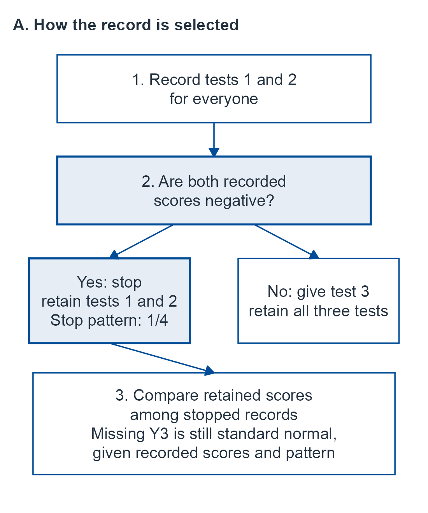
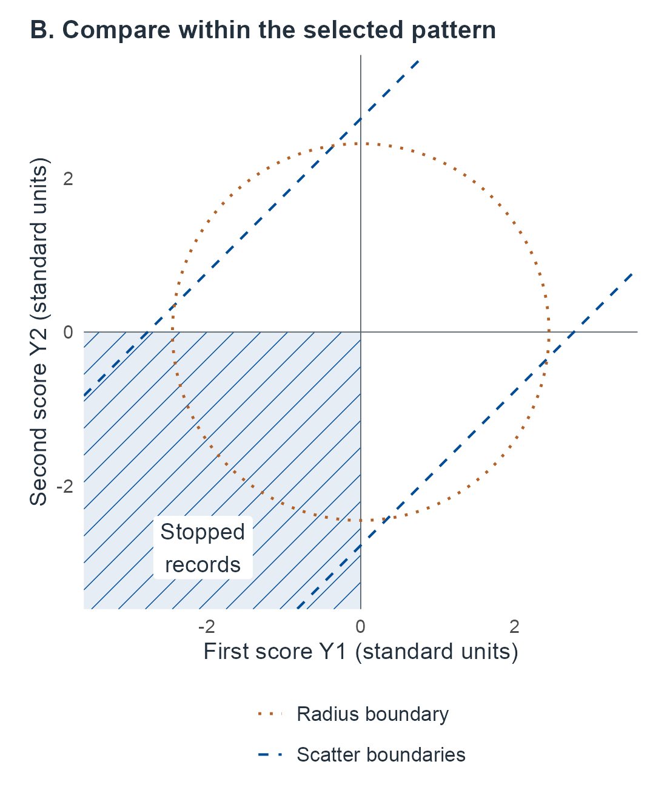
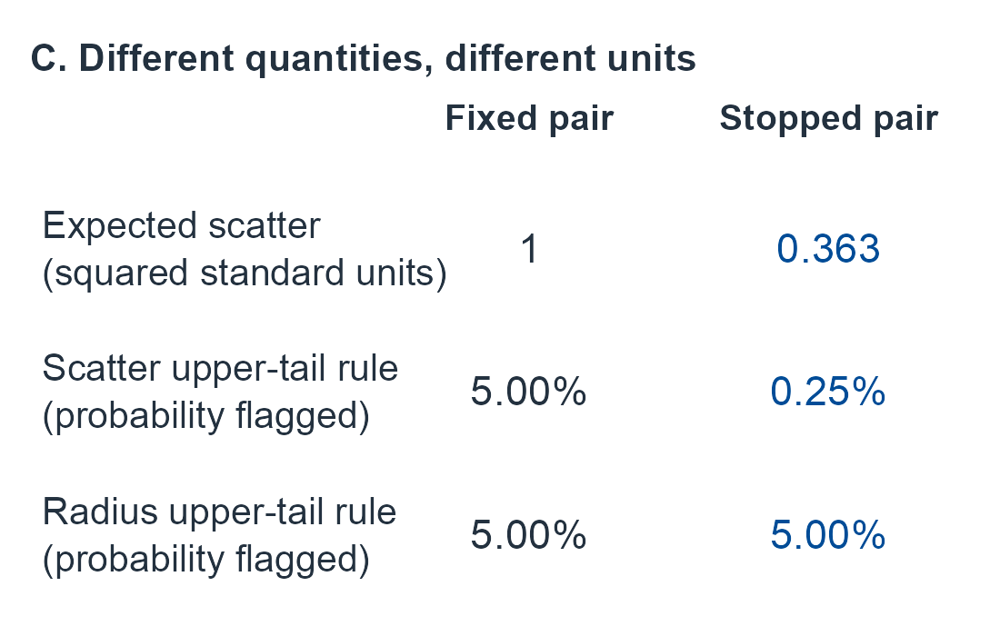

# Administration and missingness {#sec-administration}

```{=html}
<style>
.m09-page #quarto-content > *, .m09-page main.content { min-width: 0; }
.m09-scroll { max-width: 100%; min-width: 0; overflow-x: auto; }
.m09-scroll .math.display { overflow: visible; }
.m09-scroll mjx-container[display="true"] { max-width: none; width: max-content; min-width: 100%; overflow: visible; }
.m09-scroll:focus-visible, .m09-page .math.inline:focus-visible { outline: 3px solid var(--book-focus); outline-offset: 3px; }
.m09-page .math.inline { display: inline-block; max-width: 100%; overflow-x: auto; overflow-y: hidden; padding-block: .15em; vertical-align: middle; }
.m09-figure-panels { display: grid; gap: .6rem; }
.m09-reference-panels { grid-template-columns: repeat(2, minmax(0, 1fr)); }
.m09-reference-panels > :last-child { grid-column: 1 / -1; max-width: 30rem; width: 100%; margin-inline: auto; }
@container (max-width: 36rem) { .m09-reference-panels { grid-template-columns: 1fr; max-width: 26rem; margin-inline: auto; } }
@container (max-width: 32rem) { .m09-calibration-panels { grid-template-columns: 1fr; max-width: 26rem; margin-inline: auto; } }
.m09-figure-panels p { margin: 0; }
.m09-figure-panels img { width: 100%; height: auto; }
</style>

<script>
document.body.classList.add('m09-page');
(function () {
  function nameOverflow() {
    document.querySelectorAll('main .math.inline').forEach(function (element) {
      if (element.scrollWidth > element.clientWidth + 2) {
        element.tabIndex = 0;
        element.setAttribute('role', 'group');
        element.setAttribute('aria-label', 'Long mathematical expression; scroll horizontally');
      } else {
        element.removeAttribute('tabindex');
        element.removeAttribute('role');
        element.removeAttribute('aria-label');
      }
    });
  }
  function start() {
    let pending = false;
    function settle() {
      if (pending) return;
      pending = true;
      requestAnimationFrame(function () { requestAnimationFrame(function () { pending = false; nameOverflow(); }); });
    }
    const sizes = window.ResizeObserver ? new ResizeObserver(settle) : null;
    function observeMath() {
      if (sizes) document.querySelectorAll('main .math.inline, main .math.inline mjx-container, main .math.inline mjx-math').forEach(function (element) { sizes.observe(element); });
      settle();
    }
    function whenMathReady() {
      if (window.MathJax && MathJax.startup && MathJax.startup.promise) MathJax.startup.promise.then(observeMath);
      else setTimeout(whenMathReady, 150);
    }
    whenMathReady();
    if (document.fonts) {
      document.fonts.ready.then(observeMath);
      document.fonts.addEventListener('loadingdone', observeMath);
    }
    document.addEventListener('keydown', function (event) {
      const element = event.target;
      if (!(element instanceof HTMLElement) || !element.matches('.m09-scroll, .math.inline[role="group"]')) return;
      if (event.altKey || event.ctrlKey || event.metaKey || event.shiftKey || element.scrollWidth <= element.clientWidth + 2) return;
      const step = Math.max(48, parseFloat(getComputedStyle(element).fontSize) * 3);
      if (event.key === 'ArrowRight' || event.key === 'ArrowLeft') {
        element.scrollLeft += event.key === 'ArrowRight' ? step : -step;
        event.preventDefault();
      } else if (event.key === 'Home' || event.key === 'End') {
        element.scrollLeft = event.key === 'Home' ? 0 : element.scrollWidth;
        event.preventDefault();
      }
    });
    window.addEventListener('resize', settle);
    window.addEventListener('scroll', settle, { passive: true });
    document.addEventListener('keydown', function (event) { if (event.key === 'Tab') nameOverflow(); }, true);
    const main = document.querySelector('main');
    if (main) new MutationObserver(settle).observe(main, { childList: true, subtree: true, attributes: true, attributeFilter: ['style', 'class'] });
    new MutationObserver(settle).observe(document.documentElement, { attributes: true, attributeFilter: ['style'] });
  }
  if (document.readyState === 'loading') document.addEventListener('DOMContentLoaded', start, { once: true });
  else start();
}());
</script>
```

This chapter develops inference from the scores and administration history actually recorded.

## What was observed, and why? {#sec-m09-question}

Consider a short synthetic protocol. Everyone receives two tests. A third test follows unless both first scores fall below the reference mean, in which case the examiner stops. Suppose the three potential scores, in standard units, are independent standard normals in the reference population. Now look only at the people who stopped after two tests, and compare their two scores with each other, as one would compare two scores from a fixed two-test battery. Before reading on, predict: will their two scores differ from each other about as much as two scores from a fixed battery do, more, or less?

They differ less. The rule admitted only pairs in which both scores were negative, so the pairs are confined to one quadrant. Their expected within-profile scatter is $1-2/\pi\approx.36$, where a fixed pair has expectation 1, and a nominal 5% scatter rule calibrated on fixed pairs flags only .25% of them. Yet the third score that was never given, conditional on the two that were, still has its ordinary standard normal distribution. Both statements hold at once. The first concerns a reference comparison for the people the rule selected; the second concerns a response the rule prevented. A test omitted after poor earlier performance is therefore not equivalent to a test omitted by random scheduling, and the record of an examination is more than a list of scores: it includes what was given, in what order, by what rule, and why it ended.

This chapter keeps those questions apart. Each unit adds one way in which an administration record can differ from a fixed battery: a declared rule that selects which scores are retained, a mechanism that must itself be estimated, an omitted response we wish to predict, an adaptive choice of the next item, a decision to stop, and a planned observation that could not be obtained. In every unit, a stopped examination contains both responses and a history, and filling an unobserved score with its conditional mean does not make the completed profile known.

To state the questions precisely we need notation for what was recorded.

Let $Y=(Y_1,\ldots,Y_p)$ be an observed-score vector that **would be defined under a specified compatible full administration**, and let $O\subseteq\{1,\ldots,p\}$ be the retained-coordinate pattern. The actual record is $(O,Y_O)$, with covariates and history added when needed. A stable complete-vector model assumes the act/order of omitting tests does not itself change their response laws; fatigue, practice or intervention may instead require a history-indexed measurement kernel. An unperformed hypothetical score is not automatically a defined outcome after death or another event that changes the target's meaning.

All probabilities refer to a declared reference or measurement population and protocol. Supplied population/measurement inputs are known until estimation is explicitly introduced. Observed-score rarity, a latent posterior, the distribution of a missing response and a clinical decision remain different targets.

Throughout, $\Phi$ is the standard normal CDF, $z_q=\Phi^{-1}(q)$ and $\chi^2_{r,q}$ is a chi-square quantile. All examples are synthetic. Known-law Gaussian/finite-response branches, exact integrals, numerical integration and Monte Carlo error statements are distinguished. The fitted examples explicitly estimate their stated population and observation inputs; no empirical clinical missing-data analysis is claimed. Complete-vector compatibility, saved history and identification assumptions are part of the target, not technical afterthoughts.

## How the chapter is organized {#sec-m09-roadmap}

The units follow the record from the moment a pattern is chosen to the moment an observation fails. The first unit begins with a known law, where the algebra is exact and the target is easiest to see; later units estimate what was supplied.

::::: {.m09-scroll role="group" tabindex="0" aria-label="M09 table 1; scroll horizontally"}

| Unit | Question | Experiment and inputs |
|---|---|---|
| [Fixed and selected subsets](#sec-m09-subsets) | Can the retained scores of a pattern be compared with a norm built for a fixed subset? | A known full-vector law and a declared selection rule; then sixty score/pattern records with the population and administration laws estimated |
| [Likelihood and ignorability](#sec-m09-likelihood) | When can inference about the response model leave the administration mechanism out? | The full observed-data likelihood; MCAR and informative MAR experiments with every parameter estimated; dependent priors, shared parameters, selected-only samples and an unsupported category |
| [Imputation](#sec-m09-imputation) | What does an omitted response imply for a nonlinear profile summary? | The conditional law of the missing scores, integrated over fitted parameters; a declared nonignorable alternative |
| [Adaptive administration](#sec-m09-adaptive) | What does a record of chosen items retain, and what does a reported total lose? | A history likelihood with policy factors; a finite model with an estimated calibration and an informative policy |
| [Stopping](#sec-m09-stopping) | Does a procedure stay calibrated when testing may stop at any time? | Stopped Bernoulli records; a mixture likelihood-ratio process; the same process with estimated calibration |
| [Noncompletion](#sec-m09-noncompletion) | What does a planned observation that was not obtained tell us? | Censored completion times; a binary outcome that is defined but unrecorded, with bounds, sensitivity priors and validation |

:::::

For a first reading, follow [fixed and selected subsets](#sec-m09-subsets), [likelihood factorization](#sec-m09-likelihood) and [conditional imputation](#sec-m09-imputation), then the [adaptive history likelihood](#sec-m09-adaptive) and [score coarsening](#prp-m09-adaptive-coarsening), the [stopped posterior](#sec-m09-stopping) and [anytime comparison](#sec-m09-anytime), and the [noncompletion distinctions](#sec-m09-noncompletion). Read each result with its conditions and proof, and return to the [closing interpretation](#sec-m09-boundaries) to connect these questions.

For fitted methods, continue through [score/pattern estimation](#sec-m09-fitted-patterns), [informative MAR](#sec-m09-informative-mar), [population averaging](#sec-m09-mar-population-targets) and [fitted imputation](#sec-m09-fitted-imputed-profile); then study the [finite adaptive model](#sec-m09-finite-adaptive-model), [full sequential model](#sec-m09-full-sequential-model) and [calibration clock](#sec-m09-calibration-clock), and [missing-outcome inference](#sec-m09-fitted-mnar) through [validation](#sec-m09-mnar-validation). Before applying a fitted method, work through its full development, including the relevant conditions, proof and sensitivity analysis. The [lookup guide](#sec-m09-guide) near the end collects each reader question with its record, target and sections.

## Synthetic examples and reused symbols {#sec-m09-examples}

Every numerical example is a synthetic teaching input chosen so that results can be checked; none is an instrument's norms, a value fitted to patients or a clinical cutoff. The units need different observation experiments, so the chapter uses several small examples. Two of them carry across units: the screening rule of the opening, and the sixty score/pattern records that later gain second scores.

::::: {.m09-scroll role="group" tabindex="0" aria-label="M09 table 2; scroll horizontally"}

| Example | Inputs | What it shows | Where |
|---|---|---|---|
| Screening rule | three independent standard-normal scores; test 3 omitted when both first scores are negative | A MAR rule that changes the law of the retained scores but not the conditional law of the omitted one | [Subsets](#sec-m09-subsets), @fig-m09-selected-history, [imputation](#sec-m09-imputation) |
| Sixty score/pattern records | first-score category $X\in\{-1,0,1\}$, 20 people each; 24 abbreviated and 36 full administrations | Selected first-score law; confidence, posterior and a new-case rank | [Fitted patterns](#sec-m09-fitted-patterns) to [new-case ranks](#sec-m09-pattern-predictive-calibration) |
| Second scores for the 36 full administrations | fitted line $50+10X$, residual variance about 4 | Informative MAR inference, population means, dependent priors, selected-only samples, a category with no responses, imputed scatter | [Informative MAR](#sec-m09-informative-mar) to [support gap](#sec-m09-mar-support-gap); [fitted profile](#sec-m09-fitted-imputed-profile) to [sensitivity](#sec-m09-imputation-mnar-sensitivity) |
| MCAR reference | four observed scores $(40,45,50,55)$ of ten scheduled | Ignoring omissions that are independent of everything | [MCAR reference](#sec-m09-mcar-reference) |
| Mean-linked recording | 20 potential responses, two recorded (45 and 47) | Indicators that inform a shared parameter | [Shared parameter](#sec-m09-mar-shared-parameter) |
| Adaptive case | three reference people with a noisy anchor; a case that fails item 0, receives item $A$ and succeeds | Joint calibration, policy and case inference; what a total discards | [Finite model](#sec-m09-finite-adaptive-model) to [confidence](#sec-m09-finite-adaptive-confidence); [sequential](#sec-m09-full-sequential-model) |
| Bernoulli sequences | nine successes in ten responses; one reference response before a sequence | Posterior, crossing and fitted-null behaviour under stopping | [Stopping](#sec-m09-stopping) to [fitted null](#sec-m09-fitted-stopping-failure) |
| Timed examinations | ten records with deadline 1; eight records with random censoring | Censored times versus completion indicators | [Fixed deadline](#sec-m09-fixed-censoring) to [random censoring](#sec-m09-random-censoring) |
| Missing binary flag | 25 scheduled people: 3 flags, 12 nonflags, 10 unrecorded; five later retrieved | Identified sets, sensitivity priors, cohort prediction, validation | [Missing outcome](#sec-m09-fitted-mnar) to [validation](#sec-m09-mnar-validation) |

:::::

The chapter needs more objects than there are convenient letters, so several letters are reused in separate units. Each is defined where it is introduced and confined to its unit; the list marks the reuses a reader moving between units is most likely to meet.

- $r$: the size of a fixed subset; the abbreviated-pattern probability $P(R=0)$ in the fitted-pattern unit; a recorded adaptive path; the recorded-outcome probability $\pi_s+\pi_f$ in the missing-outcome unit.
- $s$ and $t$: in the fitted-pattern unit, the low-score probabilities among abbreviated and full administrations; elsewhere $s$ is a sample SD, a stop probability $s_u$ or a success count, and $t$ is a step or time index.
- $q$: the continuation probability $q_j$ given a first score; an adaptive policy probability $q_t$ or $q_h$; a completion probability in the censoring unit.
- $\pi$: the joint score/pattern cell probabilities $\pi_{jr}$; a prior or posterior density $\pi(\,\cdot\,)$; the prevalence of the binary state in the adaptive model; the observed-record probabilities $\pi_s,\pi_f,\pi_m$.
- $h$: the leverage multipliers $h_x$ and $h$; the latent coordinate or case state in the adaptive units. The selection factor of the first unit is written $\bar g_o$: it is the observation mechanism averaged over the missing scores.
- $B$, $Q$, $W$: the score map $B=50+10X$, the beta function and a likelihood bound $B_h$; a quadratic form, a residual sum of squares and the prior predictive probability $Q(\,\cdot\,)$; the composition contrast and the anchor $W_i$. $E$ is always an expectation; total exposure in the censoring unit is $\mathcal E$, and the sequential likelihood-ratio process is $\Lambda_t$.
- $K$, $M$, $\Gamma$, $\eta$: a maximum test length, an anchor kernel, a missing-score kernel and a missing count $K_0$; a pattern count, a martingale $M_t$ and the moments $M_1,M_2$ (a number of Monte Carlo draws is $n_{\mathrm{MC}}$); a departure bound and the gamma function; a mean departure, a parameter vector and item parameters.

Footnotes mark the places where a kept letter could be misread.

## Independently fixed subsets versus selected patterns {#sec-m09-subsets}

Return to the screening protocol. Two different procedures could produce two-test records. In one, the subset of tests is fixed in advance, for example by a clinic schedule that never looks at the scores. In the other, a rule looks at the scores already obtained and decides which tests follow. The first procedure keeps the reference law of the retained scores; the second need not, even when the rule uses only observed scores. We begin with the fixed subset, where the answer is a standard Gaussian fact.

Supply $Y\sim N_p(\mu,\Sigma)$ with known $\Sigma\succ0$, and fix a nonempty subset $o$ of size $r$ independently of the responses. Let $\mu_o,\Sigma_{oo}$ be its mean/submatrix.

::: {#prp-m09-fixed-subset}
## A fixed subset inherits a Gaussian law

For this fixed subset,

::::: {.m09-scroll role="group" tabindex="0" aria-label="M09 equation 1; scroll horizontally"}

$$
Y_o\sim N_r(\mu_o,\Sigma_{oo}),\qquad
Q_o=(Y_o-\mu_o)^T\Sigma_{oo}^{-1}(Y_o-\mu_o)\sim\chi^2_r.
$$ {#eq-m09-fixed-quadratic}

:::::

The upper-tail rule $Q_o>\chi^2_{r,1-\alpha}$ has reference probability $\alpha$. If random $O$ is independent of the entire $Y$, this statement also holds conditional on each positive-probability pattern $O=o$ (MCAR). It need not hold if $O$ depends on scores.
:::

::: {.proof}
Coordinate selection is a full-row-rank linear map of a Gaussian vector. For nonzero $v\in\mathbb R^r$, embedding $v$ in the full coordinate space gives $v^T\Sigma_{oo}v>0$. Whiten the marginal normal vector; its independent standard-normal squared coordinates sum to $\chi^2_r$. Under independence of $O$ and $Y$, conditioning on a pattern leaves this law unchanged.
:::

With a known null law, the same kernel supplies a Bayesian predictive reference comparison; no norm-parameter posterior is needed. It supplies neither a person's latent-state posterior nor an observation-process model. A scalar lower-tail convention or a nonlinear scatter statistic needs its own distribution, even for a fixed subset.

A rule changes the experiment because it acts before the comparison. Panel A of @fig-m09-selected-history tells the screening record in order: the first two scores are observed, the rule inspects them, the pattern $O$ is recorded, and only then do we ask how unusual the retained scores are. The probability of interest is therefore evaluated among records that reached a particular pattern. The next result writes that probability for any full-data law and any observation mechanism. Its formula is a reweighting: the ordinary marginal law of the retained scores, multiplied by the probability that the mechanism produces this pattern given those scores, then renormalized.

::: {#prp-m09-selected-pattern}
## Pattern-specific observed distributions

For any full-data density/mass $f(y)$ and observation mechanism $g(o\mid y)$, define
$\bar g_o(y_o)=E_f\{g(o\mid Y)\mid Y_o=y_o\}$ and $\pi_o=P(O=o)>0$. Then

::::: {.m09-scroll role="group" tabindex="0" aria-label="M09 equation 2; scroll horizontally"}

$$
f(y_o\mid O=o)=\frac{f_o(y_o)\bar g_o(y_o)}{\pi_o}.
$$ {#eq-m09-selected-pattern}

:::::

If the mechanism for this pattern depends only on its retained values, $g(o\mid y)=g_o(y_o)$, then $\bar g_o(y_o)=g_o(y_o)$; this is the relevant patternwise missing-at-random (MAR) restriction. It leaves a selection factor in the observed-values law. The fixed marginal law is retained exactly when $\bar g_o=\pi_o$ almost surely under $f_o$.
:::

::: {.proof}
Integrate the joint density $f(y)g(o\mid y)$ over the missing coordinates. Factoring $f=f_o f_{-o\mid o}$ yields $f_o \bar g_o$; division by its integral $\pi_o$ gives the selected density. MAR permits taking $g_o(y_o)$ outside this integral, not cancelling it as a function of $y_o$. Equality with $f_o$ is equivalent to the stated constant factor almost surely.
:::

MAR is sometimes read as saying that a rule based on observed scores is harmless. The proposition shows what it does say: under MAR the weight $\bar g_o=g_o$ is a function of the retained values, so it remains in their law unless it happens to be constant. The term and its likelihood consequences are due to @rubin1976inference. @seaman2013meant distinguish MAR for the realized pattern and values from MAR for every possible pattern and value, and explain why a general repeated-sampling justification must specify the mechanism across possible patterns and values, rather than only at the realized record.

**The screening rule as a counterexample.** Let three potential test scores be independent standard normals. Administer the first two to everyone. Omit the third exactly when both first scores are negative; otherwise administer all three. This depends only on observed scores and is MAR. For the two-score pattern, whose probability is $1/4$, the weight $\bar g_o$ is the indicator that both retained scores are negative, so the retained scores are independent negative half-normals. Direct integration gives mean $-\sqrt{2/\pi}$, second moment $1$ and variance $1-2/\pi$ for each. Their unbiased within-profile scatter is $s_o^2=(Y_1-Y_2)^2/2$, so

::::: {.m09-scroll role="group" tabindex="0" aria-label="M09 equation 3; scroll horizontally"}

$$
E(s_o^2\mid O=\{1,2\})=1-2/\pi\approx .363380,
$$ {#eq-m09-mar-scatter}

:::::

whereas an independently fixed pair gives expectation $1$. The difference follows by expanding the squared difference: equal means cancel and independence gives twice their common variance. Thus the fixed-subset calibration statement fails for this pattern even though the rule is MAR. The missing third score nevertheless stays standard normal conditional on these two scores and the pattern. Correct imputation and selected-pattern calibration are different claims.

Selection does not invalidate every statistic in every example. Here $Y_1^2+Y_2^2$ still has a $\chi^2_2$ law because independent symmetric normal signs are independent of their squared magnitudes; conditioning on both signs leaves the squared distribution unchanged. That special invariance does not restore the entire Gaussian law or the scatter result. Check the actual statistic and event.

A fixed-subset norm may remain a clearly labelled comparison to externally specified peers. To claim calibration among those receiving that pattern, use the actual selected law, conditional comparison or justified independent scheduling.

If the pattern law is known and a scalar statistic has continuous strictly increasing conditional CDF $F_o$, then $F_o(S\mid O=o)$ is uniform by evaluating at its inverse quantile. With discrete atoms, inclusive lower ranks instead satisfy $P\{F_o(S)\le u\mid O=o\}\le u$ by summing the initial atoms up to $u$; randomization is an additional declared operation. An estimated observation mechanism needs uncertainty analysis and support, not a silent substitution into this known-law statement.

### What the MAR counterexample does to an actual cutoff {#sec-m09-selected-scatter-tail}

The scatter result concerns an average. A cutoff concerns a tail, so we compute the tail as well. For an independently fixed pair of standard normals, the scatter
$Q=(Y_1-Y_2)^2/2$ is $\chi^2_1$. A nominal upper $5\%$ rule therefore uses $c=\chi^2_{1,.95}\approx3.841459$. In the abbreviated MAR pattern above, its actual rejection probability is instead

::::: {.m09-scroll role="group" tabindex="0" aria-label="M09 equation 4; scroll horizontally"}

$$
P(Q>c\mid Y_1<0,Y_2<0)
=4\{\Phi(-\sqrt c)\}^2=.0025.
$$ {#eq-m09-selected-scatter-tail}

:::::

To derive this, rotate to $D=(Y_1-Y_2)/\sqrt2$ and $A=(Y_1+Y_2)/\sqrt2$, independent standard normals. Both original scores are negative exactly when $A<-|D|$, an event of probability $1/4$. The selected tail is consequently
$8\int_{\sqrt c}^{\infty}\phi(d)\Phi(-d)\,dd$.
Since the derivative of $\Phi(-d)^2$ is $-2\phi(d)\Phi(-d)$, its integral gives the displayed expression. At this cutoff $\Phi(-\sqrt c)=.025$. This is a failure of the advertised exact $5\%$ selected-pattern calibration, here in the conservative direction. It does not say selection always decreases scatter or false positives. The squared-radius rule in the preceding paragraph still has size $.05$ in this same pattern, for its separate sign-invariance reason.

Panel B of @fig-m09-selected-history draws both rules. The band of the scatter rule meets the selected quadrant only near its far corners, so few selected pairs fall outside it. The circle of the radius rule cuts the quadrant in the same proportion as the whole plane, which is the geometric form of the sign-invariance argument.

:::: {#fig-m09-selected-history .book-process-figure}

<div class="m09-figure-panels m09-reference-panels">
<div class="m09-panel"><a href="figures/m09-screening-1.png" aria-label="Open full-size M09 panel 1"></a></div>
<div class="m09-panel"><a href="figures/m09-screening-2.png" aria-label="Open full-size M09 panel 2"></a></div>
<div class="m09-panel"><a href="figures/m09-screening-3.png" aria-label="Open full-size M09 panel 3"></a></div>
</div>

The synthetic screening rule of this unit: three independent standard-normal scores, with test 3 omitted exactly when $Y_1<0$ and $Y_2<0$. **A.** The record in the order it is made. The rule inspects the first two scores before the pattern $O$ is recorded; the evaluated event, the scatter rule $Q>c$ with $c=\chi^2_{1,.95}$, is a probability among records that reached the stop box. Conditional on $Y_1,Y_2$ and $O$, the omitted $Y_3$ is still standard normal. **B.** The score plane. Hatched: the stopped records (probability 1/4). Dashed: the boundaries of the scatter rule, which flags points outside the band; its probability is .05 for a fixed pair but .0025 among stopped records. Dotted: the circle of the squared-radius rule $Y_1^2+Y_2^2>\chi^2_{2,.95}$, whose probability is .05 in both cases. Expected scatter is 1 for a fixed pair and $1-2/\pi\approx.363$ among stopped records. All values are exact calculations; nothing is simulated. Panel C separates the expected scatter from the two flag probabilities, reporting the probabilities as percentages.

::::

### Learning the score distribution and administration mechanism {#sec-m09-fitted-patterns}

The screening counterexample supplied the full law. In practice neither the score distribution nor the way administration depends on it is known; both are learned from records. The next four subsections work one small example completely. Their conclusions can be stated now. A confidence statement for the selected score distribution must keep the random number of abbreviated records. A posterior must update the population composition and the administration mechanism from the same records. A reference rank for a new person is calibrated when it is computed as a rank, not when an estimated CDF is inserted into the known-law argument.

A population pattern law is not a fitted one. Consider an explicit finite experiment that estimates both the score distribution and how administration depends on it. Every person first receives the same scored task, giving $X\in\{-1,0,1\}$ in increasing score order. The subsequent recorded indicator is $R=0$ for abbreviated administration and $R=1$ for full administration. For this question the retained record is $(X,R)$; later test responses, if obtained, are not used in this reduced likelihood. The first task precedes this decision and has the same protocol for everyone. This experiment concerns the first score's reference distribution among different administration patterns; it does not infer an unperformed later response or a latent ability.

Observe $N$ independent people and retain the full score/pattern counts $N_{jr}$, $j\in\{-1,0,1\}$, $r\in\{0,1\}$. Let

::::: {.m09-scroll role="group" tabindex="0" aria-label="M09 equation 5; scroll horizontally"}

$$
\begin{aligned}
\pi_{jr}&=P(X=j,R=r),\\
w_j&=\pi_{j0}+\pi_{j1},\\
q_j&=\frac{\pi_{j1}}{w_j}\quad(w_j>0).
\end{aligned}
$$ {#eq-m09-fitted-pattern-parameters}

:::::

All six cell probabilities, equivalently the population probabilities $w_j$ and continuation probabilities $q_j$, are unknown. The observed likelihood is multinomial, proportional to $\prod_{j,r}\pi_{jr}^{N_{jr}}$. Each parameter choice is realized by drawing $X$ with probabilities $w$ and then drawing $R\mid X=j$ with probability $q_j$ of full administration. The complete joint law thus identifies $w$ and every $q_j$ on positive-probability score categories. At $w_j=0$, that conditional administration probability is undefined or irrelevant and cannot be learned from this population. These are whole-law statements, not estimates supplied as true inputs.

At the prespecified low-score threshold $X\le-1$, define^[Here $r$ is the probability of abbreviated administration. As a subscript, in $\pi_{jr}$ and $R=r$, it indexes the pattern; the subsets unit uses $r$ for the size of a fixed subset, and the missing-outcome unit uses it for the probability that an outcome is recorded.]

::::: {.m09-scroll role="group" tabindex="0" aria-label="M09 equation 6; scroll horizontally"}

$$
\begin{aligned}
r&=P(R=0)=\sum_j\pi_{j0},\\
s&=P(X=-1\mid R=0)=\pi_{-1,0}/r,\\
u&=P(X=-1)=\pi_{-1,0}+\pi_{-1,1},\\
\delta_F&=s-u .
\end{aligned}
$$ {#eq-m09-pattern-comparison-targets}

:::::

The selected target $s$ requires $r>0$. If $r=0$ structurally, there is no abbreviated-pattern population to normalize; reporting its conditional CDF as zero would invent a target. A finite sample with no abbreviated records does not establish $r=0$. Positive $r$ with some zero cells remains meaningful and is allowed in the frequentist procedures below. The target $u$ describes an independently sampled person's first score; $s$ describes first scores conditional on abbreviated administration. Neither is a probability that a patient's response is valid or that a disease is present.

The complete constructed observations are:

::::: {.m09-scroll role="group" tabindex="0" aria-label="M09 table 3; scroll horizontally"}

| First score $X$ | Abbreviated $R=0$ | Full $R=1$ | All people |
|---:|---:|---:|---:|
| $-1$ | 16 | 4 | 20 |
| $0$ | 6 | 14 | 20 |
| $1$ | 2 | 18 | 20 |
| Total | 24 | 36 | 60 |

: Full retained score/pattern counts from sixty independent constructed records. {#tbl-m09-score-pattern-records}

:::::

The maximum-likelihood estimates are $\widehat w=(1/3,1/3,1/3)$ and $\widehat q=(.2,.7,.9)$, obtained from the actual row totals and full-administration counts. The estimated abbreviated first-score law is $(2/3,1/4,1/12)$. Thus $\widehat s=2/3$, $\widehat u=1/3$ and $\widehat\delta_F=1/3$. This difference is estimated selection of an observed score distribution, not an effect of administering the later tests on the earlier score. It provides no missing-response model for those later tests.

### Finite confidence retains the random pattern counts {#sec-m09-pattern-confidence}

Write $M=\sum_jN_{j0}$. Conditional on $M=m$, the abbreviated scores are independent draws from their conditional categorical law. This follows by factoring the multinomial probabilities into the binomial law of $M$ and the two within-pattern multinomial laws. In particular,

::::: {.m09-scroll role="group" tabindex="0" aria-label="M09 equation 7; scroll horizontally"}

$$
N_{-1,0}\mid M=m\sim\operatorname{Bin}(m,s),\qquad
N_{-1,0}+N_{-1,1}\sim\operatorname{Bin}(N,u).
$$ {#eq-m09-pattern-binomial-reductions}

:::::

The second law is unconditional on the pattern count. The two counts overlap; their confidence intervals are not independent.

Here is the exact interval convention used for these binomial reductions; it is the equal-tailed interval of @clopper1934binomial. At error $\beta\in(0,1)$, for count $k$ from $\operatorname{Bin}(n,p)$, set $L=0$ if $k=0$; otherwise solve $P_L(K\ge k)=\beta/2$. Set $U=1$ if $k=n$; otherwise solve $P_U(K\le k)=\beta/2$. The nonconstant binomial tails are continuous and strictly monotone in $p$, giving unique roots. The inclusive tail evaluated at its own draw is superuniform: the most extreme count block whose tail probability is at most $x$ has total probability at most $x$. Thus each endpoint can miss the true $p$ on its side with probability at most $\beta/2$, proving coverage at least $1-\beta$, including $p=0,1$. At $n=0$ use $[0,1]$.

This gives a confidence interval for $s$ conditional on each $m>0$; the $m=0$ convention preserves its at-least-$1-\beta$ guarantee after averaging over the random $M$. An interval for $u$ uses all $N$ first scores. To compare them, use error $\beta=\alpha/2$ for **each** interval. If their endpoints are $[L_s,U_s]$ and $[L_u,U_u]$, then

::::: {.m09-scroll role="group" tabindex="0" aria-label="M09 equation 8; scroll horizontally"}

$$
\delta_F\in[L_s-U_u,\ U_s-L_u]
$$ {#eq-m09-pattern-difference-confidence}

:::::

with probability at least $1-\alpha$ over the entire $N$-person experiment. The union bound requires no independence. This is not claimed to retain that same conditional guarantee for every realized $M$, because the interval for $u$ used its unconditional binomial experiment.

For these data the separate $95\%$ intervals are approximately $s\in[.446780,.843698]$ and $u\in[.216869,.466873]$. For the simultaneous comparison at $\alpha=.05$, the two $97.5\%$ intervals are $[.418731,.861642]$ and $[.202935,.485133]$, giving
$\delta_F\in[-.066402,.658707]$.
The difference enclosure is conservative; no exact $.95$ attained coverage or sharp joint-region image is asserted.

The same construction can cover the entire abbreviated CDF on this three-point support. There are only two nonconstant thresholds: $-1$ and $0$. Conditional on $M$, their cumulative counts are binomial, with dependent sampling errors. Use coordinate error $\alpha/2$ for each, and the same $[0,1]$ convention at $M=0$. The union bound gives a whole-CDF confidence band at least $1-\alpha$, with exact known values 0 below $-1$ and 1 at or above $1$. At $\alpha=.05$, its intervals at the two nonconstant thresholds are $[.418731,.861642]$ and $[.702003,.992913]$. This band estimates a population CDF; it is not a sampling distribution obtained by treating fitted cell probabilities as known.

### A full proper posterior for the same count experiment {#sec-m09-pattern-posterior}

Choose the full joint prior
$\pi\sim\operatorname{Dirichlet}(\alpha_{jr})$, all six shapes positive. Its density on five free simplex coordinates is

::::: {.m09-scroll role="group" tabindex="0" aria-label="M09 equation 9; scroll horizontally"}

$$
\frac{\Gamma(\alpha_+)}{\prod_{j,r}\Gamma(\alpha_{jr})}
\prod_{j,r}\pi_{jr}^{\alpha_{jr}-1},
\qquad \alpha_+=\sum_{j,r}\alpha_{jr}.
$$ {#eq-m09-pattern-dirichlet-prior}

:::::

For a normalization proof, take six independent gamma variables with these shapes and unit rate, and transform them to their positive sum $T$ and the five free proportions. The Jacobian is $T^5$; the product density separates into a gamma density for $T$ with shape $\alpha_+$ (the sum of the six prior shapes) and the displayed simplex factor. Integrating the normalized gamma factors gives the finite Dirichlet normalizer. The multinomial likelihood adds the actual cell counts, so

::::: {.m09-scroll role="group" tabindex="0" aria-label="M09 equation 10; scroll horizontally"}

$$
\pi\mid\mathcal R\sim\operatorname{Dirichlet}(A_{jr}),
\qquad A_{jr}=\alpha_{jr}+N_{jr}>0.
$$ {#eq-m09-pattern-dirichlet-posterior}

:::::

This proves propriety for every finite record, including empty cells or an entirely absent pattern. Posterior regularization of an unobserved pattern comes from its prior; it does not manufacture observations. All the probability targets here are bounded, so every polynomial posterior moment exists.

Grouping the independent gamma construction by first score also shows what this prior says about the original population/mechanism coordinates: $w\sim\operatorname{Dirichlet}(\alpha_{j0}+\alpha_{j1})$ and the three $q_j\sim\operatorname{Beta}(\alpha_{j1},\alpha_{j0})$ are mutually independent and independent of $w$. The transformation to the joint cells has Jacobian $\prod_jw_j$ on the interior, giving the same factorization. The posterior has the identical grouping with the updated shapes $A$. Thus the analysis estimates population composition and the administration mechanism, rather than substituting either as a known input.

Read the next calculation as a sequence: update the joint score/pattern cells, regroup them into the abbreviated-pattern probability and the low-score probabilities within each pattern, then form the unconditional low probability and the selected-minus-unconditional contrast from those same grouped values. The grouped variables are independent under this posterior; the derived targets need not be. The covariance and contrast CDF below retain that dependence. Later, [population averaging](#sec-m09-mar-population-targets) uses the composition uncertainty that a known-category prediction can leave out.

For an especially useful posterior grouping, put $A_r=\sum_jA_{jr}$, and define $t=P(X=-1\mid R=1)$. When both pattern masses are positive, the same gamma decomposition gives **independent** posterior variables

::::: {.m09-scroll role="group" tabindex="0" aria-label="M09 equation 11; scroll horizontally"}

$$
\begin{aligned}
r&\sim\operatorname{Beta}(A_0,A_1),\\
s&\sim\operatorname{Beta}(A_{-1,0},A_0-A_{-1,0}),\\
t&\sim\operatorname{Beta}(A_{-1,1},A_1-A_{-1,1}),\\
u&=rs+(1-r)t,\qquad
\delta_F=(1-r)(s-t).
\end{aligned}
$$ {#eq-m09-pattern-posterior-grouping}

:::::

Here $A_0,A_1$ are the updated pattern shape totals, rather than the observed pattern counts. The beta factors are proper because each remaining two-category shape sum is positive. They follow by grouping independent gamma sums: a group sum is independent of its normalized proportions, and the two groups are independent before normalization. The unconditional low probability also has the direct marginal
$u\sim\operatorname{Beta}(A_{-1,0}+A_{-1,1},\sum_{j,r}A_{jr}-A_{-1,0}-A_{-1,1})$.

Although the grouping variables are independent, $s$ and $u$ are dependent. Their actual covariance is

::::: {.m09-scroll role="group" tabindex="0" aria-label="M09 equation 12; scroll horizontally"}

$$
\operatorname{Cov}(s,u\mid\mathcal R)
=E(r\mid\mathcal R)\operatorname{Var}(s\mid\mathcal R).
$$ {#eq-m09-pattern-shared-covariance}

:::::

Expand $u=rs+(1-r)t$ and use the proved independence to obtain this identity. Consequently the difference variance subtracts twice this covariance; combining independent marginal draws for $s$ and $u$ would change its distribution.

An exact CDF representation retaining all this uncertainty is

::::: {.m09-scroll role="group" tabindex="0" aria-label="M09 equation 13; scroll horizontally"}

$$
P(\delta_F\le d\mid\mathcal R)
=E_{r,t}\!\left[
 F_s\!\left(t+\frac{d}{1-r}\right)
\right],
$$ {#eq-m09-pattern-difference-cdf}

:::::

with beta CDF extended by 0 and 1 outside its support. Since $0<r<1$ almost surely under this proper posterior, division is defined. Means and second moments can instead be evaluated algebraically:

::::: {.m09-scroll role="group" tabindex="0" aria-label="M09 equation 14; scroll horizontally"}

$$
\begin{aligned}
E(\delta_F)&=E(1-r)\{E(s)-E(t)\},\\
E(\delta_F^2)&=E\{(1-r)^2\}
 \left[\operatorname{Var}(s)+\operatorname{Var}(t)
       +\{E(s)-E(t)\}^2\right].
\end{aligned}
$$ {#eq-m09-pattern-difference-moments}

:::::

All expectations here condition on the same retained data. Beta moments follow by integrating its normalized density: for $B\sim\operatorname{Beta}(a,b)$ and $k\ge0$,
$E(B^k)=B(a+k,b)/B(a,b)$, giving mean $a/(a+b)$ and variance $ab/\{(a+b)^2(a+b+1)\}$. These formulas prove the displayed variance and covariance calculations without assuming a Gaussian posterior.

For the baseline prior take all six $\alpha_{jr}=1$, specified before these constructed observations. The posterior shape rows, in abbreviated/full order, are $(17,5),(7,15),(3,19)$. The fitted continuation probabilities have posterior summaries:

::::: {.m09-scroll role="group" tabindex="0" aria-label="M09 table 4; scroll horizontally"}

| First score | Posterior mean of $q_j$ | Central $95\%$ interval |
|---:|---:|---|
| $-1$ | $.227273$ | $[.082176,.419066]$ |
| $0$ | $.681818$ | $[.478249,.854123]$ |
| $1$ | $.863636$ | $[.696226,.969511]$ |

: Actual administration-parameter uncertainty, with all population probabilities also unknown. {#tbl-m09-pattern-mechanism-posterior}

:::::

The selected low probability has posterior Beta$(17,10)$, mean $.629630$ and central $95\%$ interval $[.443328,.797740]$. The unconditional probability has posterior Beta$(22,44)$, mean $1/3$ and interval $[.225685,.450550]$. The full difference posterior has mean $.296296$, variance $.00483101$, central $95\%$ interval $[.161974,.433938]$ and $P(\delta_F>0\mid\mathcal R)\approx.999994$. Its variance uses covariance $.00340709$ between $s$ and $u$; falsely independent marginal draws would instead give variance $.01164518$. Neither posterior interval is the finite-confidence enclosure above, whose fixed-parameter guarantee applies under its own conditioning.

::::: {.m09-scroll role="group" tabindex="0" aria-label="M09 table 5; scroll horizontally"}

| Proper joint-cell prior | Mean $s$ | Mean $u$ | Mean $\delta_F$ | Central $95\%$ interval for $\delta_F$ |
|---|---:|---:|---:|---|
| All shapes 1 | $.629630$ | $.333333$ | $.296296$ | $[.161974,.433938]$ |
| All shapes 4 | $.555556$ | $.333333$ | $.222222$ | $[.107166,.341212]$ |
| Shape 8 at $(X=1,R=0)$, all other shapes 1 | $.500000$ | $.301370$ | $.198630$ | $[.088970,.315331]$ |

: Full posterior sensitivity to explicitly different proper priors; the last row changes the joint population/administration prior, not just a final contrast variance. {#tbl-m09-pattern-prior-sensitivity}

:::::

The same likelihood updates all six cells in each row. The symmetric stronger prior concentrates around equal joint cell probabilities; it does not impose independence of administration and first score. The last prior favors high first scores in the abbreviated group. These are illustrative prior assumptions, not clinical validation or estimated hyperparameters. The difference CDF is numerically integrated over two independent beta variables and checked using the alternative product $(1-r)(s-t)$, direct beta moments and full six-gamma posterior draws. Increasing quadrature orders from 40 to 120 changed the reported endpoints by less than $7\times10^{-14}$; a differently ordered adaptive integral reproduced the CDFs at the nine quantiles within $2\times10^{-13}$. These observed discrepancies are not certified total error bounds or proofs of the model assumptions.

For a new independent person with abbreviated administration, the baseline posterior predictive probability of a low first score is $.629630$. In this Dirichlet model it equals $E(s\mid\mathcal R)$: $s$ is posterior-independent of $r$, so conditioning on the future pattern reweights $r$ without changing $s$. In a more general dependent prior/model, $E(rs)/E(r)-E(s)=\operatorname{Cov}(r,s)/E(r)$ need not vanish. For example, in a different model with equal posterior masses at $(r,s)=(.1,.9)$ and $(.9,.1)$, the posterior mean of $s$ is $.5$ but the future selected low probability is $.18$. 
This predictive event probability is also different from $P(s>1/2\mid\mathcal R)\approx.915681$, a posterior statement about the unknown population probability. The predictive low-indicator variance is $.23319616$, decomposing into $.22486772$ mean conditional Bernoulli variance plus $.00832843$ parameter variance. A larger numerical posterior sample reduces none of these substantive uncertainties.

### A fitted CDF is not automatically a calibrated new-case rank {#sec-m09-pattern-predictive-calibration}

Even after selecting the appropriate comparison population, inserting its empirical CDF into the known-law rank argument changes the procedure. Suppose $m$ independent abbreviated reference scores and a new abbreviated score have conditional probabilities $(.15,.35,.50)$ on $(-1,0,1)$. Use the lower-tail rule $\widehat F_m(X_{\mathrm{new}})\le.05$. At $m=5$, a nonzero empirical CDF is at least $.2$, so rejection means no reference score was at or below the new score. Its exact null probability is

::::: {.m09-scroll role="group" tabindex="0" aria-label="M09 equation 15; scroll horizontally"}

$$
.15(.85)^5+.35(.50)^5=.077493296875.
$$ {#eq-m09-pattern-plugin-error}

:::::

The highest category cannot satisfy that event. This is a finite-sample error of the fitted procedure, despite correct exchangeability within the selected pattern. In a full $N=12$-person reference experiment with independent abbreviated probability $.4$, report no rejection at $M=0$. Averaging the corresponding binomial-count probabilities over $M\sim\operatorname{Bin}(12,.4)$ gives actual size about $.09435147$. This calculation includes the random administration counts; it does not condition on an estimate and call it true.

One valid alternative for the same new selected score is the inclusive reference rank

::::: {.m09-scroll role="group" tabindex="0" aria-label="M09 equation 16; scroll horizontally"}

$$
p_{\mathrm{rank}}
=\frac{1+\sum_{i:R_i=0}\mathbf1(X_i\le X_{\mathrm{new}})}{M+1}.
$$ {#eq-m09-pattern-predictive-rank}

:::::

Conditional on $M=m$ and the future pattern $R_{\mathrm{new}}=0$, all $m+1$ scores are exchangeable. Conditional further on their unordered multiset, each position is equally likely to be the new person. The inclusive rank at a tied block is its upper cumulative count divided by $m+1$. Blocks whose value is at most $\alpha$ contain at most $\alpha(m+1)$ positions. Hence
$P(p_{\mathrm{rank}}\le\alpha\mid M=m,R_{\mathrm{new}}=0)\le\alpha$,
and averaging over $M$ preserves the guarantee. At $M=0$ this value is 1. No continuous-score or randomized-tie assumption is needed. The same exchangeability argument underlies conformal prediction [@lei2018conformal]. Small samples and ties can make it very conservative: at $m=5$ or at any $M\le12$ it cannot reject at $.05$. For the actual sixty-reference example and a new abbreviated score $-1$, it is $17/25=.68$.

This rank compares the new score to independent people from the same abbreviated population. It is not a confidence interval for its unknown CDF, the model-based posterior predictive probability, or a probability of disease. A policy selected using the new person's outcome, shared reference/new-person dependence, learned score thresholds or changed task protocols require their actual procedure to be analysed. Repeated comparisons also need their joint/stopping calibration. More observations can sharpen an identified selected distribution; they do not decide which population or measurement target is clinically relevant.


## Observed-data likelihood and ignorability {#sec-m09-likelihood}

The first unit asked whether the retained scores of a pattern can be compared with a fixed-subset reference. A different question is whether inference about the response model itself can leave the administration mechanism out. Under MAR and distinct parameters, likelihood inference can; Bayesian inference also needs the stated prior and evidence conditions before the mechanism factor cancels [@rubin1976inference]. The result is narrower than it is often taken to be. It is not a frequentist guarantee for a selected subset, it does not cover a dataset recruited from one pattern, it fails with a dependent prior or a shared parameter, and it does not identify a response mean in a category where no response is ever recorded. The subsections take these limits one at a time, each in an experiment in which every parameter is estimated. @little2019statistical give a book-length treatment of these conditions and of the methods built on them.

Let $f_\theta(y)$ model a compatible complete response vector and $g_\psi(o\mid y)$ the observation mechanism. The full record includes the pattern and its observed values; it is not a retrospective sample restricted to one pattern unless specified. For independent persons, integrate each missing block rather than treating missing values as zero.

::: {#prp-m09-mar-factorization}
## What MAR and parameter distinctness actually remove

For a recorded $(o,y_o)$ the joint observed-data likelihood is

::::: {.m09-scroll role="group" tabindex="0" aria-label="M09 equation 17; scroll horizontally"}

$$
L(\theta,\psi;o,y_o)=\int f_\theta(y_o,y_{-o})g_\psi(o\mid y_o,y_{-o})\,dy_{-o}.
$$ {#eq-m09-observed-likelihood}

:::::

Assume common support and MAR: for every relevant completion, $g_\psi(o\mid y)=g_{\psi,o}(y_o)$. Then

::::: {.m09-scroll role="group" tabindex="0" aria-label="M09 equation 18; scroll horizontally"}

$$
L=f_{\theta,o}(y_o)g_{\psi,o}(y_o).
$$ {#eq-m09-mar-factorization}

:::::

With variation-independent parameter domain $\Theta\times\Psi$, the relative likelihood/profiling for $\theta$ can omit the mechanism factor. With independent proper priors $\pi_\theta\pi_\psi$ and finite positive marginal evidences, its posterior is proportional to $f_{\theta,o}(y_o)\pi_\theta(\theta)$. For multiple independent records, replace each factor by its product. A dependent prior or shared parameter restrictions can prevent this separation.

At fixed $\theta,\psi$, the missing-data conditional density under MAR is $f_\theta(y_{-o}\mid y_o)$ wherever the recorded pattern has positive conditional probability. This conditional imputation statement does not make $Y_o\mid O=o$ equal to its unconditional marginal.
:::

::: {.proof}
MAR makes the mechanism constant as a function of the integration variables, yielding the factorization. On a Cartesian parameter domain, maximizing or taking likelihood ratios in $\theta$ leaves the same nuisance factor for every $\theta$. Multiplying by product priors and integrating $\psi$ leaves a factor independent of $\theta$, which cancels in posterior normalization under the stated evidence conditions. The missing-data conditional law divides $f_\theta(y)g_{\psi,o}(y_o)$ by $f_{\theta,o}(y_o)g_{\psi,o}(y_o)$; cancellation is valid at a positive recorded probability. Conditioning on the pattern alone instead integrates over $y_o$ and retains its selection weight, as the preceding unit proved.
:::

This is likelihood/posterior ignorability under stated assumptions, not a universal frequentist coverage theorem [@rubin1976inference; @seaman2013meant]. If the dataset contains only people selected into pattern $o$, its conditional sampling density is proportional to $f_{\theta,o}(y_o)g_{\psi,o}(y_o)/P_{\theta,\psi}(O=o)$. The denominator can depend on $\theta$, even with distinct parameter spaces. Recruitment, inclusion counts and patterns therefore belong in the experiment. A mechanism depending on unobserved values is nonignorable for these calculations unless an additional argument supplies a different valid reduction.

### A finite reference experiment where ignoring omissions is justified {#sec-m09-mcar-reference}

::: {#prp-m09-mcar-mean}
## MCAR normal mean inference with a random observed count

Schedule $N$ independent reference persons with $Y_i\sim N(\mu,v)$, $v>0$. Let indicators $R_i$ of observation be jointly independent of the entire score vector, with their law carrying parameters distinct from $(\mu,v)$. Condition on the realized indicators and observed count $m\ge2$, with positive sample variance $s^2$ and observed mean $\bar y$. Then

::::: {.m09-scroll role="group" tabindex="0" aria-label="M09 equation 19; scroll horizontally"}

$$
\bar y\ \pm\ t_{m-1,1-\alpha/2}\frac{s}{\sqrt m}
$$ {#eq-m09-mcar-confidence}

:::::

has exact $1-\alpha$ coverage for fixed $\mu,v$ in this indicator-conditional experiment. The reference measure $p(\mu,v)\propto1/v$ relative to $d\mu\,dv$ gives a proper posterior $\mu\mid y,R\sim t_{m-1}(\bar y,s/\sqrt m)$.

Alternatively choose proper $v\sim\operatorname{IG}(a_0,d_0)$ and $\mu\mid v\sim N(b_0,v/\kappa_0)$, $a_0,d_0,\kappa_0>0$. Set

::::: {.m09-scroll role="group" tabindex="0" aria-label="M09 equation 20; scroll horizontally"}

$$
\begin{aligned}
\kappa_m&=\kappa_0+m,&b_m&=(\kappa_0b_0+m\bar y)/\kappa_m,\\
a_m&=a_0+m/2,&d_m&=d_0+\tfrac12\{(m-1)s^2+\kappa_0m(\bar y-b_0)^2/\kappa_m\}.
\end{aligned}
$$ {#eq-m09-mcar-update}

:::::

Then $v\mid y,R\sim\operatorname{IG}(a_m,d_m)$, $\mu\mid v,y,R\sim N(b_m,v/\kappa_m)$, and the marginal mean posterior is $t_{2a_m}(b_m,\sqrt{d_m/(a_m\kappa_m)})$. Independent prior information about the MCAR mechanism factors out. Proper-prior intervals need not match the reference-measure confidence endpoints.
:::

::: {.proof}
Independence of indicators leaves every retained score an independent draw from the original normal law, conditional on their identities. The sample mean has variance $v/m$ independently of $(m-1)s^2/v\sim\chi^2_{m-1}$, giving the Student pivot. Completing the normal likelihood under the reference measure gives $v\mid y\sim\operatorname{IG}((m-1)/2,(m-1)s^2/2)$ and conditional mean $N(\bar y,v/m)$; positivity establishes propriety and mixing yields the matched Student marginal. For the proper prior, completing the mean square gives the displayed update, with positive rate at least $d_0$ and positive shape. Mixing its conditional normal over inverse-gamma variance gives the stated Student scale.
:::

Here $t_\nu(b,s)$ denotes location $b$ and scale $s$, not generally SD; $t_{\nu,q}$ is a standard Student quantile. The inverse-gamma density is $d^av^{-a-1}e^{-d/v}/\Gamma(a)$ relative to $dv$. Throughout, $0<\alpha<1$ and normal quantiles use $z_q=\Phi^{-1}(q)$.

**Synthetic MCAR reference.** Of ten scheduled people, suppose four observed scores are $(40,45,50,55)$. They have $\bar y=47.5$ and $s^2=125/3$. Predetermined teaching priors $b_0=50,\kappa_0=1,a_0=3,d_0=25$ give $b_m=48$, $\kappa_m=5,a_m=5,d_m=90$. The reference-measure $95\%$ mean interval is approximately $[37.2287,57.7713]$, while the proper-prior central interval is $[43.7724,52.2276]$. This is uncertainty about a population mean, not a prediction for an omitted person's score. If $m<2$, the reference-measure result is unavailable; a proper prior can still define inference, but it cannot create absent reference precision. Complete-case inference under arbitrary MAR is not justified by this MCAR proof.

### An informative MAR experiment with all parameters estimated {#sec-m09-informative-mar}

MAR need not mean random scheduling independent of the scores. Enrich the preceding sixty-person experiment by retaining a second score $Y_i$ only when $R_i=1$. The first score category $X_i\in\{-1,0,1\}$ and administration indicator are retained for **everyone**. For comparisons in score points, define the fixed scoring map $B_i=50+10X_i$;^[With two arguments, as in $B(a,b)$, $B$ is the beta function.] this map is supplied, not fitted from these records. The second score is a meaningful response under the declared full protocol even for a person whose recorded examination omits it. This model would be inappropriate for an outcome that is undefined after noncompletion.

Assume independent people with unknown population/administration probabilities $\pi_{jr}$ as above, and the conditional response model

::::: {.m09-scroll role="group" tabindex="0" aria-label="M09 equation 21; scroll horizontally"}

$$
\begin{aligned}
Y_i\mid X_i=j,\pi,\beta,v&\sim N(\beta_0+\beta_1j,v),
\qquad v>0,\\
Y_i&\perp R_i\mid X_i,\pi,\beta,v .
\end{aligned}
$$ {#eq-m09-mar-response-model}

:::::

The coefficients $\beta=(\beta_0,\beta_1)^T$, residual variance $v$, population composition and continuation mechanism are all unknown. The first score is an **observed predictor**, not an error-free latent ability. The normal response model is conditional on that observed category; the two scores are not asserted to have a jointly Gaussian distribution. The homoscedastic linear relationship and its transport to omitted responses are assumptions. The recorded pattern counts alone cannot verify that responses with $R=0$ obey it.

For the complete retained record $\mathcal D$, the joint likelihood is

::::: {.m09-scroll role="group" tabindex="0" aria-label="M09 equation 22; scroll horizontally"}

$$
L(\pi,\beta,v;\mathcal D)
\ \propto\
\left\{\prod_{j,r}\pi_{jr}^{N_{jr}}\right\}
\prod_{i:R_i=1}\varphi(Y_i;\beta_0+\beta_1X_i,v).
$$ {#eq-m09-informative-mar-likelihood}

:::::

Here $\varphi(\,\cdot\,;m,v)$ is a normal density with variance $v$. For an omitted response its normal density integrates to one; its first score and pattern still contribute their cell probability. No absent response is filled in to fit the model. In population/mechanism coordinates, $\pi_{j1}=w_jq_j$ and $\pi_{j0}=w_j(1-q_j)$. The response parameter domain and the observation domain are Cartesian. This is the preceding MAR factorization applied to an actual informative design, rather than an MCAR proof applied by name.

Let $m=\sum_iR_i$, let $Z$ have rows $(1,X_i)$ for the observed second scores, and let $y$ collect those $m$ responses. Conditional on all first scores and indicators, the response errors are independent $N(0,v)$. If $Z$ has column rank 2 and $m>2$, put

::::: {.m09-scroll role="group" tabindex="0" aria-label="M09 equation 23; scroll horizontally"}

$$
\begin{aligned}
V_f&=(Z^TZ)^{-1},&
\widehat\beta&=V_fZ^Ty,\\
Q&=\|y-Z\widehat\beta\|^2,&
\nu&=m-2,\qquad s_Y^2=Q/\nu .
\end{aligned}
$$ {#eq-m09-informative-mar-fit}

:::::

For a prespecified category $x$ and $f_x=(1,x)^T$, write $h_x=f_x^TV_ff_x$. The exact confidence and prediction constructions differ:

::::: {.m09-scroll role="group" tabindex="0" aria-label="M09 equation 24; scroll horizontally"}

$$
\begin{aligned}
\mu_x=f_x^T\beta:\quad
&f_x^T\widehat\beta\ \pm\
 t_{\nu,1-\alpha/2}s_Y\sqrt{h_x},\\
Y_{\mathrm{miss}}\text{ at }X=x:\quad
&f_x^T\widehat\beta\ \pm\
 t_{\nu,1-\alpha/2}s_Y\sqrt{1+h_x}.
\end{aligned}
$$ {#eq-m09-informative-mar-confidence-prediction}

:::::

To prove these claims, project the normal error vector onto the column space of $Z$ and its orthogonal complement. The first projection gives a normal coefficient error with covariance $vV_f$; the second gives $Q/v\sim\chi^2_\nu$, independently. A mean contrast therefore has variance $vh_x$. An omitted person's response error is independent of all observed response errors at this conditional design, adding $v$ for prediction. Dividing either centered normal by the square root of its independent residual chi-square proves the two Student laws. Selection of a target person using only recorded $X,R$, for example the first omitted person with $X=-1$, preserves this conditional argument; selection using an unrecorded response would not.

These guarantees condition on the first scores and administration indicators, not on the realized fitted response outcomes. They remain valid with unknown, score-dependent $q_j$ because that design conditioning leaves the declared error law intact. For deficient rank, no residual degrees of freedom or zero residual sum, use a whole-space report for a target not supported by this construction. The last event has probability zero under a positive-variance full-rank Gaussian design. With random designs, this convention supplies an unconditional guarantee at least $1-\alpha$; uninformative designs can make it conservative. A generic MAR mechanism does not, by itself, imply these normal, rank or transport assumptions.

### Proper nuisance propagation in the same experiment {#sec-m09-mar-proper-inference}

Independently of the full joint-cell Dirichlet prior, choose

::::: {.m09-scroll role="group" tabindex="0" aria-label="M09 equation 25; scroll horizontally"}

$$
v\sim\operatorname{IG}(a_0,d_0),\qquad
\beta\mid v\sim N_2(b_0,vV_0),
$$ {#eq-m09-mar-response-prior}

:::::

with $a_0,d_0>0$ and $V_0\succ0$, using the stated inverse-gamma shape/scale convention. The cell posterior retains all first scores and patterns. Completing the response coefficient square gives

::::: {.m09-scroll role="group" tabindex="0" aria-label="M09 equation 26; scroll horizontally"}

$$
\begin{aligned}
V_n&=(V_0^{-1}+Z^TZ)^{-1},\\
b_n&=V_n(V_0^{-1}b_0+Z^Ty),\\
a_n&=a_0+m/2,\\
d_n&=d_0+\tfrac12\{\|y-Zb_n\|^2
 +(b_n-b_0)^TV_0^{-1}(b_n-b_0)\}.
\end{aligned}
$$ {#eq-m09-mar-response-update}

:::::

The two posterior factors are $v\mid\mathcal D\sim\operatorname{IG}(a_n,d_n)$ and $\beta\mid v,\mathcal D\sim N_2(b_n,vV_n)$. In particular the normalized full posterior, relative to simplex volume and $d\beta\,dv$, is

::::: {.m09-scroll role="group" tabindex="0" aria-label="M09 equation 27; scroll horizontally"}

$$
p(\pi,\beta,v\mid\mathcal D)
=\operatorname{Dir}(\pi;\alpha+N)\,
  p(v\mid\mathcal D)\,p(\beta\mid v,\mathcal D).
$$ {#eq-m09-mar-full-posterior}

:::::

Here $\alpha+N$ denotes all six positive updated cell shapes. The independent prior and product likelihood yield this normalized product, so all population, mechanism and response parameters are retained. The residual-plus-prior penalty is the nonnegative minimum of the completed quadratic, so $d_n\ge d_0>0$. Integrating its normalized two-dimensional normal factor leaves exactly the displayed inverse-gamma power and scale. This proves propriety even at a deficient realized design or with no observed responses; it does not create likelihood information about unobserved contrasts.

Normal then inverse-gamma integration yields

::::: {.m09-scroll role="group" tabindex="0" aria-label="M09 equation 28; scroll horizontally"}

$$
\begin{aligned}
\mu_x\mid\mathcal D
&\sim t_{2a_n}\left(f_x^Tb_n,
 \sqrt{\frac{d_n}{a_n}f_x^TV_nf_x}\right),\\
Y_{\mathrm{miss}}\mid X=x,R=0,\mathcal D
&\sim t_{2a_n}\left(f_x^Tb_n,
 \sqrt{\frac{d_n}{a_n}(1+f_x^TV_nf_x)}\right).
\end{aligned}
$$ {#eq-m09-mar-mean-missing-posterior}

:::::

For a direct Student derivation, let $G=d_n/v\sim\operatorname{Gamma}(a_n,1)$. Conditional on $v$, either centered quantity is normal with variance $v$ times its stated coefficient. It can be generated using an independent standard normal divided by $\sqrt{G/a_n}$, proving the degrees and scale. Locations are not always means; the first two moments used below exist when $a_n>1$, with $E(v)=d_n/(a_n-1)$. Higher moments require their corresponding inverse-gamma moments. No unknown variance is held at its estimate.

With independent response and observation priors, the conditional mean and missing-score posterior do not depend on fitted $q_j$ once $X,R$ have been conditioned on. This is a **proved cancellation for these particular targets**, not permission to ignore observation uncertainty everywhere. Population or pattern-average targets below use the uncertain composition; dependent priors and shared parameters can also prevent cancellation.

For comparison, the independently declared reference measure $d\beta\,dv/v$ gives a proper response posterior only when the observed design is full rank, $m>2$ and $Q>0$. Indeed
$\|y-Z\beta\|^2=Q+(\beta-\widehat\beta)^TZ^TZ(\beta-\widehat\beta)$;
integrating the coefficient normal leaves $v\sim\operatorname{IG}(\nu/2,Q/2)$. Mixing the conditional mean or missing-score normal gives the corresponding Student law with $\nu$ degrees and exactly the frequentist interval endpoints above. A proper independent cell prior does not turn this improper response measure into a normalized prior predictive law. This agreement concerns the declared conditional targets/measure; it does not establish confidence/credible matching for a population mixture target or every proper prior.

### Observed responses under an informative administration pattern {#sec-m09-mar-observed-example}

Use all sixty earlier first-score/pattern records. The following second scores are recorded only for the full administrations; each listed value occurs for the stated number of **different people**. The twenty-person category totals are realized counts in the synthetic iid sample, not sampling quotas that fix the unknown population composition.

::::: {.m09-scroll role="group" tabindex="0" aria-label="M09 table 6; scroll horizontally"}

| Category $X$ | First score $B$ | Omitted second scores | Recorded $Y$ values | People per listed value |
|---:|---:|---:|---|---:|
| $-1$ | 40 | 16 | $38.056349,41.943651$ | 2 |
| $0$ | 50 | 6 | $48.056349,51.943651$ | 7 |
| $1$ | 60 | 2 | $58.056349,61.943651$ | 9 |

: Complete constructed second-score input, rounded for display; the actual fits use the retained twelve-decimal synthetic records. No omitted second score is supplied as a true value. {#tbl-m09-mar-observed-responses}

:::::

The observed response design has

::::: {.m09-scroll role="group" tabindex="0" aria-label="M09 equation 29; scroll horizontally"}

$$
\begin{aligned}
Z^TZ&=\begin{pmatrix}36&14\\14&22\end{pmatrix},\\
\widehat\beta&=(50,10)^T,\\
Q&\approx136,\quad \nu=34,\quad s_Y^2\approx4.
\end{aligned}
$$ {#eq-m09-mar-example-fit}

:::::

The complete-case second-score average is $53.888889$. Its composition overweights people with higher first scores because they more often continued. The fitted full-population mean instead is $50$ using all first-score proportions, while the fitted mean second score in the abbreviated population is $44.166667$. These are different descriptive targets; no intervention effect is inferred.

For proper inference use all six cell shapes 1 and the teaching response prior
$b_0=(50,0)^T$, $V_0=\operatorname{diag}(100,25)$, $a_0=3,d_0=8$. These specified priors are not an estimation rule for deriving hyperparameters from the displayed outcomes. The response posterior has $b_n\approx(50.009370,9.975899)^T$, $a_n=21,d_n\approx77.995180$ and $E(v\mid\mathcal D)\approx3.899759$. The population/continuation posteriors remain the full cell updates already calculated; no omission was dropped from their denominators.

For one of the omitted people with known $X=-1$, the conditional mean posterior location is $40.033471$. Compare the same targets:

::::: {.m09-scroll role="group" tabindex="0" aria-label="M09 table 7; scroll horizontally"}

| Target | Finite $95\%$ confidence or prediction interval | Proper central $95\%$ posterior interval |
|---|---|---|
| Expected second score at this recorded first category | $[38.456,41.544]$ | $[38.558,41.509]$ |
| The actual omitted second response | $[35.652,44.348]$ | $[35.874,44.193]$ |

: Fixed mean and missing-response prediction under the same informative MAR experiment, with all fitted response coefficients and residual variance retained. {#tbl-m09-mar-conditional-inference}

:::::

The first row concerns the population response-kernel mean at that recorded category; it is not an identified personal latent true level or an interval for the person's realized missing score. The second row includes its unobserved response noise. The proper missing-score distribution has Student degrees 42, scale about $2.061261$, and probability about $.989781$ of being below 45 points. This is a model-based missing-response probability, not a posterior probability of pathology. The person's recorded first score and omission already enter the cell data; their absent $Y$ cannot provide an additional response likelihood.

### A population mean needs the unknown first-score composition {#sec-m09-mar-population-targets}

The conditional mean at a known first-score category did not need the population composition. A population average does. The full-population expected second score is

::::: {.m09-scroll role="group" tabindex="0" aria-label="M09 equation 30; scroll horizontally"}

$$
\mu_{\mathrm{pop}}=\sum_jw_j(\beta_0+\beta_1j)
=\beta_0+\beta_1W,
\qquad W=w_1-w_{-1}.
$$ {#eq-m09-mar-population-mean}

:::::

The observed category balance does not make $w=(1/3,1/3,1/3)$ known. For the baseline prior its posterior is Dirichlet$(22,22,22)$, independently of the response posterior. Likewise, the abbreviated category proportions have posterior Dirichlet$(17,7,3)$ and define a different population expected score $\mu_{\mathrm{abbr}}$. At a known category, the conditional mean requires neither averaging.

A finite confidence enclosure for $\mu_{\mathrm{pop}}$ can combine a response coefficient region and population probability bands. Allocate errors $\alpha_B+\alpha_W=\alpha$, and let $F_{r,s;q}$ denote an F quantile with the degrees before its probability. The coefficient region is

::::: {.m09-scroll role="group" tabindex="0" aria-label="M09 equation 31; scroll horizontally"}

$$
\mathcal B=\{b:(b-\widehat\beta)^TZ^TZ(b-\widehat\beta)
\le c_B\},\qquad
c_B=2s_Y^2F_{2,\nu;1-\alpha_B}.
$$ {#eq-m09-mar-coefficient-region}

:::::

Its conditional coverage is $1-\alpha_B$: the coefficient error's two-dimensional normal radius divided by its independent residual chi-square gives $2F_{2,\nu}$. Separately give each of the three $w_j$ an inclusive binomial interval at error $\alpha_W/3$, using all $N$ first scores. The joint probability of those three inclusions is at least $1-\alpha_W$. If their endpoints are $L_j,U_j$, define

::::: {.m09-scroll role="group" tabindex="0" aria-label="M09 equation 32; scroll horizontally"}

$$
W_L=\max(-1,L_1-U_{-1}),\qquad
W_U=\min(1,U_1-L_{-1}).
$$ {#eq-m09-mar-population-W-region}

:::::

On both coverage events the true $W$ lies in this outer interval and the true $\beta$ in $\mathcal B$. For $f_z=(1,z)^T$, an explicit population-mean enclosure is

::::: {.m09-scroll role="group" tabindex="0" aria-label="M09 equation 33; scroll horizontally"}

$$
\begin{aligned}
L_{\mathrm{pop}}&=\min_{z\in\{W_L,W_U\}}
 \{f_z^T\widehat\beta-\sqrt{c_B f_z^TV_ff_z}\},\\
U_{\mathrm{pop}}&=\max_{z\in\{W_L,W_U\}}
 \{f_z^T\widehat\beta+\sqrt{c_B f_z^TV_ff_z}\}.
\end{aligned}
$$ {#eq-m09-mar-population-confidence}

:::::

For fixed $z$, Cauchy–Schwarz in the coefficient information metric gives these attained linear supports of $\mathcal B$. The upper support is affine plus a norm of an affine function of $z$, hence convex; its maximum over an interval occurs at an endpoint. The lower support is concave, so its minimum also occurs at an endpoint. This proves the formula over the outer $W$ interval without a projection grid. The union bound gives coverage at least $1-\alpha$ over the whole population/administration/response experiment; the coefficient event is first conditioned on $X,R$ and then averaged. No independence between fitted coefficients and category counts is asserted. The interval can be conservative because the separate category bounds need not give a sharp simplex image. Use the whole real line when the coefficient construction is unavailable.

At $\alpha_B=\alpha_W=.025$, the three category intervals in this example are approximately $[.184129,.510863]$. They give $W\in[-.326735,.326735]$ and the finite population-mean enclosure $[45.341621,54.228168]$. It is neither the complete-case mean's standard error nor a conditional-case prediction interval.

For the full proper posterior, conditional on any such composition $W$,

::::: {.m09-scroll role="group" tabindex="0" aria-label="M09 equation 34; scroll horizontally"}

$$
\mu(W)\mid W,\mathcal D
\sim t_{2a_n}\left(
 (1,W)b_n,
 \sqrt{\frac{d_n}{a_n}(1,W)V_n(1,W)^T}\right).
$$ {#eq-m09-mar-composition-conditional-posterior}

:::::

Integrating this Student CDF over the appropriate full Dirichlet composition posterior gives the population or abbreviated-mean CDF. This integrates both coefficients and residual scale before composition uncertainty, not just a plug-in line. The Dirichlet may be integrated using two stick-breaking beta coordinates. Its positive proper density and the already normalized Student make a proper mixture.

Let $m_W=E(W)$ and $v_W=\operatorname{Var}(W)$ under that composition posterior. Independence and total variance give

::::: {.m09-scroll role="group" tabindex="0" aria-label="M09 equation 35; scroll horizontally"}

$$
\begin{aligned}
E\{\mu(W)\}&=(b_n)_0+(b_n)_1m_W,\\
\operatorname{Var}\{\mu(W)\}
&=E(v)\{(V_n)_{00}+2m_W(V_n)_{01}\\
&\qquad +(v_W+m_W^2)(V_n)_{11}\}
 +(b_n)_1^2v_W .
\end{aligned}
$$ {#eq-m09-mar-composition-moments}

:::::

Subscripts 0 and 1 here label intercept and slope. For Dirichlet shapes $A_j$, $p_j=A_j/A_+$ and score codes $x_j=-1,0,1$,
$m_W=\sum_jp_jx_j$ and
$v_W=\{\sum_jp_jx_j^2-m_W^2\}/(A_++1)$.
These follow by integrating the normalized simplex density to obtain $E(w_jw_k)=A_j(A_k+\mathbf1\{j=k\})/\{A_+(A_++1)\}$. They justify the displayed moments whenever $a_n>1$. Bounded composition alone would not prove finite coefficient moments under an arbitrarily heavy-tailed response prior.

For the baseline, $E(W)=0$ but $\operatorname{Var}(W)=.00995025$. Thus the population-mean posterior has the same mean $50.009370$ as the intercept but **not** its marginal distribution: its variance is about $1.136384$, including composition uncertainty. Its central $95\%$ interval is $[47.898336,52.075081]$. The abbreviated-population mean is instead $44.836681$, with interval $[42.238218,47.753689]$. Neither is the expected second score of an individual whose first category is already known.

::::: {.m09-scroll role="group" tabindex="0" aria-label="M09 table 8; scroll horizontally"}

| Specified proper prior | Mean $\mu_{\mathrm{pop}}$ | Central $95\%$ interval | Mean $\mu_{\mathrm{abbr}}$ |
|---|---:|---|---:|
| Baseline | $50.009$ | $[47.898,52.075]$ | $44.837$ |
| Replace slope factor 25 by 1 | $50.221$ | $[48.122,52.256]$ | $45.332$ |
| Replace every cell shape 1 by 4 | $50.009$ | $[48.102,51.873]$ | $46.130$ |

: Complete response/scale/composition refits. All other stated hyperparameters are retained in each row. {#tbl-m09-mar-population-sensitivity}

:::::

The stronger slope prior also changes the learned noise mean to about $6.157607$; it cannot be implemented by shrinking a coefficient and leaving precision fixed. Changing the independent cell prior leaves the conditional-case posterior unchanged but changes population/pattern averaging. Observation uncertainty enters where the target and joint model actually use it; it need not inflate every conditional standard error. Numerical integration of the full composition mixtures, alternative posterior draws and raw likelihood checks support these evaluations, with their actual numerical limits recorded separately.

### Dependent priors can retain mechanism information under MAR {#sec-m09-mar-dependent-prior}

The product-prior condition has substantive content. For Bayesian inference, the distinctness that ignorability requires includes a priori independence of the response and mechanism parameters [@rubin1976inference; @seaman2013meant]. Keep the same sixty-person likelihood and introduce a proper prior component $K\in\{0,1\}$ with probability $1/2$ each. In both components let $w\sim\operatorname{Dirichlet}(2,2,2)$. Conditional on $K$, give the three continuation probabilities independent priors:

::::: {.m09-scroll role="group" tabindex="0" aria-label="M09 table 9; scroll horizontally"}

| Category | $q_j$ prior when $K=0$ | $q_j$ prior when $K=1$ |
|---:|---|---|
| $-1$ | Beta$(2,8)$ | Beta$(8,2)$ |
| $0$ | Beta$(7,3)$ | Beta$(3,7)$ |
| $1$ | Beta$(9,1)$ | Beta$(1,9)$ |

: Two proper mechanism priors linked to response priors through the same component. {#tbl-m09-mar-dependent-prior}

:::::

Use $v\sim\operatorname{IG}(3,8)$ and
$\beta\mid v,K\sim N_2\{(45+10K,0)^T,v\operatorname{diag}(1,25)\}$,
conditionally independent of $w,q$ given $K$. All hyperparameters are explicit illustrative assumptions. Marginalizing $K$ makes the mechanism and response parameters dependent a priori, although the conditional response model remains MAR at each fixed parameter point. This prior is not the baseline joint-cell Dirichlet prior.

Let $Z_{Y,k}$ be the normalized conditional response evidence in component $k$. Completing and integrating its full normal/inverse-gamma square gives

::::: {.m09-scroll role="group" tabindex="0" aria-label="M09 equation 36; scroll horizontally"}

$$
Z_{Y,k}=(2\pi)^{-m/2}
 \frac{|V_{n,k}|^{1/2}}{|V_{0,k}|^{1/2}}
 \frac{d_0^{a_0}\Gamma(a_n)}
      {d_{n,k}^{a_n}\Gamma(a_0)}.
$$ {#eq-m09-mar-response-evidence}

:::::

For beta shapes $a_{jk},b_{jk}$ in the table, the conditional mechanism evidence is

::::: {.m09-scroll role="group" tabindex="0" aria-label="M09 equation 37; scroll horizontally"}

$$
Z_{R,k}=\prod_j
\frac{B(a_{jk}+N_{j1},b_{jk}+N_{j0})}
     {B(a_{jk},b_{jk})}.
$$ {#eq-m09-mar-mechanism-evidence}

:::::

The common population-composition evidence cancels between components. Hence
$P(K=k\mid\mathcal D)\propto P(K=k)Z_{R,k}Z_{Y,k}$.
Each evidence is finite and positive by its normalized beta and normal/inverse-gamma integrals; their finite mixture proves full posterior propriety. Conditional posteriors update $w$, every $q_j$, both coefficients and scale. Integrating the component with these **full weights** supplies the same conditional-case or population target.

For these observations the full component weights are approximately $(.999999986,1.38\times10^{-8})$. Omitting the mechanism evidence would give about $(.494730,.505270)$. The full posterior mean expected second score at $X=-1$ is $39.742042$; the response-only calculation gives $40.035997$. The corresponding full-population means are $49.831149$ versus $50.010915$. The distinction comes from the declared prior connection, not a failure of the MAR algebra. Treating the mechanism as irrelevant while retaining this dependent prior is not the full posterior of the recorded experiment.

### Parameter distinctness can fail even with conditionally random omissions {#sec-m09-mar-shared-parameter}

A different counterexample uses a shared parameter. Suppose $N=20$ independent potential responses have $Y_i\sim N(\mu,25)$ and, conditional on $\mu$, independent recording indicators have probability
$q(\mu)=\operatorname{expit}\{(\mu-50)/5\}$, independently of the responses. At each fixed $\mu$, recording is MCAR for these responses. But the mechanism probability is tied to the response mean; the two parameter domains are not variation-independent. The full record likelihood contains

::::: {.m09-scroll role="group" tabindex="0" aria-label="M09 equation 38; scroll horizontally"}

$$
q(\mu)^m\{1-q(\mu)\}^{N-m}
\prod_{i:R_i=1}\varphi(Y_i;\mu,25).
$$ {#eq-m09-mar-shared-parameter-likelihood}

:::::

For two recorded values 45 and 47 and proper $\mu\sim N(50,100)$, the response-only posterior would be normal with mean $46.444444$ and variance $11.111111$. The **full** proper posterior multiplies that normalized density by the bounded positive mechanism factor and renormalizes. Its mean is approximately $42.453277$, variance $4.824247$, and central $95\%$ interval $[37.990186,46.603426]$. Boundedness and positivity prove propriety; direct integration, independent Gaussian quadrature and a discarded-tail bound check the numerical calculation. This specified link from $\mu$ to recording is an assumption, not evidence that refusal or noncompletion measures ability this way.

The same shared-parameter experiment has a finite sampling counterpart. At error $.025$, use the observed mean's known-variance normal interval conditional on the indicators, with the whole line at $m=0$. At error $.025$, form the exact binomial interval for $q(\mu)$ from **all 20** indicators and map it through $\mu=50+5\operatorname{logit}(q)$, allowing infinite endpoints. The intersection covers the fixed $\mu$ at least $.95$ by the union bound over the full experiment. Here the two component intervals are $[38.075445,53.924555]$ and $[26.225468,46.874810]$, so the intersection is $[38.075445,46.874810]$. They need not be independent, and this is not a claim of exact attained coverage or equality to the proper posterior interval. Indicators can carry information about a shared parameter even when they are independent of the response noise at that parameter.

### Retrospective recruitment is a different likelihood {#sec-m09-retrospective-mar}

Now suppose the retained dataset contains only independently recruited full-administration records. Counts of omitted people and their first scores are unavailable. Let
$c=P(R=1)=\sum_jw_jq_j>0$ and
$\omega_j=P(X=j\mid R=1)=w_jq_j/c$.
Each selected record has density

::::: {.m09-scroll role="group" tabindex="0" aria-label="M09 equation 39; scroll horizontally"}

$$
P(X=j,Y\in dy\mid R=1)
=\omega_j\varphi(y;\beta_0+\beta_1j,v)\,dy.
$$ {#eq-m09-retrospective-response-law}

:::::

The full-cohort likelihood cannot be reused with missing denominator records silently set to zero. The conditional response regression can still be correct here: $c$ depends on $w,q$, not on $\beta,v$ in this model. But the target-population composition is not learned from the selected first-score frequencies without additional information.

To prove the whole-law nonidentification, fix any positive selected weights $\omega$ and any positive population weights $w$. Choose $c>0$ small enough that $q_j=c\omega_j/w_j\le1$ for every $j$. These values reproduce the **same entire selected-record law**, while $w$ and the population mean change. With the response line supplied as $(40,50,60)$ at the three categories, population means can approach 40 or 60 while all selected categories retain positive probability. These are sharp **closure** endpoints; the extreme point masses are not attained when positive selected categories and positive continuation probabilities are required.

An external continuation floor $q_j\in[\epsilon,1]$, $\epsilon>0$, yields actual finite sharp bounds at known $\omega,\beta$:

::::: {.m09-scroll role="group" tabindex="0" aria-label="M09 equation 40; scroll horizontally"}

$$
w_j=\frac{\omega_j/q_j}{\sum_k\omega_k/q_k},\qquad
\mu_{\mathrm{pop}}
=\frac{\sum_j\omega_j(\beta_0+\beta_1j)/q_j}
       {\sum_j\omega_j/q_j}.
$$ {#eq-m09-retrospective-transport-target}

:::::

Write $t_j=1/q_j\in[1,1/\epsilon]$. Holding the other coordinates fixed, this ratio is $(A+\omega_j\mu_jt_j)/(B+\omega_jt_j)$, whose derivative has sign determined by $\mu_jB-A$, independently of $t_j$. Repeatedly moving each coordinate to an endpoint gives a box corner attaining any global extremum; compactness and positive denominator ensure extrema exist. Thus checking the eight corners gives sharp population bounds, not a grid approximation.

For the supplied selected weights $(1/9,7/18,1/2)$ and line $(40,50,60)$, floors $.1,.5,1$ give bounds approximately $[46.944,58.889]$, $[51.852,55.926]$ and the point $53.888889$. These are identification calculations at supplied laws; substituting empirical estimates does not turn them into confidence limits.

A fully fitted proper sensitivity analysis of this **different, selected-only experiment** can instead specify $\omega\sim\operatorname{Dirichlet}(1,1,1)$, independently give each $q_j$ a uniform prior on $[\epsilon,1]$, and independently use the baseline response prior above. At $\epsilon=1$ use the point mass $q_j=1$. The generative map in the preceding display gives normalized population weights and a valid complete law, with
$c=1/\sum_j\omega_j/q_j\le1$.
It is a proper prior in $(\omega,q)$ coordinates; it is not a reparameterization of the earlier full-cohort cell prior.

For the 36 selected records above, the selected weights update to Dirichlet$(5,15,19)$ and the coefficients/scale have their baseline response posterior. The whole $q$ prior remains unchanged because it is absent from this conditional-record likelihood. Conditional on $(\omega,q)$, integrate the coefficient Student law at the transported
$W=(\omega_1/q_1-\omega_{-1}/q_{-1})/\sum_j\omega_j/q_j$.
Averaging its CDF over all five unknown transport coordinates gives actual full-nuisance population-mean posteriors:

::::: {.m09-scroll role="group" tabindex="0" aria-label="M09 table 10; scroll horizontally"}

| Unlearned continuation prior | Posterior mean $\mu_{\mathrm{pop}}$ | Approximate central $95\%$ interval |
|---|---:|---|
| Independent uniform on $[.1,1]$ | $53.34$ | $[48.4,57.9]$ |
| Independent uniform on $[.5,1]$ | $53.56$ | $[50.8,56.1]$ |
| Point mass at $q_j=1$ for every category | $53.59$ | $[51.24,55.75]$ |

: Fully estimated selected-record response/composition analysis, with explicit unlearned selection assumptions. The full-cohort omitted records are not used in this selected-only analysis. {#tbl-m09-retrospective-prior-sensitivity}

:::::

The normal/inverse-gamma and Dirichlet factors are proper, the continuation prior is normalized, and the target's transport coordinate stays in $[-1,1]$; the required mean/variance moments follow from the response posterior when $a_n>1$. Increasing scrambled integrations and an independently ordered five-dimensional quadrature check these approximate values. The largest checked tail-CDF discrepancy at the numerical quantiles was about $6\times10^{-5}$, not a certified total error bound; the first two intervals are deliberately shown only to a tenth of a point.

A valid, deliberately loose frequentist population-mean enclosure can also be reported from these selected data without identifying $q$. A whole $95\%$ response coefficient ellipsoid covers the three conditional category means simultaneously; every population mean is a convex combination of them. Taking the smallest lower support and largest upper support across the three categories therefore covers any compatible population mean at least $.95$ under the stated response line, regardless of the unknown weights. For these records it gives about $[38.055373,61.148544]$. An invalid design requires a whole-space convention. A stronger justified selection restriction can sharpen this bound, but a selected sample alone does not supply that restriction.

### MAR without response support does not identify an arbitrary conditional mean {#sec-m09-mar-support-gap}

Finally consider a **separate protocol** that never records a second score when $X=-1$, while recording the same 32 middle/high-category responses as above. All twenty low-category records have $R=0$; no low-category $Y$ is supplied. This structural $q_{-1}=0$ is a declared policy, not inferred just because a finite sample happened to have no observed low responses.

Assume positive population mass and positive continuation probability in both observed categories. Their recorded conditional response laws then identify their two means and common residual variance in the population model; finite fitting still requires the stated full-rank design and residual degrees of freedom. Writing their means as $\beta_0,\beta_0+\beta_1$ is unrestricted for that pair. But write the unobserved low-category mean as

::::: {.m09-scroll role="group" tabindex="0" aria-label="M09 equation 41; scroll horizontally"}

$$
\mu_{-1}=\beta_0-\beta_1+\eta .
$$ {#eq-m09-mar-unsupported-mean}

:::::

Every real $\eta$ gives the same complete **observed** record law, since no low-category response is recorded. The usual line prediction sets $\eta=0$ by an extrapolation restriction; MAR itself does not impose it. An external bound $|\eta|\le\Gamma<\infty$^[$\Gamma$ is a declared departure bound, as for the aliased practice and form effects of the change chapter. Written with an argument, as in $\Gamma(a)$, it is the gamma function.] gives the sharp mean identified set
$[\beta_0-\beta_1-\Gamma,\beta_0-\beta_1+\Gamma]$.
Every point is attained by its permitted $\eta$ under the same Gaussian response kernel elsewhere. With unrestricted $\eta$ an almost-surely finite interval cannot have uniform positive coverage over this equivalent-law family: its probability of containing an arbitrarily distant mean tends to zero under the common data law.

For the observed 32 responses, the fitted line still has coefficients $(50,10)$, but $Q\approx120.888889$ and residual degrees 30. Its conditional $95\%$ line-mean interval at $X=-1$ is $[37.605057,42.394943]$. Expanding by $\Gamma$ covers the **entire** true mean identified set with exact $.95$ conditional probability: whole-set containment is equivalent to containing its center. This remains different from prediction of an actual omitted response.

For proper sensitivity, retain $v\sim\operatorname{IG}(3,8)$ and $\beta\mid v\sim N_2\{(50,0)^T,v\operatorname{diag}(100,25)\}$ on the coordinates $\beta=(\mu_0,\mu_1-\mu_0)^T$, and independently set $\eta\sim\operatorname{Unif}[-\Gamma,\Gamma]$, with a point mass 0 at $\Gamma=0$. The observed likelihood does not involve $\eta$, so its entire prior stays unchanged and independent of the fitted line posterior. The line mean has Student degrees 38, location $40.078924$ and scale $1.121853$. Convolving its full CDF with the unchanged departure prior gives:

::::: {.m09-scroll role="group" tabindex="0" aria-label="M09 table 11; scroll horizontally"}

| External departure radius $\Gamma$ | Entire-set $95\%$ confidence enclosure | Proper central $95\%$ mean interval |
|---:|---|---|
| 0 | $[37.605,42.395]$ | $[37.808,42.350]$ |
| 2 | $[35.605,44.395]$ | $[36.952,43.206]$ |
| 5 | $[32.605,47.395]$ | $[34.579,45.579]$ |

: Actual unknown-coefficient/scale fitting with an unlearned low-category mean departure, under the structural support-gap protocol. {#tbl-m09-mar-support-sensitivity}

:::::

The bound and prior are assumptions about an unsupported response relationship. Observing appropriately sampled validation responses in that category would add its response likelihood and distinguish different means. A proper prior alone does not create that identification. A free difference in the missing category's residual distribution would likewise need its own restriction before predicting an actual response. The next section develops nonlinear imputation under a justified fitted response law; it must retain both missing-response noise and parameter uncertainty rather than treating a mean-filled profile as observed.


## Conditional imputation preserves uncertainty {#sec-m09-imputation}

Return once more to the screening rule. For a person who stopped after two low scores, the omitted third score is still standard normal given the first two. A natural report fills it with its conditional mean, 0, and computes a profile summary from the completed battery. For a nonlinear summary such as within-profile scatter, the filled value is not the expected summary and says nothing about its tails. This unit develops the conditional law of the missing scores and shows how a nonlinear summary inherits uncertainty from it. It then carries both the missing-response noise and the uncertainty in fitted parameters through the sixty-record example, and finally replaces MAR with a declared nonignorable alternative. Single imputation and the methods that account for its uncertainty are treated at book length by @little2019statistical.

Partition a supplied Gaussian full-vector law into observed $o$ and missing $m$. Allow its covariance $\Sigma\succeq0$ to be singular. Under MAR at fixed model parameters and a pattern having positive conditional observation probability, the regular conditional missing law, for almost every compatible observed value, is

::::: {.m09-scroll role="group" tabindex="0" aria-label="M09 equation 42; scroll horizontally"}

$$
\begin{aligned}
m_{m\mid o}&=\mu_m+\Sigma_{mo}\Sigma_{oo}^{+}(y_o-\mu_o),\\
Y_m\mid y_o,O=o&\sim N(m_{m\mid o},V_m),\\
V_m&=\Sigma_{mm}-\Sigma_{mo}\Sigma_{oo}^{+}\Sigma_{om}
\succeq0 .
\end{aligned}
$$ {#eq-m09-imputation-kernel}

:::::

Here $+$ denotes the Moore–Penrose inverse and $y_o-\mu_o$ must lie in the range of $\Sigma_{oo}$. A singular conditional Gaussian is a probability measure on its affine support, not a positive Lebesgue density on all missing coordinates. If the full $\Sigma\succ0$, the ordinary observed-block inverse exists and the Schur complement $V_m$ is positive definite.

To prove the general law, a null vector of $\Sigma_{oo}$ gives a zero-variance observed linear combination, so its covariance with the missing block is zero. Hence $\Sigma_{mo}\Sigma_{oo}^{+}\Sigma_{oo}=\Sigma_{mo}$. Subtracting the displayed regression from $Y_m$ leaves a Gaussian residual uncorrelated with $Y_o$, therefore independent, with covariance $V_m\succeq0$. On the observed support this gives the claimed conditional mean and covariance. For full positive definiteness, evaluating the joint quadratic form at $(-\Sigma_{oo}^{-1}\Sigma_{om}x,x)$ for nonzero $x$ proves the strict Schur inequality. Empty observed or missing blocks have their natural empty-matrix or deterministic conventions.

The observation-mechanism cancellation was proved above; it does not remove selection from the observed reference law. Without MAR the missing measure is instead proportional to the ordinary conditional measure weighted by $g_\psi(o\mid y_o,y_m)$ and normalized over its support. That weight need not produce a Gaussian kernel.

::: {#prp-m09-quadratic-imputation}
## A nonlinear profile summary is not its mean-filled value

Let $\widetilde m=E(Y\mid y_o,O=o)$ retain the observed entries exactly and let $V_c$ be its conditional covariance, zero on observed rows/columns with missing block $V_m$. For a fixed symmetric $A$, define $Q(Y)=Y^TAY$. Then

::::: {.m09-scroll role="group" tabindex="0" aria-label="M09 equation 43; scroll horizontally"}

$$
\begin{aligned}
E(Q\mid y_o,o)&=\widetilde m^TA\widetilde m+\operatorname{tr}(AV_c),\\
\operatorname{Var}(Q\mid y_o,o)&=2\operatorname{tr}(AV_cAV_c)+4\widetilde m^TAV_cA\widetilde m.
\end{aligned}
$$ {#eq-m09-imputed-moments}

:::::

The formulas allow an indefinite $A$; its trace correction can then have either sign. For within-profile scatter with the $p-1$ denominator use $A=(I-\mathbf1\mathbf1^T/p)/(p-1)$, $p>1$. Its trace correction is nonnegative, so conditional-mean filling can suppress expected scatter. A missing-summary tail probability is the exact conditional integral

::::: {.m09-scroll role="group" tabindex="0" aria-label="M09 equation 44; scroll horizontally"}

$$
P\{Q(Y)>q\mid y_o,o\}=\int\mathbf1\{Q(y_o,y_m)>q\}\,K_o(dy_m\mid y_o).
$$ {#eq-m09-imputed-tail}

:::::

Here $K_o$ is the justified conditional Gaussian probability measure, including a singular case. Neither the expectation nor one simulated completion is the full conditional distribution.
:::

::: {.proof}
Write $Y=\widetilde m+\xi$ with centered possibly singular Gaussian $\xi$ of covariance $V_c$. Expand the quadratic. The linear term has mean zero and variance $4\widetilde m^TAV_cA\widetilde m$. Centered Gaussian third moments vanish, so its covariance with the centered quadratic term is zero. Write $\xi=V_c^{1/2}G$ with independent standard-normal coordinates. Diagonalize the symmetric matrix $V_c^{1/2}AV_c^{1/2}$; the centered quadratic becomes a sum of eigenvalues times $(G_j^2-1)$, with variance twice the sum of squared eigenvalues. This is $2\operatorname{tr}(AV_cAV_c)$. The expectation follows by $E(\xi\xi^T)=V_c$. For positive-semidefinite scatter $A$, $\operatorname{tr}(AV_c)\ge0$ by the same square-root representation. Integrating the event indicator establishes the tail expression.
:::

**Synthetic missing third score.** In the earlier independent-standard-normal MAR example, observe $y_1=y_2=-1$ and omit $Y_3$. The missing conditional law is still $N(0,1)$, using its density version at these continuous observed values. The completed three-score scatter is $Q=(Y_3+1)^2/3$. Conditional-mean filling gives $Q=1/3$, whereas the conditional expectation is $2/3$ and variance is $2/3$. Its tail at $q=1$ is $\Phi(-\sqrt3-1)+1-\Phi(\sqrt3-1)\approx.235216$, not zero as the filled profile would suggest. The two observed scores' pattern-specific reference distribution remains selected; this conditional calculation does not undo that fact.

::: {#prp-m09-parameter-mixture}
## Parameter uncertainty and repeated imputations

Let $\eta$ collect unknown response/observation parameters with a proper posterior $\pi(\eta\mid\mathcal R)$ from all retained data $\mathcal R$, including patterns. Let $K_\eta(dy_m\mid\mathcal R)$ be the justified conditional missing-score kernel, whether ignorable or explicitly nonignorable. The posterior missing distribution and summary CDF are

::::: {.m09-scroll role="group" tabindex="0" aria-label="M09 equation 45; scroll horizontally"}

$$
\begin{aligned}
K(dy_m\mid\mathcal R)&=\int K_\eta(dy_m\mid\mathcal R)\pi(d\eta\mid\mathcal R),\\
P\{S(Y)\le s\mid\mathcal R\}&=\iint\mathbf1\{S(y_o,y_m)\le s\}
K_\eta(dy_m\mid\mathcal R)\pi(d\eta\mid\mathcal R).
\end{aligned}
$$ {#eq-m09-imputation-mixture}

:::::

If the summary has finite second posterior moment, writing $e_\eta=E_\eta(S\mid\mathcal R)$ and $v_\eta=\operatorname{Var}_\eta(S\mid\mathcal R)$ gives

::::: {.m09-scroll role="group" tabindex="0" aria-label="M09 equation 46; scroll horizontally"}

$$
\operatorname{Var}(S\mid\mathcal R)=E(v_\eta\mid\mathcal R)+\operatorname{Var}(e_\eta\mid\mathcal R).
$$ {#eq-m09-imputation-total-variance}

:::::

For $n_{\mathrm{MC}}$ independent complete draws from this **joint** posterior, the empirical event frequency is unbiased for its posterior event probability $p_s$, with Monte Carlo variance $p_s(1-p_s)/n_{\mathrm{MC}}\le1/(4n_{\mathrm{MC}})$. More draws reduce numerical error, not the missing-score or parameter uncertainty itself.
:::

::: {.proof}
Condition first on parameters and integrate their posterior to obtain the mixture. Integrating the event indicator gives its CDF by iterated probability. Expand $S-E(S\mid\mathcal R)=(S-e_\eta)+(e_\eta-E(S\mid\mathcal R))$ and take conditional expectations; the cross term is zero, proving total variance. Independent posterior draws give independent Bernoulli event indicators with mean $p_s$ and the stated variance of their average.
:::

The independence qualification matters: dependent Markov-chain draws do not have this simple Monte Carlo variance. At $n_{\mathrm{MC}}=10{,}000$, the worst-case SD for an event probability estimate under independent draws is $.005$. Reporting a narrow numerical error bar is not evidence that the missing person's outcome is known. The following fitted example actually evaluates the full missing distribution, shared nuisance propagation and nonlinear summaries; it does not replace them with known calibration inputs.

A frequentist guarantee for a procedure using imputed data requires analysing the whole fitted/imputation/summary procedure over its specified sampling and observation design. Provided $E(Y^2\mid\mathcal R)<\infty$, the conditional expectation minimizes conditional squared error for a scalar missing score, because $E\{(Y-a)^2\mid\mathcal R\}=\operatorname{Var}(Y\mid\mathcal R)+(E(Y\mid\mathcal R)-a)^2$; that loss result does not give valid nonlinear-profile tails or complete-data standard errors. Imputation can improve inference under a justified model but cannot recover unidentified components without assumptions or new observations.


### A fitted omitted response changes a nonlinear profile {#sec-m09-fitted-imputed-profile}

Continue the **same** sixty-person informative MAR experiment, observed second-score records, full cell likelihood and independent proper priors from the preceding section. Select an omitted person with recorded category $X=-1$ using the saved first scores and indicators alone. Their first score in points is the fixed $B=40$; their unrecorded second response is $Y$. The question is the distribution of their completed two-score scatter,

::::: {.m09-scroll role="group" tabindex="0" aria-label="M09 equation 47; scroll horizontally"}

$$
S=\frac{(Y-B)^2}{2},\qquad B=40.
$$ {#eq-m09-fitted-profile-target}

:::::

This is descriptive within-profile scatter with the $p-1$ denominator for two point scores. The named tests are not iid replications with a common response mean, so the denominator supplies no general unbiasedness claim for a common variance. The target is not a standardized norm comparison, latent discrepancy or diagnosis. The scoring map that places the two responses on this point scale is assumed meaningful. A comparison of the category code $-1$ with a forty-point response would instead be a scale error. The actual omitted response, rather than a personal true level, is the prediction target.

All model parameters remain fitted. Let $f=(1,-1)^T$, and use the already derived response posterior $(b_n,V_n,a_n,d_n)$. For this paragraph set

::::: {.m09-scroll role="group" tabindex="0" aria-label="M09 equation 48; scroll horizontally"}

$$
\begin{aligned}
\delta&=f^Tb_n-B,&h&=f^TV_nf,\\
M_1&=\frac{d_n}{a_n-1},&
M_2&=\frac{d_n^2}{(a_n-1)(a_n-2)},\\
\ell^2&=\frac{d_n}{a_n}(1+h).
\end{aligned}
$$ {#eq-m09-fitted-profile-inputs}

:::::

$M_1=E(v\mid\mathcal D)$ requires $a_n>1$ and $M_2=E(v^2\mid\mathcal D)$ requires $a_n>2$. The properly integrated response difference has
$Y-B=\delta+\ell T$, $T\sim t_{2a_n}$.
Write $F_\nu$ for the standard Student CDF. For $s\ge0$ the **entire** scatter CDF is

::::: {.m09-scroll role="group" tabindex="0" aria-label="M09 equation 49; scroll horizontally"}

$$
P(S\le s\mid\mathcal D)
=F_{2a_n}\!\left(\frac{\sqrt{2s}-\delta}{\ell}\right)
 -F_{2a_n}\!\left(\frac{-\sqrt{2s}-\delta}{\ell}\right).
$$ {#eq-m09-fitted-profile-cdf}

:::::

It is zero for $s<0$. This exact one-dimensional integral accounts for both tails of the response difference; the posterior mean-filled scatter is not its center or its event probability. Conditional on a fixed coefficient vector and scale, $Y-B$ is normal with mean $f^T\beta-B$ and variance $v$. Marginalizing the coefficient normal first changes that variance to $v(1+h)$, then integrating the full inverse-gamma law gives the Student above. The independent full cell posterior remains part of the joint inference but cancels from this known-category conditional target. A population-average target would require it again.

::: {#prp-m09-fitted-profile-moments}
## Noise, fitted parameters and nonlinear scatter

Under this fitted model, when $a_n>2$,

::::: {.m09-scroll role="group" tabindex="0" aria-label="M09 equation 50; scroll horizontally"}

$$
\begin{aligned}
E(S\mid\mathcal D)
&=\tfrac12\{\delta^2+(1+h)M_1\},\\
\operatorname{Var}(S\mid\mathcal D)
&=\delta^2(1+h)M_1\\
&\quad+\tfrac14(1+h)^2(3M_2-M_1^2).
\end{aligned}
$$ {#eq-m09-fitted-profile-moments}

:::::

If the uncertainty decomposition conditions on the unknown actual $\beta,v$, its two terms are

::::: {.m09-scroll role="group" tabindex="0" aria-label="M09 equation 51; scroll horizontally"}

$$
\begin{aligned}
E\{\operatorname{Var}(S\mid\beta,v,\mathcal D)\mid\mathcal D\}
&=(\tfrac12+h)M_2+\delta^2M_1,\\
\operatorname{Var}\{E(S\mid\beta,v,\mathcal D)\mid\mathcal D\}
&=\delta^2hM_1\\
&\quad+\tfrac14\{(3h^2+2h+1)M_2\\
&\qquad -(h+1)^2M_1^2\}.
\end{aligned}
$$ {#eq-m09-fitted-profile-variance-components}

:::::

Their sum is the displayed full variance. The second term includes the uncertainty in residual scale as well as both coefficients. It is not obtained by subtracting an estimated standard error from a filled profile.
:::

::: {.proof}
Conditional on $v,\mathcal D$, the coefficient contrast $D_\beta=f^T\beta-B$ is $N(\delta,vh)$. Independently add the omitted response noise $N(0,v)$. Thus
$E\{(Y-B)^2\}=\delta^2+(1+h)M_1$ and
$E\{(Y-B)^4\}=\delta^4+6\delta^2(1+h)M_1+3(1+h)^2M_2$,
by expanding the centered normal square and fourth power before averaging $v$. Subtracting the squared second moment and dividing by four proves the full scatter variance.
At fixed $\beta,v$, the normal quadratic gives conditional mean $(D_\beta^2+v)/2$ and conditional variance $v^2/2+vD_\beta^2$. Now
$E(vD_\beta^2)=\delta^2M_1+hM_2$ and
$E(D_\beta^4)=\delta^4+6\delta^2hM_1+3h^2M_2$.
Also $E\{(D_\beta^2+v)^2\}=E(D_\beta^4)+2E(vD_\beta^2)+M_2$.
These identities give both total-variance terms. All interchanges for these nonnegative even powers are justified by their finite inverse-gamma moments. For this nondegenerate response prediction, $E(S)$ is finite exactly when $a_n>1$, and its second moment is finite exactly when $a_n>2$, as also follows from the Student density's power tail.
:::

For the baseline posterior, $\delta\approx.033471$, $h\approx.143978$, $a_n=21$, and $\ell\approx2.061261$. The mean-filled scatter is only $.000560$, whereas its posterior expectation is $2.231180$ and variance is $10.741955$. The two variance terms above are approximately $10.313523$ from conditional response noise and $.428432$ from uncertainty in the conditional expected scatter. The latter distinction depends on the stated conditioning: after integrating coefficients into the response kernel, a decomposition conditioning only on $v$ allocates the terms differently, while the full law is the same.

The posterior probability that the actual scatter exceeds 8 squared points is about $.059074$, and its upper $.95$ quantile is $8.654072$. Consequently $[0,8.654072]$ is a posterior predictive interval with probability $.95$ under this model. The threshold 8 is a declared teaching comparison, not a clinical cutoff. The normal plug-in at $\widehat\beta=(50,10),\widehat v=4$ instead gives $P(S>8)=2\Phi(-2)\approx.045500$; this omits fitted coefficient/scale uncertainty.

::::: {.m09-scroll role="group" tabindex="0" aria-label="M09 table 12; scroll horizontally"}

| Specified proper prior | $E(S\mid\mathcal D)$ | $\operatorname{Var}(S\mid\mathcal D)$ | $P(S>8\mid\mathcal D)$ | Upper $.95$ quantile |
|---|---:|---:|---:|---:|
| Baseline response and cell priors | $2.231$ | $10.742$ | $.05907$ | $8.654$ |
| Response slope factor 25 replaced by 1 | $3.815$ | $30.855$ | $.14581$ | $14.754$ |
| Every independent cell shape 1 replaced by 4 | $2.231$ | $10.742$ | $.05907$ | $8.654$ |

: Actual full refits with the preceding section's data and all other hyperparameters retained. {#tbl-m09-fitted-profile-sensitivity}

:::::

The stronger response prior changes the fitted line, residual scale and their uncertainty, so the nonlinear probability changes. The cell-prior change affects population/pattern composition but leaves this conditional response target unchanged under the proved independent-prior factorization. None of these calculations conditions on supplied true regression or mechanism parameters.

### Frequentist prediction and uncertainty about a fixed event probability {#sec-m09-frequent-profile-prediction}

Use the same observed $X,R,Y$, response model and target person. The finite conditional Student **prediction** interval $[L_Y,U_Y]$ proved above maps to

::::: {.m09-scroll role="group" tabindex="0" aria-label="M09 equation 52; scroll horizontally"}

$$
\begin{aligned}
L_S&=\tfrac12\,\operatorname{dist}(B,[L_Y,U_Y])^2,\\
U_S&=\tfrac12\max\{(L_Y-B)^2,(U_Y-B)^2\}.
\end{aligned}
$$ {#eq-m09-frequent-scatter-image}

:::::

The distance is zero if the interval contains $B$. If $Y$ is in the prediction interval then its scatter is in this image; therefore coverage of the **actual** scatter is at least $1-\alpha$ conditional on all first scores/indicators. Squaring need not preserve equality of the two coverage events, because different response values can give the same scatter. Whole $[0,\infty)$ on invalid designs preserves the unconditional guarantee. Here the response prediction interval $[35.652145,44.347855]$ gives scatter $[0,9.451920]$. Transforming the narrower mean-confidence interval instead gives a confidence enclosure for the squared departure of the population conditional mean from $B$; it does not give a valid prediction interval for the actual response scatter.

A different fixed target is the response-model event probability

::::: {.m09-scroll role="group" tabindex="0" aria-label="M09 equation 53; scroll horizontally"}

$$
p_{\beta,v}
=\Phi\!\left(\frac{B-4-f^T\beta}{\sqrt v}\right)
 +1-\Phi\!\left(\frac{B+4-f^T\beta}{\sqrt v}\right).
$$ {#eq-m09-fixed-scatter-event-probability}

:::::

This is $P_{\beta,v}(S>8\mid X=-1,R=0)$, not a realized binary outcome and not the full posterior predictive average. A finite confidence enclosure can combine the preceding coefficient ellipsoid at error $\alpha_B$ with a variance interval at error $\alpha_V$:

::::: {.m09-scroll role="group" tabindex="0" aria-label="M09 equation 54; scroll horizontally"}

$$
\mathcal V=
\left[\frac{Q}{\chi^2_{\nu;1-\alpha_V/2}},
      \frac{Q}{\chi^2_{\nu;\alpha_V/2}}\right].
$$ {#eq-m09-scatter-variance-confidence}

:::::

Here the chi-square degrees precede the probability, and $Q$ is the fitted response residual sum, not the person's scatter. Take the infimum and supremum of $p_{\beta,v}$ over these joint regions, or over an explicit outer interval for $f^T\beta$ and $\mathcal V$. By the union bound their confidence coverage is at least $1-\alpha_B-\alpha_V$ at every fixed parameter. Conditioning and then averaging handles random administration designs; no independence of the regions is required. Invalid designs use $[0,1]$. A numerical search without a validated outer bound would not establish this guarantee.

For $\alpha_B=\alpha_V=.025$ the actual outer mean interval is $[37.819260,42.180740]$ and variance interval $[2.468520,7.454775]$. On this rectangle the absolute mean departure is less than 4. The event probability is increasing in that absolute departure: moving the mean away from $B$ adds more normal density at the nearer threshold, $4-|f^T\beta-B|$ from the mean, than it removes at the farther one, $4+|f^T\beta-B|$. It is also increasing in $v$, because both distances $4\pm|f^T\beta-B|$ are positive on this rectangle, so a larger SD moves probability across both thresholds outward. Hence the extrema occur at zero departure/smallest variance and the largest departure/largest variance, respectively. This gives the evaluated finite $.95$ confidence enclosure $[.010900,.264402]$ for $p_{\beta,v}$. Its width and meaning differ from the posterior predictive probability $.059074$ and from a prediction interval for an actual scatter.

### Multiple missing responses share nuisance uncertainty {#sec-m09-joint-fitted-imputation}

Suppose $k$ existing records have omitted second scores, with their first categories already known. Let $Z_m$ have their rows $(1,X_i)$. Conditional on $\beta,v$ their omitted errors are independent, but after fitting the **joint** posterior predictive law is

::::: {.m09-scroll role="group" tabindex="0" aria-label="M09 equation 55; scroll horizontally"}

$$
\begin{aligned}
Y_m\mid v,\mathcal D&\sim
N_k(Z_mb_n,vC_m),\\
C_m&=I_k+Z_mV_nZ_m^T\succ0,\\
Y_m&=Z_mb_n+\sqrt{d_n/G}\,C_m^{1/2}Z,\\
G&\sim\operatorname{Gamma}(a_n,1),\qquad
Z\sim N_k(0,I_k),\quad G\perp Z.
\end{aligned}
$$ {#eq-m09-joint-fitted-missing}

:::::

Integrating this common gamma variable gives a multivariate Student with degrees $2a_n$ and scale matrix $(d_n/a_n)C_m$. It is a proper normalized distribution because it mixes normalized normals with a proper gamma density. When $a_n>1$ its covariance is $M_1C_m$. For distinct people $i,j$, the covariance is $M_1f_i^TV_nf_j$, not generally zero; a common scale mixture can also induce dependence when a covariance happens to vanish. This is dependence among imputed responses from shared calibration uncertainty, not proof of person-to-person causal dependence. A vector of independently sampled marginal Students generally has the wrong joint law.

For two distinct omitted people both at $X=-1$, the predictive response covariance is about $.561480$ and correlation $.125857$. Define their scatters $S_1,S_2$ using their respective first point score 40. At fixed $\beta,v$, let $p(\beta,v)$ be the preceding normal-tail probability. Independent omitted noises give

::::: {.m09-scroll role="group" tabindex="0" aria-label="M09 equation 56; scroll horizontally"}

$$
P(S_1>8,S_2>8\mid\mathcal D)
=E\{p(\beta,v)^2\mid\mathcal D\},
$$ {#eq-m09-joint-profile-event}

:::::

whereas the false marginal-independence calculation gives $\{E(p\mid\mathcal D)\}^2$. The difference is $\operatorname{Var}(p\mid\mathcal D)\ge0$. The actual full coefficient/scale integral gives $.00478979$, versus $.00348974$ from multiplication of the two marginal probabilities. Increasing independent normal/gamma quadrature orders 40,80,120 reproduces the one-person Student tail and both total-variance components, as well as this joint probability; observed tail changes were below $4\times10^{-17}$, not a certified total integration error bound.

### A declared nonignorable sensitivity law {#sec-m09-imputation-mnar-sensitivity}

The MAR transport of the recorded response law to omissions is an assumption. To test a specific alternative, retain the same complete observed sixty-person experiment and full joint-cell law, but **replace** the response model by the pattern-mixture kernels

::::: {.m09-scroll role="group" tabindex="0" aria-label="M09 equation 57; scroll horizontally"}

$$
\begin{aligned}
Y\mid X=j,R=1,\beta,v&\sim N(\beta_0+\beta_1j,v),\\
Y\mid X=j,R=0,\beta,v,\Delta&\sim
N(\beta_0+\beta_1j+\Delta,v).
\end{aligned}
$$ {#eq-m09-imputation-pattern-sensitivity}

:::::

Here $\Delta$ is a common unobserved response departure in points, with a specified proper prior independent of the preceding cell/response prior. The recorded likelihood is unchanged: each unrecorded normal kernel integrates one. Thus the entire $\Delta$ prior remains unlearned and independent of the fitted parameters, even though all observed-law parameters are estimated. Specifying the response law separately for recorded and omitted people, with the omitted-pattern law fixed only by a restriction or a prior, is the pattern-mixture formulation of @little1993pattern. The complete marginal response distribution given $X$ is now a two-component mixture.

For $0<q_j<1$ and $\mu_j=\beta_0+\beta_1j$, Bayes' rule for this declared joint model gives

::::: {.m09-scroll role="group" tabindex="0" aria-label="M09 equation 58; scroll horizontally"}

$$
\begin{aligned}
\rho_j(y)&=P(R=1\mid X=j,Y=y,\beta,v,\Delta,q),\\
\operatorname{logit}\rho_j(y)
&=\operatorname{logit}q_j
 -\frac{\Delta(y-\mu_j)}{v}+\frac{\Delta^2}{2v}.
\end{aligned}
$$ {#eq-m09-imputation-implied-mnar-policy}

:::::

Thus nonzero $\Delta$ generally makes observation depend on the missing value. The missing conditional kernel is justified by this full alternative model; it is not obtained by automatically carrying the MAR conditional normal formula into an arbitrary nonMAR mechanism. The logit equality follows by taking the ratio $q_j\varphi(y;\mu_j,v)/\{(1-q_j)\varphi(y;\mu_j+\Delta,v)\}$ and expanding the two squared residuals.

For a fixed departure, shift $\delta$ by $\Delta$ in the Student/scatter formulas. For a proper uniform departure on $[-\Gamma,\Gamma]$, average the full shifted Student CDF, rather than replacing $\Delta$ by its prior mean zero:

::::: {.m09-scroll role="group" tabindex="0" aria-label="M09 equation 59; scroll horizontally"}

$$
F_{Y,\Gamma}(y)
=\frac1{2\Gamma}\int_{-\Gamma}^{\Gamma}
 F_{2a_n}\!\left(\frac{y-f^Tb_n-u}{\ell}\right)\,du ,
\qquad \Gamma>0.
$$ {#eq-m09-imputation-departure-mixture}

:::::

At $\Gamma=0$ use a point mass at zero. These are normalized proper mixtures. To obtain moments let $D=Y-B$ under the baseline law and let $U$ be the independent symmetric departure. Then $E(U^2)=\Gamma^2/3$, $E(U^4)=\Gamma^4/5$ and odd moments vanish. Hence
$E\{(D+U)^2\}=E(D^2)+E(U^2)$ and
$E\{(D+U)^4\}=E(D^4)+6E(D^2)E(U^2)+E(U^4)$.
These prove finite scatter moments for $a_n>2$ and the actual variance evaluations; no unidentified departure is estimated by the observed Ys.

::::: {.m09-scroll role="group" tabindex="0" aria-label="M09 table 13; scroll horizontally"}

| Independent departure assumption | $E(S\mid\mathcal D)$ | $\operatorname{Var}(S\mid\mathcal D)$ | $P(S>8\mid\mathcal D)$ | Upper $.95$ quantile |
|---|---:|---:|---:|---:|
| Point $\Delta=0$ | $2.231$ | $10.742$ | $.05907$ | $8.654$ |
| Point $\Delta=-4$ | $10.097$ | $80.927$ | $.49375$ | $27.628$ |
| Point $\Delta=4$ | $10.365$ | $83.316$ | $.50661$ | $28.128$ |
| Uniform $[-2,2]$ | $2.898$ | $17.047$ | $.09603$ | $11.109$ |
| Uniform $[-5,5]$ | $6.398$ | $61.817$ | $.28635$ | $22.459$ |

: Full fitted response/scale sensitivity under a specified alternative observation/response law; the departure distribution is not learned from this record. {#tbl-m09-imputation-mnar-sensitivity}

:::::

There is a frequentist prediction counterpart if an externally justified bound $|\Delta|\le\Gamma$ is supplied. The recorded responses have the same fitted law; a future omitted response is a baseline Gaussian response plus its unknown fixed departure. Expand the original Student prediction interval to $[L_Y-\Gamma,U_Y+\Gamma]$, then take the scatter image. Coverage is at least $.95$ uniformly over that bounded departure, by containment of the original predictive error event. For $\Gamma=2,5$ the observed scatter upper limits are approximately $20.148$ and $43.691$. These are predictions for the realized response scatter, not confidence about the mean identified set in the preceding section. Without a bound on an arbitrary unobserved departure, no almost-surely finite interval can uniformly predict its shifted response with positive coverage: under the common observed law, the unobserved response moves outside any finite interval as the departure tends to infinity.

The preceding **separate structural-support-gap protocol** has different data: no low-category second response was recorded. Under its beta-coordinate prior and independent low-mean departure Uniform$[-\Gamma,\Gamma]$, predicting the actual low-category response likewise requires response noise in addition to the mean-departure mixture. The actual fitted scatter results for $\Gamma=0,2,5$ are respectively expected scatter $2.624,3.291,6.791$, event probabilities $.08078,.11808,.29897$, and upper $.95$ quantiles $10.187,12.650,24.155$. They differ from both the full sixty-person MAR fit and the preceding mean-only intervals. Here as elsewhere the unobserved residual distribution is assumed transported; changing that distribution would require a further declared sensitivity law. Appropriately sampled validation responses from omitted people would add information about such departures.

### Computation, and what repeated imputation establishes {#sec-m09-imputation-computation}

The fitted response Student integrals, analytic moments, distinct conditional-normal/gamma integrals and increasing orders above were actually evaluated. Actual $300{,}000$ independent draws per prior of the full cell/coefficient/scale posterior followed by the conditional missing responses checked the same scalar and joint events. For the baseline, the one-person event frequency was $.059847$ and the joint frequency $.004623$, compared with integrals $.059074$ and $.004790$. Their discrepancies were within two binomial Monte Carlo standard errors. Each draw must use a **shared** coefficient vector and residual scale for all responses in that completed dataset. Drawing independent fitted parameters for each omitted coordinate would alter the target distribution.

For $n_{\mathrm{MC}}$ independent full draws, the event-frequency variance bound already proved is at most $1/(4n_{\mathrm{MC}})$. A finite numerical guarantee is also available:

::::: {.m09-scroll role="group" tabindex="0" aria-label="M09 equation 60; scroll horizontally"}

$$
P_{\mathrm{MC}}(|\widehat p-p|>\varepsilon)
\le2e^{-2n_{\mathrm{MC}}\varepsilon^2}.
$$ {#eq-m09-imputation-mc-bound}

:::::

The display is an instance of Hoeffding's inequality for sums of bounded independent variables [@hoeffding1963probability]. For completeness, a centered Bernoulli log moment-generating function has second derivative equal to its tilted Bernoulli variance, at most $1/4$. Its value and derivative at zero vanish, so integrating twice bounds it by $t^2/8$. Independence adds log bounds for the $n_{\mathrm{MC}}$ indicators; exponential Markov and minimizing over the tilt gives each tail $e^{-2n_{\mathrm{MC}}\varepsilon^2}$, then the union bound gives the display. At $n_{\mathrm{MC}}=300{,}000$, error half-width $\sqrt{\log(40)/(2n_{\mathrm{MC}})}\approx.002480$ has MC coverage at least $.95$ for a single event probability. This probability is over the independent numerical draws conditional on the retained data/model, not over hypothetical clinical data or the missing person's response.

More draws reduce this numerical error; they do not reduce missing-score variation, posterior nuisance uncertainty or uncertainty in unlearned departures. A whole fitted frequentist prediction/summary procedure must be assessed over its actual random reference scores, administration records, observed responses and target response. Its analytic image guarantee above and actual full refitting checks address that different experiment. Two synthetic settings were each refitted $100{,}000$ times, drawing complete reference scores, administration records, observed responses and the target response. The first uses the example's own values, $w=(1/3,1/3,1/3)$, $q=(.2,.7,.9)$, $\beta=(50,10)^T$ and $v=4$; the second uses $w=(.2,.3,.5)$, $q=(.1,.6,.9)$, $\beta=(42,0)^T$ and $v=9$. The scatter prediction coverages were about $.980$ and $.982$; the fixed-event-probability confidence coverages were about $.988$ and $.999$. These conservative examples challenge the fitted procedures; the pivot, set-containment and union-bound arguments establish the guarantees. A third, very sparse administration design, with $q=(.005,.01,.02)$, produced a valid design in only about 2% of replications and otherwise returned the prescribed uninformative fallback. Neither a precise posterior event frequency nor a mean-filled completed battery establishes disease, action or validity of the assumed transport law.

## Adaptive administration uses a history likelihood {#sec-m09-adaptive}

In an adaptive examination the next item depends on what has happened so far: a harder item after a success, an easier one after a failure, or an examiner's choice informed by what was seen. The record is then a history, not a fixed battery with gaps. Three conclusions organize the unit. When the choice probabilities are known functions of the recorded history, they drop out of the likelihood for the response parameters, as a MAR mechanism did. @mislevy2000adaptive resolve the apparent conflict between adaptive item selection and local independence in this way, by writing the selection mechanism into the probability of the response pattern. They do not drop out of the distribution of a reported total, which must sum over every path that could produce it. And when the policy carries information that is not in the recorded history, its probabilities must be estimated together with the response model.

Let $\mathcal H_{t-1}$ contain all recorded earlier item identities, responses and relevant conditions. At step $t$, a policy chooses an available item $J_t$ with probability $q_t(j\mid\mathcal H_{t-1})$, or stops. The response law is $k_\theta(u_t\mid J_t,\mathcal H_{t-1})$. Histories can include covariates or calibration data conditioned on from the start. Response probabilities may themselves change with fatigue/order; if so, use that history-dependent kernel rather than silently reusing a static item law.

::: {#prp-m09-history-likelihood}
## Predictable policy factors and observed-path likelihood

Suppose administration terminates within a fixed finite maximum $K$, and policy/stop probabilities are known functions of recorded history, free of the unknown response parameter $\theta$. For a realized positive-probability stopped path $r=(j_1,u_1,\ldots,j_T,u_T,\mathrm{stop})$,

::::: {.m09-scroll role="group" tabindex="0" aria-label="M09 equation 61; scroll horizontally"}

$$
P_\theta(r)=q_{\mathrm{stop}}(\mathcal H_T)
\prod_{t=1}^Tq_t(j_t\mid\mathcal H_{t-1})
k_\theta(u_t\mid j_t,\mathcal H_{t-1}).
$$ {#eq-m09-history-likelihood}

:::::

Continuation/selection probabilities are included in $q_t$; at the forced terminal horizon the stop probability is one. The response likelihood is therefore proportional to the product of response kernels as a function of $\theta$. This proportionality holds for the **joint observed path**; it does not assert that its administered items or response total have a fixed-battery null law.

For known finite slopes $a_j>0$, finite difficulties $b_j\in\mathbb R$ and scalar fixed coordinate $h\in\mathbb R$, use either $p_j(h)=\operatorname{expit}\{a_j(h-b_j)\}$ or $p_j(h)=\Phi\{a_j(h-b_j)\}$. Assume the actual response kernel given the whole past is the corresponding Bernoulli law; this is an invariant conditional item model, not a statement that adaptive scores are normal. With a proper density $\pi_H(h)$ on $\mathbb R$, posterior

::::: {.m09-scroll role="group" tabindex="0" aria-label="M09 equation 62; scroll horizontally"}

$$
\pi_H(h\mid r)\ \propto\ \pi_H(h)
\prod_{t=1}^Tp_{j_t}(h)^{u_t}\{1-p_{j_t}(h)\}^{1-u_t}
$$ {#eq-m09-adaptive-posterior}

:::::

is proper for any realized finite path, including all successes/failures. Shared metric, invariant item parameters and the stated conditional response kernels remain necessary.
:::

::: {.proof}
Apply the chain rule for conditional probabilities at every recorded choice, response and stop. The realized policy factors are constants in $\theta$, hence can be omitted from relative likelihoods for this joint record. For the item posterior each success/failure probability at finite $h$ lies strictly between zero and one. Their finite product is positive and at most one, so its integral against a proper prior is finite and positive; normalization gives the proper posterior. No claim about the distribution of a selected score summary follows from this factorization.
:::

### Conditioning on an administered path changes the experiment {#sec-m09-conditioned-path}

If a sampling design recruits or conditions on a path/length event $A$ with positive probability, its response-record likelihood is $P_\theta(r\mid A)=P_\theta(r)/P_\theta(A)$ for $r\in A$. The denominator can depend on $\theta$ even though every policy factor is a known function of recorded history. This is a different reduction from dropping constant policy factors in the joint saved record.

For example, under the deterministic rule “success on item 0 gives the harder item; failure gives the easier item,” conditioning on receiving the harder item forces the first response to be one. The joint law for that path and second response $u$ is $p_0(h)b\{u;p_H(h)\}$, whereas the conditional law given that item path is $b\{u;p_H(h)\}$ after division by $p_0(h)$. Here $b(u;p)=p^u(1-p)^{1-u}$. No fixed-battery score law follows from either likelihood. A Bayesian selected-person prior must also reflect the actual recruitment experiment: reweighting an original population prior by $P_h(A)$ restores the original joint posterior when appropriate. Merely noticing that $A$ is implied by the saved record does not change that original posterior.

For an explicit fixed-target confidence construction, let $P_h(r)$ be the probability of each path under the declared known **finite discrete** policy/kernel. Fix probability ordering as the rule and define

::::: {.m09-scroll role="group" tabindex="0" aria-label="M09 equation 63; scroll horizontally"}

$$
p_h(r)=\sum_{r':P_h(r')\le P_h(r)}P_h(r'),\qquad
C(r)=\{h:p_h(r)>\alpha\}.
$$ {#eq-m09-adaptive-confidence}

:::::

At every fixed $h$, $P_h\{h\in C(R)\}\ge1-\alpha$. To see this, group paths by their probability values in increasing order. The inclusive cumulative mass at the drawn group is superuniform: groups whose cumulative mass is at most $\alpha$ have total probability at most $\alpha$. Inverting this test proves coverage under the **whole policy**, using policy as well as response probabilities in $P_h$. This is an exact finite-sum construction; computing it may require substantial enumeration, the resulting set need not be an interval, and probability ordering has no automatic clinical optimality. It accompanies the posterior for the same fixed-coordinate likelihood without identifying their guarantees.

The fixed-target frequentist experiment repeats both the stochastic responses and this actual adaptive policy. Testing a parameter using its path likelihood requires calibration under that experiment, or a proved conditional/sequential guarantee. A clinical policy with unrecorded information related to ability can have $h$-dependent administration probabilities after conditioning only on the saved history. Then policy factors can carry information and must be modelled. Likewise, assuming conditional independence for static items is stronger than merely naming a latent variable. Item-parameter uncertainty needs a joint calibration/person posterior, not a plug-in assertion of exactness.

### When calibration and policy are estimated {#sec-m09-general-joint-adaptive}

If item parameters $\eta$ and administration parameters $\psi$ are unknown, a joint posterior must retain them, the case coordinate and any unobserved reference coordinates. In compact notation,

::::: {.m09-scroll role="group" tabindex="0" aria-label="M09 equation 64; scroll horizontally"}

$$
p(\eta,\psi,h,h_{\mathcal C}\mid\mathcal C,r)
\ \propto\
p(\eta,\psi,h,h_{\mathcal C})\,
L_{\mathcal C}(\eta,\psi,h_{\mathcal C})\,
P_{\eta,\psi,h}(r).
$$ {#eq-m09-general-joint-adaptive}

:::::

The calibration likelihood includes the actual reference observations and recommendations, not true coordinates substituted for noisy anchors. Integrating this posterior over nuisance quantities gives the case posterior; fitting them once and holding them fixed is a different calculation. For a proper joint prior, a likelihood bounded above and positive on a set of positive prior mass gives finite positive evidence directly. Finite binary response/choice likelihoods with fixed positive-variance Gaussian anchor errors meet this bound: each anchor density is bounded by its known normal height and every binary probability by one. Proper evidence alone does not establish finite moments for unbounded parameters or measurement identification.

For continuous logistic/probit items with all calibration parameters free, the positive affine change $h'=c h+d$, $a_j'=a_j/c$, $b_j'=c b_j+d$, $c>0$, leaves every response probability unchanged. Transforming an unrestricted policy kernel as $q'(h',\cdot)=q((h'-d)/c,\cdot)$ preserves its path probabilities too. A correspondingly transformed population law therefore gives the same response/policy observations. Anchors or justified metric restrictions are required to fix that origin/unit; a prior convention does not create data identification. The finite model below uses a different explicit label anchor and computes its full unknown-calibration/policy posterior.

**Synthetic two-step policy.** Start with item success probability $p_0(h)$. After success, administer the harder item, whose conditional response-success probability is $p_H(h)$; after failure administer the easier item, whose conditional response-success probability is $p_E(h)$. For known static independent potential item kernels conditional on $h$,

::::: {.m09-scroll role="group" tabindex="0" aria-label="M09 equation 65; scroll horizontally"}

$$
P_h(U_1+U_2=1)=p_0(h)\{1-p_H(h)\}+\{1-p_0(h)\}p_E(h).
$$ {#eq-m09-adaptive-total}

:::::

At a specified coordinate with $(p_0,p_H,p_E)=(.5,.2,.8)$, this probability is $.8$, compared with $.5$ for two independent equal-difficulty $.5$ items. The adaptive rule can be ignorable for the recorded-path likelihood while materially changing the total's null distribution.

::: {#prp-m09-adaptive-coarsening}
## A reported adaptive score must integrate the policy paths

For a finite discrete path space and a deterministic report $S=s(r)$ fixed in advance,

::::: {.m09-scroll role="group" tabindex="0" aria-label="M09 equation 66; scroll horizontally"}

$$
P_\theta(S=s)=\sum_{r:s(r)=s}P_\theta(r).
$$ {#eq-m09-adaptive-score-law}

:::::

Thus a score-only likelihood sums response **and policy** probabilities over compatible paths; it cannot generally condition on a single observed path and then discard its identity. Under a proper prior and the resulting joint prior-predictive path law, with finite $E(H^2)$,

::::: {.m09-scroll role="group" tabindex="0" aria-label="M09 equation 67; scroll horizontally"}

$$
E\{\operatorname{Var}(H\mid S)\}=
E\{\operatorname{Var}(H\mid r)\}+
E\{\operatorname{Var}(E(H\mid r)\mid S)\}.
$$ {#eq-m09-adaptive-posterior-loss}

:::::

The extra term is nonnegative. Equality concerns the conditional posterior means under squared-error loss; it does not by itself prove equality of whole posterior distributions for a continuous coordinate. A summary retains the full posterior only when the relevant path information is redundant under the specified model; equal totals do not establish that condition.
:::

::: {.proof}
Compatible paths are disjoint, so their probabilities add. Since $S$ is a function of the full record, iterated conditional variance gives $\operatorname{Var}(H\mid S)=E\{\operatorname{Var}(H\mid r)\mid S\}+\operatorname{Var}\{E(H\mid r)\mid S\}$. Average over $S$ to obtain the identity. Posterior distributions given a score are corresponding conditional mixtures of the path posteriors; their equality to each component needs an additional sufficiency condition.
:::

The identity compares average posterior squared-error risks under this proper prior and policy. It is not a guarantee that every score is less precise for every person, or a measurement-validity claim. If the proposed full-vector target is a hypothetical battery whose later responses would change under different administration, its counterfactual kernel must be specified. A latent posterior using administered items, a predicted omitted response and a reference probability of an adaptive total answer different questions.


### Unknown calibration and an informative policy: a finite model {#sec-m09-finite-adaptive-model}

The preceding continuous-coordinate item model answers a known-calibration question. An informative adaptive examination can also require estimating the measurement and administration parameters themselves. To work that problem completely with exact finite sums, consider an **additional** model with an anchor-defined binary response state $H\in\{0,1\}$. This is not an assertion that general ability is binary or that either state is disease.

Three reference people receive items $0,A,B$ under a full calibration protocol. Conditional on unknown prevalence $\pi$,^[In this unit $\pi$ is the prevalence of the anchored state, not the score/pattern cell probabilities $\pi_{jr}$ of the first unit.] their unobserved states $H_i$ are iid Bernoulli$(\pi)$. The recorded calibration data include:

- A noisy binary anchor $W_i$, with supplied probabilities $P(W_i=1\mid H_i=h)=\kappa_h$, here $(\kappa_0,\kappa_1)=(.1,.9)$.
- All three item responses $U_{i0},U_{iA},U_{iB}$.
- The recommended second item $J_i$ after seeing $U_{i0}$.

The anchor probabilities are assumed independently established and transported to this population; no such empirical validation is claimed for the synthetic data. They supply the class labels, not observed true states. The six item probabilities $p_{jh}=P(U_j=1\mid H=h)$, two policy probabilities $q_h$ and $\pi$ are all unknown. The population model uses $0<\pi<1$; sampling permits $p_{jh},q_h\in[0,1]$, while the proper beta priors below are supported in their interiors. At Bernoulli endpoints use the usual $0^0=1$ convention.

Define a recorded branch indicator
$V_i=1$ when the recommendation is $B$ after a success on item 0, or $A$ after a failure; otherwise $V_i=0$. Assume that, conditional on $H_i=h$, the three responses and $V_i$ are independent Bernoulli variables with probabilities $p_{0h},p_{Ah},p_{Bh},q_h$, and are independent of the anchor conditional on that state. A clinician's private signal related to the state can produce such state-dependent recommendations after conditioning only on the saved history; the model does not require the clinician to know $H_i$.

The reference protocol records a recommendation but administers all three items. Transferring its response kernels to the adaptive case assumes invariance to the actual choice/order and absence of unmodelled fatigue, practice or response dependence. The labels $A,B$ do not impose a difficulty order or monotonicity in the binary state.

For the case, administer item 0 first. After response $u$, stop with known probability $s_u$, where $s_0=1/4,s_1=1/2$. If continuing, choose $B$ with probability $q_h$ after success and $1-q_h$ after failure; the complementary choice is $A$. Observe the chosen second response, then stop. This gives ten complete stopped paths: two early stops and eight two-response paths. The known stopping coin is independent given the saved first response; the choice probabilities conditional on the unobserved state are estimated.

For shorthand write $b(u;p)=p^u(1-p)^{1-u}$ and
$K_{wh}=\kappa_h^w(1-\kappa_h)^{1-w}$.^[$K_{wh}$ is an anchor probability. The unadorned $K$ of the history likelihood is a maximum test length, and in the imputation unit $K_o$ and $K_\eta$ are missing-score kernels.]
For $u_i=(U_{i0},U_{iA},U_{iB},V_i)$, define its conditional class kernel $\ell_z(u_i)$. With all reference records $\mathcal C$, the full likelihood is

::::: {.m09-scroll role="group" tabindex="0" aria-label="M09 equation 68; scroll horizontally"}

$$
\begin{aligned}
\ell_z(u)&=b(v;q_z)\prod_{j\in\{0,A,B\}}b(u_j;p_{jz}),\\
L_{\mathcal C}(\theta)
&=\prod_{i=1}^n\sum_{z=0}^1
\pi^z(1-\pi)^{1-z}K_{W_i z}\ell_z(u_i).
\end{aligned}
$$ {#eq-m09-finite-reference-likelihood}

:::::

where $\theta=(\pi,p,q)$ and the worked example has $n=3$. No true calibration state appears among the observations. At fixed case state $h$, the case path probability is

::::: {.m09-scroll role="group" tabindex="0" aria-label="M09 equation 69; scroll horizontally"}

$$
P_{\theta,h}(r)=
\begin{cases}
s_{u_0}\,b(u_0;p_{0h}),&T=1,\\
(1-s_{u_0})\,b(u_0;p_{0h})b(v;q_h)b(u_1;p_{Jh}),&T=2.
\end{cases}
$$ {#eq-m09-finite-case-path}

:::::

Here $v$ is determined by $u_0,J$ as above. Summing the early-stop and continuation branches, then choices and responses, gives one at each fixed $\theta,h$. Conditional on the first response, this law uses the actual saved choice; it is not a fixed two-item score law.

### What the noisy anchor identifies {#sec-m09-finite-anchor-identification}

There is a population identification argument for the declared calibration model. For each joint response/branch pattern $u=(u_0,u_A,u_B,v)$, let $\ell_h(u)$ be its conditional probability in state $h$. The observed two-vector indexed by anchor values satisfies

::::: {.m09-scroll role="group" tabindex="0" aria-label="M09 equation 70; scroll horizontally"}

$$
\begin{pmatrix}
P(W=0,U=u)\\P(W=1,U=u)
\end{pmatrix}
=
\begin{pmatrix}
1-\kappa_0&1-\kappa_1\\
\kappa_0&\kappa_1
\end{pmatrix}
\begin{pmatrix}
(1-\pi)\ell_0(u)\\ \pi\ell_1(u)
\end{pmatrix}.
$$ {#eq-m09-finite-anchor-inversion}

:::::

The anchor matrix has determinant $\kappa_1-\kappa_0=.8$. Inverting it recovers both unnormalized class laws. Summing over all sixteen $u$ values recovers $(1-\pi,\pi)$; when both masses are positive, division gives each $\ell_h$. Its marginals identify every item probability and $q_h$. This proves identification from the **whole population law** under the supplied anchor kernel and conditional independence, not precise calibration from three people.

If the anchor columns coincide, swapping all class-specific probabilities and replacing $\pi$ by $1-\pi$ leaves the entire observed law unchanged, while exchanging the class labels. The stated labelled target then lacks that anchor justification. With an uncertain anchor kernel, its validation experiment and uncertainty must be included, or explicit sensitivity reported. A proper prior does not itself establish the anchor assumptions.

Even when calibration parameters are identified, a finite response history need not identify the person's state without uncertainty. If the two states' item and policy kernels coincide, their entire case-path laws coincide; reference anchoring alone does not distinguish such a case. More informative responses or a case anchor could help. A latent allocation with no reference members in a class is not an observed true class count or proof that its population mass is zero.

### A normalized full joint posterior, including the case {#sec-m09-finite-adaptive-posterior}

For the worked analysis specify

::::: {.m09-scroll role="group" tabindex="0" aria-label="M09 equation 71; scroll horizontally"}

$$
\pi\sim\operatorname{Beta}(2,2),\qquad
p_{jh},q_h\sim\operatorname{Beta}(1,1)
$$ {#eq-m09-finite-adaptive-prior}

:::::

independently across all eight item/policy parameters and $\pi$. The Bayesian prior for this new exchangeable case is $H\mid\pi\sim\operatorname{Bernoulli}(\pi)$. All prior choices are fixed teaching assumptions before fitting. Exchangeability of this case with the calibration population is part of this prior model; a different referral population can require a different declared case prior.

To reconstruct this posterior, enumerate the possible reference-state allocations and case states. For each combination, count the responses and choices actually recorded, integrate the corresponding beta factors, and normalize the resulting allocation weights. Averaging the conditional posteriors with those weights gives the target posterior. The allocations organize the calculation; they are not observed class labels. The [worked case updates](#sec-m09-finite-adaptive-example) show the information gained as the saved choice and its response arrive. The known stopping factor cancels for a fixed path, but must be restored when comparing possible paths.

The exact posterior sums over $2^n$ possible reference allocations $z=(z_1,\ldots,z_n)$ and two case states $h$. Let $n_1=\sum_i z_i,n_0=n-n_1$. For each parameter $a\in\{p_{00},p_{A0},p_{B0},q_0,p_{01},p_{A1},p_{B1},q_1\}$, write $S_a(z,h),F_a(z,h)$ for successes and failures among its assigned reference observations and the actual case observations governed by that parameter. An early-stopped case supplies no choice or later response count. Apart from the known path coin factor, the allocation weight is proportional to

::::: {.m09-scroll role="group" tabindex="0" aria-label="M09 equation 72; scroll horizontally"}

$$
\begin{aligned}
\omega_{z,h}^{*}
&=\left\{\prod_iK_{W_i z_i}\right\}
\frac{B(2+n_1+h,\,2+n_0+1-h)}{B(2,2)}\\
&\quad\times\prod_a B\{1+S_a(z,h),1+F_a(z,h)\}.
\end{aligned}
$$ {#eq-m09-finite-allocation-weight}

:::::

The Beta$(1,1)$ prior normalizers equal one. Divide these positive weights by their finite sum. Conditional on the allocation, the posterior factors are

::::: {.m09-scroll role="group" tabindex="0" aria-label="M09 equation 73; scroll horizontally"}

$$
\begin{aligned}
\pi\mid z,h,\mathcal C,r
&\sim\operatorname{Beta}(2+n_1+h,2+n_0+1-h),\\
a\mid z,h,\mathcal C,r
&\sim\operatorname{Beta}(1+S_a,1+F_a).
\end{aligned}
$$ {#eq-m09-finite-allocation-posteriors}

:::::

They are conditionally independent. Replacing a uniform prior on parameter $a$ by $\operatorname{Beta}(c_a,d_a)$, with $c_a,d_a>0$, replaces its weight factor by
$B(c_a+S_a,d_a+F_a)/B(c_a,d_a)$
and its conditional posterior by $\operatorname{Beta}(c_a+S_a,d_a+F_a)$. This is the full update used for the shape-2 sensitivity below. Their finite mixture is the normalized **joint** posterior for calibration, policy and case state. To derive it, expand the product of reference state sums, multiply the hierarchical case factor $\pi^h(1-\pi)^{1-h}$ and the full case path likelihood, then integrate each beta monomial. Every updated shape is positive. Known anchor probabilities lie strictly between zero and one and every allowed finite binary response has positive prior-integrated probability, so the evidence is positive and finite. All parameter/state moments are bounded. No unknown item or policy probability is held at its estimate.

The omitted known stopping/continuation factor is common to all allocations for a **fixed saved path**, so it cancels from these posterior weights. It must still be restored when normalizing over paths, forming score-only likelihoods or calibrating repeated experiments. A prefix update uses only the responses and choices so far; later unadministered responses never enter its counts.

### Fitting the model, and the cost of ignoring a saved choice {#sec-m09-finite-adaptive-example}

The full constructed reference dataset is:

::::: {.m09-scroll role="group" tabindex="0" aria-label="M09 table 14; scroll horizontally"}

| Person | Anchor $W$ | $U_0$ | $U_A$ | $U_B$ | Recommended item |
|---:|---:|---:|---:|---:|---|
| 1 | 0 | 0 | 0 | 0 | $B$ |
| 2 | 1 | 1 | 1 | 0 | $B$ |
| 3 | 1 | 1 | 1 | 1 | $B$ |

: No reference state or true item/policy probability is supplied. The derived branch values are $(0,1,1)$. {#tbl-m09-finite-reference-data}

:::::

The actual case fails item 0, continues, receives item $A$, succeeds on it, and stops. Reference-only fitting gives $E(\pi\mid\mathcal C)\approx.568590$. The case state probability updates as follows:

::::: {.m09-scroll role="group" tabindex="0" aria-label="M09 table 15; scroll horizontally"}

| Retained case information | Full $P(H=1\mid\mathcal C,\text{history})$ |
|---|---:|
| First response $U_0=0$ | $.343773$ |
| Also the saved choice $J=A$ | $.528470$ |
| Also its response $U_A=1$ | $.703243$ |

: Joint calibration and person updates; the known continuation coin adds no parameter information at this saved first response. {#tbl-m09-finite-case-updates}

:::::

The complete case also changes nuisance calibration. Posterior means for $(\pi,p_{00},p_{A0},q_0,p_{01},p_{A1},q_1)$ change from approximately
$(.5686,.3468,.3468,.3468,.7406,.7406,.7406)$ after reference fitting to
$(.5851,.3232,.3966,.3966,.6343,.7754,.7754)$.
The class-conditional probabilities are estimated, not supplied true coordinates.

If the choice factor is incorrectly dropped while the chosen item's identity is still used in its response kernel, the final case probability is $.528470$ rather than $.703243$. That response-only calculation could describe a different case experiment with a known state-independent random choice, but is not the posterior of this actual informative policy. Its numerical equality here to the correct intermediate update is an accident of the reference data: the $U_A$ and $V$ columns have identical counts, with identical beta priors. Choices and responses are not generally interchangeable.

::::: {.m09-scroll role="group" tabindex="0" aria-label="M09 table 16; scroll horizontally"}

| Declared analysis | Full saved-path case probability | Choice factor wrongly dropped | Only total $S=1$ retained |
|---|---:|---:|---:|
| Baseline | $.70324$ | $.52847$ | $.65850$ |
| All eight item/policy beta shapes increased to 2 | $.65703$ | $.55030$ | $.61821$ |
| Supplied anchor changed to $(.2,.8)$ | $.67952$ | $.52587$ | $.64211$ |

: Every row refits the latent allocation, calibration, policy and case jointly; the prevalence prior remains Beta$(2,2)$. Anchor changes are sensitivity analyses of the supplied kernel, not posterior propagation of validation data that were never observed. {#tbl-m09-finite-adaptive-sensitivity}

:::::

For the last column, define $S=U_0$ after an early stop and $S=U_0+U_1$ after two responses. It discards length, item choice and the first-response pattern. Summing the ten full path probabilities, including their known stop coins and fitted policy integrals, gives this actual score-only posterior. It is not obtained by assigning the observed item $A$ to everyone with total 1.

Conditional on the actual reference dataset, averaging over the full posterior predictive case experiment gives squared-error risks about $.179953$ with the full path and $.204425$ with the total, an increase $.024472$. Across **all** random reference datasets and case paths under the stated proper prior, the corresponding risks are $.213464$ and $.227878$, difference $.014414$. These are the precise averages in the coarsening identity; no claim says every person's posterior variance must increase or that these states measure a clinically valid construct.

### Finite confidence while retaining every nuisance parameter {#sec-m09-finite-adaptive-confidence}

The same fixed-state experiment has a frequentist treatment. Fix $\theta=(\pi,p,q)$ and the case state $h$; repeat the reference persons' unobserved states, noisy anchors, full responses/recommendations and the case's actual policy/responses. The observed-record probability is
$L_{\theta,h}(\mathcal C,r)=L_{\mathcal C}(\theta)P_{\theta,h}(r)$.
There is no extra case-prevalence factor in this likelihood **conditional on fixed $h$**. The Bayesian hierarchical factor above is its declared dependent prior on the target and nuisance parameters.

Let $Q(\mathcal C,r)$ be the normalized joint prior predictive law obtained by integrating that full hierarchical model with the specified proper priors. It is fixed before seeing the data and includes the random calibration experiment, all ten paths and their stopping factors. Define the full nuisance/state region

::::: {.m09-scroll role="group" tabindex="0" aria-label="M09 equation 74; scroll horizontally"}

$$
\mathcal G_\alpha(\mathcal C,r)
=\{(\theta,h):L_{\theta,h}(\mathcal C,r)
\ge\alpha Q(\mathcal C,r)\}.
$$ {#eq-m09-finite-nuisance-region}

:::::

At a fixed true point, summing $Q/L_{\theta,h}$ over its positive-probability record support with weights $L_{\theta,h}$ is at most $\sum Q=1$. Markov's inequality therefore gives region coverage at least $1-\alpha$. This is the expected likelihood-ratio and Markov argument of universal inference [@wasserman2020universal], with the comparison law fixed in advance rather than fitted on a split sample. Points with zero true likelihood have zero sampling probability; no $0/0$ argument is used. This is a full finite-sample confidence region, not an item-calibration plug-in or equality of credible and confidence sets.

Projection to the state requires an existential nuisance parameter:

::::: {.m09-scroll role="group" tabindex="0" aria-label="M09 equation 75; scroll horizontally"}

$$
C_H(\mathcal C,r)
=\{h:\text{some }\theta
\text{ has }(\theta,h)\in\mathcal G_\alpha(\mathcal C,r)\}.
$$ {#eq-m09-finite-state-projection}

:::::

Testing only a finite grid can miss compatible points and falsely exclude a true state. A conservative computation can instead use an explicit likelihood **upper bound** $B_h\ge\sup_\theta L_{\theta,h}$ and retain $h$ whenever $B_h\ge\alpha Q$. Here such a bound is available by expanding the reference allocation sum and maximizing each nonnegative monomial separately before adding. A Bernoulli monomial with $s$ successes and $f$ failures has maximum

::::: {.m09-scroll role="group" tabindex="0" aria-label="M09 equation 76; scroll horizontally"}

$$
m(s,f)=
\left(\frac{s}{s+f}\right)^s
\left(\frac{f}{s+f}\right)^f ,
$$ {#eq-m09-bernoulli-monomial-maximum}

:::::

with value one at $s=f=0$ and $0^0=1$. Differentiation or concavity of $s\log p+f\log(1-p)$ proves this formula, including endpoint maxima. For each reference allocation multiply its known anchor factor by these maxima for the reference-prevalence count and every item/policy count, adding actual case counts at fixed $h$, and the known path coin. Sum over allocations. These monomial maximizations can use the closed unit interval: allowing endpoints for the positive-class prevalence can only enlarge its supremum bound. Moving the maximum inside a sum can only increase it, so this is a certified bound, not a sharp global optimization.

For this tiny three-person reference experiment the evaluated conservative state set is $\{0,1\}$ for every possible record at $\alpha=.05$. For the **actual** data even the exact projected set contains both states: the parameter point $\pi=.5$, all item/policy probabilities $.5$, gives likelihood $2.861023\times10^{-6}$ for either state, exceeding
$.05Q=1.294947\times10^{-7}$.
Thus there is a concrete compatible nuisance witness for each state. The posterior probability $.70324$ is not a frequentist exclusion of state 0. Larger validated calibration samples, discriminating item histories or case anchor data could improve inference; this short history need not provide a decisive classification.

The full finite experiment was actually enumerated: $32^3=32768$ ordered reference datasets, ten stopped case paths each, all eight reference allocations and both case states. Their joint prior predictive probabilities sum to one. At three distinct nuisance settings, including a deterministic item/policy boundary, the full point-region noncoverage probabilities for both states range from zero to about $.006877$, below $.05$. The conservative projected state set has coverage one in this enumeration. This is an evaluated complete fitted/integrated procedure; the preceding normalized-likelihood argument supplies the general guarantee, and the all-state outer set is reported as uninformative.

The finite branch supplies the same retained calibration and person experiment for the next stopping analysis. Its existence does not transfer known-parameter Bernoulli martingales or fixed-horizon score cutoffs to estimated item/policy parameters. Those require their own sequential argument.

## Stopping changes calibration, not every likelihood factor {#sec-m09-stopping}

An examiner may end a test early because the answer already seems clear. Stopping raises two questions with different answers. For the likelihood of a recorded path, a stopping rule that depends only on what was observed contributes a factor free of the parameters, so the posterior computed from the stopped record is the ordinary posterior. For a repeated-testing guarantee, the opportunity to stop changes which records occur, so a cutoff calibrated for a fixed number of responses loses its stated error rate. The unit develops both, then builds a guarantee that survives stopping and shows why it fails when a fitted reference value is treated as known.

A stopping time uses only information available by that time: whether $T\le t$ is determined by the history through $t$. Recording the responses and stopping rule matters. Conditioning additionally on a terminal count or duration is a different sampling question.

::: {#prp-m09-stopped-posterior}
## A stopped Bernoulli path and its proper posterior

Let $U_t$ be independent Bernoulli$(p)$ responses, fixed $p\in[0,1]$, with a parameter-free recorded-history stopping rule terminating by finite $K$. For a compatible recorded path $(u_1,\ldots,u_T,T)$, its likelihood as a function of $p$ is proportional to $p^{S_T}(1-p)^{T-S_T}$, $S_T=\sum_{t\le T}u_t$. A proper $p\sim\operatorname{Beta}(a,b)$ prior, $a,b>0$, gives

::::: {.m09-scroll role="group" tabindex="0" aria-label="M09 equation 77; scroll horizontally"}

$$
p\mid u_{1:T},T\sim\operatorname{Beta}(a+S_T,b+T-S_T).
$$ {#eq-m09-stopped-beta}

:::::

This joint-record posterior does not imply fixed-horizon frequentist coverage at a data-dependent time. If the sampling experiment conditions on $T=t$ alone, its response-path density divides by $P_p(T=t)$ wherever that probability is positive and can yield a different likelihood.
:::

::: {.proof}
The stopping/continuation probabilities for a compatible observed path are known constants in $p$. Use $0^0=1$; at a boundary candidate a contradictory response has zero likelihood. Multiplying its independent response probabilities gives the likelihood. Multiplication by the proper beta density produces positive updated shape parameters and the beta integral normalizer. Conditional sampling at a given terminal time requires dividing the joint probability by its terminal-time probability; this factor can depend on $p$ and is undefined if the conditioning event has zero probability.
:::

For example stop after a first success, otherwise stop after the second response. From a uniform beta prior, recorded path $(1)$ gives posterior Beta$(2,1)$, and $(0,1)$ gives Beta$(2,2)$. Conditional on $T=1$, the only possible response is success, with conditional probability one whenever $p>0$; treating that selected experiment as the original joint-path experiment would remove information that the original design recorded.

### Boundary hypotheses and a proper prior with endpoint atoms {#sec-m09-stopping-boundaries}

The candidate values $p=0,1$ require a support statement. At zero only all-zero paths are possible, and at one only all-success paths are possible. A contradictory recorded response rules out that candidate; a conditional experiment such as $T=1$ after a first success is undefined at $p=0$ because that event has probability zero. One cannot repair this by dividing by its zero probability.

The continuous beta prior above puts zero probability on either exact endpoint, even after a compatible finite record. That is a prior choice, distinct from the sampling confidence statement below. If endpoint hypotheses are to have positive posterior probability, one proper extension is

::::: {.m09-scroll role="group" tabindex="0" aria-label="M09 equation 78; scroll horizontally"}

$$
\begin{aligned}
\Pi&=w_0\delta_0+w_1\delta_1+w_I\operatorname{Beta}(a,b),\\
w_0+w_1+w_I&=1,\qquad w_I>0.
\end{aligned}
$$ {#eq-m09-stopping-endpoint-prior}

:::::

Here $w_0,w_1\ge0$ and $\delta_c$ is a point mass at $c$. For a stopped record with $t$ responses and $s$ successes, the three unnormalized posterior weights are

::::: {.m09-scroll role="group" tabindex="0" aria-label="M09 equation 79; scroll horizontally"}

$$
\left(
w_0\mathbf1\{s=0\},\
w_1\mathbf1\{s=t\},\
w_I\frac{B(a+s,b+t-s)}{B(a,b)}
\right).
$$ {#eq-m09-stopping-endpoint-posterior}

:::::

Normalize their sum; the continuous part is Beta$(a+s,b+t-s)$. The likelihood at a compatible endpoint is one before the common recorded-policy factor, and at an incompatible endpoint is zero, which proves the formula. The positive continuous component ensures positive finite evidence for every finite binary record compatible with the recorded stopping rule. If the empty record is allowed, at $t=0$ both endpoint indicators are one and the prior is unchanged.

For $(w_0,w_1,w_I)=(.1,.1,.8)$ and a uniform continuous component, ten zeros give posterior weights approximately $(.578947,0,.421053)$, with continuous part Beta$(1,11)$. A continuous uniform prior alone instead gives that beta posterior with no endpoint mass. Neither prior choice establishes a frequentist stopping guarantee or biological absence of any chance of success.


A transparent fixed-look error counterexample uses independent $N(0,1)$ observations under a null. At each of two opportunities, an upper-tail rule on that opportunity's observation alone has size $\alpha$. Stop and reject if the first exceeds $z_{1-\alpha}$; otherwise test the second the same way. The probability of any rejection is $1-(1-\alpha)^2$, or $.0975$ for $\alpha=.05$, rather than $.05$. @armitage1969repeated quantified this inflation for repeated tests on accumulating binomial, normal and exponential data. The two-look case is an exact counterexample to transferring each fixed-look calibration to the repeated-look procedure; it is not a claim about every sequential statistic. A valid sequential design must control the actual crossing event.

### One explicit anytime-valid comparison {#sec-m09-anytime}

For this comparison allow an indefinitely extendable iid Bernoulli sequence. An actual stopping rule reveals only its prefix; the observed comparison process is then frozen after observation stops.

::: {#prp-m09-mixture-martingale}
## A beta-mixture likelihood ratio controls crossing probability

Keep the independent Bernoulli experiment, and fix a null $p_0\in[0,1]$. Independently choose a proper Beta$(a,b)$ mixing distribution over alternatives $q\in(0,1)$. For interior $p_0$, define $M_0(p_0)=1$ and

::::: {.m09-scroll role="group" tabindex="0" aria-label="M09 equation 80; scroll horizontally"}

$$
M_t(p_0)=\frac{B(a+S_t,b+t-S_t)}{B(a,b)\,p_0^{S_t}(1-p_0)^{t-S_t}},
$$ {#eq-m09-mixture-ratio}

:::::

where $B(a,b)=\int_0^1q^{a-1}(1-q)^{b-1}\,dq$. At the boundary candidates, on their respective supported paths define

::::: {.m09-scroll role="group" tabindex="0" aria-label="M09 equation 81; scroll horizontally"}

$$
\begin{aligned}
M_t(0)&=\frac{B(a,b+t)}{B(a,b)},&&S_t=0,\\
M_t(1)&=\frac{B(a+t,b)}{B(a,b)},&&S_t=t.
\end{aligned}
$$ {#eq-m09-mixture-boundaries}

:::::

An incompatible response excludes that boundary candidate directly; set its comparison value to infinity for confidence inversion. Under a true boundary it is never observed. For an interior null, $(M_t)$ is a nonnegative mean-one martingale; on true boundary support it is a nonnegative supermartingale. For $0<\alpha<1$, all these cases obey

::::: {.m09-scroll role="group" tabindex="0" aria-label="M09 equation 82; scroll horizontally"}

$$
P_{p_0}\{\text{some }t\ge0:\ M_t(p_0)\ge1/\alpha\}\le\alpha.
$$ {#eq-m09-anytime-crossing}

:::::

Thus $C_t=\{p\in[0,1]:M_t(p)<1/\alpha\}$ obeys
$P_p\{p\in C_t\text{ for every }t\}\ge1-\alpha$ for each fixed $p\in[0,1]$. This is simultaneous confidence-set coverage, not a posterior probability or a guarantee of narrow intervals. The running intersection $\overline C_t=\bigcap_{s\le t}C_s$ is nested and has the same simultaneous guarantee. A stopped report at any almost surely finite adapted stopping time inherits that coverage. At a true boundary the supported comparison never exceeds one, so its coverage is one.
:::

::: {.proof}
For interior $p_0$ and fixed $q$, the likelihood ratio $L_t(q)=q^{S_t}(1-q)^{t-S_t}/\{p_0^{S_t}(1-p_0)^{t-S_t}\}$ has conditional expected next multiplier $p_0(q/p_0)+(1-p_0)(1-q)/(1-p_0)=1$. Nonnegative integration against the proper beta law gives the displayed $M_t$ and preserves conditional mean one. At $p_0=0$, its supported next ratio is $(b+t)/(a+b+t)<1$, and at $p_0=1$ it is $(a+t)/(a+b+t)<1$, proving the boundary supermartingale claims without dividing by zero.

Let $\tau$ be the first threshold crossing and fix finite $n$. Before crossing the expected next increment is at most zero, and after crossing the stopped increment is zero. Iterating conditional expectations through $n$ gives $E M_{n\wedge\tau}\le1$. Nonnegativity yields
$1\ge E M_{n\wedge\tau}\ge\alpha^{-1}P(\tau\le n)$.
Let $n$ increase to infinity to prove crossing control. Applying the bound at the fixed true $p$, exclusion at any time is precisely threshold crossing. A running intersection retains any prior exclusion and therefore has the same all-time coverage event.
:::

Mixing likelihood ratios over a distribution of alternatives, then bounding the probability of ever crossing a threshold with Ville's inequality, is the method of mixtures of @robbins1970statistical; @howard2021timeuniform develop confidence sequences of this kind in general.

The same beta mixing density is a proper Bayesian prior for this Bernoulli model, giving the posterior in the preceding result. Its central credible interval at the terminal time and the confidence set obtained by inverting $M_t$ answer different probability questions. The marginal-likelihood numerator and posterior have an algebraic relationship, but that does not turn a posterior tail into an anytime confidence guarantee.

**Synthetic sequential record.** For Beta$(1,1)$ mixing, $p_0=.5$, $t=10,S_t=9$, the mixture ratio is $1024/110\approx9.3091$, below the $20$ threshold for $\alpha=.05$. At ten successes it is $1024/11\approx93.0909$, above that threshold. The corresponding posteriors are Beta$(10,2)$ and Beta$(11,1)$. These are Bernoulli teaching calculations, not a calibrated stopping policy for a changing latent ability or dependent clinical responses.

A beta-binomial model for exchangeable but dependent observations is a different null experiment. The martingale proof used the conditional Bernoulli$(p_0)$ probability at every step. Model drift, adaptive response dependence or arbitrary likelihood-ratio approximations cannot inherit it by name. Fitted null parameters, more general clinical kernels and feasibility constraints require their own proved or evaluated sequential procedures.


### The terminal count does not describe the crossing history {#sec-m09-stopping-count-order}

For the uniform mixture and $p_0=.5$, nine successes in ten observations give posterior Beta$(10,2)$ and current mixture ratio $1024/110\approx9.3091$. Its posterior probability $P(p>.5\mid\text{record})$ is about $.994141$; a central $.95$ credible interval excludes $.5$, although the current mixture ratio is below 20. The two procedures have different guarantees.

The **order** of these same counts matters for an entire-path decision. Nine successes followed by a failure first cross 20 at observation 8, because $M_8=256/9\approx28.4444$. A failure followed by nine successes never crosses by observation 10. If the policy actually stops at the first crossing or at 10, the first record ends with eight successes and posterior Beta$(9,1)$; the second ends at ten observations with posterior Beta$(10,2)$. It would be incorrect to pretend both complete ten-response records were observed under that stopping rule. If both complete records were obtained under a different full-horizon administration, their final beta posteriors would agree but their crossing histories would still differ.

Exact first-crossing recursion makes the distinction quantitative. Propagate the probabilities of all un-crossed $(t,S_t)$ states, remove the mass that first crosses, and add that mass to the cumulative crossing probability. Under the fixed true $p=.5$, uniform mixing and threshold 20, the crossing probabilities through 10,20,100 observations are approximately $.0078125,.0152893,.0275762$, respectively, all below $.05$. This finite calculation includes every response order; a terminal binomial tail alone would not compute it.

In the same true experiment, repeatedly reporting the central $.95$ uniform-prior credible interval and stopping when it excludes $.5$ gives exclusion probabilities $.0625$ by five observations, $.175320$ by twenty, and $.316006$ by one hundred. Already at a fixed fifth observation the two all-equal records have total probability $2/32=.0625$ and exclude $.5$. Posterior credibility remains a conditional statement under its prior; it is not a fixed-parameter confidence guarantee.

### A fitted reference probability cannot be treated as a known null {#sec-m09-fitted-stopping-failure}

Consider an actual common-probability experiment: one reference response $R$ and subsequent responses $U_1,U_2,\ldots$ are independent Bernoulli$(p)$ conditional on the same unknown $p$. The null question is whether the future sequence follows the **same response probability as the reference population**. Under that null there is still unknown calibration, even when all observations share the same mechanism.

A tempting procedure computes the smoothed reference estimate
$\widehat p=(R+1)/3$, inserts it into the known-null mixture denominator and monitors

::::: {.m09-scroll role="group" tabindex="0" aria-label="M09 equation 83; scroll horizontally"}

$$
\widetilde M_t
=\frac{B(1+S_t,1+t-S_t)}
 {\widehat p^{S_t}(1-\widehat p)^{t-S_t}}.
$$ {#eq-m09-fitted-null-process}

:::::

The beta normalizer $B(1,1)$ is one. This estimate is inside $(0,1)$, so the problem is not merely division by zero. At the fixed true common probability $p=.5$, conditional on $R=0$ the first ratio is $1.5$ after a future success and $.75$ after a failure. Thus
$E_{.5}(\widetilde M_1\mid R=0)=1.125$.
The symmetric result holds at $R=1$. The future conditional probability is $.5$, not the frozen estimate $1/3$ or $2/3$, so the martingale premise is false.

For a fixed alternative $q$, the actual expected next likelihood-ratio multiplier at a fitted denominator $\widehat p$ is

::::: {.m09-scroll role="group" tabindex="0" aria-label="M09 equation 84; scroll horizontally"}

$$
p\frac{q}{\widehat p}
 +(1-p)\frac{1-q}{1-\widehat p}
=1+\frac{(p-\widehat p)(q-\widehat p)}
          {\widehat p(1-\widehat p)}.
$$ {#eq-m09-fitted-null-multiplier}

:::::

It is not generally one. Integrating the alternative law cannot make the missing premise disappear.

Average over both possible reference fits and **all** future response paths. At the true common probability $.5$, threshold 20 gives crossing probabilities approximately $.075195$ by ten observations, $.145046$ by twenty, and $.724726$ by one hundred. These are false alarms for the declared common-probability question, not size calculations under an asserted true point hypothesis $p=\widehat p$. The actual nuisance probability was fixed at $.5$ in this evaluation and was not known to the fitted procedure.

The unsmoothed one-response maximum-likelihood estimate $R\in\{0,1\}$ is worse: a subsequent opposite response has positive probability under the true common model but zero probability under the fitted null. It causes immediate infinite ratio, with first-look false-alarm probability $.5$. Boundary support conventions for a **true** zero/one null cannot justify this fitted-support substitution.

These probabilities were evaluated by finite dynamic recursion and independently by integer counts of binary words with exact rational threshold comparisons. No simulation or plug-in assertion supplies their guarantee. The following construction instead retains the reference experiment and all its nuisance parameters.

### A full calibration-and-case likelihood-ratio process {#sec-m09-full-sequential-model}

Return to the preceding finite adaptive model with unknown
$\theta=(\pi,p,q)$, three unobserved reference states, supplied noisy anchor, all reference item/recommendation records and a case with fixed target state $h$. The proper Bayesian model still has the declared joint beta prior and $H\mid\pi\sim\operatorname{Bernoulli}(\pi)$. No calibration or informative-choice probability is supplied as true input to the case posterior.

Specify what arrives in the filtration. Time 0 is **before** any reference data. Times 1,2,3 reveal one person's complete calibration record, each with 32 possible outcomes. Time 4 reveals the case's first response; time 5 reveals the known stop/continue coin; time 6, if continuing, reveals the informative item choice; time 7 reveals its response and forced stop. Early-stopped paths are absorbed, with no additional observations. This batching is a declared observation order for inference, not a claim that the reference measurements occurred instantaneously.

Write $\mathcal R_t$ for the random full saved prefix through stage $t$, and $v$ for one realized prefix. Let $Q(v)$ be its probability under the full normalized hierarchical prior predictive model, and $P_{\theta,h}(v)$ its probability at a fixed candidate nuisance/state point. Before the case, the latter is just the appropriate reference likelihood; after the case starts it includes every recorded response, choice and stop. In the fixed-state likelihood there is no case factor $\pi^h(1-\pi)^{1-h}$; that factor belongs to the Bayesian hierarchical prior used in $Q$.

Each $Q(v)$ is evaluated by the same explicit beta-integral allocation formula above, using only the counts available in $v$ and its known policy factors. Before the first case response, summing its unobserved state gives one; after it, sum the two possible case states with their updated prevalence factors. At most eight reference allocations and two case states are needed here. Equivalently one can sum the normalized full-record probabilities over all compatible future completions. Those are integrations of possible future records, not unobserved values inserted as data.

Keep the observation clock attached to this ratio. It starts before any reference data, passes through the reference records and then the case stages; an early-stopped path stays absorbed. The [calibration-clock comparison](#sec-m09-calibration-clock) below explains why beginning a report after reference fitting does not permit resetting the process to its original starting value. The guarantee averages over the declared reference-and-case experiment.

Define the candidate-indexed process

::::: {.m09-scroll role="group" tabindex="0" aria-label="M09 equation 85; scroll horizontally"}

$$
\Lambda_t(\theta,h)
=\frac{Q(\mathcal R_t)}{P_{\theta,h}(\mathcal R_t)},\qquad \Lambda_0=1,
$$ {#eq-m09-full-prefix-ratio}

:::::

on its positive candidate support. An observed prefix impossible under a candidate excludes it directly. The numerator is fixed by a fully specified proper model **before** seeing the data, including the calibration experiment.

::: {#prp-m09-full-nuisance-sequential}
## Sequential control with estimated measurement and administration

For each fixed candidate $\theta,h$, the supported prefix process is a nonnegative supermartingale. It is a mean-one martingale when every child prefix with positive $Q$ also has positive candidate transition probability. In particular this holds for the interior parameter points of the worked model.

Consequently the running region

::::: {.m09-scroll role="group" tabindex="0" aria-label="M09 equation 86; scroll horizontally"}

$$
\overline{\mathcal G}_t
=\{(\theta,h):\Lambda_s(\theta,h)<1/\alpha
                 \text{ for all }s\le t\}
$$ {#eq-m09-full-running-region}

:::::

satisfies simultaneous coverage at least $1-\alpha$ for every fixed true nuisance/state point. Any adapted stopping report in this finite experiment inherits that guarantee. Projection to the case state must retain a **single common** nuisance parameter point satisfying every prefix constraint.
:::

::: {.proof}
For a positive-probability parent prefix $v$, sum over its possible next observations $x$. On positive candidate child support,

::::: {.m09-scroll role="group" tabindex="0" aria-label="M09 equation 87; scroll horizontally"}

$$
\begin{aligned}
E_{\theta,h}\{\Lambda_{t+1}\mid \mathcal R_t=v\}
&=\frac{\sum_{x:P_{\theta,h}(vx)>0}Q(vx)}
        {P_{\theta,h}(v)}\\
&\le\frac{Q(v)}{P_{\theta,h}(v)}
=\Lambda_t .
\end{aligned}
$$ {#eq-m09-full-prefix-conditional-mean}

:::::

The inequality uses projective normalization $\sum_xQ(vx)=Q(v)$. It is equality under the stated support condition; zero-probability candidate children can lose alternative mass at a boundary. Absorbed paths have constant process. Starting with $\Lambda_0=1$, the bounded first-crossing argument proved for the Bernoulli comparison gives probability at most $\alpha$ of ever reaching $1/\alpha$. Apply it at the fixed true $\theta,h$ to obtain the running-region coverage. A data-dependent stopping time can only report a region at one of these simultaneously covered times.
:::

The exact state projection is
$\{h:\exists\theta\ \forall s\le t,\ \Lambda_s(\theta,h)<1/\alpha\}$.
Interchanging “some $\theta$” and “every prefix” can silently admit different nuisance explanations at different times. A conservative computation may use the preceding monomial upper bound $B_h(v)$ at each prefix and retain $h$ when $B_h(\mathcal R_s)>\alpha Q(\mathcal R_s)$ for every $s$; this outer set need not establish that one common $\theta$ exists. A finite grid is not an exact continuous-nuisance projection.

For the actual failure/choice-$A$/success record, a fair candidate $\pi=.5$, all item and policy probabilities $.5$, is an interior witness for **both** states through every prefix. At calibration stages 1,2,3, first response 4, choice 6 and final response 7, the witness ratios are respectively
$(1,.741333,.993975,.851979,.815347,.905234)$.
The known stop/continue coin at stage 5 leaves the ratio unchanged. Thus even the exact running projected state set contains both states at threshold 20. The posterior state probability $.703243$ remains distinct from a confidence exclusion.

### Why the calibration clock matters {#sec-m09-calibration-clock}

Return to the [full observation order and prefix ratio](#sec-m09-full-sequential-model) when choosing where monitoring begins. If the process above is evaluated only after the reference dataset has arrived, its starting value is $\Lambda_3$, a random variable under the reference experiment. Conditional on that dataset, the future crossing bound is at most $\min(1,\alpha \Lambda_3)$, not automatically $\alpha$. This follows from the same bounded-stopping proof with conditional initial value $\Lambda_3$. It does not forbid a separately justified conditional predictive construction; it forbids silently resetting this full joint-record process to one.

A concrete calculation uses
$\pi=.5$, state-0 item probabilities $(.2,.3,.1)$, state-1 probabilities $(.8,.9,.7)$ and $(q_0,q_1)=(.2,.8)$, with fixed case state $h=0$. Consider the rare reference records encoded as $(W,U_0,U_A,U_B,V)$:
$(0,0,0,0,1),(0,0,0,0,1),(0,0,0,1,1)$.
Their probability is about $1.164442\times10^{-5}$. The three calibration ratios are approximately $.685307,1.528192,17.518530$, so no calibration prefix has crossed 20.

Conditional on these records, the future crossing probability is **$.368$**. Its disjoint contributions are: first success, probability $.2$; first failure followed by continuation and choice $A$, probability $.8(.75)(.2)=.12$; or first failure, continuation, choice $B$ and its success, probability $.8(.75)(.8)(.1)=.048$. The relevant ratios cross at the first response, choice or final response, respectively. Their sum $.368$ exceeds $.05$ but respects the correct conditional upper bound $.05(17.518530)\approx.875927$. Averaging over the complete calibration-and-case experiment restores the unconditional bound; no universal guarantee conditional on every fitted reference dataset was claimed.

The entire experiment was actually enumerated, including all 327680 reference/case terminal records and every prefix. All supported parent/child conditional means were checked. Interior relative discrepancies were below $7\times10^{-16}$; deterministic response/policy boundaries produced strict loss of alternative mass, as the supermartingale proof permits.

At the nuisance setting above, complete-path crossing probabilities are about $.013685$ for $h=0$ and $.013816$ for $h=1$, versus terminal-only crossing probabilities $.006877$ and $.006642$. A second setting,
$\pi=.2$, item vectors $(.02,.05,.01)$ and $(.98,.95,.9)$, and policy vector $(.05,.95)$,
gives complete-path crossing probabilities $.014949$ and $.014909$. At deterministic item/policy boundary vectors $(0,0,0),(1,1,1)$ and $(0,1)$ with $\pi=.5$, both are zero on the true positive support. These finite evaluations include the fitting/integration and informative choices; the normalized conditional-mean argument establishes the general bound.

### A fitted-posterior stopping rule under the same model {#sec-m09-posterior-stopping-comparison}

A stopping rule can itself use a fitted posterior if its algorithm is specified as a function of the saved data. For a concrete comparison, after the case's first response stop if the **full** fitted probability $P(H=1\mid\mathcal C,U_0)$ is at least $.7$; otherwise retain the original known stop coin and subsequent informative choice/response protocol. This is an illustrative measurement-budget rule, not a clinical recommendation or a claim of $.95$ classification.

At a fixed saved record this additional stopping indicator is a known function of the observed calibration/response history, free of the candidate parameter. Its factor therefore cancels from the relative posterior likelihood for that record. The posterior still integrates calibration/policy uncertainty and uses only responses and choices actually observed. It does not fill a later unadministered response. Across repeated experiments, the same fitted rule must be recomputed for every reference record and first response.

For the actual reference data, a first failure has full state probability $.343773$ and a first success has $.737202$. The new rule therefore stops after a first success with posterior probability $.737202$, whereas the actual failure/choice-$A$/success path continues and ends with $.703243$. These are proper full stopped-data posteriors, not fitted item parameters treated as known. A stop before observing the choice supplies no case choice or later-response counts.

The comparison was evaluated over all random reference records and case paths. For 576 of the 65,536 possible pairs of reference dataset and first response, the fitted probability equals $.7$ exactly; the rule stops there, as "at least" requires, and the values below were computed in exact rational arithmetic at those ties. Under the full proper prior predictive model, expected case item count changes from $1.625$ to about $1.53$. The averaged squared-error state risk increases from about $.2135$ to $.2148$, an increase of about $.0014$. The shorter record is a deterministic coarsening of the original potential record under this rule; the increase equals the expected conditional variance of the discarded posterior mean information, as the earlier coarsening identity proves.

At the first nuisance setting above, running-region noncoverage at this data-dependent stopped report is approximately $.01324$ and $.01355$ for the two fixed states; at the second it is $.01492$ and $.01488$, and at the deterministic boundary it is zero. All are below $.05$ and below the corresponding complete-path crossing probabilities. This is a genuine fitted stopping procedure with nuisance uncertainty and informative observation retained; it is not a transfer of the known-parameter Bernoulli proof to estimated clinical inputs.

No result here makes an unrecorded feasibility restriction, changing response law or noncompletion ignorable. The next section distinguishes those observation questions and the targets that remain meaningful when a planned response cannot be obtained.

## Noncompletion, censoring and missing outcomes {#sec-m09-noncompletion}

The last unit concerns a planned observation that was not obtained. Three situations look alike in a data file and differ in what they permit. A test stopped at its time limit tells us that the completion time exceeded the limit. A binary outcome that exists for everyone but was not recorded for some people leaves its value unknown. An outcome that has no meaning for a person, such as a test score after an event that makes the test impossible, is not missing data in this sense: there is no value to predict, and the target itself must be redefined. Test scores after death are the standard case: @kurland2009longitudinal show how common longitudinal models can implicitly impute such values and match the target to the research aim, and @frangakis2002principal define comparisons within principal strata, which they apply among other problems to outcomes censored by death.

A timeout can provide an inequality about a meaningful completion time. Refusal, motor inability or an undefined post-event outcome can provide different information. Record the event and reason before choosing a likelihood. A completion indicator is not the unrecorded test score, and a meaningful completion time is not a latent ability or disease state.

### A fixed deadline: retain the event times as well as the flags {#sec-m09-fixed-censoring}

::: {#prp-m09-censoring}
## A censored event contributes a probability, not a point density

Let independent positive completion times $T_i$ have continuous density $f_\theta$ and survival $\overline F_\theta$. Under fixed administrative limits $c_i>0$, retain $X_i=\min(T_i,c_i)$ and $D_i=\mathbf1(T_i\le c_i)$. A completed record has its time density below the limit; a censored record has the probability $P_\theta(T_i>c_i)$. Their full likelihood is

::::: {.m09-scroll role="group" tabindex="0" aria-label="M09 equation 88; scroll horizontally"}

$$
L(\theta)=\prod_i
f_\theta(x_i)^{d_i}\overline F_\theta(c_i)^{1-d_i}.
$$ {#eq-m09-censored-likelihood}

:::::

Its mixed observation measure has a time-density component for completion and an atom at the administrative limit for censoring. With exponential times of common unknown rate $\lambda>0$, define $d=\sum_i d_i$ and exposure $\mathcal E=\sum_i x_i$. Then
$L(\lambda)=\lambda^d e^{-\lambda \mathcal E}$.
A proper shape/rate Gamma$(a,b)$ prior, density
$b^a\lambda^{a-1}e^{-b\lambda}/\Gamma(a)$ relative to $d\lambda$, gives
$\lambda\mid\mathcal R\sim\operatorname{Gamma}(a+d,b+\mathcal E)$.

If all $c_i=c$ and **only** completion indicators are retained, their count has
$d\sim\operatorname{Binomial}(n,q)$, where $q=1-e^{-\lambda c}$. A closed conservative $1-\alpha$ confidence interval for $q$ is

::::: {.m09-scroll role="group" tabindex="0" aria-label="M09 equation 89; scroll horizontally"}

$$
\mathcal C(d)=\left\{q\in[0,1]:
\begin{array}{l}
P_q(B\le d)\ge\alpha/2,\\
P_q(B\ge d)\ge\alpha/2
\end{array}\right\}.
$$ {#eq-m09-completion-confidence}

:::::

Here $B\sim\operatorname{Binomial}(n,q)$. Mapping the interval through $\lambda=-\log(1-q)/c$ gives a rate confidence interval. Zero and infinity are closure endpoints at $q=0,1$, not additional finite positive rates in this exponential model. A proper Beta$(a_q,b_q)$ prior on this **same indicator experiment** gives $q\mid d\sim\operatorname{Beta}(a_q+d,b_q+n-d)$ and its induced proper rate posterior.
:::

::: {.proof}
Integrate the unobserved tail beyond each censoring limit; it is a probability, not the density at the limit. Independent records multiply. Substituting $\lambda e^{-\lambda t}$ and $e^{-\lambda c_i}$ yields the event-count/exposure likelihood. Gamma multiplication and its integral give the stated posterior, with positive shape and rate even if there are no completions.

At a common deadline each indicator has probability $1-e^{-\lambda c}$. Its binomial lower inclusive tail, evaluated at its own draw, is superuniform: atoms whose cumulative mass is below a threshold have at most that total mass. The reversed upper tail has the same property. Exclusion from the displayed interval requires at least one tail below $\alpha/2$, so the union bound gives error at most $\alpha$. This includes all-zero/all-one counts and interval endpoints. Monotone transformation preserves coverage. Beta multiplication yields the last posterior.
:::

The exponential assumption supplies a common constant hazard in the declared time unit, with independent people and a completion time defined for each. It is not a claim that all clinical durations follow this law. If some people can never complete, a mass at infinity is a different time model; if the proposed outcome is undefined, it cannot simply be treated as another exponential or Gaussian draw.

Here is a **feasible full record** with six completions out of ten at $c=1$:

::::: {.m09-scroll role="group" tabindex="0" aria-label="M09 table 17; scroll horizontally"}

| Recorded outcome | Observed times in time units |
|---|---|
| Six completed examinations | $.3,.5,.6,.8,.9,.9$ |
| Four censored examinations | $1,1,1,1$ |

: Every completed time is below its deadline. Each censored time is the saved limit, not an asserted actual completion time. {#tbl-m09-fixed-censored-records}

:::::

The completed times sum to 4 and the censored exposures to 4, so $d=6,\mathcal E=8$. Rate has units of inverse time and exposure has time units. The prior's rate parameter $b$ has time units too. The actual Gamma$(2,1)$ prior gives Gamma$(8,9)$ posterior, mean rate $.888889$, variance $.098765$ and central $.95$ interval $[.383759,1.602519]$. These describe a population rate, not a person's realized completion time.

For a new independent person the posterior probability of completion by one time unit is

::::: {.m09-scroll role="group" tabindex="0" aria-label="M09 equation 90; scroll horizontally"}

$$
P(T_{\mathrm{new}}\le c\mid\mathcal R)
=1-E(e^{-\lambda c}\mid\mathcal R)
=1-\left(\frac{b+\mathcal E}{b+\mathcal E+c}\right)^{a+d}.
$$ {#eq-m09-completion-predictive-probability}

:::::

Integrating the gamma density after adding $c$ to its rate proves this Laplace expression. It is about $.569533$ here, whereas the posterior probability that the unknown completion fraction $q$ exceeds $.5$ is about $.710568$. Evaluating $1-e^{-\lambda c}$ at the posterior mean rate would be another calculation; it is not this integrated predictive probability.

### A finite full-time confidence interval without a false exposure pivot {#sec-m09-full-time-confidence}

The event count and exposure are both random under fixed censoring. Gamma posterior conjugacy alone does not prove that $2\lambda \mathcal E$ has a chi-square law with $2d$ degrees of freedom. A direct finite confidence construction can use the normalized full-record alternative law, as in the preceding likelihood-ratio argument.

Fix a proper Gamma$(a,b)$ comparison distribution before observing the records. Its prior predictive density, divided by the same parameter-free observation factors as the likelihood, is

::::: {.m09-scroll role="group" tabindex="0" aria-label="M09 equation 91; scroll horizontally"}

$$
Z(d,\mathcal E)=
\frac{b^a\Gamma(a+d)}
     {\Gamma(a)(b+\mathcal E)^{a+d}}.
$$ {#eq-m09-censored-predictive-evidence}

:::::

On the full mixed observation space, integrating the proper comparison prior against the normalized censored-record density gives total probability one by nonnegative integration. Thus at every fixed $\lambda>0$, the expectation of the alternative-to-candidate density ratio is one. Markov's inequality gives the confidence set

::::: {.m09-scroll role="group" tabindex="0" aria-label="M09 equation 92; scroll horizontally"}

$$
\mathcal C_{\mathrm{time}}
=\{\lambda>0:\lambda^d e^{-\lambda \mathcal E}
                    \ge\alpha Z(d,\mathcal E)\}
$$ {#eq-m09-full-time-rate-confidence}

:::::

with coverage at least $1-\alpha$ over the actual random event/time records. The gamma comparison is not a sampling prior on the true rate for this guarantee.

For $d>0,\mathcal E>0$, $d\log\lambda-\lambda \mathcal E$ is concave, maximized at $d/\mathcal E$, and tends to minus infinity at both rate limits. The alternative density is an average of these likelihoods, so it cannot exceed their maximum. For $\alpha<1$ two scalar roots therefore give a nonempty interval. If $d=0,\mathcal E>0$, the closure is $[0,-\log\{\alpha Z(0,\mathcal E)\}/\mathcal E]$; if no exposure was observed, every positive rate remains possible. This inversion is finite and valid, but need not attain exactly $.95$ coverage.

For the full ten-person record, $\alpha=.05$ and Gamma$(2,1)$ comparison, it gives $[.167942,2.041199]$. The completion-count interval mapped to rate instead gives $[.304324,2.107411]$. Both are valid specified constructions; their lengths are not a universal ordering of information in the two datasets. The full-time construction uses both $d,\mathcal E$ and never substitutes an estimated random exposure into an unproved Poisson pivot.

### Compare retained information under the same prior {#sec-m09-censoring-prior-comparison}

Changing data and changing priors are separate operations. For $q=1-e^{-\lambda c}$,^[Here $q$ is a completion probability. In the earlier units $q_j$, $q_t$ and $q_h$ are continuation and choice probabilities.] a beta prior induces rate density

::::: {.m09-scroll role="group" tabindex="0" aria-label="M09 equation 93; scroll horizontally"}

$$
p(\lambda)=\frac{c}{B(a_q,b_q)}
(1-e^{-c\lambda})^{a_q-1}e^{-b_qc\lambda},
\qquad\lambda>0.
$$ {#eq-m09-beta-to-rate-density}

:::::

The derivative $dq/d\lambda=ce^{-c\lambda}$ proves this normalized transformation. Uniform $q$ therefore means Gamma$(1,c)$ rate prior; it does **not** mean Gamma$(2,1)$ when $c=1$.

::::: {.m09-scroll role="group" tabindex="0" aria-label="M09 table 18; scroll horizontally"}

| Same declared rate prior | Retained record | Posterior mean rate | Central $.95$ rate interval |
|---|---|---:|---|
| Gamma$(1,1)$ | Full times and indicators | $.777778$ | $[.312707,1.451053]$ |
| Gamma$(1,1)$ | Indicators only | $.936544$ | $[.368032,1.786843]$ |
| Gamma$(2,1)$ | Full times and indicators | $.888889$ | $[.383759,1.602519]$ |
| Gamma$(2,1)$ | Indicators only | $1.080073$ | $[.454934,1.994757]$ |

: Actual fits of the same feasible ten-person record or its indicator coarsening. Compare within a prior to isolate the data change. {#tbl-m09-matched-censoring-priors}

:::::

The indicator-only uniform-$q$ posterior is Beta$(7,5)$, with mean $7/12$. Its transformed mean rate is not $-\log(1-7/12)$: the integrated value is about $.936544$. Indeed
$E(e^{-s c\lambda}\mid d)=B(7,5+s)/B(7,5)=\prod_{j=0}^6(5+j)/(5+j+s)$.
Differentiating this normalized Laplace transform at zero gives mean $\sum_{j=5}^{11}1/j$ and variance $\sum_{j=5}^{11}1/j^2$ at $c=1$, about $.134421$. The full-time Gamma$(7,9)$ variance under that same prior is $.086420$. This is an actual comparison, not a claim every person's posterior variance must decrease after more data.

With the Gamma$(2,1)$ prior and only indicators, the positive posterior density is proportional to $\lambda e^{-5\lambda}(1-e^{-\lambda})^6$, not a gamma density. Its normalized one-dimensional integrals give the final row. Both data and nuisance uncertainty are retained; the table does not compare a full-time gamma posterior with an unrelated uniform-$q$ analysis as if they differed only in information.

### Random censoring can introduce an unknown time scale {#sec-m09-random-censoring}

For independent continuous completion and censoring times, the retained minimum/cause density is $f_T(x)S_C(x)$ for completion and $f_C(x)S_T(x)$ for censoring. Independent censoring, parameter distinctness and the declared prior structure are substantive assumptions; a dependent or informative censoring process needs its joint model. @heitjan1991ignorability give general conditions, coarsening at random and distinct parameters, under which a coarsening mechanism such as censoring can be ignored for likelihood and Bayesian inference.

A worked extension estimates **both** rates: $T_i\sim\operatorname{Exp}(\lambda)$ and $C_i\sim\operatorname{Exp}(\rho)$, conditionally independent across times and persons, with only $X_i=\min(T_i,C_i)$ and $D_i=\mathbf1(T_i\le C_i)$ saved. Neither latent time beyond its observed minimum is supplied. The full likelihood is

::::: {.m09-scroll role="group" tabindex="0" aria-label="M09 equation 94; scroll horizontally"}

$$
L(\lambda,\rho)=
\lambda^d\rho^{n-d}e^{-(\lambda+\rho)\mathcal E}.
$$ {#eq-m09-random-censoring-likelihood}

:::::

Take eight observed times $(.2,.3,.4,.5,.7,.8,.9,1.4)$ and event indicators $(1,0,1,1,0,1,0,1)$, giving $d=5,\mathcal E=5.2$. These have no fixed one-unit deadline; each positive minimum/cause pair is feasible. Independent Gamma$(2,1)$ priors give independent Gamma$(7,6.2)$ and Gamma$(5,6.2)$ posteriors for $\lambda,\rho$. Their means are about $1.129032,.806452$, and central $.95$ intervals are $[.453930,2.106367]$ and $[.261853,1.651869]$.

For a finite sampling counterpart let $\kappa=\lambda+\rho$ and $q=\lambda/\kappa$. Then

::::: {.m09-scroll role="group" tabindex="0" aria-label="M09 equation 95; scroll horizontally"}

$$
f(x,d)=\kappa e^{-\kappa x}q^d(1-q)^{1-d}.
$$ {#eq-m09-random-censoring-factorization}

:::::

Thus $X_i\sim\operatorname{Exp}(\kappa)$ independently of $D_i\sim\operatorname{Bernoulli}(q)$. Convolution of $n$ exponential densities gives $\mathcal E\sim\operatorname{Gamma}(n,\kappa)$, so $2\kappa \mathcal E\sim\chi^2_{2n}$; the exponent in this pivot uses the fixed **number of people**, not the random event count. Inclusive binomial inversion covers $q$, and this chi-square pivot covers $\kappa$. Give each interval error $.025$, then map their joint rectangle through $\lambda=\kappa q,\rho=\kappa(1-q)$. The union bound gives simultaneous coverage at least $.95$ for both rates, even without invoking their independence.

For these records the $q$ interval is $[.208521,.934026]$ and the $\kappa$ interval is $[.582129,3.004817]$. Corresponding outer rate intervals are $[.121386,2.806577]$ and $[.038406,2.378250]$. The chi-square degrees precede its quantile probability, as throughout this chapter. Endpoints zero/one in a finite binomial interval are closure conventions, not proof an unobserved event type cannot occur.

If the times are discarded, the same indicators identify only $q$, not the time scale: multiplying both rates by any positive constant leaves their **whole** indicator law unchanged. Under the stated common-rate gamma priors, the transformation has Jacobian $\kappa$ and factors the prior into independent $\kappa\sim\operatorname{Gamma}(4,1)$ and $q\sim\operatorname{Beta}(2,2)$. Indicators update $q$ to Beta$(7,5)$ while the entire $\kappa$ prior stays unchanged. The resulting mean completion rate is $4(7/12)=2.333333$, a proper prior-sensitive completion of an unidentified scale. Full times instead update $\kappa$ to Gamma$(12,6.2)$ and identify both rates under the model. With a different dependent prior, lack of scale likelihood need not mean an unchanged marginal scale posterior.

Here $q$ means completion before random censoring, not completion by a fixed deadline. Neither inference models an undefined test score. Time observations, a justified external censoring-rate calibration or an explicitly changed target can supply information the coarsened indicators lack.

### A missing binary outcome: retain the full denominator {#sec-m09-fitted-mnar}

A different question concerns a binary outcome or flag $X$ that is **well defined for every target person**, although sometimes unrecorded. Let $R=1$ mean it was initially recorded. Assume independent people from the declared population; no outcome-independent recording assumption is imposed. The sharp bounds in the next result are the worst-case missing-outcome bounds of @manski2003partial.

::: {#prp-m09-mnar-bounds}
## Whole-law nonidentification and sharp population bounds

Use the globally defined observed probabilities $\pi_s,\pi_f,\pi_m\ge0$, summing to one:

::::: {.m09-scroll role="group" tabindex="0" aria-label="M09 equation 96; scroll horizontally"}

$$
\begin{aligned}
P(R=1,X=1)&=\pi_s,\\
P(R=1,X=0)&=\pi_f,\\
P(R=0)&=\pi_m.
\end{aligned}
$$ {#eq-m09-pattern-mixture-record}

:::::

When $\pi_m>0$ let $\theta_0=P(X=1\mid R=0)$. If that stratum has zero mass its value is an irrelevant auxiliary parameter, not a conditional probability for an observed population. Then

::::: {.m09-scroll role="group" tabindex="0" aria-label="M09 equation 97; scroll horizontally"}

$$
\begin{aligned}
\theta=P(X=1)&=\pi_s+\pi_m\theta_0,\\
\mathcal I(\pi)&=[\pi_s,\ 1-\pi_f].
\end{aligned}
$$ {#eq-m09-noncompletion-bounds}

:::::

Every value of this interval is attained under the same **entire observed record law**. It is the sharp population identified set without additional restrictions on missing outcomes.

On the interior parameterization let
$r=\pi_s+\pi_f$, $\theta_1=\pi_s/r$ and $\pi_m=1-r$.
Independent proper beta priors on $r,\theta_1,\theta_0$, with shapes
$(a_r,b_r),(a_1,b_1),(a_0,b_0)$, give for $n$ records, $m$ initially observed outcomes and $k$ recorded flags:

::::: {.m09-scroll role="group" tabindex="0" aria-label="M09 equation 98; scroll horizontally"}

$$
\begin{aligned}
r\mid\mathcal R&\sim\operatorname{Beta}(a_r+m,b_r+n-m),\\
\theta_1\mid\mathcal R&\sim\operatorname{Beta}(a_1+k,b_1+m-k),\\
\theta_0\mid\mathcal R&\sim\operatorname{Beta}(a_0,b_0),
\end{aligned}
$$ {#eq-m09-pattern-mixture-posterior}

:::::

independently. The target posterior is the full induced law of
$r\theta_1+(1-r)\theta_0$, not a fitted marginal probability treated as known.
:::

::: {.proof}
Complete the joint binary table with probabilities
$P(R=0,X=1)=\pi_m\theta_0$ and
$P(R=0,X=0)=\pi_m(1-\theta_0)$.
All four entries are nonnegative and sum to one. Varying $\theta_0$ changes neither observed probability; its endpoints attain the displayed population endpoints. Zero observed flag/failure cells cause no problem. If $\pi_m=0$, the set is the point $\pi_s$ and $\theta_0$ is irrelevant. If $r=0$, no recorded-outcome conditional $\theta_1$ is defined and the joint-cell representation gives $[0,1]$ directly. This avoids multiplying undefined conditional probabilities by zero.

For the interior beta parameterization, the retained likelihood is proportional to
$r^m(1-r)^{n-m}\theta_1^k(1-\theta_1)^{m-k}$.
It contains no $\theta_0$. Multiplication by normalized product beta priors gives the three displayed proper posteriors with positive shapes. A finite sample with no completions does not prove population $r=0$; a sample with no omissions does not prove population $\pi_m=0$.
:::

At supplied population values $r=.6,\theta_1=.2$, the sharp interval is $[.12,.52]$. Both missing-group endpoints give exactly the same observed probabilities $(.12,.48,.4)$. Even if this observed law were known perfectly, a uniform missing probability gives target mean $.32$, whereas a proper missing-group prior with mean $.1$ gives $.16$. This is an explicit known-law illustration of nonidentification, not a fitted confidence analysis.

### Confidence for the entire estimated identified set {#sec-m09-mnar-entire-set-confidence}

Now allow every observed probability to be estimated. The recorded flag count $k$ is marginally Binomial$(n,\pi_s)$ and the recorded nonflag count $m-k$ is Binomial$(n,\pi_f)$, with the **full scheduled population sample size** $n$. These two counts are dependent; the construction does not assume otherwise.

For a count $j>0$, a one-sided lower bound at error $\delta$ is the $\delta$ quantile of Beta$(j,n-j+1)$; at $j=0$ use zero. Inclusive upper-binomial-tail inversion proves this lower bound has coverage at least $1-\delta$, by the same discrete-tail argument above. Give each of the two category lower bounds error $\alpha/2$, calling them $L_s,L_f$. Then

::::: {.m09-scroll role="group" tabindex="0" aria-label="M09 equation 99; scroll horizontally"}

$$
\mathcal C_{\mathcal I}=[L_s,\ 1-L_f]
$$ {#eq-m09-mnar-entire-set-confidence}

:::::

contains the **entire true** identified set with probability at least $1-\alpha$. Covering the whole identified set is a stronger requirement than covering the unknown population value itself [@imbens2004confidence]. Indeed its containment is exactly the pair of inequalities $L_s\le\pi_s,L_f\le\pi_f$, whose joint failure probability is at most $\alpha$ by the union bound. No plug-in endpoint, conditional completer-only denominator or estimated missing-group probability is substituted into this guarantee. At an empty sample use $[0,1]$; all-unrecorded data also give this whole interval.

For a concrete full observed record, take 25 scheduled people: three recorded flags, twelve recorded nonflags and ten initially unrecorded outcomes. These three category counts contain all retained information in this iid experiment; no hidden flag values are supplied for the ten omissions. The empirical identified set is $[.12,.52]$, while the finite $.95$ **entire-set confidence enclosure** is approximately $[.025465,.722032]$. The numerically identical empirical endpoints in the preceding known-law illustration do not make them known population probabilities here.

An external restriction $\ell\le\theta_0\le u$, $0\le\ell\le u\le1$, changes the sharp population set to
$[\pi_s+\pi_m\ell,\pi_s+\pi_m u]$; both endpoints have feasible joint-table witnesses. To propagate endpoint estimation, give two-sided binomial intervals $(L_s,U_s),(L_f,U_f)$ error $\alpha/2$ each. On their joint coverage event the whole constrained set lies in

::::: {.m09-scroll role="group" tabindex="0" aria-label="M09 equation 100; scroll horizontally"}

$$
\begin{aligned}
L_{\ell,u}&=\max\{0,\ell+(1-\ell)L_s-\ell U_f\},\\
U_{\ell,u}&=\min\{1,u+(1-u)U_s-uL_f\}.
\end{aligned}
$$ {#eq-m09-mnar-constrained-set-confidence}

:::::

Substitute $\pi_m=1-\pi_s-\pi_f$: the lower endpoint is increasing in $\pi_s$ and decreasing in $\pi_f$, as is the upper endpoint. Taking the relevant rectangle corners proves these outer bounds; simplex constraints could sharpen them. The union bound gives at least $.95$ coverage for the entire constrained set. This uses a different, explicitly two-sided error allocation from the preceding unrestricted one-sided construction.

::::: {.m09-scroll role="group" tabindex="0" aria-label="M09 table 19; scroll horizontally"}

| External missing-group range | Empirical identified set | Finite $.95$ entire-set enclosure |
|---|---|---|
| $[0,.2]$ | $[.12,.20]$ | $[.019573,.421224]$ |
| $[.8,1]$ | $[.44,.52]$ | $[.234805,.745307]$ |

: These restrictions require outside justification; they are not inferred from the absent outcomes. {#tbl-m09-mnar-set-confidence}

:::::

All 351 possible three-category count tables at $n=25$ were evaluated, including all-unrecorded, no-missing and zero flag/failure population boundaries. At seven declared observed-law settings, $(\pi_s,\pi_f,\pi_m)=(.12,.48,.40)$, $(.40,.40,.20)$, $(0,.70,.30)$, $(.50,.50,0)$ and the three vertices $(1,0,0)$, $(0,1,0)$, $(0,0,1)$, unrestricted entire-set coverage ranged from about $.957$, at $(.50,.50,0)$, to one; the constrained constructions also exceeded $.95$. The tail/union-bound argument supplies the general guarantee; this exact finite enumeration challenges the complete fitted-count procedure.

### Fully estimated proper sensitivity, not a fixed observed law {#sec-m09-mnar-fitted-posterior}

For the worked analysis give the **observed** probability vector $\pi$ a Dirichlet$(1,1,1)$ prior, independently of the missing-group probability. This is equivalent to $r\sim\operatorname{Beta}(2,1)$ and $\theta_1\sim\operatorname{Beta}(1,1)$ independently: the change from $(r,\theta_1)$ to $(\pi_s,\pi_f)$ has Jacobian $r$, yielding the constant normalized simplex density 2. It is not a flat four-cell complete-data prior.

The actual posterior is

::::: {.m09-scroll role="group" tabindex="0" aria-label="M09 equation 101; scroll horizontally"}

$$
\begin{aligned}
\pi\mid\mathcal R&\sim\operatorname{Dirichlet}(4,13,11),\\
r\mid\mathcal R&\sim\operatorname{Beta}(17,11),\\
\theta_1\mid\mathcal R&\sim\operatorname{Beta}(4,13).
\end{aligned}
$$ {#eq-m09-mnar-observed-posterior}

:::::

The latter two are independent under Dirichlet grouping, independently of an independently declared $\theta_0$ prior. For verification, independent unit-rate gamma variables with positive shapes $a_s,a_f,a_m$, total $G$ and proportions $\pi$, have transformation Jacobian $G^2$. Their joint density factors into a Gamma$(a_s+a_f+a_m,1)$ density for $G$ and simplex density $\Gamma(a_s+a_f+a_m)\prod_j\pi_j^{a_j-1}/\prod_j\Gamma(a_j)$. Integrating $G$ proves normalization. Substituting $\pi_s=r\theta_1$, $\pi_f=r(1-\theta_1)$, $\pi_m=1-r$ with Jacobian $r$ factors that density into Beta$(a_s+a_f,a_m)$ and Beta$(a_s,a_f)$ densities. Multiplying the complete three-category likelihood adds all three counts and gives the displayed independent grouping. Every posterior shape is positive, so all normalizers are finite. Thus population composition, recording frequency and recorded-outcome probability are all estimated.

For independent missing-group probability, write $\bar r=E(r)$, $r_2=E(r^2)$, $v_1=E(\theta_1)$, $v_2=E(\theta_1^2)$ and $u_j=E(\theta_0^j)$ under these full posteriors. Then

::::: {.m09-scroll role="group" tabindex="0" aria-label="M09 equation 102; scroll horizontally"}

$$
\begin{aligned}
E(\theta)&=\bar r v_1+(1-\bar r)u_1,\\
E(\theta^2)
&=r_2v_2+(1-2\bar r+r_2)u_2\\
&\quad+2(\bar r-r_2)v_1u_1 .
\end{aligned}
$$ {#eq-m09-mnar-target-moments}

:::::

The shared $r$ in both terms is essential. All moments are finite because every probability lies in $[0,1]$. Conditional on $r,\theta_0$, the exact target CDF is the Beta$(4,13)$ CDF evaluated at
$(z-(1-r)\theta_0)/r$, with the CDF extended by zero/one outside its support. Integrate it over the normalized full $r$ and $\theta_0$ laws. Division is valid posterior almost surely since $r$ is interior; population boundary identification was handled separately by joint cells.

::::: {.m09-scroll role="group" tabindex="0" aria-label="M09 table 20; scroll horizontally"}

| Missing-outcome assumption | Mean population $\theta$ | Central $.95$ posterior interval | $P(\theta>.3\mid\mathcal R)$ |
|---|---:|---|---:|
| Independent Beta$(1,1)$ | $.339286$ | $[.107474,.604314]$ | $.588083$ |
| Independent Beta$(1,9)$ | $.182143$ | $[.064320,.343718]$ | $.066769$ |
| Independent Beta$(9,1)$ | $.496429$ | $[.314849,.678146]$ | $.983575$ |
| Independent uniform $[0,.2]$ | $.182143$ | $[.070227,.329836]$ | $.052589$ |
| Independent uniform $[.8,1]$ | $.496429$ | $[.323762,.670928]$ | $.987864$ |
| Outcome-independent recording | $.235294$ | $[.072662,.456457]$ | $.245856$ |

: Full observed-law uncertainty is integrated in every row. Missing-group beta priors have full interior support; the uniform ranges impose additional hard bounds. {#tbl-m09-mnar-fitted-sensitivity}

:::::

For the independent rows the entire missing-group prior remains unchanged, while the observed-law posterior is the same. A soft low-mean beta prior and a hard low range can have the same posterior mean but different variances and identified sets. The final row is a **different constrained model**, $\theta_0=\theta_1$, with its own normalized prior on $(r,\theta_1)$; it is not conditioning an independent prior on a probability-zero equality. With positive recording probability it makes $\theta=\theta_1$, so the beta CDF directly evaluates that row. With no observed covariates and one missing flag, this is outcome-independent recording, not a claim about arbitrary MAR. A population recording probability of zero still supplies no outcome information.

As independent exact fitted benchmarks, the endpoint targets $\pi_s$ and $1-\pi_f$ have Beta$(4,24)$ and Beta$(15,13)$ posteriors. Drawing those endpoints independently would lose their joint dependence. For example $\operatorname{Cov}(\pi_s,\pi_m)\approx-.001935$. Under the baseline missing prior, $\operatorname{Var}(\theta)\approx.017890$: conditional missing-probability variation contributes $.013547$ and variation in its observed-law conditional mean $.004343$. These are parameter-distribution components, not the noise of an individual flag.

The CDF integrals were actually evaluated with increasing product quadratures and independently with a differently conditioned positive adaptive integral. Their largest CDF disagreement at the reported quantiles was below $3\times10^{-11}$; this is a numerical check, not a certified total error bound or proof of clinical applicability.

### A future flag and the missing outcomes of this cohort {#sec-m09-mnar-predictions}

A new randomly drawn person's flag probability under the baseline posterior is $E(\theta)=.339286$, not the posterior probability $.588083$ that the unknown population parameter exceeds $.3$. A new person known to be initially unrecorded instead has predictive probability $E(\theta_0)=.5$ under the stated independent prior. In general selection reweights the parameter posterior; here independence makes $E(\pi_m\theta_0)/E(\pi_m)=E(\theta_0)$. The cancellation is target/model specific.

For a new population flag the predictive variance is
$E\{\theta(1-\theta)\}+\operatorname{Var}(\theta)
=E(\theta)\{1-E(\theta)\}$.
This differs from both parameter variance and numerical integration error.

The **actual 25-person cohort** has a different unfinished target. Its three observed flags are already known, and only ten outcomes remain unrecorded. Conditional on $\theta_0$, their count $K_0$ is Binomial$(10,\theta_0)$; mixing its common probability over Beta$(1,1)$ gives

::::: {.m09-scroll role="group" tabindex="0" aria-label="M09 equation 103; scroll horizontally"}

$$
P(K_0=j\mid\mathcal R)
=\binom{10}{j}B(1+j,11-j)=\frac1{11},
\qquad j=0,\ldots,10.
$$ {#eq-m09-missing-cohort-prediction}

:::::

The completed cohort fraction $(3+K_0)/25$ therefore has mean $.32$ and variance $.016$. Drawing ten independent Bernoulli$(.5)$ completions would instead lose their shared missing-probability uncertainty. Its logical completion range is $[.12,.52]$ on an eleven-point grid; that is not a confidence interval for the population parameter $\theta$. Numerically matching the empirical population identified endpoints does not equate these targets.

### Validation adds a likelihood, not merely a preferred missing prior {#sec-m09-mnar-validation}

Specify a retrieval protocol that uniformly selects up to five initially unrecorded people, all if fewer, independently of their flags conditional on initial recording status. The flag must refer to the same well-defined outcome and be validly ascertained; measuring a different post-event performance is not this validation. Conditional on the selected identities and original statuses, $v$ retrieved flags give $l$ positives with likelihood $\theta_0^l(1-\theta_0)^{v-l}$.

For the constructed record, five of the ten omissions are retrieved and four are positive. The baseline missing probability now updates to Beta$(5,2)$, independently of the unchanged Dirichlet$(4,13,11)$ initial-status posterior. Retrieved outcomes do **not** change who was initially recorded or its denominator. The fully integrated population target has mean about $.423469$ and central $.95$ interval $[.235052,.619469]$.

The remaining current-cohort prediction also changes: seven flags are now known and five remain missing, so its expected completed fraction is
$(7+5(5/7))/25\approx.422857$,
not an imputation of all ten original omissions from the updated mean. Finite validation reduces uncertainty but does not make either target known.

Without validation, every $\theta_0$ had the same whole record law. With positive chance of independently retrieving an initially missing outcome, its conditional Bernoulli law now depends on $\theta_0$ and identifies it in the augmented population experiment whenever that stratum has positive mass. Informative retrieval or an undefined outcome does not inherit this argument without a justified selection/measurement model.

This is the same distinction used in @sec-m08-causal-noncompletion. Within a randomized arm, the full assigned success/failure/missing probabilities give $p_a\in[\pi_{as},1-\pi_{af}]$. Taking arm differences gives the sharp average-effect set
$[\pi_{1s}+\pi_{0f}-1,1-\pi_{1f}-\pi_{0s}]$:
complete each arm's missing outcomes at its endpoints, then couple the valid potential-arm marginals, for example independently. Randomization identifies the observed arm laws; it does not supply either missing-outcome distribution or remove its uncertainty. All assigned people belong in those denominators.

## Choosing the record and target {#sec-m09-guide}

Use this table to return to a result after a first reading. Each row names the record that must be kept and the target it supports.

::::: {.m09-scroll role="group" tabindex="0" aria-label="M09 table 21; scroll horizontally"}

| Reader question | Record and target | Development |
|---|---|---|
| Is an omitted subset a fixed reference comparison? | Fixed versus selected rarity; estimate the population and administration law, then calibrate the actual new-case procedure. | [Known-law counterexample](#sec-m09-subsets), [fitted patterns](#sec-m09-fitted-patterns), [new-case ranks](#sec-m09-pattern-predictive-calibration) |
| Can the mechanism be omitted from inference? | Full observed likelihood, distinct parameters and priors; conditional response, population composition and unsupported means have different information. | [Ignorability](#sec-m09-likelihood), [informative MAR fit](#sec-m09-informative-mar), [population uncertainty](#sec-m09-mar-population-targets), [support gap](#sec-m09-mar-support-gap) |
| What does a missing response imply for a nonlinear profile? | Predict the missing response and its nonlinear summary with shared fitted parameters, noise and declared departures. | [Conditional law](#sec-m09-imputation), [fitted profile](#sec-m09-fitted-imputed-profile), [joint missing responses](#sec-m09-joint-fitted-imputation), [sensitivity](#sec-m09-imputation-mnar-sensitivity) |
| What information does an adaptive record retain? | Item identities, responses and choice history; unknown calibration and an informative policy must be integrated jointly. | [History likelihood](#sec-m09-adaptive), [full estimated model](#sec-m09-finite-adaptive-model), [actual fitting](#sec-m09-finite-adaptive-example), [nuisance-aware confidence](#sec-m09-finite-adaptive-confidence) |
| Does a procedure remain calibrated when stopped? | Fixed-horizon, crossing-event and posterior statements differ; retain the random calibration clock and recompute fitted stopping rules. | [Stopped posterior](#sec-m09-stopping), [anytime comparison](#sec-m09-anytime), [full sequential model](#sec-m09-full-sequential-model), [fitted stopping](#sec-m09-posterior-stopping-comparison) |
| What does noncompletion tell us? | Meaningful censored time, missing well-defined outcome or undefined target; information loss, estimation and identification need separate treatment. | [Full times and flags](#sec-m09-noncompletion), [entire-set confidence](#sec-m09-mnar-entire-set-confidence), [proper sensitivity](#sec-m09-mnar-fitted-posterior), [validation](#sec-m09-mnar-validation) |

:::::

## What the protocol permits us to conclude {#sec-m09-boundaries}

Return to the screening rule of the opening. Its stopped records answer several questions, and each needs a different calculation. Whether their two scores are unusually scattered is a question about the selected pattern: the fixed-pair reference is wrong for them, and a correct reference comes from the selected law, a conditional comparison or a schedule that ignores the scores. What the omitted third score would have been is a prediction from its conditional law, which the MAR rule left unchanged; filling it with its mean answers neither question. Whether testing should have stopped is a question about the whole stopping procedure, not about the posterior at the stopped record. And if the third test could not have been given at all, the target must be redefined rather than imputed.

Keep the retained record, observation mechanism and intended target together. Fixed-subset norms, a selected-pattern reference, a conditional missing response, a fitted population probability and a case state posterior answer different questions. MAR can permit likelihood/imputation cancellation without preserving selected norms. Saved adaptive choices can carry information; a parameter-free stopping factor may cancel from a joint likelihood while the repeated-look procedure still requires its own calibration.

Unknown calibration cannot be inserted into a known-null guarantee without a new argument. Proper posteriors, finite confidence for an entire identified set and simultaneous sequential coverage have distinct conditioning and assumptions. A meaningful censored time, a missing well-defined flag and an undefined test outcome require different observation models.

Record identities, history, deadlines, stopping and reasons. Propagate the response, reference, nuisance and missing-group uncertainty the actual target uses. Validation or a changed design adds likelihood information; an untested constraint supplies an assumption. None of these alone establishes response validity, diagnosis or utility. Broader response-law departures belong to @sec-robustness; clinical interpretation and action require their own targets and evidence.

