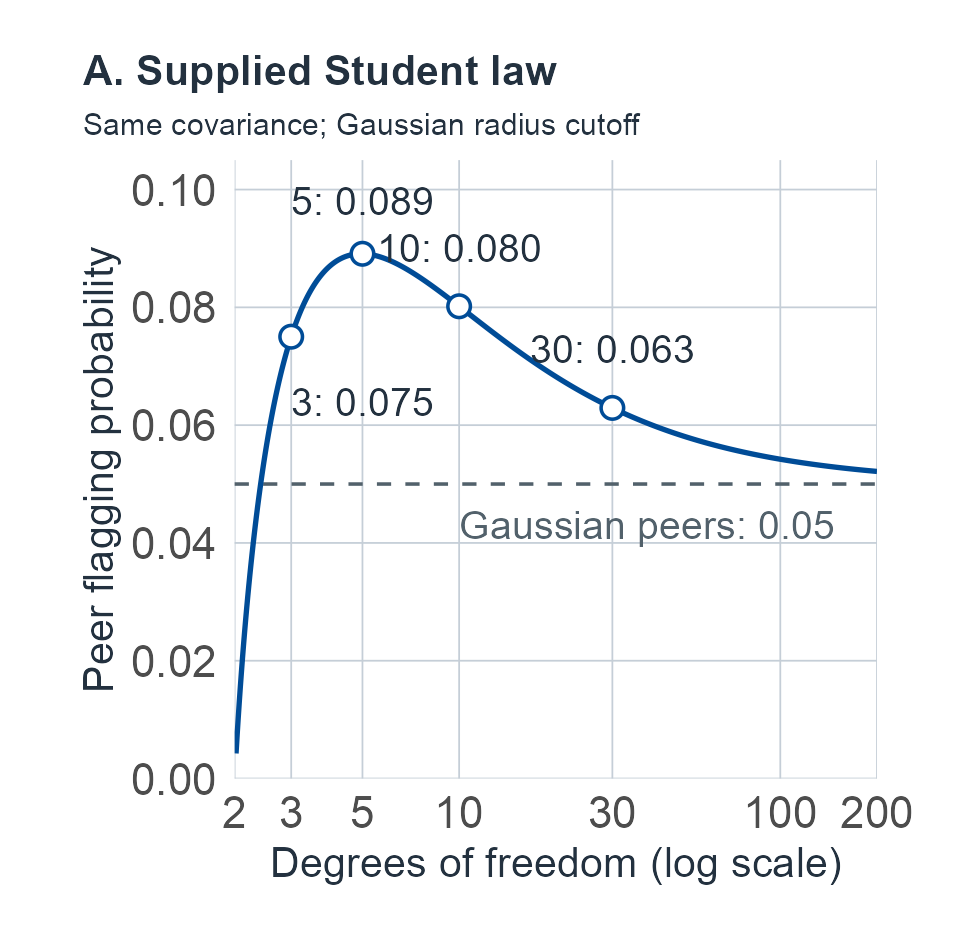
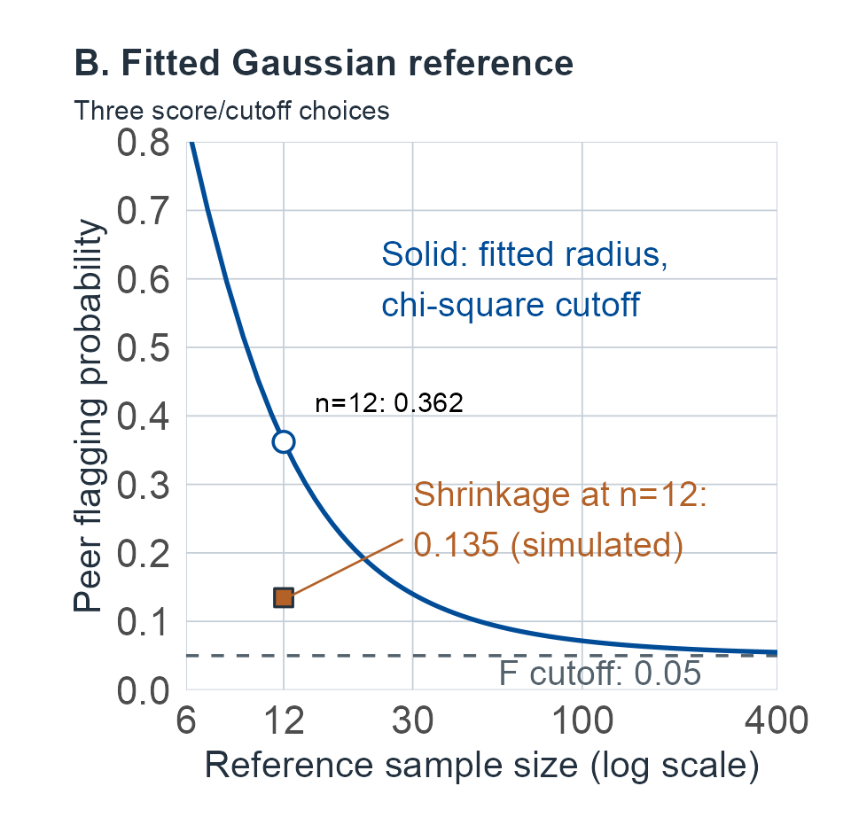

# Heterogeneity and robustness {#sec-robustness}

```{=html}
<style>
.m10-page #quarto-content > *, .m10-page main.content { min-width: 0; }
.m10-scroll { max-width: 100%; min-width: 0; overflow-x: auto; }
.m10-scroll .math.display { overflow: visible; }
.m10-scroll mjx-container[display="true"] { max-width: none; width: max-content; min-width: 100%; overflow: visible; }
.m10-scroll:focus-visible, .m10-page .math.inline:focus-visible { outline: 3px solid var(--book-focus); outline-offset: 3px; }
.m10-page .math.inline { display: inline-block; max-width: 100%; overflow-x: auto; overflow-y: hidden; padding-block: .15em; vertical-align: middle; }
.m10-figure-panels { display: grid; gap: .6rem; }
.m10-figure-panels p { margin: 0; }
.m10-figure-panels img { width: 100%; height: auto; }
</style>

<script>
document.body.classList.add('m10-page');
(function () {
  function nameOverflow() {
    document.querySelectorAll('main .math.inline').forEach(function (element) {
      if (element.scrollWidth > element.clientWidth + 2) {
        element.tabIndex = 0;
        element.setAttribute('role', 'group');
        element.setAttribute('aria-label', 'Long mathematical expression; scroll horizontally');
      } else {
        element.removeAttribute('tabindex');
        element.removeAttribute('role');
        element.removeAttribute('aria-label');
      }
    });
  }
  function start() {
    let pending = false;
    function settle() {
      if (pending) return;
      pending = true;
      requestAnimationFrame(function () { requestAnimationFrame(function () { pending = false; nameOverflow(); }); });
    }
    const sizes = window.ResizeObserver ? new ResizeObserver(settle) : null;
    function observeMath() {
      if (sizes) document.querySelectorAll('main .math.inline, main .math.inline mjx-container, main .math.inline mjx-math').forEach(function (element) { sizes.observe(element); });
      settle();
    }
    function whenMathReady() {
      if (window.MathJax && MathJax.startup && MathJax.startup.promise) MathJax.startup.promise.then(observeMath);
      else setTimeout(whenMathReady, 150);
    }
    whenMathReady();
    if (document.fonts) {
      document.fonts.ready.then(observeMath);
      document.fonts.addEventListener('loadingdone', observeMath);
    }
    document.addEventListener('keydown', function (event) {
      const element = event.target;
      if (!(element instanceof HTMLElement) || !element.matches('.m10-scroll, .math.inline[role="group"]')) return;
      if (event.altKey || event.ctrlKey || event.metaKey || event.shiftKey || element.scrollWidth <= element.clientWidth + 2) return;
      const step = Math.max(48, parseFloat(getComputedStyle(element).fontSize) * 3);
      if (event.key === 'ArrowRight' || event.key === 'ArrowLeft') {
        element.scrollLeft += event.key === 'ArrowRight' ? step : -step;
        event.preventDefault();
      } else if (event.key === 'Home' || event.key === 'End') {
        element.scrollLeft = event.key === 'Home' ? 0 : element.scrollWidth;
        event.preventDefault();
      }
    });
    window.addEventListener('resize', settle);
    window.addEventListener('scroll', settle, { passive: true });
    document.addEventListener('keydown', function (event) { if (event.key === 'Tab') nameOverflow(); }, true);
    const main = document.querySelector('main');
    if (main) new MutationObserver(settle).observe(main, { childList: true, subtree: true, attributes: true, attributeFilter: ['style', 'class'] });
    new MutationObserver(settle).observe(document.documentElement, { attributes: true, attributeFilter: ['style'] });
  }
  if (document.readyState === 'loading') document.addEventListener('DOMContentLoaded', start, { once: true });
  else start();
}());
</script>
```

## When the reference population is more complicated {#sec-m10-question}

Start with one rule. A synthetic five-score battery, three memory scores and two speed scores, is summarized by the squared distance of a profile from the peer mean, measured in the units of the peer covariance. A profile is flagged when that distance exceeds 11.07, the upper 5% point of the chi-square law with five degrees of freedom. When peers are Gaussian and their mean and covariance are supplied, a new peer is flagged exactly 5% of the time. That is the guarantee the rule is meant to carry.

Before reading on, predict two things. If peers have heavier tails but exactly the same covariance, will the rule flag more peers or fewer? If the mean and covariance are estimated from 12 people instead of being supplied, how far will the 5% move?

::::: {.m10-scroll role="group" tabindex="0" aria-label="M10 table 1; scroll horizontally"}

| Peer population and reference information | How the cutoff is set | Chance a new peer is flagged | Developed in |
|---|---|---:|---|
| Gaussian; mean and covariance supplied | $\chi^2_5$ point, 11.07 | .05 (exact) | [Joint-profile chapter](03-correlated-battery.md#sec-correlated-battery) |
| Heavier-tailed (Student, $\nu=5$); the same covariance supplied | the same | .089 (F-CDF) | [Student branch](#sec-m10-t) |
| Gaussian; mean and covariance estimated from 12 people | the same | .362 (exact F law; simulation .362) | [Fitted procedure](#sec-m10-covariance-example) |
| Gaussian; the same 12 people | finite-reference F cutoff, 33.81 | .05 (exact; simulation .050) | [Finite benchmark](#sec-m10-gaussian-finite) |
| Gaussian; the same 12 people | covariance shrunk to $.8S+.2I$, $\chi^2_5$ point | .135 (simulation) | [Fitted procedure](#sec-m10-covariance-example) |
| Student, $\nu=5$; 30 people, tail and shrinkage chosen by cross-validation | the fitted law's own 5% radius | .070 (simulation) | [Learned example](#sec-m10-bootstrap-example) |
| Student, $\nu=5$; 30 people to build a rank-transformed score, 99 more to calibrate it | 95th of the 99 calibration scores | .051 (simulation); at most .05 by theorem | [Calibration example](#sec-m10-calibration-example) |

: One flagging rule under seven experiments. Every population is synthetic, and every probability is taken over new peers and, where something is estimated, over reference samples as well. {#tbl-m10-one-rule}

:::::

The question never changes from row to row: among people who belong to the stated peer population, how often does the rule flag one? The supplied-law comparison isolates heavier tails with matched covariance; later experiments change the stated fitting procedure or cutoff, sometimes through several learned steps. Heavier tails with a matched covariance leave the expected squared distance where it was, because a moment identity survives, but they move the tail. @fig-m10-one-cutoff shows that the move is not even monotone in the degrees of freedom. Estimating the mean and covariance from a small sample moves the tail much further, and the finite-reference F cutoff restores the 5% exactly, under Gaussian sampling, as long as nothing else is learned. Shrinkage stabilizes the estimated covariance and removes most of the excess in this example, but it is not a calibration. The last two rows change the procedure. Fitting a more flexible law still left its own nominal 5% rule at about 7% in that experiment. Calibrating a learned score on independent peers restores a guarantee, of a different kind: a marginal one, averaged over calibration samples, for one new peer.

::: {#fig-m10-one-cutoff}

::: {.m10-figure-panels}

<p><a href="figures/m10-one-cutoff-1.png" aria-label="Open full-size M10 panel 1"></a></p>

<p><a href="figures/m10-one-cutoff-2.png" aria-label="Open full-size M10 panel 2"></a></p>

::: 

One flagging rule, flag when the squared radius exceeds $\chi^2_{5,.95}=11.07$, with the target held fixed: the chance that a new peer from the stated population is flagged. **A.** Peers follow a supplied Student law with the same covariance as the Gaussian benchmark. The rate is the exact F-CDF value of @eq-m10-t-miscalibration; circles mark the four tabulated degrees of freedom. The rate peaks near $\nu=5$ at about .089, falls below .05 only for $\nu$ below about 2.4, and approaches .05 as $\nu$ grows. **B.** Peers are Gaussian, and the mean and covariance are estimated from $n$ reference people. The curve is the exact plug-in rate from the finite-reference F law of @eq-m10-finite-F; the dashed line is the F cutoff, which keeps the rate at .05 for every $n$. The square is the simulated rate (100,000 repetitions) for the shrunk covariance $.8S+.2I$ at $n=12$. All populations are synthetic.

:::

The same pattern recurs throughout the chapter. A patient has several low scores and an uneven profile, and a Gaussian calculation reports an unusual battery pattern. Would that conclusion survive a peer population with occasional very large deviations, more than one severity group, or a different pattern of coincident extremes? Would estimating a large covariance matrix from a small reference sample create the apparent anomaly? These are questions about the stability of a specified inference, rather than a search for the most flexible distribution. We keep one target fixed, state which features of the model or procedure change, and ask which guarantee survives.

The [joint-profile chapter](03-correlated-battery.md#sec-correlated-battery) supplies a tractable Gaussian reference experiment. The [level and shape chapter](04-level-and-shape.md#sec-level-and-shape) separates projection, dispersion, discrimination and replication. Here we change their population and estimation assumptions explicitly. A distributional departure can leave a mean identity intact while invalidating a tail area or an independence claim. An alternative can improve fitting without identifying a biological subtype, an individual latent deficit or a clinically useful decision.

## Observations and inferential contract {#sec-m10-experiment}

Let $Z\in\mathbb R^p$ be an observed profile on prespecified score scales, with a fixed battery, administration and scoring rule. Lower scores indicate poorer performance in the examples. Persons in the declared peer population are independent sampling units unless an example explicitly introduces paired occasions. The reference data are $\mathcal D=(Z_1,\ldots,Z_n)$, independent of a new person. A covariance between people on this observed scale differs from an error covariance under repeated measurements of one person. Covariates can be held fixed at a declared stratum; pooling changing strata creates another mixture.

Write $P_\theta$ for a stipulated observed-data law and $A$ for a prespecified score event. Two recurring targets are $q_A(\theta)=P_\theta(Z\in A)$ and the new-person prediction law given reference data. If an event is chosen after seeing the case, the relevant null experiment repeats that choice. An event fixed using independent training data can instead be conditioned on those training data. Norm transformations, weights, covariance regularization and class selection belong to the learning experiment when estimated. They are not known constants merely because the software returns one answer.

Measurement assumptions enter before the population distribution: if responses $U$ follow a kernel $k(u\mid H,A,C,\psi)$ and scores are $Z=s(U)$, changing the population law of $H$ changes the induced score law through that kernel. A Gaussian factor distribution with nonlinear or discrete scoring need not yield Gaussian $Z$. Conversely, a fitted mixture for $Z$ does not identify item parameters, a replication universe or the number of cognitive mechanisms. [Measurement](05-measurement-and-replication.md#sec-measurement) and [scoring](06-items-and-scoring.md#sec-items-and-scoring) remain separate model layers; all formulas here apply to the stated input scale.

We use $\Phi$ for the standard normal CDF, $\chi^2_r$ and $F_{r,s}$ for chi-square and F distributions, and $t_\nu$ for a univariate Student law. For a multivariate Student distribution, the displayed matrix is a **scale matrix**, not generally its covariance.^[The change chapter writes the Student scale matrix $\Lambda$. Here $\Lambda$ keeps its measurement-chapter meaning of factor loadings, used in the heterogeneity unit, so the Student scale matrix is written $\Omega$; it is not the factor covariance $\Omega$ of the measurement chapter.] Numerical examples are synthetic, with stipulated parameters; none supplies clinical norms.

The Bayesian and frequentist comparisons use the same observations and target when paired. Their conditioning differs: a population event parameter, a fixed person's replication variance, a conditional component label and a new-person predictive event have different likelihood-to-output mappings. A tractable restricted prior family is identified as a special case; unrestricted exact integrals are not claimed to have been numerically evaluated. The numerical examples below are worked synthetic calculations, not empirical validation of their models.

## How the chapter is organized {#sec-m10-roadmap}

Each unit changes one assumption of the Gaussian known-law comparison and asks what survives. The early units change the population; the middle units change what is learned from reference data; the last units change how an answer is computed and calibrated.

::::: {.m10-scroll role="group" tabindex="0" aria-label="M10 table 2; scroll horizontally"}

| Unit | What changes | What survives, and what must be added |
|---|---|---|
| [Moments](#sec-m10-moments) | The joint law is no longer Gaussian | Means, variances and expected quadratic spread stay exact with finite moments; their tails and independence need a joint law |
| [Heavy tails](#sec-m10-t) | One random precision per person (Student) | Explicit radial and conditional laws; learning the law adds parameter uncertainty |
| [Heterogeneity](#sec-m10-heterogeneity) | A continuum, classes, or both | Event probabilities under a mixture; component labels are not identified taxonomies |
| [Scale replication](#sec-m10-scale-replication) | A person's residual scale may recur | A paired design separates stable from fresh variation; personal and population inference |
| [Copulas](#sec-m10-copulas) | Margins and dependence are modeled separately | Threshold probabilities from the joint cells; tails that a covariance cannot see |
| [Covariance estimation](#sec-m10-covariance) | Mean and covariance are estimated, shrunk or replaced by robust targets | An exact Gaussian finite-reference benchmark and a proper posterior prediction; no inherited law for regularized radii |
| [Sensitivity and bounds](#sec-m10-sensitivity) | The law is known only to lie in a set | Perturbation, divergence, moment, Fréchet and contamination bounds |
| [Computation](#sec-m10-computation) | The answer must be integrated or simulated | Numerical error reported separately; what a bootstrap repeats |
| [Calibration](#sec-m10-calibration) | The score is learned and then calibrated on new peers | One-person marginal coverage under exchangeability, with its subgroup and realized-content limits |

:::::

A [lookup guide](#sec-m10-guide) near the end collects reader questions with their sections, and a [summary table](#sec-m10-frontier) lists what survives each assumption change.

For a first reading, follow the [experiment](#sec-m10-experiment) and [moments](#sec-m10-moments), the [Student radial comparison](#sec-m10-t), then [shrinkage](#sec-m10-shrinkage), the [exact Gaussian benchmark](#sec-m10-gaussian-finite) and its [fitted-procedure example](#sec-m10-covariance-example). Continue through [Monte Carlo error](#sec-m10-MC), [what the bootstrap refits](#sec-m10-bootstrap), and the [calibration experiment](#sec-m10-conformal-experiment), including its rank proof and [coverage limits](#sec-m10-conditional-coverage). This route develops peer prediction; each result retains its local conditions.

For replication questions, read the [Gaussian countermodel](#sec-m10-gaussian-length) alongside [stable and fresh scales](#sec-m10-scale-replication) and [personal variance inference](#sec-m10-person-scale). For population structure, use [mixtures](#sec-m10-heterogeneity); for coincident lows, use [copulas and ordinal cells](#sec-m10-copulas). The full mixture priors, scale hyperparameters, inverse-Wishart normalization and projection, and general sensitivity and linear-programming arguments provide deeper consultation within those units. Their assumptions and proofs remain part of any result you use. Returning readers can go directly to the [question guide](#sec-m10-guide).

## Synthetic examples and reused symbols {#sec-m10-examples}

Every numerical example is a synthetic teaching input with stipulated parameters, chosen so that results can be checked. None is an instrument's norms, a value fitted to patients or a clinical cutoff. One battery recurs across units; the others are small examples built for a single calculation.

::::: {.m10-scroll role="group" tabindex="0" aria-label="M10 table 3; scroll horizontally"}

| Example | Inputs | What it shows | Where |
|---|---|---|---|
| Recurring five-score battery | three memory and two speed scores, unit variances, correlations .61 within and .36 between domains (loadings .6 common, .5 domain) | Tails, mixtures, covariance estimation, learning and calibration of one rule | @tbl-m10-one-rule; [mixture](#sec-m10-mixture-example), [fitted procedure](#sec-m10-covariance-example), [learned example](#sec-m10-bootstrap-example), [calibration](#sec-m10-calibration-example) |
| Two-score Student profile | $\nu=5$, correlation .5, unit variances | Conditional location and scale depend on the conditioning score | [Student branch](#sec-m10-t) |
| Two-domain Gaussian battery | loadings .6 general and $\pm.3$ domain, error variance .55, two occasions | Squared-dispersion reproducibility that grows with battery length without any scale trait | [Gaussian source](#sec-m10-gaussian-length) |
| Six scalar observations | $(-2.5,-1.8,-.7,0,.4,1)$, components $N(0,1)$ and $N(-2,1)$ | Uncertainty in a mixture weight; integrated membership | [Weight example](#sec-m10-weight-example) |
| Paired energies | one person with energy 6; eight reference persons $(2,3,5,6,8,10,16,25)$ at $p=5$ | Personal scale inference, then unknown tail and scale | [Personal scale](#sec-m10-person-scale), [nuisance integration](#sec-m10-scale-hyperparameters) |
| Two-test low/high table | 100 people: 8 both low, 12 first only, 10 second only, 70 neither | Cell inference and contamination bounds | [Fitted margins](#sec-m10-copula-learning), [contamination](#sec-m10-contamination) |
| Two fixed synthetic samples | 30 Student profiles (seed 271006); 30 training and 99 calibration profiles (seed 271007) | A learned rule with bootstrap and posterior; a calibrated learned score | [Learned example](#sec-m10-bootstrap-example), [calibration](#sec-m10-calibration-example) |

:::::

The notation carries forward earlier chapter names for the same objects. Distinctive names identify several quantities ($n_{\mathrm{MC}}$ for a number of Monte Carlo draws, $n_\theta$ for posterior draws, $\mathcal E_i$ for a paired energy, $\Delta_R$ for a covariance perturbation, $\mathrm{Eff}$ for a relative efficiency, $\sigma_\mu$ for a prior scale, $\mathcal B$ for a set of values). The remaining letters are reused in separate units, defined where introduced and confined to their unit; footnotes mark them at first use, and the list collects them.

- $B$: a fixed matrix in a quadratic form $Q=X^TBX$; a Beta quantile $B^{-1}_{a,b}$; the inverse eigenvalue matrix $(I+\Delta_R)^{-1}$ in the sensitivity proof; a binomial count in the median interval.
- $E$: always an expectation.
- $h$: the vector $B\delta$ in the moment identities; a latent level $H_i$ or factor $H$; the contamination law $H$ and $h=H(A)$; the function $h(e)$ in the divergence bound; the CDF $H$ of a test statistic.
- $T$: the Gamma precision of the Student branch; a Student vector in the copula unit; a shrinkage target $T_0$; a discrepancy $T_\theta$ or a bootstrap statistic $T^*$; a triangular factor in a matrix integral.
- $d$: the Mahalanobis form $d(z)$ and $d_b$; the paired-contrast dimension $d=2r$; a number of cells; the predictive degrees $d_n$; whitened vectors $d$ and $\widetilde d$; interval probabilities $d_j$.
- $M$: third moments $M_{ijk}$; a model index $M\in\{G,t_4\}$.
- $K$, $r$, $W$: a cross-occasion covariance, a number of mixture components, an event count $K_A$ and a precision matrix; the contrast dimension $r=p-1$, a component responsibility $r_g$ and an observed event probability; a random scale and a Wishart matrix.
- $m$, $q$, $s$, $V$, $\lambda$: a mean, a location index and the number of calibration persons; an event probability $q_A$, a quadratic form and a quantile level; a sign vector, a squared dispersion $s^2$, sample eigenvalues $s_j$, a covariance-scale multiplier and a trained score $s_{\mathrm{tr}}$; a Frobenius risk, a region content, an auxiliary uniform and a covariance domain $\mathcal V_p$; a loading, a shrinkage weight, a tail coefficient $\lambda_L$ and an eigenvalue.

## Which moments survive? {#sec-m10-moments}

The Student comparison in @tbl-m10-one-rule changed only the tails, and the squared distance kept its expected value. This unit explains why. Any statistic that is linear or quadratic in the scores has a mean, and a quadratic has a variance, that depend only on low-order moments; a Gaussian law is not needed for those identities. What a covariance cannot supply is the rest of the distribution: the tail area of a cutoff, or the independence of level and shape.

A battery's spread is often interpreted through its covariance matrix. That is enough for an expected squared spread, but generally insufficient for its uncertainty or tail distribution. Let $X=Z-\mu_0=\delta+\varepsilon$, where $E\varepsilon=0$, $\operatorname{Cov}(\varepsilon)=R$, and $\delta=E Z-\mu_0$. The analysis origin $\mu_0$ need not be this population's mean. For a fixed symmetric matrix $B$, define $Q=X^TBX$; the ordinary squared dispersion uses $B=C_p/(p-1)$ with $C_p=I-\mathbf1\mathbf1^T/p$.

::: {#prp-m10-moment-survival}
## Moments do not determine Gaussian tails

**Experiment and assumptions.** Profiles are sampled from one declared population on a fixed observed scale. $B$ and any linear weights $b$ are fixed independently of the profile. With finite second moments,

::::: {.m10-scroll role="group" tabindex="0" aria-label="M10 equation 1; scroll horizontally"}

$$
\begin{aligned}
E(Q)&=\operatorname{tr}(BR)+\delta^TB\delta,\\
E(b^TX)&=b^T\delta,\qquad
\operatorname{Var}(b^TX)=b^TRb.
\end{aligned}
$$ {#eq-m10-second-moments}

:::::

If fourth moments exist, let $M_{ijk}=E(\varepsilon_i\varepsilon_j\varepsilon_k)$ and

::::: {.m10-scroll role="group" tabindex="0" aria-label="M10 equation 2; scroll horizontally"}

$$
\kappa_{ijkl}=E(\varepsilon_i\varepsilon_j\varepsilon_k\varepsilon_l)
-R_{ij}R_{kl}-R_{ik}R_{jl}-R_{il}R_{jk}.
$$ {#eq-m10-cumulant}

:::::

Writing $h=B\delta$, the variance is

::::: {.m10-scroll role="group" tabindex="0" aria-label="M10 equation 3; scroll horizontally"}

$$
\begin{aligned}
\operatorname{Var}(Q)
={}&2\operatorname{tr}(BRBR)
+\sum_{i,j,k,l}B_{ij}B_{kl}\kappa_{ijkl}\\
&+4h^TRh+4\sum_{i,j,k}h_iB_{jk}M_{ijk}.
\end{aligned}
$$ {#eq-m10-quadratic-variance}

:::::

The covariance with a linear summary is

::::: {.m10-scroll role="group" tabindex="0" aria-label="M10 equation 4; scroll horizontally"}

$$
\operatorname{Cov}(b^TX,Q)
=2b^TRB\delta+\sum_{i,j,k}b_iB_{jk}M_{ijk}.
$$ {#eq-m10-linear-quadratic}

:::::
:::

::: {.proof}
Expand $Q=\delta^TB\delta+2h^T\varepsilon+\varepsilon^TB\varepsilon$. The last term has expectation $\sum B_{ij}R_{ij}=\operatorname{tr}(BR)$. To compute its variance, expand its square and insert the definition of $\kappa$. The $R_{ij}R_{kl}$ term cancels the squared expectation; the other two pairings each give $\operatorname{tr}(BRBR)$ because $B$ and $R$ are symmetric. The linear term has variance $4h^TRh$; twice its covariance with the quadratic term gives the third-moment term in @eq-m10-quadratic-variance. Expanding $\operatorname{Cov}(b^T\varepsilon,2h^T\varepsilon+\varepsilon^TB\varepsilon)$ proves the last statement. No Gaussian approximation has entered.
:::

For equally centered unit-variance scores, $\delta=0$ and $R_{jj}=1$, this gives

::::: {.m10-scroll role="group" tabindex="0" aria-label="M10 equation 5; scroll horizontally"}

$$
E(s^2)=\frac{\operatorname{tr}(C_pR)}{p-1}=1-\bar r,
\qquad
\bar r=\frac{1}{p(p-1)}\sum_{j\ne k}R_{jk}.
$$ {#eq-m10-dispersion-mean}

:::::

The correlations are those of the **observed scores being dispersed**. Copula correlations or latent-factor correlations cannot be inserted without changing this target. If the mean profile is nonflat, add $\delta^TC_p\delta/(p-1)$. A common shift does not change dispersion; a domain shift does. Gaussianity would remove the third cumulants and fourth cumulants, but a covariance matrix alone does not remove them. Neither zero linear–quadratic covariance under central symmetry nor a finite expected dispersion establishes independence.

For central paired occasions $X_1,X_2$ with covariance matrices $R_1,R_2$ and cross-covariance $K=E(X_1X_2^T)$, the same expansion gives

::::: {.m10-scroll role="group" tabindex="0" aria-label="M10 equation 6; scroll horizontally"}

$$
\begin{aligned}
\operatorname{Cov}(X_1^TBX_1,X_2^TDX_2)
={}&2\operatorname{tr}(BKDK^T)\\
&+\sum_{i,j,k,l}B_{ij}D_{kl}\kappa^{1122}_{ijkl},
\end{aligned}
$$ {#eq-m10-cross-quadratic}

:::::

where $\kappa^{1122}_{ijkl}=E(X_{1i}X_{1j}X_{2k}X_{2l})-(R_1)_{ij}(R_2)_{kl}-K_{ik}K_{jl}-K_{il}K_{jk}$. Expanding the fourfold sum proves this expression exactly as above. Reproducibility of squared dispersion requires these joint fourth moments and nonzero finite variances. It is not the reliability of the within-profile SD, a latent scale, or the underlying tests.

### A scale mixture changes higher moments {#sec-m10-scale-mixture}

Consider $X=\sqrt W G$, with $G\sim N_p(0,R)$ independent of $W>0$ and $EW=1$. This is a mathematical population model; $W$ need not be a cognitive trait. It preserves $\operatorname{Cov}(X)=R$. Conditional on $W$, ordinary Gaussian formulas apply, but unconditional independence usually fails. If $m_B=\operatorname{tr}(BR)$, $v_B=2\operatorname{tr}(BRBR)$ and $EW^2<\infty$, conditioning gives

::::: {.m10-scroll role="group" tabindex="0" aria-label="M10 equation 7; scroll horizontally"}

$$
E(Q)=m_B,\qquad
\operatorname{Var}(Q)=E(W^2)v_B+\operatorname{Var}(W)m_B^2.
$$ {#eq-m10-scale-variance}

:::::

Indeed $E(Q\mid W)=Wm_B$ and $\operatorname{Var}(Q\mid W)=W^2v_B$; total variance proves the claim. Thus population mean dispersion is unchanged while its variance increases unless the relevant quadratic is degenerate. If whitened Gaussian coordinates split into a signed level $G_1$ and residual energy $\sum_{j=2}^pG_j^2$, then their scaled versions have zero covariance by symmetry, but

::::: {.m10-scroll role="group" tabindex="0" aria-label="M10 equation 8; scroll horizontally"}

$$
\operatorname{Cov}\left(WG_1^2,W\sum_{j=2}^pG_j^2\right)
=(p-1)\operatorname{Var}(W).
$$ {#eq-m10-level-shape-dependence}

:::::

For $p>1$ and nonconstant square-integrable $W$, this is positive and proves failure of unconditional level–shape independence. With infinite $EW^2$ that covariance is unavailable; conditional laws still define the experiment. A distribution can have a perfectly adequate covariance matrix and no finite dispersion variance.

## Heavy tails: a multivariate Student branch {#sec-m10-t}

Suppose peers occasionally produce very large deviations on several tests at once. A convenient model gives each person one random precision that scales the whole profile, so that some peers are spread out across the entire battery. The covariance can be held at the Gaussian benchmark while the tails change, which is exactly the comparison in the second row of @tbl-m10-one-rule. The unit derives three consequences: the squared radius follows a scaled F law rather than a chi-square law; conditioning on companion scores changes the residual scale as well as the location; and learning the tail parameter from reference data adds an uncertainty that the known-law calculation omits.

A useful tractable extension uses one random precision per person:

::::: {.m10-scroll role="group" tabindex="0" aria-label="M10 equation 9; scroll horizontally"}

$$
\begin{aligned}
T&\sim\operatorname{Gamma}(\nu/2,\nu/2),\\
Z\mid T=t&\sim N_p(\mu,\Omega/t),\\
\nu&>0,\qquad\Omega\succ0.
\end{aligned}
$$ {#eq-m10-t-experiment}

:::::

The Gamma convention is shape/rate: density $b^a t^{a-1}e^{-bt}/\Gamma(a)$. Integrating $t$ gives the multivariate Student density

::::: {.m10-scroll role="group" tabindex="0" aria-label="M10 equation 10; scroll horizontally"}

$$
\begin{aligned}
f(z\mid\mu,\Omega,\nu)
={}&\frac{\Gamma((\nu+p)/2)}
{\Gamma(\nu/2)(\nu\pi)^{p/2}|\Omega|^{1/2}}\\
&{}\times\left(1+\frac{d(z)}{\nu}\right)^{-(\nu+p)/2},\\
d(z)={}&(z-\mu)^T\Omega^{-1}(z-\mu).
\end{aligned}
$$ {#eq-m10-t-density}

:::::

To verify normalization and constants, multiply the normal conditional density by the Gamma density; the remaining integral is $\int_0^\infty t^{(\nu+p)/2-1}\exp[-(\nu+d)t/2]dt=\Gamma((\nu+p)/2)\{2/(\nu+d)\}^{(\nu+p)/2}$. The mixture of normalized densities already integrates to one. This is an observed-score distribution, not a Student posterior for a person's true ability.

::: {#prp-m10-t-laws}
## Radial and conditional Student laws

Under @eq-m10-t-experiment, $d(Z)/p\sim F_{p,\nu}$. If $\nu>2$,

::::: {.m10-scroll role="group" tabindex="0" aria-label="M10 equation 11; scroll horizontally"}

$$
\operatorname{Cov}(Z)=R=\frac{\nu}{\nu-2}\Omega,
\qquad
(Z-\mu)^TR^{-1}(Z-\mu)
\sim \frac{\nu-2}{\nu}\,p F_{p,\nu}.
$$ {#eq-m10-t-radius}

:::::

Partition the observed profile into $Z_a$ and $Z_b$, with $k$ coordinates in $b$. Define

::::: {.m10-scroll role="group" tabindex="0" aria-label="M10 equation 12; scroll horizontally"}

$$
\begin{aligned}
m_{a\mid b}&=\mu_a+\Omega_{ab}\Omega_{bb}^{-1}(z_b-\mu_b),\\
\Omega_{a\cdot b}&=\Omega_{aa}-\Omega_{ab}\Omega_{bb}^{-1}\Omega_{ba},\\
d_b&=(z_b-\mu_b)^T\Omega_{bb}^{-1}(z_b-\mu_b).
\end{aligned}
$$ {#eq-m10-t-conditional-inputs}

:::::

Then $Z_a\mid Z_b=z_b$ is multivariate Student with degrees of freedom $\nu+k$, location $m_{a\mid b}$ and scale matrix

::::: {.m10-scroll role="group" tabindex="0" aria-label="M10 equation 13; scroll horizontally"}

$$
\Omega_{a\mid b}^{*}=\frac{\nu+d_b}{\nu+k}\Omega_{a\cdot b}.
$$ {#eq-m10-t-conditional}

:::::
:::

::: {.proof}
Let $V=\nu T\sim\chi^2_\nu$ and let $G$ be a vector of independent standard normals, independent of $V$. With $LL^T=\Omega$, $Z-\mu=\sqrt{\nu/V}\,LG$, so $d(Z)=\nu\|G\|^2/V$. The definition of an F ratio proves the radial law. Gamma integration gives $E(T^{-1})=\nu/(\nu-2)$ when $\nu>2$, establishing the covariance and its conversion of the radius. For $\nu>1$, symmetry and integrability give $EZ=\mu$; at smaller $\nu$, $\mu$ is a location parameter without a finite mean. Fourth moments require $\nu>4$, since $E(T^{-2})=\nu^2/\{(\nu-2)(\nu-4)\}$.

For the conditional law, Gaussian block completion conditional on $T$ gives location $m_{a\mid b}$ and covariance $\Omega_{a\cdot b}/T$. Multiplying the marginal $Z_b$ density conditional on $T$ by its prior gives $T\mid z_b\sim\operatorname{Gamma}((\nu+k)/2,(\nu+d_b)/2)$. Rescaling this Gamma variable to equal shape and rate and integrating as in @eq-m10-t-density proves @eq-m10-t-conditional. Positive definiteness of $\Omega$ makes the block inverse and Schur complement valid. The calculation conditions on actual observed values, not latent states.
:::

The conditional law is again Student; @ding2016conditional gives a short proof through the same normal-mixture representation. Unlike the Gaussian conditional variance, the Student conditional scale changes with how extreme the conditioning profile is. In a two-score example with $\nu=5$, $\mu=0$, unit marginal variances and correlation $.5$, take $\Omega=.6\left(\begin{smallmatrix}1&.5\\.5&1\end{smallmatrix}\right)$. At $z_b=-2$, the conditional location is $-1$, $d_b=20/3$, the conditional degrees of freedom are 6, and the conditional scale squared is $.875$. Its conditional variance is $6(.875)/4=1.3125$. At $z_b=0$ the scale squared is $.375$ and the variance is $.5625$. A normal law matched on the same $R$ would use variance $.75$ at both points. Conditional lower tails therefore require the conditional Student CDF, not the normal residual formula with a constant replacement SD.

At a case target score $z_a=-2$, the conditional lower-tail probabilities are $.16308$ at $z_b=-2$ and $.00856$ at $z_b=0$. They were evaluated using the univariate Student CDF and checked by integrating the actual joint density divided by the conditioning marginal density (agreement within $10^{-10}$). Conditioning on poorer companion performance changes both location and residual scale.

For a five-score profile with the same finite covariance $R$, a conventional $\chi^2_5$ cutoff remains a convenient **ordering** but has exceedance probability

::::: {.m10-scroll role="group" tabindex="0" aria-label="M10 equation 14; scroll horizontally"}

$$
P\{Q>\chi^2_{5,.95}\}
=1-F_{5,\nu}\left(\frac{\nu\chi^2_{5,.95}}{5(\nu-2)}\right),\qquad \nu>2,
$$ {#eq-m10-t-miscalibration}

:::::

where $F_{r,s}(\cdot)$ now denotes the F CDF. This is generally not $.05$. Numerical F-CDF evaluation gives:

::::: {.m10-scroll role="group" tabindex="0" aria-label="M10 table 4; scroll horizontally"}

| Degrees of freedom $\nu$ | Exceedance of the Gaussian 5% radius cutoff |
|---|---:|
| 3 | .0750173 |
| 5 | .0890964 |
| 10 | .0801801 |
| 30 | .0629253 |

:::::

These values were also checked by integrating the conditional chi-square survival function over Gamma precision (agreement within $10^{-10}$; adaptive-quadrature error estimates below $5\times10^{-10}$). Matching the covariance while changing $\nu$ does not imply a monotone finite-cutoff exceedance ordering. In particular, the $\nu=5$ law exceeds this cutoff more often than the $\nu=3$ law. The values quantify this stipulated departure, not a universal direction for all non-Gaussian populations. Panel A of @fig-m10-one-cutoff draws the whole curve: the rate rises above .05, peaks near $\nu=5$ and returns slowly toward .05.

As $\nu\to\infty$, $T\to1$ in probability (its variance is $2/\nu$), and the Gaussian branch is recovered. At $\nu\le2$, covariance matching is not defined; a robust scatter matrix must not be relabelled the nonexistent covariance.

### Learning the heavy-tail law {#sec-m10-t-estimation}

When $\mathcal D$ consists of independent profiles from @eq-m10-t-density, the likelihood is $\prod_i f(z_i\mid\mu,\Omega,\nu)$. Unknown $\nu$, location and scale cannot be replaced by their fitted values while retaining the known-law F calculation as an exact fitted-procedure test. Uncertainty in $\nu$ can particularly affect extreme probabilities. For a fixed event $A$, the parameter target remains $q_A(\theta)=\int_A f(z\mid\theta)dz$; a fitted radius defines a different, data-dependent event unless its training is conditioned on.

Here is a proper Bayesian construction that also specifies an exact computational target. Work in score units declared above. Take $\mu\sim N_p(0,\sigma_\mu^2I)$ for a stipulated finite $\sigma_\mu>0$; let $\nu$ have positive masses on a finite prespecified set such as $\{3,5,10,30\}$; independently give $\Omega$ a normalized density proportional to $\exp[-\operatorname{tr}(\Omega)/(2s_0^2)]$ with respect to its independent symmetric entries on $aI\preceq\Omega\preceq bI$, where $0<a<b<\infty$ and $s_0>0$ are declared scale choices. This compact positive-definite domain has positive finite volume. The density of every observation is positive and bounded by a finite constant uniformly in parameters because $|\Omega|\ge a^p$ and the degrees-of-freedom set is finite. Thus the likelihood times this proper prior has a positive finite integral for every finite dataset; the posterior is proper, without a hidden improper scale prior.

For any posterior-integrable function $g$, define

::::: {.m10-scroll role="group" tabindex="0" aria-label="M10 equation 15; scroll horizontally"}

$$
E\{g(\theta)\mid\mathcal D\}
=\frac{\sum_\nu\int g(\mu,\Omega,\nu)L(\mathcal D\mid\mu,\Omega,\nu)\,d\Pi(\mu,\Omega,\nu)}
{\sum_\nu\int L(\mathcal D\mid\mu,\Omega,\nu)\,d\Pi(\mu,\Omega,\nu)}.
$$ {#eq-m10-parameter-integration}

:::::

Here $d\Pi$ within each summand includes its stated mass and continuous densities once. The posterior law of $q_A(\theta)$ describes uncertainty about an event frequency; $E\{q_A(\theta)\mid\mathcal D\}$ is the posterior predictive chance of that event for a new peer. These differ from evaluating $q_A$ at a posterior mean parameter. Bounds $a,b$, prior scale $\sigma_\mu$ and the degrees-of-freedom grid require sensitivity analysis, especially when few extremes are observed. They are teaching choices, not assertions that the tail law is known to belong to four possibilities.

There is a finite-sample frequentist counterpart for that same parameter family, even when no convenient pivot exists. Choose a discrepancy $T_\theta(\mathcal D)$ for every proposed $\theta$, such as a likelihood ratio against the supremum within the specified family, with ties included. Let

::::: {.m10-scroll role="group" tabindex="0" aria-label="M10 equation 16; scroll horizontally"}

$$
p_\theta(\mathcal D)=P_\theta\{T_\theta(\mathcal D')\ge T_\theta(\mathcal D)\},
\qquad
\mathcal C(\mathcal D)=\{\theta:p_\theta(\mathcal D)>\alpha\}.
$$ {#eq-m10-neyman-inversion}

:::::

All fitting in $T$ is repeated for $\mathcal D'$; a numerical local maximum is not the mathematical supremum. Under the true family member $\theta$, inclusive tail ranking is super-uniform: writing $H$ for the CDF of $T_\theta$, its inclusive tail jumps upward at atoms, so at most probability $\alpha$ can fall in the rejection set $\{p_\theta\le\alpha\}$. Consequently $P_\theta\{\theta\in\mathcal C\}\ge1-\alpha$. Mapping this set to $[\inf_{\theta\in\mathcal C}q_A(\theta),\sup_{\theta\in\mathcal C}q_A(\theta)]$ gives simultaneous coverage of that event parameter under the model. An empty set can be reported as model rejection, with the interval set empty; the coverage statement remains the same. This construction is an exact definition requiring integrations/global searches; an unverified grid or Monte Carlo approximation is not an implemented exact interval. Computationally feasible direct event-frequency inference and held-out predictive calibration are developed below. A posterior credible interval has a different conditioning statement and need not coincide with this confidence set.

If both the reference law and its parameters are supplied, frequentist reference probabilities and Bayesian new-peer probabilities are simply the same integrals; there is no parameter posterior to invent. Once parameters are learned, neither the mixture variable $T$ nor its posterior is automatically a personal replication error or an identified latent cognitive scale. Repeated items, occasions or external measures are needed to give those interpretations a measurement model.

## Heterogeneity: a continuum, classes, or both? {#sec-m10-heterogeneity}

Clinical populations can differ in severity, domain emphasis, treatment history or observation quality. A single broad density can hide useful subgroups, while a class model can divide a smooth continuum into apparently distinct types. The statistical question is whether an explicit alternative changes predictions or event probabilities enough to matter. The biological question, whether those components represent stable mechanisms, requires a stronger observation design. Neuropsychological studies have applied latent profile and latent class analysis to test batteries to propose subgroups, for example in mild cognitive impairment and in Parkinson's disease without dementia, and have then compared the subgroups on information outside the battery, such as biomarkers, daily function and neuropathology at autopsy [@eppig2017statistically; @brennan2017neuropsychological; @zammit2019neuropsychological]. The external comparison is what this unit's mathematics says a partition needs.

The unit establishes four things. A mixture is a legitimate alternative reference law, and its event probabilities and conditional laws follow directly once its weights are updated by the observed scores. The same observed density can be written with different numbers and kinds of components, so cross-sectional scores do not settle a taxonomy. Fitting and Bayesian inference for mixtures need explicit restrictions to be well defined. And the uncertainty in a mixture weight can be carried into an event probability or a membership probability, as the six-observation example shows.

### Continuous and discrete population laws {#sec-m10-mixture-moments}

For a finite mixture, let $G\in\{1,\ldots,K\}$^[$K$ is the number of components here. The moments unit uses $K$ for a cross-occasion covariance, the contamination unit $K_A$ for an event count, and the inverse-Wishart derivation $K=R^{-1}$ for a precision matrix.] have probabilities $\pi_g\ge0$, $\sum_g\pi_g=1$. Conditional on $G=g$, the observed profile has normalized density $f_g$, mean $m_g$ and covariance $R_g$, when those moments exist. Its density, mean and covariance are

::::: {.m10-scroll role="group" tabindex="0" aria-label="M10 equation 17; scroll horizontally"}

$$
\begin{aligned}
f(z)&=\sum_g\pi_gf_g(z),\qquad \bar m=\sum_g\pi_gm_g,\\
\operatorname{Cov}(Z)&=\sum_g\pi_gR_g+
\sum_g\pi_g(m_g-\bar m)(m_g-\bar m)^T.
\end{aligned}
$$ {#eq-m10-mixture-moments}

:::::

The first covariance term is within-component variation; the second is between-component variation. Total expectation and total covariance prove the formulas. If means differ, pooling can inflate covariance in their displacement directions even if every within-component covariance is unchanged. A continuous severity model has the same decomposition with sums replaced by integrals. A Gaussian factor model $Z=\Lambda H+e$, with independent Gaussian $H$ and $e$, can yield one Gaussian observed law despite substantial latent heterogeneity. A factor mixture allows both continuous $H$ within classes and discrete variation across classes. None of these labels supplies a diagnosis by itself.

For an observed profile $z$ at which $f(z)>0$, Bayes' rule gives

::::: {.m10-scroll role="group" tabindex="0" aria-label="M10 equation 18; scroll horizontally"}

$$
r_g(z)=P(G=g\mid z,\theta)=\frac{\pi_g f_g(z)}{\sum_h\pi_h f_h(z)}.
$$ {#eq-m10-responsibility}

:::::

This is a conditional probability for a **model component**. It is a clinical target probability only if component membership has independently established meaning for that target. Assigning the modal class discards the uncertainty vector $r(z)$. Under 0–1 component-label loss the conditional error of that assignment is $1-\max_g r_g(z)$, since selecting label $a$ is correct with probability $r_a(z)$. Different actions require a specified loss, and unknown parameters require further integration.

Mixture event probabilities satisfy $P(Z\in A)=\sum_g\pi_g P_g(A)$ for any measurable event. Thus even a density mixture retained for prediction, without biological class claims, gives a concrete alternative reference probability. Conditional mixtures have **updated** weights. If only $Z_b=z_b$ is conditioned on, then

::::: {.m10-scroll role="group" tabindex="0" aria-label="M10 equation 19; scroll horizontally"}

$$
f(z_a\mid z_b)=\sum_g\frac{\pi_g f_{g,b}(z_b)}{\sum_h\pi_h f_{h,b}(z_b)}f_g(z_a\mid z_b).
$$ {#eq-m10-conditional-mixture}

:::::

Divide the joint mixture density by its marginal to derive this expression. Reusing the unconditional $\pi_g$ after observing companion scores generally gives the wrong conditional law.

::: {#prp-m10-continuous-class-equivalence}
## Observed heterogeneity does not identify a unique taxonomy

**Experiment.** Observe independent profiles $Z=\lambda H+e$, where $H\sim N(0,1)$ and $e\sim N_p(0,\Psi)$ are independent, $\Psi\succ0$, and $\lambda\ne0$. The score law is $N_p(0,\lambda\lambda^T+\Psi)$.

For any real cutpoint $c$, let $G=1\{H\le c\}$. The same experiment can be written as a two-component mixture with weight $\Phi(c)$, with $H$ drawn from its lower- or upper-truncated normal law within components, and $Z\mid H$ unchanged. Every such cutpoint gives the **identical observed density**, though component prevalences, means and membership probabilities differ. Cross-sectional scores alone cannot choose a unique cutpoint-defined phenotype.
:::

::: {.proof}
Partition the latent integral $\int\phi(h)\phi_p(z;\lambda h,\Psi)dh$ at $c$, and normalize each portion by $\Phi(c)$ or $1-\Phi(c)$. Summing the two weighted normalized densities restores exactly the original integral for every $z$. Since $0<\Phi(c)<1$ for every finite $c$, both are legitimate nonzero components. For $c=0$, their means are $\mp\lambda\sqrt{2/\pi}$: $\int_0^\infty h\phi(h)dh=\phi(0)$ and the half-normal normalization gives $\sqrt{2/\pi}$. They are different components despite having a Gaussian marginal mixture. For other $c$, integration gives lower mean $-\lambda\phi(c)/\Phi(c)$ and upper mean $\lambda\phi(c)/\{1-\Phi(c)\}$. Thus component definitions, not merely their names, vary while the observations do not.
:::

This equivalence allows non-Gaussian within-class densities. It does not assert nonidentifiability of every finitely parameterized Gaussian mixture. Rather, a conclusion conditional on Gaussian components and covariance restrictions must be reported as such. Repeated measurements can distinguish transient measurement noise from stable heterogeneity under specified kernels; external outcomes or a proposed threshold mechanism can make a particular partition useful. They do not retrospectively prove that an arbitrary density partition is a natural kind. Grouping by a score and then validating against the same score is circular.

### Local independence can manufacture a need for more components {#sec-m10-local-independence}

A continuous latent factor induces residual dependence if omitted from a class model. The next argument clarifies one reason that increasing the class count can improve fit without establishing more biological types. A simulation study of growth mixture models reached the same practical conclusion for nonnormal repeated measures: several classes can be estimated, and can appear optimal, when the population contains only one group [@bauer2003distributional].

::: {#prp-m10-finite-product-mixture}
## One correlated Gaussian is not a finite mixture of independent pairs

Let $(X,Y)$ be bivariate standard normal with $0<|\rho|<1$. Its joint law cannot be represented **exactly** by a finite mixture of product laws $\sum_{g=1}^K\pi_g P_g^X\otimes P_g^Y$ with positive weights. The component laws need not themselves be Gaussian.
:::

::: {.proof}
Suppose such a representation existed. Because the marginal normal distribution has every absolute moment finite and the weights are positive, each component $Y$ law has all these moments finite. Conditional expectation would have the form

::::: {.m10-scroll role="group" tabindex="0" aria-label="M10 equation 20; scroll horizontally"}

$$
\begin{aligned}
E(Y^m\mid X=x)&=\sum_{g=1}^K w_g(x)a_{gm},\\
w_g(x)&=P(G=g\mid X=x),\\
a_{gm}&=E_g(Y^m).
\end{aligned}
$$ {#eq-m10-product-span}

:::::

Therefore the functions $x\mapsto E(Y^m\mid X=x)$ all belong to a function space of dimension at most $K$, spanned by $w_1,\ldots,w_K$ (up to null sets). But the Gaussian conditional representation is $Y=\rho x+\sqrt{1-\rho^2}\,E$ with $E$ standard normal, so its $m$th conditional moment is a polynomial of degree $m$ with nonzero leading coefficient $\rho^m$. The functions for $m=0,\ldots,K$ are linearly independent: a nonzero polynomial cannot vanish almost everywhere under a continuous normal $X$. This contradicts the dimension bound. Conditional component weights exist as conditional probabilities even without component densities; the marginal $X$ law dominates each positively weighted component, so the argument applies.
:::

At $\rho=0$, a single product law suffices; the excluded value matters. The result is an exact representation obstruction. It does **not** prove that a particular AIC, BIC, cross-validation criterion or optimizer selects a number of classes diverging with sample size. That would require a separate theorem about the candidate models, approximation error and selection rule. Finite mixtures can still approximate the density well at finite sample size. A factor model with local dependence, a continuous severity model and a product-mixture model are therefore competing explanations to compare on stated predictions and independent data.

### A Gaussian source of increasing dispersion reproducibility {#sec-m10-gaussian-length}

Scale heterogeneity is not the only route to stable dispersion. Recheck the Gaussian comparison before interpreting a battery-length pattern. For an even $p$, let $s_j=+1$ in one domain and $-1$ in the other, and set at two occasions

::::: {.m10-scroll role="group" tabindex="0" aria-label="M10 equation 21; scroll horizontally"}

$$
Z_{tj}=.6G+.3s_jF+\sqrt{.55}\,e_{tj},\qquad t=1,2.
$$ {#eq-m10-gaussian-domains}

:::::

$G,F$ and all errors are independent standard normals; $G,F$ are stable across occasions, errors independent across occasions. This fixes the replication universe: repeat scores with stable general/domain factors and fresh errors, across independent people. Every observed test has variance $.36+.09+.55=1$; cross-time same-test covariance and reliability are $.45$. Same-occasion correlations are $.45$ within domains and $.27$ between domains. All are positive.

Let $C=C_p$. The marginal covariance is $R=.36\mathbf1\mathbf1^T+.09ss^T+.55I$ and cross-time covariance is $K=.36\mathbf1\mathbf1^T+.09ss^T$. The centered covariance $CRC$ has eigenvalue $.09p+.55$ along $s$ and eigenvalue $.55$ in its $p-2$ remaining contrast directions; $CKC$ has just the eigenvalue $.09p$. Gaussian fourth cumulants are zero. Using @eq-m10-cross-quadratic and the variance formula with $B=D=C/(p-1)$ gives

::::: {.m10-scroll role="group" tabindex="0" aria-label="M10 equation 22; scroll horizontally"}

$$
\operatorname{Corr}(s_1^2,s_2^2)
=\frac{(.09p)^2}{(.09p+.55)^2+(p-2)(.55)^2}\longrightarrow1.
$$ {#eq-m10-gaussian-length-reliability}

:::::

The factor 2 and the common $(p-1)^{-2}$ cancel. This is a correlation of **squared** dispersion across people and occasions, not the test retest coefficient $.45$. Its increase is entirely Gaussian. For $p=4,16,64,128$ the values are approximately $.0904,.2530,.5665,.7220$ (evaluated from the displayed covariance model). A covariance sequence with a growing stable contrast eigenvalue behaves differently from exchangeable covariance without that direction. Battery length alone therefore identifies neither a non-Gaussian scale trait nor a latent class. Actual marginal and cross-time covariances, the added tests' loadings, and higher moments are needed to compare explanations.

### A five-score synthetic mixture {#sec-m10-mixture-example}

Use the recurring five-score battery: three memory coordinates, two speed coordinates, unit variances, within-domain correlations $.61$ and between-domain correlations $.36$. It is generated by a common loading $.6$, domain loading $.5$ and independent residual variance $.39$. Denote that positive-definite covariance by $R$. Put $v_M=(1,1,1,0,0)^T$. Consider an observed-score reference mixture with weight $.7$ on $N_5(0,R)$ and weight $.3$ on $N_5(-1.5v_M,R)$. These are stipulated reference subpopulations, without diagnostic labels.

For a case $z=-1.5v_M$, let $\Delta=-1.5v_M$. Then

::::: {.m10-scroll role="group" tabindex="0" aria-label="M10 equation 23; scroll horizontally"}

$$
\log\frac{r_2(z)}{r_1(z)}
=\log\frac{.3}{.7}+\Delta^TR^{-1}z-\tfrac12\Delta^TR^{-1}\Delta.
$$ {#eq-m10-mixture-logodds}

:::::

This follows by cancelling equal normal determinants and expanding their two quadratic exponents. The full profile, including companion-domain values, determines the component probability; a memory-only classifier would define another experiment. The pooled covariance is $R+.21\Delta\Delta^T$, and its mean is $.3\Delta$. For the fixed event $A=\{Z_1\le-1.5\}$, the probability is $.7\Phi(-1.5)+.3\Phi(0)$. Plugging the pooled mean and variance into a single normal CDF instead evaluates a moment-matched approximation, not the mixture's exact tail. Here $\Delta^TR^{-1}\Delta=3.88597$ and $r_2(z)=.749451$, so the modal component assignment still has conditional error about $.250549$ under this stipulated model. The event probability is $.1967650$, compared with $.1934398$ under the moment-matched normal. These decimal values come from a direct normal-density ratio and univariate normal CDFs; similarity at this one event does not establish adequacy elsewhere.

### Estimating a mixture without concealing uncertainty {#sec-m10-mixture-learning}

For independent reference persons, the observed likelihood is

::::: {.m10-scroll role="group" tabindex="0" aria-label="M10 equation 24; scroll horizontally"}

$$
L(\theta;\mathcal D)=\prod_{i=1}^n\left\{\sum_{g=1}^K\pi_g f_g(z_i;\eta_g)\right\}.
$$ {#eq-m10-mixture-likelihood}

:::::

It sums over the unobserved assignments. Assigning classes first and then treating them as observed replaces that likelihood. With Gaussian components and $K\ge2$, unrestricted covariance fitting has a collapse problem: center one component at a data point, let its covariance be $\epsilon^2I$, keep its weight positive and another component with positive density at all remaining points. The centered point's density grows like $\epsilon^{-p}$, while other likelihood factors remain bounded below by the other component. The likelihood is unbounded as $\epsilon\downarrow0$. A finite optimizer value does not demonstrate existence of an unrestricted maximum or a valid likelihood-ratio reference law. The ill-posedness is classical; @hathaway1985constrained reformulated univariate normal-mixture estimation with simple constraints so that a strongly consistent global solution exists. The eigenvalue box below is a different, compact restriction chosen for this teaching model.

One explicit regularized experiment constrains every component covariance to $aI\preceq R_g\preceq bI$ with $0<a<b$, each mean to a declared bounded box, and $K$ to a finite candidate set; weights range over the closed simplex. These are compact restrictions under which the density is continuous and the likelihood is bounded, so a global maximum exists. Components can coincide or have zero weights, making some parameters unidentified even there. Routine regular asymptotic chi-square tests for an added class are not justified by this existence argument. The exact sampling inversion in @eq-m10-neyman-inversion applies to a specified parameterized family if its repeated fit/selection and nuisance search are actually included; held-out event counts supply a simpler finite-sample check of predictions.

For Bayesian inference, use a proper mass function on the finite candidate $K$, $\pi\mid K\sim\operatorname{Dirichlet}(\alpha_1,\ldots,\alpha_K)$ with every $\alpha_g>0$, and independent proper mean/covariance priors on the stated compact domains. Conditional densities are bounded above uniformly and positive everywhere for finite observations. The observed likelihood times the proper prior has positive finite evidence, so this posterior is proper even when parameters are weakly identified. In contrast, properness would not follow merely from calling an unspecified variance prior “weak.”

For a fully specified full-parameter example on unit-scale observed scores, take $P(K=k)=1/3$ for $k\in\{1,2,3\}$, $\pi\mid K\sim\operatorname{Dirichlet}(1,\ldots,1)$, independent component means uniform on $[-5,5]^p$, and independent component covariances uniform, with respect to their independent symmetric entries, on

::::: {.m10-scroll role="group" tabindex="0" aria-label="M10 equation 25; scroll horizontally"}

$$
\mathcal V_p=\{V=V^T:.1I\preceq V\preceq10I\}.
$$ {#eq-m10-mixture-explicit-prior}

:::::

The mean density is $10^{-p}$; the covariance density is $1/\operatorname{Vol}(\mathcal V_p)$ on that domain. The volume is finite and positive: bounded eigenvalues bound all entries, and an open ball about $I$ lies strictly inside the inequalities. These facts completely define its normalization even without a closed expression for that volume. The prior weights, means, covariance matrices and number of components are all uncertain. The eigenvalue lower bound makes the Gaussian density uniformly bounded and the evidence finite; positive densities and proper priors make it nonzero. Symmetric component priors retain label permutations. This teaching choice is not uniquely preferable, and its score-unit bounds must be changed explicitly if the scales change.

For this example the posterior expectation of any event frequency is the ratio of the integrals of $\sum_g\pi_gP_{\eta_g}(A)$ times the full observed likelihood and prior to the same integral without that factor, summing over all three $K$. It integrates component means, covariances and weights; replacing them by fitted means is another calculation. This is an exact integral definition, not a claim to have numerically fitted this larger model in the six-observation weight example below. Sensitivity to the box, covariance bounds and prior class masses can be assessed within the same likelihood, while the general proper-prior result above allows other declared choices.

Introduce assignments $g_1,\ldots,g_n$ only as integration variables. Their joint posterior kernel is

::::: {.m10-scroll role="group" tabindex="0" aria-label="M10 equation 26; scroll horizontally"}

$$
\pi(\theta,g_{1:n}\mid\mathcal D)
\ \propto\ \pi(\theta)\prod_i\pi_{g_i}f_{g_i}(z_i;\eta_{g_i}).
$$ {#eq-m10-mixture-augmented}

:::::

Summing assignments recovers @eq-m10-mixture-likelihood. Conditional on assignments, the weight posterior is $\operatorname{Dirichlet}(\alpha_1+n_1,\ldots,\alpha_K+n_K)$, by collecting powers of each $\pi_g$; the normalizing constant is the simplex beta integral. This is not the weight posterior after replacing uncertain assignments by modal ones. Predictions integrate over assignments, means, covariances, weights and $K$:

::::: {.m10-scroll role="group" tabindex="0" aria-label="M10 equation 27; scroll horizontally"}

$$
P(Z_{\mathrm{new}}\in A\mid\mathcal D)
=E\left\{\sum_g\pi_g P_{\eta_g}(A)\mid\mathcal D\right\}.
$$ {#eq-m10-mixture-prediction}

:::::

If exchangeable component priors permit label permutations, posterior component numbers are arbitrary. A density, event probability or ordered-by-a-prespecified-mean summary is permutation invariant. A “component 2 probability” across posterior draws is not meaningful until a consistent defining convention is supplied; sorting components introduces a definition, not external biological validity. This is the label-switching problem of Bayesian mixture analysis; @stephens2000dealing shows that artificial identifiability constraints do not in general remove it and proposes relabelling by minimizing a posterior expected loss.

For a new case that is to be classified, the correct integrated component probability under such a fixed convention is

::::: {.m10-scroll role="group" tabindex="0" aria-label="M10 equation 28; scroll horizontally"}

$$
P(G_{\mathrm{new}}=g\mid z,\mathcal D)
=\frac{E\{\pi_g f_g(z)\mid\mathcal D\}}
{E\{\sum_h\pi_h f_h(z)\mid\mathcal D\}}.
$$ {#eq-m10-learned-membership}

:::::

The case itself updates parameter weights. In general this ratio is **not** $E\{r_g(z;\theta)\mid\mathcal D\}$; the latter fails to weight parameters by the case's predictive density. This distinction matters even with completely proper priors.

To compute this ratio, average the joint component-and-case density over the reference posterior for the numerator, and average the total case density for the denominator; then divide. Parameter values that predict the observed case more readily receive more weight in its membership calculation. The [six-observation example](#sec-m10-weight-example) compares this operation with averaging responsibilities directly. The [paired-energy calculation](#sec-m10-scale-hyperparameters) uses the same case-update principle for a different likelihood and target, a personal variance. These densities weight the observed case; they are not probabilities of a single point.

### A computable weight-uncertainty experiment {#sec-m10-weight-example}

To expose estimation without an unevaluated large integral, suppose only one observed scalar score is used, with known component laws $f_0=N(0,1)$ and $f_1=N(-2,1)$ and unknown weight $w=P(G=1)$. These coordinates and component parameters are fixed before sampling. Observe six synthetic values $(-2.5,-1.8,-.7,0,.4,1)$; take a uniform $\operatorname{Beta}(1,1)$ prior for $w$. Its posterior density on $[0,1]$ is proportional to

::::: {.m10-scroll role="group" tabindex="0" aria-label="M10 equation 29; scroll horizontally"}

$$
\prod_{i=1}^6\{(1-w)\phi(z_i)+w\phi(z_i+2)\}.
$$ {#eq-m10-weight-posterior}

:::::

It is a degree-six nonnegative polynomial with positive integral; one-dimensional quadrature evaluates its CDF and moments. For $A=\{Z\le-1.5\}$, $q_A(w)=(1-w)\Phi(-1.5)+w\Phi(.5)$ is linear, so the posterior interval for $q_A$ is the affine image of the interval for $w$. For classification at a new $z$, integrate the numerator $w f_1(z)$ and denominator $(1-w)f_0(z)+wf_1(z)$ separately, as in @eq-m10-learned-membership.

The frequentist experiment has the same six independent observations and unknown $w$. Maximize the scalar likelihood on $[0,1]$ for a constrained estimate; boundary estimates are possible. An exact parameter confidence set can invert the inclusive sampling law of a specified likelihood-ratio statistic as above, including the boundary. Alternatively, discard the score values after forming the fixed event indicators. Then $K_A=\sum_i1\{Z_i\in A\}\sim\operatorname{Binomial}(6,q_A(w))$ exactly. An exact binomial confidence interval for $q_A$, intersected with the feasible range $[\Phi(-1.5),\Phi(.5)]$ and mapped back linearly, covers $w$ with at least the chosen confidence level. This uses less information but has an explicit finite-sample guarantee. A uniform prior on $w$ induces a uniform prior on that **restricted** range of $q_A$, rather than a uniform prior on all $[0,1]$; a beta-binomial analysis of only the indicators therefore uses a truncated beta posterior under this same mixture model. Posterior agreement with a full-score analysis is not expected.

For these six values, direct likelihood quadrature and a separate sum over all $2^6=64$ assignments agree. The posterior weight mean is $.373371$, with equal-tail 95% interval $[.0449093,.781388]$; the constrained likelihood estimate is approximately $.315834$. The posterior mean event probability is $.300035$, with equal-tail interval $[.0948600,.554905]$. These intervals describe uncertainty about the population weight/event frequency under the teaching prior. At a new case score $z=-1.5$, the correctly integrated component probability is $.618271$; averaging the parameter-conditional responsibilities using the reference-only posterior gives $.575888$ and answers a different conditional calculation. Enumeration and quadrature agree within $10^{-10}$ for these reported posterior quantities.

The fixed event occurs twice in the six observations. An equal-tail 95% exact binomial interval [@clopper1934binomial] for its probability is $[B^{-1}_{2,5}(.025),B^{-1}_{3,4}(.975)]=[.0432719,.777222]$, where $B^{-1}_{a,b}$ is a Beta quantile^[With two subscripts, $B^{-1}_{a,b}$ is a Beta quantile. The unadorned $B$ is the fixed matrix of a quadratic form in the moments unit and $(I+\Delta_R)^{-1}$ in the sensitivity proof, and in the median interval it counts observations below the median.]. In general these endpoints invert the two binomial tail tests, allocating at most $.025$ rejection probability to each; use lower endpoint 0 at count 0 and upper endpoint 1 at count $n$. Thus the union bound gives coverage at least $.95$, with conservative coverage from discrete counts. Intersecting this example's interval with $[\Phi(-1.5),\Phi(.5)]$ yields the entire feasible event range, so the resulting weight confidence interval is $[0,1]$. The data reduction buys a transparent exact guarantee but little precision here. A full-score frequentist fit and the full-score posterior retain more information than the event count alone; differences are not evidence of disagreement about the same likelihood.

The additional data that matter depend on the unresolved question. More independent peers improve density estimation; repeated items and occasions inform stable versus transient components; verified covariates can explain a mixture as pooling; independent clinical outcomes can test whether class uncertainty predicts something consequential. Stable cluster assignments or a high posterior membership probability alone do not supply any of these missing observations.

## Stable scale heterogeneity under repeated measurement {#sec-m10-scale-replication}

Within-person dispersion across a battery is studied clinically as cognitive intra-individual variability [@delbene2026cognitive]. A person's uneven profile may reflect stable domain differences, an occasion-specific disturbance, or a tendency toward larger residual variation across tests. The one-occasion scale mixture does not determine which variation would recur. The following deliberately simple **replication** model supplies a positive scale-trait branch to compare with the Gaussian domain-factor counterexample. Its residual covariance is spherical in the declared commensurable score units; it is a special case, rather than another claim about the recurring five-score $R$.

The unit's conclusions are stated first so that the algebra has a destination. With two occasions, a stable personal scale makes squared dispersion reproducible, and the reproducibility grows with the number of contrast directions; a scale redrawn at each occasion gives none, even though each occasion looks identical. Battery length alone cannot separate a stable scale from the stable Gaussian domain factor of the previous section, and moment signatures cannot separate continuous from discrete scales. For one person, the paired energy gives an exact confidence interval and, under a population prior, a posterior; with unknown population parameters, the person's own energy must also update them.

For person $i$ at occasions $t=1,2$, let

::::: {.m10-scroll role="group" tabindex="0" aria-label="M10 equation 30; scroll horizontally"}

$$
Z_{it}=H_i\mathbf1+\sqrt{W_i}\,e_{it},\qquad
 e_{it}\sim N_p(0,I),\quad p\ge2.
$$ {#eq-m10-stable-scale-model}

:::::

Errors are independent across people/occasions and independent of the stable level $H_i$ and positive stable scale $W_i$. $H_i$ may be related to $W_i$; subtracting each profile's arithmetic mean removes the level. The replication universe holds $H_i,W_i$ fixed while drawing new $e_{it}$. This gives $W_i$ a precise role as a residual **variance** across the declared tests under this model, not automatically a substantive ability, diagnosis or response-validity trait. Unequal loadings, stable domain/test effects and correlated errors would change this experiment.

Let $r=p-1$^[$r$ counts contrast directions in the scale units. The responsibility $r_g(z)$ belongs to the mixture unit, and in the contamination unit $r$ is an observed event probability.] and choose any fixed $p\times r$ matrix $U$ with $U^TU=I_r$, $U^T\mathbf1=0$, $UU^T=C_p$. The observed contrast coordinates $X_{it}=U^TZ_{it}$ are conditionally independent $N_r(0,W_iI)$ across occasions. Ordinary squared dispersion is $s_{it}^2=\|X_{it}\|^2/r$, so conditional on a fixed $W_i=w$,

::::: {.m10-scroll role="group" tabindex="0" aria-label="M10 equation 31; scroll horizontally"}

$$
rs_{it}^2/w\sim\chi^2_r,\qquad
E(s_{it}^2\mid w)=w,\qquad
\operatorname{Var}(s_{it}^2\mid w)=2w^2/r.
$$ {#eq-m10-scale-dispersion-conditional}

:::::

The orthonormal projection preserves independent unit-normal contrast coordinates; summing their squares proves these claims. A raw-coordinate sum of squares around an unknown level would incorrectly count the removed level direction. At $p=1$, $r=0$ and centered dispersion supplies no scale information; raw-score replicates with a level model would be a different experiment.

::: {#prp-m10-scale-reproducibility}
## Stable scale and battery-length dependence

Across independent persons let $EW=\beta>0$ and $EW^2<\infty$. For repeated scores under @eq-m10-stable-scale-model,

::::: {.m10-scroll role="group" tabindex="0" aria-label="M10 equation 32; scroll horizontally"}

$$
\operatorname{Corr}(s_{i1}^2,s_{i2}^2)
=\frac{\operatorname{Var}(W)}{\operatorname{Var}(W)+2EW^2/r}.
$$ {#eq-m10-scale-reliability}

:::::

If $W$ is nonconstant, this increases toward 1 as the number $r$ of such independent residual contrast directions grows. If $W$ is constant, it is zero for every finite $r$.
:::

::: {.proof}
Given $W$, the two dispersions are independent with conditional mean $W$, so total covariance is $\operatorname{Var}(W)$. Total variance gives $\operatorname{Var}(W)+2EW^2/r$ for each occasion. The denominator is positive because $W>0$; division proves the formula, its constant-$W$ boundary and its limit. These fourth-moment calculations are exact under this replication design. Without finite $EW^2$, the stated Pearson reproducibility coefficient need not exist.
:::

For a normalized Student branch take $W\sim\operatorname{IG}(\nu/2,(\nu-2)\beta/2)$ with $\nu>4$. Then $EW=\beta$, $EW^2=\beta^2(\nu-2)/(\nu-4)$ and $\operatorname{Var}(W)=2\beta^2/(\nu-4)$, by substituting $b/W$ into the Gamma integral. Therefore

::::: {.m10-scroll role="group" tabindex="0" aria-label="M10 equation 33; scroll horizontally"}

$$
\rho_{s^2}=\frac{r}{r+\nu-2}=\frac{p-1}{p+\nu-3}.
$$ {#eq-m10-IG-scale-reliability}

:::::

At $p=5,\nu=5$ this is $4/7$. The two-occasion stacked **contrast** vector has a Student law in dimension $2r$ with common scale $(\nu-2)\beta I/\nu$; its cross-occasion linear covariance is zero even though its squared dispersions are dependent. This is a fourth-order dependence mechanism. A raw $Z$ vector with an additional random $H$ need not have that same Student law.

Now redraw $W_{it}$ independently at each occasion from the identical inverse-Gamma law. Each occasion's entire contrast distribution is unchanged, but paired squared-dispersion correlation becomes zero. One-occasion data cannot distinguish these replication universes. Conversely, the Gaussian stable-domain model above also gives increasing squared-dispersion reproducibility, through a nonzero stable cross-time contrast covariance. Estimating the actual paired covariance/higher moments, together with justified error structure, can distinguish those particular models; battery length by itself cannot.

Nor does this reproducibility curve distinguish continuous from discrete scales. For example equally weighted $W\in\{.5,1.5\}$ and a uniform $W$ on $[1-\sqrt{.75},1+\sqrt{.75}]$ both have mean 1 and variance $.25$, hence $EW^2=1.25$ and the identical curve $r/(r+10)$. These models need not have identical full score densities; they show nonidentification from this **moment signature**, not observational equivalence of every possible measurement. Full response distributions, repeated designs and external validators can add information beyond that signature.

### Inference for one person's replication scale {#sec-m10-person-scale}

Keep the two observed contrast vectors for a fixed person and define $\mathcal E_i=\|X_{i1}\|^2+\|X_{i2}\|^2$, $d=2r$.^[$d$ is the paired-contrast dimension. Elsewhere $d(z)$ and $d_b$ are Student Mahalanobis forms, $d_n$ is a predictive degrees of freedom, and in the cell experiment $d$ counts cells.] Conditional on their fixed $w$, $\mathcal E_i/w\sim\chi^2_d$. If $c_{d,q}$ denotes a chi-square quantile, the interval

::::: {.m10-scroll role="group" tabindex="0" aria-label="M10 equation 34; scroll horizontally"}

$$
\left[\mathcal E_i/c_{d,1-\alpha/2},\ \mathcal E_i/c_{d,\alpha/2}\right]
$$ {#eq-m10-person-scale-CI}

:::::

has exact $1-\alpha$ coverage over new errors for **every fixed $w>0$** under the contrast model. The sufficient energy has likelihood proportional to $w^{-d/2}\exp[-\mathcal E_i/(2w)]$. This is a personal replication-variance experiment, not a confidence interval for a population percentile or the person's $H_i$.

For a randomly sampled person with the proper inverse-Gamma population prior just specified, multiplication gives

::::: {.m10-scroll role="group" tabindex="0" aria-label="M10 equation 35; scroll horizontally"}

$$
W_i\mid X_{i1},X_{i2},\nu,\beta
\sim\operatorname{IG}\left(\frac{\nu+d}{2},\frac{(\nu-2)\beta+\mathcal E_i}{2}\right).
$$ {#eq-m10-person-scale-posterior}

:::::

The posterior is proper for $\nu>2,\beta>0$ within this variance-normalized family, which makes its inverse-Gamma scale positive; $\nu>4$ is additionally required for the population reproducibility moments. Its mean exists here and equals $\{(\nu-2)\beta+\mathcal E_i\}/(\nu+d-2)$. Integrating $W_i$ gives the next-occasion contrast prediction as a Student law with degrees $\nu+d$, location zero, and scale $\{(\nu-2)\beta+\mathcal E_i\}I/(\nu+d)$. This predicts new residual errors while retaining uncertainty in the same stable personal scale. The equal-tail credible interval follows from $b/W_i\sim\operatorname{Gamma}(a,1)$, whereas the frequentist interval uses the conditional chi-square pivot. They do not generally coincide.

For $p=5$, $\nu=5$, $\beta=1$ and observed two-occasion energy $\mathcal E_i=6$, the pivot uses $d=8$, and the posterior is IG$(6.5,4.5)$ with mean $9/11$. The units of both intervals are squared score units; their square-root images would concern an SD. Estimating $H_i$, interpreting a loading direction or changing battery content requires additional measurement assumptions, not a relabeling of $W_i$.

For the known-hyperparameter personal example, the exact 95% confidence interval for $w$ is $[.342182,2.75263]$ and the equal-tail 95% posterior interval is $[.363848,1.79686]$, with posterior mean $.818182$. The first interval's guarantee holds at every fixed personal variance under the stipulated replications; the second conditions on the population prior and this person's observed contrasts. The posterior interval is narrower because the population prior pulls this person's scale toward the population mean $\beta=1$; the confidence interval uses only the person's own eight contrast coordinates.

### Population estimation and nuisance integration {#sec-m10-scale-hyperparameters}

Independent reference persons now each supply **paired** contrasts. Unknown tail/scale parameters change both the personal posterior and population reproducibility. Under the inverse-Gamma branch the energy density for a person is

::::: {.m10-scroll role="group" tabindex="0" aria-label="M10 equation 36; scroll horizontally"}

$$
\begin{aligned}
f_{\mathcal E}(e\mid\nu,\beta)
={}&\frac{\Gamma((\nu+d)/2)e^{d/2-1}}
{\Gamma(\nu/2)\Gamma(d/2)\{(\nu-2)\beta\}^{d/2}}\\
&{}\times\left(1+\frac e{(\nu-2)\beta}\right)^{-(\nu+d)/2},
\qquad e>0.
\end{aligned}
$$ {#eq-m10-paired-energy-likelihood}

:::::

Multiply the conditional chi-square scale density by the inverse-Gamma density and integrate $w$ to derive this expression; equivalently, $\mathcal E/[d(\nu-2)\beta/\nu]\sim F_{d,\nu}$. The likelihood is the product of these densities over independent people, with $d$ defined by the actual paired contrast design. Treating the two occasions as independent population draws would instead average over independent scales and lose this likelihood.

For a fully specified Bayesian teaching model put equal positive prior masses on $\nu\in\{5,8,20\}$ and a proper log-uniform prior on $\beta\in[.25,4]$, density $1/(\beta\log16)$, independent of $\nu$. On this compact positive scale range the positive paired likelihood has finite integral, so the posterior is proper. Its pushforward through $\rho=r/(r+\nu-2)$ is the posterior of population squared-dispersion reproducibility; its predictive law sums and integrates both nuisance parameters. The bounds/grid are explicit scientific restrictions to examine, not known properties of neuropsychological populations.

For a new person's scale inference, the case's paired energy also updates the hyperparameters. The correct marginal posterior is the mixture of @eq-m10-person-scale-posterior weighted by $\pi(\nu,\beta\mid\mathcal D_{\mathrm{pair}},\mathcal E_i)$, proportional to the reference posterior times $f_{\mathcal E}(\mathcal E_i\mid\nu,\beta)$. Averaging conditional personal posteriors using **reference-only** hyperparameter weights would omit the new person's likelihood. This is the continuous-nuisance analogue of the membership update in @eq-m10-learned-membership.

A frequentist treatment of the same paired experiment can invert its full sampling likelihood as in @eq-m10-neyman-inversion, integrating independent-person energy distributions and repeating estimation under every proposed $(\nu,\beta)$. Mapping the confidence set gives coverage for population reproducibility under this family. A simple conservative scale calculation gives an implementable check without pretending an approximate likelihood interval is exact. For $n$ paired persons,

::::: {.m10-scroll role="group" tabindex="0" aria-label="M10 equation 37; scroll horizontally"}

$$
\widehat\beta=\frac{\sum_i \mathcal E_i}{nd},\qquad
E(\widehat\beta)=\beta,\qquad
\frac{\operatorname{Var}(\widehat\beta)}{\beta^2}
=\frac{2(\nu+d-2)}{nd(\nu-4)}=:v_\nu.
$$ {#eq-m10-hyper-scale-moments}

:::::

Total variance with $\mathcal E_i\mid W_i\sim W_i\chi^2_d$ proves the expression. Chebyshev's inequality gives $P(|\widehat\beta/\beta-1|\ge t)\le v_\nu/t^2$. Taking $t=\sqrt{v_\nu/\alpha}$ yields confidence bounds $\beta\ge\widehat\beta/(1+t)$ and, only when $t<1$, $\beta\le\widehat\beta/(1-t)$; otherwise the guaranteed upper endpoint is infinity. If $\nu$ is unknown in the stated finite set, the union of these scale intervals paired with each candidate $\nu$ contains the true pair with probability at least $1-\alpha$, because its true-$\nu$ branch does. A valid bound need not be precise, and no estimated moment is silently substituted for a known tail law.

Consider eight synthetic paired-person energies $(2,3,5,6,8,10,16,25)$ at $p=5$. Then $\widehat\beta=75/64$. The proper posterior is evaluated by one-dimensional quadrature in $\log\beta$, including its normalizing constant and all three $\nu$ weights. For a new person's energy 6, the weights are updated and the personal inverse-Gamma CDF integrated. These fitted-hyperparameter results complete a different target from the known-$(\nu,\beta)$ personal example; neither one infers a disease or establishes that the common scale is the true measurement mechanism.

For the eight-person energy sample, integrating the log-uniform nuisance scale gives posterior masses $(.418508,.389315,.192176)$ on $\nu=(5,8,20)$, posterior mean $\beta=1.28202$ with equal-tail 95% interval $[.710959,2.21881]$, and posterior mean reproducibility $.429815$. The energy-density log evidence under the specified priors is $-26.6077351$. After incorporating the new person's energy 6, the tail weights become $(.378821,.399597,.221583)$; nuisance-integrated personal scale has posterior mean $.943576$ and 95% interval $[.422803,1.96336]$. Using fixed hyperparameters would give the earlier interval; using reference-only weights would miss the actual case update. The modest number of paired people leaves consequential hyperparameter uncertainty.

The simple frequentist scale estimates remain much less precise under a guaranteed moment-only argument: at 95% confidence the $\nu=5$ branch is $[.323542,\infty)$, the $\nu=8$ branch $[.472717,\infty)$, and the $\nu=20$ branch $[.583666,\infty)$. Their union with the corresponding tail candidates gives the described covering set. This conservatism does not establish a conflict with the proper likelihood posterior, which uses the full model and a bounded scale prior. Paired-energy formulas were checked against both a scaled F density and direct inverse-Gamma/chi-square integration; an independent 8,193-point Simpson integration in $\log\beta$ using the scaled-F likelihood agrees with the direct adaptive likelihood integration for weights, means, log evidence and personal interval endpoints within $10^{-9}$. Direct energy-mixture quadrature reported error estimates below $8\times10^{-10}$, not certified error bounds. No unknown-hyperparameter conjugacy has been asserted.

## Copulas: margins do not settle coincident extremes {#sec-m10-copulas}

Two reference populations can have the same percentile distribution on every test and still differ in how often low scores occur together. This matters for low-score counts, conditional comparisons and the tails of quadratic summaries. Published methods for the percentage of a population expected to show several abnormally low scores simulate the battery from a multivariate normal model with its correlation matrix [@crawford2007percentage, pp. 419-420]; that calculation therefore inherits the Gaussian copula, and the examples below show how much the count can move when the copula changes but the margins and correlations do not. A marginal transformation changes the displayed score scale; it does not select a joint dependence law.

### Continuous margins and a separate dependence model {#sec-m10-copula-transform}

Suppose each observed $Z_j$ has continuous strictly increasing CDF $F_j$ on its support. Define $U_j=F_j(Z_j)$. For $0<u<1$, $P(U_j\le u)=P\{Z_j\le F_j^{-1}(u)\}=u$, so every $U_j$ is uniform. Define their joint CDF $C(u)=P(U_1\le u_1,\ldots,U_p\le u_p)$. This construction proves

::::: {.m10-scroll role="group" tabindex="0" aria-label="M10 equation 38; scroll horizontally"}

$$
P(Z_1\le z_1,\ldots,Z_p\le z_p)=C\{F_1(z_1),\ldots,F_p(z_p)\}.
$$ {#eq-m10-copula-CDF}

:::::

Conversely, drawing a vector of uniforms with any valid joint CDF $C$ and setting $Z_j=F_j^{-1}(U_j)$ constructs those margins and that dependence. Under these invertible continuous transforms, the observed joint CDF fixes $C$ uniquely. This is the continuous case of Sklar's theorem, which @demarta2005tcopula state in general before constructing the Student copula. A strictly increasing recoding preserves $U_j$ and $C$, but generally changes observed Pearson correlations, linear composites and ordinary dispersion.

If the margins and copula have densities, change of variables gives

::::: {.m10-scroll role="group" tabindex="0" aria-label="M10 equation 39; scroll horizontally"}

$$
f(z)=c\{F_1(z_1),\ldots,F_p(z_p)\}\prod_j f_j(z_j).
$$ {#eq-m10-copula-density}

:::::

For a Gaussian copula with correlation matrix $R_c\succ0$, set $x_j=\Phi^{-1}(u_j)$. Its density is

::::: {.m10-scroll role="group" tabindex="0" aria-label="M10 equation 40; scroll horizontally"}

$$
c_G(u;R_c)=|R_c|^{-1/2}
\exp\{-\tfrac12x^T(R_c^{-1}-I)x\}.
$$ {#eq-m10-gaussian-copula-density}

:::::

Indeed, dividing the joint $N_p(0,R_c)$ density by the product of its univariate standard normal densities cancels their constants and diagonal exponents. The Gaussian copula assumption is that the entire vector $x$ is Gaussian, not merely that every coordinate is standard normal after the transformation. These coordinates are rank-based response coordinates; interpreting them as a small number of cognitive factors requires a separate identified measurement model.

A Student copula uses a standardized multivariate Student vector $T$^[Here $T$ is a Student vector. In the Student branch $T$ is the Gamma precision; $T_0$ is a shrinkage target, and $T_\theta$ and $T^*$ are test and bootstrap statistics.] with scale correlation $R_c$ and degrees of freedom $\nu$, and sets $U_j=t_\nu(T_j)$. Its density is the multivariate Student density divided by $\prod_j t_\nu'(T_j)$, evaluated at $T_j=t_\nu^{-1}(u_j)$. Arbitrary continuous margins can then be attached. The same $R_c$ is a parameter on the Student coordinate scale; it need not be the Pearson correlation on the displayed observed scale. Gaussian/Student copulas and their extremal behavior are classical constructions; see @demarta2005tcopula. The calculations below state the relevant assumptions and derive the limits directly.

### Finite thresholds and asymptotic tail dependence {#sec-m10-tail-dependence}

For two scores at marginal lower quantile $u$, let $C(u,u)$ denote their simultaneous low-score probability. The probability of at least one low is $2u-C(u,u)$; of two lows is $C(u,u)$. Thus even an increase in the simultaneous event would decrease the union event at these fixed margins. A statement that “tail dependence increases all low-score-count probabilities” cannot hold.

The lower tail dependence coefficient is the limit $\lambda_L=\lim_{u\downarrow0}C(u,u)/u$, when it exists. It describes an asymptotic conditional probability, not a percentile at a clinical cutoff.

::: {#prp-m10-tail-coefficients}
## Gaussian and Student asymptotic coefficients

For bivariate Gaussian and Student copulas with $-1<\rho<1$, the Gaussian coefficient is zero, while the Student coefficient is

::::: {.m10-scroll role="group" tabindex="0" aria-label="M10 equation 41; scroll horizontally"}

$$
\lambda_L^{(t)}=2t_{\nu+1}\!\left(-\sqrt{\frac{(\nu+1)(1-\rho)}{1+\rho}}\right)>0,
\qquad 0<\nu<\infty.
$$ {#eq-m10-tail-coefficient}

:::::
:::

::: {.proof}
Write $x$ for the common Gaussian or Student marginal threshold. Exchange symmetry and differentiation of the smooth bivariate CDF along its diagonal give

::::: {.m10-scroll role="group" tabindex="0" aria-label="M10 equation 42; scroll horizontally"}

$$
\frac{d}{dx}P(T_1\le x,T_2\le x)
=2 f_1(x)P(T_2\le x\mid T_1=x).
$$ {#eq-m10-diagonal-derivative}

:::::

Divide by the derivative $f_1(x)$ of the marginal CDF. For the Gaussian law, the conditional standardized threshold is $x(1-\rho)/\sqrt{1-\rho^2}$, tending to $-\infty$ as $x\to-\infty$, so the derivative ratio tends to zero. For a Student vector with unit diagonal scale, @eq-m10-t-conditional gives conditional degrees of freedom $\nu+1$, location $\rho x$ and scale squared $(\nu+x^2)(1-\rho^2)/(\nu+1)$. Its standardized threshold tends to $-\sqrt{(\nu+1)(1-\rho)/(1+\rho)}$. Both joint and marginal CDFs tend to zero; the derivative-ratio limit therefore gives their ratio limit by the elementary l'Hôpital rule. Positivity follows from a finite Student threshold. Singular endpoints $\rho=\pm1$ require separate degenerate laws and are excluded.
:::

This limit does not order Gaussian and Student probabilities at every finite cutoff, much less every event involving $k$ lows in $p$ dimensions. The Student coefficient, and the absence of tail dependence in the Gaussian copula for $\rho<1$, are given by @demarta2005tcopula. Report the finite event and the correlation scale being matched. The limit $\nu\to\infty$ recovers the Gaussian coefficient for fixed $\rho<1$; it says nothing about swapping that limit with a sequence of changing $\rho$ or cutoffs without justification.

### Identical normal margins and Pearson correlations can still conceal dependence {#sec-m10-copula-example}

Take a bivariate Student vector with $\nu=4$ and scale matrix $I$, set $U_j=t_4(T_j)$, then $Z_j=\Phi^{-1}(U_j)$. Both observed scores are exactly standard normal. The joint law is invariant under changing either coordinate's sign while keeping its magnitude, because the original Student density depends only on $T_1^2+T_2^2$. Thus $E(Z_2\mid Z_1)=0$ and $\operatorname{Cov}(Z_1,Z_2)=0$; integrability is supplied by the normal margins. Nevertheless the lower-tail coefficient is $2t_5(-\sqrt5)>0$, whereas independent standard normals have coefficient zero. Hence these two populations have identical means, covariance and normal margins, but different joint tail laws. Squared radii, conditional tails and multiple-low probabilities cannot be recovered from their common covariance alone.

For a finite lower marginal rate $u$, evaluate the Student simultaneous probability by the one-dimensional conditional integral

::::: {.m10-scroll role="group" tabindex="0" aria-label="M10 equation 43; scroll horizontally"}

$$
C_t(u,u)=\int_{-\infty}^{a}t_\nu'(x)\,
 t_{\nu+1}\!\left(
 \frac{a-\rho x}{\sqrt{(\nu+x^2)(1-\rho^2)/(\nu+1)}}\right)dx.
$$ {#eq-m10-t-copula-integral}

:::::

Here $a=t_\nu^{-1}(u)$. The analogous Gaussian integral uses $a=\Phi^{-1}(u)$, density $\phi(x)$ and conditional CDF $\Phi\{(a-\rho x)/\sqrt{1-\rho^2}\}$. This follows by conditioning on the first coordinate, and is an exact integral specification before numerical evaluation. For $\rho=0$, $\nu=4$ and $u=.05$, compare it with the independent-normal value $.05^2=.0025$. These are the same displayed normal margins and zero Pearson correlations. For a different comparison at $\rho=.5$, match the **copula parameter** rather than claiming matched observed Pearson correlations. Adaptive conditional integration gives the following probabilities for $u=.05$, $\nu=4$:

::::: {.m10-scroll role="group" tabindex="0" aria-label="M10 table 5; scroll horizontally"}

| Dependence parameter $\rho$ | Gaussian both low | Student both low | Gaussian any low | Student any low |
|---|---:|---:|---:|---:|
| 0 | .00250000 | .00638448 | .09750000 | .09361552 |
| .5 | .01218943 | .01693696 | .08781057 | .08306304 |

:::::

A separate integration of the Gaussian conditional event over Gamma precision agrees with the Student entries within $10^{-10}$; reported outer quadrature error estimates were below $2\times10^{-11}$. The asymptotic coefficients are about $.0755868$ and $.253170$ for the Student rows, and zero for the Gaussian rows. They are not the table's finite conditional probabilities. These examples show why both the event and the matching convention must be declared.

For a $p$-score threshold pattern $I_j=1\{Z_j\le c_j\}$, each complete pattern is a rectangle in $u$ coordinates. A probability of at least $k$ lows is the sum over the disjoint pattern rectangles with at least $k$ lower indicators. This remains valid under any specified copula, with dependence retained. It is binomial only under equal-probability independent indicators, or Poisson-binomial under independent unequal probabilities. Normalizing margins does not create either independence condition.

### Atoms: identified cells, unidentified within-cell ordering {#sec-m10-copula-atoms}

If a score is ordinal, $F_j(Z_j)$ is not uniform. For example a binary score gives two possible CDF values. An auxiliary $V_j$, uniform on $[0,1]$ and independent of the observed category vector, can produce $U_j=F_j(Z_j^-)+V_j\{F_j(Z_j)-F_j(Z_j^-)\}$, which is marginally uniform: each category fills its probability interval uniformly. This is an added randomization, not an observed ability ordering. Its cross-coordinate coupling depends on the joint law chosen for the $V_j$; independence across coordinates is one possible augmentation, not a fact in the observed data.

An explicit latent-threshold model instead posits continuous $T$ with copula $C_\eta$ and observed categories $Z_j=r$ when $a_{j,r-1}<T_j\le a_{j,r}$, with endpoint conventions fixed. Category likelihoods are rectangle probabilities. In copula coordinates the endpoints are the cumulative category probabilities, and a cell probability is the alternating sum of the $2^p$ copula CDF values at its corners. The formula follows by repeatedly writing $1\{l<U\le u\}=1\{U\le u\}-1\{U\le l\}$ and taking expectations. Infinite endpoints correspond to 0 or 1 in uniform coordinates.

Observed joint cells identify every threshold event that is a union of those cells. They do **not** identify unrestricted latent within-cell dependence. To see this, draw a category vector from its observed cell law, then fill each category's corresponding uniform interval. One construction uses independent within-cell uniforms; another uses the same uniform $V$ in every interval. Conditional on each category vector, every coordinate still fills its interval uniformly, so both constructions have uniform margins and the same observed category probabilities. Within-cell pair dependence differs whenever a positive-probability cell has two nontrivial intervals. One can also use an antithetic $1-V$ coupling. Thus multiple copula extensions generate exactly the same observed ordinal law.

This is observational equivalence about the latent ordering, not uncertainty about an observable event once the full cell law is known. A Gaussian or Student threshold family can impose extra restrictions that permit estimating a dependence parameter from the cells, but that parameter's meaning is conditional on the chosen family. More resolved items, repeated measurements with identified kernels, and defensible parametric restrictions can add information; neither a jittering convention nor a large sample alone recovers the missing within-category ordering.

### Fitted margins and finite dependence uncertainty {#sec-m10-copula-learning}

For continuous profiles with marginal parameters $\beta=(\beta_1,\ldots,\beta_p)$ and copula parameters $\eta$, the full likelihood is

::::: {.m10-scroll role="group" tabindex="0" aria-label="M10 equation 44; scroll horizontally"}

$$
L(\beta,\eta;\mathcal D)
=\prod_{i=1}^n c_\eta\{F_{1,\beta_1}(z_{i1}),\ldots,F_{p,\beta_p}(z_{ip})\}
\prod_{j=1}^p f_{j,\beta_j}(z_{ij}).
$$ {#eq-m10-copula-likelihood}

:::::

An empirical-CDF transformation followed by fitting a copula is a learned two-stage procedure. Treating the fitted uniforms as observed iid uniforms ignores their shared rank constraints and margin estimation. A model for conditional norms must fit margins conditional on the covariates and use the corresponding dependence assumption. [Reference selection](07-norms-invariance-linking.md#sec-norms) and [informative administration](09-administration-and-missingness.md#sec-administration) are not repaired by a copula.

A proper same-experiment Bayesian construction may take a finite collection of candidate marginal/copula models, with proper positive masses and proper densities on compact parameter domains bounded away from singular correlations and zero marginal scales. Require each joint observation density to be continuous and bounded on that parameter domain for the finite observed dataset. Then the positive bounded likelihood has finite evidence under the proper prior, exactly as in the Student branch. The posterior of $q_A(\beta,\eta)$ integrates **both** margin and dependence uncertainty; model-averaged prediction also sums over candidate families. Compactness alone is insufficient if the density is allowed to diverge at a boundary, hence the explicit boundedness requirement. For ordinal observations the finite multinomial likelihood uses rectangle probabilities, with the same prior integration and no need to fabricate continuous jittered data.

For a concrete joint-margin/dependence prior, consider two observed continuous score coordinates. In each coordinate posit $F_j(z)=\Phi\{(z-\mu_j)/\sigma_j\}$. Independently put $\mu_j\sim\operatorname{Uniform}(-5,5)$ and $\log\sigma_j\sim\operatorname{Uniform}(\log .5,\log2)$. Thus the scale density with respect to $d\sigma_j$ is $1/(\sigma_j\log4)$ on $[.5,2]$. Give probability $1/2$ each to a Gaussian copula and a Student copula with $\nu=4$, and put $\rho\sim\operatorname{Uniform}(-.8,.8)$ independently, using $R_c=\left(\begin{smallmatrix}1&\rho\\\rho&1\end{smallmatrix}\right)$ in the chosen family. The location, marginal spread, dependence and family are all uncertain, while every component of the prior is normalized and proper. Normal margins here are a deliberately specified subfamily; the Student-copula branch still need not be jointly Gaussian.

For any finite observed profiles, the marginal CDF coordinates remain strictly inside $(0,1)$ uniformly over these compact location/scale supports; $|\rho|\le.8$ keeps both copulas nonsingular. Their joint likelihood is therefore positive, continuous and bounded on this domain. The posterior is proper. Write $\vartheta=(\mu,\sigma,\rho)$ for the continuous parameter tuple; the event target is

::::: {.m10-scroll role="group" tabindex="0" aria-label="M10 equation 45; scroll horizontally"}

$$
P(Z_{\mathrm{new}}\in A\mid\mathcal D)
=\frac{\sum_{M\in\{G,t_4\}}\int q_A(\vartheta,M)
 L(\mathcal D\mid\vartheta,M)\,d\Pi}
{\sum_{M\in\{G,t_4\}}\int
 L(\mathcal D\mid\vartheta,M)\,d\Pi}.
$$ {#eq-m10-copula-explicit-posterior}

:::::

Each summand includes its family mass once and the stated continuous prior densities. The posterior distribution of $q_A$ uses the same numerator with an indicator of its value range. This full joint integral propagates fitted-margin and copula uncertainty; no value from the saturated cell example is presented as an evaluation of it. Exact family-based frequentist inversion in @eq-m10-neyman-inversion or independent cell/score calibration addresses the corresponding sampling questions. A prior restriction on covariance shape or margins remains an assumption to examine even with ample simulation precision.

Frequentist likelihood inference or parametric bootstrap likewise repeats margin fitting and dependence estimation. When cells rather than latent parameters are the target, a simpler saturated experiment gives transparent finite-sample alternatives. With $d$ prespecified disjoint cells and counts $N_1,\ldots,N_d$, independent peers yield

::::: {.m10-scroll role="group" tabindex="0" aria-label="M10 equation 46; scroll horizontally"}

$$
\begin{aligned}
(N_1,\ldots,N_d)&\sim\operatorname{Multinomial}
(n;\theta_1,\ldots,\theta_d),\\
\theta_j&\ge0,\qquad\sum_j\theta_j=1.
\end{aligned}
$$ {#eq-m10-cell-experiment}

:::::

Each marginal count is binomial. Invert its two tail tests at total error $\alpha/d$ and intersect all $d$ intervals with the simplex. By the union bound this region contains the entire true cell vector with probability at least $1-\alpha$, without an independence assumption between counts. Images of this region bound every prespecified cell-union probability simultaneously. Refining a large number of cells can make these conservative intervals wide; that is a precision cost, not a reason to assume known dependence.

For a Bayesian analysis of that same saturated cell likelihood, give $\theta$ a proper $\operatorname{Dirichlet}(a_1,\ldots,a_d)$ prior with every $a_j>0$. Multiplying the multinomial likelihood gives posterior $\operatorname{Dirichlet}(a_1+N_1,\ldots,a_d+N_d)$, whose normalization is the finite simplex beta integral. For a union $J$ of cells, its probability has posterior

::::: {.m10-scroll role="group" tabindex="0" aria-label="M10 equation 47; scroll horizontally"}

$$
\sum_{j\in J}\theta_j\mid\mathcal D
\sim\operatorname{Beta}\left(\sum_{j\in J}(a_j+N_j),\sum_{j\notin J}(a_j+N_j)\right).
$$ {#eq-m10-cell-posterior}

:::::

One derivation represents independent Gamma variables of common rate, groups their sums, and normalizes by the total; the two group sums have Gamma shapes equal to their summed shapes, yielding the beta ratio. Empty or full unions are constants 0 or 1 rather than beta laws with a zero shape. A credible interval for one union differs from the simultaneous frequentist region. With the density fully known, both approaches simply use its cell probabilities; no uncertainty interval is needed for parameters that were supplied.

For a synthetic two-test low/high table, take $n=100$ counts $(8,12,10,70)$ for (both low, first only, second only, neither). The empirical marginal low rates are $.20$ and $.18$, so their independence product is $.036$, whereas the observed both-low proportion is $.08$. Under a saturated Dirichlet$(1,1,1,1)$ teaching prior, the both-low probability is Beta$(9,95)$ and its new-person predictive mean is $9/104$. An exact 95% binomial interval for the fixed both-low event in the **same** data uses the original count 8, not a smoothed count. The posterior equal-tail 95% interval is $[.0407364,.147314]$ and the exact binomial 95% confidence interval is $[.0351716,.151558]$, evaluated by beta quantiles. The saturated uniform cell prior induces a Beta$(1,3)$ prior on this one event probability, so it is not a uniform event prior. Neither interval is the simultaneous four-cell region described above. These estimates and intervals concern the peer event frequency; neither establishes a diagnosis or the latent copula within the low/low category. Marginal independence can be tested or modeled, but replacing the observed joint table by a product is an additional restriction.

## Estimating covariance, shrinking it, and changing the target {#sec-m10-covariance}

When several tests are redundant, a small estimated eigenvalue can make an ordinary-looking contrast dominate a fitted Mahalanobis distance. There are two questions: can the inverse be stabilized, and does the stabilized score have a calibrated reference distribution? A positive-definite numerical answer addresses the first question. Its error rate still requires a sampling experiment.

### Rank and shrinkage geometry {#sec-m10-shrinkage}

For $n\ge2$ independent reference profiles define

::::: {.m10-scroll role="group" tabindex="0" aria-label="M10 equation 48; scroll horizontally"}

$$
\bar Z=\frac1n\sum_iZ_i,\qquad
S=\frac1{n-1}\sum_i(Z_i-\bar Z)(Z_i-\bar Z)^T.
$$ {#eq-m10-sample-covariance}

:::::

The centered data matrix has at most $n-1$ independent rows, so $\operatorname{rank}(S)\le\min(p,n-1)$. Thus $n>p$ is necessary for ordinary inversion, and with nonsingular Gaussian sampling it is sufficient almost surely. For arbitrary distributions it is not sufficient: repeated or confined profiles may still give deficient rank. A pseudoinverse suppresses directions outside the estimated span rather than learning their variance. If the true population has full support in those directions, a zero pseudoinverse contribution does not mean those deviations are unsurprising. If a population is truly confined to a known affine subspace, use its rank-dimensional law and separately treat any deviation outside that support.

An elementary shrinkage estimator is

::::: {.m10-scroll role="group" tabindex="0" aria-label="M10 equation 49; scroll horizontally"}

$$
S_\lambda=(1-\lambda)S+\lambda\tau I,
\qquad 0<\lambda\le1,\quad \tau>0.
$$ {#eq-m10-shrinkage}

:::::

Here $\tau$ is a variance in the **declared score units**. If scores are not commensurable, shrinkage toward a chosen diagonal matrix or prior scale is a different, explicitly scaled procedure. For fixed $\lambda,\tau$, the eigenvalues are $(1-\lambda)s_j+\lambda\tau$, hence the smallest is at least $\lambda\tau$ and

::::: {.m10-scroll role="group" tabindex="0" aria-label="M10 equation 50; scroll horizontally"}

$$
\operatorname{cond}(S_\lambda)
=\frac{(1-\lambda)s_{\max}+\lambda\tau}
{(1-\lambda)s_{\min}+\lambda\tau}.
$$ {#eq-m10-shrinkage-condition}

:::::

These identities follow by applying the affine matrix function to an orthonormal eigenbasis. They also hold conditionally for realized fitted $\lambda,\tau$. Choosing $\tau=\operatorname{tr}(S)/p$ needs positive trace; an all-constant sample still needs a positive floor. For $s_{\min}=.01,s_{\max}=2,\lambda=.2,\tau=1$, the condition number falls from 200 to $1.8/.208\approx8.654$. Yet the inverse coefficient along the small-eigenvalue direction changes greatly: its inverse coefficient drops from 100 to about 4.808. A substantively justified small-variance contrast can be damped along with spurious sample instability.

Shrinkage covariance estimation is a developed methodology; @ledoit2004covariance provides a prominent quadratic-loss treatment. Their finite-sample starting point has the same structure as the calculation below: nonrandom weights on the sample covariance and a scaled identity, an unbiased sample covariance and Frobenius loss, with an optimal weight that depends on the unobservable covariance [@ledoit2004covariance, pp. 365-367]. The following finite-dimensional calculation has a deliberately narrower scope. Suppose $S$ is unbiased for $R$ and has finite Frobenius risk $V=E\|S-R\|_F^2$, and let the target $T_0$ be a fixed matrix. For deterministic $\lambda\in[0,1]$,

::::: {.m10-scroll role="group" tabindex="0" aria-label="M10 equation 51; scroll horizontally"}

$$
E\|(1-\lambda)S+\lambda T_0-R\|_F^2
=(1-\lambda)^2V+\lambda^2\|T_0-R\|_F^2.
$$ {#eq-m10-shrinkage-risk}

:::::

Expand the norm; its cross term vanishes since $E(S-R)=0$. If $V+\|T_0-R\|_F^2>0$, the oracle minimizing weight is $\lambda^*=V/\{V+\|T_0-R\|_F^2\}$. In the degenerate case both risks are zero and every weight has zero risk. This identity does not cover a data-dependent target or weight by simple substitution, nor does minimizing covariance Frobenius error prove good tail calibration, optimal inverse-covariance weights or clinical utility. Heavy tails can make $V$ infinite even when $R$ exists. A learned tuning rule must be assessed with its estimation and selection included.

### An exact finite Gaussian benchmark {#sec-m10-gaussian-finite}

Before regularizing, retain a benchmark that detects errors in finite-reference scaling. Let $Z_1,\ldots,Z_n,Z_{\mathrm{new}}$ be independent $N_p(\mu,R)$, $R\succ0$, and $n>p$. Both parameters are unknown, the case independent of the reference sample. For

::::: {.m10-scroll role="group" tabindex="0" aria-label="M10 equation 52; scroll horizontally"}

$$
Q_{\mathrm{new}}=(Z_{\mathrm{new}}-\bar Z)^TS^{-1}(Z_{\mathrm{new}}-\bar Z),
$$ {#eq-m10-fitted-radius}

:::::

one has

::::: {.m10-scroll role="group" tabindex="0" aria-label="M10 equation 53; scroll horizontally"}

$$
\frac{n-p}{p(n-1)(1+1/n)}Q_{\mathrm{new}}\sim F_{p,n-p}.
$$ {#eq-m10-finite-F}

:::::

This is a new-person predictive experiment, not a test of the reference group's mean. In neuropsychology it is the multivariate normative comparison of @huizenga2007multivariate [p. 2536], whose test statistic uses the same sample covariance and the factor $(n+1)/n$. Its guarantee averages over new persons **and** their independent reference samples, not over new persons conditional on every realized sample.

::: {.proof}
Whiten by $R^{-1/2}$. Orthogonally separate each coordinate's $n$ reference observations into their mean and $n-1$ centered normal contrasts; orthogonal normal coordinates are independent. Thus $(n-1)S$ after whitening is $W=A^TA$, where $A$ has $m=n-1$ rows of independent standard normal $p$-vectors, and is independent of the standardized mean and new case. Their difference divided by $\sqrt{1+1/n}$ is an independent $g\sim N_p(0,I)$. It remains to find $g^TW^{-1}g$.

Decompose $g$ into independent squared radius $\|g\|^2\sim\chi^2_p$ and uniform direction. Orthogonal invariance of $W$ allows rotation of that direction to the first coordinate without changing the conditional law of $W$. By the block inverse formula,

::::: {.m10-scroll role="group" tabindex="0" aria-label="M10 equation 54; scroll horizontally"}

$$
(W^{-1})_{11}=\{a_1^T(I-P_{A_{-1}})a_1\}^{-1},
$$ {#eq-m10-Wishart-Schur}

:::::

where $a_1$ is the first column and $A_{-1}$ the other $p-1$ columns. Those columns have rank $p-1$ almost surely; the residual projection has rank $m-p+1=n-p$. Conditional on them, $a_1$ is an independent standard normal vector, so the denominator is $\chi^2_{n-p}$. Its distribution does not depend on the other columns. The radius of $g$ is independent of all these variables. Hence $g^TW^{-1}g$ is a ratio of independent $\chi^2_p$ and $\chi^2_{n-p}$ variables, equal in distribution to $pF_{p,n-p}/(n-p)$. Multiplication by $(n-1)(1+1/n)$ proves @eq-m10-finite-F. This argument also covers $p=1$ with an empty set of other columns, recovering the squared scalar predictive t law.
:::

#### From the exact benchmark to a regularized radius {#sec-m10-benchmark-to-shrinkage}

The benchmark is worth pausing on, because it is the last place in this unit where a guarantee comes for free. Its experiment has three parts: Gaussian peers, a reference sample of size $n$ drawn independently of the new person, and a radius built from the unregularized $\bar Z$ and $S$. The target is the probability that a new peer's radius exceeds a cutoff, averaged over the new peer **and** over reference samples. The theorem answers that question exactly, because the radius has the same F law whatever the unknown $\mu$ and $R$ are; that is what makes its cutoff a pivot. Now change one part at a time and keep the target fixed.

::::: {.m10-scroll role="group" tabindex="0" aria-label="M10 table 6; scroll horizontally"}

| Held fixed | Changed | What happens to the guarantee |
|---|---|---|
| Gaussian peers, $n=12$, target = chance a new peer is flagged | nothing: radius from $\bar Z,S$, F cutoff | Exact: .05 for every $\mu,R$ (@eq-m10-finite-F) |
| the same | cutoff replaced by the $\chi^2_5$ point | Still computable exactly from the same F law, but the rate is .362 |
| the same | $S$ replaced by $S_\lambda=.8S+.2I$, $\chi^2_5$ point | No pivot: the rate depends on the unknown $R$; .135 for the recurring $R$ by simulation |
| the same | $S$ replaced by a fixed $\tau I$ ($\lambda=1$) | No universal law: a weighted chi-square law whose weights depend on $R$ |
| the target and the population | any further fitted step (copula transform, selected coordinates) | No pivot unless the whole learned procedure is calibrated |

: Holding the target fixed while the covariance estimate changes. {#tbl-m10-benchmark-to-shrinkage}

:::::

The pattern is that shrinkage changes the radius, and with it the reference law the cutoff must be read from. Replacing $S$ by $S_\lambda$, fitting a copula transform on the same sample, or selecting coordinates after inspection changes this pivot. Even under a true Gaussian law, a fitted shrinkage radius is not generally chi-square or governed by @eq-m10-finite-F. At $\lambda=1$ with fixed known $\tau$, the covariance is $\tau I$ while the true covariance can be arbitrary; the new-case difference has a weighted chi-square law rather than a universal F law. Independent calibration or a correctly evaluated fitted-model prediction can restore a stated guarantee for the chosen procedure. Panel B of @fig-m10-one-cutoff shows how slowly the plug-in rate returns to .05 as $n$ grows: about .14 at $n=30$ and .072 at $n=100$. The next two sections give the proper Bayesian prediction for the same Gaussian experiment and then ask what a robust estimate is estimating; the [fitted-procedure experiment](#sec-m10-covariance-example) returns to the three rules with $n=12$.

### Proper Gaussian parameter inference and prediction {#sec-m10-NIW}

Use the **same** normal reference likelihood, with respect to the actual observed scores. A fully specified proper teaching prior is

::::: {.m10-scroll role="group" tabindex="0" aria-label="M10 equation 55; scroll horizontally"}

$$
\begin{aligned}
R&\sim\operatorname{IW}_p(\nu_0,\Psi_0),\\
\mu\mid R&\sim N_p(m_0,R/\kappa_0),\\
\nu_0&>p-1,\qquad\Psi_0\succ0,\qquad\kappa_0>0.
\end{aligned}
$$ {#eq-m10-NIW-prior}

:::::

Our inverse-Wishart density, with respect to the independent entries of a symmetric positive-definite matrix, is

::::: {.m10-scroll role="group" tabindex="0" aria-label="M10 equation 56; scroll horizontally"}

$$
\pi(R)=\frac{|\Psi_0|^{\nu_0/2}}{2^{\nu_0p/2}\Gamma_p(\nu_0/2)}
|R|^{-(\nu_0+p+1)/2}\exp\{-\tfrac12\operatorname{tr}(\Psi_0R^{-1})\},
$$ {#eq-m10-IW-density}

:::::

where $\Gamma_p(a)=\pi^{p(p-1)/4}\prod_{j=1}^p\Gamma\{a+(1-j)/2\}$. The positive-definite matrix integral, after whitening by $\Psi_0$ and triangular factorizing the precision, separates into Gaussian off-diagonal integrals and Gamma integrals with shapes $(\nu_0-j+1)/2$. All shapes are positive exactly when $\nu_0>p-1$; this gives the displayed normalization and propriety condition. Finite means of $R$ require the stronger $\nu_0>p+1$ and are not assumed just to define the prior.

For more detail on the matrix normalization, set $K=R^{-1}$. The symmetric-matrix inversion Jacobian is $|K|^{-(p+1)}$: on diagonalizing $K$, the linear map $dR=-K^{-1}(dK)K^{-1}$ multiplies diagonal directions by inverse squared eigenvalues and off-diagonal directions by inverse eigenvalue products, giving exponent $p+1$ for each eigenvalue. The precision integral is therefore

::::: {.m10-scroll role="group" tabindex="0" aria-label="M10 equation 57; scroll horizontally"}

$$
\int_{K\succ0}|K|^{(\nu-p-1)/2}e^{-\operatorname{tr}(\Psi K)/2}dK
=2^{\nu p/2}\Gamma_p(\nu/2)|\Psi|^{-\nu/2}.
$$ {#eq-m10-Wishart-integral}

:::::

To evaluate it first put $\Psi=I$ and write $K=TT^T$ with $T$ lower triangular and positive diagonal. The Jacobian is $2^p\prod_{i=1}^p t_{ii}^{p+1-i}$ (successively differentiate the last row/column, or induct on dimension). The determinant power combines with it to give diagonal factors $t_{ii}^{\nu-i}$. Off-diagonal integrals are $\sqrt{2\pi}$; each diagonal integral is $\int_0^\infty t^{\nu-i}e^{-t^2/2}dt=2^{(\nu-i-1)/2}\Gamma((\nu-i+1)/2)$. Multiplying the factors gives the displayed constant. For general $\Psi$, the congruence $K=\Psi^{-1/2}J\Psi^{-1/2}$ has symmetric-entry Jacobian $|\Psi|^{-(p+1)/2}$ and determinant factor $|\Psi|^{-(\nu-p-1)/2}$, producing $|\Psi|^{-\nu/2}$. These transformations also establish the positivity and exact range of the degrees parameter.


Define

::::: {.m10-scroll role="group" tabindex="0" aria-label="M10 equation 58; scroll horizontally"}

$$
\begin{aligned}
\kappa_n&=\kappa_0+n,&\nu_n&=\nu_0+n,\\
m_n&=(\kappa_0m_0+n\bar Z)/\kappa_n,\\
\Psi_n&=\Psi_0+(n-1)S+
\frac{\kappa_0n}{\kappa_n}(\bar Z-m_0)(\bar Z-m_0)^T.
\end{aligned}
$$ {#eq-m10-NIW-updates}

:::::

Completing the mean square in the likelihood and prior gives $\mu\mid R,\mathcal D\sim N_p(m_n,R/\kappa_n)$ and $R\mid\mathcal D\sim\operatorname{IW}_p(\nu_n,\Psi_n)$. Explicitly, the scatter terms are $(n-1)S+n(\bar Z-\mu)(\bar Z-\mu)^T+\kappa_0(\mu-m_0)(\mu-m_0)^T$; completion splits the last two into $\kappa_n(\mu-m_n)(\mu-m_n)^T$ and the last term of $\Psi_n$. Integrating $\mu$ removes its normal kernel; the remaining determinant power is exactly the inverse-Wishart one. Since $\Psi_n\succeq\Psi_0\succ0$, the posterior is proper even when $n\le p$ or $S$ is singular.

Conditional on $R,\mathcal D$, a new peer has normal law with mean $m_n$ and covariance $(1+1/\kappa_n)R$, because the uncertain mean and the new residual are independent conditional on $R$. Integrating $R$ gives

::::: {.m10-scroll role="group" tabindex="0" aria-label="M10 equation 59; scroll horizontally"}

$$
Z_{\mathrm{new}}\mid\mathcal D
\sim t_{d_n,p}\left(m_n,\frac{\kappa_n+1}{\kappa_n d_n}\Psi_n\right),
\qquad d_n=\nu_n-p+1>0.
$$ {#eq-m10-NIW-predictive}

:::::

For a direct check, multiply the inverse-Wishart density by that conditional normal density, adding $(z-m_n)(z-m_n)^T/(1+1/\kappa_n)$ to $\Psi_n$ and one to its degrees parameter. The ratio of the two normalized matrix integrals, with $|\Psi+vv^T/c|=|\Psi|\{1+v^T\Psi^{-1}v/c\}$, yields the Student kernel and normalizing constant of @eq-m10-t-density with the displayed $d_n$ and scale. This derivation establishes a posterior predictive law rather than attaching a Student distribution to an arbitrary regularized inverse.

When $\nu_n>p+1$, $E(R\mid\mathcal D)=\Psi_n/(\nu_n-p-1)$; integrating its density or using the same matrix integral establishes this moment. For example, integration by parts in the precision density gives this moment directly. With $a=(\nu_n-p-1)/2>0$, its log derivative with respect to a diagonal precision entry is $a(R)_{jj}-(\Psi_n)_{jj}/2$; off-diagonal symmetric-entry derivatives are twice the corresponding expression. Integrating the density derivative gives zero boundary terms when $a>0$ and the moment is integrable. Thus $E(R)_{jk}=(\Psi_n)_{jk}/(\nu_n-p-1)$. At smaller degrees the relevant integrals do not supply a finite covariance mean. It is a regularized covariance estimate pulled toward $\Psi_0$ and adjusted for mean uncertainty. Plugging this mean into a normal density still differs from integrating $R$. The posterior of the fixed profile's population radius $(z-\mu)^TR^{-1}(z-\mu)$ also differs from the predictive tail of a new profile; the former integrates a fixed $z$ against parameter uncertainty, while the latter averages new scores. Proper priors do not in general reproduce the frequentist F pivot, nor guarantee its uniform frequentist coverage. Those differences are features of the specified targets and priors to report, not numerical disagreement to conceal.

The multivariate posterior admits a useful scalar view. For a prespecified nonzero $w$, the random projected mean and variance induce an ordinary normal/inverse-Gamma experiment. In detail, block integration after rotating $w$ onto the first coordinate gives

::::: {.m10-scroll role="group" tabindex="0" aria-label="M10 equation 60; scroll horizontally"}

$$
w^TRw\mid\mathcal D\sim\operatorname{IG}\!\left(\frac{d_n}{2},\frac{w^T\Psi_nw}{2}\right),
$$ {#eq-m10-projected-IW}

:::::

where $\operatorname{IG}(a,b)$ has density $b^a v^{-a-1}e^{-b/v}/\Gamma(a)$ on $v>0$. To verify the marginal, first rotate and rescale so the projection is the first coordinate, and partition

::::: {.m10-scroll role="group" tabindex="0" aria-label="M10 equation 61; scroll horizontally"}

$$
R=\begin{pmatrix}v&vb^T\\vb&D+vbb^T\end{pmatrix},\qquad D\succ0.
$$ {#eq-m10-IW-block}

:::::

This change from symmetric entries to $(v,b,D)$ has Jacobian $v^{p-1}$: the first off-diagonal column is $vb$, and shifting the lower block to $D+vbb^T$ adds no further determinant factor. Its determinant is $v|D|$. With the corresponding partition of $\Psi_n$, write $\Psi_{22\cdot1}=\Psi_{22}-\Psi_{21}\Psi_{12}/\Psi_{11}$. Block inversion gives

::::: {.m10-scroll role="group" tabindex="0" aria-label="M10 equation 62; scroll horizontally"}

$$
\begin{aligned}
\operatorname{tr}(\Psi_nR^{-1})
={}&\Psi_{11}/v+\operatorname{tr}(D^{-1}\Psi_{22\cdot1})\\
&+\Psi_{11}(b-\Psi_{21}/\Psi_{11})^TD^{-1}
(b-\Psi_{21}/\Psi_{11}).
\end{aligned}
$$ {#eq-m10-IW-block-trace}

:::::

The last two terms contain no $v$. Combining the determinant power with the Jacobian leaves $v^{-(\nu_n-p+3)/2}e^{-\Psi_{11}/(2v)}$, and integrating the proper remaining Gaussian/matrix kernels in $b,D$ changes only its normalizing constant. This is the displayed inverse-Gamma density with shape $(\nu_n-p+1)/2$ and scale $\Psi_{11}/2$. Undoing the projection replaces $\Psi_{11}$ by $w^T\Psi_nw$. For $p=1$ the blocks are empty and the same conclusion follows directly from the scalar density. Conditional projected mean variance is $v/\kappa_n$, so integrating this scalar inverse-Gamma/normal pair recovers the projection of @eq-m10-NIW-predictive. The predictive probability of the event $w^TZ_{\mathrm{new}}\le c$ is the univariate Student CDF from this integrated prediction law. Quantiles of that Student law give intervals for the future **score** $w^TZ_{\mathrm{new}}$. An uncertainty interval for the population event frequency instead uses the posterior distribution of $\Phi\{(c-w^T\mu)/\sqrt{w^TRw}\}$ over the uncertain normal parameters. This posterior distribution is distinct from its predictive mean. Estimating $w$ from the same data adds its selection; calling the resulting projection prespecified would misstate this experiment.

### Robust location or scatter need not estimate the original moments {#sec-m10-robust-targets}

Covariance shrinkage stabilizes the fitted matrix; it does not by itself resist arbitrary outliers. Conversely, a robust location/scatter functional can estimate a central population feature that differs from the full population mean/covariance. Specify which population is meant to define “normal.” Discarding extreme but legitimate peer scores changes the target if they belong to that population.

A transparent bounded-influence location example is the population median $m=F^{-1}(.5)$ of a continuous scalar score. For a unique median with density $f(m)>0$, contaminate its law by a point at $x\ne m$: $F_\epsilon=(1-\epsilon)F+\epsilon\delta_x$. Differentiating $F_\epsilon(m_\epsilon)=.5$ at zero gives

::::: {.m10-scroll role="group" tabindex="0" aria-label="M10 equation 63; scroll horizontally"}

$$
\left.\frac{d m_\epsilon}{d\epsilon}\right|_{0}
=\frac{.5-1\{x\le m\}}{f(m)}.
$$ {#eq-m10-median-influence}

:::::

This derivative is the influence curve of the median in the sense of @hampel1974influence. It is bounded in the outlier value, while the analogous mean derivative is $x-EZ$, unbounded on an unbounded score scale. At $x=m$ a directional/non-smooth analysis is needed; the displayed regular derivative excludes that point. Bounded local influence is not an exact finite-contamination bias bound or a multivariate affine-invariance theorem. The median estimates the .5 quantile, which equals the mean under suitable symmetric integrable laws but need not under skewness.

For iid continuous scalar scores, let $Z_{(1)}\le\cdots\le Z_{(n)}$. If a positive integer $k\le(n+1)/2$ satisfies

::::: {.m10-scroll role="group" tabindex="0" aria-label="M10 equation 64; scroll horizontally"}

$$
2\sum_{j=0}^{k-1}{n\choose j}2^{-n}\le\alpha,
$$ {#eq-m10-median-interval-choice}

:::::

then $[Z_{(k)},Z_{(n-k+1)}]$ covers a true median with probability at least $1-\alpha$. For a unique continuous median, $B=\sum_i1\{Z_i<m\}\sim\operatorname{Binomial}(n,.5)$; the interval covers precisely when $k\le B\le n-k$, whose complement has the displayed two equal tails. For very small $n$ no such positive $k$ exists, and an unbounded interval is the trivial guaranteed choice. This distribution-free confidence experiment does not estimate a mean or a multivariate radial tail. For $n=15,k=4$, the interval $[Z_{(4)},Z_{(12)}]$ has exact continuous-median coverage $.96484375$ by the finite binomial sum. Under an exponential score law with rate 1, for instance, the median is $\log2\approx.693147$ and the mean is 1; robustness must state which one is being inferred.

A Bayesian counterpart needs a model for the same score distribution/median. For example choose one population law from a finite prespecified grid of location–scale Student densities, with positive proper prior masses on the candidate index. That index is unknown but shared by the whole sampling experiment, rather than redrawn for each person; the chosen law's location is its median. The likelihood updates the finite masses and the posterior median distribution is their pushforward. It is proper for every finite dataset and integrates scale uncertainty, but inference is conditional on the grid and does not inherit the order-statistic guarantee across all continuous distributions. More flexible distribution priors are possible only with their support, parameterization and target defined; a robust point estimate is not by itself a Bayesian likelihood.

Coordinatewise medians and median absolute deviations likewise give a possible descriptive center and positive diagonal scale when coordinates are nondegenerate. They are not generally rotation-invariant or equal to the population covariance, and treating their standardized quadratic radius as chi-square would require an additional joint distribution. On bounded scores their moments may exist automatically while fitted scatter still targets a central subset. Sensitivity to contamination, uncertain dependence and scoring origin must be assessed at the event actually being reported.

### A fitted-procedure experiment {#sec-m10-covariance-example}

This is the experiment behind the third to fifth rows of @tbl-m10-one-rule. For the recurring five-score Gaussian battery $R$ above, independently generate $n=12$ reference persons and one new peer on each repetition. Estimate $\bar Z,S$. Compare the plug-in $\chi^2_5$ upper 5% rule, the exact finite-reference F rule, and a radius using $S_{.2}=.8S+.2I$ with the same chi-square cutoff. The mean, covariance and radius are recomputed in every repetition; no observed case or training estimate is held fixed. The exact F benchmark is analytically calibrated under this experiment. The other error rates are numerical operating characteristics, not supplied-law theorems.

As a separate proper-prior calculation on that experiment, take $m_0=0$, $\kappa_0=1$, $\nu_0=8$ and $\Psi_0=2I$ (so the prior covariance mean is $I$ for $p=5$). Then $d_n=16$, $\kappa_n=13$ and the predictive Student scale is $(14/208)\Psi_n$. For the synthetic sufficient statistics $\bar Z=(-.4,-.2,0,.1,.2)^T$ and $S=R$, the predictive radius and fixed-coordinate lower event $Z_1\le-1.5$ are evaluated at the new profile $z=(-1.5,-1.5,-1.5,0,0)^T$. These statistics specify a teaching dataset summary, rather than a clinical dataset; $S$ here is stipulated to equal $R$ in this one example, while it remains re-estimated in the operating-characteristic experiment. Evaluating the predictive Student CDF includes mean/covariance uncertainty under this stated prior. It is a distinct comparison from the F test and from a parameter-radius credible interval.

In 100,000 independent reference/new-peer repetitions (seed 271004), the Gaussian experiment above gave:

::::: {.m10-scroll role="group" tabindex="0" aria-label="M10 table 7; scroll horizontally"}

| Rule | Rejection proportion | Monte Carlo standard error |
|---|---:|---:|
| Fitted $S^{-1}$, plug-in $\chi^2_5$ | .36195 | .001520 |
| Fitted $S^{-1}$, exact finite-reference F | .04999 | .000689 |
| Shrunk $(.8S+.2I)^{-1}$, plug-in $\chi^2_5$ | .13460 | .001079 |

:::::

The chi-square cutoff is 11.0705; the exact F radius cutoff is 33.8052. The exact F sampling law implies a plug-in exceedance of $.3620338$, which agrees with the first simulated rate. Shrinkage reduces this example's error inflation but does not calibrate it at $.05$. The table is a full sampling experiment for fixed $\lambda=.2$, not evidence about every shrinkage tuning rule or a clinical population. Monte Carlo standard errors describe finite-run uncertainty, not model adequacy.

For the stated proper-prior example, the predictive scale's first diagonal entry is $.884941$, the case's predictive scale radius is $3.45489$, and its upper radial probability is $P\{F_{5,16}\ge3.45489/5\}=.637526$. The predictive marginal probability $P(Z_1\le-1.5\mid\mathcal D)$ is $.123420$. A separate scalar inverse-Gamma/normal integration agrees with this marginal Student CDF within $10^{-10}$ (reported quadrature error estimate below $2\times10^{-12}$). The radial ordering and one-coordinate event answer different reference questions, and neither is a posterior for a personal latent deficit.

## Sensitivity and bounds when the law is uncertain {#sec-m10-sensitivity}

A correlation matrix rounded in a manual, a small normative sample, or an uncertain tail model can change an individual comparison. Sensitivity analysis asks how much that **specified** output can vary over a stated set of alternatives. A deterministic range is not a confidence interval unless the set itself has a sampling coverage guarantee. A prior-weighted range is not a bound on all possible populations unless its support imposes that bound.

The unit moves from the most specific set of alternatives to the least. A covariance known to within a relative tolerance gives explicit bounds on a radius and on the efficiency of a discriminant direction. Two Gaussian laws a known divergence apart give a bound on any event probability. Knowing only moments, or only marginal low-score rates, gives sharp but often wide ranges. A known fraction of observations from an unrestricted source gives bounds on any clean event frequency. Each range answers the question for its stated set and no other.

### Perturbing the center, covariance and chosen direction {#sec-m10-matrix-sensitivity}

Take baseline center $\mu$ and $R\succ0$, and an alternative $\widetilde\mu,\widetilde R$. Quantify perturbations in baseline standardized coordinates:

::::: {.m10-scroll role="group" tabindex="0" aria-label="M10 equation 65; scroll horizontally"}

$$
\begin{aligned}
\Delta_R&=R^{-1/2}(\widetilde R-R)R^{-1/2},\\
\|\Delta_R\|_{\mathrm{op}}&\le\eta<1,\\
\|R^{-1/2}(\widetilde\mu-\mu)\|&\le\epsilon.
\end{aligned}
$$ {#eq-m10-perturbation-set}

:::::

The operator norm is the largest absolute eigenvalue for a symmetric matrix. This is an explicit relative covariance assumption; small elementwise changes in an almost singular matrix need not make $\eta$ small. Since the eigenvalues of $I+\Delta_R$ lie between $1-\eta$ and $1+\eta$, the alternative remains positive definite. At a fixed observed $z$, let $q=(z-\mu)^TR^{-1}(z-\mu)$ and $\widetilde q=(z-\widetilde\mu)^T\widetilde R^{-1}(z-\widetilde\mu)$. Then

::::: {.m10-scroll role="group" tabindex="0" aria-label="M10 equation 66; scroll horizontally"}

$$
\frac{(\sqrt q-\epsilon)_+^2}{1+\eta}
\le\widetilde q\le
\frac{(\sqrt q+\epsilon)^2}{1-\eta},
\qquad x_+=\max(x,0).
$$ {#eq-m10-radius-perturbation}

:::::

To prove it, put $x=R^{-1/2}(z-\mu)$ and $h=R^{-1/2}(\widetilde\mu-\mu)$. The quadratic is $(x-h)^T(I+\Delta_R)^{-1}(x-h)$; bound the inverse eigenvalues and use $(\|x\|-\epsilon)_+\le\|x-h\|\le\|x\|+\epsilon$. With no mean error this reduces to $q/(1+\eta)\le\widetilde q\le q/(1-\eta)$. The bounds can be attained by aligning a covariance endpoint eigenvector with the shifted case, so they are not simply a first-order approximation.

For example $q=9$, $\eta=.2$ and $\epsilon=.1$ permit $\widetilde q$ between $2.9^2/1.2\approx7.0083$ and $3.1^2/.8=12.0125$. If a rule changes classification within this range, the supplied covariance/center tolerance matters to that rule. No numerical tolerance on an integration routine resolves this model uncertainty.

For target discrimination, suppose two observed-score populations differ by a fixed nonzero mean vector $\delta$ and share the true covariance $R$. The best linear signal-to-noise ratio is $\delta^TR^{-1}\delta$ by Cauchy–Schwarz in whitened coordinates, attained by $w\propto R^{-1}\delta$. Choosing $\widetilde w=\widetilde R^{-1}\delta$ instead gives relative squared signal-to-noise

::::: {.m10-scroll role="group" tabindex="0" aria-label="M10 equation 67; scroll horizontally"}

$$
\mathrm{Eff}=\frac{(\delta^T\widetilde R^{-1}\delta)^2}
{(\delta^T\widetilde R^{-1}R\widetilde R^{-1}\delta)(\delta^TR^{-1}\delta)}
\ge1-\eta^2.
$$ {#eq-m10-weight-robustness}

:::::

This is a moment/SNR statement; interpreting it as Gaussian AUC or power requires that additional class model and threshold calibration.

::: {.proof}
Put $d=R^{-1/2}\delta$ and $B=(I+\Delta_R)^{-1}$. The ratio is $(d^TBd)^2/(d^TB^2d\,d^Td)$. In an eigenbasis of $B$, divide squared coordinates of $d$ by $\|d\|^2$ to get probability weights on eigenvalues $\lambda\in[a,b]$, where $a=(1+\eta)^{-1}$, $b=(1-\eta)^{-1}$. Let $m_1,m_2$ be their first and second moments. Since $(\lambda-a)(\lambda-b)\le0$, $m_2\le(a+b)m_1-ab$. Maximizing $\{(a+b)m_1-ab\}/m_1^2$ for $m_1\in[a,b]$ gives $(a+b)^2/(4ab)$ at $m_1=2ab/(a+b)$. Therefore $m_1^2/m_2\ge4ab/(a+b)^2=1-\eta^2$. If $\eta=0$, $a=b=1$ and equality is immediate. No distributional tail law was used.
:::

This protects a **fixed correct displacement direction**, not an estimated clinical alternative. Even with $\widetilde R=R$, an estimated direction orthogonal to the true one in whitened coordinates gives zero SNR. If additionally $\|R^{-1/2}(\widetilde\delta-\delta)\|\le\xi\|R^{-1/2}\delta\|$ with $0\le\xi<1$, the same eigenvalue bounds give the weaker but explicit lower bound

::::: {.m10-scroll role="group" tabindex="0" aria-label="M10 equation 68; scroll horizontally"}

$$
\mathrm{Eff}_{\mathrm{learned}}
\ge\left[\frac{\{(1-\eta)/(1+\eta)-\xi\}_+}{1+\xi}\right]^2.
$$ {#eq-m10-direction-error}

:::::

Indeed $d^TB\widetilde d\ge(a-b\xi)\|d\|^2$ while $\|B\widetilde d\|\le b(1+\xi)\|d\|$. Squaring yields the bound when the numerator is positive; otherwise zero is the guaranteed lower bound. This estimate can be conservative, but it makes the missing direction information explicit. If a procedure also chooses its own sign, alternative, threshold or target from the data, the learning/validation experiment must repeat those steps.

### Gaussian model error converted to event-probability error {#sec-m10-KL}

For $P=N_p(\mu,R)$ and $Q=N_p(\widetilde\mu,\widetilde R)$ with both covariances positive definite, the oriented log-density divergence is

::::: {.m10-scroll role="group" tabindex="0" aria-label="M10 equation 69; scroll horizontally"}

$$
D_{\mathrm{KL}}(P\|Q)=\frac12\left[
\operatorname{tr}(\widetilde R^{-1}R)
+(\widetilde\mu-\mu)^T\widetilde R^{-1}(\widetilde\mu-\mu)
-p+\log\frac{|\widetilde R|}{|R|}\right].
$$ {#eq-m10-gaussian-KL}

:::::

Take the expectation under $P$ of the two normal log densities; the centered quadratic in $P$ has expectation $p$, while the $Q$ quadratic has the trace and mean-offset terms. This derives the expression and its orientation. Interchanging $P,Q$ generally changes the answer. For $\widetilde R=\operatorname{diag}(R)$ and unchanged means, the trace equals $p$, giving the familiar determinant ratio; the resulting product-normal approximation does not retain the full observed dependence.

Under @eq-m10-perturbation-set, diagonalizing $\Delta_R$ gives

::::: {.m10-scroll role="group" tabindex="0" aria-label="M10 equation 70; scroll horizontally"}

$$
\begin{aligned}
D_{\mathrm{KL}}(P\|Q)
&\le\frac12\left[p\,h(-\eta)+\frac{\epsilon^2}{1-\eta}\right],\\
h(e)&=\frac1{1+e}-1+\log(1+e).
\end{aligned}
$$ {#eq-m10-KL-perturbation}

:::::

Here $h(0)=0$, $h'(e)=e/(1+e)^2$, and on $[-\eta,\eta]$ its largest value is $h(-\eta)$. To check the last comparison, differentiate $h(-\eta)-h(\eta)$ with respect to $\eta$: it equals $\eta\{(1-\eta)^{-2}-(1+\eta)^{-2}\}\ge0$, starting at zero. Bound the shifted quadratic by $\epsilon^2/(1-\eta)$ as before.

For **every fixed measurable score event** $A$, irrespective of its shape,

::::: {.m10-scroll role="group" tabindex="0" aria-label="M10 equation 71; scroll horizontally"}

$$
|P(A)-Q(A)|\le\min\{1,\sqrt{D_{\mathrm{KL}}(P\|Q)/2}\}.
$$ {#eq-m10-event-KL-bound}

:::::

For a self-contained proof, write $p_A=P(A),q_A=Q(A)$. Jensen's inequality applied separately to the density ratio on $A$ and its complement gives $D_{\mathrm{KL}}(P\|Q)\ge p_A\log(p_A/q_A)+(1-p_A)\log\{(1-p_A)/(1-q_A)\}$. For fixed $0<q_A<1$, this Bernoulli divergence is zero with zero first derivative at $p_A=q_A$, and its second derivative in $p_A$ is $1/p_A+1/(1-p_A)\ge4$. Twice integrating this curvature bound yields divergence at least $2(p_A-q_A)^2$. Boundary probabilities follow by limits, including infinite divergence if one law excludes an event assigned positive probability by the other. This proves @eq-m10-event-KL-bound. A common Markov scoring kernel also contracts KL by conditional Jensen, so the same event bound applies after coarsening; this does not create a sharper fitted-model guarantee.

For $p=5$, $\eta=.1$ and $\epsilon=0$, @eq-m10-KL-perturbation gives a computable worst-case absolute event error bound. Numerically the KL bound is $.0143765$, giving an absolute event-error bound about $.0847835$ (8.48 percentage points). It can be broad in the tails: a bound of several percentage points may be large compared with an event of interest near 1%. These are bounds between the two stipulated **Gaussian** laws. They do not bound arbitrary non-Gaussian laws merely sharing their means and covariances, as the copula example already proves. A Bayesian posterior can give a distribution of these model-conditional discrepancies relative to a specified baseline; it does not turn unmodelled alternatives into posterior-supported truths.

### Bounds from moments and marginal low rates {#sec-m10-moment-bounds}

With only mean/covariance information, exact Gaussian tails must be replaced by weaker guarantees. If $B\succeq0$, then $Q=X^TBX\ge0$, so for $c>0$,

::::: {.m10-scroll role="group" tabindex="0" aria-label="M10 equation 72; scroll horizontally"}

$$
P(Q\ge c)\le\min\left\{1,\frac{\operatorname{tr}(BR)+\delta^TB\delta}{c}\right\}.
$$ {#eq-m10-Markov-bound}

:::::

The pointwise inequality $c1\{Q\ge c\}\le Q$ and expectation prove this. It requires a **known population expectation** or a valid upper confidence bound for it, not an unqualified sample substitute. If $R\succ0$ is the true covariance and $X$ centered, its Mahalanobis expectation is $p$, so $c=p/\alpha$ gives a conservative at-most-$\alpha$ rejection probability without Gaussianity. The chi-square quantile is not justified by that expectation alone.

For a scalar score with mean $m$, variance $\sigma^2>0$ and $t>0$,

::::: {.m10-scroll role="group" tabindex="0" aria-label="M10 equation 73; scroll horizontally"}

$$
P(Z-m\le-t)\le\frac{\sigma^2}{\sigma^2+t^2}.
$$ {#eq-m10-Cantelli}

:::::

Let $Y=m-Z$, so $EY=0$. For any $a\ge0$, $1\{Y\ge t\}\le(Y+a)^2/(t+a)^2$, giving bound $(\sigma^2+a^2)/(t+a)^2$. Its minimum at $a=\sigma^2/t$ is @eq-m10-Cantelli. A centered two-point law at $Y=t$ and $Y=-\sigma^2/t$ attains the inclusive bound, with the probabilities determined by zero mean. This demonstrates how little a variance alone says about a tail: for variance one at $t=1.645$, the bound is $.269831$, while $\Phi(-1.645)\approx.0499849$. The difference is the cost of only knowing two moments, rather than a normal law. Known finite support can sharpen the feasible set and should be used rather than ignored.

For low indicators $I_j$, suppose only marginal probabilities $q_j=P(I_j=1)$ are known. For two tests,

::::: {.m10-scroll role="group" tabindex="0" aria-label="M10 equation 74; scroll horizontally"}

$$
\max(0,q_1+q_2-1)\le P(I_1=I_2=1)\le\min(q_1,q_2).
$$ {#eq-m10-Frechet}

:::::

The upper bounds follow by event inclusion and the lower from nonnegativity of the complementary cell. They are sharp: set the both-low cell to any feasible value $x$, then the other three cells are $q_1-x,q_2-x,1-q_1-q_2+x$, all nonnegative. At $q_1=q_2=.05$, the simultaneous low rate may be anywhere from 0 to $.05$, not automatically $.0025$.

For $p$ tests, let $\theta_b$ be the probability of indicator pattern $b\in\{0,1\}^p$. The sharp bounds on $P(\sum I_j\ge k)$ with given margins and any supplied pair probabilities are the two linear programs

::::: {.m10-scroll role="group" tabindex="0" aria-label="M10 equation 75; scroll horizontally"}

$$
\begin{aligned}
\text{minimize/maximize }&\sum_{|b|\ge k}\theta_b\\
\text{subject to }&\theta_b\ge0,\quad\sum_b\theta_b=1,\\
&\sum_b b_j\theta_b=q_j,\\
&\sum_b b_jb_l\theta_b=q_{jl}.
\end{aligned}
$$ {#eq-m10-pattern-LP}

:::::

The last equality line is included only for supplied pair probabilities. Every joint indicator law yields such a feasible vector, and every feasible vector is a joint law on these $2^p$ patterns. Therefore extrema are genuine sharp bounds at this indicator resolution, not merely a numerical relaxation. The feasible set is a closed bounded simplex intersection; if nonempty extrema are attained. If it is empty, the supplied constraints are incompatible, not evidence that the event is impossible. For three equal marginal rates $.1$, at least two lows can range from 0 (put $.1$ on each singleton) to $.15$ (put $.05$ on each of the three pair-only patterns), with the remaining mass on no lows. The upper bound also follows from $2\,1\{N\ge2\}\le N$ and $EN=.3$. Pairwise or full joint observations can reduce this range.

When margins/pair rates are estimated from independent peers, construct simultaneous binomial intervals for all supplied indicator events using allocated error probabilities summing to $\alpha$, replace the equality constraints by those interval constraints, and optimize. On the event that every supplied interval covers, the true joint vector is feasible and its target probability lies in the optimized range, so that range has coverage at least $1-\alpha$. It is a confidence envelope for a **partially identified** frequency [@manski2003partial], not proof of a single copula. Dependence between estimates is allowed by the union bound; reference selection, clustering or adaptive thresholds require a different interval experiment.

For Bayesian treatment of fully observed indicator patterns, the proper Dirichlet posterior above supplies a joint law of event probabilities, including dependence uncertainty. If each coordinate is observed in a separate, disjoint sample of independently drawn persons, with no person observed on two coordinates, the joint likelihood is a product of marginal likelihoods and contains no copula parameter at all. Losing the pairing of scores measured in the same people is a different observation experiment and is not covered by this argument. With a prior independent between marginal parameters and copula, the copula posterior remains its prior: the observed data have supplied no dependence likelihood. Assigning a parametric copula or a prior over feasible cells may select a predictive answer, but that selection should be called prior/model sensitivity, not identification from the marginal observations. Reporting the full feasible LP range alongside such predictions makes the extra assumptions visible.

### Contamination changes which population is being inferred {#sec-m10-contamination}

Suppose independent observations come from

::::: {.m10-scroll role="group" tabindex="0" aria-label="M10 equation 76; scroll horizontally"}

$$
P_{\mathrm{obs}}=(1-\varepsilon)P_{\mathrm{clean}}+\varepsilon H,
\qquad 0\le\varepsilon<1,
$$ {#eq-m10-contamination-model}

:::::

with $H$ otherwise unrestricted.^[$H$ is a contaminating law and $h=H(A)$ its event probability; neither is the latent attribute $H$ of the experiment section.] This is the contamination neighborhood that @huber1964robust used to study robust estimation of location; here it is a sensitivity model for a declared fraction of observations from another source; calling that source “invalid” requires separate evidence. For any fixed score event, put $r=P_{\mathrm{obs}}(A)$, $q=P_{\mathrm{clean}}(A)$ and $h=H(A)\in[0,1]$. Then $r=(1-\varepsilon)q+\varepsilon h$, giving

::::: {.m10-scroll role="group" tabindex="0" aria-label="M10 equation 77; scroll horizontally"}

$$
\max\left(0,\frac{r-\varepsilon}{1-\varepsilon}\right)
\le q\le
\min\left(1,\frac r{1-\varepsilon}\right).
$$ {#eq-m10-contamination-bounds}

:::::

These are sharp for the event: choose endpoint $h$ or an interior value to reach each feasible $q$. They do not recover the whole clean distribution or identify which people are contaminated. If $0\le\varepsilon\le\varepsilon_{\max}<1$ is the only assumption, taking $\varepsilon_{\max}$ gives the outer bounds, since the lower endpoint decreases and upper increases as the allowed fraction grows.

With $K_A$ occurrences among $n$ fixed independent observations, exact binomial inference concerns $r$, not $q$. A confidence interval $[L,U]$ for $r$ maps to the clean-frequency envelope

::::: {.m10-scroll role="group" tabindex="0" aria-label="M10 equation 78; scroll horizontally"}

$$
\left[\max\left(0,\frac{L-\varepsilon_{\max}}{1-\varepsilon_{\max}}\right),
\min\left(1,\frac U{1-\varepsilon_{\max}}\right)\right].
$$ {#eq-m10-contamination-confidence}

:::::

Monotonicity in $r$ and the defining bound ensure at least the original coverage for $q$ whenever the sensitivity model holds. Uncertainty in a fitted contamination classifier is not included by merely setting $\varepsilon$ to its fitted error rate. Verified indicators or a defensible measurement model could narrow that missing component.

For a matched Bayesian experiment take, for example, independent proper $q,h\sim\operatorname{Beta}(1,1)$ and a stated proper prior for $\varepsilon$ on $[0,\varepsilon_{\max}]$. The likelihood is $r^{K_A}(1-r)^{n-K_A}$ with $r=(1-\varepsilon)q+\varepsilon h$. It is bounded by one, positive on a set of positive prior mass, so the posterior is proper for all finite $n$, including zero or all occurrences. Integrating $h,\varepsilon$ gives the posterior of the same clean target $q$. It is not an ordinary beta-binomial posterior for $q$, except at $\varepsilon=0$. Even infinitely precise knowledge of $r$ leaves a curve/surface of $(q,h,\varepsilon)$ with the same observation law; the bounds prove the surviving nonidentification. The prior still distributes mass along that observational equivalence. A proper posterior alone does not resolve it.

For illustration use the both-low event with 8 occurrences among 100 persons and assume $\varepsilon\le.05$. At the empirical $r=.08$, the clean sensitivity range is $[(.08-.05)/.95,.08/.95]$. Map the exact binomial interval from the earlier table through @eq-m10-contamination-confidence for finite-reference uncertainty. For an explicitly evaluated Bayesian sensitivity comparison, hold $\varepsilon$ at 0 or $.05$ in turn and integrate the stated independent uniform $q,h$ priors. These are two assumptions about the **same observation experiment**, not an inferred contamination rate. The conditional-on-$\varepsilon$ posterior can be compared with a prior average over it, with the chosen sensitivity prior made explicit.

The empirical clean range is $[.0315789,.0842105]$; including the 95% exact binomial uncertainty about $r$ gives $[0,.159534]$. These are event-frequency bounds, with the latter a conservative confidence envelope under the contamination assumption. They do not diagnose invalid responding.

For the stated independent uniform $q,h$ priors, the evaluated posterior sensitivity comparison is:

::::: {.m10-scroll role="group" tabindex="0" aria-label="M10 table 8; scroll horizontally"}

| Assumption about $\varepsilon$ | Posterior mean of clean $q$ | Equal-tail 95% posterior interval |
|---|---:|---:|
| $\varepsilon=0$ | .0882353 | [.0415595, .150116] |
| $\varepsilon=.05$ | .0673262 | [.0116991, .137579] |
| $\varepsilon\sim\operatorname{Uniform}(0,.05)$ | .0776197 | [.0238124, .143412] |

:::::

The third row integrates the posterior weights on the allowed fraction as well as $h$, rather than averaging the two endpoint answers. These values use 60-point Gauss–Legendre quadrature in each integrated variable. The likelihood is a degree-100 polynomial in each of $q,h,\varepsilon$ separately, so this rule is exact for its polynomial integral in exact arithmetic; finite precision and root solving remain numerical. An independent incomplete-beta marginal integral agrees with the fixed-$.05$ posterior mean within $10^{-10}$. At $\varepsilon=0$, the calculation also recovers the analytic Beta$(9,93)$ posterior. That differs from the earlier saturated-table Beta$(9,95)$ posterior because the present prior on the single clean event is uniform, whereas a uniform four-cell prior induced Beta$(1,3)$ on that event. Both choices have been made explicit; neither is silently substituted for the other. Tightening the numerical tolerance cannot remove the variation across contamination assumptions.

A general way to combine parameter uncertainty with robust testing is also available. If a reference-only confidence set $\mathcal C(\mathcal D)$ covers the true model parameter with probability at least $1-\gamma$, and each supplied-law tail function $p_\theta(Z_{\mathrm{new}})$ is super-uniform under its own law, reject only when $\sup_{\theta\in\mathcal C}p_\theta(z)\le\alpha$. On the event that the true parameter lies in the set, rejection implies its own tail is at most $\alpha$. A union bound therefore gives total null rejection at most $\alpha+\gamma$ over reference samples and new persons. Define the supremum over an empty confidence set as 1 (no rejection) for this procedure. This is a conservative construction under the stated family, not automatic conditional calibration of a plug-in test; numerical inner searches must actually upper-bound the supremum to preserve the guarantee.

## Computation must preserve the experiment {#sec-m10-computation}

A multivariate probability can require numerical integration even when its mathematical definition is exact. A posterior can require simulation even when its likelihood and prior are fully specified. Neither fact makes all numerical outputs equivalent. The key is to retain the event, sampling law and conditioning while reporting computational error separately from parameter and model uncertainty.

### An exact probability interface and deterministic integration {#sec-m10-quadrature}

For a fixed model parameter $\theta$ and event $A$, the target remains $q_A(\theta)=\int1_A(z)f_\theta(z)dz$. Before invoking a numerical method, record the score scale, thresholds/ties, covariance or scatter convention, positive-definiteness, conditioning values, mixture weights and any transformation Jacobian. A covariance correction introduced to make an algorithm run changes the model and belongs in sensitivity analysis, not in a hidden numerical option.

A Gaussian rectangle admits a useful sequential integral. If $Z=\mu+LG$ with $LL^T=R\succ0$ lower triangular and $G_j$ independent standard normals, the rectangle $l<Z\le u$ is equivalent at stage $j$ to

::::: {.m10-scroll role="group" tabindex="0" aria-label="M10 equation 79; scroll horizontally"}

$$
\begin{aligned}
a_j(g_{<j})&<G_j\le b_j(g_{<j}),\\
a_j&=(l_j-\mu_j-\sum_{k<j}L_{jk}g_k)/L_{jj},\\
b_j&=(u_j-\mu_j-\sum_{k<j}L_{jk}g_k)/L_{jj}.
\end{aligned}
$$ {#eq-m10-rectangle-conditional}

:::::

Define $d_j=\Phi(b_j)-\Phi(a_j)$. With $v_j\in(0,1)$ recursively set $g_j=\Phi^{-1}\{\Phi(a_j)+v_jd_j\}$. Substitution $\phi(g_j)dg_j=d_jdv_j$ gives

::::: {.m10-scroll role="group" tabindex="0" aria-label="M10 equation 80; scroll horizontally"}

$$
P(l<Z\le u)=\int_{[0,1]^p}\prod_{j=1}^p d_j\{g_{<j}(v_{<j})\}\,dv.
$$ {#eq-m10-rectangle-unitcube}

:::::

This is derived directly by repeated change of variable in the nested normal integral; it is the separation-of-variables transformation described by @genz2009computation [pp. 31-32]. If a conditional interval has zero probability its integrand branch is zero; avoid evaluating an inverse CDF at an undefined limiting endpoint. The final $v_p$ need not be integrated because $d_p$ depends only on earlier coordinates. Permuting coordinates changes numerical behavior, not the probability when the covariance and bounds are permuted together. Near singular matrices can yield difficult integrands; a singular law requires a lower-dimensional support treatment instead of an invalid Cholesky factor.

A Student rectangle adds an outer Gamma-precision integral from @eq-m10-t-experiment. A mixture event adds a finite weighted sum. A copula rectangle first maps the actual score thresholds to marginal probabilities; an ordinal cell uses category endpoints. A count event adds probabilities of disjoint complete patterns, which avoids overlapping-union double counting. Directly sampling the count indicator is another legitimate method and can avoid $2^p$ enumeration when $p$ is large.

Adaptive quadrature reports a numerical error estimate based on its rule/refinement behavior. That estimate is not automatically a certified worst-case error bound. Challenge it with analytic cases (independent products, dimension one, probability zero or one, a known covariance symmetry), an alternative conditional or mixing integral, and tighter tolerances/orders. The earlier Student/copula examples used both conditional-t and Gaussian/Gamma integrals for this reason. A near-zero result should carry an **absolute** error statement and, where meaningful, a relative one; subtracting nearly equal CDF values can erase a rare rectangle. An exact input covariance does not eliminate floating-point cancellation.

### Monte Carlo probability error {#sec-m10-MC}

For iid full-model draws $Z^{(1)},\ldots,Z^{({n_{\mathrm{MC}}})}$, with ${n_{\mathrm{MC}}}$ fixed in advance, let $I_b=1_A(Z^{(b)})$ and $\widehat q={n_{\mathrm{MC}}}^{-1}\sum_bI_b$. Conditional on the supplied model inputs, ${n_{\mathrm{MC}}}\widehat q\sim\operatorname{Binomial}({n_{\mathrm{MC}}},q_A)$, so

::::: {.m10-scroll role="group" tabindex="0" aria-label="M10 equation 81; scroll horizontally"}

$$
E(\widehat q)=q_A,\qquad
\operatorname{Var}(\widehat q)=\frac{q_A(1-q_A)}{n_{\mathrm{MC}}}.
$$ {#eq-m10-MC-variance}

:::::

The usual reported Monte Carlo standard error is $\sqrt{\widehat q(1-\widehat q)/{n_{\mathrm{MC}}}}$ away from boundaries; exact binomial intervals remain informative when there are zero or all hits. With no hits, the one-sided $(1-\alpha)$ exact upper bound is $1-\alpha^{1/{n_{\mathrm{MC}}}}$, since $P_q(K=0)=(1-q)^{n_{\mathrm{MC}}}$. Thus zero simulated events do not establish impossibility.

A finite-run absolute-error guarantee is also available:

::::: {.m10-scroll role="group" tabindex="0" aria-label="M10 equation 82; scroll horizontally"}

$$
P(|\widehat q-q_A|\ge e)\le2e^{-2{n_{\mathrm{MC}}}e^2},\qquad e>0.
$$ {#eq-m10-MC-concentration}

:::::

This is Hoeffding's inequality for bounded independent variables [@hoeffding1963probability]. For a direct proof, the log moment-generating function of a centered Bernoulli has value and first derivative zero at the origin, and second derivative equal to the variance of an exponentially tilted Bernoulli, at most $1/4$. Integrating twice gives $\log E\exp\{s(I-q_A)\}\le s^2/8$ for every real $s$. Independence, the exponential Markov inequality and optimization at $s=4e$ for the sample mean give $P(\widehat q-q_A\ge e)\le e^{-2{n_{\mathrm{MC}}}e^2}$; apply the same argument to its negative and add. This is valid for fixed ${n_{\mathrm{MC}}}$ under independent draws. Repeatedly inspecting an ordinary binomial interval and stopping when it looks sufficiently precise changes the experiment; use a prespecified budget or an anytime-valid procedure with its own proof.

For a small positive $q$, the relative standard error is approximately $1/\sqrt{{n_{\mathrm{MC}}}q}$. A target relative standard error $.1$ at $q=10^{-4}$ requires roughly a million iid draws. For ${n_{\mathrm{MC}}}=10,000$ and zero hits, the 95% one-sided bound is about $.0002995$, much larger than zero. Importance sampling can improve rare-event efficiency, but with proposal density $g$ it needs the correct weight $1_A(Z)f_\theta(Z)/g(Z)$, proposal support covering the event under $f_\theta$, and finite second weighted moment for the usual variance formula. The Bernoulli variance and concentration result do not apply unchanged to weighted samples. For randomized quasi-Monte Carlo, independent randomizations can estimate variability across randomized integrals; individual points within one design are not independent Bernoulli replications.

### Parameter posterior, predictive simulation and numerical error {#sec-m10-posterior-computation}

For a proper posterior $\pi(\theta\mid\mathcal D)$, the posterior predictive event probability is $\bar q=E(q_A(\theta)\mid\mathcal D)$. Distinguish two simulations. Independent posterior draws followed by **one** new-person draw from each produce marginal iid Bernoulli indicators with probability $\bar q$. Repeated new-person draws at a fixed parameter instead estimate $q_A(\theta)$ and do not integrate parameter uncertainty. Sharing one parameter draw across many predictions introduces dependence between those predictions marginally.

For nested independent draws, take ${n_\theta}$ iid posterior parameter values and ${n_{\mathrm{MC}}}$ independent conditional peer draws at each. The average $\widehat{\bar q}$ has variance

::::: {.m10-scroll role="group" tabindex="0" aria-label="M10 equation 83; scroll horizontally"}

$$
\operatorname{Var}(\widehat{\bar q}\mid\mathcal D)
=\frac{\operatorname{Var}(q_A(\theta)\mid\mathcal D)}{n_\theta}
+\frac{E\{q_A(\theta)(1-q_A(\theta))\mid\mathcal D\}}{{n_\theta}{n_{\mathrm{MC}}}}.
$$ {#eq-m10-nested-MC}

:::::

Apply total variance to each parameter-level average, then divide by ${n_\theta}$ for independent outer draws. This shows why a large inner ${n_{\mathrm{MC}}}$ cannot eliminate limited posterior exploration. If $q_A(\theta)$ can be integrated directly, averaging those conditional probabilities removes the second term; total variance proves the variance reduction. The posterior variance of $q_A(\theta)$ is an inferential quantity, while the displayed variance divided by ${n_\theta}$ is computational error. Neither is model misspecification.

Importance integration of a posterior uses proposal weights proportional to $L(\theta)\pi(\theta)/g(\theta)$; a ratio of weighted sums estimates a posterior expectation. Such a self-normalized ratio is generally biased at finite sample size and needs stable tail behavior/support. Markov-chain posterior draws add autocorrelation: when a stationary chain satisfies a suitable summable-covariance central limit theorem, the asymptotic variance of an average of $h(\theta)$ is ${n_\theta}^{-1}\{\gamma_0+2\sum_{k\ge1}\gamma_k\}$, with $\gamma_k=\operatorname{Cov}(h(\theta_0),h(\theta_k))$. This follows by writing the variance of the finite sum as ${n_\theta}\gamma_0+2\sum_{k=1}^{{n_\theta}-1}({n_\theta}-k)\gamma_k$; convergence requires the stated summability and further conditions for a normal approximation. Multiple dispersed chains, model-relevant summaries, effective sample sizes and between-chain comparisons can reveal poor mixing, but a stable trace is not a proof that all mixture modes were explored. For the finite assignment and low-dimensional examples in this chapter, direct enumeration/quadrature provides more assessable benchmarks than an unnecessary chain.

### What a bootstrap repeats {#sec-m10-bootstrap}

A parametric bootstrap starts with a fitted population law $P_{\widehat\theta}$ and generates a complete new reference dataset $\mathcal D^*$. Refit the whole analysis $\mathcal A(\mathcal D^*)$: means, covariance, marginal transformations, tuning, model choices, thresholds or selected summaries. Resampling a person means carrying all that person's scores together. Repeated occasions, sites or families require blocks or a hierarchical sampling model appropriate to their design. Independent entrywise resampling destroys observed dependence. Conditioning on a selected administration pattern requires the corresponding observed-data model; an informative policy belongs in simulation, as in the [administration chapter](09-administration-and-missingness.md#sec-administration).

The bootstrap target must also be explicit. For the sampling distribution of an estimated **fixed-event probability**, compute $\widehat q_A^*=q_A\{\widehat\theta(\mathcal D^*)\}$ with the same fixed score event $A$. For new-peer calibration of a learned statistic, independently draw $Z_{\mathrm{new}}^*\sim P_{\widehat\theta}$ and compute $T^*=T\{Z_{\mathrm{new}}^*,\mathcal A(\mathcal D^*)\}$. Both reference and new person come from the original fitted generating law, while the reference-dependent rule is refitted. Drawing the new person from each bootstrap **refitted** law would change this sampling experiment. Holding the fitted rule fixed instead evaluates only the realized rule with known parameters, which omits training variability.

A nonparametric bootstrap samples reference persons with replacement from the empirical joint distribution. It preserves the observed joint rows, but assigns no mass to unseen score patterns/extremes. It is not a general solution for rare tails, weakly identified mixtures, discontinuous model selection or parameter boundaries. Percentile intervals $[\widehat q^*_{\alpha/2},\widehat q^*_{1-\alpha/2}]$ are distributional approximations to uncertainty, not automatically finite-sample confidence intervals. Validity needs an appropriate sampling model and regularity/consistency argument, or operating-characteristic evaluation in relevant populations. A bootstrap cannot identify a mechanism that was unidentified in the original likelihood.

In the Gaussian unregularized radius experiment, the full parametric-bootstrap reference/new-person statistic is pivotal: every nonsingular fitted normal law gives the same F distribution in @eq-m10-finite-F. Thus the population bootstrap 95th percentile equals the exact F radius cutoff. A finite bootstrap quantile adds Monte Carlo error; it does not improve that exact analytic benchmark. After learned shrinkage, nonlinear norming or model choice, this pivotal identity usually disappears. Bootstrap calibration is then conditional on a fitted generating model and approximate for the original unknown population.

### A complete learned Student/shrinkage example {#sec-m10-bootstrap-example}

Use independent five-score reference persons from the covariance-matched Student population with $\nu=5$, $\mu=0$ and recurring $R$. Sample $n=30$ persons. The analysis is a fully specified learning rule on these fixed observed scales:

1. For each leave-one-person-out training sample, fit its mean and unbiased covariance, with target $\tau I$, $\tau=\max\{\operatorname{tr}(S)/5,10^{-6}\}$ in squared score units.
2. Evaluate Gaussian and Student candidate densities with $\nu\in\{3,5,10,30,\infty\}$ and $\lambda\in\{.1,.4,.8,1\}$. Here $\infty$ denotes Gaussian; finite candidates use covariance $S_\lambda$ and scale $(\nu-2)S_\lambda/\nu$. Select the pair minimizing the sum of the held-out negative log densities, using the stated candidate order to break exact ties.
3. Refit the mean, covariance and target on all 30 persons, using the selected pair. For a case report its fitted covariance radius $Q$ and, as a plug-in comparison, the selected law's radial upper tail. For the fixed event $A=\{Z_1\le-1.5\}$ report the selected law's marginal event probability.

This cross-validation criterion chooses a predictive density; it does not prove that a class, a tail parameter or the clinical target is correct. The nonzero target floor defines the procedure even in a degenerate resample. No fitted marginal transformation is used in this experiment; its score scale was fixed before sampling. If one were added, it would have to be refitted within every training fold and bootstrap reference dataset.

For one synthetic dataset (seed 271006), the calculation used 2,000 parametric and 2,000 nonparametric bootstrap reference samples, rerunning **all three** steps for each. The parametric generator is the complete fitted Student/Gaussian law from the original sample. Selection frequencies provide an uncertainty diagnostic, alongside percentile ranges for the fixed-event estimate. In the parametric replicates an independent new person was drawn from that original generator to obtain the simulated 95th percentile of the refitted radius $Q^*$. The two bootstrap laws condition on different generating approximations, so their intervals need not agree.

A Monte Carlo interval for a continuous simulated quantile can be obtained without calling it a confidence interval for the unknown population parameter. If $c_q$ is a quantile of the **fixed bootstrap generating experiment**, the count of ${n_{\mathrm{MC}}}$ simulated statistics below it is binomial $({n_{\mathrm{MC}}},q)$. Choose ranks $l,u$ with $P\{l\le\operatorname{Binomial}({n_{\mathrm{MC}}},q)\le u-1\}\ge1-\gamma$; then $[T^*_{(l)},T^*_{(u)}]$ covers that generating quantile with at least $1-\gamma$, with rank 0 or ${n_{\mathrm{MC}}}+1$ interpreted as infinite endpoints. For a possibly discrete generating law use its left quantile $c_q=\inf\{c:H(c)\ge q\}$. Then $H(c_q^-)\le q\le H(c_q)$. The number of simulated values at most $c_q$ stochastically dominates Binomial$({n_{\mathrm{MC}}},q)$, while the number strictly below it is stochastically dominated by that binomial. These two bounds yield the same conservative order-statistic interval for $c_q$; no false equality $H(c_q)=q$ is needed at an atom. The same argument can describe quantile simulation error for posterior samples when they are iid; it does not supply a frequentist confidence interval for $q_A(\theta)$ from the observed reference data.

An independently repeated full-reference/new-person experiment can assess the plug-in radial rule under the stipulated $\nu=5$ population by refitting the cross-validation rule every time. Its estimated error rate includes mean/covariance estimation and selection; it remains a numerical operating characteristic under that one population. The next section shows how independent calibration supplies a finite-sample prediction guarantee even if the selected parametric density is wrong.

The original sample selected $\nu=10,\lambda=.4$ and estimated $P(Z_1\le-1.5)$ as $.0192829$. The 2,000-replicate parametric-bootstrap percentile range for that fitted event estimate was $[.00484557,.0489384]$; the nonparametric range was $[.00393918,.0438902]$. These are bootstrap percentile summaries, with no finite-sample coverage claim. Retaining the individual bootstrap estimates gives the following Monte Carlo ranges for the two generating percentile endpoints:

::::: {.m10-scroll role="group" tabindex="0" aria-label="M10 table 9; scroll horizontally"}

| Bootstrap generating law | 2.5th percentile simulation range | 97.5th percentile simulation range |
|---|---:|---:|
| Parametric | [.00417201, .00543332] | [.0463336, .0515535] |
| Nonparametric | [.00338837, .00457340] | [.0420755, .0474721] |

:::::

Ranks 35/67 and 1,934/1,966 allocate at most $.025$ simulation error to each endpoint, so both endpoint intervals cover jointly with probability at least $.95$ for each fixed generating law. Each marginal binomial bound has content at least $.978454$. Ties in the nonparametric generating law preserve conservative bounds as above. This quantifies finite-bootstrap error in the reported percentile summaries, while their coverage for the original population parameter remains an approximation. The selected degrees of freedom varied substantially:

::::: {.m10-scroll role="group" tabindex="0" aria-label="M10 table 10; scroll horizontally"}

| Selected $\nu$ | Parametric resamples | Nonparametric resamples |
|---|---:|---:|
| 3 | 8 | 0 |
| 5 | 423 | 182 |
| 10 | 962 | 1,110 |
| 30 | 421 | 475 |
| $\infty$ | 186 | 233 |

:::::

For the original fitted generator's reference-plus-new-person bootstrap experiment, the simulated 95th radius quantile was about 14.7011. Its binomial order-statistic Monte Carlo interval was $[13.6570,16.1531]$, using ranks 1,880 and 1,920 among 2,000 draws; the finite binomial content of that interval is $.959989$. This uncertainty concerns the simulated generating quantile. It omits uncertainty about whether that fitted generator represents the original population.

In 10,000 independent full-reference/new-peer repetitions from the stipulated true $\nu=5$ population, the fitted law's nominal 5% radial rule rejected 696 times: $.0696$ with Monte Carlo standard error $.002545$. Every repetition redid leave-one-out tuning, degrees-of-freedom selection and final mean/covariance fitting. Model flexibility reduced no theorem's burden: the nominal tail still needed calibration under this finite learning experiment.

### A posterior is a different integration, not a bootstrap reinterpretation {#sec-m10-grid-posterior}

The likelihoods and proper continuous-parameter posteriors in the earlier units already define fully integrated Bayesian answers. A finite example makes the distinction computationally transparent on the **same 30 observed profiles and fixed event**. Specify one unknown population law from a grid fixed before seeing the sample: $\mu=m v_M$ with $m\in\{-.5,0,.5\}$; covariance $sR$ with $s\in\{.7,1,1.5\}$; and $\nu\in\{3,5,10,30,\infty\}$, using the covariance-to-Student-scale conversion above. Give the 45 candidates equal positive prior masses. The supplied $R$ is now a **prior shape restriction**, so this example is a structured special case, with less covariance freedom than the learned shrinkage rule. It does not replace the earlier full unknown-covariance developments.

For grid point $j$, compute $L_j=\prod_i f_j(z_i)$ and $q_j=P_j(Z_1\le-1.5)$. The posterior weights and event target are exactly

::::: {.m10-scroll role="group" tabindex="0" aria-label="M10 equation 84; scroll horizontally"}

$$
\begin{aligned}
\omega_j&=\frac{L_j}{\sum_{h=1}^{45}L_h},\\
P\{q_A(\theta)\in \mathcal B\mid\mathcal D\}
&=\sum_j\omega_j1\{q_j\in \mathcal B\},\\
\bar q&=\sum_j\omega_jq_j.
\end{aligned}
$$ {#eq-m10-finite-model-posterior}

:::::

Every normal/Student density is positive and finite, so the finite denominator is positive and finite; the posterior is proper. In computation subtract the largest log likelihood before exponentiating to avoid underflow. Equal-tail quantiles use the discrete posterior's generalized inverse CDF and may contain more than 95% mass. These posterior draws do not redraw the reference observations; a bootstrap distribution of a selected point estimate answers a different sampling question.

For the same seed-271006 sample, direct enumeration gives posterior predictive event probability $.0431971$ and equal-tail 95% parameter interval $[.0342587,.0622320]$. The largest candidate mass is about $.406684$ at $(m,s,\nu)=(0,.7,10)$, leaving most posterior mass on other candidates. Averaging likelihood-weighted event probabilities includes the declared location, covariance-scale and tail uncertainty. It does not include shapes or parameter values outside the grid, and a narrow grid can make an apparently precise posterior. Vary its prior masses/ranges or use the full parameter models when those restrictions are consequential. A posterior predictive simulation can assess this fitted family's implications, but checking data used to fit it does not establish a new independent calibration guarantee.

As a local prior-mass sensitivity check on this same 45-law grid, assign total prior probability $.8$ to the Gaussian tail family and $.05$ to each of the four finite-$\nu$ families, keeping the location/scale masses uniform. Direct enumeration changes the predictive event probability to $.0419669$; the rounded discrete interval endpoints remain $[.0342587,.0622320]$, and posterior Gaussian-family mass is $.262698$. This check concerns those prior masses only. It does not assess excluded locations, covariance shapes, tail families or observation mechanisms.

## Held-out calibration: a guarantee for the learned score {#sec-m10-calibration}

Sometimes a useful anomaly score is easier to construct than a trustworthy parametric tail law. Independent reference calibration can replace the proposed tail formula by the empirical ordering of that score. It changes the guarantee: the result is marginal prediction for an observed profile under exchangeability, rather than a proof of the fitted density or an individual's clinical state. Split conformal prediction formalizes this distinction; see @lei2018conformal for the established approach. We give the rank argument explicitly for a vector-profile score.

The last row of @tbl-m10-one-rule is this unit's example. Its learned score uses fitted norms, a fitted covariance and a selected amount of shrinkage, so no parametric law describes its tail; yet the calibrated cutoff kept the flag rate at about .05. The unit proves why, then marks the limits of that guarantee: it holds on average over calibration samples, for one new person drawn exchangeably with the calibration peers, and not separately within every subgroup or for every realized calibration sample.

### Training, calibration and a new person {#sec-m10-conformal-experiment}

Split independent peer data before any tuning into training data $\mathcal D_{\mathrm{tr}}$ and $m$ calibration persons $Z_1^{\mathrm{cal}},\ldots,Z_m^{\mathrm{cal}}$. A new peer $Z_{\mathrm{new}}$ follows the same sampling/administration law as calibration persons. Training produces a score $s_{\mathrm{tr}}(z)$, larger for more unusual profiles; it can include estimated norms, copula transformations, selected covariance shrinkage, a fitted mixture density or a prespecified combination of summaries. Everything that chooses the score is confined to training data (or a nested partition within it). Once trained, exactly the **same** deterministic scoring map applies to each calibration profile and the new person.

More generally, it suffices that the $m+1$ scores be exchangeable conditional on training: permuting their indices leaves their joint law unchanged. IID persons from the same population are a sufficient condition. Family clusters, changing sites, referral selection, adaptive administration, a time trend or a new subgroup with a different law can violate it. A correct formula for the scores does not repair that sampling failure. Clinical cases evaluated against the peer null need not themselves be peers; the guarantee describes the false-alert experiment **if** they were drawn under that null.

Let $S_i=s_{\mathrm{tr}}(Z_i^{\mathrm{cal}})$ and order them $S_{(1)}\le\cdots\le S_{(m)}$. Fix $0<\alpha<1$ and put $k=\lceil(m+1)(1-\alpha)\rceil$. If $k\le m$, let $c=S_{(k)}$; if $k=m+1$, let $c=+\infty$. Include a new profile when its score is at most $c$:

::::: {.m10-scroll role="group" tabindex="0" aria-label="M10 equation 85; scroll horizontally"}

$$
\mathcal R(\mathcal D_{\mathrm{tr}},\mathcal D_{\mathrm{cal}})
=\{z:s_{\mathrm{tr}}(z)\le c\}.
$$ {#eq-m10-conformal-region}

:::::

::: {#prp-m10-conformal}
## Split-score prediction under exchangeability

Under the preceding conditional-exchangeability experiment,

::::: {.m10-scroll role="group" tabindex="0" aria-label="M10 equation 86; scroll horizontally"}

$$
P\{Z_{\mathrm{new}}\in\mathcal R\mid\mathcal D_{\mathrm{tr}}\}\ge1-\alpha.
$$ {#eq-m10-conformal-coverage}

:::::

The probability averages over calibration persons and the new peer. When scores have no ties and $k\le m$, coverage equals $k/(m+1)$, which lies between $1-\alpha$ and $1-\alpha+1/(m+1)$. Ties with inclusive acceptance can make coverage more conservative. If $k=m+1$, coverage is 1.
:::

::: {.proof}
Augment the $m+1$ exchangeable scores with independent continuous tie breakers. Their augmented ranks are distinct and the new person's rank is uniform on $\{1,\ldots,m+1\}$ conditional on training, by permutation symmetry. If that rank is at most $k$, its unaugmented score cannot exceed the $k$th calibration score; inclusion of ties can add further accepted ranks. Thus acceptance probability is at least $k/(m+1)\ge1-\alpha$ when $k\le m$. With no original ties the event is exactly that rank event. For $k=m+1$ the infinite cutoff accepts every finite score. The ceiling inequality yields the upper rounding allowance in the no-tie case. The tie breakers are a proof device; implementing inclusive acceptance requires no randomization.
:::

The equivalent conservative high-score tail value

::::: {.m10-scroll role="group" tabindex="0" aria-label="M10 equation 87; scroll horizontally"}

$$
p_{\mathrm{cal}}(z)=\frac{1+\sum_{i=1}^m1\{S_i\ge s_{\mathrm{tr}}(z)\}}{m+1}
$$ {#eq-m10-conformal-p}

:::::

is super-uniform for the new peer by the same rank argument; the extra 1 includes the new observation. It is a calibrated peer-tail quantity under the experiment, not a posterior class probability. Using $m(1-\alpha)$ instead of $(m+1)(1-\alpha)$ for the order rank can under-cover at finite $m$. Choosing the score after looking at the calibration anomalies also changes the proof, unless another independent calibration set or a valid symmetric alternative is used.

The prediction region is joint for the **whole observed vector** under its one score. It need not be a Cartesian interval, and its coverage does not imply that every clinically meaningful component is estimated precisely. For multiple future persons the theorem gives one-person marginal coverage. A union bound controls the chance of at least one exclusion among $N$ prespecified peers by $N\alpha$; it does not promise a $(1-\alpha)$ simultaneous guarantee for all of them or an anytime stopping guarantee. A region for observed scores also differs from a confidence region for a person's expected/latent performance.

### Marginal coverage, subgroup coverage and realized content {#sec-m10-conditional-coverage}

A high overall inclusion rate can conceal a poorly covered subgroup. An exact finite example uses calibration sample size $m=9$, $\alpha=.1$, and a group indicator $C$ with $P(C=1)=.05$. Let the fixed anomaly score be 0 in group 0 and 1 in group 1. Here $k=9$ and the cutoff is the largest calibration score. A new group-1 person is included exactly when at least one calibration person belongs to group 1, giving

::::: {.m10-scroll role="group" tabindex="0" aria-label="M10 equation 88; scroll horizontally"}

$$
\begin{aligned}
P(\text{include}\mid C_{\mathrm{new}}=1)&=1-.95^9,\\
P(\text{include})&=1-.05(.95^9).
\end{aligned}
$$ {#eq-m10-subgroup-counterexample}

:::::

The minority's conditional coverage is far below $.9$ even though the marginal guarantee holds. This is an observation-population issue, not a numerical approximation. Prespecified groupwise calibration can provide marginal coverage **within** groups when there are enough exchangeable calibration persons in each and the group labels are observed; it does not establish pointwise coverage for every continuous covariate or an unknown subgroup selected after seeing errors. Small groups may require an infinite cutoff at the desired level. Stronger, conditional forms of validity require modified procedures. For a distribution-free guarantee over unrestricted populations, precise validity conditional on an individual profile cannot be achieved in a useful way unless that profile has positive probability [@vovk2013conditional].

Even without subgroups, @eq-m10-conformal-coverage does not hold conditional on every realized calibration sample. With iid continuous scores having CDF $H_{\mathrm{tr}}$ given training, the population content of the realized region is $V=H_{\mathrm{tr}}(S_{(k)})$. The transformed calibration scores are iid uniforms, hence

::::: {.m10-scroll role="group" tabindex="0" aria-label="M10 equation 89; scroll horizontally"}

$$
V\mid\mathcal D_{\mathrm{tr}}\sim\operatorname{Beta}(k,m+1-k),\qquad k\le m.
$$ {#eq-m10-realized-content}

:::::

To derive this law, the probability of exactly $k-1$ uniforms below a small interval around $v$ gives density $m!\,v^{k-1}(1-v)^{m-k}/\{(k-1)!(m-k)!\}$, normalized by the beta integral. Its mean $k/(m+1)$ agrees with the rank coverage. It is a **sampling distribution of realized region content**, not a Bayesian posterior for an unknown content after seeing that sample. With $m=19,\alpha=.05,k=19$, the chance that this content is below $.95$ is $.95^{19}$, not zero. @vovk2013conditional studies this training-conditional validity of split (inductive) conformal predictors and gives a binomial condition of the same kind as @eq-m10-tolerance-rank for a guaranteed content with stated probability.

If the objective instead is a region with content at least $1-\alpha$ with probability at least $1-\gamma$ over calibration samples, choose $k$ so

::::: {.m10-scroll role="group" tabindex="0" aria-label="M10 equation 90; scroll horizontally"}

$$
P\{\operatorname{Binomial}(m,1-\alpha)\le k-1\}\ge1-\gamma,
$$ {#eq-m10-tolerance-rank}

:::::

using an infinite cutoff if no $k\le m$ suffices. For continuous scores, $V\ge1-\alpha$ exactly when at most $k-1$ transformed calibration scores are below $1-\alpha$ (equality of uniform values has probability zero), proving the condition. With ties, the same lower-content guarantee is conservative by randomized uniform filling, because the unrandomized CDF at the order score is at least the corresponding randomized uniform order value. This tolerance-content objective is stronger than average conformal coverage and normally needs a more inclusive rank. The probability statement still concerns the declared peer population, not every individual's latent state.

### A fitted-transformation example {#sec-m10-calibration-example}

To include norm fitting in a concrete experiment, train on $n_{\mathrm{tr}}=30$ profiles from the five-score covariance-matched Student population with $\nu=5$. For each coordinate fit the smoothed empirical CDF

::::: {.m10-scroll role="group" tabindex="0" aria-label="M10 equation 91; scroll horizontally"}

$$
\begin{aligned}
\widehat F_{{\mathrm{tr}},j}(z)
&=\frac{\#\{Z_{ij}<z\}+\tfrac12\#\{Z_{ij}=z\}+\tfrac12}
{n_{\mathrm{tr}}+1},\\
x_j(z)&=\Phi^{-1}\{\widehat F_{{\mathrm{tr}},j}(z)\}.
\end{aligned}
$$ {#eq-m10-fitted-rank-transform}

:::::

The map takes values strictly between 0 and 1, including outside the training range. Fit mean/covariance of the training transformed profiles and shrink covariance toward $\tau I$ as above. Choose $\lambda\in\{.1,.4,.8,1\}$ by leave-one-person-out training scores: in each fold refit its empirical margins, training mean/covariance and target, then compute the held-out transformed Gaussian negative log score. This is a learning criterion on fold-specific transformed coordinates, not a claim of a raw-score density likelihood or a Gaussian copula. Refit all maps and moments on the full training set after choosing $\lambda$.

Set $s_{\mathrm{tr}}(z)=(x(z)-\bar x)^TS_\lambda^{-1}(x(z)-\bar x)$. The map is now fixed for calibration and new peers. Because empirical margins are step functions, different raw profiles can receive the same score; inclusive ties remain essential. The transform also saturates outside each training coordinate's range, so an extremely distant raw value may have the same transformed coordinate as a less distant one. The calibration theorem protects the **resulting observed-score region**, which can have unbounded raw-score portions; it does not certify extrapolated percentiles, make the map invertible or prove a Gaussian law in the transformed coordinates.

The experiment uses $m=99$ independent calibration peers, so $k=95$ at $\alpha=.05$, followed by a separate new person under the same law. Repetitions redraw training, calibration and the new person, refitting all transformations, foldwise tuning and final score. The inclusion rate is reported with Monte Carlo error, with no Gaussian reference cutoff substituted. This evaluates an estimated and selected procedure; the rank proof supplies its finite-sample marginal guarantee even though none of its fitted coordinates is an oracle CDF.

### Bayesian content of the same realized region {#sec-m10-Bayes-calibration}

Keep three calculations separate: the [rank guarantee](#prp-m10-conformal) averages over calibration sets and new peers conditional on training; the [beta sampling law](#eq-m10-realized-content) describes realized content across calibration sets with continuous scores; the posterior below conditions on all observed data and the actual fitted map and cutoff within its stated population family. The empirical map has ties, and the computed posterior retains the grid restrictions.

Given the actual training/calibration data, the event $A_{\mathcal D}=\{z:s_{\mathrm{tr}}(z)\le c\}$ is now fixed. For a population model $P_\theta$, its target is $q_{\mathcal D}(\theta)=P_\theta(A_{\mathcal D})$. A Bayesian posterior for that **same realized-region content** uses the likelihood for all observed training and calibration profiles and a stated proper prior; it pushes the posterior through $q_{\mathcal D}(\theta)$, and posterior predictive inclusion is its posterior mean. Integration must include parameter and model uncertainty, while the scoring map/cutoff stay those actually fitted from the observed data. Refitting a new conformal region inside each parameter draw would answer a different target.

For a computed illustration use the same proper 45-candidate family and equal prior masses defined in @eq-m10-finite-model-posterior, now updating on the combined 129 raw profiles. This retains the explicitly restricted covariance shape, while the region itself uses the empirical-margin/shrinkage score. Each candidate's region content is evaluated by direct prediction under that candidate and averaged with its updated posterior mass. An iid predictive simulation can instead draw a fresh candidate from its posterior for each simulated new person, generate that raw profile and apply the **fixed** learned map/cutoff. Its Bernoulli Monte Carlo error concerns the integrated predictive content. The posterior distribution across candidate contents describes parameter/model uncertainty within that family; it is distinct from the Monte Carlo variability of its estimated mean.

There is no general equality between this posterior predictive content and $k/(m+1)$, nor with a Beta$(k,m+1-k)$ posterior. The beta law above was a sampling result for iid continuous calibration scores, whereas the present fitted score is discrete and the posterior is a specified population model conditional on all the data. If that population law is completely supplied, both Bayesian and frequentist **conditional-on-the-realized-region** predictions reduce to its exact content $P_\theta(A_{\mathcal D})$, which need not equal the marginal coverage target.

If a proper prior is averaged over the whole experiment, the conformal guarantee holds under its prior predictive law whenever it holds under each $\theta$: integrate the conditional sampling guarantee over the prior (or over the posterior given training when the score was fitted there). That is an average before calibration/new observations, not a guarantee for every posterior-predictive set conditional on the complete data. Posterior sets chosen to have nominal posterior mass require their own frequentist assessment; conformity ranking requires its own exchangeability assumptions. Neither operation provides a disease posterior, response-validity conclusion or clinical action without the target evidence developed in the [clinical targets chapter](11-clinical-targets-and-decisions.md#sec-clinical-targets).

For the finite subgroup example, minority coverage is $.369751$ while overall coverage is $.968488$. For continuous scores with $m=19,k=19$, the probability that realized content falls below $.95$ is $.377354$. With $m=99,k=95$, the equal-tail 95% **sampling** range of continuous-score region content is approximately $[.899772,.983400]$. A 95%-content/95%-probability tolerance objective at $m=99$ instead requires rank 98. These values use finite binomial/beta calculations; they are not posterior intervals for the empirically transformed example.

For one fitted-transformation dataset (seed 271007), the training criterion selected $\lambda=.1$ and the 95th calibration score was $15.8155$. Direct prediction of 100,000 independent peers from the stipulated true Student population estimated this **realized** region's content as $.95740$ with Monte Carlo standard error $.000639$. The rank theorem concerns its average over other calibration sets, rather than declaring this particular content exactly $.95$.

In 5,000 independently repeated full training/calibration/new-peer experiments, 4,743 new profiles were included: $.9486$ with Monte Carlo standard error $.003123$, consistent with the at-least-$.95$ theorem within finite-run error. The fitted score tied the new score to a calibration score in five repetitions, and inclusive acceptance was retained. All empirical margins, foldwise transformations, covariance targets and shrinkage choices were refitted every repetition. A simulation supports the implementation here; the exchangeability/rank proof establishes the guarantee.

On the original combined 129 profiles, the proper grid posterior puts about $.934876$ mass on $(m,s,\nu)=(0,1,5)$ and $.0602203$ on $(0,1,10)$. Refining the four candidates with posterior mass above $10^{-4}$ using two million independent predictions each gives posterior mean region content approximately $.95748$. Their simulated content standard errors are at most $.000193$; the unrefined candidates' total posterior mass is below $.0000475$ and their contents are bounded by $[0,1]$. Simultaneous exact binomial Monte Carlo intervals for the four contents, with total computational error probability at most $.01$, propagate to a numerical bound $[.956999,.957909]$ on the integrated posterior mean. This is a statement about **computational error**, not a credible or confidence interval for a population parameter.

The estimated equal-tail 95% posterior interval for the realized region content is $[.957437,.960250]$ within this finite population family. Propagating the same simultaneous Monte Carlo bounds places its lower endpoint in $[.957004,.957867]$ and its upper endpoint in $[.959830,.960666]$, with at least 99% joint computational coverage. This explicitly distinguishes a narrow model-conditional posterior interval from the precision with which its endpoints were computed. An independent 100,000-draw iid posterior-predictive calculation gives inclusion $.95739$ with Monte Carlo standard error $.000639$, consistent with the refined integration. None of these posterior calculations establishes subgroup calibration or validates the grid's covariance restriction.


## Choose the comparison and its guarantee {#sec-m10-guide}

This guide is for returning readers. Each row starts from a question a reader brings to a profile and points to the unit that develops it, with the inferential target that unit protects.

::::: {.m10-scroll role="group" tabindex="0" aria-label="M10 table 11; scroll horizontally"}

| Reader's question | Development and inferential target |
|---|---|
| Can the covariance still explain expected spread? | [Moment identities](#sec-m10-moments) survive nonnormality when the required moments exist; a tail law needs more. |
| What changes under heavy tails? | [Student profiles](#sec-m10-t) give explicit radial/conditional laws; [learning the law](#sec-m10-t-estimation) adds parameter uncertainty. |
| Does the population contain distinct types? | [Mixtures and continuous heterogeneity](#sec-m10-heterogeneity) separate density components, observable equivalence and target meaning. |
| Would a person's variability recur? | [Stable versus fresh scales](#sec-m10-scale-replication) and [personal variance inference](#sec-m10-person-scale) specify a replication universe. |
| How often do lows coincide? | [Copulas and ordinal cells](#sec-m10-copulas) distinguish observed margins, dependence and latent within-category ordering. |
| Can a small norm sample support an inverse covariance? | [Estimation and shrinkage](#sec-m10-covariance) separate stability, exact Gaussian prediction and regularized/robust targets. |
| What can be said without one exact law? | [Sensitivity and sharp bounds](#sec-m10-sensitivity) state allowed alternatives, identification limits and finite-reference envelopes. |
| How precise is a calculated answer? | [Numerical integration, simulation and bootstrap](#sec-m10-computation) separate numerical error from parameter/model uncertainty. |
| Can a learned score be calibrated anyway? | [Independent calibration](#sec-m10-calibration) protects one-person marginal prediction under exchangeability, with explicit subgroup and conditional limits. |

:::::

## What survives each assumption change? {#sec-m10-frontier}

::::: {.m10-scroll role="group" tabindex="0" aria-label="M10 table 12; scroll horizontally"}

| Departure from the Gaussian known-law comparison | Surviving result and condition |
|---|---|
| Nonnormal scores, finite second moments | Fixed affine moments and expected quadratic spread remain exact. Tail probabilities and independence require a joint law. |
| Heavy tails or common random scale | The declared Student/mixture integral is exact under its model. Covariance needs finite second moments; squared-dispersion reproducibility needs fourth moments and the actual paired design. |
| Continuous severity or discrete mixtures | Density/event predictions can be useful under the fitted model. Component taxonomy, stable mechanisms and future transitions require extra identifying observations and validation. |
| Different margins or copula | Observable threshold probabilities follow the specified joint cells/CDF. Normal margins and observed correlations do not establish joint Gaussianity; atoms hide unrestricted within-cell ordering. |
| Estimated or regularized covariance | Positive definiteness can stabilize a score. Exact Gaussian new-case F needs its unregularized independent-reference experiment; a proper posterior predicts under its stated likelihood/prior. |
| Uncertain center, covariance or dependence | Deterministic perturbation and sharp feasible-law bounds describe declared sets. They become confidence envelopes only when the estimated sets/constraints actually cover. |
| Unknown contamination or observation mechanism | A sensitivity range can be identified without a point estimate. Robust fitting does not label invalid people or repair informative administration automatically. |
| Numerical integration or simulation | The same mathematical event remains the target. Report finite computation error separately from uncertain parameters and model assumptions. |
| Bootstrap learning approximation | Repeat sampling units, complete fitting and selection. Approximation validity is a separate question; known Gaussian pivotal cases provide analytic benchmarks. |
| Independent calibration of a learned score | Exchangeability gives one-person marginal observed-profile coverage, including inclusive ties. It does not provide subgroup, realized-calibration, latent-person or arbitrary-stopping guarantees. |

:::::

## Interpreting a robust conclusion {#sec-m10-close}

Return to the question of the opening: how often is a peer flagged? The experiments changed the population, fitted inputs, scoring rule or cutoff while keeping that question fixed. Heavier tails moved the answer modestly, estimation from 12 people moved it a great deal, shrinkage moved it partway back, and two constructions supplied the stated prediction guarantees: the exact finite-reference F law, for its Gaussian experiment, and independent calibration, for a learned score under exchangeability. A robust conclusion is one whose answer to a fixed question has been checked against the changes that could plausibly matter.

A useful conclusion identifies the clinical question, the score scale and reference/replication population, then gives the result together with the assumption changes that materially affect it. A profile's expected spread may be robust while its tail probability is not. A stable squared-dispersion correlation can support a replication claim under a declared design without identifying a scale mechanism. A regularized model can predict better from a small sample while retaining fewer population features; that is an estimation question to assess on independent observations.

For an individual report, distinguish the reference estimate or calibrated tail, its parameter uncertainty, the sensitivity range across plausible laws, and the precision of the numerical calculation. If the result depends strongly on an uncertain copula, rare extremes, class constraints or a contamination assumption, say which observation would narrow that uncertainty: paired complete profiles, more independent reference people, repeated items/occasions under a stated kernel, an externally anchored measurement model, or independent outcomes. A wider honest range answers a different question from a very precise probability under one selected density.

For further reading, @demarta2005tcopula develop Student copulas and their tail dependence, @ledoit2004covariance develop covariance shrinkage, @lei2018conformal and @vovk2013conditional develop split conformal prediction and its conditional guarantees, @manski2003partial treats partial identification, and @genz2009computation review numerical evaluation of multivariate normal and Student probabilities. The detailed local derivations above state which parts are needed here; no distribution family is declared an empirically established law for every neuropsychological population.

The next chapter, [Clinical targets and decisions](11-clinical-targets-and-decisions.md#sec-clinical-targets), asks what a profile says about an external diagnosis, prognosis, function or action. That step needs target-conditional evidence, prevalence and consequences beyond the robustness of a peer comparison. [Design and validation](12-design-and-validation.md#sec-design) addresses how to collect and independently evaluate the information a learned interpretation requires. More flexible fitting, mathematical calibration and clinical usefulness remain separate achievements.
