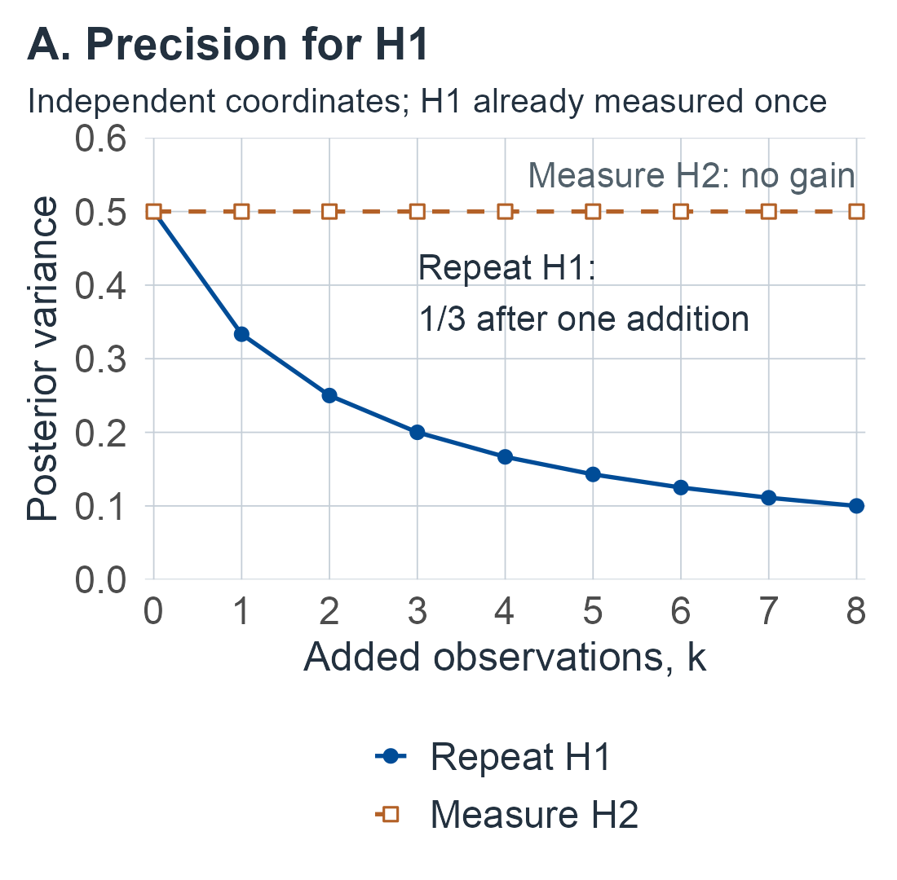

# Design and validation {#sec-design}

```{=html}
<style>
.m12-page #quarto-content > *, .m12-page main.content { min-width: 0; }
.m12-scroll { max-width: 100%; min-width: 0; overflow-x: auto; }
.m12-scroll .math.display { overflow: visible; }
.m12-scroll mjx-container[display="true"] { max-width: none; width: max-content; min-width: 100%; overflow: visible; }
.m12-scroll:focus-visible, .m12-page .math.inline:focus-visible { outline: 3px solid var(--book-focus); outline-offset: 3px; }
.m12-page .math.inline { display: inline-block; max-width: 100%; overflow-x: auto; overflow-y: hidden; padding-block: .15em; vertical-align: middle; }
.m12-figure-panels { display: grid; gap: .6rem; }
.m12-figure-panels p { margin: 0; }
.m12-figure-panels img { width: 100%; height: auto; }
</style>

<script>
document.body.classList.add('m12-page');
(function () {
  function nameOverflow() {
    document.querySelectorAll('main .math.inline').forEach(function (element) {
      if (element.scrollWidth > element.clientWidth + 2) {
        element.tabIndex = 0;
        element.setAttribute('role', 'group');
        element.setAttribute('aria-label', 'Long mathematical expression; scroll horizontally');
      } else {
        element.removeAttribute('tabindex');
        element.removeAttribute('role');
        element.removeAttribute('aria-label');
      }
    });
  }
  function start() {
    let pending = false;
    function settle() {
      if (pending) return;
      pending = true;
      requestAnimationFrame(function () { requestAnimationFrame(function () { pending = false; nameOverflow(); }); });
    }
    const sizes = window.ResizeObserver ? new ResizeObserver(settle) : null;
    function observeMath() {
      if (sizes) document.querySelectorAll('main .math.inline, main .math.inline mjx-container, main .math.inline mjx-math').forEach(function (element) { sizes.observe(element); });
      settle();
    }
    function whenMathReady() {
      if (window.MathJax && MathJax.startup && MathJax.startup.promise) MathJax.startup.promise.then(observeMath);
      else setTimeout(whenMathReady, 150);
    }
    whenMathReady();
    if (document.fonts) {
      document.fonts.ready.then(observeMath);
      document.fonts.addEventListener('loadingdone', observeMath);
    }
    document.addEventListener('keydown', function (event) {
      const element = event.target;
      if (!(element instanceof HTMLElement) || !element.matches('.m12-scroll, .math.inline[role="group"]')) return;
      if (event.altKey || event.ctrlKey || event.metaKey || event.shiftKey || element.scrollWidth <= element.clientWidth + 2) return;
      const step = Math.max(48, parseFloat(getComputedStyle(element).fontSize) * 3);
      if (event.key === 'ArrowRight' || event.key === 'ArrowLeft') {
        element.scrollLeft += event.key === 'ArrowRight' ? step : -step;
        event.preventDefault();
      } else if (event.key === 'Home' || event.key === 'End') {
        element.scrollLeft = event.key === 'Home' ? 0 : element.scrollWidth;
        event.preventDefault();
      }
    });
    window.addEventListener('resize', settle);
    window.addEventListener('scroll', settle, { passive: true });
    document.addEventListener('keydown', function (event) { if (event.key === 'Tab') nameOverflow(); }, true);
    const main = document.querySelector('main');
    if (main) new MutationObserver(settle).observe(main, { childList: true, subtree: true, attributes: true, attributeFilter: ['style', 'class'] });
    new MutationObserver(settle).observe(document.documentElement, { attributes: true, attributeFilter: ['style'] });
  }
  if (document.readyState === 'loading') document.addEventListener('DOMContentLoaded', start, { once: true });
  else start();
}());
</script>
```

## One more hour: which observation should it buy? {#sec-m12-targets}

Start with a small budget decision. A synthetic person has two cognitive coordinates, $H_1$ and $H_2$, which in the reference population are independent and standard normal. One noisy observation of $H_1$ has been made, with error variance 1; $H_2$ has not yet been measured. The budget allows one more observation of the same quality. It can repeat the first measure or measure the second coordinate for the first time.

Before reading on, predict which addition helps more when the question is how the two coordinates differ, $H_1-H_2$. Repeating the measure that already has data is tempting: it makes the existing score more dependable.

For the contrast, the new domain does three times as much. After the first observation the posterior variance of $H_1-H_2$ is $3/2$. A second observation of $H_1$ reduces it by $1/6$; a first observation of $H_2$ reduces it by $1/2$. If the question is instead $H_1$ alone, the order reverses: the repeat reduces its variance from $1/2$ to $1/3$, and the $H_2$ observation leaves it unchanged. Same tests, same costs, opposite answers. The target, not the test, decided ([proper-prior precision](#sec-m12-bayesian-design)). @fig-m12-next-observation follows the two strategies for up to eight added observations. However many repeats of $H_1$ are made, the variance of the contrast never falls below 1, the prior variance of $H_2$. The repeats cannot supply information about a coordinate they do not measure.

The same question arises with every kind of observation a clinic or study can buy. The rows of @tbl-m12-next-observation are the chapter's own synthetic examples, each answering it for one kind of addition.

::::: {.m12-scroll role="group" tabindex="0" aria-label="M12 table 1; scroll horizontally"}

| Candidate observation | What it can improve | Synthetic answer in this chapter | What it cannot supply | Developed in |
|---|---|---|---|---|
| Another occasion of the same measure | Precision for the measured coordinate | Variance of $H_1$ falls from $1/2$ to $1/3$; the contrast gains only $1/6$ | Identification of an unmeasured coordinate without a linking restriction | [Estimability](#sec-m12-linear-design), [posterior gain](#sec-m12-bayesian-design) |
| A new domain or test | A contrast or a class separation that needs it | The contrast gains $1/2$; a test with no class mean difference can still add separation (marginal gain .16 against $1/9$) | A precision gain when its conditional covariance with the target is zero (in the Gaussian model) | [Posterior gain](#sec-m12-bayesian-design), [suppressors](#sec-m12-kkt) |
| More tasks or raters | A person's expected score over a replication universe | With supplied variance components, 6 tasks and 3 raters minimize absolute error (10.72) within a cost of 40 | Knowledge of the components: calibration with two raters leaves the 95% upper error of the selected design near 32,000 | [Decision study](#sec-m12-replication) |
| More reference people | A norm's mean, tail frequency or quantile | A two-stratum pilot leads to 44 and 14 people for the unshrunk mean; 299 people with no tail events bound a 1% tail at 95% | A future patient's measurement error | [Reference samples](#sec-m12-norms) |
| An anchor or bridging comparison | An offset or a link between scales | 14 calibration people and 13 case repeats give expected squared error .63 within a budget of 40 | An offset drift between calibration and the case; more of either kind leaves it unidentified | [Anchors](#sec-m12-anchors) |
| Outcome verification | The error rate in the target population | With 30 of 100 targets unverified, the error rate is identified only within $[.14,.44]$ | A narrower range from more records of the same incomplete kind; randomized verification changes the likelihood | [Verification](#sec-m12-verification-design) |
| Independent validation people | The performance of the procedure actually used | A reused tuning minimum reports .184; nested validation of the same algorithm gives .205 | Transport to a different population or setting | [Validation](#sec-m12-validation) |

: One budget, seven kinds of observation. All inputs are synthetic teaching values; each row is a separate stated experiment, not one dataset. {#tbl-m12-next-observation}

:::::

::: {#fig-m12-next-observation}

::: {.m12-figure-panels}

<p><a href="figures/m12-next-observation-1.png" aria-label="Open full-size M12 panel 1"></a></p>

<p><a href="figures/m12-next-observation-2.png" aria-label="Open full-size M12 panel 2"></a></p>

:::

The opening budget decision, from the synthetic precision example of [the proper-prior section](#sec-m12-bayesian-design). Two independent standard-normal coordinates; one unit-error observation of $H_1$ already made, so the current posterior covariance is $\operatorname{diag}(1/2,1)$; each added observation measures one coordinate with error variance 1 and updates the covariance by @eq-m12-increment. **A.** Posterior variance of $H_1$ when the $k$ added observations all repeat $H_1$, or all measure $H_2$. **B.** Posterior variance of the contrast $H_1-H_2$ for the same two strategies and for the best split of $k$ between them. Repeating $H_1$ alone approaches but never reaches the prior variance 1 of $H_2$. All values are exact rational calculations.

:::

Three ideas organize the chapter. First, identification comes before optimization: when repeated observations of the wrong quantity cannot determine the target, the next observation must be of a different kind. Second, the value of an identifying observation depends on the declared target, the correlations among measures, and what is still uncertain about the calibration. Third, a fitted procedure has to be judged as it will be used. The risk of one frozen fit and the risk of the complete learning algorithm, retrained on new development data, are different quantities.

The general setting is as follows. A clinic can spend its next hour repeating an uncertain measure, adding a different domain, obtaining an anchor, enlarging a reference sample, or verifying an outcome. These observations solve different problems. More reliable scores may scarcely change a decision when the new observation duplicates existing evidence. More reference people can stabilize a percentile while leaving an unidentified latent scale untouched. A carefully measured outcome can be more valuable than another cognitive score when the question concerns prognosis.

Design therefore begins with the question to be answered. Let $d$ specify the people, items, raters, forms, occasions, reference sampling, outcome verification and administration policy. Write the resulting record as $O_d\sim p_\theta^d$, with unknown parameters $\theta$, and let $\psi(\theta)$ be the declared target. The target might instead include a particular person's fixed latent coordinate $h$, or a future person's clinical outcome. State this before optimizing a criterion. The observation kernel concerns raw responses or scores; a reported normed coordinate, a latent expected score and a disease state are not interchangeable targets.

Let $\mathcal A$ denote the **entire** learning algorithm, including transformations, item calibration, norm fitting, feature and covariance selection, threshold setting, administration and stopping. A fitted rule is $f_{\mathcal A,T,d}$, where $T$ is its development sample. For a new record/target $(X,D)$, two useful risks are

::::: {.m12-scroll role="group" tabindex="0" aria-label="M12 equation 1; scroll horizontally"}

$$
\begin{aligned}
R_\theta(f\mid T,d)&=E_\theta[L\{f_{\mathcal A,T,d}(X),D\}\mid T,d],\\
\mathcal R_\theta(\mathcal A,d)&=E_{T\sim p_\theta^d}R_\theta(f\mid T,d).
\end{aligned}
$$ {#eq-m12-learned-risk}

:::::

The first describes the particular deployed fit; the second averages over repeated development studies of specified sizes and protocols. They can differ substantially. Include testing burden, money, delay and verification costs in $C(d)$ or in the loss itself, avoiding double counting. The feasible set must describe integer item counts, available forms, admissible raters, maximum delay, patient burden and minimum subgroup representation. An unconstrained information optimum need not be feasible.

## How the chapter is organized {#sec-m12-roadmap}

The chapter moves from a fixed person's precision to the validation of an entire fitted procedure. Each unit treats one kind of observation from @tbl-m12-next-observation and says what that observation cannot supply.

For a first reading, follow [target and criterion](#sec-m12-criteria), the [posterior precision example](#sec-m12-bayesian-design), and [anchor identification](#sec-m12-anchors) with its [noisy-anchor calculation](#sec-m12-noisy-anchor-design). Then read [selection optimism](#sec-m12-selection-optimism), [independent](#sec-m12-holdout) and [nested validation](#sec-m12-nested), [verification](#sec-m12-verification-design), and the [return to the budget](#sec-m12-budget-return). Read every calculation you use with its conditions and derivation. The [question guide](#sec-m12-guide) gives returning readers a direct consultation route.

For calibration and allocation in greater depth, choose [facets](#sec-m12-replication), [items](#sec-m12-items-battery), [operating criteria](#sec-m12-operating-design) or [reference samples](#sec-m12-norms). For learned procedures, continue through [posterior learning risk](#sec-m12-learning-posterior), the [complete fitted example](#sec-m12-fitted-example) and [transport](#sec-m12-transport). These are extensions of the core route; their assumptions remain essential whenever their results are used.

The prerequisite bridges are [replication universes](05-measurement-and-replication.md#sec-m05-gt), [item and score information](06-items-and-scoring.md#sec-m06-information), and [loss-based value of information](11-clinical-targets-and-decisions.md#sec-m11-information). The examples and symbol list below are available for lookup as each experiment is introduced.

::::: {.m12-scroll role="group" tabindex="0" aria-label="M12 table 2; scroll horizontally"}

| Unit | Design question | What it adds | What it cannot establish alone |
|---|---|---|---|
| [Target and criterion](#sec-m12-criteria) | Which target, and which criterion: precision, power, information or loss? | Estimability, nuisance information, posterior gain from an added observation | A clinical loss or a causal benefit |
| [Replications and facets](#sec-m12-replication) | More tasks, raters or people? | Decision-study errors, feasible integer budgets, simultaneous calibration regions, a proper posterior over components | A replication universe the calibration did not sample |
| [Items and batteries](#sec-m12-items-battery) | Where should items and effort go? | Allocation for a contrast, the item information budget, a learned item design with all response probabilities unknown | Validity of the anchoring states or response kernel |
| [Operating and global criteria](#sec-m12-operating-design) | Estimate a person, detect a shift, support one action, or rank two populations? | Different optimal thresholds, correlated allocation, suppressors, a calibrated correlated comparison | A battery that is best for every question |
| [Reference samples](#sec-m12-norms) | How many reference people, in which strata, how far into the tail? | Stratified and pilot allocation, tail and quantile precision, regression design, clustering | Measurement error or construct comparability |
| [Anchors, forms and time](#sec-m12-anchors) | Which observation resolves an ambiguity? | Linking graphs, scale gauges, noisy-anchor designs, drift bounds | A split that the likelihood cannot see |
| [Validation](#sec-m12-validation) | Does the procedure that will be used generalize? | Selection optimism, holdout and paired guarantees, nested validation, posterior learning risk, a complete fitted example | Transport to another population |
| [Transport and verification](#sec-m12-transport) | Will the evidence apply in the target setting? | Target weights, missing and randomized verification, assurance, an empirical program | The transport assumption itself |
| [Returning to the budget](#sec-m12-budget-return) | In what order should the choice be made? | Identification, target value, feasible allocation, validation and transport, applied to the chapter's examples | A recommendation for a real clinic |

:::::

Exact algebra, named distributions, finite sums, numerical quadrature and simulation have different roles, and each example states which it uses. Confidence statements concern a repeated-sampling experiment; credible statements concern a stated prior and likelihood. A [lookup guide](#sec-m12-guide) near the end of the chapter collects design questions with the sections that answer them.

## Synthetic examples and reused symbols {#sec-m12-examples}

Every numerical example is a synthetic teaching input with stipulated parameters, chosen so that its result can be checked. None is an instrument's norms, an estimate from patients, a measured cost or a clinical cutoff. Separate examples are separate experiments, even when two of them use similar numbers.

::::: {.m12-scroll role="group" tabindex="0" aria-label="M12 table 3; scroll horizontally"}

| Example | Inputs | What it shows | Where |
|---|---|---|---|
| Two coordinates | Independent standard-normal $H_1,H_2$; unit-error observations; $H_1$ observed once | The useful addition changes with the target | @tbl-m12-next-observation; [posterior gain](#sec-m12-bayesian-design) |
| Crossed decision study | 20 people, 4 tasks, 2 raters; seven mean squares; component grid; cost $2J+3K+JK\le40$ | Supplied, posterior and simultaneous-confidence design choices | [Decision-study posterior](#sec-m12-gt-posterior) |
| Contrast allocation | $c=(1,-1)$, $\sigma=(1,2)$, budget 12 | $(4,8)$ has variance .75; equal allocation $5/6$ | [Resource problems](#sec-m12-budget) |
| Two logistic items | $a=(1,2)$, $b=(0,1)$ | Moment bound, total and full-response information at $h=0$; population-shift information | [Item information](#sec-m12-item-information), [global ranking](#sec-m12-global-design) |
| Two calibrated item types | 20 calibration responses per type and state; 12 state-1 anchors among 40; cost at most 3 | Posterior choice of three A responses; simultaneous bounds that do not rank it | [Learned item design](#sec-m12-calibrated-battery) |
| Three thresholds | Class separation 1, prevalence .1, equal costs | Local, global and operating criteria choose 0, .5 and 2.70 | [Global ranking](#sec-m12-global-design) |
| Waterfill and suppressor | $\delta=(1,.5)$, budget 2; correlation .6 with $\delta=(1,0)$ | Separation .6875; a test with no mean difference has marginal value | [Allocation](#sec-m12-kkt) |
| Calibrated correlated design | 81-point parameter family; 12 people per class | Learned $(4,0)$ design, error .351, confidence range $[.327,.400]$ | [Calibrated comparison](#sec-m12-correlated-calibration) |
| Stratified pilot | Weights $(.8,.2)$, costs $(1,4)$, eight pilot people per stratum | Allocations $(40,15)$, $(44,14)$ and $(56,11)$ for different estimators and uncertainty | [Pilot](#sec-m12-norm-pilot) |
| Constructed regression | 20 endpoint covariates, $y_i=50+2x_i+\sin(i)$ | Mean versus new-score halfwidths; proper prior | [Regression](#sec-m12-regression-design) |
| Noisy anchor | 8 calibration differences; 4 case repeats | Interval for the case coordinate, drift sensitivity, a next-study allocation | [Anchor study](#sec-m12-anchor-drift) |
| Selection optimism | Two procedures with true error .3 | Expected reported minimum .25 | [Selection](#sec-m12-selection-optimism) |
| Paired validation | Counts $(70,15,5,10)$ | Exact test, posterior, power and assurance | [Paired comparison](#sec-m12-paired-validation), [assurance](#sec-m12-assurance) |
| Majority learner | Pilot 12 of 40; nine-person training samples | Confidence image and posterior for a repeated-learning risk | [Learning posterior](#sec-m12-learning-posterior) |
| Adaptive six-score pipeline | 120 development people; 24 tuned policies; 100 complete replications | Reused, nested, matched and final-fit losses | [Fitted example](#sec-m12-fitted-example) |
| Two-stratum transport | 3 of 60 and 5 of 20 errors; 30 of 50 in stratum 2 | Source versus target weighting; drift sensitivity | [Target weights](#sec-m12-target-weights) |
| Missing and randomized verification | 14, 56 and 30 of 100; rates $(.1,.4)$ with probabilities $(.2,.8)$ | Identified interval; weighting and allocation | [Verification](#sec-m12-verification-design), [randomization](#sec-m12-random-verification) |

:::::

The chapter needs more objects than there are convenient letters. Where an earlier chapter already named an object, this chapter carries the name forward: $v_P,\dots,v_e$, $\lambda_A$, $v_{\mathrm{rel}}$, $v_{\mathrm{abs}}$ and $\rho_{\mathrm{rel}},\rho_{\mathrm{abs}}$ for the decision study, as in the measurement chapter; $I_U$, $I_X$ and the derivative scores $\mathcal S_U$, $\mathcal S_X$, as in the items chapter; $h_x$ for leverage and $\Gamma$ for an external bound, as in the administration chapter; $\pi_s,\pi_f,\pi_m$ and $\theta_0$ for verified-error, verified-correct and unverified probabilities and the error rate among the unverified, as in the administration and clinical-targets chapters; $c_{\mathrm{FP}},c_{\mathrm{FN}}$ for costs and $d$ for a class separation, as in the clinical-targets chapter; and $\operatorname{IW}_p(\nu_0,\Psi_0)$ with posterior $\nu_n,\Psi_n$, as in the change and robustness chapters. Letters that keep a second meaning are marked by footnotes at first use. The most consequential are:

- $K$, $J$: the numbers of raters and tasks in a decision study ($K_c$, $J_c$ in calibration); $K_0$, $K_d$, $K_n$ are covariance matrices, or covariance factors in the regression unit; $K$ and $K_\gamma$ are also binomial counts.
- $I_\delta$: Fisher information about a population shift, distinct from the fixed-person information $I_U(h)$.
- $R$: the rater facet of a decision study; a risk ($R_d$, $R_T$, $R_t$, $R(q)$); and the within-class latent covariance in the correlated-design units.
- $M$: the precision matrix of the linear experiment, a discordant-pair count, and the size of a target survey; $m$ counts candidate procedures in the validation unit.
- $B$: a budget, the incidence matrix of a linking graph, the beta function $B(\cdot,\cdot)$ and the majority probability $B_9$.
- $Q$: class separation $Q(\lambda)$; $\omega$ is the discordant share in the paired posterior.
- $c$, $d$, $t$: a target coefficient vector and costs; a design, a class separation and contrast degrees $d_A$; thresholds, including the Bayes threshold $t_*$.
- $h$: a person's latent coordinate, and a stratum, state or class index.
- $\delta$: a population shift or class mean difference ($\tilde\delta$ after whitening), an offset drift, and a logit drift $\delta_h$.
- $\lambda$, $\nu$, $\kappa$, $e$, $v$: decision-study eigenvalues and coordinate precisions ($\lambda_+$ their sum); multipliers and degrees of freedom; precision per cost and prior counts; variances in the anchor study, and a verification probability $e(X)$.

## Target, precision and the design criterion {#sec-m12-criteria}

The opening comparison used one target and one criterion: posterior variance of a contrast. This unit sets out that calculation for any linear measurement, then separates four criteria that are easy to conflate: precision of a target, power to detect a stated alternative, expected information gain, and expected loss of an action.

### Target precision in a linear measurement experiment {#sec-m12-linear-design}

A useful exact benchmark is $Y=X_dh+\varepsilon$, where $h\in\mathbb R^q$ is a fixed person's coordinate, $X_d$ is a supplied loading/design matrix and $\varepsilon\sim N(0,V_d)$ with known positive definite $V_d$. The target is $\psi=c^Th$, with fixed $c$. Rows can represent test indicators, repeats or experimental conditions, provided their shared errors are in $V_d$. This is the linear factor/SEM measurement branch; CTT expectations over the declared errors give $E_hY=X_dh$. It is not a universal model of item scores.

::: {#prp-m12-target-estimability}
## Estimability determines whether precision can be purchased

Put $M=X_d^TV_d^{-1}X_d$. The target $c^Th$ is identified by this experiment exactly when $c$ is in the row space of $X_d$. In that case, with $M^+$ the symmetric Moore–Penrose inverse,

::::: {.m12-scroll role="group" tabindex="0" aria-label="M12 equation 2; scroll horizontally"}

$$
\widehat\psi=c^TM^+X_d^TV_d^{-1}Y,\qquad
s_d^2=c^TM^+c,
$$ {#eq-m12-c-precision}

:::::

and $\widehat\psi\sim N(c^Th,s_d^2)$. For $c\ne0$ estimable, $s_d^2>0$, so $\widehat\psi\pm z_{1-\alpha/2}s_d$ has exact $1-\alpha$ coverage over fresh measurement errors with this fixed design, loading and covariance. It minimizes variance among linear unbiased estimators of this target.
:::

::: {.proof}
Two coordinates give the same complete normal law exactly when their difference $v$ satisfies $X_dv=0$. The functional is constant on all such pairs exactly when $c$ is orthogonal to this null space, equivalently in the row space. Also $M$ has the same null space as $X_d$, since $v^TMv=\|V_d^{-1/2}X_dv\|^2$. Thus $M^+M c=c$ for an estimable $c$, giving unbiasedness and the stated variance by multiplication. For any other linear unbiased estimator $a^TY$, $X_d^Ta=c$. Let $a_*=V_d^{-1}X_dM^+c$. Write $a=a_*+b$; then $X_d^Tb=0$ and $b^TV_da_*=b^TX_dM^+c=0$. Therefore $a^TV_da=s_d^2+b^TV_db\ge s_d^2$. Normality gives the confidence statement. These are exact sampling results for supplied $X_d,V_d$, not for arbitrary fitted substitutes.
:::

For example, one noisily observed first coordinate identifies $h_1$ even though $h_2$ is unidentified. It does not identify $h_1-h_2$: changing $h_2$ leaves the data law unchanged. Repeating the first observation indefinitely cannot solve that problem. A test of $h_2$, or a justified restriction relating the coordinates, changes identification.

Nuisance coordinates also consume information when all coordinates are identified. Partition a positive definite $M$ for a scalar target coordinate and nuisance vector as

::::: {.m12-scroll role="group" tabindex="0" aria-label="M12 equation 3; scroll horizontally"}

$$
M=\begin{pmatrix}a&b^T\\b&C\end{pmatrix},\qquad
(M^{-1})_{11}=\{a-b^TC^{-1}b\}^{-1}.
$$ {#eq-m12-schur}

:::::

Complete the quadratic form as $(u+C^{-1}bt)^TC(u+C^{-1}bt)+(a-b^TC^{-1}b)t^2$ to prove the effective precision and its positivity. The upper-left information $a$ is the precision only when the nuisance is known or orthogonal in this metric. Calibration data that identify offsets or loadings can be valuable even if they do not directly measure the case's target.

### The same measurement with a proper population prior {#sec-m12-bayesian-design}

For the same likelihood, supply $H\sim N(m_0,K_0)$ with positive definite $K_0$, independent of measurement errors. Completing the square in $h$ gives

::::: {.m12-scroll role="group" tabindex="0" aria-label="M12 equation 4; scroll horizontally"}

$$
\begin{aligned}
K_d&=(K_0^{-1}+M)^{-1},\\
m_d&=K_d(K_0^{-1}m_0+X_d^TV_d^{-1}Y),\\
c^TH\mid Y,d&\sim N(c^Tm_d,c^TK_dc).
\end{aligned}
$$ {#eq-m12-gaussian-design-posterior}

:::::

The posterior is proper because its precision is positive definite, including rank-deficient $X_d$. For squared error, the optimal reported coordinate is $c^Tm_d$ and its posterior mean squared error is $c^TK_dc$. Averaging over the prior predictive records leaves that same variance because it is constant in $Y$. This is Bayes risk over the stipulated population, whereas the preceding confidence interval treats $h$ as fixed. A proper prior can bound uncertainty along an unobserved direction; it does not make that direction identifiable from the measurement likelihood. Sensitivity in such directions is necessary.

For an added scalar observation $W=x^TH+\eta$, $\eta\sim N(0,v)$ independent of previous errors and $H$, the existing posterior covariance $K$ changes to

::::: {.m12-scroll role="group" tabindex="0" aria-label="M12 equation 5; scroll horizontally"}

$$
K_{\mathrm{new}}=K-\frac{Kxx^TK}{v+x^TKx},\qquad
\Delta\operatorname{Var}(c^TH)=\frac{(c^TKx)^2}{v+x^TKx}.
$$ {#eq-m12-increment}

:::::

Multiply the proposed inverse by $K^{-1}+xx^T/v$ to verify it. The target gain depends on conditional relevance $c^TKx$, as well as noise. Correlated new errors require first conditioning on the old record, which changes both $x$ and $v$; treating duplicate scores as independent overstates the gain.

**Synthetic precision example.** Take independent standard-normal coordinates and unit-error observations. After observing $H_1$ once, $K=\operatorname{diag}(1/2,1)$. For target $H_1$, another $H_1$ observation reduces variance from $1/2$ to $1/3$, while an $H_2$ observation gives no gain. For target $H_1-H_2$, the starting variance is $3/2$: another $H_1$ observation reduces it by $1/6$, while the first $H_2$ observation reduces it by $1/2$. The most useful addition changes with the target, under identical tests and costs.

### Precision, power, information and action answer different questions {#sec-m12-objectives}

In the fixed-target normal experiment, test $H_0:\psi\le\psi_0$ using $\widehat\psi>\psi_0+z_{1-\alpha}s_d$. The null rejection probability is at most $\alpha$, and at the prespecified alternative $\psi=\psi_0+\Delta$ it is

::::: {.m12-scroll role="group" tabindex="0" aria-label="M12 equation 6; scroll horizontally"}

$$
\operatorname{Power}_d(\Delta)=\Phi(\Delta/s_d-z_{1-\alpha}).
$$ {#eq-m12-power}

:::::

This follows by standardizing the exact sampling law; $\Delta>0$ is required for the intended directional power comparison. Selecting the direction or estimated error from these same outcomes changes the experiment. A design with high power for one contrast need not detect another.

Information gain is another criterion. @lindley1956measure [pp. 987-990] defined the average information an experiment provides, gave its joint-density form, proved it nonnegative, and proposed performing the experiment with the greatest expected gain. For a proper discrete target prior or densities for which the following integrals are finite, define expected posterior-to-prior divergence

::::: {.m12-scroll role="group" tabindex="0" aria-label="M12 equation 7; scroll horizontally"}

$$
\mathcal I_d=E_{O_d}\int\pi(\psi\mid O_d,d)
 \log\frac{\pi(\psi\mid O_d,d)}{\pi(\psi)}\,d\psi.
$$ {#eq-m12-information-gain}

:::::

This is mutual information: substitute Bayes' rule to obtain the joint-density integral $\int p(\psi,o)\log\{p(\psi,o)/(p(\psi)p(o))\}\,d\psi\,do$. Nonnegativity follows from $-\log t\ge1-t$ integrated under the joint law, with equality only at independence. Expected posterior information is a design criterion; the identities and Gaussian specialization here are directly derived. In the scalar-target Gaussian case, entropy integration gives
$\mathcal I_d=\tfrac12\log\{c^TK_0c/(c^TK_dc)\}$ for nonzero $c$. For the whole vector it is $\tfrac12\log\det(I+K_0M)$, which can favor measuring a coordinate irrelevant to a particular clinical decision.

For a finite action set and a loss integrable under every predictive law used, the relevant criterion is instead

::::: {.m12-scroll role="group" tabindex="0" aria-label="M12 equation 8; scroll horizontally"}

$$
\mathcal B(d)=E_{O_d}\min_a E[L(a,D)\mid O_d,d]+C(d).
$$ {#eq-m12-design-loss}

:::::

This expectation includes unknown calibration/norm/outcome parameters under their joint proper posterior or design prior. It must integrate the predictive joint law of outcomes and observations; inserting an estimated parameter can change both the posterior actions and their risk. For nested observations with zero added cost, the minimum expected loss cannot increase: one admissible policy ignores the additional observation. With positive costs or forced actions that conclusion does not hold. Neither the information criterion nor a repeatability coefficient supplies the required clinical loss or proves that acting on a test changes an outcome. [Clinical targets and decisions](11-clinical-targets-and-decisions.md#sec-m11-information) develops that distinction.

All numerical choices in this chapter are synthetic teaching experiments. They illustrate design calculations, without clinical cutoffs, estimated patient effects or empirical recommendations.

## Replications, people and facets: a decision study {#sec-m12-replication}

The third row of @tbl-m12-next-observation asked whether to add tasks or raters. The answer depends on two things that are easy to run together: how the future average's error depends on the facet counts, and how well a calibration study has learned the variance components that determine that error. This unit treats them in that order, ending with the worked study behind the table's row.

Suppose the target is a person's expected score over new tasks and raters, on the original score metric. The [crossed GT experiment](05-measurement-and-replication.md#sec-m05-gt) writes
$Y_{ijk}=\mu+P_i+T_j+R_k+(PT)_{ij}+(PR)_{ik}+(TR)_{jk}+e_{ijk}$.
Persons, tasks and raters are independently sampled; each random array is centered and independent of the others. A calibration study observes every cell for $n$ people, $J_c$ tasks and $K_c$ raters. A future clinical design uses $J$ fresh tasks and $K$ fresh raters. Its target is $\tau_i=\mu+P_i$, not the person's expectation conditional on particular fixed raters.

Averaging independent array entries gives

::::: {.m12-scroll role="group" tabindex="0" aria-label="M12 equation 9; scroll horizontally"}

$$
\begin{aligned}
v_{\mathrm{rel}}(J,K;v)&=v_{PT}/J+v_{PR}/K+v_e/(JK),\\
v_{\mathrm{abs}}(J,K;v)&=(v_T+v_{PT})/J+(v_R+v_{PR})/K
 +(v_{TR}+v_e)/(JK).
\end{aligned}
$$ {#eq-m12-d-study}

:::::

Absolute mean squared error of the future average about $\tau_i$ is $v_{\mathrm{abs}}$. For two people using the same sampled tasks/raters, common task/rater offsets cancel and error variance of their difference is $2v_{\mathrm{rel}}$. With separately sampled facets these offsets do not cancel. The relative and absolute coefficients $\rho_{\mathrm{rel}}=v_P/(v_P+v_{\mathrm{rel}})$ and $\rho_{\mathrm{abs}}=v_P/(v_P+v_{\mathrm{abs}})$, written $G$ and $\Phi$ in many GT texts, are useful population summaries when denominators are positive. They are not probabilities of a correct clinical decision. A high person variance can raise either coefficient without reducing anyone's absolute error.

A decision study predicts these errors under alternative facet counts; the variance coefficients are properties of a declared replication universe. GT's classical multiple-source framework is credited to @gleser1965generalizability; the averaging, sampling and allocation arguments used here are supplied explicitly rather than assumed from that attribution. If a stable test-specific effect belongs to the target, it must stay in the numerator/target rather than be averaged away as transient noise. Fixed forms, serially correlated states and practice require another kernel, as in [Measurement and replication](05-measurement-and-replication.md#sec-m05-gt-universe).

### Optimize a feasible budget, not an unconstrained coefficient {#sec-m12-gt-cost}

Let cost be $C(J,K)=c_TJ+c_RK+c_EJK$ with nonnegative supplied costs, at least one positive, and choose positive integers from a finite feasible set $\mathcal F$ with cost at most $B$. The three terms distinguish creating tasks, recruiting/training raters and scoring cells. They are teaching cost units rather than measured minutes. Minimize the relevant error over all feasible pairs, or add a declared error-to-cost tradeoff. Integer enumeration is exact for this finite set. Rounding a continuous solution can miss the optimum or violate the budget.

For a simpler repeat design with $m$ equivalent independent administrations, $Y_{it}=\mu+P_i+e_{it}$, $\operatorname{Var}P_i=a$ and $\operatorname{Var}e_{it}=e$, the person's average error is $e/m$. Increasing the number of calibration people estimates $a,e$ more precisely; it does not divide a future patient's measurement error by that number. At fixed total calibration readings $N=nm$, between-person mean information is $n/(a+e/m)=N/(ma+e)$. For $a>0$ this decreases with larger $m$: more independent people improve population-mean precision, while repeats are needed to separate $a$ from $e$ and to estimate within-person error. If $m=1$, only $a+e$ is identified by the complete normal law. A design optimal for the mean alone can therefore fail the measurement-calibration question.

### A finite calibration region protects a selected design {#sec-m12-gt-confidence}

Now all seven components are unknown. Assume independent Gaussian arrays, $n,J_c,K_c\ge2$, residual $v_e>0$ and other components nonnegative. Let $A$ range over $e,PT,PR,TR,P,T,R$, and let $d_A$ and $SS_A$ be the balanced orthogonal contrast degrees and sums of squares. In the same order,

::::: {.m12-scroll role="group" tabindex="0" aria-label="M12 equation 10; scroll horizontally"}

$$
\begin{aligned}
\lambda_e&=v_e,&\lambda_{PT}&=v_e+K_cv_{PT},\\
\lambda_{PR}&=v_e+J_cv_{PR},&\lambda_{TR}&=v_e+nv_{TR},\\
\lambda_P&=v_e+K_cv_{PT}+J_cv_{PR}+J_cK_cv_P,\\
\lambda_T&=v_e+K_cv_{PT}+nv_{TR}+nK_cv_T,\\
\lambda_R&=v_e+J_cv_{PR}+nv_{TR}+nJ_cv_R.
\end{aligned}
$$ {#eq-m12-gt-eigenvalues}

:::::

The degrees are $(n-1)(J_c-1)(K_c-1)$, $(n-1)(J_c-1)$, $(n-1)(K_c-1)$, $(J_c-1)(K_c-1)$, $n-1$, $J_c-1$, $K_c-1$. To verify the law rather than import a coefficient formula, project the Gaussian cell vector onto the tensor products of constant and centered subspaces for the three factors. Each covariance array acts as scalar $\lambda_A$ on space $A$, and different spaces are orthogonal. Their normal coordinates are independent, hence $SS_A/\lambda_A\sim\chi^2_{d_A}$ independently. The same decomposition gives a grand mean independent of these contrasts.

Set $\epsilon=1-(1-\alpha)^{1/7}$. Invert each central chi-square event to obtain

::::: {.m12-scroll role="group" tabindex="0" aria-label="M12 equation 11; scroll horizontally"}

$$
\mathcal C=\left\{v\ge0, v_e>0:
 \frac{SS_A}{\chi^2_{d_A,1-\epsilon/2}}
 \le\lambda_A(v)\le
 \frac{SS_A}{\chi^2_{d_A,\epsilon/2}} \text{for all }A\right\}.
$$ {#eq-m12-gt-region}

:::::

By independence $P_v(v\in\mathcal C)=1-\alpha$. Intersecting with the true nonnegative-component domain does not alter the true-inclusion event. The region may be empty for some data; report that incompatibility. It does not justify negative population variances or an invented zero-width interval.

For each feasible design let $r^-_d=\inf_{v\in\mathcal C}r_d(v)$ and $r^+_d=\sup_{v\in\mathcal C}r_d(v)$, where $r_d$ is the declared relative or absolute error. These are linear optimizations over a bounded polyhedral closure; the strict residual positivity can be handled by limits. Conservative component-box bounds also suffice. On the one event $v\in\mathcal C$, **all** these design-error bounds hold, including for a design $\widehat d$ selected after inspecting the calibration:

::::: {.m12-scroll role="group" tabindex="0" aria-label="M12 equation 12; scroll horizontally"}

$$
0\le r_{\widehat d}(v)-\min_{d\in\mathcal F}r_d(v)
 \le r^+_{\widehat d}-\min_{d\in\mathcal F}r^-_d.
$$ {#eq-m12-design-regret}

:::::

The proof is $r_{\widehat d}\le r^+_{\widehat d}$ and $\min r_d\ge\min r^-_d$ on that same event. Thus the reported upper bound has at least $1-\alpha$ simultaneous coverage for the selected design's excess MSE over this finite candidate family. It is not a bound on every clinical loss or on a newly changed replication universe. Choosing the smallest upper error is one conservative rule; broad intervals can leave designs essentially unordered.

A prospective fixed-person confidence interval follows too. Use a component region of error probability $\alpha_1$ and the selected design's upper absolute variance $r^+_{\widehat d}$. With entirely fresh case facets/errors independent of calibration and $\alpha_1+\alpha_2=\alpha$, the interval
$\bar Y_i\pm z_{1-\alpha_2/2}\sqrt{r^+_{\widehat d}}$
covers $\tau_i$ with probability at least $1-\alpha$ over calibration and case sampling. Conditional on calibration and the true components, the case error is normal with variance $r_{\widehat d}(v)$; on true inclusion it is no larger than the bound. The union bound proves the claim. A point estimate of reliability substituted into a normal interval has no such general guarantee.

### A proper posterior evaluates the same uncertain decision study {#sec-m12-gt-posterior}

A transparent finite example keeps every variance unknown without hiding a high-dimensional numerical fit. Give each component an independent discrete prior on $\{v^*_j/2,v^*_j,2v^*_j\}$ with positive probabilities, and $\mu\sim N(50,100)$ independently. This is a deliberately finite teaching prior on positive variances, with respect to counting measure; it excludes exact zero and all values outside its grid. A continuous or spike-and-slab prior may be preferable in an application, but would give different probabilities.

Conditional on $v$, the independent contrast likelihood, omitting data-only factors, is

::::: {.m12-scroll role="group" tabindex="0" aria-label="M12 equation 13; scroll horizontally"}

$$
\ell(v)=\prod_A\lambda_A(v)^{-d_A/2}
 \exp\{-SS_A/(2\lambda_A(v))\}.
$$ {#eq-m12-gt-likelihood}

:::::

The grand mean has distribution $N(\mu,v_0)$, where

::::: {.m12-scroll role="group" tabindex="0" aria-label="M12 equation 14; scroll horizontally"}

$$
\begin{aligned}
v_0&=v_P/n+v_T/J_c+v_R/K_c\\
&\quad+v_{PT}/(nJ_c)+v_{PR}/(nK_c)\\
&\quad+v_{TR}/(J_cK_c)+v_e/(nJ_cK_c).
\end{aligned}
$$ {#eq-m12-gt-grand-variance}

:::::

Integrating the proper mean prior gives $\bar Y\mid v\sim N(50,100+v_0)$. Multiply this density by $\ell(v)\pi(v)$ and normalize over the $3^7$ grids. Every weight is positive and finite, so the posterior is proper and all moments exist. The conditional mean posterior has precision $1/100+1/v_0$ and its corresponding weighted mean. Thus unknown location is integrated, not fixed at the observed grand mean.

For the operational estimator that reports the fresh raw average, posterior expected squared error at design $d$ is $E[r_d(v)\mid\mathcal D]$. Because $r_d$ is linear in the components, one can use posterior component means for **this particular expectation**. One cannot replace components by means in a nonlinear reliability ratio, a probability of meeting a precision threshold or a probability of one design beating another. This is a Bayes comparison among declared average-score procedures; a policy also optimizing shrinkage or clinical actions requires its own predictive risk.

**Evaluated synthetic study.** Use $n=20,J_c=4,K_c=2$, grand mean 50, and observed mean squares $(36,68,72,116,616,508,472)$ in the preceding order. A vector with those summaries exists: choose one unit vector in each orthogonal contrast space, multiply it by $\sqrt{d_A MS_A}$ and add $50\mathbf1$. Therefore these are admissible data, although they were not collected from patients. Use $v^*=(64,9,4,16,9,4,36)$ in order $(P,T,R,PT,PR,TR,e)$ and costs $2J+3K+JK\le40$. The supplied-component design, simultaneous confidence bounds, posterior design ordering and a changed prior are calculated below. They answer a real estimated-component allocation question, not just the oracle comparison between adding tasks or raters.

There are 39 feasible pairs. With supplied $v^*$ the minimum absolute MSE is $10.7222$ at $(J,K)=(6,3)$. Under equal prior probabilities on each component grid, the posterior expected MSE at that pair is $11.5238$ and its posterior probability of minimizing grid-specific MSE is $.9072$. Changing each component prior's probabilities on half/base/double to $(.6,.3,.1)$ retains the pair but changes its expected MSE to $9.2960$ and its optimality probability to $.9385$. These are finite posterior sums, not asymptotic approximations or probabilities that the design is clinically best.

The 95% simultaneous region tells a much less decisive story. Minimizing its upper absolute MSE selects $(1,9)$, with error bounds approximately $[5.1843,32028.2002]$ and an excess-MSE upper bound $32025.6081$. The extreme upper error is driven by the calibration with only two rater levels and its one rater contrast degree of freedom. It is a warning about weak design knowledge, not a recommendation to use one task. Linear programs evaluated the bounds with constraint tolerance $10^{-7}$; the statistical coverage follows from the pivots, while the displayed endpoints are numerical evaluations. The finite prior is considerably more restrictive than this confidence region. Reporting both makes that difference visible.

More rater levels can be more valuable than more people for learning rater variation: the rater mean square still has only $K_c-1$ degrees of freedom. A large number of cells does not create independent rater information. Conversely, repeating one person's battery can refine that person's operational expected score without learning the population's between-person variance well. Choose the replication units to match the uncertainty that matters.

## Items and batteries: allocate information about the stated target {#sec-m12-items-battery}

The first two rows of @tbl-m12-next-observation compared repeating a measure with adding a domain. Here the same choice is made at the level of items and tests: how to divide effort among coordinates, how much a scored item can contribute, and what changes when every response probability must be learned from calibration data.

An additional item changes a response experiment; an additional test can also introduce a domain, examiner, method effect or delay. The design should record the full responses when possible, because losing item identity can destroy target information even if a total remains repeatable. The observation scale and admissible estimator determine the allocation calculation.

### Two resource problems that have different optima {#sec-m12-budget}

First suppose the fixed target is $\psi=\sum_jc_jh_j$, with independently measured coordinates
$\bar Y_j\sim N(h_j,\sigma_j^2/m_j)$, known positive $\sigma_j^2$, fixed nonzero coefficients on the active coordinates, and positive continuous effort $m_j$. For the unbiased estimator $\sum_jc_j\bar Y_j$, variance is $\sum_j c_j^2\sigma_j^2/m_j$. Under $\sum_j k_jm_j\le B$, $k_j>0$, Cauchy–Schwarz gives

::::: {.m12-scroll role="group" tabindex="0" aria-label="M12 equation 15; scroll horizontally"}

$$
\begin{aligned}
\left(\sum_j|c_j|\sigma_j\sqrt{k_j}\right)^2
 &\le\left(\sum_jc_j^2\sigma_j^2/m_j\right)
       \left(\sum_jk_jm_j\right),\\
m_j^*&=\frac{B\,|c_j|\sigma_j/\sqrt{k_j}}
 {\sum_l|c_l|\sigma_l\sqrt{k_l}}.
\end{aligned}
$$ {#eq-m12-coordinate-allocation}

:::::

Equality holds at the displayed allocation, which uses the whole budget; the minimum variance is the squared sum divided by $B$. Coordinates with $c_j=0$ can be omitted in this model. Required minimum counts, integer counts and maximal effort must instead be included in the feasible set. For a contrast between independent coordinates with $c=(1,-1)$, $\sigma=(1,2)$, equal costs and budget 12, allocate $(4,8)$ and obtain variance $.75$; equal allocation $(6,6)$ gives $5/6$. The noisier component receives more effort because both coordinates are needed to estimate the contrast.

A different experiment assumes every observation measures the **same** scalar $h$: $Y_j=\lambda_jh+\varepsilon_j$ with independent normal errors of variance $v_j/t_j$. Its scalar information is $\sum_jt_j\lambda_j^2/v_j$. With continuous cost $\sum_jk_jt_j\le B$, it is maximized by spending on a coordinate with largest $\lambda_j^2/(v_jk_j)$; the information is at most $B\max_j\lambda_j^2/(v_jk_j)$. This follows by bounding each cost-weighted summand by the maximum ratio. It is an exact result for this supplied homoscedastic precision-versus-effort experiment. It is not evidence that every clinical battery should measure one domain. Unknown nuisance abilities, correlated errors, fatigue, content coverage, bounded item information and calibration costs can invalidate this reduction.

Under a scalar proper normal prior the posterior variance is the inverse of prior precision plus that information. Under the first experiment, the target posterior variance instead uses the full diagonal coordinate posterior covariance. These are the same likelihoods as their frequentist counterparts with different target conditioning. Unknown $\sigma_j$, $v_j$ or $\lambda_j$ require calibration uncertainty, rather than using these equations as fitted guarantees.

### Item likelihoods impose a physical information budget {#sec-m12-item-information}

For locally independent logistic items with known $a_j>0,b_j$, let
$p_j(h)=\operatorname{expit}\{a_j(h-b_j)\}$ and $U_j\in\{0,1\}$. Differentiating the product likelihood gives score $\mathcal S_U(h)=\sum_j a_j\{U_j-p_j(h)\}$ and

::::: {.m12-scroll role="group" tabindex="0" aria-label="M12 equation 16; scroll horizontally"}

$$
I_U(h)=\sum_ja_j^2p_j(h)\{1-p_j(h)\}
 \le\tfrac14\sum_ja_j^2.
$$ {#eq-m12-logistic-budget}

:::::

Independence removes the cross-covariances; $p(1-p)\le1/4$ proves the bound. A known-discrimination item is locally most informative at $h=b_j$. This is local information about $h$, not a finite-sample variance formula, a diagnostic accuracy guarantee or an ability-free recommendation. A design intended for a range of abilities can integrate $I_U(h)$ against a declared design distribution, or optimize worst-case precision over a specified range. Priors and target populations matter. An item with steep slope but poorly known calibration need not be worth its apparent oracle information. For the same known-item likelihood a proper normal prior on $h$ gives posterior density proportional to the prior times the response product. The product is positive and at most one, proving a finite positive normalizer and finite posterior moments. Its target posterior and predictive risk can be evaluated by one-dimensional integration; inverse Fisher information is not a finite-sample posterior variance.

For a reported total $X=\sum_jU_j$, differentiate its finite pattern probabilities to obtain $\mathcal S_X=E_h(\mathcal S_U\mid X)$. The law of total variance and the identity $\tau'(h)=\operatorname{Cov}_h(X,\mathcal S_X)$ give

::::: {.m12-scroll role="group" tabindex="0" aria-label="M12 equation 17; scroll horizontally"}

$$
\frac{\tau'(h)^2}{\operatorname{Var}_hX}\le I_X(h)\le I_U(h),
\qquad \tau(h)=E_hX,
$$ {#eq-m12-scoring-bound}

:::::

when $\operatorname{Var}X>0$. The left side is the information function of a scoring formula in the sense of @birnbaum1968some [p. 418]. The first step is Cauchy–Schwarz; the second is variance of a conditional expectation. They are inequalities, not a general identity between the moment bound and exact total information. Equal discriminations make $\mathcal S_U=a(X-\tau)$ and all three agree. Two items with $(a_1,a_2)=(1,2)$, $(b_1,b_2)=(0,1)$ at $h=0$ instead give approximately $.596034$, $.617478$, $.669974$. Thus designing from the first number can differ from designing from the actual scored likelihood. The [item chapter](06-items-and-scoring.md#sec-m06-information) gives the wider scoring experiment; no latent Fisher-information optimum supplies a clinical action loss by itself.

### A learned item design with every response probability unknown {#sec-m12-calibrated-battery}

A finite-state experiment supplies an exact, non-asymptotic design calculation. Let $H=0,1$ be two externally anchored operational ability states, not disease labels. Conditional on $H=h$, fresh responses on item type $j$ are independent Bernoulli$(q_{jh})$. Repeats of the same type reuse the unknown $q_{jh}$ but redraw response errors; they are not new independently calibrated item types. All $q_{jh}$ are unknown. Representative target-population anchor labels independently give $s$ state-1 people among $m$, estimating unknown $\pi=P(H=1)$. Separate state-by-item calibration samples give $k_{jh}$ successes among fixed $n_{jh}$, independently of this prevalence sample. Perfect anchor labels and stable response probabilities between calibration and deployment are explicit measurement assumptions. Misclassified anchors would require their error kernel; [the anchor section](#sec-m12-anchors) explains why adding observations alone may not identify it.

For an allocation $d=(r_1,\ldots,r_J)$, record counts $x_j$ from $r_j$ independent responses. Within a type, counts suffice because its responses are exchangeable Bernoulli given $(H,q)$; across different types retain the separate counts. The likelihood for a future count pattern is

::::: {.m12-scroll role="group" tabindex="0" aria-label="M12 equation 18; scroll horizontally"}

$$
P_h(x\mid q,d)=\prod_j \binom{r_j}{x_j}
 q_{jh}^{x_j}(1-q_{jh})^{r_j-x_j}.
$$ {#eq-m12-calibrated-pattern}

:::::

The decision target here is to classify the anchored state under unit misclassification loss. This is an illustration of target-specific measurement design; its state probability cannot be relabeled disease probability without new external evidence.

Use independent proper beta priors on $\pi$ and every $q_{jh}$, with positive shapes. Binomial sampling gives posterior shapes $A_\pi=a_\pi+s$, $B_\pi=b_\pi+m-s$ and $A_{jh}=a_{jh}+k_{jh}$, $B_{jh}=b_{jh}+n_{jh}-k_{jh}$. Conjugacy follows by collecting the powers of each probability. All beta normalizers are finite and positive, including all-success or all-failure samples. Define $\bar\pi=A_\pi/(A_\pi+B_\pi)$ and

::::: {.m12-scroll role="group" tabindex="0" aria-label="M12 equation 19; scroll horizontally"}

$$
\widetilde P_h(x\mid d,\mathcal D)=\prod_j \binom{r_j}{x_j}
 \frac{B(A_{jh}+x_j,B_{jh}+r_j-x_j)}{B(A_{jh},B_{jh})}.
$$ {#eq-m12-calibrated-predictive}

:::::

Integrating the complete pattern likelihood yields this exact beta-binomial product. The joint predictive masses of $(H,x)$ are $(1-\bar\pi)\widetilde P_0(x)$ and $\bar\pi\widetilde P_1(x)$. Their normalized ratio gives the case's proper posterior state probability. Conditional on $H=h$ and the case counts, the corresponding item probabilities receive the additional successes/failures; marginally their posterior is the state-weighted mixture. More explicitly, conditional on the case state $H=h$, its prevalence posterior is $\operatorname{Beta}(A_\pi+h,B_\pi+1-h)$; item probabilities for state $h$ become $\operatorname{Beta}(A_{jh}+x_j,B_{jh}+r_j-x_j)$, while those for the other state retain their calibration posteriors. Conditional on $h$ these beta variables remain independent. The full nuisance posterior is the mixture of these two product distributions, with weights given by the case state posterior. Marginalizing the unknown state generally makes the nuisance variables dependent. Thus the case updates calibration uncertainty as well as its own state; calibration probabilities were not fixed at point estimates.

The best predeclared rule for this allocation chooses state 1 if its joint predictive mass exceeds state 0's mass, with ties choosing 0. Its posterior predictive expected error is

::::: {.m12-scroll role="group" tabindex="0" aria-label="M12 equation 20; scroll horizontally"}

$$
\widetilde R_d=\sum_x\min\{(1-\bar\pi)\widetilde P_0(x),
                                  \bar\pi\widetilde P_1(x)\}.
$$ {#eq-m12-calibrated-risk}

:::::

Minimization occurs **after** integrating unknown parameters, because the deployed rule cannot observe them. Averaging oracle errors $E[\min\{(1-\pi)P_0,\pi P_1\}\mid\mathcal D]$ would instead let the action adapt to unknown parameters. This optimistic comparison is a different experiment. Even though one-response predictions use posterior means under these independent priors, repeats require beta moments; $(Eq)^r$ is generally not $E(q^r)$.

### Sampling guarantees for the learned rules {#sec-m12-item-confidence}

For the same calibration experiment, put simultaneous binomial confidence intervals on $\pi$ and all $q_{jh}$, using central exact tail inversion with total error at most $\alpha$ by Bonferroni. At $k=0$ use lower endpoint 0; at $k=n$ upper endpoint 1. Let their product rectangle be $\mathcal Q$. Then $P_\theta(\theta\in\mathcal Q)\ge1-\alpha$ over calibration sampling, including boundary probabilities.

For any learned rule $g_d(x)$ fixed after calibration, its actual target-population error is

::::: {.m12-scroll role="group" tabindex="0" aria-label="M12 equation 21; scroll horizontally"}

$$
R_d(\theta)=(1-\pi)\sum_{g_d(x)=1}P_0(x\mid q,d)
             +\pi\sum_{g_d(x)=0}P_1(x\mid q,d).
$$ {#eq-m12-learned-item-risk}

:::::

Bounds valid for every pattern probability on $\mathcal Q$ give simultaneous bounds on these errors for all candidate rules/designs, even though their choices used the calibration. An elementary conservative calculation is enough. For one factor $q^x(1-q)^{r-x}$, its minimum on an interval is at an endpoint; its maximum is at an endpoint or $x/r$ if inside, for $r>0$. This follows by differentiating its logarithm in $(0,1)$; the function increases to its single mode and then decreases. For $r=0$ the factor is 1. Multiply the nonnegative bounds across types and include the binomial coefficients, sum them over the relevant error patterns, and truncate upper sums at 1. Combine the state-specific bounds at the two endpoints for $\pi$, taking their minimum/maximum. The result can be loose but is uniformly valid on $\mathcal Q$. Apply the preceding simultaneous-regret argument to compare the **learned** candidate rules; the comparator is their true risk, not an oracle classifier that knows $\theta$.

**Evaluated calibrated design.** For two types A and B take $n_{jh}=20$, success counts $(k_{A0},k_{A1},k_{B0},k_{B1})=(2,14,3,18)$ and $s=12$ among $m=40$ representative anchor labels. A response on A costs 1 and one on B costs 2; total cost is at most 3. The six allocations are no item, A, two A, three A, B, and A+B. Unit beta priors on all five probabilities give the following finite calculations.

::::: {.m12-scroll role="group" tabindex="0" aria-label="M12 table 4; scroll horizontally"}

| Allocation | Posterior predictive error, Beta(1,1) | Error, Beta(2,2) | Simultaneous 95% risk bounds for the first rule |
|---|---:|---:|---:|
| No item | .309524 | .318182 | [.134357,.514308] |
| A | .192641 | .219697 | [.015944,.501550] |
| Two A | .179089 | .196667 | [.021784,.521071] |
| Three A | .119377 | .142867 | [.002792,.502367] |
| B | .167749 | .195076 | [.011292,.441090] |
| A+B | .144382 | .165088 | [.007381,.598818] |

:::::

The posterior rule selects three A responses at this budget under both priors, but the simultaneous sampling bounds do not confidently rank it above B. For three A responses it chooses state 1 for counts 2 or 3; for A+B it chooses state 1 only if both respond positively under the first prior. The repeated-A likelihood was integrated with beta moments, not by pretending its calibration is known. Independent quadrature of the predictive factors agreed with the beta-function calculation within $1.4\times10^{-15}$ in this example.

The confidence bounds address repeated calibration, whereas the predictive risks average a proper prior/posterior model. A posterior ranking need not imply a confident frequentist ranking. Neither establishes the validity of the anchoring states or response kernel. For a continuous latent ability with noisy anchors, the [joint calibration likelihood](06-items-and-scoring.md#sec-m06-noisy-anchors) includes latent calibration people, unknown anchor noise, item slopes/difficulties and case ability. The corresponding design risk is obtained by integrating that joint posterior and the proposed response kernel, then minimizing over actions, exactly as above; the convenient beta factorization is no longer available. Its priors must fix a coordinate system and propagate nuisance uncertainty. The finite calculation here is a complete stated experiment, not a replacement for that richer model when its assumptions are needed.

### Administration and fatigue are design variables {#sec-m12-administration-design}

If item choice depends only on the recorded history through a known randomized policy, the complete record likelihood is the response-kernel product times its policy factors. For inference conditional on the observed history those factors may not involve $h$, but the design's expected risk, time and stopping distribution still average over the entire policy. If noncompletion depends on unobserved state or potential responses, an additional observation-process model or sensitivity analysis is needed. Likelihood ignorability [@rubin1976inference] does not make the administered subset an unconditional random battery; [Administration and missingness](09-administration-and-missingness.md#sec-administration) owns that distinction.

Effort need not yield independent exchangeable repeats. For example, let $Y_t=h-\gamma t+\varepsilon_t$ with independent $N(0,\sigma^2)$ errors at fixed times and unknown fatigue slope $\gamma$. The information for $(h,\gamma)$ is $\sigma^{-2}\begin{pmatrix}m&-\sum t\\-\sum t&\sum t^2\end{pmatrix}$. Estimating $h$ requires at least two distinct times and has variance $\sigma^2\sum t^2/\{m\sum t^2-(\sum t)^2\}$. This is the intercept variance from the nuisance Schur complement, not $\sigma^2/m$. If every reading is at the same nonzero time, $h$ and fatigue are aliased; if all readings are at time zero, $h$ is identified while fatigue is not. Unknown error or fatigue parameters require calibration/uncertainty. Record order, delays and stopping in the deployed procedure and in its validation rather than assuming that adding items buys the same information indefinitely.

## Local, operating-point and global design criteria {#sec-m12-operating-design}

The opening example changed the target from one coordinate to a contrast. This unit changes the target again, among four uses of the same items, and shows that each use favors items in a different place.

An item can be good at estimating one person's coordinate, detecting a small population shift, supporting one action threshold, or ranking two clinical populations. These objectives are mathematically different. The following developments use known measurement kernels first, then carry unknown class means and dependence through an actual calibrated design. Fixed difficulty or information budgets are model inputs, not clinical facts inferred from an oracle calculation.

### Moving information along a declared ability scale {#sec-m12-information-area}

For one logistic item, $I_j(h)=a_j^2p_j(h)\{1-p_j(h)\}$ and $p_j'=a_jp_j(1-p_j)$. Therefore

::::: {.m12-scroll role="group" tabindex="0" aria-label="M12 equation 22; scroll horizontally"}

$$
\int_{\mathbb R}I_j(h)\,dh
 =a_j\{p_j(\infty)-p_j(-\infty)\}=a_j.
$$

:::::

Fixed discrimination gives a fixed integrated-information area while difficulty moves its location. Under common discrimination $a$, the total is sufficient and its exact information is
$I_X(h)=a\sum_j k_a(h-b_j)$, where
$k_a(x)=a\,\operatorname{expit}(ax)\{1-\operatorname{expit}(ax)\}$ is a probability density. Thus difficulties allocate a kernel-smoothed histogram of information, of total area $ma$ for $m$ items. Unequal slopes retain the full-response area identity but do not make a sum's moment bound its Fisher information. The area is coordinate-dependent: changing the ability unit changes slopes and the integration measure. It is not Shannon information or a unit-free conservation law.

### Detect a population shift rather than estimate a fixed person {#sec-m12-local-shift}

Let $H\sim N(\delta,1)$ and a finite response record $U$ have a shared known kernel $k(u\mid h)$ independent of $\delta$. Retain only supported categories, with positive $f_0(u)=\int k(u\mid h)\phi(h)\,dh$. At the reference population $\delta=0$,

::::: {.m12-scroll role="group" tabindex="0" aria-label="M12 equation 23; scroll horizontally"}

$$
\begin{aligned}
\left.\partial_\delta\log f_\delta(u)\right|_0
 &=E_0(H\mid U=u),\\
I_\delta&=\operatorname{Var}_0\{E_0(H\mid U)\}\\
 &=1-E_0\{\operatorname{Var}_0(H\mid U)\}.
\end{aligned}
$$

:::::

Here $I_\delta$ is Fisher information about the **population shift**, not $I_U(h)$ about a fixed person's coordinate. To prove the identity, differentiate the normal density inside the bounded-kernel integral. On a bounded neighborhood of zero, its first and second derivatives are dominated by integrable normal tails times polynomials. Thus $f_0'(u)=\int hk(u\mid h)\phi(h)\,dh$. The conditional-expectation score has mean zero, and total variance of $H$ gives $0\le I_\delta\le1$. Since support is finite and all retained $f_0(u)>0$, Taylor expansion with $\sum f_0'=\sum f_0''=0$ also gives
$\operatorname{KL}(f_\delta\|f_0)=I_\delta\delta^2/2+o(\delta^2)$.
This local statement does not establish power for an arbitrary large shift or a unique clinical mechanism.

A proper $\delta\sim N(m_\delta,s_\delta^2)$ prior, $s_\delta^2>0$, and independent population records $u_1,\ldots,u_n$ give posterior proportional to that prior times $\prod_i f_\delta(u_i)$. The likelihood is positive and at most one; posterior normalization and all absolute moments are finite. Its predictive and design-loss integrals are over $\delta$ and the latent coordinates, rather than identifying $1/(nJ)$ with an exact finite posterior variance. The normative conditional expectation used to derive $I_\delta$ is not itself a posterior for $\delta$.

For a single ideal threshold response $U=\mathbf1\{H>t\}$, integration by parts gives $E(H\mid H>t)=\phi(t)/(1-\Phi(t))$ and the corresponding lower mean $-\phi(t)/\Phi(t)$ at $\delta=0$. Hence
$I_\delta(t)=\phi(t)^2/\{\Phi(t)(1-\Phi(t))\}$.
Its unique maximum is at the reference median $t=0$, with $I_\delta(0)=4\phi(0)^2\approx.636620$. An independent proof avoids importing a hazard inequality: let $r(t)=\phi(t)/(1-\Phi(t))$. The upper truncated normal second moment is $1+tr(t)$, so its positive variance is $1+tr-r^2=1-r'(t)>0$. The log derivative of $I_\delta$ is $k(t)=r(t)-r(-t)-2t$. Its derivative $r'(t)+r'(-t)-2<0$ and $k(0)=0$, proving the unique maximum.

### One action threshold can need less information than a full ranking {#sec-m12-operating-point}

For illustration let $D=0$ have $H\sim N(0,1)$, $D=1$ have $H\sim N(d,1)$, $d>0$,^[Here $d$ is the class separation in latent SD units, the one-score case of the separation $d$ of the clinical-targets chapter. Elsewhere $d$ is a design, and $d_A$ counts degrees of freedom.] and let both groups share the response kernel conditional on $H$. Larger coordinates here indicate the coded target state. Supply prevalence $\pi=P(D=1)\in(0,1)$ and positive false-positive/false-negative losses $c_{\mathrm{FP}},c_{\mathrm{FN}}$. The latent likelihood ratio is $\exp(dh-d^2/2)$, so the Bayes action is 1 exactly when

::::: {.m12-scroll role="group" tabindex="0" aria-label="M12 equation 24; scroll horizontally"}

$$
h>t_*=\frac d2+\frac1d\log\frac{(1-\pi)c_{\mathrm{FP}}}{\pi c_{\mathrm{FN}}}.
$$

:::::

Its risk is
$(1-\pi)c_{\mathrm{FP}}\{1-\Phi(t_*)\}+\pi c_{\mathrm{FN}}\Phi(t_*-d)$.
This follows by comparing weighted class densities pointwise and integrating the error regions.

No shared response kernel can improve that minimum risk. For each response category, the minimum of the two integrated weighted densities is at least the integral of their pointwise minimum; sum categories and use $\sum_uk(u\mid h)=1$. An ideal deterministic item $\mathbf1\{H>t_*\}$ reproduces the latent action and attains its risk. If a univariate latent Bayes region has finitely many boundaries, ideal items at those boundaries partition the line into cells on which the same action is constant and likewise retain that decision.

This is an ideal experiment about **one fixed decision**, not a proof that finite-discrimination items all placed at the cutoff are globally optimal. For any finite positive logistic slope and positive class densities on both sides of $t_*$, each response mixes both latent action regions, giving strict loss relative to the latent decision. Letting the slope tend to infinity at difficulty $t_*$ makes its response approach the ideal flag away from $t_*$; bounded convergence and zero probability of an exact boundary give risk convergence. Floors away from a cutoff can be harmless for that ideal fixed action while destroying graded ability estimates, other operating points or prognosis.

### Global ranking uses the whole ROC curve {#sec-m12-global-design}

Ideal ordered thresholds partition $H$ into ordered intervals; their count identifies the interval exactly. Under the preceding equal-variance normal classes, the full latent ROC is
$y(x)=\Phi\{\Phi^{-1}(x)+d\}$, where $x$ is false-positive rate. Its derivative is the likelihood ratio at the threshold and decreases strictly in $x$ for $d>0$, so the curve is strictly concave. The interval-category likelihood ratios are the corresponding averages of this strictly ordered latent ratio. They preserve the category order, and randomization at a boundary joins consecutive achievable ROC vertices by straight lines.

For vertices $(x_0,y_0)=(0,0)$ through $(x_{m+1},y_{m+1})=(1,1)$ in increasing $x$ order, the optimal categorical AUC is therefore

::::: {.m12-scroll role="group" tabindex="0" aria-label="M12 equation 25; scroll horizontally"}

$$
\operatorname{AUC}_m=\frac12\sum_{j=0}^m
 (x_{j+1}-x_j)(y_{j+1}+y_j).
$$

:::::

Reordering categories or merging them cannot improve it: at each false-positive constraint, exchanging a lower-ratio rejection probability for a higher-ratio one increases true positives. Adding a distinct finite threshold adds a vertex strictly above an old chord, increasing area by a positive triangle. Every finite polygon is strictly below the latent AUC
$P(H_1>H_0)=\Phi(d/\sqrt2)$, since $H_1-H_0\sim N(d,2)$. Ties between equal categories receive half credit. @hanley1982meaning interpret the ROC area as this ranking probability.

At an interior optimum with distinct thresholds, varying one vertex gives the necessary stationarity condition
$y'(x_j)=(y_{j+1}-y_{j-1})/(x_{j+1}-x_{j-1})$.
Differentiate the two adjacent trapezoids to verify it. This is a necessary condition, not a claim of uniqueness or an algorithm certified to find every global optimum. For one threshold, AUC is
$\{1+\Phi(t)-\Phi(t-d)\}/2$; its derivative changes from positive to negative at the unique optimum $t=d/2$. Thus local shift information favors 0, global one-item ranking favors $d/2$, and the fixed-loss decision favors $t_*$, usually a third value.

For $d=1$, prevalence $.1$ and equal error costs, the three thresholds give:

::::: {.m12-scroll role="group" tabindex="0" aria-label="M12 table 5; scroll horizontally"}

| Threshold criterion | $t$ | Local shift information $I_\delta$ | Binary AUC | Optimal binary-record Bayes error |
|---|---:|---:|---:|---:|
| Local | 0 | .636620 | .670672 | .100000 |
| Global one-item ranking | .5 | .580992 | .691462 | .100000 |
| Stated operating loss | 2.697225 | .031642 | .520666 | .098664 |

:::::

For the first two binary records the optimal action at this prevalence is always 0; their better AUC does not reduce this operating loss. The operating-threshold record reproduces the latent Bayes action while having little local information and a low global AUC. The full latent AUC is $.760250$. Equal costs/prevalence do not define a universal clinical decision, and these numerical values are synthetic.

For the earlier unequal-slope logistic pair, integrating its normal population mixture gives shift information $I_\delta\approx.380312$, distinct from its fixed-person information $.669974$ at $h=0$. Finite-mixture quadrature and small-shift KL limits check the difference in targets.

Longer tests can approach the latent ranking bound under explicit consistency, not merely by counting items. For this statement let $H\mid D=g\sim N(\mu_g,R)$ with $R$ positive definite and $\delta=\mu_1-\mu_0\ne0$. Suppose an estimated latent profile $\widehat H_m$ converges in probability to $h$ conditional on every fixed $h$, under a common measurement kernel. Bounded convergence integrates this conditional error probability over either class. For nonzero $w=R^{-1}\delta$, the difference between scores of two independent classes then converges to $w^T(H_1-H_0)$, a continuous normal variable with no atom at zero. Ranking probabilities converge and tie probabilities vanish, giving AUC $\Phi(\sqrt{\delta^TR^{-1}\delta}/\sqrt2)$. The best response-based ranking is squeezed between that score and the latent bound. As a constructive scalar example, repeated independent observations of one known logistic item admit
$\widehat h_m=b+a^{-1}\operatorname{logit}\{(S_m+1/2)/(m+1)\}$; the law of large numbers and continuity at every finite $h$ prove consistency. Practice, a changing coordinate, unknown calibration or missing high-ability observations can invalidate these premises. Growing test length alone proves none of them.

### Diminishing returns in a correlated noisy-profile model {#sec-m12-correlated-allocation}

Now use a declared Gaussian approximation: $H\mid D=g\sim N(\mu_g,R)$, $R$ positive definite,^[Here $R$ is the common within-class covariance matrix, as in the clinical-targets chapter. In the decision study $R$ is the rater facet, and $R$ with a subscript or argument, such as $R_d(\theta)$, $R_T$ and $R(q)$, is a risk.] $\delta=\mu_1-\mu_0\ne0$, and measure coordinate $j$ with independent added normal error variance $1/\lambda_j$. Errors are independent of $H$ and $D$. For positive precisions the observed class covariance is $R+\Lambda^{-1}$, $\Lambda=\operatorname{diag}\lambda$. Known-law separation and discriminant weights are

::::: {.m12-scroll role="group" tabindex="0" aria-label="M12 equation 26; scroll horizontally"}

$$
Q(\lambda)=\delta^T(R+\Lambda^{-1})^{-1}\delta,\qquad
w=(R+\Lambda^{-1})^{-1}\delta.
$$

:::::

The earlier single-coordinate loading-budget result concerned a fixed person and independent errors. Here class populations have irreducible within-class variation $R$, which produces diminishing returns even with more precise measurement. The log likelihood ratio is $w^T\{Y-(\mu_0+\mu_1)/2\}$, with variance $Q$ and means $\mp Q/2$. Consequently its AUC is $\Phi(\sqrt{Q/2})$ and its size-$\alpha$ power is $\Phi(\sqrt Q-z_{1-\alpha})$. If $Q=0$, the classes coincide on the observed coordinates and randomization supplies the null ROC. These are reference-classification laws, not a fixed person's coordinate variance.

Complete the quadratic square to obtain

::::: {.m12-scroll role="group" tabindex="0" aria-label="M12 equation 27; scroll horizontally"}

$$
Q(\lambda)=\max_w\left\{2\delta^Tw-w^TRw-\sum_jw_j^2/\lambda_j\right\}.
$$

:::::

At $\lambda_j=0$, require $w_j=0$ and interpret that penalty as zero; the coordinate is unobserved. The function $w_j^2/\lambda_j$ is jointly convex, since for positive $\lambda$ its second differential is $2(dw_j-w_j\,d\lambda_j/\lambda_j)^2/\lambda_j$. Thus the expression is jointly concave; evaluating it at convex combinations of maximizers proves $Q$ concave in $\lambda$. It is nondecreasing in each precision. At finite positive precisions, its nonzero maximizer pays a positive penalty, so $Q<\delta^TR^{-1}\delta$; evaluating at $R^{-1}\delta$ as every precision increases proves convergence to that latent bound.

Differentiating the inverse covariance gives
$\partial Q/\partial\lambda_j=(w_j/\lambda_j)^2=t_j^2$,
where $t=\delta-Rw$ and $w=\Lambda t$. The extension to dropped coordinates is continuous: $t=(I+R\Lambda)^{-1}\delta$ and $w=\Lambda t$, and the matrix remains invertible for nonnegative $\Lambda$ because it is similar on its positive support to a positive definite matrix. Hence the same one-sided gradient holds at zero allocation. Concavity implies diminishing marginal returns along each coordinate; it does not require the off-diagonal Hessian entries to have one sign.

### Cost-constrained allocation, including suppressors {#sec-m12-kkt}

Let supplied $\kappa_j>0$ denote precision per cost unit in this approximation,^[Here $\kappa_j$ is precision per unit cost. In the reference-sample and validation units, subscripted $\kappa$ is the prior count of a normal mean, as in the robustness chapter.] with $\sum_j\lambda_j/\kappa_j\le B$, $B>0$. The feasible set is compact. An optimum uses its full budget when $\delta\ne0$ and satisfies

::::: {.m12-scroll role="group" tabindex="0" aria-label="M12 equation 28; scroll horizontally"}

$$
\kappa_jt_j^2=\nu\quad(\lambda_j>0),\qquad
\kappa_jt_j^2\le\nu\quad(\lambda_j=0)
$$

:::::

for a common $\nu>0$. To prove sufficiency, the concave tangent inequality bounds any other value by
$Q(\lambda^*)+\sum_jt_j^2(\lambda_j-\lambda_j^*)$, and the displayed conditions plus the budget make that increment nonpositive. For necessity, transfer a small amount of cost between active coordinates, or to a zero coordinate. A larger cost-adjusted derivative would improve the value. If all derivatives vanished, $t=0$, $w=\Lambda t=0$, and $\delta=0$, a contradiction; unused budget therefore cannot be optimal. These arguments establish the global optimum conditions without assuming that a local numerical optimizer has certified them.

For $R=I$ they reduce to
$\lambda_j=(|\delta_j|\sqrt{\kappa_j/\nu}-1)_+$,
with the multiplier chosen to meet the budget. With $\delta=(1,.5)$, $\kappa=(1,1)$ and $B=2$, this gives $(5/3,1/3)$ and $Q=.6875$, compared with $2/3$ from allocating everything to the first coordinate. Integer item counts and minimum content constraints need a separate feasible-family search; this continuous solution cannot certify their optimum.

If $\delta_j=0$ but coordinate $j$ correlates with the other-coordinate discriminant, its initial marginal value is
$\kappa_j\{R_{j,-j}w^{(-j)}\}^2$.
Indeed at zero allocation $w_j=0$ and $t_j=-R_{j,-j}w^{(-j)}$. This is a suppressor: a test with no marginal class mean difference can help remove correlated variation. For $R_{12}=.6$, unit diagonals, $\delta=(1,0)$ and starting allocation $(2,0)$, $w_1=2/3$, so the second coordinate's marginal gain per unit precision is $.16$, versus $1/9$ for the first. A transfer toward it can improve separation. Marginal effect-size screening can discard useful conditional information.

### An aligned direction is an oracle comparison, with explicit units {#sec-m12-alignment}

For a direction $u$ normalized by $u^TRu=1$, the coordinate $\eta=u^TH$ has unit within-class variance. Its class separation is $(u^T\delta)^2\le\delta^TR^{-1}\delta$ by Cauchy–Schwarz after whitening. Equality requires $u$ proportional to $R^{-1}\delta$. A shared item kernel depending only on $\eta$ cannot exceed $\eta$'s optimal ROC/AUC; the same exchange-of-rejection-probabilities argument, or averaging decisions over the kernel, proves this bound. Finite slopes need not attain it.

For a Gaussian aligned observation of precision $\lambda_+$ on the **unit-variance $\eta$ scale**, the best direction gives $Q_{\mathrm{aligned}}=(\delta^TR^{-1}\delta)\lambda_+/(1+\lambda_+)$. To compare it with coordinate allocation at the same sum precision $\lambda_+=\sum\lambda_j$, additionally require $R_{jj}=1$ for every coordinate. Put $A=R^{1/2}\Lambda R^{1/2}$ and $\tilde\delta=R^{-1/2}\delta$. Algebra gives $Q=\tilde\delta^TA(I+A)^{-1}\tilde\delta$. Its eigenvalues $a$ satisfy $0\le a\le\operatorname{tr}A=\lambda_+$, so $a/(1+a)\le \lambda_+/(1+\lambda_+)$. Therefore coordinate allocation cannot exceed the aligned value under these unit and kernel assumptions. Without unit diagonals the trace is $\sum_jR_{jj}\lambda_j$, not necessarily $\sum_j\lambda_j$; omitting that change would make the budget comparison scale-dependent.

A single aligned direction can attain the latent direction bound for two nonzero shifts only if $R^{-1}\delta_1$ and $R^{-1}\delta_2$ are proportional, allowing score reversal for each target. Otherwise the two equality conditions conflict. A designed item bank may not realize the desired loading direction, Gaussian precision or cost, and loadings/calibration may be estimated. These oracle comparisons neither establish a practical universally superior test nor justify replacing an entire battery for every question. Classical fixed-time battery optimization predates this illustration [@novick1967battery].

### A fully calibrated correlated design comparison {#sec-m12-correlated-calibration}

An explicit finite model shows how learned design differs from the preceding supplied-law optimum. The scale is fixed, and the target population is balanced between two defined external classes. Unknown parameters are $\mu_0$, $\delta$ and within-class correlation $\rho$. Give $\mu_0$ equal prior mass on the nine pairs from $\{-.2,0,.2\}^2$, $\delta$ on $\{(.6,0),(1,0),(1,.4)\}$, and $\rho$ on $\{0,.3,.6\}$. Take $R$ with unit diagonals and off-diagonal $\rho$. There are 81 possible parameter values, all positive definite. This deliberately restricted finite family is both the sampling parameter family and the proper prior's support; it is not a generic continuous-covariance guarantee.

Calibration obtains 12 independent people per class on a supplied noisy channel with covariance $R+.5I$. Use observed class means $(.1,-.1)$ and $(.9,0)$, and sample covariances
$\begin{pmatrix}1.5&.5\\.5&1.3\end{pmatrix}$ in both classes. Each is positive definite and can be realized by two orthogonal centered contrast vectors with the required scatter. The known $.5I$ channel error is part of this declared experiment; it is not estimated precision silently substituted into a pivot. The complete Gaussian likelihood for every candidate is evaluated from these means/scatters and normalized against its prior. Positive finite likelihoods and a finite proper prior prove posterior propriety.

Future designs allocate four integer precision units, $(4,0),(3,1),(2,2),(1,3),(0,4)$, with added coordinate error $1/\lambda_j$ on retained coordinates; write $\Lambda_d^{-1}$ for the diagonal matrix of these added error variances, the inverse of the retained part of $\Lambda$. For each design, class predictive density is the posterior mixture
$f_g^d(y)=\sum_\theta\pi(\theta\mid\mathcal D)\phi(y;\mu_0+g\delta,R+\Lambda_d^{-1})$
on its measured coordinates. The learned rule compares $f_1^d$ with $f_0^d$, and posterior predictive error is $\frac12\int\min(f_0^d,f_1^d)\,dy$. Integrate nuisance before choosing the action; averaging oracle risks would grant the classifier unknown means/correlation.

There is also a finite-sampling confidence construction for the same declared family. Choose fixed positive design weights $\omega_\theta$ and define the normalized calibration mixture density $m(\mathcal D)=\sum_\theta\omega_\theta p_\theta(\mathcal D)$. Under any true candidate, $E_\theta[m(\mathcal D)/p_\theta(\mathcal D)]=1$, since both densities integrate to 1. Markov's inequality therefore gives coverage at least $1-\alpha$ for
$\mathcal C_\alpha=\{\theta:p_\theta(\mathcal D)/m(\mathcal D)>\alpha\}$.
This is a likelihood-ratio confidence set, not a posterior credible threshold. Use uniform weights in the illustration.

For each actually learned rule $g_d$, evaluate
$R_d(\theta)=\frac12\int[\mathbf1\{g_d(y)=1\}\phi_{0,\theta}^d(y)+\mathbf1\{g_d(y)=0\}\phi_{1,\theta}^d(y)]\,dy$.
Its range over $\mathcal C_\alpha$ covers the rule's true error, simultaneously over all designs and the calibration-selected one, on the one event $\theta_{\mathrm{true}}\in\mathcal C_\alpha$. The confidence theorem requires truth in this finite family; outside it neither the confidence nor prior calculation supplies a guarantee. Continuous nuisance models, uncertain information-per-cost or response drift require their additional likelihoods and validation.

With equal grid priors, predictive errors are approximately:

::::: {.m12-scroll role="group" tabindex="0" aria-label="M12 table 6; scroll horizontally"}

| Precision allocation | Posterior predictive error |
|---|---:|
| (4,0) | .351104 |
| (3,1) | .353499 |
| (2,2) | .361270 |
| (1,3) | .379819 |
| (0,4) | .481023 |

:::::

The selected design is $(4,0)$ in this five-design family. The 95% likelihood-ratio confidence set retains all 81 candidates, and the selected learned rule's error range is approximately $[.327391,.399973]$. This is not a confident ordering over all possible designs or over a continuous population family. Changing only the correlation prior masses to $(.1,.2,.7)$ retains the selected design, with error $.351096$; $(3,1)$ is then close, at $.351499$. Prior sensitivity and integer cost restrictions matter despite the oracle suppressor derivative.

For a one-coordinate design, the equal-variance finite Gaussian mixture's density difference can be written as a polynomial in $\exp(.2y/v)$ after collecting the means on their $.2$ grid. Positive real polynomial roots determine the decision intervals, whose class errors are evaluated by normal CDFs. Two-coordinate mixture integrals used tensor Gauss–Legendre quadrature on $[-8,8]^2$, with orders 180 and 320; predictive-error changes were below $.000003$. The omitted mass has union bound $4\{1-\Phi((8-1.2)/\sqrt2)\}<.00000305$. Numerical integration/root error remains distinct from the exact confidence inclusion argument.

The continuous suppressor example at budget 2 has optimum $(1.875,.125)$, giving $Q\approx.669643$, slightly above $2/3$ from $(2,0)$. The waterfill example's $.6875$ and this value concern different supplied correlation/shift models. Neither number is the error of the fitted finite-calibration classifier.

This comparison supplements the complete learned adaptive procedure later in the chapter. Its purpose is to propagate actual calibration uncertainty within a clearly stated correlated measurement model, while exposing exactly which physical precision, scale and class assumptions remain supplied.


## Reference samples: whom, how often and how far into the tail? {#sec-m12-norms}

The fourth row of @tbl-m12-next-observation concerned more reference people. They improve what is known about the reference distribution, and they do so only for the event, parameter or covariate range that the design targets.

A reference design must specify the people to whom a norm will refer, the covariates used for comparison, and the score event or parameter requiring precision. Reference people are not interchangeable with repeated observations of one person. Nor does a large convenience sample become representative merely through precise estimation. Oosterhuis and colleagues studied traditional and regression-based norming under a specified simulation model; their work motivates explicit precision and model assumptions rather than a universal minimum reference size [@oosterhuis2016norms]. The derivations below supply their own experiments and guarantees.

### Stratified allocation for a population mean {#sec-m12-stratified-norms}

Let $W_h>0$, $\sum_hW_h=1$, be known target-population stratum proportions.^[Here $h$ indexes strata, as in the transport unit; in the learned item design and the learning posterior it labels a state or class. Elsewhere $h$ is a person's latent coordinate.] Sample $n_h$ independent people within each stratum, independently across strata. Let their raw scores have means $\mu_h$ and finite variances $\sigma_h^2>0$. For the target $\mu=\sum_hW_h\mu_h$, the stratified estimator $\widehat\mu=\sum_hW_h\bar Y_h$ is unbiased with variance

::::: {.m12-scroll role="group" tabindex="0" aria-label="M12 equation 29; scroll horizontally"}

$$
V(n)=\sum_h W_h^2\sigma_h^2/n_h.
$$ {#eq-m12-stratified-variance}

:::::

Independence gives the variance sum. With cost $k_h$ per person and continuous budget $\sum_hk_hn_h\le B$, the coordinate-allocation proof gives
$n_h^*=B W_h\sigma_h/\{\sqrt{k_h}\sum_lW_l\sigma_l\sqrt{k_l}\}$.
The equal-cost special case has the classical Neyman allocation form [@neyman1934sampling, p. 580]; the independent-person cost extension here follows directly from the displayed variance and Cauchy inequality. Equal allocation, proportional-to-population allocation and this variance-optimal allocation answer different precision/representation goals. Mandatory subgroup sizes should be imposed before optimization; a small stratum can matter clinically despite a small contribution to average variance.

For a fixed event $E$ rather than a score mean, replace $\sigma_h^2$ by $q_h(1-q_h)$, where $q_h=P(E\mid h)$. The target is $q=\sum_hW_hq_h$, not a percentile conditional on each stratum separately. Unknown or estimated population weights require their own sampling uncertainty; they will be included in the [transport experiment](#sec-m12-transport).

### An independent pilot makes unknown-variance allocation assessable {#sec-m12-norm-pilot}

Assume normal scores within strata for this finite-pilot analysis. Obtain a fixed independent pilot of $n_{0h}\ge2$ people in each stratum with sample variance $S_{0h}^2$. The exact pivots $(n_{0h}-1)S_{0h}^2/\sigma_h^2\sim\chi^2_{n_{0h}-1}$ follow by centering an iid normal vector and using its $n_{0h}-1$ orthogonal residual coordinates. Bonferroni central intervals with per-stratum error $\alpha/H$ give simultaneous $[l_h,u_h]$ for all variances with coverage at least $1-\alpha$. Independence allows a slightly sharper joint error allocation, but is not needed for the conservative statement.

For **every** future allocation, $\sum W_h^2l_h/n_h\le V(n)\le\sum W_h^2u_h/n_h$ holds on that same event. Thus one can select integer counts from pilot data using worst-case variance and report a simultaneous selected-allocation variance/regret bound. This repeats pilot sampling and concerns the true variance of the later, independent stratified estimator. It is not an exact normal confidence interval obtained by treating the pilot variances as known.

After choosing counts, collect an entirely new final sample. Conditional on the pilot, its counts/design are fixed and its within-stratum Student intervals have their usual normal-theory coverage. Use Bonferroni stratum intervals for $\mu_h$ and sum their endpoints with positive weights to obtain a conservative confidence interval for $\mu$. No exact pooled Student law is generally available with unequal unknown stratum variances. A Welch approximation, if used, should be identified as such. Including pilot observations in an adaptively sized final sample and applying ordinary fixed-size pivots without adjustment changes the experiment.

For the same pilot observations give independent priors

::::: {.m12-scroll role="group" tabindex="0" aria-label="M12 equation 30; scroll horizontally"}

$$
\sigma_h^2\sim\operatorname{IG}(a_{0h},b_{0h}),\qquad
\mu_h\mid\sigma_h^2\sim N(m_{0h},\sigma_h^2/\kappa_{0h}),
$$ {#eq-m12-norm-prior}

:::::

where $a_{0h},b_{0h},\kappa_{0h}>0$, and IG has density proportional to $s^{-a-1}\exp(-b/s)$ on $s>0$. Collecting likelihood powers and completing the mean square gives

::::: {.m12-scroll role="group" tabindex="0" aria-label="M12 equation 31; scroll horizontally"}

$$
\begin{aligned}
\kappa_h&=\kappa_{0h}+n_{0h},\quad
m_h=(\kappa_{0h}m_{0h}+n_{0h}\bar Y_{0h})/\kappa_h,\\
a_h&=a_{0h}+n_{0h}/2,\\
b_h&=b_{0h}+\tfrac12(n_{0h}-1)S_{0h}^2
 +\frac{\kappa_{0h}n_{0h}}{2\kappa_h}(\bar Y_{0h}-m_{0h})^2.
\end{aligned}
$$ {#eq-m12-norm-posterior}

:::::

Then $\sigma_h^2\mid\mathcal D_0\sim\operatorname{IG}(a_h,b_h)$ and $\mu_h\mid\sigma_h^2,\mathcal D_0\sim N(m_h,\sigma_h^2/\kappa_h)$. Positive shapes/scales and completed normal squares prove propriety. The variance mean is $\bar s_h=b_h/(a_h-1)$ when $a_h>1$; otherwise this squared-error design criterion can be infinite. The posterior expected MSE of the future **unshrunk** stratified mean is $\sum_hW_h^2\bar s_h/n_h$, for the same operational estimator as the frequentist variance criterion.

If the final estimator instead uses posterior means after both samples, its anticipated Bayes squared-error risk for $\mu$ is
$\sum_hW_h^2\bar s_h/(\kappa_h+n_h)$.
Indeed the final posterior variance conditional on its variance component is $\sigma_h^2/(\kappa_h+n_h)$; iterated expectation of its final posterior variance mean gives $\bar s_h/(\kappa_h+n_h)$. Strata remain independent. With continuous counts, minimizing this criterion gives $n_h=\max\{0,W_h\sqrt{\bar s_h/(\nu k_h)}-\kappa_h\}$, with $\nu$ chosen to meet the budget, and modifications for mandatory minima. Differentiating each active term and the complementary boundary inequality proves this expression. This is a different estimator/prior-averaged risk, so it need not select the same design as the unshrunk mean.

**Synthetic pilot allocation.** Let $W=(.8,.2)$, costs $(1,4)$ and future budget 100. An eight-person pilot in each stratum has means 50 and sample variances $(1,9)$. The pilot itself costs 40, making the total study budget 140. Use $m_{0h}=50$, $\kappa_{0h}=1$, $a_{0h}=2$, $b_{0h}=2$. The posterior variance means are $(1.1,6.7)$. Enumerate final integer counts at least two per stratum, retaining the future budget constraint.

The supplied-variance comparison $(\sigma_1^2,\sigma_2^2)=(1,9)$ gives counts $(40,15)$ and variance $.040000$; equal final counts $(20,20)$ give $.050000$. Under the pilot posterior, the best unshrunk-mean allocation is $(44,14)$, expected MSE $.035143$. The posterior-mean estimator instead selects $(56,11)$, anticipated Bayes MSE $.024231$; its virtual prior/pilot counts change the marginal value of another observation. These losses describe different estimators, so the smaller number is not a claim of uniform frequentist dominance. The simultaneous 95% pilot variance bounds select $(40,15)$ under the upper-bound rule and give variance bounds approximately $[.015656,.209853]$. All 1081 feasible integer pairs were evaluated. The design uncertainty is much larger than a plug-in variance comparison suggests.

This design concerns a weighted raw-score mean. Estimating stratum-specific percentiles, an entire reference surface or subgroup decision loss requires a different objective. An observed-score mean cannot supply measurement error or construct comparability without their own design data.

### Tail precision requires events, not just a large total sample {#sec-m12-tail-design}

Fix a score threshold $x$ and tail convention before collecting independent reference people, and put $q=P(Y\le x)$. Then $K\sim\operatorname{Bin}(n,q)$.^[Here $K$ is a binomial count, as are $K$ in the holdout unit and $K_h$ in the transport unit. In the decision study $K$ is the number of raters ($K_c$ in calibration), and $K_0$, $K_d$ and $K_n$ are covariance matrices or covariance factors here; the finite-reference regression uses the corresponding precision convention instead.] Exact central confidence intervals invert binomial tail probabilities with endpoints 0 at $K=0$ and 1 at $K=n$ [@clopper1934binomial]. A proper $\operatorname{Beta}(a,b)$ prior gives posterior $\operatorname{Beta}(a+K,b+n-K)$ by the same power collection as above. The confidence interval targets sampling coverage for fixed $q$; the posterior targets uncertainty under the declared prior for that same $q$. Neither is a probability of disease.

For zero observed events, the one-sided $1-\alpha$ upper confidence endpoint solves $(1-q_U)^n=\alpha$, so $q_U=1-\alpha^{1/n}$. To make it at most $\varepsilon$, require

::::: {.m12-scroll role="group" tabindex="0" aria-label="M12 equation 32; scroll horizontally"}

$$
n\ge\frac{\log\alpha}{\log(1-\varepsilon)}.
$$ {#eq-m12-zero-event-design}

:::::

At 95% one-sided confidence and $\varepsilon=.01$, at least 299 independent reference people and **zero** events are required. The same equation and its approximation $q_U\approx3/n$ for a 95% bound, the “rule of three”, are discussed for clinical zero numerators by @hanley1983nothing [p. 1744]. This is a conditional numerical endpoint plan; it does not guarantee that zero events will occur. With a uniform prior the zero-event posterior is Beta$(1,n+1)$ and its 95% upper quantile is $1-.05^{1/(n+1)}$, showing how a similar-looking Bayesian endpoint differs even in this simple experiment.

For a guaranteed absolute precision bound at a fixed threshold, a conservative sample size follows without a normal approximation. A centered Bernoulli variable has log moment-generating function $g(t)$ with $g(0)=g'(0)=0$ and $g''(t)$ equal to a tilted Bernoulli variance, at most $1/4$. Integrating twice gives $g(t)\le t^2/8$. Independence and the exponential Markov inequality, optimized at $t=4\varepsilon$, yield

::::: {.m12-scroll role="group" tabindex="0" aria-label="M12 equation 33; scroll horizontally"}

$$
P_q(|K/n-q|\ge\varepsilon)\le2e^{-2n\varepsilon^2},\qquad
n\ge\frac{\log(2/\alpha)}{2\varepsilon^2}.
$$ {#eq-m12-tail-precision-bound}

:::::

This is Hoeffding's inequality for bounded summands [@hoeffding1963probability]. The bound is uniform over $q$ for this one fixed event. At $\varepsilon=.02,\alpha=.05$, rounding upward gives 4612 people. Exact binomial-width or power planning can be far less conservative for a stated range of $q$, but must evaluate the actual interval/rule at all relevant counts rather than rely on expected event counts alone. Relative precision for a very rare event is much harder: $\operatorname{Var}(K/n)/q^2=(1-q)/(nq)$ for $q>0$, so a fixed absolute error can conceal large proportional error.

A sample quantile uses another experiment. If $F$ is continuous and strictly increasing at its $\gamma$ quantile $\xi_\gamma$, then $K_\gamma=\#\{Y_i\le\xi_\gamma\}\sim\operatorname{Bin}(n,\gamma)$. Thus
$P\{Y_{(r)}\le\xi_\gamma\le Y_{(s)}\}=P\{r\le K_\gamma\le s-1\}$ for $1\le r<s\le n$. This is an exact finite-sum quantile confidence calculation. Likewise the upper tolerance statement $P\{F(Y_{(k)})\ge\gamma\}=P\{\operatorname{Bin}(n,\gamma)\le k-1\}$ follows by counting observations below the population quantile. Distribution-free tolerance limits from the order statistics of a continuous variable, and the sample sizes they require, go back to @wilks1941determination [pp. 92-94]. For tied/discrete scores one must specify the quantile and coverage convention; the continuous equalities cannot simply be copied. If the threshold, covariates or score transformation are learned from the same reference people, the fixed-event binomial analysis must be replaced by the complete fitted experiment or independent calibration/validation.

### Covariate coverage and an exact regression benchmark {#sec-m12-regression-design}

Consider fixed design covariates $x_i\in[-1,1]$ and raw scores $Y_i=\beta_0+\beta_1x_i+\varepsilon_i$, independent $N(0,\sigma^2)$ errors, unknown coefficients/variance, full-rank design and $n>2$. For a patient covariate $x$, the target conditional expected score is $\mu(x)=\beta_0+\beta_1x$. Least squares and orthogonal normal projections give

::::: {.m12-scroll role="group" tabindex="0" aria-label="M12 equation 34; scroll horizontally"}

$$
\begin{aligned}
h_x&=\frac1n+\frac{(x-\bar x)^2}{\sum_i(x_i-\bar x)^2},\\
\frac{\widehat\mu(x)-\mu(x)}{S\sqrt{h_x}}&\sim t_{n-2},\\
\frac{Y_{\mathrm{new}}-\widehat\mu(x)}{S\sqrt{1+h_x}}&\sim t_{n-2}.
\end{aligned}
$$ {#eq-m12-regression-precision}

:::::

Here $S^2$ is residual sum of squares divided by $n-2$, and the independent new observation follows the same conditional kernel. To prove the pivots, the fitted mean error is a normal linear functional with variance $\sigma^2h_x$, independent of the residual projection with scaled chi-square law; the new-person error adds independent variance $\sigma^2$. Prediction has an irreducible residual term that more reference people cannot remove. Confidence for the conditional mean, prediction of another observed score and precision of a person's latent expected score remain separate targets.

For even $n$, a design with half the observations at each endpoint $-1,+1$ minimizes worst-case mean variance over $[-1,1]$ **within this correct straight-line model**. Its largest leverage is $2/n$. To verify optimality for any full-rank design, the average leverage at the two endpoints is $1/n+(1+\bar x^2)/S_{xx}$. Since $S_{xx}\le n(1-\bar x^2)$, that average is at least $2/\{n(1-\bar x^2)\}\ge2/n$; the maximum is at least its average, and the balanced endpoint design attains the bound. Minimizing the largest variance over the design region is one of the two criteria whose equivalence with maximizing the determinant of the information matrix was proved by @kiefer1960equivalence. This is an exact mean-variance minimax calculation, not a general recommendation to omit middle ages. With curvature $\beta_2x^2$, endpoint-only data cannot distinguish $\beta_0$ from $\beta_2$ because $x_i^2=1$. Adding interior observations can identify and challenge curvature. With all $x_i=0$, the intercept is identifiable but the slope is not. Extrapolation and heteroscedasticity likewise need more than a favorable leverage number.

For the same likelihood use a proper normal–inverse-gamma prior,
$\sigma^2\sim\operatorname{IG}(a_0,b_0)$ and $\beta\mid\sigma^2\sim N(m_0,\sigma^2K_0)$, $K_0$ positive definite. For design matrix $X$ with rows $(1,x_i)$, completing squares gives

::::: {.m12-scroll role="group" tabindex="0" aria-label="M12 equation 35; scroll horizontally"}

$$
\begin{aligned}
K_n&=(K_0^{-1}+X^TX)^{-1},\quad
m_n=K_n(K_0^{-1}m_0+X^Ty),\\
a_n&=a_0+n/2,\\
b_n&=b_0+\tfrac12(y^Ty+m_0^TK_0^{-1}m_0-m_n^TK_n^{-1}m_n).
\end{aligned}
$$ {#eq-m12-regression-posterior}

:::::

The bracket is a minimized sum of nonnegative residual and prior quadratic terms, hence $b_n>0$. The joint posterior is proper normal–inverse-gamma even at deficient design rank because the proper prior precision is positive definite. With $z=(1,x)^T$, the marginal posterior for $\mu(x)$ is Student with $2a_n$ degrees, location $z^Tm_n$ and scale squared $(b_n/a_n)z^TK_nz$; the new-score predictive scale adds 1 inside that last quadratic term. Integrate the inverse-gamma variance in the normal density, substituting $u=1/\sigma^2$, to obtain these Student densities. Scales are not variances: the variance exists for $a_n>1$ and multiplies scale squared by $a_n/(a_n-1)$. Proper-prior posterior degrees and coverage need not match the frequentist pivots. Priors do not identify curvature absent an informative design.

**Constructed regression data.** Take $n=20$, $x_i=(-1)^{i+1}$ and $y_i=50+2x_i+\sin(i)$ for $i=0,\ldots,19$. This deterministic vector supplies admissible teaching observations, not a sampled clinical study. Least squares gives $(\widehat\beta_0,\widehat\beta_1)\approx(50.004264,2.030908)$ and $S^2\approx.524677$. At $x=0$, 95% mean-confidence and new-score prediction halfwidths are $.340284$ and $1.559375$. With $m_0=(50,0)^T$, $K_0=100I$, $a_0=b_0=2$, the proper posterior center is $50.004262$ and corresponding credible/predictive halfwidths are $.345853$ and $1.585274$. These small differences reflect the explicit prior and different Student distributions, not a general agreement theorem.

### Independence is a budget assumption too {#sec-m12-cluster-design}

If $m$ people within each of $G$ independent sites have common variance $\sigma^2$ and equal within-site pairwise correlation $\rho$, variance of their grand mean is
$\sigma^2\{1+(m-1)\rho\}/(Gm)$.
There are $Gm$ diagonal terms and $Gm(m-1)$ within-site ordered pairs in the variance sum, proving the formula. Positive $\rho$ makes independent site recruitment valuable; negative correlations require a feasible positive-semidefinite covariance, including $\rho\ge-1/(m-1)$. A convenient count of patients cannot replace the independent unit count. Unequal clusters, site selection, different target populations and new-site prediction require their actual design and loss. A prospective new-site validation cannot be simulated by randomly splitting records from the same few sites and calling them external.

## Anchors, forms and time: design for identification first {#sec-m12-anchors}

The fifth row of @tbl-m12-next-observation is the clearest case of identification before optimization. A bridge or anchor is valuable because it separates explanations that the existing design cannot tell apart.

Some additional observations are valuable because they separate explanations, rather than merely reduce a standard error. Consider a two-occasion score difference whose expectation is $\Delta+\varphi+\gamma$, where $\Delta$ is latent change on a fixed score metric, $\varphi$ is a form offset and $\gamma$ is practice. If everyone takes form A first and form B second, the data identify only this sum. For any $t$, replacing $(\Delta,\varphi)$ by $(\Delta+t,\varphi-t)$ leaves the entire normal observation law unchanged when covariance is unchanged. Enlarging that cohort cannot identify the two components. Counterbalancing form order can separate a form contrast under stable group/time assumptions, but time change and practice still need a suitable comparison, randomized exposure design or justified restrictions. Randomization of form order does not by itself identify a person's untreated counterfactual change.

### Linking data must connect the scales {#sec-m12-link-graph}

For an additive common-person linking experiment, let a stable person's expected score on form $f$ be $h_i+b_f$. A paired contrast between forms $f,g$ has expectation $b_f-b_g$ if the person's coordinate stays constant during the comparison and order/carryover effects are absent or separately modeled. Let $B$ be the oriented form-edge incidence matrix.^[Here $B$ is an incidence matrix. Elsewhere $B$ is a budget; $B(\cdot,\cdot)$ is the beta function, and $B_9(q)$ is a binomial tail probability in the learning-posterior example.] The expected edge vector is $Bb$.

If the graph has $F$ forms and $C$ connected components, $\operatorname{rank}(B)=F-C$. To prove it, $Bb=0$ says offsets are equal along each edge, hence constant on each connected component; conversely any componentwise constant vector is in the null space. There are $C$ free constants. Rank-nullity gives the result. In a connected graph, fixing $b_1=0$ identifies every offset. In a disconnected graph, no number of within-component pairs fixes the relative location of components. A bridging comparison or external anchor changes the rank. Precision then depends on edge variances, covariance, allocation and the target contrast, rather than just the number of forms.

The more general latent scale has an additional gauge. For logistic items, the transformations $h^*=sh+t$, $a_j^*=a_j/s$, $b_j^*=sb_j+t$, $s>0$, leave $a_j(h-b_j)$ and therefore every response probability unchanged. Unanchored responses cannot identify location and unit, however large the calibration sample. Fixing a latent mean/variance defines coordinates; it is not evidence that independently fitted groups have the same construct or response function. Shared anchors must themselves be stable across the groups/occasions being linked. [Norms, invariance and linking](07-norms-invariance-linking.md#sec-norms) distinguishes numerical linking from measurement invariance and equating. @kolen2014test treat data-collection designs for linking and equating in detail.

### A noisy-anchor experiment with unknown variances {#sec-m12-noisy-anchor-design}

Suppose paired readings on $n$ calibration people are $A_i=T_i+b+\eta_i$ and $V_i=T_i+\xi_i$, where $T_i$ can vary across people. The externally defined comparison channel has zero expected offset, but its readings are noisy. The differences $D_i=A_i-V_i=b+\eta_i-\xi_i$ remove the unknown person levels. Assume these differences are iid $N(b,v)$, $v>0$,^[In this unit $v$ and $e$ are the difference and case-repeat variances. In the decision study $v$ collects the variance components $v_P,\dots,v_e$, and in the verification units $e(X)$ is a verification probability.] independently of the current case's $r$ repeat readings $W_t\sim N(h+b,e)$, $e>0$. All of $h,b,e,v$ are unknown. Here $h$ is that case's expected comparison-channel score under the stated stable conditions; $b$ is the shared channel offset. The difference variance $v$ incorporates both channels' noise and their covariance; it does not identify either channel variance separately. Case repeats estimate their own $e$ rather than treating $v$ as the case measurement error.

The observed experiment is the difference vector and case-repeat vector, $(D_1,\ldots,D_n,W_1,\ldots,W_r)$. It can be analyzed without specifying the distribution of $T_i$ because those levels cancel identically. Retaining additional channel levels could help other targets, but needs their fuller likelihood. Assume $n,r\ge2$ and both sample variances positive. Let $\bar D,S_D^2$ and $\bar W,S_W^2$ denote the two independent summaries. Then $\widehat h=\bar W-\bar D$ is unbiased with variance $e/r+v/n$.

A finite confidence construction uses separate exact Student intervals for $m_W=h+b$ and $m_D=b$. With each interval's error probability $\alpha/2$, subtracting endpoints gives

::::: {.m12-scroll role="group" tabindex="0" aria-label="M12 equation 36; scroll horizontally"}

$$
\widehat h\ \pm\left\{
 t_{r-1,1-\alpha/4}\frac{S_W}{\sqrt r}
 +t_{n-1,1-\alpha/4}\frac{S_D}{\sqrt n}\right\}.
$$ {#eq-m12-noisy-anchor-confidence}

:::::

The true two means lie in both intervals with probability at least $1-\alpha$ by the union bound, and on that event their difference lies in this interval. It handles both unknown variances without asserting a generally false pooled-$t$ law. Independence is used for the variance expression; the union coverage bound does not require independence of the two interval events.

For a proper Bayesian analysis of the same observations, parameterize by the two observed means $(m_D,m_W)$ and unknown variances $(v,e)$. Give each pair an independent normal–inverse-gamma prior as in the pilot experiment, with positive hyperparameters, fixed before these data. The change of variables $h=m_W-m_D$, $b=m_D$ has absolute Jacobian 1; this specifies a proper induced prior on $(h,b,e,v)$, rather than silently assigning an additional independent prior to $h$.

The two updated mean marginals are independent Students with the posterior parameters in @eq-m12-norm-posterior. The posterior for $h$ is their difference. Its CDF has the exact one-dimensional representation

::::: {.m12-scroll role="group" tabindex="0" aria-label="M12 equation 37; scroll horizontally"}

$$
P(h\le z\mid D,W)=\int F_{m_W\mid W}(z+t)f_{m_D\mid D}(t)\,dt.
$$ {#eq-m12-anchor-convolution}

:::::

The integrand is a bounded CDF times a proper density, so this is a proper distribution. If both updated inverse-gamma shapes exceed 1, its mean is $m_W^{\mathrm{post}}-m_D^{\mathrm{post}}$ and variance is the sum $\bar e/\kappa_W+\bar v/\kappa_D$; the two mean marginals are independent. The offset posterior remains correlated with $h$, since $h$ subtracts that offset. An interval obtained from the convolution is a posterior credible interval, not a replacement for the Student union-coverage proof.

With supplied variances and costs $k_n,k_r>0$, minimize $v/n+e/r$ under $k_nn+k_rr\le B$. The continuous ratio is $n/r=\sqrt{vk_r/(ek_n)}$ by the earlier contrast-allocation result. With unknown variances, use the full simultaneous variance region or proper posterior to compare feasible integer allocations. Merely increasing case repeats leaves calibration error $v/n$; merely increasing calibrators leaves case error $e/r$. Independent old calibration can define a prospective design distribution, but using the current patient's repeats to choose further repeats requires the actual sequential experiment in its uncertainty analysis.

### Offset drift is an unidentified part of the target {#sec-m12-anchor-drift}

If the case offset is $b+\delta$ while calibration estimates $b$, the same observed means identify $m_W-m_D=h+\delta$.^[Here $\delta$ is an offset drift, and in the transport unit $\delta_h$ is a drift on the logit scale. In the operating-design units $\delta$ is a population shift or class mean difference.] Replacing $(h,\delta)$ by $(h+t,\delta-t)$ preserves the entire likelihood. Neither more calibrators nor more repeats can identify the split without another assumption or observation. If $|\delta|\le \Gamma$ is justified, the sharp identified set is
$[m_W-m_D-\Gamma,m_W-m_D+\Gamma]$:
each point is attainable by a drift in the allowed interval, with unchanged observed law. Expanding the preceding confidence interval by $\Gamma$ covers the **entire** identified set with probability at least $1-\alpha$, since both endpoints shift by the same estimated mean difference.

For a proper sensitivity analysis parameterize by $(m_D,m_W,e,v,\delta)$, keep the two mean/variance priors, and give $\delta$ a proper independent sensitivity prior. The observed likelihood has no $\delta$ factor, so its posterior remains that prior. Now $h=m_W-m_D-\delta$. This is an explicit choice of prior parameterization; an independent prior on $(h,b,\delta)$ would generally induce a different coupling and posterior. With finite second moments, posterior mean shifts by $-E\delta$ and variance increases by $\operatorname{Var}\delta$. Report sensitivity, not an invented data estimate of drift. Concurrent stable anchor comparisons, external response-process evidence, randomized form/order comparisons or a credible bound on invariance would supply information of a different kind.

**Evaluated anchor study.** Supply calibration summaries $n=8,\bar D=1,S_D^2=4$ and case summaries $r=4,\bar W=40,S_W^2=9$. Centered deterministic vectors with those sums of squares exist, so these are admissible synthetic observations. The estimate without drift is 39. Use independent priors for the two mean/variance pairs with $\kappa_0=.1$, IG$(2,2)$, prior mean 0 for $m_D$ and 40 for $m_W$. These are deliberately weak-location teaching choices, not clinical calibration estimates.

The 95% frequentist interval is approximately $[30.73,47.27]$. The proper posterior has mean $39.01$, variance $1.66$ and equal-tail 95% interval $[36.46,41.57]$. The posterior convolution was evaluated by one-dimensional quadrature. A point sensitivity assumption $\delta=2$ shifts that interval to $[34.46,39.57]$; it is an assumption, not a learned drift. An independent uniform drift prior on $[-2,2]$ instead gives approximately $[35.68,42.34]$, with variance increased by $4/3$. Two scrambled Sobol integrations with $2^{16}$ and $2^{18}$ points differed by less than $.000061$ in their interval endpoints. These are numerical posterior evaluations, not coverage proofs. Under the bounded-drift assumption, the confidence interval covering the entire identified set is $[28.73,49.27]$.

For a subsequent independent experiment with the same variance components $e,v$, treat these data as its pilot. At future budget 40 with calibration-person cost 1 and case-repeat cost 2, posterior expected unshrunk error is minimized at $(n,r)=(14,13)$, with expected MSE $.63$. The pilot cost was 16, so total planned cost is 56. Shared variances and stable offsets are required to use this allocation for another person; the four current repeats alone do not establish that transport assumption. This prospective design calculation does not retroactively justify stopping the present case at a selected repeat count.

The noisy-channel example identifies an operational expected-score difference under shared offsets. It does not prove that an anchor measures the intended cognitive construct or that a score change is acquired decline. Its useful design lesson is concrete: allocate observations to the particular calibration, repeat or bridge uncertainty, and collect a genuinely new kind of observation when likelihood equivalence blocks the target.

## Validate the procedure that will actually be used {#sec-m12-validation}

The last row of @tbl-m12-next-observation compared two reports for the same fitted procedure, .184 and .205. The first reuses the data that chose the procedure, so it needs an assessment independent of that choice. This unit separates the risk of one frozen fit from the risk of the complete learning algorithm, and ends with the experiment behind those two numbers.

A population information bound concerns a known experiment. A learned clinical procedure also estimates norms, loadings, covariance, features, thresholds and possibly when to stop measuring. The object to validate is this whole map from development data and a new person's unfolding observations to a prediction or action. Evaluating only its final formula with supplied true parameters leaves out part of the experiment.

Model selection itself can overfit a noisy performance criterion; Cawley and Talbot explain why it belongs inside the repeated fitting process [@cawley2010overfitting, pp. 2094-2095]. In simulations with classifiers tuned by cross-validation, @varma2006bias found the cross-validation error of the tuned classifier substantially optimistic and a nested procedure nearly unbiased. The mathematical guarantees below are derived for the stated observation and sampling designs. Internal validation assesses generalization under its sampling assumptions; external validation asks about a distinct intended population, setting or time. @altman2000validating discuss what validating a prognostic model means and distinguish its statistical from its clinical validity.

### Selection can improve a reported number without improving a rule {#sec-m12-selection-optimism}

Suppose $m$ procedures all have true error $R$, but each unbiased validation estimate is $R+\varepsilon_j$, with independent $\varepsilon_j=\pm a$ equally likely and $0<a<\min(R,1-R)$. The selected minimum is $R+a$ only when all errors are positive, probability $2^{-m}$; otherwise it is $R-a$. Thus

::::: {.m12-scroll role="group" tabindex="0" aria-label="M12 equation 38; scroll horizontally"}

$$
E\min_j\widehat R_j=R-a+2a\,2^{-m}.
$$ {#eq-m12-selection-bias}

:::::

For $R=.3,a=.1,m=2$, expected reported error is $.25$ while every selected procedure still has true error $.3$. No genuine predictive improvement occurred. Independence is needed for this particular expression, not for the general inequality $E\min_j\widehat R_j\le\min_jE\widehat R_j$: pointwise $\min_j\widehat R_j\le\widehat R_k$ for every fixed $k$, then take expectations and minimize. Increasing the search over scores, battery compositions, class counts or thresholds can worsen this problem.

### Independent validation gives a conditional guarantee {#sec-m12-holdout}

Freeze the fitted procedure after development sample $T$. Apply it, with its actual measurement/stopping policy, to $N$ independent representative new people with observed target outcomes. For binary error indicators $E_i$, let $r_T=P(E_i=1\mid T)$ under that deployment law. Conditional on $T$, $K=\sum_iE_i\sim\operatorname{Bin}(N,r_T)$, so exact binomial confidence intervals cover this **particular fitted rule's** error at least at the stated level. Averaging over $T$ preserves that coverage, but the estimand remains the random fitted rule's conditional error, rather than the mean risk of retraining on another sample.

A proper Beta$(a,b)$ prior for $r_T$ gives Beta$(a+K,b+N-K)$ after this validation likelihood. This is a proper model for the frozen rule's Bernoulli error probability, not a posterior for disease, for an individual ability, or for every possible retraining. Specify whether $a,b$ were fixed before viewing validation outcomes. All-success/all-failure observations are legitimate boundaries. A prior predicting the training procedure's risk needs a joint learning/data model, rather than relabeling this beta posterior.

For bounded losses $0\le L_i\le1$, including scaled costs or Brier score, the same moment-generating argument used for fixed-event precision gives

::::: {.m12-scroll role="group" tabindex="0" aria-label="M12 equation 39; scroll horizontally"}

$$
P\{|\widehat R_T-R_T|\ge\epsilon\mid T\}\le2e^{-2N\epsilon^2}.
$$ {#eq-m12-holdout-bound}

:::::

The Bernoulli log-mgf bound extends to any variable in $[0,1]$: convexity of $e^{tx}$ gives $e^{tx}\le1-x+xe^t$, so its centered mgf is bounded by that of a Bernoulli with the same mean. For loss in $[0,L_{\max}]$, divide by $L_{\max}$ first. At 95% confidence, a sufficient uniform absolute error at most $.05$ is $N=738$ for a loss in $[0,1]$. This conservative bound is a precision criterion, not a power or clinical usefulness criterion.

If $m$ candidate procedures are frozen independently of the test set, a union bound replaces 2 by $2m$, yielding simultaneous statements even if the best of those candidates is selected after testing. The search family and the actual bound must be retained. Repeatedly inventing new candidates, changing the endpoint or editing the procedure after seeing its test results generally removes that guarantee. Reserve another independent final sample, or use a specifically justified sequential/simultaneous design.

### Compare procedures on the same validation people {#sec-m12-paired-validation}

For two frozen classifiers A and B, count paired errors $(E_A,E_B)$. Let $p_{ab}=P(E_A=a,E_B=b\mid T)$ and corresponding counts $n_{ab}$, $a,b\in\{0,1\}$. Independent people give a multinomial likelihood for these four cells. Error difference is

::::: {.m12-scroll role="group" tabindex="0" aria-label="M12 equation 40; scroll horizontally"}

$$
\Delta=r_A-r_B=p_{10}-p_{01}.
$$ {#eq-m12-paired-risk}

:::::

Using the same people preserves this dependence instead of pretending the two error proportions are independent. Judging the difference between correlated proportions through the discordant pairs alone goes back to @mcnemar1947note [pp. 155-157]; the test here uses the exact conditional binomial law. Conditional on the number of discordant pairs $M=n_{10}+n_{01}$,^[Here $M$ counts discordant pairs. In the target-and-criterion unit $M=X_d^TV_d^{-1}X_d$ is the precision matrix of the linear experiment, and in the transport unit $M$ is the size of the target survey.] $n_{10}\sim\operatorname{Bin}\{M,p_{10}/(p_{10}+p_{01})\}$. Under $H_0:\Delta=0$ and positive discordance probability this is Bin$(M,1/2)$. Reject using its central two-sided tail probability at most $\alpha$ to obtain a conditional test of size at most $\alpha$; for $M=0$ do not reject. If discordance probability is zero, there is never a rejection and the null still holds. This test does not quantify the clinical importance of the difference.

For a confidence bound on $\Delta$, each paired loss difference lies in $[-1,1]$. Rescaling gives
$P(|\widehat\Delta-\Delta|\ge\epsilon\mid T)\le2\exp(-N\epsilon^2/2)$.
A multinomial confidence region can be much sharper; the range bound is deliberately conservative. Paired comparisons of Brier scores, costs or other losses use their corresponding bounded difference range. AUC is a pairwise ranking functional, not an independent Bernoulli per patient, so the binomial formula for an error rate should not be applied to an AUC estimate.

For a proper Bayesian analysis put a Dirichlet prior with all four shapes positive on $(p_{00},p_{01},p_{10},p_{11})$. The multinomial likelihood updates shapes to prior plus counts; integrating its powers on the simplex gives the finite Dirichlet normalizer, including zero cells. For updated shapes $\alpha_{ab}$ and total $\alpha_+$,

::::: {.m12-scroll role="group" tabindex="0" aria-label="M12 equation 41; scroll horizontally"}

$$
E(\Delta\mid n)=\frac{\alpha_{10}-\alpha_{01}}{\alpha_+},\qquad
P(\Delta<0\mid n)=
 I_{1/2}(\alpha_{10},\alpha_{01}).
$$ {#eq-m12-paired-posterior}

:::::

To derive the probability, write independent unit-rate gamma variables $G_{ab}$ with the stated shapes and normalize by their sum. The Jacobian separates total gamma mass from simplex proportions. Then $p_{10}/(p_{10}+p_{01})=G_{10}/(G_{10}+G_{01})$ is beta, and its crossing of $1/2$ is exactly $\Delta<0$. For intervals, $S=p_{10}+p_{01}$ and $\omega=p_{10}/S$ are independent Beta$(\alpha_{10}+\alpha_{01},\alpha_{00}+\alpha_{11})$ and Beta$(\alpha_{10},\alpha_{01})$. Hence $\Delta=S(2\omega-1)$ and its CDF is a one-dimensional beta integral, clipping $P\{\omega\le(1+z/S)/2\}$ to 0 or 1 outside its support. This integrates nuisance concordance probabilities instead of fixing the discordant fraction.

**Paired teaching example.** Take $(n_{00},n_{01},n_{10},n_{11})=(70,15,5,10)$. Empirical errors are $.15$ for A and $.25$ for B. The exact conditional two-sided null probability is $2P\{\operatorname{Bin}(20,.5)\le5\}\approx.041389$. With unit Dirichlet shapes the posterior mean difference is $-.096154$ and $P(\Delta<0\mid n)\approx.986698$; its equal-tail 95% credible interval is approximately $[-.184324,-.011440]$, evaluated by the beta integral. A confidence tail, a posterior sign probability and a practically important benefit are different statements. For prospective power, fix alternative discordance probabilities, rather than plug in a significant observed difference as if certain. Under $p_{01}=.15,p_{10}=.05$, first draw $M\sim\operatorname{Bin}(N,.2)$ and then $n_{10}\mid M\sim\operatorname{Bin}(M,.25)$. Sum the conditional rejection probability over these $M$ values. Exact finite sums give power $.544445$ at $N=100$ and $.875300$ at $N=200$. The alternative probabilities are planning inputs, not patient estimates. Verification labels must actually measure the target; agreement with a test-defined diagnosis is not independent evidence that the tests diagnose pathology.

### Nested validation targets a specified learning experiment {#sec-m12-nested}

Split independent people into outer folds without using their outcomes to fit anything. For each held-out outer fold, run the **entire** development algorithm on the remaining people: fit scoring and norm transformations, item/calibration quantities, missing-data models, feature selection, covariance regularization, class definitions, action thresholds and acquisition/stopping choices using only those training records and inner validation. Then apply the resulting procedure to each outer person exactly once. Comparisons selected using outer results need another layer or final independent evaluation.

With a data-independent equal-fold split and iid people, the expected outer mean loss equals the average risk of this learning algorithm trained on the outer-training size, with its specified inner selection and randomization. For each fold, its training sample is independent of its test records and has that size; conditional expected test loss is its fitted-rule risk. Take expectation and average over folds. This proves an expectation identity, not a conditional guarantee for every realized development set. It also does not make overlapping training folds independent or turn their total errors into a binomial count for one common fitted rule. An ordinary standard error treating folds as independent replicates is not justified by that argument. For least-squares prediction, @bates2024crossvalidation show that cross-validation estimates the average error of models fitted to other training sets rather than the error of the model at hand, and that the usual fold-based variance estimate is too small.

The final fit on all people has a larger training sample and can have different risk. Learning-curve differences must be reported; there is no automatic exact correction. Stratification, clustered families, repeated patients or site-level splitting must match the claimed sampling target. To validate new people, keep all records of each person together. To assess a new site, hold out independent sites or obtain new sites; more within-site splits cannot create that experiment. In temporal prognosis, do not train on outcomes or future records that would be unavailable at the prediction date.

Bootstrap resampling can diagnose stability and approximate sampling variation when its units and refitting match the experiment. A bootstrap that freezes learned transforms or selected features assesses a narrower procedure. Resampling cannot identify absent anchors, repair unrecorded outcome verification or prove transport to an unobserved population. Posterior predictive checks similarly test a stated fitted model's implications and can reveal lack of fit; passing them does not establish the assumptions or external clinical utility.

### Posterior uncertainty about a repeated learning experiment {#sec-m12-learning-posterior}

The prior-integrated counterpart to repeated-learning risk must regenerate training data, not just update one fitted rule's error probability. For an independent pilot $\mathcal D_0$, proper model posterior $\pi(\theta\mid\mathcal D_0)$, specified future training size $n$ and complete algorithm $\mathcal A$, its posterior expected risk is

::::: {.m12-scroll role="group" tabindex="0" aria-label="M12 equation 42; scroll horizontally"}

$$
\begin{aligned}
&E[\mathcal R_\theta(\mathcal A,n)\mid\mathcal D_0]\\
&\quad=\int\!\int\!\int
 L\{f_{\mathcal A,T}(o),D(o)\}\,p_\theta(o)\\
&\qquad{}\times p_\theta^n(T)
 \pi(\theta\mid\mathcal D_0)\,do\,dT\,d\theta.
\end{aligned}
$$ {#eq-m12-posterior-learning-risk}

:::::

Algorithm randomization is also averaged if present. For loss in $[0,1]$, this integral exists and lies in $[0,1]$ by positivity and proper normalization; iterated expectation is justified. Evaluating it by simulation means drawing $\theta$, drawing an entirely new training set, running all fitting/selection, then drawing new evaluation people. Posterior quantiles of losses from one training draw per $\theta$ would include training variation; they are not automatically credible intervals for $\mathcal R_\theta$ itself.

A fully evaluated elementary counterpart makes the distinction transparent. Suppose independent binary outcomes have unknown frequency $q$. A nine-person future training sample estimates the majority state and a new person is assigned that state, with ties to 0. Let $B_9(q)=P\{\operatorname{Bin}(9,q)\ge5\}$. The frequentist repeated-training error is
$R(q)=q+(1-2q)B_9(q)$:
predicting 0 gives future error $q$ and predicting 1 gives $1-q$. This is not the conditional error of one already observed majority fit. At $q=.3$, $R(q)=.339523464$.

An independent pilot with 12 events among 40 gives a binomial confidence interval for $q$ approximately $[.165627,.465316]$. Map that whole interval through $R$ to get a confidence set for the same repeated-learning risk, here $[.171451,.494117]$, with coverage at least 95%. The full family is handled by including $q=.5$ if it lies in the interval: for $q\le.5$, $R'=1-2B_9+(1-2q)B_9'\ge0$ because $B_9\le.5$ and $B_9'\ge0$; symmetry gives the other half. Thus extrema are endpoints and possibly $.5$.

A uniform proper prior gives $q\mid\mathcal D_0\sim\operatorname{Beta}(13,29)$. Its posterior mean learning risk is the exact finite sum

::::: {.m12-scroll role="group" tabindex="0" aria-label="M12 equation 43; scroll horizontally"}

$$
\begin{aligned}
&\frac1{B(a,b)}
 \left\{\sum_{k=0}^4\binom{9}{k}B(a+k+1,b+9-k)\right.\\
&\qquad\left.+\sum_{k=5}^9\binom{9}{k}B(a+k,b+10-k)\right\},\\
&\qquad(a,b)=(13,29).
\end{aligned}
$$

:::::

It is $.346296$, agreeing with direct beta-density quadrature within $3\times10^{-16}$. The induced equal-tail 95% posterior interval for $R(q)$ is $[.188989,.489767]$. These are proper same-target posterior statements, not the confidence image or a posterior for the current fitted majority's error. All future training and evaluation uncertainty was integrated.

The adaptive six-score procedure below also admits a full model-based counterpart. Enlarge its Gaussian latent-coordinate family to unknown $\theta=(\pi,\mu_0,\mu_1,\Sigma)$ with $Z\mid D=h\sim N(\mu_h,\Sigma)$. Keep its declared cubic scoring map known. It is strictly increasing, derivative $10(1+.45z^2)>0$, so raw scores have a unique inverse coordinate and a parameter-independent transformation Jacobian in this likelihood. Give $\pi\sim\operatorname{Beta}(1,1)$, $\Sigma\sim\operatorname{IW}_6(\nu_0,\Psi_0)$ and independently conditional on $\Sigma$ give $\mu_h\sim N(0,\Sigma/\kappa_0)$. Here IW has density proportional to
$|\Sigma|^{-(\nu_0+6+1)/2}\exp\{-\operatorname{tr}(\Psi_0\Sigma^{-1})/2\}$,
with $\Psi_0$ positive definite and $\nu_0>5$, the proper inverse-Wishart domain.

For a fully labeled independent pilot, counts $n_h$, inverse-coordinate means $\bar z_h$ and within-class sums of outer products $S_h$ give these updates, using $\bar z_h=0$ and $S_h=0$ when $n_h=0$

::::: {.m12-scroll role="group" tabindex="0" aria-label="M12 equation 44; scroll horizontally"}

$$
\begin{aligned}
\kappa_h&=\kappa_0+n_h,&m_h&=n_h\bar z_h/\kappa_h,\\
\nu_n&=\nu_0+n,&
\Psi_n&=\Psi_0+\sum_h\{S_h+\kappa_0n_h\bar z_h\bar z_h^T/\kappa_h\}.
\end{aligned}
$$

:::::

Collecting the Bernoulli powers gives $\pi\mid\mathcal D_0\sim\operatorname{Beta}(1+n_1,1+n_0)$. Completing each class mean square and integrating the normal mean factor gives $\Sigma\mid\mathcal D_0\sim\operatorname{IW}_6(\nu_n,\Psi_n)$, with conditional independent $\mu_h\mid\Sigma,\mathcal D_0\sim N(m_h,\Sigma/\kappa_h)$. Positive definite $\Psi_n$, positive $\kappa_h$ and $\nu_n>5$ prove propriety. All measurement-distribution, class-frequency and covariance nuisance parameters in this declared family are integrated.

A separate synthetic 120-person pilot, seed 271208, has 39 state-1 people. Under $(\kappa_0,\nu_0,\Psi_0)=(.1,8,I)$, 100 independent posterior-parameter/fresh-training/test experiments give expected algorithm loss $.164333$, Monte Carlo SE $.002188$. Each future training set has 120 people, each evaluation set 5000, and the entire 24-policy tuning and staged acquisition procedure is rerun. Changing the prior to $(1,10,3I)$ gives $.166872$, SE $.002251$. These numerical evaluations condition on this realized pilot and its proper model posterior. They differ from the following fixed-parameter repeated-sampling experiment and do not establish a Bayesian improvement, a prior ordering or empirical calibration. The finite majority example supplies an exact benchmark, while this calculation carries unknown nuisance parameters through an actual full fitted pipeline.


### A complete fitted and adaptive synthetic experiment {#sec-m12-fitted-example}

The following calculation includes norm fitting, feature choice, covariance shrinkage, action threshold and staged acquisition. Its purpose is to expose the validation experiment, not recommend this classifier.

Generate independent people with $D\sim\operatorname{Bernoulli}(.3)$, latent Gaussian profile $Z\mid D\sim N(D\delta,\Sigma)$, $\delta=(.8,.6,0,0,0,0)^T$ and $\Sigma_{jk}=.5^{|j-k|}$. Potential observed raw scores are $Y_j=50+10(Z_j+.15Z_j^3)$. Their common nonlinear transformation makes the fitted Gaussian score model a working approximation. All six potential scores exist for every simulated person. Acquisition reveals selected coordinates of that same correlated record; it does not redraw scores after selection. This is a declared no-fatigue/no-order-effect kernel, which a real adaptive study would need to test rather than assume.

Within each training sample, estimate each score's control-group mean/SD, transform scores using those estimates, rank features by the absolute training class-mean gap, and fit two Gaussian discriminant rules with estimated class means and pooled within-class covariance. Shrink covariance toward its own diagonal. Use a smoothed class frequency $(n_1+.5)/(n+1)$ for fitted prior odds; do not substitute true prevalence or covariance. Deterministic floors and a constant-risk fallback for insufficient class observations are part of the algorithm.

At deployment, observe the highest-ranked $k$ coordinates and obtain the initial fitted probability $p_1$. If $|p_1-t|\le b$, acquire the other scores and use the separately fitted six-coordinate probability; otherwise stop at the initial stage. Choose action 1 when the final probability exceeds $t$. Tune $k\in\{1,3\}$, shrinkage $\lambda\in\{.1,1\}$, threshold $t\in\{.25,.5\}$ and uncertainty band $b\in\{0,.15,.3\}$, a 24-policy family with a fixed tie rule. The working probabilities are assessed as predictions, not claimed correct posteriors after selection.

Use loss
$L=\{(\mathbf1_{\mathrm{FP}}+3\mathbf1_{\mathrm{FN}})/3+.005\,N_{\mathrm{acquired}}\}/1.03$,
which lies in $[0,1]$ because at most six scores are acquired. Both errors and observation burden matter. All transformations, rankings, covariance estimates and acquisition choices are refitted inside every inner and outer training sample. Inner three-fold selection minimizes this loss; outer five-fold validation with 120 development people therefore trains the evaluated algorithm on 96 people. A separate 5000-person sample evaluates those actual outer fits, giving a comparison at the same training size. It also evaluates the final 120-person fit separately. This avoids attributing a training-size effect to selection bias.

Across 100 independent complete development/test experiments, seed 271206, the results were:

::::: {.m12-scroll role="group" tabindex="0" aria-label="M12 table 7; scroll horizontally"}

| Evaluation | Mean loss | Monte Carlo SE |
|---|---:|---:|
| Minimum inner-validation loss, reused as its own report | 0.184265 | 0.002819 |
| Nested outer loss, training size 96 | 0.205368 | 0.003414 |
| Independent loss of those same 96-person fits | 0.206501 | 0.001580 |
| Independent loss of final 120-person fit | 0.201392 | 0.001979 |

:::::

The nested-minus-matched mean difference was $-.001132$ with Monte Carlo SE $.003084$, consistent with the expectation identity at the matched training size. The reused minimum was much lower than the nested assessment. The 120-person fit had a different average loss and therefore should not be used as an exact check of the 96-person target. Final-fit independent Brier score averaged $.192201$ (Monte Carlo SE $.000706$), AUC $.699727$ (SE $.002778$), and acquired scores $2.56304$ per person (SE $.145144$ across complete experiments). These standard errors use independent study replications, not folds treated as independent patients. The 5000-person test samples add finite Monte Carlo error, which is included in these repeated-study variability estimates.

The computational experiment must regenerate development data, refit everything and apply the actual acquisition rule in every replication. Monte Carlo uncertainty across independent complete experiments is reported alongside means; it is not a confidence theorem for clinical performance. The study does not validate biological labels, covariate transport, fatigue effects or optimal item measurement. A real validation report should preserve the frozen pipeline/version, target and horizon, sampling and missingness design, acquisition costs, calibration/discrimination/loss results, subgroup failures and any changes made after seeing outcomes. The TRIPOD statement gives a 22-item checklist for reporting studies that develop, validate or update a prediction model [@collins2015tripod].

## External populations, verification and the research budget {#sec-m12-transport}

Validation in one population answers a question about that population. The sixth row of @tbl-m12-next-observation showed one way the answer can fail to transfer: when targets are verified for only some people. This unit adds the other: when the target population mixes strata differently or the procedure's performance drifts.

A validation design should name the intended deployment population, independent units, target definition, observation policy and action. A large independent sample from the wrong population can estimate the wrong risk precisely. A small, carefully sampled target study may instead reveal the missing transport assumption.

### Estimate the target mixture as well as stratum performance {#sec-m12-target-weights}

Freeze the procedure. In strata $h=1,\ldots,H$, assume its error probability $r_h$ is the same in source validation and the target population. This is a conditional performance transport assumption, not a consequence of matching covariate names. Obtain independent source-stratum validation counts $K_h\sim\operatorname{Bin}(n_h,r_h)$, with sizes fixed by the study, and a separate representative target covariate survey with counts $(M_h)\sim\operatorname{Multinomial}(M,W)$. All stratum rates and target weights are unknown. Target error is

::::: {.m12-scroll role="group" tabindex="0" aria-label="M12 equation 45; scroll horizontally"}

$$
R_t=\sum_hW_hr_h.
$$ {#eq-m12-transport-risk}

:::::

A source's sample proportions are design choices, not estimates of target weights under stratified recruitment. To obtain a sampling confidence region, simultaneously bound all $r_h$ and $W_h$ by binomial tail inversion with an allocated family error budget, and intersect the weight intervals with the simplex. Multinomial cell counts each have a binomial marginal; independence between their intervals is not assumed. Minimize/maximize $\sum W_hr_h$ on that region. On the event of true simultaneous inclusion, the target error is included, even if the most concerning stratum was selected after seeing the study. This is a conditional-on-training fitted-rule statement over independent source/survey sampling. @steingrimsson2023transporting give identification results and estimators for a prediction model's performance in a target population that supplies covariates but no outcomes.

For a proper Bayesian analysis use independent positive-shape beta priors for rates and a positive-shape Dirichlet prior for $W$. The factorized source/survey likelihood gives independent updated rate betas and a Dirichlet weight posterior. Then

::::: {.m12-scroll role="group" tabindex="0" aria-label="M12 equation 46; scroll horizontally"}

$$
\begin{aligned}
E(R_t\mid\mathcal D)&=\sum_h E(W_h\mid M)E(r_h\mid K_h),\\
E(R_t^2\mid\mathcal D)&=
 \sum_hE(W_h^2)E(r_h^2)
 +2\sum_{h<l}E(W_hW_l)E(r_h)E(r_l).
\end{aligned}
$$ {#eq-m12-transport-moments}

:::::

Subtract the squared mean for the variance. If weight shapes are $\alpha_h$, $E(W_h^2)=\alpha_h(\alpha_h+1)/\{\alpha_+(\alpha_++1)\}$ and $E(W_hW_l)=\alpha_h\alpha_l/\{\alpha_+(\alpha_++1)\}$. Beta second moments have the same two-category expression. These follow by multiplying the normalized simplex/beta density by its polynomial and taking the ratio of normalizers. Posterior intervals integrate weights and rates jointly; fixing estimated weights misses part of uncertainty.

**Estimated two-stratum example.** Source validation has 3 errors among 60 people in stratum 1 and 5 among 20 in stratum 2. A representative target survey has 30 stratum-2 people among 50. The sample-weighted source error is $.10$; substituting the target survey weight gives $.17$. With unit beta and Dirichlet shapes the full posterior uses $r_1\sim\operatorname{Beta}(4,58)$, $r_2\sim\operatorname{Beta}(6,16)$ and $W_2\sim\operatorname{Beta}(31,21)$ independently.

The posterior target error mean is $.19$ and variance $.0035$. A numerical equal-tail 95% interval is approximately $[.09,.32]$. The corresponding 95% simultaneous confidence-region image is much broader, approximately $[.03,.45]$; here eight corners of the three-probability rectangle evaluate its extrema exactly because the risk is affine in each coordinate separately. Both weight and rate uncertainty are included. The posterior interval is computed by scrambled Sobol integration, with moments independently checked against the exact formulas.

If a target stratum has positive weight but no source validation and no justified rate restriction, its error is not identified. Holding every observed stratum law and target covariate weight fixed while varying the missing rate in $[0,1]$ leaves the complete observed law unchanged. With one missing stratum of weight $w$, the target error has the sharp range $[\sum_{\mathrm{observed}}W_hr_h,\sum_{\mathrm{observed}}W_hr_h+w]$. Both endpoints are attainable. A proper prior for the unobserved rate yields a posterior distribution but no likelihood learning about that rate. Target outcomes or a defensible restriction, rather than more source people in other strata, would help.

Even observed strata can drift. For a declared sensitivity model let
$\operatorname{logit}r_{t,h}=\operatorname{logit}r_h+\delta_h$.
Without target outcomes, assign independent proper sensitivity priors to $\delta_h$, independently of source rates/weights in this parameterization. Their posterior remains their prior because the source/survey likelihood has no drift factor. Integrate $\sum_hW_h\operatorname{expit}(\operatorname{logit}r_h+\delta_h)$ for the new target risk. This is different from imposing a fixed absolute bound on $r_{t,h}-r_h$, whose confidence analysis would optimize over that bounded set. State the sensitivity scale, rather than silently treating source conditional accuracy as transportable.

In the two-stratum example, independent zero-centered normal logit drifts of SD $.5$ change the posterior mean target error to $.20$ and its 95% interval to approximately $[.07,.38]$. Drift SD 1 gives mean $.22$ and interval $[.04,.51]$. These priors are sensitivity assumptions, not estimates of target deterioration; a zero mean on the logit scale does not preserve a mean on the probability scale. Evaluations used $2^{18}$ and $2^{20}$ scrambled Sobol points, seed 271211. The largest interval-endpoint change across these three scenarios was $.000545$; this refinement diagnostic is not a rigorous quadrature error bound.

### Missing verification changes what can be learned {#sec-m12-verification-design}

For a frozen binary action and a well-defined binary target, let $E$ be its error indicator and $V$ indicate that the target was verified by a separate target assessment. The record contains the action, $V$, and $E$ only when $V=1$. Write $\pi_s=P(V=1,E=1)$, $\pi_f=P(V=1,E=0)$, $\pi_m=P(V=0)$, so $\pi_s+\pi_f+\pi_m=1$. The following analysis uses the explicit three-category coarsening of that record, whose likelihood is multinomial in $(\pi_s,\pi_f,\pi_m)$. Retained predictors or action strata can be analyzed with a stratumwise likelihood rather than assumed irrelevant. For $\pi_m>0$, the unverified error rate $\theta_0=P(E=1\mid V=0)$ has no factor in this observed-cell likelihood; when $\pi_m=0$, take any $\theta_0\in[0,1]$ as a harmless convention. Population error is

::::: {.m12-scroll role="group" tabindex="0" aria-label="M12 equation 47; scroll horizontally"}

$$
R=\pi_s+\pi_m\theta_0,\qquad R\in[\pi_s,\pi_s+\pi_m]=[\pi_s,1-\pi_f].
$$ {#eq-m12-verification-bounds}

:::::

The range is sharp without further restrictions: assign each unverified person's unknown target to agree or disagree with their recorded action. This changes no observed record. If $\pi_m=0$, the range collapses; if verification never occurs, it is $[0,1]$. Informative verification is not repaired by reporting a narrow interval for error among the verified people. Restricting accuracy estimates to verified cases can bias them, and adjusting for that requires assumptions about how cases were selected for verification [@begg1983assessment]; the range above makes no such assumption and is a partial-identification bound in the sense of @manski2003partial.

For $N$ independent people, let $n_s,n_f,n_m$ be the three observed counts. One-sided lower binomial bounds $l_s,l_f$, each with error at most $\alpha/2$, give
$[l_s,1-l_f]$ covering the entire identified interval with probability at least $1-\alpha$. Both true lower bounds hold by the union bound, so every point of $[\pi_s,1-\pi_f]$ is included. For zero counts use the boundary lower bound 0. This targets the identified set, not just an arbitrary point chosen within it.

A proper Dirichlet prior on $(\pi_s,\pi_f,\pi_m)$ updates to prior plus observed counts. Give $\theta_0$ an independent proper beta sensitivity prior in this observed-cell parameterization. Its posterior stays that prior, and the proper posterior for $R=\pi_s+\pi_m\theta_0$ integrates both estimated observed cells and unlearned missing errors. Its mean is $E(\pi_s)+E(\pi_m)E(\theta_0)$. No amount of the same incomplete records can make this prior sensitivity disappear when $\pi_m$ stays positive.

**Verification example.** Among 100 people, 14 verified errors, 56 verified correct actions and 30 unverified targets give the identified interval $[.14,.44]$. Unit Dirichlet shapes and two different missing-error priors produce the evaluated uncertainty below. The whole-set confidence interval includes sampling error in the endpoints themselves.

The 95% whole-set confidence interval is approximately $[.08,.54]$. With observed-cell posterior Dirichlet$(15,57,31)$ and $\theta_0\sim\operatorname{Beta}(1,1)$, the posterior error mean is $.30$ with numerical equal-tail 95% interval $[.13,.47]$. Changing only the unlearned missing-error prior to Beta$(1,9)$ gives mean $.18$ and interval $[.10,.27]$. The observed likelihood is identical in the two analyses. Scrambled Sobol evaluations with $2^{18}$ and $2^{20}$ points, seed 271212, changed the interval endpoints by less than $.000081$; means agree with the exact Dirichlet/beta expectation. This sensitivity is structural, not a Monte Carlo artifact.

### Randomize verification to change the likelihood {#sec-m12-random-verification}

Suppose verification is randomized with a recorded known probability $e(X)>0$ based only on available baseline record $X$, independently of the target/error conditional on $X$. Then for a bounded loss $L$ with $E\{L^2/e(X)\}<\infty$,

::::: {.m12-scroll role="group" tabindex="0" aria-label="M12 equation 48; scroll horizontally"}

$$
E\left\{\frac{VL}{e(X)}\right\}=E(L),\qquad
\operatorname{Var}\left\{\frac{VL}{e(X)}\right\}
=E\{L^2/e(X)\}-E(L)^2.
$$ {#eq-m12-verification-weighting}

:::::

Weighting each verified observation by the inverse of its known selection probability is the device of @horvitz1952generalization. Conditional expectation of $V$ given $(X,L)$ is $e(X)$, proving both moments using $V^2=V$. The expectation identity remains valid for bounded loss under positivity alone; without the stated second-moment condition, the variance can be infinite. This changes the observed-data experiment: loss is now sampled with known outcome-independent probabilities within the recorded strata. If $e(X)\ge e_{\min}>0$ and $0\le L\le1$, the weighted observations lie in $[0,1/e_{\min}]$, so bounded-loss confidence concentration applies after rescaling. Unknown verification probabilities, nonresponse after randomized invitation or validation target error require further likelihoods/uncertainty. Random invitation alone does not ensure completed verification is randomized.

To allocate expected verification effort, let $s(X)=E(L^2\mid X)>0$ almost surely, known cost $k(X)>0$ with $0<Ek(X)<\infty$, and budget $0<B<Ek(X)$. Ignoring constants in the variance, minimize $E\{s(X)/e(X)\}$ subject to $E\{k(X)e(X)\}\le B$ and $0<e(X)\le1$. On uncapped positive strata, differentiating $s/e+\nu ke$ gives
$e^*(X)=\min\{1,\sqrt{s(X)/(\nu k(X))}\}$.
For positive $s$ the mean cost decreases continuously from $Ek$ to 0 as the multiplier increases from 0 to infinity, so a multiplier enforces this budget. Convexity of $s/e$ proves global optimality in this supplied-moment problem. With mandatory lower probability $e_{\min}>0$, instead cap the square-root expression between $e_{\min}$ and 1, with a feasible budget at least $e_{\min}Ek$. If $s=0$ on some strata, the formula gives zero in the relaxed problem; under strict positivity the infimum need not be attained without a positive lower constraint. Learning whether a purported zero-risk stratum is truly safe also requires data or a justified restriction. For binary error $s(X)$ is the conditional error rate; a pilot or proper posterior can guide allocation while its uncertainty is propagated. Designing only around already verified high-risk people cannot estimate population error without the appropriate probabilities/support.

**Verification allocation example.** For two equally weighted strata with error rates $(.1,.4)$ and verification probabilities $(.2,.8)$, the true population error is $.25$ but error among the verified people is $.34$. Weighting by recorded inverse probabilities restores expectation $.25$; its one-person second moment is $.5$ and variance $.4375$. At the same mean verification budget $.5$ and equal verification costs, the supplied-rate optimum is $(1/3,2/3)$, with variance $.3875$. These numbers come from the displayed moment identities.

For the same stratified randomized design, proper independent beta priors update using successes/failures among verified people in each stratum: conditional on known random verification and the recorded stratum, unverified outcomes contribute the integrated factor 1. The resulting rate posteriors propagate through weighted risk exactly as above. A prospective expected-variance allocation substitutes posterior means only in the allocation-dependent linear term $E[r_h]/e_h$; the remaining $E[R^2]$ is independent of allocation. It is a proper posterior expected sampling-variance criterion, not a proof that the conditional rates transport or that estimated verification probabilities can be treated as known.

### Plan precision, power and expected benefit separately {#sec-m12-assurance}

A sample size requires a success criterion. A narrow risk interval, rejection of equal error, accurate prediction and a favorable action are distinct outcomes. The paired finite-sum power calculation assumed a specified true alternative. A posterior predictive probability of a future success event averages uncertainty about that alternative and is often called assurance [@ohagan2005assurance, pp. 189-190].

For the preceding paired example, keep the same two frozen rules and target population, and define success as a future exact two-sided test rejecting equal error at $.05$ in A's favorable direction. Updated Dirichlet shapes give independent $S=p_{10}+p_{01}\sim\operatorname{Beta}(22,82)$ and $\omega=p_{10}/S\sim\operatorname{Beta}(6,16)$. For future $N$ people, integrate $M\mid S\sim\operatorname{Bin}(N,S)$ to a beta-binomial$(N,22,82)$ distribution and then $K\mid M,\omega$ to beta-binomial$(M,6,16)$. Sum their product over the predeclared favorable rejection region. Each beta-binomial mass is $\binom{n}{k}B(a+k,b+n-k)/B(a,b)$, derived by integrating the binomial likelihood. Thus the assurance is an exact finite sum with every nuisance rate integrated.

The resulting favorable-direction assurances are $.494731$ for 100 future people, $.715013$ for 200, and $.852540$ for 400. These values integrate the estimated discordance rate and uncertain benefit, rather than assuming the planning alternative $(.15,.05)$ is known. Costs and the required assurance would determine which of these sizes is feasible; no size is intrinsically sufficient.

This is not the frequentist power at one fixed $(p_{01},p_{10})$, nor the probability that the procedures' actions cause clinical benefit. A different prior, clinically meaningful margin, error loss or target definition changes the success criterion and design. If the rules are retrained, their rates also change and the full learning experiment must be repeated; this fixed-rule assurance cannot be copied.

Development, validation and verification draw on the same resources. With $m$ independent complete development studies, each using a new training sample and $N$ new validation people, the variance of their average binary error estimate is

::::: {.m12-scroll role="group" tabindex="0" aria-label="M12 equation 49; scroll horizontally"}

$$
\frac1m\left\{\operatorname{Var}_T(R_T)
+\frac{E_T[R_T(1-R_T)]}{N}\right\}.
$$ {#eq-m12-training-validation-variance}

:::::

Conditional variance within a fitted study is $R_T(1-R_T)/N$ and conditional mean is $R_T$, so total variance and independence across studies prove the expression. An arbitrarily large validation sample for one fit does not reveal the between-training risk variation. This formula presumes independent studies; overlapping resamples do not acquire that independence by being called replications.

A practical budget first reserves the observations needed to identify the target and to obtain acceptable subgroup/target verification. Choose a precision or power/assurance requirement, calculate its independent validation cost, then assess feasible development/calibration designs with the remaining resources. A proposed learning curve such as $R(n)=R_\infty+A/n^\gamma$ can help planning only as an estimated model with uncertainty, not a universal law. @figueroa2012predicting fit such inverse power laws to observed learning curves to predict the sample size needed to reach a classification target. If no feasible design meets the stated target, change the resources, scope or decision criterion explicitly; do not relabel an imprecise study as validation.

### An executable empirical program {#sec-m12-research-program}

The mathematical examples specify experiments; they do not supply clinical evidence. The following program turns the book's recurring questions into assessable studies. Before recruitment, fix the intended population, independent unit, score kernel, target/horizon, required covariates, missingness/verification protocol, analysis family, losses and precision or success criterion. Archive the resulting procedure before its final test.

::::: {.m12-scroll role="group" tabindex="0" aria-label="M12 table 8; scroll horizontally"}

| Study and question | Observations and complete fitting | Independent assessment and consequential failure |
|---|---|---|
| Reference dependence: are conditional tail/profile probabilities calibrated? | Representative reference people with raw and, where available, item scores; fit covariate margins, dependence and finite-reference uncertainty inside development samples. Compare observed Gaussian, copula and appropriate discrete/robust alternatives on the actual score scale. | Hold out people and prespecified strata/sites; evaluate proper scores and fixed tail/pattern frequencies with uncertainty. Failure of one tail stratum requires model/design revision or a restricted supported population, not an omnibus normality label. |
| Target-indexed reduction: what does a simpler battery lose or gain? | A defined external pathology, function or prospective outcome, with independent verification; fit full regularized profiles, composites, counts/patterns, dispersion and latent/class summaries with nested selection. | Compare paired losses, calibration, discrimination and actual acquisition burden; then evaluate a frozen rule in an independent cohort. Reusing the cognitive inputs in the reference diagnosis assesses agreement with that definition, not independent pathological validation. |
| Finite-reference single cases: which fitted procedure attains its claimed guarantee? | Independent reference samples or simulated complete datasets under declared alternatives; refit every margin, covariance, transform, cutoff and selected summary before scoring held-out pseudo-cases. | Assess coverage, false-positive events and percentile uncertainty with their correct repeated-sampling target and Monte Carlo error. A held-out reference person tests reference calibration, not disease detection or their latent ability. |
| Longitudinal inference: does change support the intended forecast? | Repeated scores with timing, forms, practice exposure and response conditions; suitable counterbalanced/comparison data; independently measured functional or biological follow-up at a fixed horizon. | Hold out people and later times/sites as appropriate; compare marginal change, conditional innovations and latent change under their separate targets. Unidentified practice/form/time splits require new design information rather than more same-design data. |
| Transport and fairness: where does the interpretation fail? | Target-site/language/cohort records and representative covariates; item anchors for invariance/DIF where available; verification across the relevant spectrum and socially situated subgroups. | Evaluate subgroup calibration and loss with sufficient independent units; distinguish weight shift, score-kernel drift and different consequences. Recalibrate only on designated development target data, then test the revised rule on fresh data. |

:::::

Recruitment and minimum subgroup targets should reflect the estimands, not arbitrary equal cell sizes or a blanket “events per variable” rule, whose adequacy has often been debated [@riley2020calculating, p. 2]. Record exclusions, noncompletion, shared items, score overlap, selected administration, lost follow-up and label uncertainty. The validation dataset should permit reconstructing the deployed sequence, not just its final total.

## Returning to the budget {#sec-m12-budget-return}

We can now return to the hour in @tbl-m12-next-observation. The chapter's calculations suggest an order in which to make the choice. Each step below uses only quantities derived earlier, and every input remains a synthetic teaching value.

::::: {.m12-scroll role="group" tabindex="0" aria-label="M12 table 9; scroll horizontally"}

| Step | Question | Example from this chapter | What the example shows |
|---|---|---|---|
| 1. Identification | Could any amount of the proposed observation determine the target? | Repeats of $H_1$ never identify $h_1-h_2$ (@prp-m12-target-estimability); a fixed form order identifies only $\Delta+\varphi+\gamma$; an offset drift leaves $h+\delta$; 30 unverified people leave the error rate in $[.14,.44]$ | If not, the next observation must be of a different kind: another coordinate, a bridge, a counterbalanced order, a verified outcome |
| 2. Value for the target | Among identifying observations, which helps this target most? | The contrast gains $1/2$ from $H_2$ and $1/6$ from $H_1$; local, global and operating criteria choose thresholds 0, .5 and 2.70; a suppressor has marginal value .16 | The value depends on the target, the correlations and the action, not on the test alone |
| 3. Feasible allocation under uncertainty | Which integer design is best within the costs, given what is unknown? | Supplied components and the posterior choose 6 tasks and 3 raters; the simultaneous upper bound chooses 1 task and 9 raters with an error bound near 32,000; the pilot gives $(40,15)$, $(44,14)$ or $(56,11)$ | The answer depends on the estimator and on which uncertainty is propagated; sometimes the calibration itself needs more data, such as more raters |
| 4. Validation of the procedure used | How does the complete procedure perform? | Reused tuning minimum .184; nested validation .205 at training size 96; the same 96-person fits on new people .207; the final 120-person fit .201 | A frozen fit's risk and a learning algorithm's risk are different targets; reused selection reports are optimistic |
| 5. Transport and verification | Does the estimate apply in the intended setting? | Error .10 with source weights and .17 with target weights; drift priors widen the posterior; randomized verification restores the population error .25 from a verified-only .34 | Target data, a declared sensitivity model or a randomized design are needed; more source data are not a substitute |

: The budget decision in order. Each step needs what the previous step established. All values are the chapter's synthetic calculations. {#tbl-m12-budget-order}

:::::

The noisy-anchor study passes through the first three steps. Under shared offsets, the anchor differences and case repeats identify the case's expected comparison-channel score, and the estimate is 39 with 95% interval $[30.73,47.27]$. If the case offset can differ from the calibration offset by up to 2, no further data of either kind can separate drift from the case score; the interval that covers the whole identified set is $[28.73,49.27]$. Within that limit, allocation is a precision question. With the posterior variance means from these data, a later study with budget 40 does best with 14 calibration people and 13 case repeats, expected squared error $.63$. Increasing only one kind of observation leaves the other error term in place.

The fourth step has a structural reason. With independent complete development studies, the variance of an average validation error has a between-training term and a within-study term (@eq-m12-training-validation-variance). A very large validation sample for one fit shrinks only the second. It says how well this fit performs, not how much another fit trained on new people would differ.

A model-based summary of the opening calculation reads as follows. Under the synthetic two-coordinate model with unit-error observations and $H_1$ already observed once, measuring $H_2$ reduces the posterior variance of the contrast $H_1-H_2$ from $3/2$ to 1, whereas repeating $H_1$ reduces it to $4/3$; for the target $H_1$ alone, the repeat reduces its variance from $1/2$ to $1/3$ and the $H_2$ observation does nothing. The summary describes the model. It is not a recommendation for any battery, and the costs, priors and correlations of a real design would have to be declared and checked before the same reasoning could be applied.

**Check the relevance condition.** Suppose we change the opening model so that $H_1$ and $H_2$ are correlated. Does leaving $H_2$ out of the target $H_1$ make an observation of $H_2$ useless? No. In the [Gaussian update](#eq-m12-increment), the gain depends on the new observation's conditional covariance with the target. That covariance can be nonzero even when the target has no $H_2$ term. The original figure retains independence and its zero-gain result for this target.

**Check the validation target.** Can the nested loss from training on 96 people stand for the final 120-person fit's risk, or can its pooled errors be treated as one frozen-rule binomial count? No to both. [Nested validation](#sec-m12-nested) averages performance over fits trained on the outer-training size, and overlapping training sets do not produce independent fitted rules. The [worked experiment](#sec-m12-fitted-example) therefore evaluates those same 96-person fits on independent people and evaluates the frozen 120-person fit separately. Its 5000-person test samples assess the fits; they do not increase their training sizes.

## Choosing the design calculation {#sec-m12-guide}

The table below collects design questions with the sections that answer them, for readers returning to look up a calculation.

The relevant precision is the precision of the declared target, under the proposed observation protocol. The following routes keep the exact benchmark and its estimated extensions together.

::::: {.m12-scroll role="group" tabindex="0" aria-label="M12 table 10; scroll horizontally"}

| Design question | Target and experiment | Development |
|---|---|---|
| Which indicator would refine this person's estimate? | A fixed coordinate or contrast, then a proper latent prior for the same measurement | [Estimability and nuisance precision](#sec-m12-linear-design), [posterior gain](#sec-m12-bayesian-design) |
| More tasks, raters or people? | Expected score over stated facets, with unknown calibration components and costs | [GT decision study](#sec-m12-replication), [simultaneous confidence](#sec-m12-gt-confidence), [proper posterior](#sec-m12-gt-posterior) |
| Where should items be informative? | Fixed-person precision, population-shift detection, one operating action or global ranking | [Scoring/physical budget](#sec-m12-item-information), [distinct design criteria](#sec-m12-operating-design) |
| How should a correlated battery share effort? | Supplied-law class separation and its physical/unit restrictions, then actual learned rules | [Diminishing returns and allocation](#sec-m12-correlated-allocation), [calibrated comparison](#sec-m12-correlated-calibration) |
| What can an estimated item bank support? | Unknown response probabilities, state frequency and repeated-item nuisance | [Calibrated item allocation](#sec-m12-calibrated-battery), [sampling risk bounds](#sec-m12-item-confidence) |
| How many reference people, in which strata? | Mean, tail frequency, quantile or covariate-specific prediction | [Pilot allocation](#sec-m12-norm-pilot), [tail precision](#sec-m12-tail-design), [regression design](#sec-m12-regression-design) |
| Which anchor or repetition resolves the ambiguity? | Form offsets, scale, expected-score differences and possible drift | [Identification and bridges](#sec-m12-anchors), [noisy calibration](#sec-m12-noisy-anchor-design) |
| Does a learned adaptive procedure generalize? | This frozen fit's risk versus risk over future complete retraining | [Independent/nested validation](#sec-m12-validation), [proper learning risk](#sec-m12-learning-posterior), [complete fitted example](#sec-m12-fitted-example) |
| Will validation apply to the target setting? | Unknown target weights, outcome verification and future success criterion | [Transport](#sec-m12-transport), [verification design](#sec-m12-verification-design), [assurance](#sec-m12-assurance) |

:::::

Sampling confidence, posterior uncertainty and predicted error are different outputs even when their formulas use the same likelihood. Their derivations specify what is repeated or integrated; the worked examples include the quantities that are actually estimated. None supplies construct validity or causal clinical benefit merely by achieving a statistical design objective.

## What a design recommendation can support {#sec-m12-conclusion}

A defensible recommendation identifies the question, the new observation that answers it, and the assumptions linking that observation to the target. It separates target precision from repeatability, latent information from clinical utility, reference sample size from measurement replication, and independent validation from repeated inspection of a fitted result.

The essential sequence is to establish identification, allocate feasible resources to the relevant uncertainty, propagate estimated calibration and population quantities, and evaluate the whole learned observation/action procedure in the intended population. Report exact algebra and distributions separately from numerical integration, simulation and empirical evidence. The best design in a declared model is a reviewable proposal; clinical adoption additionally requires clinicians and researchers to assess construct meaning, feasible burden, outcome quality, consequences and transport.

The opening hour shows the sequence in miniature. Whether to repeat a measure or add a domain had no answer until the target was named: the repeat served $H_1$, and the new domain served $H_1-H_2$. The same holds for the other rows of @tbl-m12-next-observation. More tasks, reference people or anchor differences help only with the uncertainty they sample. Verification and transport need observations of their own kind. A validation report describes the procedure that produced it.
