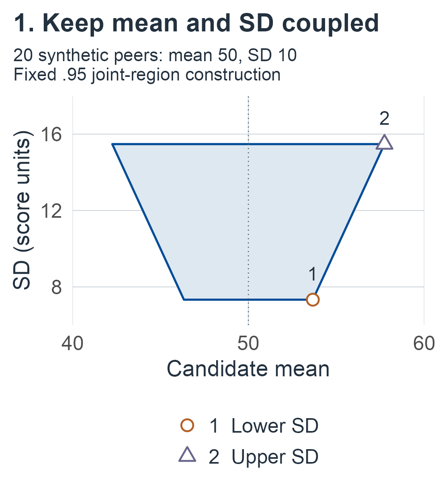
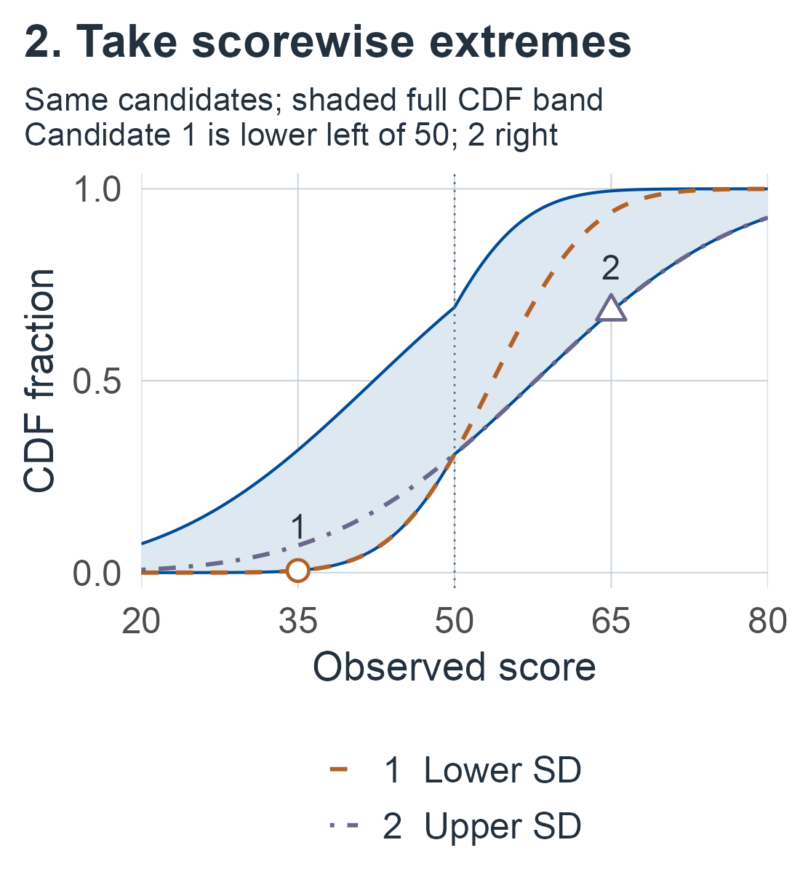

# Reference curves, tables, and transformations {#sec-reference-curves}

```{=html}
<style>
.m13-page #quarto-content > *, .m13-page main.content { min-width: 0; }
.m13-scroll { max-width: 100%; min-width: 0; overflow-x: auto; }
.m13-scroll .math.display { overflow: visible; }
.m13-scroll mjx-container[display="true"] { max-width: none; width: max-content; min-width: 100%; overflow: visible; }
.m13-scroll:focus-visible, .m13-page .math.inline:focus-visible { outline: 3px solid var(--book-focus); outline-offset: 3px; }
.m13-page .math.inline { display: inline-block; max-width: 100%; overflow-x: auto; overflow-y: hidden; padding-block: .15em; vertical-align: middle; }
.m13-figure-panels { display: grid; gap: .6rem; }
.m13-figure-panels p { margin: 0; }
.m13-figure-panels img { width: 100%; height: auto; }
</style>

<script>
document.body.classList.add('m13-page');
(function () {
  function nameOverflow() {
    document.querySelectorAll('main .m13-scroll').forEach(function (element) {
      element.tabIndex = element.scrollWidth > element.clientWidth + 2 ? 0 : -1;
    });
    document.querySelectorAll('main .math.inline').forEach(function (element) {
      if (element.scrollWidth > element.clientWidth + 2) {
        element.tabIndex = 0;
        element.setAttribute('role', 'group');
        element.setAttribute('aria-label', 'Long mathematical expression; scroll horizontally');
      } else {
        element.removeAttribute('tabindex');
        element.removeAttribute('role');
        element.removeAttribute('aria-label');
      }
    });
  }
  function start() {
    let pending = false;
    function settle() {
      if (pending) return;
      pending = true;
      requestAnimationFrame(function () { requestAnimationFrame(function () { pending = false; nameOverflow(); }); });
    }
    const sizes = window.ResizeObserver ? new ResizeObserver(settle) : null;
    function observeMath() {
      if (sizes) document.querySelectorAll('main .math.inline, main .math.inline mjx-container, main .math.inline mjx-math').forEach(function (element) { sizes.observe(element); });
      settle();
    }
    function whenMathReady() {
      if (window.MathJax && MathJax.startup && MathJax.startup.promise) MathJax.startup.promise.then(observeMath);
      else setTimeout(whenMathReady, 150);
    }
    whenMathReady();
    if (document.fonts) {
      document.fonts.ready.then(observeMath);
      document.fonts.addEventListener('loadingdone', observeMath);
    }
    document.addEventListener('keydown', function (event) {
      const element = event.target;
      if (!(element instanceof HTMLElement) || !element.matches('.m13-scroll, .math.inline[role="group"]')) return;
      if (event.altKey || event.ctrlKey || event.metaKey || event.shiftKey || element.scrollWidth <= element.clientWidth + 2) return;
      const step = Math.max(48, parseFloat(getComputedStyle(element).fontSize) * 3);
      if (event.key === 'ArrowRight' || event.key === 'ArrowLeft') {
        element.scrollLeft += event.key === 'ArrowRight' ? step : -step;
        event.preventDefault();
      } else if (event.key === 'Home' || event.key === 'End') {
        element.scrollLeft = event.key === 'Home' ? 0 : element.scrollWidth;
        event.preventDefault();
      }
    });
    window.addEventListener('resize', settle);
    window.addEventListener('scroll', settle, { passive: true });
    document.addEventListener('keydown', function (event) { if (event.key === 'Tab') nameOverflow(); }, true);
    const main = document.querySelector('main');
    if (main) new MutationObserver(settle).observe(main, { childList: true, subtree: true, attributes: true, attributeFilter: ['style', 'class'] });
    new MutationObserver(settle).observe(document.documentElement, { attributes: true, attributeFilter: ['style'] });
  }
  if (document.readyState === 'loading') document.addEventListener('DOMContentLoaded', start, { once: true });
  else start();
}());
</script>
```

## Many scores, one reference law {#sec-m13-question}

The [previous chapter](02-finite-reference.md#sec-finite-reference) asked one question at a time: where another peer's score may fall, what fraction of peers lies below a score fixed in advance, which score marks a fixed fraction, how often a fitted cutoff flags, and how spread out peers are. In practice a norms table is read at whatever score a patient happens to obtain, often at several scores, and sometimes after the norms have been inspected. An interval valid at one prespecified score does not cover that use. Scores on short tests also have ties, and a norming study may choose a nonlinear score scale as well as a mean and SD.

The three normal-reference developments reuse the [running example](02-finite-reference.md#sec-m02-running): 20 synthetic reference scores, case score 35 and the proper teaching prior, following the familiar sequence from experiment and guarantees to examples and limits. The discrete illustration uses its own ten-person sample and Dirichlet prior. The transformation examples specify new models and priors; their regression illustration reuses the earlier conditional sample. The five targets fall into two groups.

::::: {.m13-scroll role="group" tabindex="0" aria-label="M13 table 1; scroll horizontally"}

| Group | Sections | Question |
|---|---|---|
| The whole reference curve | [Simultaneous band](#sec-m13-joint-band); [score range](#sec-m13-range); [calibration error](#sec-m13-cdf-error) | Which reference curves remain compatible at every score at once; the fraction in a fixed score range; how far a fitted percentile curve can miss anywhere |
| Other score models | [Discrete support](#sec-m13-discrete-reference); [estimated transformations](#sec-m13-transformations) | Tables with ties and their fitted cutoffs; norms that also choose the score scale |

:::::

Equations and results of the previous chapter are cited by their labels. Local symbols are defined in each section; in particular $\tau_-,\tau_+$ are the SD limits of a joint region, $\xi_{n,1-\alpha}$ is a calibrated error radius and $\omega$ is the shape of the sinh-normal family. The chapter ends with a [synthesis](#sec-m13-synthesis) of both chapters and a list of [what to report](#sec-m13-reporting).

For a first reading, recall the [recurring symbols](02-finite-reference.md#sec-m02-running) and [reference posterior](02-finite-reference.md#eq-m02-reference-posterior), then follow the simultaneous band's [experiment](#sec-m13-joint-experiment), [region and envelopes](#sec-m13-joint-region), [example](#sec-m13-joint-example) and [limits](#sec-m13-joint-boundaries). Continue to the [fixed-range fraction](#sec-m13-range) and [percentile-curve calibration error](#sec-m13-cdf-error), keeping each target's assumptions beside its result.

Choose the [tied-score branch](#sec-m13-discrete-reference) for a known finite support, or the [transformation branch](#sec-m13-transformations) when a continuous score scale is supplied or estimated. The [general transformed regression](#sec-m13-general-transform) and [new-person prediction](#sec-m13-general-prediction) develop the technical extension; their conditions remain essential when using them. For consultation, start with the [question-to-method lookup](02-finite-reference.md#sec-m02-target-guide), then read the relevant [normal-band](#sec-m13-joint-example), [discrete](#sec-m13-discrete-example) or [transformation example](#sec-m13-shape-example) together with its experiment and [reporting requirements](#sec-m13-reporting).

## A simultaneous normal reference curve {#sec-m13-joint-band}

A fitted reference distribution is often consulted at several scores, perhaps after seeing the norms. A norms table read at whatever score a patient happens to obtain is, in effect, being asked about every score at once. A confidence interval for the percentile at one prespecified score does not alone quantify uncertainty across that entire curve. Here the target is the fixed normal reference CDF

::::: {.m13-scroll role="group" tabindex="0" aria-label="M13 equation 1; scroll horizontally"}

$$
F_{\mu,v}(y)=\Phi\!\left(\frac{y-\mu}{\sigma}\right),\qquad
\sigma=\sqrt v>0,\qquad y\in\mathbb R,
$$ {#eq-m13-joint-target}

:::::

simultaneously over all real observed scores. We construct one joint region for mean and SD and then take its CDF envelopes. A general region's envelope can enlarge its coverage event. For the particular region below, we prove an equivalence that preserves the exact probability.

### Experiment and fixed allocation {#sec-m13-joint-experiment}

Retain $n\ge2$ independent reference persons with observed-score law $N(\mu,v)$, unknown fixed $\mu\in\mathbb R$ and $v>0$, unbiased $S^2$, $\nu=n-1$, and observed $s^2>0$ as in @eq-m02-summaries. The sample size, intended peer population, scoring/administration protocol and normal model are fixed independently of the outcomes. Only the reference scores supply likelihood; no case or future-person residual enters this parameter-curve experiment.

Choose two component coverage probabilities $p_\mu,p_\sigma\in(0,1)$ before sampling, with $p_\mu p_\sigma=1-\alpha$. Put

::::: {.m13-scroll role="group" tabindex="0" aria-label="M13 equation 2; scroll horizontally"}

$$
\begin{aligned}
z&=\Phi^{-1}\!\left(\frac{1+p_\mu}{2}\right),\\
r_-&=(1-p_\sigma)/2,\qquad r_+=(1+p_\sigma)/2,\\
a_\nu^-&=c_{\nu,r_-},\qquad a_\nu^+=c_{\nu,r_+},
\end{aligned}
$$ {#eq-m13-joint-allocation}

:::::

using the chi-square quantiles defined in @eq-m02-scale-chi-density. These constants are positive and finite, with $a_\nu^-<a_\nu^+$. The allocation is a teaching choice, not an optimality claim. For the .95 example below, both component probabilities are $\sqrt{.95}$, rather than .95: two independent .95 component events would give only $.95^2$ joint probability.

### One joint confidence region {#sec-m13-joint-region}

For $m\in\mathbb R$, $k>0$ and $0<{\tau_{-}}<{\tau_{+}}<\infty$, define a set of candidate mean/SD pairs

::::: {.m13-scroll role="group" tabindex="0" aria-label="M13 equation 3; scroll horizontally"}

$$
\mathcal R(m,k,{\tau_{-}},{\tau_{+}})
=\{(\theta,\tau):\ {\tau_{-}}\le\tau\le {\tau_{+}},\quad |\theta-m|\le k\tau\}.
$$ {#eq-m13-joint-region-form}

:::::

Here $\theta$ has score units, $\tau$ is a positive SD in score units and $k$ is dimensionless. This is not a Cartesian product of independent mean and SD intervals: the admissible mean range depends on the candidate SD.

::: {#thm-m13-joint-region}
## A reference-only joint normal mean/SD region

**Target and assumptions.** Use the reference-only experiment and fixed allocation above. Infer the fixed pair $(\mu,\sigma)$.

**Result.** Define

::::: {.m13-scroll role="group" tabindex="0" aria-label="M13 equation 4; scroll horizontally"}

$$
\begin{gathered}
m_Y=\bar Y,\\
 k_Y=\frac z{\sqrt n},\\
{\tau_{-,Y}}=S\sqrt{\frac\nu{a_\nu^+}},\\
{\tau_{+,Y}}=S\sqrt{\frac\nu{a_\nu^-}},\\
\mathcal R_Y=\mathcal R(m_Y,k_Y,{\tau_{-,Y}},{\tau_{+,Y}}).
\end{gathered}
$$ {#eq-m13-joint-confidence-region}

:::::

For every fixed $\mu\in\mathbb R,v>0$,

::::: {.m13-scroll role="group" tabindex="0" aria-label="M13 equation 5; scroll horizontally"}

$$
P_{\mu,v}\{(\mu,\sigma)\in\mathcal R_Y\}=p_\mu p_\sigma=1-\alpha.
$$ {#eq-m13-joint-region-coverage}

:::::

Every realized region with $s>0$ is nonempty and compact and has strictly positive finite SD limits. Its projection onto the mean axis is $[\bar y-k_Y{\tau_{+,Y}},\bar y+k_Y{\tau_{+,Y}}]$; that projection paired arbitrarily with its SD limits is a larger set.
:::

::: {.proof}
The orthogonal-normal argument underlying @eq-m02-residual-chi-square gives independent factors

::::: {.m13-scroll role="group" tabindex="0" aria-label="M13 equation 6; scroll horizontally"}

$$
Z=\frac{\sqrt n(\bar Y-\mu)}{\sigma}\sim N(0,1),\qquad
Q=\frac{\nu S^2}{\sigma^2}\sim\chi^2_\nu.
$$ {#eq-m13-joint-sampling-factors}

:::::

The first rotated coordinate and the sum of squares of the remaining independent normal coordinates are independent by their factorized density. Thus $P(|Z|\le z)=p_\mu$ and $P(a_\nu^-\le Q\le a_\nu^+)=p_\sigma$ multiply. Inverting their intersection gives exactly ${\tau_{-,Y}}\le\sigma\le {\tau_{+,Y}}$ and $|\mu-\bar Y|\le z\sigma/\sqrt n$, proving coverage. No marginal Student interval has been treated as independent of $S$.

For realized data, ${\tau_{-,Y}},{\tau_{+,Y}}$ are finite positive numbers. The region is closed and bounded by $\tau\in[{\tau_{-,Y}},{\tau_{+,Y}}]$ and $|\theta-\bar y|\le k_Y{\tau_{+,Y}}$, hence compact. At $\tau={\tau_{+,Y}}$ every point of the stated mean projection is available; this proves its endpoints but does not remove the dependence within the region.
:::

### Envelopes and an exact all-score event {#sec-m13-joint-envelope}

::: {#prp-m13-joint-envelope}
## The CDF envelopes retain this joint event exactly

**Target and assumptions.** For a fixed realized $\mathcal R=\mathcal R(m,k,{\tau_{-}},{\tau_{+}})$ as above, let $F_-(y)$ and $F_+(y)$ be the minimum and maximum of $F_{\theta,\tau^2}(y)$ over $(\theta,\tau)\in\mathcal R$.

**Result.** With $\Delta=y-m$,

::::: {.m13-scroll role="group" tabindex="0" aria-label="M13 equation 7; scroll horizontally"}

$$
\begin{aligned}
g_-(y)&=\begin{cases}
\Delta/{\tau_{-}}-k,&\Delta<0,\\
\Delta/{\tau_{+}}-k,&\Delta\ge0,
\end{cases}\\
g_+(y)&=\begin{cases}
\Delta/{\tau_{+}}+k,&\Delta<0,\\
\Delta/{\tau_{-}}+k,&\Delta\ge0,
\end{cases}\\
F_-(y)&=\Phi(g_-(y)),\qquad F_+(y)=\Phi(g_+(y)).
\end{aligned}
$$ {#eq-m13-joint-envelope-formulas}

:::::

Both envelopes are continuous, strictly increasing CDFs, with $0<F_-<F_+<1$ at every finite score and respective limits 0 and 1 at the score-axis ends. At $y=m$, they equal $\Phi(-k),\Phi(k)$. For any candidate normal law with mean $\theta\in\mathbb R$ and SD $\tau>0$,

::::: {.m13-scroll role="group" tabindex="0" aria-label="M13 equation 8; scroll horizontally"}

$$
\{F_-(y)\le F_{\theta,\tau^2}(y)\le F_+(y)
\ \text{for every }y\in\mathbb R\}
\quad\Longleftrightarrow\quad
(\theta,\tau)\in\mathcal R.
$$ {#eq-m13-joint-envelope-equivalence}

:::::

Consequently the random envelopes of $\mathcal R_Y$ satisfy the exact simultaneous confidence guarantee

::::: {.m13-scroll role="group" tabindex="0" aria-label="M13 equation 9; scroll horizontally"}

$$
P_{\mu,v}\{F_-(y)\le F_{\mu,v}(y)\le F_+(y)
\ \text{for every }y\in\mathbb R\}=1-\alpha.
$$ {#eq-m13-joint-simultaneous-coverage}

:::::
:::

::: {.proof}
Write $e=(\theta-m)/\tau$. The admissible pairs correspond exactly to $e\in[-k,k]$ and $\tau\in[{\tau_{-}},{\tau_{+}}]$. At a fixed score,

::::: {.m13-scroll role="group" tabindex="0" aria-label="M13 equation 10; scroll horizontally"}

$$
\frac{y-\theta}{\tau}=\frac\Delta\tau-e.
$$

:::::

The minimum uses $e=k$, the maximum $e=-k$. If $\Delta<0$, $\Delta/\tau$ increases with $\tau$, so the minimum uses ${\tau_{-}}$ and the maximum ${\tau_{+}}$; if $\Delta>0$ these choices reverse. At $\Delta=0$ the SD drops out. Strict increase of $\Phi$ proves the formulas, and each extremum is attained in the compact region. The branches agree at zero, have positive slopes and tend to the appropriate infinite probit ends; this proves continuity, ordering and CDF tails. The envelopes need not themselves be normal CDFs.

Region membership implies the all-score inequalities by construction. Conversely, apply $\Phi^{-1}$ to those inequalities. At $y=m$ they give $|\theta-m|/\tau\le k$. For $\Delta>0$ the remaining inequalities include

::::: {.m13-scroll role="group" tabindex="0" aria-label="M13 equation 11; scroll horizontally"}

$$
\frac\Delta {\tau_{+}}-k\ \le\ \frac\Delta\tau+\frac{m-\theta}{\tau}
\ \le\ \frac\Delta{\tau_{-}}+k.
$$ {#eq-m13-joint-envelope-tail-test}

:::::

Divide by $\Delta$ and let $\Delta\to\infty$. The finite intercepts vanish, giving $1/{\tau_{+}}\le1/\tau\le1/{\tau_{-}}$, equivalently ${\tau_{-}}\le\tau\le {\tau_{+}}$. Together with the center condition this is exactly region membership. The simultaneous coverage now follows from @eq-m13-joint-region-coverage. This reverse implication concerns normal candidate curves over the entire real score axis; it does not follow from checking a finite grid or from arbitrary envelopes of arbitrary parameter sets.
:::

For a general construction, containing the parameter region only proves a lower bound on band coverage. Here the reverse implication removes that possible conservatism. We claim exact equality because of this proof, not merely because the input region had exact coverage. Sweeping a joint parameter region into an all-score CDF band, and checking that no parameter outside the region gives a curve inside the band, follows @cheng1983confidence [pp. 78-81], who used an information-based elliptical region whose exact level requires their tabulated constants; the region here instead multiplies two exact independent pivots. Individual scorewise intervals from this band can still have coverage greater than $1-\alpha$.

If the model, allocation and construction were fixed as stated, the all-score event also implies the bound at any score inspected after seeing the norms, even a data-dependent score. This is the scope that a pointwise theorem alone does not provide. It does not validate choosing the population, normal model, allocation or band procedure in response to the data. It supplies no diagnosis or decision guarantee for a selected cutoff.

### Reference posterior for the same curve {#sec-m13-joint-reference}

::: {#prp-m13-joint-reference}
## The reference posterior assigns the same exact band probability

**Target and assumptions.** Use the reference-only likelihood @eq-m02-likelihood and prior density $1/v$ relative to $d\mu\,dv$, with $n\ge2,s^2>0$. The target remains the entire normal reference CDF. The allocation remains fixed.

**Result.** The normalized posterior has the independent-factor representation

::::: {.m13-scroll role="group" tabindex="0" aria-label="M13 equation 12; scroll horizontally"}

$$
W=\frac{\sqrt n(\mu-\bar y)}{\sqrt v}\sim N(0,1),\qquad
R=\frac{\nu s^2}{v}\sim\chi^2_\nu,\qquad W\perp R.
$$ {#eq-m13-joint-reference-factors}

:::::

The observed confidence region $\mathcal R_Y$ has posterior probability exactly $p_\mu p_\sigma$. Its envelopes have posterior probability exactly $p_\mu p_\sigma$ of containing the entire reference CDF. Thus the same realized region and band have the specified sampling and posterior guarantees under this model, prior measure and construction.
:::

::: {.proof}
For the posterior in @eq-m02-reference-posterior, integrating the unknown mean in likelihood times $1/v$ contributes $\sqrt{2\pi v/n}$ and leaves the IG kernel with $a=\nu/2>0,b=\nu s^2/2>0$. Its integral is $\Gamma(a)b^{-a}$ by substitution $b/v$, and the normalized mean conditional is $N(\bar y,v/n)$. Hence

::::: {.m13-scroll role="group" tabindex="0" aria-label="M13 equation 13; scroll horizontally"}

$$
p(\mu,v\mid\mathcal D_{\mathrm{ref}})
=\operatorname{IG}(v;a,b)
\frac{\sqrt n}{\sqrt{2\pi v}}
\exp\!\left[-\frac{n(\mu-\bar y)^2}{2v}\right].
$$ {#eq-m13-joint-reference-density}

:::::

Each factor is normalized, establishing propriety. Standardizing the conditional mean gives a standard normal $W$ whose law does not depend on $v$, so $W$ is independent of $v$ and of $R$. Changing $v$ to $R=2b/v$ gives the normalized chi-square law. Region membership is $|W|\le z$ and $a_\nu^-\le R\le a_\nu^+$, of posterior probability $p_\mu p_\sigma$. The pathwise equivalence @eq-m13-joint-envelope-equivalence gives the same probability for the entire-curve event.
:::

Sampling fixes $\mu,v$ and repeats the norms; the posterior fixes the norms and integrates both parameters. Agreement of this particular region and band does not erase those conditioning differences, supply a proper prior-predictive experiment for the improper prior, or establish matching for other regions/bands. In particular, this proof uses the independent conditional standardized mean and precision, not independent marginal posterior mean and variance parameters.

### Proper-prior sensitivity for a simultaneous band {#sec-m13-joint-proper}

::: {#prp-m13-joint-proper}
## A proper posterior gives its own exact simultaneous credible band

**Target and assumptions.** Use the same data/curve target and proper normal–inverse-gamma prior @eq-m02-proper-prior, with positive fixed hyperparameters and updates @eq-m02-proper-update. Keep the same fixed $p_\mu,p_\sigma,z,r_-,r_+$.

**Result.** Put $d_p=2a_n$ and define

::::: {.m13-scroll role="group" tabindex="0" aria-label="M13 equation 14; scroll horizontally"}

$$
\begin{aligned}
m_p&=m_n,\qquad k_p=z/\sqrt{\kappa_n},\\
{\tau_{-,p}}&=\sqrt{\frac{2b_n}{c_{d_p,r_+}}},\qquad
{\tau_{+,p}}=\sqrt{\frac{2b_n}{c_{d_p,r_-}}},\\
\mathcal R_p&=\mathcal R(m_p,k_p,{\tau_{-,p}},{\tau_{+,p}}).
\end{aligned}
$$ {#eq-m13-joint-proper-region}

:::::

This region and its envelopes from @eq-m13-joint-envelope-formulas each have posterior probability exactly $p_\mu p_\sigma$. They need not equal the reference region/band and have no universal fixed-parameter confidence guarantee.
:::

::: {.proof}
The normalized posterior is the product of $\operatorname{IG}(v;a_n,b_n)$ and the normalized $N(m_n,v/\kappa_n)$ conditional mean density. The proper prior's conditional normal contributes a factor $v^{-1/2}$ before mean integration; completing the square and integrating that kernel retains $a_n=a_0+n/2$, not $a_0+(n-1)/2$, and the nonnegative mean-shift correction in $b_n$. Positive hyperparameters make this posterior proper. Consequently

::::: {.m13-scroll role="group" tabindex="0" aria-label="M13 equation 15; scroll horizontally"}

$$
\begin{gathered}
W_p=\frac{\sqrt{\kappa_n}(\mu-m_n)}{\sqrt v}\sim N(0,1),\\
R_p=\frac{2b_n}{v}\sim\chi^2_{2a_n},\\
 W_p\perp R_p.
\end{gathered}
$$ {#eq-m13-joint-proper-factors}

:::::

Their interval intersection is exactly $\mathcal R_p$ and has probability $p_\mu p_\sigma$ even for fractional $2a_n$. Applying the envelope equivalence proves exact posterior band probability as well.

For an inspectable confidence counterexample, fix the .95 allocation $p_\mu=p_\sigma=\sqrt{.95}$, $n=2$, true $\mu=0,v=1$ and proper prior $m_0=0,\kappa_0=a_0=1,b_0=100$. Then $a_n=2,b_n\ge100$ for every dataset, and

::::: {.m13-scroll role="group" tabindex="0" aria-label="M13 equation 16; scroll horizontally"}

$$
{\tau_{-,p}}^2\ge\frac{200}{c_{4,(1+\sqrt{.95})/2}}>1.
$$ {#eq-m13-joint-proper-counterexample}

:::::

To prove the strict inequality without relying on a numerical quantile, $X\sim\chi^2_4$ has $E(X^2)=4(4+2)=24$ by its gamma moments. Markov's inequality applied to $X^2$ gives $P(X\ge200)\le24/200^2=.0006<(1-\sqrt{.95})/2$. Thus $c_{4,(1+\sqrt{.95})/2}<200$. The true SD is outside $\mathcal R_p$ for every dataset; by the proved all-score equivalence, its normal CDF is outside the simultaneous envelope event as well. This proper credible region **and band** have zero fixed-parameter confidence coverage, while each has .95 posterior probability. This is a mathematical counterexample, not a recommended prior.
:::

The proper prior does supply a different averaging experiment: draw parameters from that prior and then draw the reference scores. Because the conditional posterior probability is $p_\mu p_\sigma$ for every eligible dataset, total probability gives that same prior-predictive coverage. It averages over the prior, rather than supplying coverage at every fixed parameter pair. The counterexample addresses the latter claim. Changing the prior does not change the original reference band's sampling law.

### Synthetic .95 bands {#sec-m13-joint-example}

Reuse exactly the [constructed 20 scores](02-finite-reference.md#sec-m02-example), $\{50\pm j\sqrt{190/77}:j=1,\ldots,10\}$, giving $\bar y=50,s=10$. These are synthetic scores, not a clinical dataset or supplied true population parameters. Choose $p_\mu=p_\sigma=\sqrt{.95}\approx.9746794345$ before sampling. Then $r_-\approx.0126602828$, $r_+\approx.9873397172$ and $z\approx2.2364766446$. Retain the unchanged proper teaching prior $m_0=50,\kappa_0=5,a_0=3,b_0=200$, so $m_n=50,\kappa_n=25,a_n=13,b_n=1150$.

The two regions have these parameters; SD limits are in score units.

::::: {.m13-scroll role="group" tabindex="0" aria-label="M13 table 2; scroll horizontally"}

| Region | Center $m$ | Coefficient $k$ | SD lower limit ${\tau_{-}}$ | SD upper limit ${\tau_{+}}$ |
|---|---:|---:|---:|---:|
| Reference; confidence and reference-posterior region | $50$ | $.5000913807$ | $7.3310122010$ | $15.4767106558$ |
| Proper teaching posterior | $50$ | $.4472953289$ | $7.1722824001$ | $13.5170133821$ |

:::::

The underlying lower/upper chi-square quantiles are $7.9322478250/35.3529546671$ for 19 degrees of freedom and $12.5882786722/44.7108651926$ for 26. The full mean projections are approximately $[42.2602303989,57.7397696011]$ and $[43.9539030534,56.0460969466]$. They describe the regions' projections, not a replacement product of mean and SD intervals.

Evaluating each **simultaneous** CDF band at three scores gives:

::::: {.m13-scroll role="group" tabindex="0" aria-label="M13 table 3; scroll horizontally"}

| Score $y$ | Reference lower $F_-(y)$ | Reference upper $F_+(y)$ | Proper lower $F_-(y)$ | Proper upper $F_+(y)$ |
|---|---:|---:|---:|---:|
| $35$ | $.0054452392$ | $.3194966450$ | $.0055635806$ | $.2538519205$ |
| $50$ | $.3085053675$ | $.6914946325$ | $.3273309196$ | $.6726690804$ |
| $65$ | $.6805033550$ | $.9945547608$ | $.7461480795$ | $.9944364194$ |

:::::

At score 35 the earlier [pointwise .95 percentile interval](02-finite-reference.md#eq-m02-percentile-example-confidence) was $[.0163435,.1988762]$. The reference simultaneous band evaluated there is wider in this example because it protects an entire curve under its declared construction. This is not an optimal-width comparison or a claim of interval nesting across every possible method. The .95 probability attaches to the all-score event, not to 95% of persons falling between CDF values. Under the proper prior the .95 band probability is posterior probability; its narrower values here do not establish better frequentist calibration or clinical utility.

The two boundary candidates in @fig-m13-region-to-band show why one normal curve need not determine the lower envelope at every score.

::: {#fig-m13-region-to-band fig-alt="Two panels carry a coupled mean/SD region into its simultaneous CDF envelopes; two boundary candidates switch lower-envelope roles at the mean."}

::: {.m13-figure-panels}

<p><a href="figures/m13-region-1.png" aria-label="Open full-size M13 panel 1"></a></p>

<p><a href="figures/m13-region-2.png" aria-label="Open full-size M13 panel 2"></a></p>

:::

From one coupled parameter region to a reference-curve band. **1.** The same 20 synthetic peers have sample mean 50 and SD 10. The fixed .95 independent-pivot construction gives admissible candidate population means and SDs; shading is a region, not a posterior-density display. Circle 1 uses the lower SD and triangle 2 the upper SD on the positive mean boundary. **2.** The same two candidate normal CDFs switch lower-envelope roles at score 50, where they coincide. The shaded band uses all region members, including the opposite mean boundary for its upper envelope. The .95 guarantee repeats reference samples under the stated normal model and fixed allocation. The plotted score window illustrates the envelopes; their all-real-score guarantee rests on the analytic event proof.

:::

### Boundaries, uniform concentration and interpretation {#sec-m13-joint-boundaries}

At $n=2$, the reference factors have normal and one-degree-of-freedom chi-square laws, so every fixed interior allocation still gives a finite compact region and the exact band guarantee. No posterior moments are used. Small samples or extreme interior allocations can give very wide bands. Observed $s^2=0$ and $n=1$ are outside the stated reference experiment. Proper posterior propriety in such cases is a separate matter. Component probabilities at 0 or 1 are excluded: compactness or a positive-width region can fail there. Mathematically finite tails can still exceed numerical range or round to zero/one in CDF evaluation.

For a positive affine score change $Y'=A+BY$, $B>0$, the region transforms by $(\theta,\tau)\mapsto(A+B\theta,B\tau)$, with $m'=A+Bm,k'=k,{\tau_{-}}'=B{\tau_{-}},{\tau_{+}}'=B{\tau_{+}}$. At $y'=A+By$ the CDF envelope values are unchanged. The proper prior must transform by $m'_0=A+Bm_0,b'_0=B^2b_0$, with $\kappa_0,a_0$ fixed. Existing update identities then give precisely the same pushforward. Nonlinear transformations, a changed population or data-chosen normal model require another argument.

::: {#prp-m13-joint-uniform}
## The whole curve band contracts under growing independent norms

**Target and assumptions.** Draw growing independent reference samples from one fixed $N(\mu,v)$ population. Keep interior allocations fixed; in the proper branch keep hyperparameters fixed. Let $F_{-,n},F_{+,n}$ be either construction above.

**Result.** Both envelopes converge uniformly to the fixed population CDF in sampling probability:

::::: {.m13-scroll role="group" tabindex="0" aria-label="M13 equation 17; scroll horizontally"}

$$
\sup_{y\in\mathbb R}|F_{-,n}(y)-F_{\mu,v}(y)|\to0,\qquad
\sup_{y\in\mathbb R}|F_{+,n}(y)-F_{\mu,v}(y)|\to0.
$$ {#eq-m13-joint-uniform-concentration}

:::::

In particular their maximum width tends to zero. The corresponding posterior also concentrates in this whole-curve distance: for every $\epsilon,\eta>0$,

::::: {.m13-scroll role="group" tabindex="0" aria-label="M13 equation 18; scroll horizontally"}

$$
P_{\mu,v}\!\left[
\Pi\!\left\{\sup_y|F_{\theta,\tau^2}(y)-F_{\mu,v}(y)|>\epsilon
\mid\mathcal D_{\mathrm{ref}}\right\}>\eta\right]\to0.
$$ {#eq-m13-joint-posterior-concentration}

:::::
:::

::: {.proof}
We first prove a uniform bound instead of inferring uniformity from scorewise convergence. Write $\phi$ for the standard normal density. At fixed SD $\tau$, the absolute derivative of a normal CDF with respect to its mean is bounded by $1/(\tau\sqrt{2\pi})$. At fixed mean, its derivative with respect to log SD has magnitude $|t|\phi(t)\le1/\sqrt{2\pi e}$, since $|t|e^{-t^2/2}$ is maximized at $|t|=1$. Integrating along mean and log-SD paths therefore gives, for every candidate $(\theta,\tau)$,

::::: {.m13-scroll role="group" tabindex="0" aria-label="M13 equation 19; scroll horizontally"}

$$
\sup_y|F_{\theta,\tau^2}(y)-F_{\mu,v}(y)|
\le\frac{|\theta-\mu|}{\tau\sqrt{2\pi}}
+\frac{|\log(\tau/\sigma)|}{\sqrt{2\pi e}}.
$$ {#eq-m13-joint-uniform-bound}

:::::

For every pair in $\mathcal R(m,k,{\tau_{-}},{\tau_{+}})$, the right side is at most

::::: {.m13-scroll role="group" tabindex="0" aria-label="M13 equation 20; scroll horizontally"}

$$
D_{\mathcal R}
=\frac{|m-\mu|+k{\tau_{+}}}{{\tau_{-}}\sqrt{2\pi}}
+\frac{\max\{|\log({\tau_{-}}/\sigma)|,|\log({\tau_{+}}/\sigma)|\}}
{\sqrt{2\pi e}}.
$$ {#eq-m13-joint-region-uniform-bound}

:::::

Taking infima or suprema over the region preserves the bound on distance to $F_{\mu,v}$; hence each envelope's uniform error is at most $D_{\mathcal R}$, and its maximum width at most $2D_{\mathcal R}$, whether or not the true pair lies in that realized region.

For the reference construction, $\bar Y\to\mu,S\to\sigma$ by the sampling moments already derived. The chi-square ratio has mean 1 and variance $2/\nu$, so $c_{\nu,r}/\nu\to1$ for every fixed interior $r$ by quantile trapping. Thus ${\tau_{-,Y}},{\tau_{+,Y}}\to\sigma$, $m_Y\to\mu$ and $k_Y\to0$. For the proper construction, the existing update gives $m_n\to\mu,b_n/a_n\to v,a_n,\kappa_n\to\infty$: the mean-shift penalty is bounded in sampling probability and negligible after division by $a_n$. Applying the same chi-square quantile limit with $2a_n$ gives ${\tau_{-,p}},{\tau_{+,p}}\to\sigma,k_p\to0$. Positivity of $\sigma$ and continuity of division/logarithms make $D_{\mathcal R}\to0$ in both cases, proving uniform envelope contraction.

For posterior curve concentration, the independent-factor representations give $v=\nu s^2/R$ and $\mu=\bar y+\sqrt{v/n}\,W$ in the reference branch, or $v=(b_n/a_n)/(R_p/(2a_n))$ and $\mu=m_n+\sqrt{v/\kappa_n}\,W_p$ in the proper branch. The chi-square ratios concentrate at 1 with variances $2/\nu$ or $1/a_n$; the scaled normal factors vanish. Combined with the sampling limits of the centers/scale summaries, posterior mass outside any fixed neighborhood of $(\mu,\sigma)$ tends to zero in sampling probability. To apply this locally to the displayed uniform bound, restrict $\tau$ to a neighborhood bounded away from zero and $\theta$ to a small neighborhood of $\mu$; continuity then makes that bound arbitrarily small. The posterior probability of leaving those neighborhoods tends to zero, proving @eq-m13-joint-posterior-concentration.
:::

These are probabilistic limits, not monotonically shrinking bands on every sample path. The reference band's exact simultaneous coverage remains $1-\alpha$ at each finite $n$; convergence of its distance to the true curve does not force that inclusion probability to tend to one. Individual observed and future performances retain their population variation as uncertainty about the reference curve contracts.

The region/curve event identities and probabilities are exact under the declared normal experiment; the example decimals use numerical normal/chi-square evaluations. Independent optimization, defining posterior integrals, transition/units/small-sample checks and tail calculations can test an implementation. A finite grid cannot certify an all-real-score event: a slope error can first violate it far in a tail, where ordinary CDF software has rounded to 0 or 1. The probit-line inequalities used in the proof retain that information.

This section quantifies reference-curve uncertainty under a specified observed-score model. More representative independent norms, consistent protocols and evidence about distributional shape and transport improve its intended use. The band does not validate the normal assumption, a selected model or population, latent interpretation, measurement precision, personal decline, response validity, disease probability or action ([reporting](#sec-m13-reporting)). Regression/multivariate and nonnormal bands, new prediction/quantile-curve families and clinical extensions remain outside this construction.

## Uncertainty about a fixed score range's population fraction {#sec-m13-range}

What fraction of the intended peers would score in a specified range, and how uncertain is that fraction because the norms are finite? A range such as $(35,65]$ has two fixed score boundaries. Its population fraction is one parameter; uncertainty about it cannot be obtained by treating the two endpoint percentiles as independent.

### Target and reference-only experiment {#sec-m13-range-experiment}

Retain the independent scalar normal reference experiment in @eq-m02-experiment: $n\ge2$, unknown fixed $\mu\in\mathbb R,v=\sigma^2>0$, unbiased $S^2$, $\nu=n-1$ and observed $s^2>0$. The intended peers, observed-score scale, protocol and sample size are fixed before outcomes. Fix finite score endpoints $a<b$ independently of those outcomes, and define

::::: {.m13-scroll role="group" tabindex="0" aria-label="M13 equation 21; scroll horizontally"}

$$
\begin{aligned}
\rho(\mu,v;a,b)&=P_{\mu,v}(a<Y\le b)\\
&=\Phi\!\left(\frac{b-\mu}{\sqrt v}\right)
 -\Phi\!\left(\frac{a-\mu}{\sqrt v}\right),\\
c_I&=(a+b)/2,\qquad d_I=(b-a)/2>0.
\end{aligned}
$$ {#eq-m13-range-target}

:::::

Here $Y$ denotes a generic performance from the reference law to define the event, not an additional observed person. The target $\rho\in(0,1)$ is fixed in the frequentist experiment, with probability units; $c_I,d_I$ have score units. Only reference persons are resampled. Bayesian inference uses their reference-only likelihood and integrates $\mu,v$ at the fixed endpoints. No case score, future-person residual or fitted range supplies a likelihood term. Endpoint inclusion makes no difference under this continuous model.

Keeping only $\mathbf1\{a<Y_i\le b\}$ would give M01's [fixed-event count experiment](01-one-performance.md#sec-m01-frequency), with a binomial likelihood and its own prior analysis. Here the full scores supply information under a normal population model. The count, its proportion, the normal plug-in estimate $\rho(\bar y,s^2;a,b)$, a posterior mean and a posterior distribution are different objects. Neither the range nor its estimated frequency is automatically a clinically validated category.

### Confidence bounds transferred from the reference band {#sec-m13-range-confidence}

Use the already proved joint region $\mathcal R(m,k,{\tau_{-}},{\tau_{+}})$ and its envelopes $F_-,F_+$ from @eq-m13-joint-region-form and @eq-m13-joint-envelope-formulas. We will use its reference-sampling version for confidence, and later its reference/proper posterior versions for probability statements conditional on the norms. The region remains nonempty with $0<{\tau_{-}}<{\tau_{+}}<\infty$. No new optimization over the joint region is needed.

::: {#prp-m13-range-confidence}
## A range-content interval with a coverage lower bound

**Target and assumptions.** Infer the fixed $\rho$ in @eq-m13-range-target. Fix the scalar model, endpoints and band allocation independently of the norms. For any realized region of the stated form, put

::::: {.m13-scroll role="group" tabindex="0" aria-label="M13 equation 22; scroll horizontally"}

$$
\begin{aligned}
L_I&=\max\{0,\ F_-(b)-F_+(a)\},\\
U_I&=\min\!\left\{F_+(b)-F_-(a),\quad 2\Phi(d_I/{\tau_{-}})-1\right\}.
\end{aligned}
$$ {#eq-m13-range-bounds}

:::::

**Result.** These endpoints satisfy $0\le L_I\le U_I<1$ and contain every candidate range fraction from the region. For the reference confidence region $\mathcal R_Y$ with fixed $p_\mu p_\sigma=1-\alpha$,

::::: {.m13-scroll role="group" tabindex="0" aria-label="M13 equation 23; scroll horizontally"}

$$
P_{\mu,v}\{L_I(Y)\le\rho(\mu,v;a,b)\le U_I(Y)\}
\ \ge\ 1-\alpha.
$$ {#eq-m13-range-coverage}

:::::

Under the stated reference prior, the same observed interval has posterior probability **at least** $1-\alpha$. Applying the same construction to the proper posterior region $\mathcal R_p$ gives posterior probability at least $1-\alpha$ under that proper prior, without a universal fixed-parameter confidence guarantee.
:::

::: {.proof}
If $(\theta,\tau)$ belongs to the region, both endpoint CDF values lie between their envelopes. Subtracting the two inequalities in opposite directions gives

::::: {.m13-scroll role="group" tabindex="0" aria-label="M13 equation 24; scroll horizontally"}

$$
F_-(b)-F_+(a)
\le F_{\theta,\tau^2}(b)-F_{\theta,\tau^2}(a)
\le F_+(b)-F_-(a).
$$

:::::

Nonnegativity justifies the lower clipping. For the additional upper cap, at a fixed $\tau$ the normal range fraction is an even function of $\theta-c_I$ and decreases strictly as its absolute value increases. Indeed, at $\theta=c_I+d$, $d>0$, its derivative in $d$ is

::::: {.m13-scroll role="group" tabindex="0" aria-label="M13 equation 25; scroll horizontally"}

$$
\frac1\tau\left[
 \phi\!\left(\frac{d_I+d}{\tau}\right)
-\phi\!\left(\frac{d_I-d}{\tau}\right)\right]<0.
$$ {#eq-m13-range-center-derivative}

:::::

Thus its maximum over all means is $2\Phi(d_I/\tau)-1$. This decreases with $\tau$, so $\tau\ge{\tau_{-}}$ gives the cap in @eq-m13-range-bounds. This is a valid upper bound, not a claim that the interval midpoint is an admissible mean in every region. Every region member's fraction lies between $L_I,U_I$; nonemptiness of the region proves their ordering. Both upper candidates are positive and less than one for finite endpoints and ${\tau_{-}}>0$.

The event $(\mu,\sigma)\in\mathcal R_Y$ implies $\rho\in[L_I,U_I]$. Its reference-only probability is exactly $1-\alpha$ by @eq-m13-joint-region-coverage, proving the lower bound. Similarly, each reference/proper posterior region has probability $1-\alpha$ under its respective normalized posterior. Integrating the same pathwise implication proves the stated posterior lower bounds.
:::

Only the lower bound on coverage has been established. Recovering one range fraction does not recover a whole CDF or a mean/SD pair: reflecting a candidate mean across $c_I$ leaves $\rho$ unchanged and can move that candidate outside a given region. The whole-curve event equivalence therefore does not automatically transfer as an equivalence for $\rho$. The cap improves a simple endpoint subtraction but is not asserted to give the exact image of the region. No exact confidence/credible matching or equal-tailed property is claimed for these bounds.

Two arbitrary pointwise percentile intervals do not supply the simultaneous endpoint event used here, and their estimation errors are dependent. Nor is the difference of two marginal posterior quantiles generally a quantile of their difference. A full posterior for $\rho$ is the next calculation.

### Induced reference and proper posteriors {#sec-m13-range-posterior}

Both existing scalar posterior branches have the form

::::: {.m13-scroll role="group" tabindex="0" aria-label="M13 equation 26; scroll horizontally"}

$$
v\mid y\sim\operatorname{IG}(A,B),\qquad
\mu\mid v,y\sim N(m,v/\kappa),
\qquad A,B,\kappa>0.
$$ {#eq-m13-range-posterior-family}

:::::

The local capital $A,B$ denote a posterior shape and inverse-gamma scale, not the fixed score endpoints $a,b$. The inverse-gamma convention has exponent $-B/v$, as in @eq-m02-inverse-gamma. In the reference branch,

::::: {.m13-scroll role="group" tabindex="0" aria-label="M13 equation 27; scroll horizontally"}

$$
(m,\kappa,A,B)=(\bar y,n,\nu/2,\nu s^2/2).
$$ {#eq-m13-range-reference-parameters}

:::::

This uses density $1/v$ relative to $d\mu\,dv$. Multiplying by the reference likelihood and integrating the unknown mean contributes $\sqrt{2\pi v/n}$ and leaves $v^{-\nu/2-1}\exp\{-\nu s^2/(2v)\}$. Its integral is $\Gamma(\nu/2)(\nu s^2/2)^{-\nu/2}$, finite for $n\ge2,s^2>0$. Thus the reference posterior used here is proper, despite its improper prior.

In the proper branch use exactly @eq-m02-proper-prior and @eq-m02-proper-update:

::::: {.m13-scroll role="group" tabindex="0" aria-label="M13 equation 28; scroll horizontally"}

$$
(m,\kappa,A,B)=(m_n,\kappa_n,a_n,b_n).
$$ {#eq-m13-range-proper-parameters}

:::::

Completing the mean square in the full proper joint prior/likelihood and integrating it gives these positive parameters. The conditional prior normal factor is retained: $a_n=a_0+n/2$, not $a_0+(n-1)/2$, and $b_n$ includes its nonnegative mean-shift contribution. Neither branch adds a likelihood term for the fixed event.

::: {#prp-m13-range-posterior}
## A normalized range-fraction posterior and its predictive mean

**Target and assumptions.** Infer the same fixed-endpoint $\rho$ using the normalized posterior in @eq-m13-range-posterior-family, with either parameter choice above. For $0<p<1$, set

::::: {.m13-scroll role="group" tabindex="0" aria-label="M13 equation 29; scroll horizontally"}

$$
v_p=\left\{\frac{d_I}{\Phi^{-1}((1+p)/2)}\right\}^{\!2}.
$$ {#eq-m13-range-variance-threshold}

:::::

For $0<v<v_p$, let $d_p(v)>0$ be the unique solution of

::::: {.m13-scroll role="group" tabindex="0" aria-label="M13 equation 30; scroll horizontally"}

$$
\Phi\!\left(\frac{d_I-d_p(v)}{\sqrt v}\right)
-\Phi\!\left(\frac{-d_I-d_p(v)}{\sqrt v}\right)=p.
$$ {#eq-m13-range-distance-root}

:::::

**Result.** The induced posterior CDF is the exact integral

::::: {.m13-scroll role="group" tabindex="0" aria-label="M13 equation 31; scroll horizontally"}

$$
\begin{aligned}
H_I(p)&=P(\rho\le p\mid y)\\
&=1-\int_0^{v_p}
 \left[\Phi\!\left\{(c_I+d_p(v)-m)\sqrt{\kappa/v}\right\}\right.\\
&\hspace{0.4em}\left.-\Phi\!\left\{(c_I-d_p(v)-m)\sqrt{\kappa/v}\right\}\right]
 \frac{B^A}{\Gamma(A)}v^{-A-1}e^{-B/v}\,dv.
\end{aligned}
$$ {#eq-m13-range-posterior-cdf}

:::::

It is continuous and strictly increasing on $(0,1)$, with no atoms at zero or one. Define $H_I(p)=0$ for $p\le0$, $H_I(p)=1$ for $p\ge1$. For $0<r<1$ the unique root $H_I(q_{I,r})=r$ is its posterior quantile; $[q_{I,\alpha/2},q_{I,1-\alpha/2}]$ has posterior probability $1-\alpha$.

With $c_*^2=(B/A)(1+1/\kappa)$, its mean is

::::: {.m13-scroll role="group" tabindex="0" aria-label="M13 equation 32; scroll horizontally"}

$$
\begin{aligned}
E(\rho\mid y)
&=P(a<Y_{\mathrm{new}}\le b\mid y)\\
&=G_{2A}\!\left(\frac{b-m}{c_*}\right)
 -G_{2A}\!\left(\frac{a-m}{c_*}\right).
\end{aligned}
$$ {#eq-m13-range-posterior-mean}

:::::

All positive moments of $\rho$ exist, even when posterior moments of the score or variance do not. The two prior branches need not give the same distribution or quantiles, and these equal-tailed intervals have no asserted exact fixed-parameter confidence calibration.
:::

::: {.proof}
The joint posterior density is the product of the normalized inverse-gamma and the conditional normal density in @eq-m13-range-posterior-family. Its integral is one. At a fixed $v$, the range fraction is maximized at $\mu=c_I$ with maximum $2\Phi(d_I/\sqrt v)-1$, by @eq-m13-range-center-derivative. This maximum exceeds $p$ exactly when $v<v_p$. There the fraction decreases continuously and strictly from that maximum to zero as $|\mu-c_I|$ increases from zero to infinity. Hence $d_p(v)$ exists uniquely, and

::::: {.m13-scroll role="group" tabindex="0" aria-label="M13 equation 33; scroll horizontally"}

$$
\{\rho>p\}\ =\ \{0<v<v_p,\quad |\mu-c_I|<d_p(v)\}.
$$ {#eq-m13-range-superlevel-event}

:::::

Integrate the conditional normal probability of that mean interval against the inverse-gamma marginal. Its complement is @eq-m13-range-posterior-cdf. This integrates both unknown mean and variance, not just a distribution obtained by holding one at its estimate.

For a fixed positive $v$, each interior level set of $\rho$ contains at most two mean values; the conditional normal has a density, so the posterior gives no positive mass to any such level. Also $0<\rho<1$ at every finite mean/positive variance. This proves no atoms, continuity and endpoint limits by dominated convergence. For any $0<p_1<p_2<1$, choose $v$ such that the centered range fraction lies strictly between them. Continuity gives an open neighborhood of $(c_I,v)$ with fraction in that interval. The joint posterior has a strictly positive density throughout $\mathbb R\times(0,\infty)$, so that neighborhood has positive probability. This proves strict increase and unique interior quantiles.

For the mean, first condition a hypothetical independent reference performance on $\mu,v$. Its event probability is $\rho$; integrating that bounded conditional probability gives the posterior predictive event probability. The existing normal–inverse-gamma predictive mixture has Student law $t_{2A}(m,c_*)$, proving the CDF difference. This identity introduces no observed future outcome into the likelihood and uses no finite predictive score mean. Boundedness gives every positive moment of $\rho$.
:::

The reference prior does not turn a generic transformed parameter's equal-tailed interval into a confidence interval. Here we derived the full posterior rather than borrowing matching from one endpoint's percentile. Under the proper prior even universal confidence calibration is impossible. To see this for the present target, fix $(a,b)=(-1,1)$, true $(\mu,v)=(0,1)$ and a fixed eligible reference sample size. Consider the proper prior sequence $m_0=10$, $\kappa_0=a_0=b_0=K\to\infty$. For each finite dataset the update gives $m_n\to10$, $b_n/a_n\to1$, $\kappa_n,a_n\to\infty$. The independent conditional normal/precision representation therefore concentrates the posterior at $(10,1)$. Its $\rho$ posterior and all fixed interior quantiles converge to $\rho(10,1;-1,1)$, strictly smaller than $\rho(0,1;-1,1)$ by the proved mean-distance monotonicity. Every fixed-level equal-tailed credible interval eventually misses the true target for each dataset. Bounded convergence makes its fixed-parameter coverage tend to zero. The proper region-derived range bounds also converge to that smaller fraction, since its envelopes collapse to that normal curve. This is a mathematical prior-sensitivity counterexample, not a proposed clinical prior.

**Computation.** The root and integral representations are exact under the model; the posterior is not a named Student distribution. Numerically one may change variables to precision $R=B/v\sim\operatorname{Gamma}(A,1)$, integrate its upper range $R>B/v_p$ and solve a scalar distance root within each evaluation. Bracket that root using the monotone mean-distance function. Evaluate small differences of normal or Student CDFs with survival functions when needed, and use the displayed integral directly for the posterior survival probability to avoid subtraction near one. Normalization, quantile residuals, reverse-order integration of the joint posterior and the predictive-mean identity provide distinct implementation checks. Finite CDF resolution or quadrature error is not evidence of a posterior atom or a coverage proof.

### Synthetic fixed interval $(35,65]$ {#sec-m13-range-example}

Use the exact 20 synthetic scores in @sec-m02-example and the unchanged proper teaching prior $m_0=50,\kappa_0=5,a_0=3,b_0=200$. For this illustration, **35 and 65 are stipulated endpoints before the reference outcomes**, not cutoffs selected from the resulting sample. The sample again has $\bar y=50,s=10$; the two posterior parameter quadruples are $(50,20,9.5,950)$ and $(50,25,13,1150)$. Use the same overall .95 allocation $p_\mu=p_\sigma=\sqrt{.95}$ as the earlier band example.

The normal plug-in range fraction is 0.8663856. Numerical evaluation of the exact posterior integrals and root equations gives the following probabilities.

::::: {.m13-scroll role="group" tabindex="0" aria-label="M13 table 4; scroll horizontally"}

| Prior branch | Posterior mean | Posterior median | Equal-tailed .95 credible interval | Region-derived range bounds |
|---|---|---|---|---|
| Reference | 0.8404160 | 0.8499359 | [0.6803861, 0.9472988] | [0.3610067, 0.9592537] |
| Proper teaching | 0.8700579 | 0.8776121 | [0.7437029, 0.9540208] | [0.4922962, 0.9635064] |

:::::

In the reference branch, endpoint subtraction alone gives upper bound 0.9891095; the normal range cap reduces it to 0.9592537. The posterior masses between the displayed region-derived bounds, evaluated before rounding, are approximately 0.9910342 (reference) and 0.9908302 (proper), exceeding their guaranteed .95 lower bounds.

These are different interval constructions for the same population fraction. The reference confidence bounds use a simultaneous-event implication and have at least .95 reference-sampling coverage. Their posterior mass need not be .95 or equal-tailed. The proper region-derived bounds use a proper posterior event, without inheriting that confidence guarantee. The equal-tailed columns instead use quantiles of the induced $\rho$ posterior; their means are predictive event probabilities, not substitute interval endpoints. All values are synthetic calculations; neither the interval endpoints nor the teaching prior is a clinical recommendation.

As a report sentence: *a normal curve fitted to these 20 peers estimates that about 87% of the peer population scores in $(35,65]$; under the reference prior, the 95% equal-tailed credible interval for that fraction runs from about 68% to 95%.*

### Boundaries, growing information and interpretation {#sec-m13-range-boundaries}

At $n=2$ and $s^2>0$, the reference branch has $A=1/2$ and remains proper. The bounded fraction and all its positive moments still exist. $n=1$, observed zero residual variance and endpoint/model choices learned from the norms are outside the stated reference experiment. A proper prior's propriety in other experiments does not restore the missing reference confidence guarantee. Finite unequal endpoints are required here; a one-sided or infinite-endpoint case is a limit, not a substitution into every root formula.

For nested fixed ranges, every candidate population fraction increases as the lower endpoint decreases or the upper endpoint increases. The induced posterior distributions are correspondingly ordered, so their quantiles and means are nondecreasing; interval widths need not be monotone. The displayed lower and upper confidence bounds are also nondecreasing for nested ranges, by monotonicity of the envelopes and the upper cap. At fixed realized region, as a range shrinks to a finite score, $U_I\le2\Phi(d_I/{\tau_{-}})-1\to0$ and $0\le L_I\le U_I$. The posterior fraction, mean and fixed interior quantiles also tend to zero by bounded convergence and concentration at zero. As $a\to-\infty,b\to\infty$, the corresponding bounds and posterior summaries tend to one. The cap prevents the positive pointwise band width at one score from leaving an uninformative positive upper limit for an arbitrarily narrow range.

For a positive affine score change $Y'=u_0+u_1Y$, $u_1>0$, transform the endpoints, mean and SD likewise. The fraction is unchanged. The region maps by $m'=u_0+u_1m$, $k'=k$, ${\tau_{-}}'=u_1{\tau_{-}},{\tau_{+}}'=u_1{\tau_{+}}$; hence the bounds are unchanged too. In the posterior, $m'=u_0+u_1m,B'=u_1^2B$, with $A,\kappa$ unchanged and the proper prior transformed as previously specified. The distance root maps by $d'_p(v')=u_1d_p(v)$ for $v'=u_1^2v$, proving the same posterior pushforward. No nonlinear fitted transformation is covered by this units argument.

For growing independent norms from one fixed normal population, hold the finite endpoints, allocation and any proper hyperparameters fixed. The preceding whole-curve concentration result gives uniform envelope convergence and ${\tau_{-}}\to\sigma$. The endpoint-difference bounds therefore approach the true $\rho$; the additional cap approaches $2\Phi(d_I/\sigma)-1\ge\rho$, so the minimum upper bound also approaches $\rho$. Both bounds converge in sampling probability, without a claim of monotone widths for each realized norm sequence. For the posterior, every candidate curve obeys

::::: {.m13-scroll role="group" tabindex="0" aria-label="M13 equation 34; scroll horizontally"}

$$
|\rho(\theta,\tau^2;a,b)-\rho(\mu,v;a,b)|
\le2\sup_y|F_{\theta,\tau^2}(y)-F_{\mu,v}(y)|.
$$ {#eq-m13-range-concentration-bound}

:::::

The proved reference/proper posterior curve concentration thus implies concentration of the fraction; boundedness gives convergence of its mean, and its fixed interior quantiles converge to the same target. If the reference parameters are supplied as known, the fraction is simply their CDF difference. A future person's membership in the range still varies with that event probability; eliminating reference uncertainty does not establish individual measurement precision.

The example uses deterministic named-distribution evaluation, root finding and quadrature, not a simulation or empirical validation. More representative independent norms, a consistent observed-score protocol and evidence for the normal reference model improve the intended comparison. A learned range, changed population, estimated predictors or selected transformation needs its own uncertainty analysis. Individual precision, change, response validity, diagnosis and action need the information listed in [reporting](#sec-m13-reporting). Nonnormal and multivariate events remain outside this construction and at their respective chapter homes.

## Uniform calibration error of a fitted normal percentile curve {#sec-m13-cdf-error}

Suppose a service reports the fitted normal percentile at any score presented to it. How far can that entire reporting transformation miss its intended population calibration because the norms are finite? The preceding joint-region construction gives one simultaneous band for the true curve. Here we study a different object: the largest probability-scale error achieved by the fixed plug-in fitting procedure, and its distribution across norming studies.

### Target, observations and calibration meaning {#sec-m13-cdf-error-experiment}

Keep the scalar reference-only experiment in @eq-m02-experiment: independent observed scores from one $N(\mu,v)$ population, $n\ge2$ fixed independently of outcomes, $v=\sigma^2>0$, unbiased $S^2$, $\nu=n-1$ and positive observed $s^2$. Population, protocol, observed-score scale, normal model and fitting rule are fixed in advance. Define

::::: {.m13-scroll role="group" tabindex="0" aria-label="M13 equation 35; scroll horizontally"}

$$
\begin{aligned}
\widehat F_Y(y)&=\Phi\!\left(\frac{y-\bar Y}{S}\right),\\
D_Y(\mu,v)&=\sup_{y\in\mathbb R}
 |\widehat F_Y(y)-F_{\mu,v}(y)|.
\end{aligned}
$$ {#eq-m13-cdf-error-target}

:::::

The true curve is fixed in the sampling experiment; the fitted curve and its achieved error $D_Y$ vary with the reference observations alone. The error has probability units. It is not the sampling law of an empirical CDF, a future score, or one fixed population percentile. In particular the denominator here is $S$ computed with $n-1$, not a maximum-likelihood SD computed with $n$.

There is a direct calibration interpretation. At realized norms, transform a hypothetical independent reference performance by $U=\widehat F_y(Y_{\mathrm{new}})$. Conditional on these norms and the true parameters, its CDF at $0<u<1$ is

::::: {.m13-scroll role="group" tabindex="0" aria-label="M13 equation 36; scroll horizontally"}

$$
\begin{aligned}
K_y(u)&=F_{\mu,v}\!\left(\bar y+s\Phi^{-1}(u)\right),\\
\sup_{0<u<1}|K_y(u)-u|&=D_y(\mu,v).
\end{aligned}
$$ {#eq-m13-cdf-error-calibration}

:::::

Strict increase and the inverse of the fitted normal CDF prove both identities. The hypothetical new performance defines calibration; it contributes no observed likelihood term and is not resampled in the error-distribution calculation below. A small $D_y$ means that these reported percentiles are nearly uniform in the intended reference population. It does not establish a measurement or clinical interpretation for that population comparison.

### A finite computation for an all-score supremum {#sec-m13-cdf-error-distance}

Write the discrepancy of two standardized normal curves as

::::: {.m13-scroll role="group" tabindex="0" aria-label="M13 equation 37; scroll horizontally"}

$$
d(h,r)=\sup_{t\in\mathbb R}
 \left|\Phi(t)-\Phi\!\left(\frac{t-h}{r}\right)\right|,
\qquad h\in\mathbb R,\quad r>0.
$$ {#eq-m13-cdf-error-distance}

:::::

Thus $D_y(\mu,v)=d((\bar y-\mu)/\sigma,s/\sigma)$. Positive affine changes of the score axis preserve this distance, as does exchanging the two curves. Reflection gives

::::: {.m13-scroll role="group" tabindex="0" aria-label="M13 equation 38; scroll horizontally"}

$$
d(h,r)=d(-h,r)=d(-h/r,1/r).
$$ {#eq-m13-cdf-error-symmetries}

:::::

::: {#prp-m13-cdf-error-distance}
## Density crossings locate the uniform error

**Target and assumptions.** Evaluate @eq-m13-cdf-error-distance for finite $h$ and positive finite $r$.

**Result.** Identical curves give $d(0,1)=0$. For equal scales,

::::: {.m13-scroll role="group" tabindex="0" aria-label="M13 equation 39; scroll horizontally"}

$$
d(h,1)=2\Phi(|h|/2)-1.
$$ {#eq-m13-cdf-error-equal-scale}

:::::

For $r\ne1$, evaluate the absolute CDF difference at the two real roots of

::::: {.m13-scroll role="group" tabindex="0" aria-label="M13 equation 40; scroll horizontally"}

$$
(r^2-1)t^2+2ht-h^2-2r^2\log r=0.
$$ {#eq-m13-cdf-error-crossings}

:::::

Its larger value is the supremum; the score-axis limits contribute zero. The distance is continuous in $(h,r)$ and strictly increases with $|h|\ge0$ at each fixed $r$, from $d_0(r)=d(0,r)$ to 1. For $r\ne1$,

::::: {.m13-scroll role="group" tabindex="0" aria-label="M13 equation 41; scroll horizontally"}

$$
\begin{aligned}
t_r&=r\sqrt{\frac{2\log r}{r^2-1}},\\
d_0(r)&=|\Phi(t_r)-\Phi(t_r/r)|<\tfrac12,
\qquad d_0(1)=0.
\end{aligned}
$$ {#eq-m13-cdf-error-pure-scale}

:::::
:::

::: {.proof}
The signed CDF difference tends to zero at both infinite score limits. Unless the curves coincide, a nonzero absolute maximum is attained at a finite score, where its signed derivative vanishes. Equating normal densities gives $\phi(t)=\phi((t-h)/r)/r$; taking logarithms yields @eq-m13-cdf-error-crossings. For $r\ne1$ its discriminant is

::::: {.m13-scroll role="group" tabindex="0" aria-label="M13 equation 42; scroll horizontally"}

$$
4r^2\{h^2+2(r^2-1)\log r\}>0,
$$

:::::

since $(r^2-1)\log r>0$. These are the only stationary points. For $r=1,h\ne0$, the equation is linear, with root $t=h/2$, giving the equal-scale expression; identical curves require no root calculation.

Continuity in the parameters holds uniformly over scores: changing the candidate mean has a CDF derivative bounded by $1/(r\sqrt{2\pi})$, and changing its log SD has derivative magnitude at most $1/\sqrt{2\pi e}$. Integrating those bounds locally, with SD bounded away from zero, proves uniform continuity and hence continuity of the supremum.

For monotonicity, let $A(h,r)=\sup_t[\Phi(t)-\Phi((t-h)/r)]$. It is nondecreasing in $h$. Reflection of $t$ shows that the reverse signed supremum is $A(-h,r)$. Thus for $h\ge0$, $d(h,r)=A(h,r)$. If $d(h_1,r)>0$, its positive maximum is attained at a finite $t_1$; increasing $h_1$ strictly increases the signed difference there. Hence $d(h_2,r)>d(h_1,r)$ whenever $h_2>h_1\ge0$. The only zero-distance case is identical curves, and any positive shift gives positive distance there too. For fixed $r$ and $h\to\infty$, evaluate the signed difference at $t=h/2$: it tends to one. A finite pair of normal curves always has distance less than one.

Putting $h=0$ gives the two symmetric crossing scores $\pm t_r$ and the displayed pure-scale value. Each positive-score CDF lies between $1/2$ and 1, so the difference is less than $1/2$. For $r>1$, $d_0(r)$ strictly increases with $r$: at its positive maximizer, $\Phi(t)-\Phi(t/r)$ strictly increases when $r$ increases. It tends to $1/2$, as can be seen by evaluating at $t=\sqrt r$. The reciprocal symmetry gives the corresponding decrease from $1/2$ to zero on $0<r<1$.
:::

**Computation.** Near equal scales compute $r^2-1$ as $\operatorname{expm1}(2\log r)$. For coefficients $a_2=r^2-1$, $a_1=2h$, $a_0=-h^2-2r^2\log r$, form $w=-\{a_1+\operatorname{sgn}_+(a_1)\sqrt{a_1^2-4a_2a_0}\}/2$, where $\operatorname{sgn}_+(0)=1$. The roots are $w/a_2$ and $a_0/w$. This avoids subtracting nearly equal numbers in one quadratic root. Handle exact equal scales separately; a nearly equal scale does not justify discarding a distant root without an error argument. Use survival functions for CDF differences in an upper tail. Very extreme finite parameters can still exceed floating-point range. Independent optimization can check an implementation; its finite search interval is not the proof of completeness.

### A reference-only error law and calibrated radius {#sec-m13-cdf-error-law}

For $0<p<1$ and $r>0$, define $b_p(r)=0$ when $p\le d_0(r)$. Otherwise define $b_p(r)>0$ as the unique root

::::: {.m13-scroll role="group" tabindex="0" aria-label="M13 equation 43; scroll horizontally"}

$$
d(b_p(r),r)=p.
$$ {#eq-m13-cdf-error-shift-root}

:::::

Uniqueness follows from the preceding strict monotonicity. For $p>d_0(r)$, $d(h,r)\le p$ exactly when $|h|\le b_p(r)$. If $p=d_0(r)$ only $h=0$ qualifies; below it none qualifies. Those exceptional cases both have zero probability under a continuous conditional shift distribution.

::: {#prp-m13-cdf-error-law}
## The plug-in error has a parameter-free distribution

**Target and assumptions.** Use the fixed normal reference experiment and plug-in procedure in @eq-m13-cdf-error-target. Only the norms are repeated.

**Result.** With independent $Z\sim N(0,1)$ and $Q\sim\chi^2_\nu$,

::::: {.m13-scroll role="group" tabindex="0" aria-label="M13 equation 44; scroll horizontally"}

$$
D_Y(\mu,v)\ \overset d=\
d\!\left(\frac Z{\sqrt n},\sqrt{\frac Q\nu}\right).
$$ {#eq-m13-cdf-error-sampling}

:::::

Its CDF $H_n$ has the exact integral, for $0<p<1$,

::::: {.m13-scroll role="group" tabindex="0" aria-label="M13 equation 45; scroll horizontally"}

$$
H_n(p)=\int_0^\infty
 \left[2\Phi\!\left\{\sqrt n\,b_p\!\left(\sqrt{q/\nu}\right)\right\}-1\right]
 f_{\chi^2_\nu}(q)\,dq.
$$ {#eq-m13-cdf-error-sampling-cdf}

:::::

The CDF is continuous and strictly increasing on $(0,1)$, with $H_n(0)=0,H_n(1)=1$ and no endpoint atoms. For $0<\alpha<1$, let ${\xi_{n,1-\alpha}}$ be its unique $1-\alpha$ quantile. The bounds

::::: {.m13-scroll role="group" tabindex="0" aria-label="M13 equation 46; scroll horizontally"}

$$
\begin{aligned}
B_{-,Y}(y)&=\max\{0,\widehat F_Y(y)-{\xi_{n,1-\alpha}}\},\\
B_{+,Y}(y)&=\min\{1,\widehat F_Y(y)+{\xi_{n,1-\alpha}}\}
\end{aligned}
$$ {#eq-m13-cdf-error-band}

:::::

satisfy the exact confidence statement

::::: {.m13-scroll role="group" tabindex="0" aria-label="M13 equation 47; scroll horizontally"}

$$
P_{\mu,v}\{B_{-,Y}(y)\le F_{\mu,v}(y)\le B_{+,Y}(y)
 \text{ for every }y\in\mathbb R\}=1-\alpha.
$$ {#eq-m13-cdf-error-coverage}

:::::
:::

::: {.proof}
Rotate the standardized reference vector into its mean coordinate and orthogonal residual coordinates, as in @eq-m02-residual-chi-square. Their factorized normal density gives independent $Z=\sqrt n(\bar Y-\mu)/\sigma$ and $Q=\nu S^2/v$ with the stated laws. Standardize the score axis by the true mean/SD in the supremum. Substitution gives @eq-m13-cdf-error-sampling, independently of those unknown parameters. Conditional on $Q=q$, the admissible shift is $|Z|/\sqrt n\le b_p(\sqrt{q/\nu})$, whose probability is the bracketed expression. Integrating gives the CDF. Equivalently it is the double integral of the indicator $\mathbf1\{d(z/\sqrt n,\sqrt{q/\nu})\le p\}$ against the independent normal/chi-square densities.

At each fixed $q>0$, strict monotonicity in the absolute shift means any error level has at most two shift solutions. The continuous normal gives them zero probability, including the minimum-distance level. Integrating proves no atoms and CDF continuity. Error zero would require both identical mean and SD, an event of probability zero; finite parameters give error strictly below one. For any $0<p_1<p_2<1$, choose $r=1$ and $h$ with equal-scale distance strictly between them. Continuity supplies an open neighborhood with error in that interval. The independent shift/scale factors have positive density there, so it has positive probability. This proves strict increase, full interior support and the unique quantile.

Finally, because a true CDF takes values between zero and one, clipping in @eq-m13-cdf-error-band changes neither direction of the equivalence between its all-score containment event and $D_Y\le {\xi_{n,1-\alpha}}$. The latter has probability $1-\alpha$ by the continuous error law. This proves exact equality rather than inferring it merely from construction of some larger envelope.
:::

The two bounds are probability bounds, not generally CDFs themselves: for positive radius their extreme-score limits need not be those of a distribution. Their confidence event repeats the norms; it does not assert that every observed set of norms has conditional frequentist probability $1-\alpha$ of achieving the radius. Within this fixed all-score event, any later inspected score is covered. Selecting the population, model, scale or fitting rule after looking at the data is another procedure.

The earlier joint-region band and this uniform-radius band are different constructions. The former maps a particular mean/SD region into attainable CDF envelopes; the latter calibrates a scalar supremum error of the plug-in curve. Their exact guarantees have separate event proofs. No universal nesting, shortest width or clinical superiority is claimed.

**Alternative exact computation.** The shift bound can also be obtained from CDF inequalities without finding the density crossings. For $0<u<1-p$ define

::::: {.m13-scroll role="group" tabindex="0" aria-label="M13 equation 48; scroll horizontally"}

$$
\begin{aligned}
\beta_p(r)&=\inf_{0<u<1-p}
 \{\Phi^{-1}(u+p)-r\Phi^{-1}(u)\},\\
b_p(r)&=\max\{0,\beta_p(r)\}.
\end{aligned}
$$ {#eq-m13-cdf-error-feasibility}

:::::

To justify it, the inequality $\Phi((t-h)/r)\ge\Phi(t)-p$ is nonvacuous for $\Phi(t)>p$ and is equivalent to $h\le t-r\Phi^{-1}(\Phi(t)-p)$. Its all-score intersection gives $h\le\beta_p(r)$. Reflection of the upper inequality gives $h\ge-\beta_p(r)$. Thus nonnegative $\beta_p$ describes exactly the feasible shifts; a negative value means none, and the zero convention gives zero conditional probability in either case.

The infimum is attained at one interior point. Put $z=\Phi^{-1}(u)$ and $t=\Phi^{-1}(u+p)>z$. The objective tends to positive infinity at both ends, and its derivative changes sign where $t^2-z^2=2\log r$. This left side strictly increases from negative to positive infinity: its derivative is $2\{t/\phi(t)-z/\phi(z)\}>0$ because $x/\phi(x)$ has derivative $(1+x^2)/\phi(x)>0$. This gives a second scalar-root route to the exact CDF integral. Numerical tail truncation and root/quadrature errors still require checks; the error law is not identified here with a named sampling distribution.

### Posterior error at the unchanged fitted curve {#sec-m13-cdf-error-posterior}

Keep the realized plug-in curve $\widehat F_y$ fixed. Its posterior discrepancy is $D_y(\mu,v)$ with both unknown population parameters integrated. Replacing $\bar y,s$ in that fitted curve by posterior centers would define a different reporting procedure.

::: {#prp-m13-cdf-error-posterior}
## Reference agreement and proper-prior sensitivity for the error

**Target and assumptions.** Use the reference-only likelihood and either the prior $1/v$ relative to $d\mu\,dv$, or the proper normal–inverse-gamma prior already specified in @eq-m02-proper-prior. Write the normalized posterior as

::::: {.m13-scroll role="group" tabindex="0" aria-label="M13 equation 49; scroll horizontally"}

$$
v\mid y\sim\operatorname{IG}(A,B),\qquad
\mu\mid v,y\sim N(m,v/\kappa),\qquad A,B,\kappa>0.
$$ {#eq-m13-cdf-error-posterior-family}

:::::

**Result.** Under the reference prior, the posterior CDF of $D_y$ equals $H_n$ exactly. In particular the observed band @eq-m13-cdf-error-band has posterior probability $1-\alpha$ of containing the entire true curve under this prior.

For either posterior branch put ${\Delta_{m}}=(m-\bar y)/s$ and $r_u=s\sqrt{u/B}$. The exact posterior CDF is

::::: {.m13-scroll role="group" tabindex="0" aria-label="M13 equation 50; scroll horizontally"}

$$
\begin{aligned}
H_y^{A,B,m,\kappa}(p)
={}&\int_0^\infty
\left[\Phi\!\left\{\sqrt\kappa\,[b_p(r_u)+{\Delta_{m}} r_u]\right\}\right.\\
&\left.\qquad-\Phi\!\left\{\sqrt\kappa\,[-b_p(r_u)+{\Delta_{m}} r_u]\right\}\right]
\frac{u^{A-1}e^{-u}}{\Gamma(A)}\,du,
\\
&0<p<1.
\end{aligned}
$$ {#eq-m13-cdf-error-posterior-cdf}

:::::

It is continuous and strictly increasing on $(0,1)$, without endpoint atoms. Its quantiles therefore define posterior error bounds and uniform credible bands around the same fit. In the proper branch $(m,\kappa,A,B)=(m_n,\kappa_n,a_n,b_n)$ from @eq-m02-proper-update; these bounds have their posterior probabilities, with no universal fixed-parameter confidence calibration asserted.
:::

::: {.proof}
First integrate the nuisance mean. Likelihood times $1/v$ has kernel $v^{-n/2-1}\exp[-\{\nu s^2+n(\mu-\bar y)^2\}/(2v)]$. Integrating the unknown mean contributes $\sqrt{2\pi v/n}$, leaving the inverse-gamma kernel with $A=\nu/2>0,B=\nu s^2/2>0$. Substitution $u=B/v$ gives normalizing integral $\Gamma(A)B^{-A}$; the conditional mean is $N(\bar y,v/n)$. This proves propriety under the stated conditions.

For the proper branch retain the conditional prior normal's factor $v^{-1/2}$. The square completion

::::: {.m13-scroll role="group" tabindex="0" aria-label="M13 equation 51; scroll horizontally"}

$$
n(\mu-\bar y)^2+\kappa_0(\mu-m_0)^2
=\kappa_n(\mu-m_n)^2+
\frac{\kappa_0n}{\kappa_n}(\bar y-m_0)^2
$$

:::::

leaves $\kappa_n=\kappa_0+n$, $a_n=a_0+n/2$ and $b_n=b_0+\{\nu s^2+\kappa_0n(\bar y-m_0)^2/\kappa_n\}/2>0$ after mean integration. In particular the shape is not $a_0+(n-1)/2$. Both posterior factors are normalized.

Represent $v=B/U$, $\mu=m+\sqrt{v/\kappa}\,W$, with independent $U\sim\operatorname{Gamma}(A,1)$ and $W\sim N(0,1)$. Standardize both candidate curves by the candidate true mean/SD rather than by the fitted curve. The fitted curve then has scale ratio $r_U=s/\sqrt v$ and mean shift

::::: {.m13-scroll role="group" tabindex="0" aria-label="M13 equation 52; scroll horizontally"}

$$
\frac{\bar y-\mu}{\sqrt v}
=-{\Delta_{m}} r_U-\frac W{\sqrt\kappa}.
$$ {#eq-m13-cdf-error-posterior-shift}

:::::

Conditional on $U$, the admissible shift interval is $[-b_p(r_U),b_p(r_U)]$. Its normal probability is exactly the bracketed integrand in @eq-m13-cdf-error-posterior-cdf. Integrating the normalized Gamma density integrates both nuisance parameters.

In the reference branch, $m=\bar y,\kappa=n$, $A=\nu/2,B=\nu s^2/2$. Thus ${\Delta_{m}}=0,r_U=\sqrt{2U/\nu}$ and $2U\sim\chi^2_\nu$. The posterior error is $d(-W/\sqrt n,\sqrt{2U/\nu})$, identical in law to @eq-m13-cdf-error-sampling by normal reflection. This proves this target-specific agreement; it is not borrowed from pointwise percentile or joint-region matching.

For arbitrary positive posterior parameters, the joint mean/variance density is positive everywhere on $\mathbb R\times(0,\infty)$. Conditional on any variance, strict distance monotonicity in absolute mean displacement gives at most two mean solutions at any level; absolute continuity excludes atoms. As in the sampling proof, an open neighborhood of an equal-scale shifted pair attains any given interior error subinterval and has positive posterior mass. This establishes continuity, interior support and strict increase. The band event is again exactly the discrepancy event, now conditional on the realized norms, proving the credible interpretation.
:::

The reference agreement compares two experiments: sampling varies the realized fitted curve around a fixed population, while the posterior varies candidate population curves around the realized fit. Their distance symmetry and this precise prior make the laws coincide. It is not a general theorem about transformed parameters or priors, and the improper prior supplies no proper prior-predictive experiment. The proper branch retains a different shift center, precision distribution and conditional mean uncertainty; the same algebra need not recover $H_n$.

### Synthetic twenty-person illustration {#sec-m13-cdf-error-example}

Reuse exactly the twenty constructed scores in @sec-m02-example, with $\bar y=50,s=10$, and the unchanged proper teaching prior $m_0=50,\kappa_0=5,a_0=3,b_0=200$. The posterior quadruples $(m,\kappa,A,B)$ remain $(50,20,9.5,950)$ and $(50,25,13,1150)$. These sample summaries do not supply the true population parameters; the actual error remains unknown.

Fix overall coverage .95 in advance. Numerical root finding and quadrature of the exact integrals give:

::::: {.m13-scroll role="group" tabindex="0" aria-label="M13 table 5; scroll horizontally"}

| Error law at the unchanged fitted curve | Median error | .95 upper error bound | Probability error is at most .20 |
|---|---:|---:|---:|
| Reference sampling law; also reference posterior | 0.0820341 | 0.1913317 | 0.9603251 |
| Proper teaching posterior | 0.0726255 | 0.1638522 | 0.9853797 |

:::::

The reference radius is ${\xi_{20,.95}}=0.1913317$. Applying its **unrounded** value to the fitted percentile curve gives these sampled scorewise bounds, all belonging to one simultaneous .95 confidence event:

::::: {.m13-scroll role="group" tabindex="0" aria-label="M13 table 6; scroll horizontally"}

| Score | Fitted percentile | Lower bound | Upper bound |
|---|---:|---:|---:|
| 35 | 0.0668072 | 0 | 0.2581389 |
| 50 | 0.5000000 | 0.3086683 | 0.6913317 |
| 65 | 0.9331928 | 0.7418611 | 1 |

:::::

Using the proper posterior .95 radius instead produces a .95 credible band under that prior, without inheriting this reference-sampling calibration. Its smaller radius in this example is not a guarantee of better calibration, optimal width or clinical utility. No statement here says that .95 of reference persons have a particular score, or that a case has a .95 probability of any diagnosis. All inputs and decimals are synthetic calculations, not empirical validation or recommended reporting thresholds.

In words: with 20 peers, the radius that keeps the entire true percentile curve inside the band in 95% of norming studies is about 19 percentage points, and half of norming studies produce a fitted curve whose largest error anywhere is below about 8 points.

### Boundaries, increasing information and interpretation {#sec-m13-cdf-error-boundaries}

At $n=2$ the reference posterior remains proper for $s^2>0$, and the bounded discrepancy needs no score/variance moment. For example its reference .95 radius is approximately 0.7378484: a finite guarantee can still allow very large probability-scale error. $n=1$, zero observed residual variation and a fitting rule learned through model/scale selection are excluded. An error threshold of zero or one is a boundary value, not an interior root calculation.

For $p<1/2$, $d_0(r)<p$ restricts admissible scale ratios to a finite interval around one; its reciprocal endpoints follow from $d_0(r)=d_0(1/r)$. This can simplify quadrature. For $p\ge1/2$ every finite positive scale ratio is admissible at zero shift. Numerical implementations must still manage the normal and Gamma tails, nearly equal SDs and root residuals. Exact integrals/root definitions, approximate quadrature and finite-grid diagnostics remain distinct.

For a positive affine change $Y'=u_0+u_1Y$ with $u_1>0$, the two curves transform together, leaving $D_Y$ and its sampling law unchanged. Transforming the proper prior by $m'_0=u_0+u_1m_0,b'_0=u_1^2b_0$ leaves the standardized posterior quantities ${\Delta_{m}},\kappa,A,B/s^2$ unchanged and gives the same posterior error law. Reflection also preserves the distance, as shown above. This is a statement about consistently transformed normal laws, not a license to assume normality after a nonlinear fitted transformation.

For growing independent samples from one fixed normal population, the earlier derivative bound can be applied directly to the fitted normal curve:

::::: {.m13-scroll role="group" tabindex="0" aria-label="M13 equation 53; scroll horizontally"}

$$
D_Y(\mu,v)\le
\frac{|\bar Y-\mu|}{S\sqrt{2\pi}}
+\frac{|\log(S/\sigma)|}{\sqrt{2\pi e}}
\ \longrightarrow\ 0
\quad\text{in sampling probability}.
$$ {#eq-m13-cdf-error-concentration}

:::::

Indeed $\operatorname{Var}(\bar Y)=v/n$ and $\operatorname{Var}(S^2)=2v^2/\nu$ imply $\bar Y\to\mu,S\to\sigma>0$. Continuity makes the right side vanish. Thus every fixed interior quantile of $H_n$, including its calibrated radius, tends to zero by quantile trapping. The posterior agrees in the reference branch. With fixed proper hyperparameters, the actual update gives $m_n\to\mu,b_n/a_n\to v,a_n,\kappa_n\to\infty$; the independent normal/precision representation then concentrates candidate curves uniformly at the true curve, as justified in @prp-m13-joint-uniform. The triangle inequality for the supremum distance combines that posterior curve concentration with the fitted-curve convergence to give posterior error concentration at zero in sampling probability. Its fixed interior quantiles also tend to zero. These are probabilistic limits, not monotone widths for every realized norm sequence.

If the population law is supplied as known and used for reporting, its own percentile transform has zero calibration error. Knowing that law while deliberately retaining a noisy finite-sample fit is a different procedure. Even an exact reference transformation leaves a new person's score variable; it does not reveal that person's latent ability, measurement precision or future course.

More representative independent norms and evidence for sampling/protocol consistency and normal shape improve this comparison. Selected populations, fitted model choices, regression/multivariate and nonnormal transformations need their own guarantees. Individual precision, change, response validity, diagnosis and action need the information listed in [reporting](#sec-m13-reporting).


## Finite norms for an ordered score with ties {#sec-m13-discrete-reference}

A short test can produce only a few distinct totals. A normal curve through those totals may be convenient, but it is an additional distributional model. What can the norms tell us when we instead retain the probabilities of the attainable scores themselves? This branch also makes a fitting problem visible: a percentile table built from the reference persons does not have its advertised population frequencies merely because it reproduces their observed counts.

### The observation experiment {#sec-m13-discrete-experiment}

Let the instrument's **known, fixed** ordered support be $r_1<\cdots<r_m$, $m\ge2$. This might be all attainable integer totals; it is not a list of just the values appearing in the sample. Independent reference persons share probabilities $p_j=P(Y=r_j)$, with $p_j\ge0$ and $\sum_jp_j=1$. The sample size $n\ge1$, population, support, score direction and scoring/administration protocol are fixed before outcomes. The experiment again samples different people, without resolving within-person measurement variation. Write

::::: {.m13-scroll role="group" tabindex="0" aria-label="M13 equation 54; scroll horizontally"}

$$
\begin{gathered}
N_j=\sum_{i=1}^n\mathbf1\{Y_i=r_j\},\\
F_j=\sum_{h=1}^jp_h,\\
 K_j=\sum_{h=1}^jN_h,
\\
\widehat F_j=K_j/n.
\end{gathered}
$$ {#eq-m13-discrete-objects}

:::::

Set $F_0=\widehat F_0=0$ and $F_m=\widehat F_m=1$. The population CDF is $F(y)=F_j$ when $r_j\le y<r_{j+1}$, zero below $r_1$, and one at/above $r_m$. Thus the reference parameters are a probability vector and its partial sums. Full scores and their category counts have the same likelihood information here; the ordering of the sampled persons adds only a parameter-free factor.

### A simultaneous reference table {#sec-m13-discrete-confidence}

::: {#prp-m13-discrete-confidence}
## Multinomial data and simultaneous CDF confidence limits

**Target and observations.** Infer the fixed entire $F$ from these independent reference persons. In frequentist inference the probability vector stays fixed while the counts are resampled.

**Result.** For nonnegative integers $k_j$ summing to $n$,

::::: {.m13-scroll role="group" tabindex="0" aria-label="M13 equation 55; scroll horizontally"}

$$
P_p(N=k)=\frac{n!}{\prod_{j=1}^m k_j!}\prod_{j=1}^m p_j^{k_j}.
$$ {#eq-m13-discrete-multinomial}

:::::

Use $0^0=1$ for an unobserved zero-probability category. For each $j<m$, $K_j\sim\operatorname{Binomial}(n,F_j)$. Apply the [binomial interval](01-one-performance.md#thm-m01-confidence) at failure level $\alpha/(m-1)$ to each cumulative count. Let its endpoints be $L_j,U_j$, and set $L_0=U_0=0$, $L_m=U_m=1$. Then, for every probability vector including boundary vectors,

::::: {.m13-scroll role="group" tabindex="0" aria-label="M13 equation 56; scroll horizontally"}

$$
\begin{gathered}
P_p\{L_j\le F_j\le U_j\text{ for every }j\}\\
=P_p\{L(y)\le F(y)\le U(y)
 \text{ for every real }y\}\\
\ge1-\alpha,
\end{gathered}
$$ {#eq-m13-discrete-simultaneous}

:::::

where $L,U$ use the same score intervals as $F$.
:::

::: {.proof}
A specified sequence with counts $k$ has probability $\prod_jp_j^{k_j}$ and there are $n!/\prod_jk_j!$ such sequences. For a cumulative event each independent person's indicator has success probability $F_j$, giving its binomial marginal. The elementary union bound gives total failure probability at most $\sum_{j<m}\alpha/(m-1)=\alpha$; the cumulative counts are dependent and no independence is assumed. Every CDF value is one of these partial sums or a known extreme value, so the finite and all-score events coincide.
:::

The binomial intervals are Clopper-Pearson intervals [@clopper1934binomial]. The guarantee is conservative finite-sample coverage, not an equality or a shortest-band claim. The parameter set of probability vectors whose partial sums satisfy all these inequalities is coherent even though arbitrary combinations of marginal endpoints need not be CDF values of the same vector. If it is empty for a realized dataset, the confidence set is empty there; coverage is still the proved repeated-sampling statement. A separate application to one independently fixed event $B\subseteq\{r_1,\ldots,r_m\}$ can use its own binomial interval without paying for the entire curve.

The same table also bounds a population quantile. For fixed $0<u<1$, define the score-valued parameter $q_u=\min\{r_j:F_j\ge u\}$. On the simultaneous event,

::::: {.m13-scroll role="group" tabindex="0" aria-label="M13 equation 57; scroll horizontally"}

$$
\min\{r_j:U_j\ge u\}\ \le\ q_u\ \le\ \min\{r_j:L_j\ge u\}.
$$ {#eq-m13-discrete-quantile-confidence}

:::::

Indeed, at the true quantile $U_j\ge F_j\ge u$, so the first candidate cannot lie above it. At the first $L_j\ge u$, the true $F_j$ also reaches $u$, so that candidate cannot lie below the true quantile. Both minima exist because $L_m=U_m=1$. Their interval therefore has coverage at least $1-\alpha$, and has score units. At a jump, there is generally no score satisfying $F(y)=u$ exactly. This generalized-inverse definition is necessary rather than borrowing the continuous-normal equality.

### A proper joint prior for the same reference distribution {#sec-m13-discrete-posterior}

Assign positive hyperparameters $a_1,\ldots,a_m$, fixed independently of the evaluation counts, with $A=\sum_ja_j$. On the open simplex $p_j>0$, use the density

::::: {.m13-scroll role="group" tabindex="0" aria-label="M13 equation 58; scroll horizontally"}

$$
{f_{\mathrm{Dir}}}(p)=\frac{\Gamma(A)}{\prod_j\Gamma(a_j)}
 \prod_jp_j^{a_j-1},\qquad
p_m=1-\sum_{j<m}p_j,
$$ {#eq-m13-discrete-prior}

:::::

relative to $dp_1\cdots dp_{m-1}$. This is a proper Dirichlet prior. It describes uncertainty about the population score frequencies, not abilities or disease categories.

::: {#prp-m13-discrete-posterior}
## Normalization, partial sums and the posterior predictive table

**Target and assumptions.** Use the multinomial observation experiment and this specified proper prior. Write $b_j=a_j+N_j$ and $B=\sum_jb_j=A+n$.

**Result.** The posterior is $\operatorname{Dirichlet}(b_1,\ldots,b_m)$ and is proper for every possible count vector, including zero counts. For any fixed nonempty proper subset $I$ of score categories,

::::: {.m13-scroll role="group" tabindex="0" aria-label="M13 equation 59; scroll horizontally"}

$$
P_I=\sum_{j\in I}p_j\mid N
 \sim\operatorname{Beta}\left(\sum_{j\in I}b_j,\ B-\sum_{j\in I}b_j\right).
$$ {#eq-m13-discrete-beta}

:::::

In particular this gives the marginal posterior of each $F_j$, $j<m$, and

::::: {.m13-scroll role="group" tabindex="0" aria-label="M13 equation 60; scroll horizontally"}

$$
E(P_I\mid N)=\sum_{j\in I}\frac{b_j}{B}
 =P(Y_{\mathrm{new}}\in\{r_j:j\in I\}\mid N).
$$ {#eq-m13-discrete-predictive}

:::::

The new person is conditionally independent with the same probabilities. Empty/full subsets have known probabilities zero/one and degenerate posteriors.
:::

::: {.proof}
One can verify the normalization rather than treating the distribution name as a proof. Take independent gamma variables $G_j$ with shape $a_j$ and rate one. Transform to their total $T=\sum_jG_j>0$ and proportions $p_j=G_j/T$. The Jacobian is $T^{m-1}$, so their joint density factors into

::::: {.m13-scroll role="group" tabindex="0" aria-label="M13 equation 61; scroll horizontally"}

$$
\frac{T^{A-1}e^{-T}}{\Gamma(A)}
\frac{\Gamma(A)}{\prod_j\Gamma(a_j)}\prod_jp_j^{a_j-1}.
$$ {#eq-m13-discrete-gamma-factorization}

:::::

The original gamma densities and the total gamma integral are normalized; integrating over $T$ therefore proves the simplex density integrates to one. Multiplying by the multinomial likelihood replaces each exponent by $a_j+N_j-1$, all integrable, giving the normalized posterior.

For aggregation, the sum of two independent rate-one gamma variables of shapes $c,d$ has density proportional to $e^{-t}\int_0^t x^{c-1}(t-x)^{d-1}dx=t^{c+d-1}e^{-t}\mathrm B(c,d)$. The beta normalization makes this the shape-$c+d$ gamma density. Repeated aggregation gives independent gamma totals for a subset and its complement. Their ratio has the beta law by the same total/proportion change of variables. The beta mean was derived in M01; averaging the new person's event probability proves the predictive identity. No future outcome contributes likelihood.
:::

An equal-tailed beta interval for each cumulative $F_j$, at posterior failure level $\alpha/(m-1)$, gives an all-score **credible** band with posterior probability at least $1-\alpha$, again by the union bound. It need not have exactly that mass and does not inherit the confidence band's guarantee at every fixed $p$. Under the proper prior and sampling experiment together, averaging its posterior guarantee does give prior-predictive coverage at least $1-\alpha$. That is an average over the prior rather than uniform fixed-parameter coverage.

The distinction is visible at a boundary truth: if a category's true probability is zero, a positive-parameter Dirichlet posterior still assigns its probability a continuous positive-support beta law. Its central credible interval excludes zero for every dataset, so that marginal interval has zero frequentist coverage at this boundary. There is no contradiction with its posterior probability. A prior allowing a genuine structural zero would be a different model.

A posterior for the same score-valued quantile is also available without a continuous-score approximation. Set $C_j(u)=P(F_j<u\mid N)$, with $C_0(u)=1$ and $C_m(u)=0$. For $j<m$ the beta CDF evaluates $C_j$. Since the partial sums are ordered,

::::: {.m13-scroll role="group" tabindex="0" aria-label="M13 equation 62; scroll horizontally"}

$$
P(q_u=r_j\mid N)=C_{j-1}(u)-C_j(u),\quad j=1,\ldots,m.
$$ {#eq-m13-discrete-quantile-posterior}

:::::

The event is $F_{j-1}<u\le F_j$; subtracting nested events proves the formula. The probabilities are nonnegative and telescope to one. A credible set of scores can be formed by adding these masses to the desired level. Its attained probability may exceed that level because the quantile posterior is discrete. This differs from the continuous beta posterior of a cumulative population proportion.

For percentile norms reported from a table, @crawford2009percentilenorms [pp. 1178-1183] treat one percentile rank as a binomial proportion, with classical intervals and a Jeffreys beta posterior mixed over ties under an underlying continuous-score interpretation. Their tie treatment allows equally likely ways to break ties. The multinomial model here instead assigns probabilities to the known attainable observed scores and keeps the whole table and its quantiles jointly.

### What happens when the empirical table itself defines the rule? {#sec-m13-discrete-fitted}

Fit $\widehat F_N$ from these same counts and choose $0<u<1$ before sampling. A rule that flags whenever the **inclusive empirical percentile** is at most $u$ selects the index

::::: {.m13-scroll role="group" tabindex="0" aria-label="M13 equation 63; scroll horizontally"}

$$
J(N)=\max\big(\{j:K_j/n\le u\}\cup\{0\}\big),
\qquad\Theta(p;N)=F_{J(N)}.
$$ {#eq-m13-discrete-fitted-rule}

:::::

Index zero means the empty flagging event. Because $K_m/n=1$, the chosen index is below $m$. Once the norms are observed the flagging event consists of the categories through $J$; its actual population frequency is $\Theta$. Unobserved categories are still part of the known support and must not be dropped when defining the table.

::: {#prp-m13-discrete-fitted}
## Achieved content across refitting and posterior content at a frozen table

**Target and assumptions.** Use this prespecified fitting rule and reference experiment. In the sampling statement the true $p$ stays fixed and the entire table and cutoff are refitted from each new count vector.

**Result.** The exact achieved-content CDF is the finite sum

::::: {.m13-scroll role="group" tabindex="0" aria-label="M13 equation 64; scroll horizontally"}

$$
P_p\{\Theta(p;N)\le t\}
=\sum_{\substack{k_1+\cdots+k_m=n\\k_j\ge0}}
 \mathbf1\{F_{J(k)}\le t\}
 \frac{n!}{\prod_jk_j!}\prod_jp_j^{k_j}.
$$ {#eq-m13-discrete-content-law}

:::::

It generally depends on the unknown probability vector. Its mean is the joint probability that a new independent reference person is flagged, averaged over refitted norms. A simultaneous confidence table from @eq-m13-discrete-simultaneous also gives

::::: {.m13-scroll role="group" tabindex="0" aria-label="M13 equation 65; scroll horizontally"}

$$
P_p\{L_{J(N)}(N)\le\Theta(p;N)\le U_{J(N)}(N)\}\ge1-\alpha.
$$ {#eq-m13-discrete-selected-confidence}

:::::

For the Bayesian comparison, freeze the realized $J=J(k)$. Its posterior content is the beta partial sum in @eq-m13-discrete-beta, or the point mass at zero when $J=0$. Its posterior mean is the predictive flagging probability at that **same** frozen table.
:::

::: {.proof}
The events $\{N=k\}$ partition the count experiment; on each, $J(k)$ and $F_{J(k)}$ specify the achieved content. Summing their multinomial probabilities proves the law. Conditional on the reference counts, a future person's flag probability is $F_{J(N)}$; total probability proves the sampling-mean identity. On the all-category confidence event, every coordinate is bounded, including the selected one. This implication proves the selected-content lower bound without asserting that a pointwise fixed-cutoff theorem remains valid after selection. For the posterior, conditioning on the observed data fixes which sum of $p_j$ is the target; the Dirichlet aggregation theorem applies. Selecting that target adds no likelihood and does not require refitting the prior.
:::

The sampling law of random achieved content and the posterior of its unknown value at a realized table need not agree. Nor does $\widehat F_J\le u$ prove $F_J\le u$. Independent validation persons could evaluate the frozen table using M01's fixed-event experiment. That estimates its realized frequency; repeating that evaluation without refitting does not estimate variation across training samples.

It is also possible to report clipped normal scores from empirical percentiles:

::::: {.m13-scroll role="group" tabindex="0" aria-label="M13 equation 66; scroll horizontally"}

$$
\begin{gathered}
\widehat Z(y)=\Phi^{-1}\!\left(\min\{1-\varepsilon,
 \max\{\varepsilon,\widehat F_N(y)\}\}\right),
\\
0<\varepsilon<1/2\text{ fixed in advance}.
\end{gathered}
$$ {#eq-m13-discrete-normal-scores}

:::::

Clipping prevents infinite reported values at empirical probabilities zero and one. It can merge several categories. Even without extra merging, a reference person has at most $m$ possible reported values, so this transformation **cannot** create a continuous standard normal law. A shared fitted table does not justify treating the transformed reference observations as independent draws from a supplied normal law; the fitting step must be included in their joint experiment. Conditional on that table, a new person's transformed law has the actual category masses $p_j$ at those reported values; it does not use the fitted counts as known population probabilities. If the clipping amount or reporting rule is selected using outcomes, its choice must be included in the fitted procedure being assessed.

### Synthetic four-score norms {#sec-m13-discrete-example}

Retain M01's score support $(0,1,2,3)$, but now use a new **synthetic finite reference sample** with $n=10$ and counts $(1,2,4,3)$. These counts are stipulated, not a clinical dataset. Use the explicit teaching prior $\operatorname{Dirichlet}(1,1,1,1)$, giving posterior parameters $(2,3,5,4)$. It is uniform on the probability simplex; it is not a uniform prior on every cumulative fraction.

With overall $\alpha=.05$, the simultaneous binomial confidence table and marginal posterior means are:

::::: {.m13-scroll role="group" tabindex="0" aria-label="M13 table 7; scroll horizontally"}

| Score boundary | Empirical inclusive percentile | Confidence lower | Confidence upper | Posterior mean percentile |
|---|---:|---:|---:|---:|
| 0 | .1 | .0008365 | .5152376 | .1428571 |
| 1 | .3 | .0444636 | .7118012 | .3571429 |
| 2 | .7 | .2881988 | .9555364 | .7142857 |
| 3 | 1 | 1 | 1 | 1 |

:::::

The first three intervals each use failure level $.05/3$. Joint coverage is at least .95, rather than the product of three marginal probabilities. Their width reflects the information in ten persons, including the uncertainty of scores not often seen.

For the independently fixed level $u=.2$, the fitted percentile rule selects score 0 as its largest flagged category. Its realized population content has posterior $\operatorname{Beta}(2,12)$, with mean $1/7\approx.1428571$ and central .95 credible interval $[.0192067,.3602974]$. Its simultaneous confidence bounds are the first row's $[.0008365,.5152376]$. These are different constructions for the selected content, not two versions of a new person's score interval.

The population .2 quantile has posterior masses approximately $(.2336462,.6672232,.0991145,.0000161)$ at scores $(0,1,2,3)$. A score interval $[0,2]$ therefore has posterior probability about $.9999839$; $[0,1]$ has only $.9008694$. Discrete credible probabilities need not hit .95 exactly. The confidence quantile interval derived from the displayed table is $[0,2]$, with its repeated-sampling lower bound supplied by the simultaneous event, rather than by its posterior mass.

For a separate **repeated-fitting illustration only**, stipulate the true probabilities $(.1,.2,.4,.3)$, as in M01. Enumerating all $\binom{13}{3}=286$ possible count vectors gives

::::: {.m13-scroll role="group" tabindex="0" aria-label="M13 equation 67; scroll horizontally"}

$$
\begin{gathered}
P_p\{\Theta(p;N)\le.2\}=.6172172136,
\\
 E_p\Theta(p;N)=.1701736292.
\end{gathered}
$$ {#eq-m13-discrete-example-content}

:::::

The first number can also be checked without a multinomial enumerator. Content exceeds .2 exactly when the selected cutoff reaches score 1 or higher, which is equivalent to the cumulative count through score 1 being at most two. That count is $\operatorname{Binomial}(10,.3)$, so the desired probability is $P\{\operatorname{Binomial}(10,.3)\ge3\}$. Neither this content-control probability nor the average content is forced to equal the reported level .2. These population probabilities were supplied for this diagnostic; the observed counts themselves do not establish them.

### Boundaries and practical use {#sec-m13-discrete-boundaries}

A category with zero observations can have positive population probability. A category known by the instrument to be impossible should instead be removed before modeling, or assigned a structural-zero model; observed absence alone is insufficient. At $n=0$ the proper prior still gives a posterior equal to that prior, but the empirical table and its fitted rule are undefined. With one attainable category, the population law is known and no Dirichlet uncertainty is needed. All-score statements here rely on the known finite support and cannot be applied to an unknown tail outside the listed categories.

For a fixed $m$ and a growing independent sample, each empirical partial sum has variance $F_j(1-F_j)/n$. Chebyshev's inequality and a finite union bound therefore give $\max_j|\widehat F_j-F_j|\to0$ in probability, equivalently uniform convergence of the empirical CDF over all scores. With fixed positive prior hyperparameters, the posterior partial-sum mean tends to $F_j$, while its variance $B_j(B-B_j)/\{B^2(B+1)\}$, $B_j=\sum_{h\le j}b_h$, is at most $1/\{4(B+1)\}$. Applying conditional Chebyshev and the finite union bound proves posterior concentration of the whole score distribution in reference-sampling probability, including boundary truths. The positive-width credible interval can still exclude an exact boundary at every finite sample, as the coverage counterexample showed.

Quantile or cutoff indices need a further separation condition. If $F_{j-1}<u<F_j$, uniform CDF consistency makes the empirical generalized-inverse quantile eventually equal $r_j$ with probability tending to one; the posterior quantile mass likewise concentrates there. For the fitted lower-tail rule, if no partial sum equals $u$, its index stabilizes at the largest $j$ with $F_j<u$. If $F_j=u$ exactly, arbitrarily small estimation errors can change the selected index; convergence of CDF values alone does not prove stable indices or nominal content-control probabilities. A jump in the score-valued functional deserves explicit treatment, not a continuous delta approximation.

These elementary finite sums, beta functions and gamma/simplex integrals are exact representations; the displayed decimals are numerical evaluations. No Gaussian score distribution, latent within-tie position or clinical validation has been inferred. Representative independent norms, a justified attainable support, consistent protocols and independent validation of the complete fitted rule strengthen the reference comparison. Personal precision, change, diagnosis and action need the information listed in [reporting](#sec-m13-reporting).


## When the norm transformation is itself estimated {#sec-m13-transformations}

A reference sample may be used not only to estimate a mean and SD but also to choose a nonlinear scale on which the scores look more nearly normal. A patient's reported percentile then depends on all those fitted quantities. What uncertainty belongs to the reference comparison, and which of the earlier exact formulas survive?

The distinction is between an event identity and a sampling model. A strictly increasing transformation preserves which persons scored below a fixed score. It does not, by itself, make the transformed observations independent normal draws with parameters estimated by the familiar formulas. We first handle a supplied transformation, then a genuinely estimated shape.

### A fixed transformation transports the experiment {#sec-m13-fixed-transform}

Let $g:\mathbb R\to\mathbb R$ be a supplied continuous strictly increasing bijection. Assume, explicitly, that $T_i=g(Y_i)$ and an independent $T_{\mathrm{new}}=g(Y_{\mathrm{new}})$ have common law $N(\mu,v)$, $v>0$. The model concerns a transformed **observed performance**, not a latent ability. All sampling/protocol conditions of the earlier scalar experiment apply, and $g$ is fixed independently of these norms and the case.

::: {#prp-m13-fixed-transform}
## Exact inference can be transported through a supplied scale

**Targets.** The raw-score reference CDF, its fixed-level quantile and a new person's raw performance are respectively

::::: {.m13-scroll role="group" tabindex="0" aria-label="M13 equation 68; scroll horizontally"}

$$
F_{\mu,v,g}(y)=\Phi\!\left(\frac{g(y)-\mu}{\sqrt v}\right),\quad
q_u=g^{-1}(\mu+\sqrt v\,z_u),\quad Y_{\mathrm{new}}.
$$ {#eq-m13-fixed-transform-targets}

:::::

**Result.** Compute the earlier normal procedures from the reference $T_i$. Their new-score prediction interval $[L^T,U^T]$ becomes $[g^{-1}(L^T),g^{-1}(U^T)]$ with the same joint reference/new-person coverage. The fixed-score percentile analysis evaluates $g(y_0)$ and retains its reference-only coverage. Inverting the normal quantile confidence endpoints through $g^{-1}$ gives the same-level confidence interval for raw $q_u$. A simultaneous CDF band evaluated at $g(y)$ retains its all-score guarantee.

Under either previously specified prior on the transformed-law parameters $\mu,v$, the corresponding posterior/predictive distributions push forward in the same way. Their probabilities retain their posterior conditioning and prior-specific matching limits.
:::

::: {.proof}
For every realization, $Y_{\mathrm{new}}\in[g^{-1}(L^T),g^{-1}(U^T)]$ if and only if $T_{\mathrm{new}}\in[L^T,U^T]$. The CDF and quantile target equalities follow from strict increase. Since $g$ is onto, the all-raw-score CDF event is exactly the all-transformed-score event. These are equalities of events, so the already-derived sampling or posterior probabilities transfer, with no approximation. If $g$ is differentiable with positive derivative, the raw-data likelihood has factor $\prod_i g'(y_i)$ multiplying the normal likelihood. This factor is independent of $\mu,v$ when $g$ is supplied, so it cancels from their posterior normalization.
:::

Nonlinear transformation of interval endpoints does not justify transforming expectations in the same way. Generally $E\{g^{-1}(T)\}\ne g^{-1}\{E(T)\}$, and the expectation on the left need not exist. An externally fixed log transformation on positive scores has an analogous transport argument on that support, with the support and inverse specified. This is not a license to insert nonpositive values into a log model.

### Why fitting is consequential, with an affine exception {#sec-m13-transform-fit-failure}

There is a direct counterexample to the idea that a normal-looking reference table supplies the normal experiment. For distinct continuous reference scores, choose the increasing piecewise linear function that maps their order statistics $Y_{(j)}$ to $\Phi^{-1}\{j/(n+1)\}$, extending with positive slopes outside the sample. This is a strictly increasing bijection, yet the ordered transformed reference observations are now deterministic. Order statistics from independent nondegenerate normal observations are random. Thus the transformed sample does not have the independent normal law needed in the Student/chi-square proof. A normal-looking plot created in this fashion cannot establish that proof's premise.

The fitting step does not always destroy an existing guarantee. Suppose the **raw** observations already obey the normal model and a fitted reporting map is $g_Y(y)=A_Y+B_Yy$, $B_Y>0$. Apply that same frozen map to the reference scores and candidate new score. Pathwise,

::::: {.m13-scroll role="group" tabindex="0" aria-label="M13 equation 69; scroll horizontally"}

$$
\frac{g_Y(y_0)-\overline{g_Y(Y)}}{S_{g_Y(Y)}\sqrt{1+1/n}}
=\frac{y_0-\bar Y}{S\sqrt{1+1/n}}.
$$ {#eq-m13-fitted-affine-cancellation}

:::::

The fitted translation and positive scale cancel; inversion also returns the original raw prediction endpoints. Consequently the original normal-model guarantee survives this particular operation. This is an algebraic exception, not evidence that raw nonnormal scores become normal after standardization. Arbitrary fitted nonlinear maps require a model for the complete operation or a procedure whose proof does not need that normality assumption.

An independent training sample offers another useful design. Conditional on the training data, freeze the chosen transformation/rule and use independent evaluation persons. M01's event-frequency analysis then assesses that realized rule; the training-fit variability remains a different target. Normal prediction on the evaluation sample still requires an appropriate transformed-score model. Independence of training prevents data reuse but does not establish normality.

### A continuous model with an unknown shape {#sec-m13-shape-model}

For a concrete complete likelihood, stipulate an external score origin $y_*$ and positive unit $b_*$, both fixed independently of the reference outcomes. Let $x=(y-y_*)/b_*$. These constants only define units; estimating them would add parameters. Consider the monotone shape family

::::: {.m13-scroll role="group" tabindex="0" aria-label="M13 equation 70; scroll horizontally"}

$$
\begin{gathered}
g_\omega(x)=\operatorname{asinh}(x/\omega),\\
Y=y_*+b_*\omega\sinh(T),\\
T\mid\mu,v\sim N(\mu,v),\\
\omega>0.
\end{gathered}
$$ {#eq-m13-shape-model}

:::::

Here $\omega,\mu$ and $v$ are dimensionless, and $Y$ is on the original observed-score scale. This supplies a continuous population family with a flexible nonlinear scale, not an assertion about every neuropsychological total. It is Johnson's unbounded translation system $S_U$, in which $\gamma+\delta\sinh^{-1}\{(Y-\xi)/s_J\}$ is standard normal [@johnson1949systems, p. 158]; in the present parameterization $\xi=y_*$, $s_J=b_*\omega$, $\delta=1/\sqrt v$ and $\gamma=-\mu/\sqrt v$. Fix an allowed shape range $0<{\omega_{-}}<{\omega_{+}}<\infty$ before outcomes. For this branch the parameter space is $\omega\in[{\omega_{-}},{\omega_{+}}]$, $\mu\in\mathbb R$, $v>0$; any confidence claim assumes the true law is in that space. Each reference person is an independent draw with this law, $n\ge2$ fixed before scores; an optional new person has the same law independently conditional on the parameters.

The raw-score CDF and density are

::::: {.m13-scroll role="group" tabindex="0" aria-label="M13 equation 71; scroll horizontally"}

$$
\begin{aligned}
F_\theta(y)&=\Phi\!\left(\frac{g_\omega((y-y_*)/b_*)-\mu}{\sqrt v}\right),\qquad\theta=(\omega,\mu,v),\\
f_\theta(y)&=\frac{\phi\!\left([g_\omega(x)-\mu]/\sqrt v\right)}
 {\sqrt v\,b_*\sqrt{\omega^2+x^2}}.
\end{aligned}
$$ {#eq-m13-shape-density}

:::::

Changing variables to $T$ integrates this density to one. The Jacobian contains the unknown shape; it **cannot** be discarded when estimating $\omega$. This is the same step as in Box and Cox's likelihood for a transformed response, where the density of the original observations is the normal density multiplied by the Jacobian of the transformation [@boxcox1964analysis, p. 215]. The full reference-only likelihood is $\prod_i f_\theta(y_i)$. A fixed case score supplies an evaluation point, not another likelihood observation.

This family is identifiable at the population-law level. If two triples give the same CDF for every raw score, invert $\Phi$ and differentiate with respect to $x$:

::::: {.m13-scroll role="group" tabindex="0" aria-label="M13 equation 72; scroll horizontally"}

$$
\frac1{\sigma\sqrt{x^2+\omega^2}}
=\frac1{\sigma'\sqrt{x^2+\omega'^2}},\qquad\sigma=\sqrt v>0.
$$ {#eq-m13-shape-identification}

:::::

Squaring and comparing the coefficient of $x^2$ gives $\sigma=\sigma'$, and then $\omega=\omega'$. Evaluation at $x=0$ gives $\mu=\mu'$. Identifiability of the family does not promise precise shape estimation in a small sample or prove that this is the correct population law. In an almost linear part of the scale, several shapes can give similar finite-data likelihoods.

### Reference-only confidence that includes shape fitting {#sec-m13-shape-confidence}

A useful confidence construction starts from raw score order rather than pretending that one estimated transformation is supplied. Let $Y_{(1)}<\cdots<Y_{(n)}$ be the observed order statistics; ties have probability zero under this continuous model. Fix $0<\alpha<1$ before outcomes and define

::::: {.m13-scroll role="group" tabindex="0" aria-label="M13 equation 73; scroll horizontally"}

$$
\begin{gathered}
\ell_j=Q_{\alpha/(2n)}(j,n+1-j),\\
u_j=Q_{1-\alpha/(2n)}(j,n+1-j),\quad j=1,\ldots,n,
\end{gathered}
$$ {#eq-m13-order-bounds}

:::::

where $Q$ denotes a beta quantile as in M01. The indexed $u_j$ are upper probability bounds; they differ from a quantile's fixed target level $u$.

::: {#prp-m13-shape-confidence}
## A joint parameter confidence set without fixing the estimated shape

**Target and design.** Infer the entire fixed raw reference law in the declared family from the independent reference sample alone. Keep origin/units, shape range, model, allocations and $n$ fixed.

**Result.** The set

::::: {.m13-scroll role="group" tabindex="0" aria-label="M13 equation 74; scroll horizontally"}

$$
\mathcal C_Y=\{\theta:\ \ell_j\le F_\theta(Y_{(j)})\le u_j
 \text{ for every }j=1,\ldots,n\}
$$ {#eq-m13-shape-confidence-set}

:::::

satisfies $P_\theta\{\theta\in\mathcal C_Y\}\ge1-\alpha$ for every admissible fixed $\theta$. Taking infima/suprema of $F_\theta(y)$ or $q_u(\theta)=y_*+b_*\omega\sinh(\mu+\sqrt v\,z_u)$ over this set gives simultaneous CDF confidence bounds or a confidence interval for a fixed raw quantile, each with coverage at least $1-\alpha$. The set may be unbounded, so finite quantile endpoints are not promised. If it is empty, use the full admissible parameter space as the reported set; this fallback can only enlarge the coverage event.
:::

::: {.proof}
At the true continuous strictly increasing CDF, $U_i=F_\theta(Y_i)$ are independent uniform variables. For fixed $t\in(0,1)$, $P(U_{(j)}\le t)=P\{\operatorname{Binomial}(n,t)\ge j\}$. Differentiating this finite sum, as in M01, gives the normalized $\operatorname{Beta}(j,n+1-j)$ density. Thus $P(\ell_j\le U_{(j)}\le u_j)=1-\alpha/n$. A union bound, without independence among order statistics, makes the simultaneous event have probability at least $1-\alpha$. That event is exactly membership of the true parameter in $\mathcal C_Y$. Membership implies every CDF or quantile projection bound; hence their conservative coverage. The empty-set fallback does not remove any previously covered truth.
:::

For implementation, at a candidate $\omega$ put $t_{(j),\omega}=g_\omega((y_{(j)}-y_*)/b_*)$. The constraints are the half-plane inequalities

::::: {.m13-scroll role="group" tabindex="0" aria-label="M13 equation 75; scroll horizontally"}

$$
t_{(j),\omega}-\sigma\Phi^{-1}(u_j)
\le\mu\le
t_{(j),\omega}-\sigma\Phi^{-1}(\ell_j),\qquad\sigma>0.
$$ {#eq-m13-shape-halfplanes}

:::::

A global envelope must retain all allowed shapes and feasible mean/SD pairs. Using only a fitted shape is not that set. A finite shape grid or a local optimizer generally gives numerical candidates, not a proved outer confidence envelope. Rigorous outer bounds, or the following direct order-statistic band, avoid disguising numerical omission as coverage.

Set $Y_{(0)}=-\infty$, $Y_{(n+1)}=+\infty$, $\ell_0=0$ and $u_{n+1}=1$. On the simultaneous event used above, for every $Y_{(j)}\le y<Y_{(j+1)}$,

::::: {.m13-scroll role="group" tabindex="0" aria-label="M13 equation 76; scroll horizontally"}

$$
\ell_j\le F_\theta(y)\le u_{j+1},\qquad j=0,\ldots,n.
$$ {#eq-m13-order-cdf-band}

:::::

Monotonicity proves these inequalities, so this more conservative all-score band is directly computable from the raw order statistics. At a sample knot, its upper bound deliberately uses the next knot and can be sharpened to $u_j$ there. The all-score event allows later inspection of a score within this fixed construction. It does not certify an outcome-selected population or validate a selected measurement interpretation.

For the **new-score target**, a separate distribution-free benchmark is available. With $0\le l<r\le n+1$ chosen before outcomes,

::::: {.m13-scroll role="group" tabindex="0" aria-label="M13 equation 77; scroll horizontally"}

$$
P\{Y_{(l)}\le Y_{\mathrm{new}}\le Y_{(r)}\}
=\frac{r-l}{n+1}.
$$ {#eq-m13-order-prediction}

:::::

All $n+1$ independent continuous scores are exchangeable, so the new person's rank among them is uniform on $1,\ldots,n+1$. The interval event consists exactly of ranks $l+1,\ldots,r$. This proves the stated **joint reference/new-person** probability; the same rank argument underlies conformal prediction [@lei2018conformal, sec. 2]. The finite-sample levels lie on a discrete grid; ensuring at least $1-\alpha$ can require infinite endpoints for small $n$. This is a prediction guarantee, not the confidence probability of the preceding reference-parameter set. Both remain valid under a common fixed strictly increasing score relabeling, without assuming Gaussianity on that scale.

### A proper posterior integrating every fitted quantity {#sec-m13-shape-posterior}

For the same continuous model, specify a proper density ${f_{\mathrm{sh}}}(\omega)$ on $[{\omega_{-}},{\omega_{+}}]$ independently of

::::: {.m13-scroll role="group" tabindex="0" aria-label="M13 equation 78; scroll horizontally"}

$$
v\sim\operatorname{IG}(a_0,b_0),\qquad
\mu\mid v\sim N(m_0,v/\kappa_0),\qquad a_0,b_0,\kappa_0>0.
$$ {#eq-m13-shape-prior}

:::::

The inverse-gamma still has exponent $-b_0/v$; the joint prior density is relative to $d\omega\,d\mu\,dv$. These hyperparameters describe the transformed-law parameters. They are not the earlier raw-score prior silently reused after a change of meaning.

At each candidate shape, transform **all** reference scores, rather than just the case. Define

::::: {.m13-scroll role="group" tabindex="0" aria-label="M13 equation 79; scroll horizontally"}

$$
\begin{aligned}
t_{i,\omega}&=g_\omega((y_i-y_*)/b_*),\\
\bar t_\omega&=n^{-1}\sum_i t_{i,\omega},\\
\kappa&=\kappa_0+n,\\
a&=a_0+n/2,\\
m_\omega&=(\kappa_0m_0+n\bar t_\omega)/\kappa,\\
b_\omega&=b_0+\tfrac12\left\{\sum_i(t_{i,\omega}-\bar t_\omega)^2+
 \frac{\kappa_0n}{\kappa}(\bar t_\omega-m_0)^2\right\},\\
J_\omega&=\prod_i\frac1{b_*\sqrt{\omega^2+x_i^2}}.
\end{aligned}
$$ {#eq-m13-shape-update}

:::::

::: {#prp-m13-shape-posterior}
## Shape uncertainty gives a mixture of conditional reference analyses

**Target and assumptions.** Use the reference-only raw-data likelihood and proper prior just specified. The case score $y_0$ and level $u$ are fixed independently of these outcomes for their respective parameter questions. Write $t_\omega(y)=g_\omega((y-y_*)/b_*)$.

**Result.** The posterior is proper, with

::::: {.m13-scroll role="group" tabindex="0" aria-label="M13 equation 80; scroll horizontally"}

$$
\begin{aligned}
v\mid\omega,y&\sim\operatorname{IG}(a,b_\omega),&
\mu\mid v,\omega,y&\sim N(m_\omega,v/\kappa),\\
w_y(\omega)&=\frac{{f_{\mathrm{sh}}}(\omega)J_\omega b_\omega^{-a}}
 {\int_{{\omega_{-}}}^{{\omega_{+}}}{f_{\mathrm{sh}}}(s)J_s b_s^{-a}\,ds}.
\end{aligned}
$$ {#eq-m13-shape-posterior-law}

:::::

For $0<p<1$, put $\rho_\omega=\sqrt{b_\omega/(a\kappa)}$ and $d_\omega=\sqrt\kappa\{t_\omega(y_0)-m_\omega\}\sqrt{a/b_\omega}$. Exact one-dimensional mixture representations are

::::: {.m13-scroll role="group" tabindex="0" aria-label="M13 equation 81; scroll horizontally"}

$$
\begin{gathered}
P(Y_{\mathrm{new}}\le y\mid y_{1:n})=\\
\int G_{2a}\!\left(\frac{t_\omega(y)-m_\omega}
 {\sqrt{(b_\omega/a)(1+1/\kappa)}}\right)w_y(\omega)\,d\omega,\\
P\{F_\theta(y_0)\le p\mid y_{1:n}\}=\\
\int\left[1-H_{2a}\!\left(d_\omega;\sqrt\kappa\,\Phi^{-1}(p)\right)\right]
 w_y(\omega)\,d\omega,\\
P\{q_u(\theta)\le q\mid y_{1:n}\}=\\
\int H_{2a}\!\left(\frac{t_\omega(q)-m_\omega}{\rho_\omega};
 \sqrt\kappa\,z_u\right)w_y(\omega)\,d\omega.
\end{gathered}
$$ {#eq-m13-shape-target-mixtures}

:::::

All integrals have limits ${\omega_{-}},{\omega_{+}}$. The CDFs are normalized, continuous and strictly increasing on the interior of their respective supports: real raw scores for prediction/quantiles and $(0,1)$ for the percentile parameter. Their roots give unique interior posterior quantiles. The percentile posterior mean equals the first line at $y=y_0$.
:::

::: {.proof}
At fixed $\omega$, the Jacobian is constant in $\mu,v$, and completing the normal mean square yields the displayed conditional normal/inverse-gamma update. Integrating those two parameters gives marginal reference likelihood

::::: {.m13-scroll role="group" tabindex="0" aria-label="M13 equation 82; scroll horizontally"}

$$
J_\omega(2\pi)^{-n/2}
\sqrt{\frac{\kappa_0}{\kappa}}
\frac{b_0^{a_0}\Gamma(a)}{\Gamma(a_0)b_\omega^a}.
$$ {#eq-m13-shape-marginal-likelihood}

:::::

Only $J_\omega b_\omega^{-a}$ varies with shape, proving $w_y$. Since $b_\omega\ge b_0>0$ and $J_\omega\le(b_*{\omega_{-}})^{-n}$, this likelihood is bounded above uniformly in shape by a finite constant. It is positive at every shape; integration against a proper ${f_{\mathrm{sh}}}$ is therefore finite and positive. Conditional posteriors are normalized, so this proves full posterior propriety, including integration of the unknown shape.

For each shape the first line of @eq-m13-shape-target-mixtures is the earlier proper normal predictive CDF on the transformed scale, transported through the inverse map. The second is the previously derived proper fixed-score percentile CDF, conditional on that shape and its transformed reference data. The third uses $q_u=y_*+b_*\omega\sinh(\mu+\sqrt v z_u)$: strict increase makes $q_u\le q$ equivalent to $\mu+\sqrt v z_u\le t_\omega(q)$, whose conditional posterior is the noncentral Student quantile-parameter law. Integrating each against $w_y$ averages shape as well as mean/variance uncertainty.

Each conditional CDF has the stated limits, continuity and strict increase; dominated convergence transfers limits/continuity to the proper mixture, and positive differences integrate to positive differences. This proves normalization/support/unique quantiles. Finally $F_\theta(y_0)$ is a bounded conditional new-person probability, so iterated expectation gives its posterior mean as the predictive CDF at $y_0$, without requiring a finite raw-score expectation.
:::

These are exact integral specifications, generally evaluated by quadrature and root finding. A mixture of conditional Student distributions is not generally a single Student distribution on either scale. Substituting the posterior mean or best-fitting shape into one Student formula omits nuisance uncertainty. Discarding the Jacobian changes the posterior shape weights. Neither shortcut acquires the confidence-set or prediction guarantees above.

The posterior intervals have their stated probability under this likelihood and proper prior. They are not asserted to equal the confidence projections or distribution-free prediction intervals. Under parameters drawn from this proper prior followed by data from the model, the posterior intervals have their nominal prior-average coverage by total probability. Coverage for every fixed parameter triple is a different statement and has not been established for these intervals.

There is a precise known-shape limit. Let ${f_{\mathrm{sh},\epsilon}}$ be uniform on a shrinking interval around an interior ${\omega_{0}}$. The positive marginal likelihood and each conditional CDF are continuous there. Their weighted integral ratios therefore tend to their values at ${\omega_{0}}$, recovering the supplied-transformation **proper-prior** analysis. This does not turn a proper prior on $\mu,v$ into the earlier improper reference prior or prove a large-sample shape theorem.

One nonlinear consequence deserves attention before reporting means. At every fixed shape, the predictive transformed score has a Student density with polynomial tails. Its inverse raw map grows like $\exp(|t|)$ in either tail. For every $r>0$, the integral of $|y_*+b_*\omega\sinh(t)|^r$ against that Student density diverges: exponential growth eventually dominates every inverse power. Thus the proper posterior predictive distribution here has no finite positive absolute raw-score moments, even when the transformed Student has finite variance. Integrating over shape cannot repair that divergence. CDFs and finite interior quantiles remain valid; the example therefore reports intervals and probabilities, not a raw predictive mean. A bounded physical score, or a tail-restricted variance prior, would require a different model.

### Synthetic transformation sensitivity {#sec-m13-shape-example}

Use the same 20 synthetic raw scores $50\pm j\sqrt{190/77}$, $j=1,\ldots,10$, and fixed case score 35. For this new illustration stipulate the **external** origin $y_*=50$ and unit $b_*=10$ in the construction; these happen to equal the sample mean and SD but are declared constants, not estimates treated as known. The model is the continuous sinh-normal law above, not the earlier assertion of raw-score normality.

Specify $m_0=0$, $\kappa_0=1$, $a_0=2$, $b_0=1$ on the dimensionless transformed scale. These are new synthetic prior assumptions for a different parameterization. Use ${f_{\mathrm{sh}}}$ uniform on $[.5,2]$, then assess sensitivity with ${f_{\mathrm{sh}}}$ uniform on $[.25,4]$, holding the raw data, origin/units and other hyperparameters fixed. In each calculation $\kappa=21$, $a=12$, while $m_\omega=0$ by the constructed sample's symmetry and $b_\omega$ still changes with shape.

::::: {.m13-scroll role="group" tabindex="0" aria-label="M13 table 8; scroll horizontally"}

| Target or summary | Shape prior uniform on [.5,2] | Shape prior uniform on [.25,4] |
|---|---:|---:|
| Posterior mean shape | 1.5094541 | 1.8586262 |
| Predictive lower tail at 35 | 0.0875469 | 0.0967499 |
| Population percentile at 35: posterior median | 0.0787484 | 0.0873360 |
| Population percentile at 35: central .95 interval | [0.0218819, 0.2026291] | [0.0242621, 0.2219576] |
| Population fifth-percentile score: posterior median | 31.7350874 | 30.9434679 |
| Population fifth-percentile score: central .95 interval | [16.9922529, 38.9346568] | [16.5492605, 38.5136198] |
| Raw new-score .95 prediction interval | [24.3660582, 75.6339418] | [23.6066878, 76.3933122] |

:::::

These values evaluate the exact mixture integrals and their quantile roots. With the shape instead supplied as $\omega=1$, the same transformed-parameter proper prior gives predictive tail 0.0796339; this conditional calculation is a distinct input assumption.

The predictive tail is the posterior mean of the population-percentile parameter. Its parameter interval instead describes uncertainty about that fraction. The raw fifth-percentile posterior interval concerns a population score boundary, while the raw prediction interval concerns another person's score. These remain different targets after nuisance integration. The sensitivity comparison is not a recommended model or prior for a clinical instrument, and no population shape is asserted by the constructed data.

A confidence calculation need not pretend one estimated shape was known. In the raw sample, 35 lies between the first and second order statistics. The directly computed order-statistic all-score band at 35 is therefore $[\ell_1,u_2]$ from @eq-m13-order-cdf-band, approximately [0.0000625, 0.3696085]. It is deliberately broad and has at least .95 reference-only simultaneous coverage under its continuous sampling assumptions. It is not the optimized projection of $\mathcal C_Y$ or a .95 equal-tailed posterior interval. Checking a numerical grid of shapes would not justify presenting a narrower interval as a rigorous global confidence projection.

For new-score prediction, the raw minimum-to-maximum interval at $n=20$ has exact joint coverage $19/21\approx.9047619$ under exchangeability. An equal-tail order-rank construction with at least .95 coverage needs the two infinite endpoints at this sample size; a one-infinite-endpoint interval can instead attain $20/21$. The earlier finite .95 normal prediction interval uses the stronger raw-normal assumption. The comparison shows the price of weaker assumptions, rather than a universal preference for one procedure.

### The reusable family and its regression bridge {#sec-m13-general-transform}

The worked shape is one fully specified instance. A service may instead supply a different monotone family, or model a transformed outcome against fixed background predictors. What must be carried through that analysis, and can the transformation parameter itself be identified?

Let $\eta\in\mathcal E\subseteq\mathbb R^d$ index a family $g_\eta:\mathbb R\to\mathbb R$ specified **before** the outcomes, each a differentiable increasing bijection with $g_\eta'(y)>0$. Known origin and unit changes can be included in $g_\eta$. Assume the maps and derivatives are measurable in $\eta$; the integrations below must refer to this supplied family, not an unconstrained map invented after seeing the outcomes. Fix the design $X\in\mathbb R^{n\times k}$ as in the earlier regression experiment, including any intercept, with full column rank and $1\le k<n$. The complete model is

::::: {.m13-scroll role="group" tabindex="0" aria-label="M13 equation 83; scroll horizontally"}

$$
\begin{gathered}
T_{i,\eta}=g_\eta(Y_i)=X_i^T\beta+\epsilon_i,
\\
\epsilon_i\ \text{independent }N(0,v),\\
L(\eta,\beta,v;y,X)=
\prod_{i=1}^n\frac{g_\eta'(y_i)}{\sqrt v}
\phi\!\left(\frac{g_\eta(y_i)-X_i^T\beta}{\sqrt v}\right).
\end{gathered}
$$ {#eq-m13-general-transform-likelihood}

:::::

The distributional assertion concerns the *true* unknown $\eta$. Choosing one fitted value does not make the transformed data follow the fixed-transform experiment unconditionally. Predictors, their columns and measurements remain supplied and outcome-independent in this branch. A common transformed mean is the intercept-only case, so the preceding scalar formulas are recovered rather than set aside.

Use a proper density ${f_{\mathrm{sh}}}(\eta)$ on $\mathcal E$, independent of $v\sim\operatorname{IG}(a_0,b_0)$ and $\beta\mid v\sim N_k(m_0,vK_0^{-1})$, with $a_0,b_0>0$ and positive definite $K_0$. These are priors on transformed-regression parameters, relative to $d\eta\,d\beta\,dv$. For the observed data require

::::: {.m13-scroll role="group" tabindex="0" aria-label="M13 equation 84; scroll horizontally"}

$$
\begin{gathered}
0<J_\eta(y)=\prod_i g_\eta'(y_i)\le M_y<\infty
\quad\text{for }{f_{\mathrm{sh}}}\text{-almost every }\eta,
\\
 |g_\eta(y_i)|<\infty.
\end{gathered}
$$ {#eq-m13-general-transform-bound}

:::::

This is a sufficient observed-data integrability condition, not a necessary condition for every possible transformation model. The compact allowed sinh shape range supplies it directly. Without an integrability argument, a proper prior alone does not guarantee finite evidence for an arbitrary unbounded continuous-density likelihood.

::: {#prp-m13-general-transformation}
## Conditional reference inference integrates the transformation family

**Targets and observations.** Use the full raw reference likelihood and proper priors just stated. At fixed supplied $x_0$ the conditional raw CDF is $F_\theta(y\mid x_0)=\Phi\{[g_\eta(y)-x_0^T\beta]/\sqrt v\}$; its fixed-level quantile is $q_u(\theta\mid x_0)=g_\eta^{-1}(x_0^T\beta+\sqrt v z_u)$. A new person has the same conditional law independently of the reference outcomes given parameters and predictors.

**Posterior result.** Put $t_\eta=(g_\eta(y_1),\ldots,g_\eta(y_n))^T$ and

::::: {.m13-scroll role="group" tabindex="0" aria-label="M13 equation 85; scroll horizontally"}

$$
\begin{aligned}
K&=K_0+X^TX,\\
 m_\eta&=K^{-1}(K_0m_0+X^Tt_\eta),\\
a&=a_0+n/2,\\
b_\eta&=b_0+\tfrac12\{\|t_\eta-Xm_\eta\|^2+
(m_\eta-m_0)^TK_0(m_\eta-m_0)\}.
\end{aligned}
$$ {#eq-m13-general-transform-update}

:::::

Then $v\mid\eta,y,X\sim\operatorname{IG}(a,b_\eta)$ and $\beta\mid v,\eta,y,X\sim N_k(m_\eta,vK^{-1})$. The posterior is proper and its shape density satisfies

::::: {.m13-scroll role="group" tabindex="0" aria-label="M13 equation 86; scroll horizontally"}

$$
w_y(\eta)\ \propto\ {f_{\mathrm{sh}}}(\eta)J_\eta(y)b_\eta^{-a}.
$$ {#eq-m13-general-transform-weight}

:::::

To evaluate its targets, draw $\eta$ from this normalized density, $v$ from its conditional posterior, and independently $W\sim N(0,1)$. Write $m_{x,\eta}=x_0^Tm_\eta$ and $\ell=x_0^TK^{-1}x_0\ge0$. The exact conditional posterior target representations are

::::: {.m13-scroll role="group" tabindex="0" aria-label="M13 equation 87; scroll horizontally"}

$$
\begin{aligned}
F_\theta(y_0\mid x_0)
 &\overset d=\Phi\!\left(\frac{g_\eta(y_0)-m_{x,\eta}}{\sqrt v}
                  -\sqrt\ell\,W\right),\\
q_u(\theta\mid x_0)
 &\overset d=g_\eta^{-1}\!\left(m_{x,\eta}
                  +\sqrt v\,[z_u+\sqrt\ell W]\right).
\end{aligned}
$$ {#eq-m13-general-transform-targets}

:::::

These are complete induced distributions, including $\ell=0$ without division by zero. The new-score predictive CDF is

::::: {.m13-scroll role="group" tabindex="0" aria-label="M13 equation 88; scroll horizontally"}

$$
\int_{\mathcal E}G_{2a}\!\left(
\frac{g_\eta(y)-m_{x,\eta}}{\sqrt{(b_\eta/a)(1+\ell)}}\right)
 w_y(\eta)\,d\eta.
$$ {#eq-m13-general-transform-predictive}

:::::

The percentile posterior mean equals this predictive CDF at $y=y_0$. For $\ell>0$, the parameter CDFs can also be evaluated by the noncentral Student expressions already derived, using conditional center $m_{x,\eta}$, mean multiplier $\ell$, variance shape/scale $a,b_\eta$, and then averaging over $w_y$. If $\ell=0$, use the displayed variance-only representations, whose events can be integrated against the inverse-gamma directly; a known parameter value can give a point mass.

**Confidence result.** For a candidate $\theta=(\eta,\beta,v)$, compute and then sort its **conditional residual PITs**

::::: {.m13-scroll role="group" tabindex="0" aria-label="M13 equation 89; scroll horizontally"}

$$
U_i(\theta)=\Phi\!\left(\frac{g_\eta(Y_i)-X_i^T\beta}{\sqrt v}\right),
\qquad U_{(1)}(\theta)\le\cdots\le U_{(n)}(\theta).
$$ {#eq-m13-general-transform-pits}

:::::

The set of all candidate parameters satisfying $\ell_j\le U_{(j)}(\theta)\le u_j$ for every $j$, with the beta bounds in @eq-m13-order-bounds, covers the true parameter with probability at least $1-\alpha$ over reference outcomes, conditional on $X$. Empty-set full-space fallback and projection give the same conservative CDF/quantile guarantees. This includes uncertainty in $\eta,\beta,v$; it does not condition on their point estimates.
:::

::: {.proof}
At fixed $\eta$ the Jacobian is constant in $\beta,v$. Completing the coefficient square exactly as in @prp-m02-regression-proper gives the conditional normal/inverse-gamma laws and the nonnegative penalized-residual expression for $b_\eta$. Their integrated likelihood is

::::: {.m13-scroll role="group" tabindex="0" aria-label="M13 equation 90; scroll horizontally"}

$$
J_\eta(y)(2\pi)^{-n/2}
\frac{|K_0|^{1/2}}{|K|^{1/2}}
\frac{b_0^{a_0}\Gamma(a)}{\Gamma(a_0)b_\eta^a}.
$$ {#eq-m13-general-transform-evidence}

:::::

The determinant ratio and remaining constants do not vary with $\eta$ because the design and coefficient prior are fixed. Since $b_\eta\ge b_0>0$ and $J_\eta\le M_y$, the evidence is bounded above by a finite constant and positive almost everywhere under ${f_{\mathrm{sh}}}$. Its integral is finite and positive, proving posterior propriety and the weight formula. If comparing different designs or prior matrices, these determinant factors must instead be retained within their model-specific weights.

The conditional coefficient posterior gives $x_0^T\beta=m_{x,\eta}+\sqrt{v\ell}\,W$; substitution proves both target representations, including the zero-multiplier boundary. An independent new-person residual adds variance $v$, so integrating the coefficient contrast and then the inverse-gamma gives the stated conditional Student predictive CDF. Averaging over shape gives its full mixture. Iterated expectation of the bounded conditional event probability proves the percentile-mean identity.

For confidence, at the true parameter each conditional residual equals its independent standardized normal error. The $U_i(\theta)$ are therefore iid uniform conditional on $X$, even when the raw outcomes have different conditional means. Their sorted values have the beta order-statistic marginals proved above. The same union bound proves joint parameter coverage. Sorting **raw scores** would generally be wrong across distinct predictor rows; the ordering must be computed from each candidate's conditional residuals. Parameter containment implies all conditional CDF bounds, and quantile bounds at any prespecified $x_0,u$. For a domain of predictors fixed in advance, it also implies simultaneous CDF containment throughout that domain under the assumed globally correct model. That algebra does not establish empirical transport beyond predictor support.
:::

The two results address the same conditional reference-law family with different parameter conditioning. The proper posterior integrates all parameter uncertainty under its chosen prior; the confidence set inverts a repeated-reference experiment at each fixed parameter. Neither method's guarantee follows by fixing a fitted shape and reusing a Student formula. The confidence construction can be broad or unbounded; exact integration or set definitions do not imply a convenient closed-form endpoint or cheap numerical optimization.

#### Prediction for another person after fitting the full family {#sec-m13-general-prediction}

The general parameter confidence set can also support a frequentist prediction interval for the same new raw performance addressed by @eq-m13-general-transform-predictive. This needs one more step: a confidence interval for a population quantile is not already an interval for a person's outcome.

Fix $x_0$ and choose $0<\alpha_c,\alpha_p<1$ independently of the reference outcomes. Construct the candidate-residual confidence set above at failure level $\alpha_c$, with its full-space empty-set fallback; call it $\mathcal C_Y^{(c)}$. Define

::::: {.m13-scroll role="group" tabindex="0" aria-label="M13 equation 91; scroll horizontally"}

$$
\begin{aligned}
L_Y&=\inf_{\theta\in\mathcal C_Y^{(c)}}q_{\alpha_p/2}(\theta\mid x_0),\\
U_Y&=\sup_{\theta\in\mathcal C_Y^{(c)}}q_{1-\alpha_p/2}(\theta\mid x_0).
\end{aligned}
$$ {#eq-m13-general-prediction-envelope}

:::::

Allow infinite endpoints. The set contains all admissible shape, coefficient and variance values; it does not freeze the fitted shape. For every fixed true parameter in the declared model,

::::: {.m13-scroll role="group" tabindex="0" aria-label="M13 equation 92; scroll horizontally"}

$$
P_\theta\{L_Y\le Y_{\mathrm{new}}\le U_Y\mid X,x_0\}
\ge(1-\alpha_c)(1-\alpha_p).
$$ {#eq-m13-general-prediction-coverage}

:::::

To prove this, let $A$ be the event that the confidence set contains the true parameter. On $A$, its lower projection is at or below the true lower tail quantile, and its upper projection is at or above the true upper tail quantile. Let $B$ be the event that the independent new outcome lies between these two **true** population quantiles. Continuity gives $P_\theta(B\mid X,x_0)=1-\alpha_p$. Event $A$ depends on the reference outcomes; $B$ depends only on the new outcome at the fixed parameter. They are independent under this model. Therefore $P_\theta(A\cap B\mid X,x_0)=P_\theta(A\mid X)(1-\alpha_p)\ge(1-\alpha_c)(1-\alpha_p)$, and their intersection implies prediction coverage. The argument does not assume independence between estimated reference quantiles.

For a desired overall level $1-\alpha$, choosing $\alpha_c=\alpha_p=1-\sqrt{1-\alpha}$ makes the displayed lower bound equal $1-\alpha$. This is a conservative construction, not exact equality or optimal width. The allocation and parameter-set procedure must be chosen before outcomes; substituting a posterior credible set without a frequentist coverage proof does not supply this guarantee. Repetition includes both reference outcomes and a new person's outcome conditional on the fixed predictors, not just repeated norms and not constant coverage at every realized set of norms.

As with the parameter projections, computing rigorous outer endpoints requires retaining the full confidence set. A shape grid or local optimizer can miss candidates and shorten the interval improperly; unbounded projections correctly report insufficient information under this construction. With a supplied normalizing transformation, the earlier exact Student prediction interval provides a direct exact route under its stronger supplied-model experiment. The proper posterior mixture instead has its conditional posterior predictive probability under its stated prior and needs no confidence/tail allocation. Both analyses now address the same new-person target while keeping their different conditioning and guarantee strengths explicit.


For a reproducible conditional illustration, reuse the ten synthetic outcomes and fixed predictor rows from @sec-m02-regression-example, with $x_0=(1,3)^T$ and case score 45. Specify $g_\eta(y)=\operatorname{asinh}((y-50)/(10\eta))$, a uniform shape prior on $[.5,2]$, and transformed-regression prior $m_0=(0,0)^T$, $K_0=\operatorname{diag}(1,10)$, $a_0=2$, $b_0=1$. These new teaching hyperparameters belong to this transformed model; the earlier raw-regression prior is unchanged. The full mixture predictive lower tail at 45 is approximately $.0520031$. Evaluating it independently as a normal/precision mixture gives the same value to the displayed precision. This is a different modeled comparison from the earlier raw-normal regression tail, rather than a universal correction factor.

Finally, the transformation coordinate need not be identified in a supplied family. If two family members satisfy $g_{\eta'}(y)=A+B g_\eta(y)$, $B>0$, and the design admits the corresponding constant shift, then

::::: {.m13-scroll role="group" tabindex="0" aria-label="M13 equation 93; scroll horizontally"}

$$
\begin{gathered}
\beta'=Ae_1+B\beta,\\
 v'=B^2v
\quad\Longrightarrow\quad
F_{\eta',\beta',v'}(y\mid x)=F_{\eta,\beta,v}(y\mid x)
\end{gathered}
$$ {#eq-m13-general-transform-nonidentification}

:::::

for an intercept design with intercept direction $e_1$ and predictor coordinate $x_1=1$. Substituting into the standardized CDF proves the equality. For example $g_\eta(y)=\eta y$, $\eta>0$, supplies the same raw normal family at every shape after rescaling its mean/SD. Every raw sample has the same law under these equivalent triples, so no amount of such reference data can identify $\eta$ separately. A prior can give a proper answer for the redundant coordinate, but cannot create empirical identification. Fixing two transformed-scale location/scale conventions, removing redundant parameters, or supplying an externally calibrated transformation can resolve this particular ambiguity. The sinh family's derivative argument proves its different, nonredundant identification explicitly. Reference-law functionals can remain identified even when parameter labels are redundant; none of these reference laws identifies latent ability or measurement precision.


### Resolution, selection and further information {#sec-m13-shape-boundaries}

If the recorded observations are rounded or coarsened, their likelihood is no longer the continuous density at a category label. For known rounding bins $(a_j,b_j]$, independent category counts instead have likelihood proportional to

::::: {.m13-scroll role="group" tabindex="0" aria-label="M13 equation 94; scroll horizontally"}

$$
\prod_j\{F_\theta(b_j)-F_\theta(a_j)\}^{N_j}.
$$ {#eq-m13-shape-rounded-likelihood}

:::::

This follows by integrating each raw continuous density over its observed bin. The original conditional conjugate update is generally lost; under a proper prior the posterior is nevertheless proper for observed bins with positive prior-predictive probability, because these probabilities are at most one and its evidence is positive. The order-statistic uniform proof also needs replacement when the retained score law has atoms. The finite-support branch above provides exact inference on a known discrete observed scale without inventing within-bin positions. Inferring latent continuous positions would need the bin/measurement model and is a different target.

The learned-shape likelihood and confidence set include all reference scores and all declared shape choices. Selecting a broader family, shape range, population stratum or prior after outcomes is another procedure. One can assess such a prespecified selection algorithm by repeating its entire fitting/selection process in a specified sampling or simulation experiment; assessing only its final fitted curve treats nuisance choices as supplied. A simulation under a chosen population model is computational evidence about that procedure, not proof of clinical applicability. Independent validation persons can directly estimate a frozen rule's event frequency without claiming that refitting has been evaluated.

In continuous norming with flexible distribution families, @voncken2019confidence propose confidence intervals for normed scores that include sampling variability from the norming phase, which published intervals for normed scores usually omit. Larger, more representative independent reference samples can improve the comparisons when the model and population are appropriate. The identifiability calculation does not prove invariance across groups, within-person precision, an underlying ability scale, or a diagnosis. Those questions require the measurement, longitudinal, outcome and decision evidence developed in their respective chapters. Here the completed development is reference uncertainty that genuinely includes transformation fitting, with an exact supplied-scale special case, conservative reference-only confidence construction and a proper nuisance-integrated Bayesian treatment of the same reference law.


## What finite reference information changes {#sec-m13-synthesis}

A finite norm sample makes the reference law uncertain. The clinical question determines which part of that uncertainty matters. A new performance has its own variation in addition to uncertainty about its peers; a fixed score's percentile is a population proportion; a fixed-level quantile is a score boundary. A population SD concerns between-person spread. A fitted rule's achieved content and a fitted curve's calibration error vary across norming studies. An interval for a fixed score range or the entire reference curve is another parameter question. Their units, likelihoods and repeated experiments stay attached to their answers.

The two clinics of the [opening](02-finite-reference.md#sec-m02-question) differ only in sample size; the [closing of the previous chapter](02-finite-reference.md#sec-m02-closing) traces which of its targets that difference changes.

The ten normal-reference families develop these distinctions with exact named distributions or exact integrals, conservative transfers where appropriate, and explicit reference/proper-prior comparisons. The finite-support branch gives a complete alternative for a known discrete observed score law, including uncertainty in an empirical percentile table and its refitted cutoff. The continuous-transformation branch separates exact event transport from fitted-shape inference, then provides a general raw-likelihood/posterior and confidence-set framework, a full nonlinear example and its conditional-regression bridge. Nuisance fitting, nonidentification, score resolution and parameter/predictive moment failures are developed limitations rather than reasons to omit the calculation.

Every result in this chapter and the previous one is derived from its stated model; no claim of novelty or of clinical validation is made. Displayed decimals are numerical evaluations of the exact expressions, and the synthetic examples supply no empirical evidence.

### Two checks on the reference argument {#sec-m13-transfer-checks}

**Does an exact 95% simultaneous band give an exact 95% interval for the fixed-range fraction?** Under the stated normal experiment, fixed endpoints and allocation, containing the true mean/SD pair implies containing its range fraction. The [transferred bounds](#prp-m13-range-confidence) therefore have **at least** 95% coverage; the reverse implication has not been established. Nor are these the 95% equal-tailed posterior limits: those require the [induced fraction posterior](#prp-m13-range-posterior). Two arbitrary pointwise intervals do not supply the simultaneous event needed for this transfer.

**Does a fitted increasing map that makes the norms look normal justify the supplied-transformation formulas?** No. Monotonicity preserves events, but the [fitted-map counterexample](#sec-m13-transform-fit-failure) makes transformed order statistics deterministic; it does not supply independent normal observations. The [supplied-scale result](#prp-m13-fixed-transform) requires its stated transformed-normal experiment. The positive affine exception still holds when raw scores already obey the normal model and the same frozen map is applied to reference and case scores: translation and scale cancel. For a fitted nonlinear family, retain the model and fitting uncertainty in the analysis.

## Report the experiment with the answer {#sec-m13-reporting}

For an actual reference comparison, state the peer population and protocol, raw/retained score scale, fixed or fitted transformation, case's role, sample design and reference sample size. Name the estimand before the interval. Specify whether a guarantee repeats reference persons alone, reference persons plus a new outcome, or both parameters and data under a proper prior. Report the prior measure and sensitivity when using posterior probabilities. Distinguish an exact algebraic or integral representation from its numerical evaluation, approximation or simulation.

A simultaneous band can support later inspection of scores inside its declared event. It does not validate outcome-driven choice of a population, model or construction. A fixed-event evaluation in independent persons assesses a frozen fitted rule; assessing its performance across refitting requires the full training procedure. More representative independent norms reduce estimation uncertainty within their design, while distributional checks and justified model/prior choices remain consequential.

Reference uncertainty does not identify an individual's measurement precision, personal change, response validity, diagnosis or action. [Measurement and replication](05-measurement-and-replication.md#sec-measurement), [norms and invariance](07-norms-invariance-linking.md#sec-norms), [change](08-change.md#sec-change), and [clinical targets and decisions](11-clinical-targets-and-decisions.md#sec-clinical-targets) develop the corresponding designs and evidence. [Heterogeneity and robustness](10-heterogeneity-and-robustness.md#sec-robustness) considers broader population laws and sensitivity, while [design and validation](12-design-and-validation.md#sec-design) assesses complete learned procedures. Those interfaces do not convert reference calibration into construct or clinical validation.

The next chapter, [A correlated battery](03-correlated-battery.md#sec-correlated-battery), extends the event comparison to joint observed performances. Multiple scores require their dependence and selection to be included; several individually unusual-looking values do not supply a joint reference probability by themselves.
